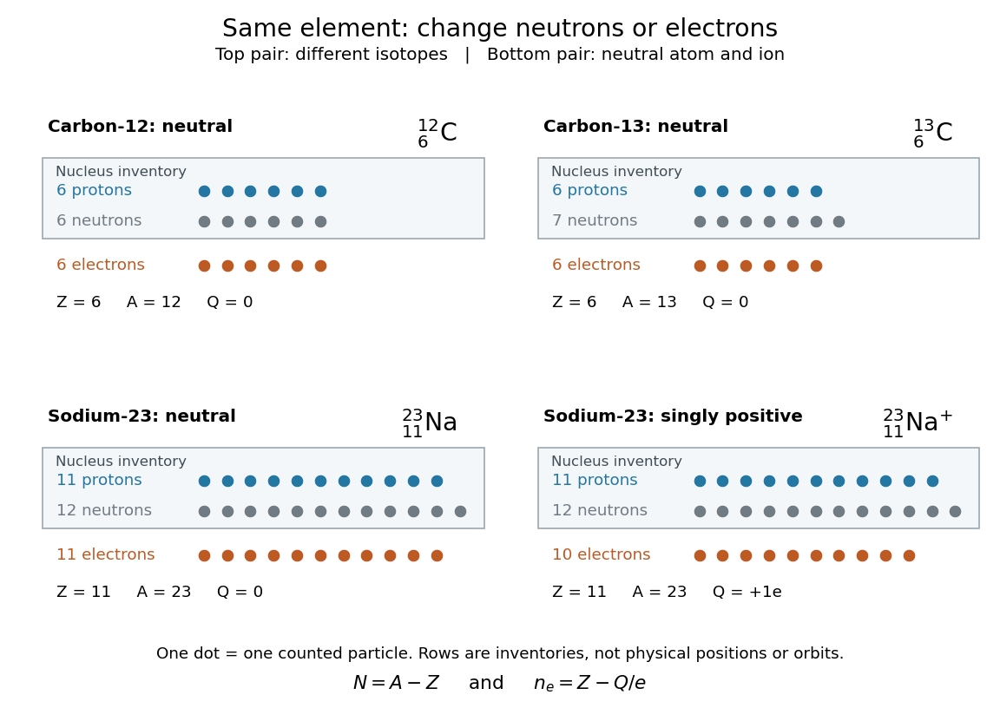

# Atomic number

↑ **Parent:** [Chemical element](chemical-element.md)  
ⓦ [Wiki](https://en.wikipedia.org/wiki/Atomic_number)

The [atomic number](atomic-number.md) $Z$ is the number of [protons](proton.md) in an [atomic nucleus](atomic-nucleus.md), and fixes the [chemical element](chemical-element.md). It is a count, with no units. An [atomic nucleus](atomic-nucleus.md) with six [protons](proton.md) is always [carbon](carbon.md), regardless of how many [neutrons](neutron.md) accompany them or how many [Electrons](electron.md) surround it. See the [IUPAC Gold Book, atomic number](https://goldbook.iupac.org/terms/view/A00499).

Three independent bookkeeping questions become easy once their symbols are kept separate. Let $N$ count [neutrons](neutron.md), $n_e$ count [Electrons](electron.md), $A$ be the [mass number](mass-number.md), and $Q$ be the net [electric charge](electric-charge.md). A [proton](proton.md) carries [electric charge](electric-charge.md) $+e$ and an [Electron](electron.md) carries $-e$, where $e$ is the positive [elementary charge](elementary-charge.md); a [neutron](neutron.md) carries zero net [electric charge](electric-charge.md). Hence

$$
A=Z+N,\qquad N=A-Z,\qquad Q=(Z-n_e)e,\qquad n_e=Z-Q/e.
$$

The reasoning is just counting: add [protons](proton.md) and [neutrons](neutron.md) for $A$, and subtract negative [Electron](electron.md) contributions from positive [proton](proton.md) contributions for $Q$. A neutral [chemical atom](atom-physics.md) has $Q=0$, so $n_e=Z$. For a positively charged [ion](ion.md), fewer [Electrons](electron.md) remain. Notation ${}^{A}_{Z}\mathrm X$ gives the [mass number](mass-number.md) at upper left and [atomic number](atomic-number.md) at lower left, with $\mathrm X$ standing for the [chemical element](chemical-element.md); a right superscript such as $+$ specifies the [electric charge](electric-charge.md) in units of $e$. See [Flowers et al., Chemistry 2e, atomic structure and symbolism](https://openstax.org/books/chemistry-2e/pages/2-3-atomic-structure-and-symbolism).

For neutral [carbon-12](carbon-12.md), ${}^{12}_{6}\mathrm C$, the [atomic number](atomic-number.md) gives six [protons](proton.md), the subtraction $N=12-6=6$ gives six [neutrons](neutron.md), and neutrality gives six [Electrons](electron.md). Neutral [carbon-13](carbon-13.md), ${}^{13}_{6}\mathrm C$, instead has $N=13-6=7$ [neutrons](neutron.md), with the same six [protons](proton.md) and six [Electrons](electron.md). Thus these two [isotopes](isotope.md) occupy the same [carbon](carbon.md) box in the [periodic table](periodic-table.md).

For neutral [sodium](sodium.md) of [mass number](mass-number.md) $23$, ${}^{23}_{11}\mathrm{Na}$, the counts are eleven [protons](proton.md), $23-11=12$ [neutrons](neutron.md), and eleven [Electrons](electron.md). Removing one [Electron](electron.md) gives the [ion](ion.md) ${}^{23}_{11}\mathrm{Na}^{+}$: $Q/e=1$, so $n_e=11-1=10$. Both its [atomic number](atomic-number.md) and its twelve [neutrons](neutron.md) stay unchanged. This is [ionization](ionization.md), not conversion into the [chemical element](chemical-element.md) [neon](neon.md), even though a neutral [neon](neon.md) [chemical atom](atom-physics.md) also has ten [Electrons](electron.md).

**[Figure 84](#image-atomic-number-fixes-chemical-element-identity-changing-isotopes-changes-neutrons-while-forming-a-sodium-ion-changes-electrons). Atomic number fixes chemical element identity: changing isotopes changes neutrons, while forming a sodium ion changes Electrons**. The dots are counting tokens, with [protons](proton.md) and [neutrons](neutron.md) in an [atomic nucleus](atomic-nucleus.md) inventory and [Electrons](electron.md) in a separate inventory. Their layout does not depict physical positions, sizes, or orbits. Neutral [carbon-12](carbon-12.md) and [carbon-13](carbon-13.md) differ by one [neutron](neutron.md); neutral [sodium](sodium.md) of [mass number](mass-number.md) 23 and its singly positive [ion](ion.md) differ by one [Electron](electron.md).

This bookkeeping is useful whenever a symbol must be translated into a physical inventory. [Mass number](mass-number.md) answers how many [protons](proton.md) plus [neutrons](neutron.md) there are; [electric charge](electric-charge.md) answers the imbalance between [protons](proton.md) and [Electrons](electron.md); [atomic number](atomic-number.md) alone answers which [chemical element](chemical-element.md) it is. Keeping those questions distinct prevents an [isotope](isotope.md) or an [ion](ion.md) from being mistaken for a different [chemical element](chemical-element.md).

## ↑ Ancestors (4)

1. [Chemical element](chemical-element.md)
2. [Chemical substance](chemical-substance.md)
3. [Chemistry](chemistry-split.md)
4. [Codex Wiki](split.md)

## ← Incoming links (16)

- [Aluminium](aluminium.md)
- [Argon](argon.md)
- [Atomic number](atomic-number.md)
- [Boron](boron.md)
- [Chemical element](chemical-element.md)
- [Chlorine](chlorine.md)
- [Fluorine](fluorine.md)
- [Ion](ion.md)
- [Isotope](isotope.md)
- [Neutron number](neutron-number.md)
- [Nuclide](nuclide.md)
- [Period (periodic table)](period-periodic-table.md)
- [Periodic table](periodic-table.md)
- [Phosphorus](phosphorus.md)
- [Sodium](sodium.md)
- [Sulfur](sulfur.md)
