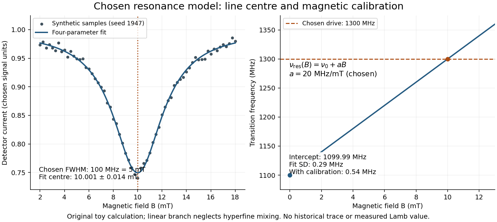
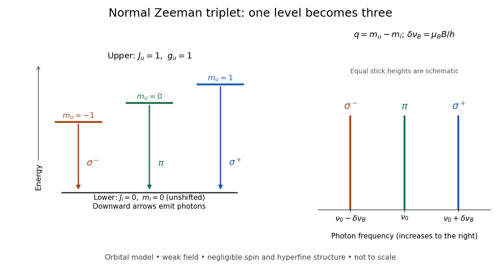
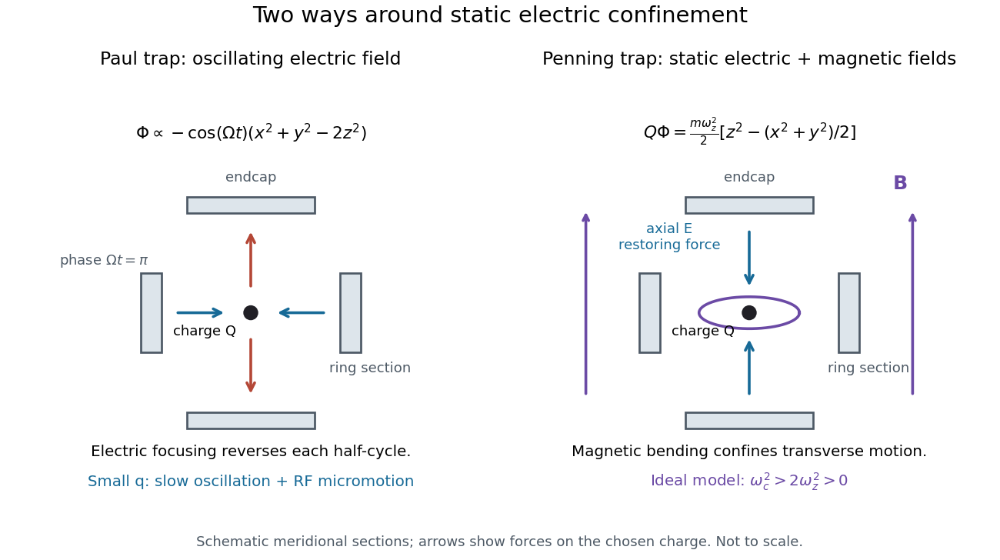
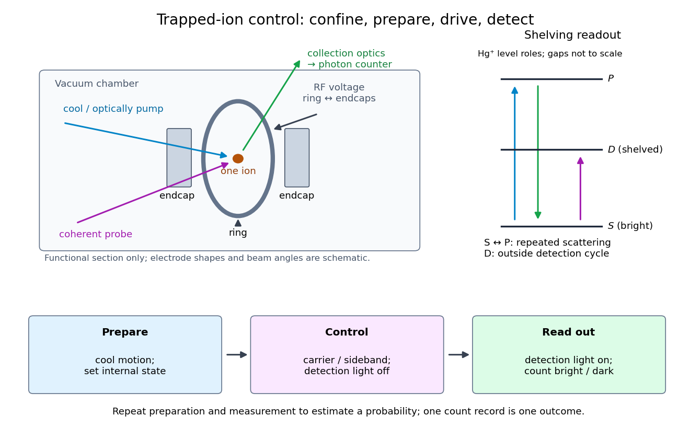
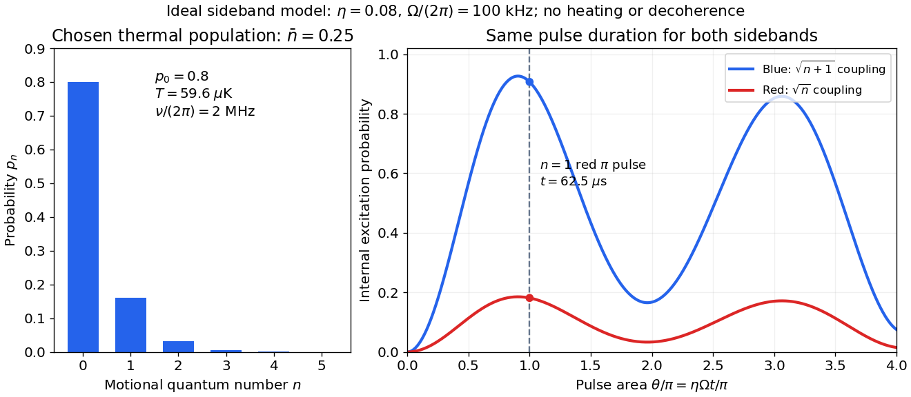
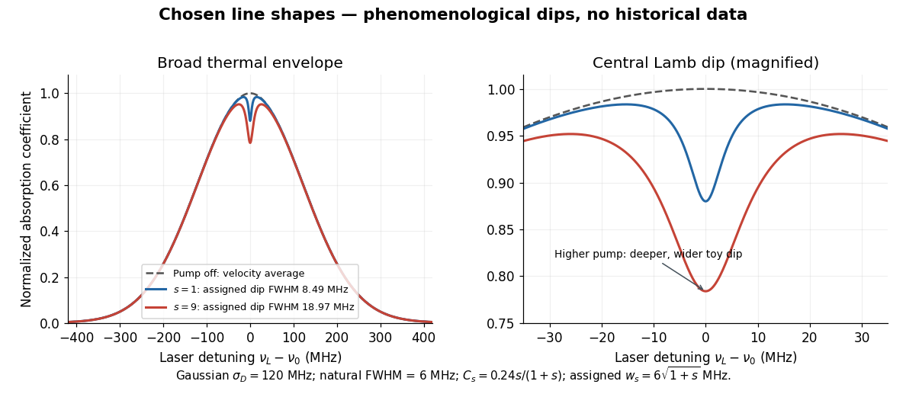
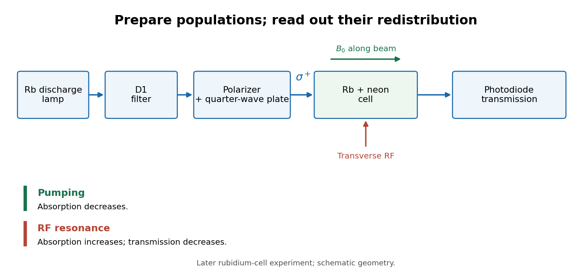
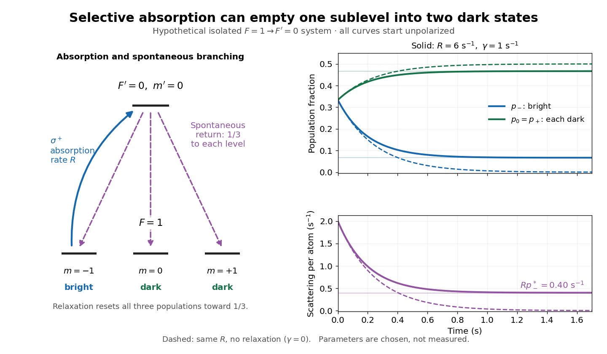
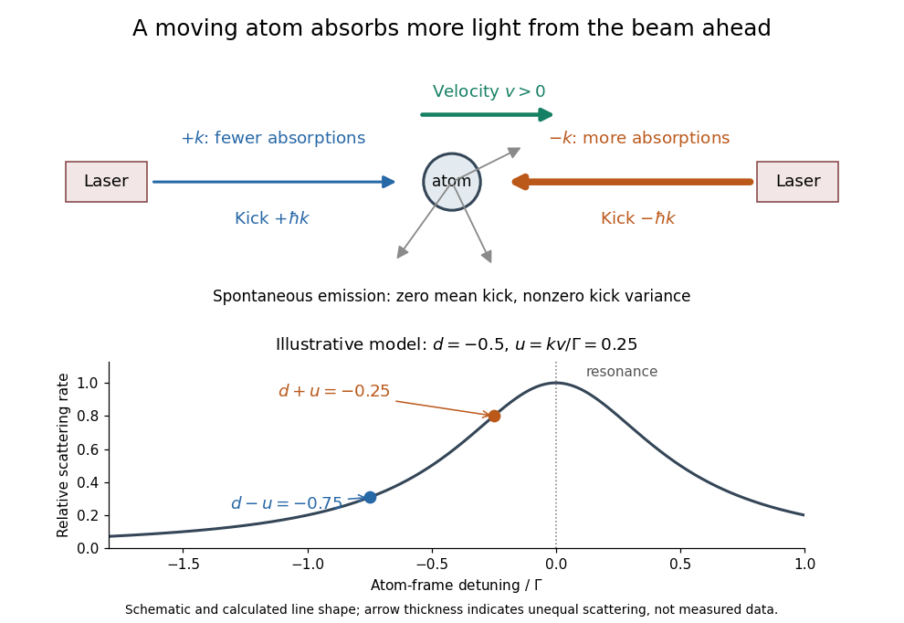
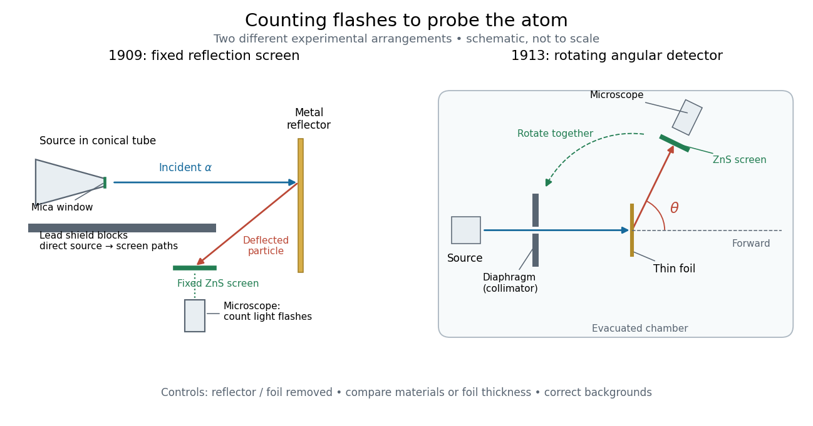

# Atomic physics

↑ **Parent:** [Physics](physics.md)  
ⓦ [Wiki](https://en.wikipedia.org/wiki/Atomic_physics)

**Table of contents**

- [Gross atomic structure](#gross-atomic-structure)
- [Positronium](#positronium)
  - [Positronium Zeeman spectrum](#positronium-zeeman-spectrum)
- [Central field approximation](#central-field-approximation)
  - [Spherical averaging versus self-consistent orbital optimization](#spherical-averaging-versus-self-consistent-orbital-optimization)
- [Magnetic dipole transition](#magnetic-dipole-transition)
- [Optical dipole trap](#optical-dipole-trap)
- [Charge exchange](#charge-exchange)
- [Electronic excitation](#electronic-excitation)
- [Atomic term](#atomic-term)
  - [Atomic fine-structure level](#atomic-fine-structure-level)
- [Hydrogen-like ion](#hydrogen-like-ion)
- [Term symbol](#term-symbol)
- [Ultracold gas](#ultracold-gas)
- [Cold atom](#cold-atom)
- [Rydberg atom](#rydberg-atom)
- [Selection rule](#selection-rule)
  - [Spin selection rule](#spin-selection-rule)
- [Lamb shift](#lamb-shift)
  - [Hydrogen Lamb splitting](#hydrogen-lamb-splitting)
  - [Lamb-Retherford experiment](#lamb-retherford-experiment)
    - [Lamb shift quenching readout](#lamb-shift-quenching-readout)
    - [Lamb shift line-centre model](#lamb-shift-line-centre-model)
- [Zeeman splitting](#zeeman-splitting)
  - [Zeeman populations from an unpolarized angular-momentum multiplet](#zeeman-populations-from-an-unpolarized-angular-momentum-multiplet)
  - [Zeeman discovery experiment of 1896](#zeeman-discovery-experiment-of-1896)
  - [Weak-field Zeeman splitting](#weak-field-zeeman-splitting)
    - [Inter-multiplet Zeeman coupling](#inter-multiplet-zeeman-coupling)
  - [Normal Zeeman effect](#normal-zeeman-effect)
  - [Polarization of Zeeman components](#polarization-of-zeeman-components)
  - [Landé g-factor](#lande-g-factor)
    - [Zeeman spacing of a single f electron](#zeeman-spacing-of-a-single-f-electron)
  - [Anomalous Zeeman effect](#anomalous-zeeman-effect)
    - [Sodium D-line Zeeman pattern](#sodium-d-line-zeeman-pattern)
      - [Magnetic field from a Zeeman diagram](#magnetic-field-from-a-zeeman-diagram)
    - [Polarization-selective Zeeman splitting of an alkali D1 line](#polarization-selective-zeeman-splitting-of-an-alkali-d1-line)
  - [Paschen-Back effect](#paschen-back-effect)
    - [Weak spin-forbidden Paschen-Back line](#weak-spin-forbidden-paschen-back-line)
    - [Paschen-Back transition-channel count](#paschen-back-transition-channel-count)
    - [Zeeman spectrum for orbital angular momentum one](#zeeman-spectrum-for-orbital-angular-momentum-one)
- [Atomic measurement methods](#atomic-measurement-methods)
  - [State-selective field ionization](#state-selective-field-ionization)
  - [Ion trap](#ion-trap)
    - [Trapped-ion quantum control](#trapped-ion-quantum-control)
      - [Trapped-ion internal and motional states](#trapped-ion-internal-and-motional-states)
        - [Harmonic-oscillator recoil matrix element](#harmonic-oscillator-recoil-matrix-element)
          - [Conditional motional heating and recoil averaging](#conditional-motional-heating-and-recoil-averaging)
        - [Lamb-Dicke regime](#lamb-dicke-regime)
        - [Motional sideband](#motional-sideband)
          - [Motional carrier transition](#motional-carrier-transition)
          - [Trapped-ion sideband pulse model](#trapped-ion-sideband-pulse-model)
      - [Resolved sideband cooling](#resolved-sideband-cooling)
        - [Raman sideband cooling experiment of 1995](#raman-sideband-cooling-experiment-of-1995)
      - [Electron shelving](#electron-shelving)
        - [Trapped-ion fluorescence count model](#trapped-ion-fluorescence-count-model)
    - [Paul trap](#paul-trap)
      - [Radiofrequency pseudopotential of a Paul trap](#radiofrequency-pseudopotential-of-a-paul-trap)
      - [Paul trap Mathieu parameters](#paul-trap-mathieu-parameters)
      - [RF-averaged trapping potential](#rf-averaged-trapping-potential)
      - [Paul trap secular motion](#paul-trap-secular-motion)
      - [Paul trap micromotion](#paul-trap-micromotion)
        - [Paul trap secular-motion example](#paul-trap-secular-motion-example)
    - [Penning trap](#penning-trap)
      - [Penning trap normal modes](#penning-trap-normal-modes)
        - [Magnetron motion](#magnetron-motion)
      - [Trapped-electron spin-jump readout](#trapped-electron-spin-jump-readout)
  - [Laser spectroscopy](#laser-spectroscopy)
    - [Doppler-free saturation spectroscopy](#doppler-free-saturation-spectroscopy)
      - [Counterpropagating saturation resonance](#counterpropagating-saturation-resonance)
      - [Saturation spectroscopy preparation and detector readout](#saturation-spectroscopy-preparation-and-detector-readout)
      - [Two-level saturation population model](#two-level-saturation-population-model)
        - [Power broadening](#power-broadening)
      - [Lamb dip](#lamb-dip)
      - [Doppler-free absorption line model](#doppler-free-absorption-line-model)
      - [Crossover resonance](#crossover-resonance)
      - [Sodium saturation spectroscopy experiment of 1971](#sodium-saturation-spectroscopy-experiment-of-1971)
  - [Optical pumping](#optical-pumping)
    - [Optical pumping preparation and readout](#optical-pumping-preparation-and-readout)
    - [Kastler-Brossel optical pumping experiments](#kastler-brossel-optical-pumping-experiments)
    - [Three-sublevel optical pumping model](#three-sublevel-optical-pumping-model)
    - [Optical pumping versus relaxation](#optical-pumping-versus-relaxation)
  - [Atom interferometry](#atom-interferometry)
    - [Atom interferometer](#atom-interferometer)
  - [Raman transition](#raman-transition)
    - [Stimulated Raman transition](#stimulated-raman-transition)
      - [Raman effective Rabi frequency](#raman-effective-rabi-frequency)
  - [Evaporative cooling (atomic physics)](#evaporative-cooling-atomic-physics)
    - [Forced evaporative cooling](#forced-evaporative-cooling)
      - [Elastic rethermalization of a trapped atomic gas](#elastic-rethermalization-of-a-trapped-atomic-gas)
        - [Runaway evaporative cooling](#runaway-evaporative-cooling)
      - [Radiofrequency evaporation knife](#radiofrequency-evaporation-knife)
      - [Evaporative cooling energy balance](#evaporative-cooling-energy-balance)
        - [Energy selectivity for evaporation to increase phase-space density](#energy-selectivity-for-evaporation-to-increase-phase-space-density)
      - [Evaporation truncation parameter](#evaporation-truncation-parameter)
  - [Laser cooling](#laser-cooling)
    - [Doppler cooling](#doppler-cooling)
      - [Doppler cooling force](#doppler-cooling-force)
      - [Doppler cooling limit](#doppler-cooling-limit)
    - [Optical molasses](#optical-molasses)
      - [Optical molasses experiment of 1985](#optical-molasses-experiment-of-1985)
    - [Sub-Doppler cooling](#sub-doppler-cooling)
      - [Sub-Doppler cooling discovery thermometry](#sub-doppler-cooling-discovery-thermometry)
      - [Release-expansion thermometry](#release-expansion-thermometry)
      - [Polarization-gradient cooling](#polarization-gradient-cooling)
        - [Sisyphus cooling](#sisyphus-cooling)
          - [Delayed-pumping model of Sisyphus friction](#delayed-pumping-model-of-sisyphus-friction)
    - [Magneto-optical trap](#magneto-optical-trap)
    - [Zeeman slower](#zeeman-slower)
      - [Zeeman slower resonance tracking](#zeeman-slower-resonance-tracking)
    - [Sympathetic cooling](#sympathetic-cooling)
- [Fine structure](#fine-structure)
  - [Hydrogen fine-structure correction](#hydrogen-fine-structure-correction)
  - [Darwin term](#darwin-term)
  - [Relativistic kinetic-energy correction](#relativistic-kinetic-energy-correction)
  - [Spin-orbit interaction](#spin-orbit-interaction)
    - [Rashba effect](#rashba-effect)
      - [Rashba spin texture](#rashba-spin-texture)
      - [Fermi contours of an isotropic Rashba band](#fermi-contours-of-an-isotropic-rashba-band)
    - [Spin-momentum locking](#spin-momentum-locking)
      - [Radial massless Dirac spin texture](#radial-massless-dirac-spin-texture)
    - [Spin-orbit energy shift in a central potential](#spin-orbit-energy-shift-in-a-central-potential)
      - [Spin-orbit shifts of an isotropic harmonic oscillator](#spin-orbit-shifts-of-an-isotropic-harmonic-oscillator)
- [Metastable atomic level](#metastable-atomic-level)
- [Collisional-radiative model](#collisional-radiative-model)
  - [Electron-density diagnostic from metastable populations](#electron-density-diagnostic-from-metastable-populations)
    - [Emission-weighted effective density from a line ratio](#emission-weighted-effective-density-from-a-line-ratio)
- [Atomic oscillator strength](#atomic-oscillator-strength)
- [Statistical weight of an atomic level](#statistical-weight-of-an-atomic-level)
- [Spontaneous emission](#spontaneous-emission)
  - [Polarization-selective spontaneous emission between conducting plates](#polarization-selective-spontaneous-emission-between-conducting-plates)
    - [Below-cutoff electric-dipole lifetime](#below-cutoff-electric-dipole-lifetime)
    - [Thin-cavity enhancement of a normal electric dipole](#thin-cavity-enhancement-of-a-normal-electric-dipole)
  - [Free-space electric-dipole spontaneous emission rate](#free-space-electric-dipole-spontaneous-emission-rate)
  - [Two-photon spontaneous emission](#two-photon-spontaneous-emission)
  - [Natural linewidth](#natural-linewidth)
  - [Radiative cascade](#radiative-cascade)
  - [Critical density of an atomic transition](#critical-density-of-an-atomic-transition)
    - [Isochoric thermal stability of a collisionally excited line](#isochoric-thermal-stability-of-a-collisionally-excited-line)
      - [Fixed ionic abundance in an atomic cooling stability test](#fixed-ionic-abundance-in-an-atomic-cooling-stability-test)
      - [Cooling-maximum marginality in thermal balance](#cooling-maximum-marginality-in-thermal-balance)
      - [Isobaric thermal stability of a two-level coolant](#isobaric-thermal-stability-of-a-two-level-coolant)
      - [High-density two-level radiative cooling](#high-density-two-level-radiative-cooling)
    - [Collisional quenching of a metastable line](#collisional-quenching-of-a-metastable-line)
  - [Einstein coefficients](#einstein-coefficients)
    - [Angular-frequency Einstein coefficients](#angular-frequency-einstein-coefficients)
    - [Radiative balance in a nondegenerate two-level atom](#radiative-balance-in-a-nondegenerate-two-level-atom)
- [Collisional excitation](#collisional-excitation)
  - [Collision rate coefficient for an atomic transition](#collision-rate-coefficient-for-an-atomic-transition)
- [Ionization](#ionization)
  - [Degree of ionization](#degree-of-ionization)
  - [Tunnel ionization](#tunnel-ionization)
  - [Electron avalanche](#electron-avalanche)
  - [Three-body recombination](#three-body-recombination)
  - [Dielectronic recombination](#dielectronic-recombination)
    - [Resonance-temperature dependence of dielectronic recombination](#resonance-temperature-dependence-of-dielectronic-recombination)
    - [Radiative stabilization](#radiative-stabilization)
    - [Dielectronic capture](#dielectronic-capture)
  - [Autoionization](#autoionization)
  - [Photoionization](#photoionization)
    - [Photoelectron](#photoelectron)
    - [Photoionization rate](#photoionization-rate)
    - [Photoionization heating](#photoionization-heating)
  - [Radiative recombination](#radiative-recombination)
    - [Recombination cooling of ionized hydrogen](#recombination-cooling-of-ionized-hydrogen)
      - [Recombination-weighted electron energy](#recombination-weighted-electron-energy)
    - [Recombination line](#recombination-line)
    - [Effective recombination coefficient](#effective-recombination-coefficient)
  - [Collisional ionization](#collisional-ionization)
    - [Excitation-autoionization](#excitation-autoionization)
    - [Collisional ionization equilibrium](#collisional-ionization-equilibrium)
      - [Coronal approximation](#coronal-approximation)
- [Absorption imaging](#absorption-imaging)
- [Electronic transition](#electronic-transition)
  - [Deslandres table](#deslandres-table)
  - [Vibrational progression](#vibrational-progression)
  - [Franck-Condon principle](#franck-condon-principle)
    - [Franck-Condon factor](#franck-condon-factor)
      - [Displaced-oscillator Franck-Condon progression](#displaced-oscillator-franck-condon-progression)
        - [Huang-Rhys factor](#huang-rhys-factor)
- [Geiger-Marsden experiment](#geiger-marsden-experiment)
  - [Geiger-Marsden angular-scattering experiment of 1913](#geiger-marsden-angular-scattering-experiment-of-1913)
- [Rutherford scattering](#rutherford-scattering)
  - [Nuclear radius bound from a Coulomb turning point](#nuclear-radius-bound-from-a-coulomb-turning-point)
  - [Rutherford impact-parameter relation](#rutherford-impact-parameter-relation)
  - [Rutherford differential cross-section](#rutherford-differential-cross-section)
    - [Target normalization in Rutherford scattering rates](#target-normalization-in-rutherford-scattering-rates)
  - [Thin-foil scattering counts](#thin-foil-scattering-counts)
    - [Foil areal number density](#foil-areal-number-density)
- [Rutherford model](#rutherford-model)

## Gross atomic structure

↑ **Parent:** [Atomic physics](atomic-physics.md)

[Gross atomic structure](#gross-atomic-structure) denotes the leading nonrelativistic Coulomb binding levels, before fine and hyperfine splittings. For a hydrogenic two-body system, the [reduced mass](classical-mechanics.md#reduced-mass) controls the binding [energy](energy.md) and characteristic separation. [Fine structure](#fine-structure) is smaller by roughly $\alpha^2$; nuclear magnetic hyperfine effects have an additional electron-to-nuclear [mass](classical-mechanics.md#mass) suppression.

## Positronium

↑ **Parent:** [Atomic physics](atomic-physics.md)

[Positronium](#positronium) is the electromagnetic bound state of an [electron](physics.md#electron) and a [Positron](physics.md#positron). Their equal masses give [reduced mass](classical-mechanics.md#reduced-mass) $m_e/2$, half the hydrogenic Rydberg binding scale and approximately twice the electron-proton separation of hydrogen. Its [spin](angular-momentum-operator.md#spin) singlet and triplet differ in hyperfine [energy](energy.md); [annihilation](relativistic-quantum-field.md#annihilation) also affects their physical lifetimes and splitting.

### Positronium Zeeman spectrum

↑ **Parent:** [Positronium](#positronium)

For the dimensionless-spin [Hamiltonian](hamiltonian-mechanics.md#hamiltonian) $A\mathbf S_e\cdot\mathbf S_p+2\mu_BB(S_{ez}-S_{pz})$, the two aligned-spin states remain at $A/4$. The two states of total [spin](angular-momentum-operator.md#spin) projection zero mix and have the displayed energies. The parameter $4\mu_BB/A$ compares off-diagonal Zeeman mixing in the singlet-triplet basis with half the zero-field splitting. A crossover is gradual, not a level-crossing [phase transition](critical-phenomenon.md#phase-transition).

## Central field approximation

↑ **Parent:** [Atomic physics](atomic-physics.md)

A many-electron atomic environment is replaced by a spherically averaged one-electron potential. Radial screening changes the Coulomb attraction and produces orbitals labelled by radial and angular quantum numbers. This spherical approximation and the separate self-consistency step in the [Hartree method](quantum-mechanics.md#hartree-method) are related but distinct assumptions.

### Spherical averaging versus self-consistent orbital optimization

↑ **Parent:** [Central field approximation](#central-field-approximation)

## Magnetic dipole transition

↑ **Parent:** [Atomic physics](atomic-physics.md)

A transition driven by an oscillating [magnetic field](magnetic-field.md) through $H'=-\boldsymbol\mu\cdot\mathbf B$. The rank-one magnetic operator preserves parity and allows changes in total [angular momentum](momentum.md#angular-momentum) of zero or one, excluding zero-to-zero. Its spherical components select changes in the [angular momentum](momentum.md#angular-momentum) component of $0,\pm1$. Hyperfine clock states can therefore couple even when each has zero first-order static magnetic moment.

## Optical dipole trap

↑ **Parent:** [Atomic physics](atomic-physics.md)

A far-detuned [laser](laser.md) produces an atomic [AC Stark shift](mathematical-physics.md#ac-stark-shift) approximately $U=-\operatorname{Re}\alpha(\omega)|E_0|^2/4$. Its spatial gradient creates a conservative dipole force. For a suitable red-detuned ground-state atom, high intensity is an [energy](energy.md) minimum and can confine several hyperfine states without relying on nonzero permanent magnetic moments. Photon scattering, differential light shifts and intensity noise remain limitations. This atomic use is more specific than a general dielectric-particle [optical trap](optics.md#optical-tweezers).

## Charge exchange

↑ **Parent:** [Atomic physics](atomic-physics.md)

Transfer of one or more [electrons](physics.md#electron) between a moving particle and its surroundings, changing the particle charge state.

## Electronic excitation

↑ **Parent:** [Atomic physics](atomic-physics.md)

Transfer of a system to an excited electronic state. Energy deposited into [electrons](physics.md#electron) need not become a permanent [atomic displacement](engineering.md#atomic-displacement).

## Atomic term

↑ **Parent:** [Atomic physics](atomic-physics.md)

An [LS coupling](angular-momentum-operator.md#ls-coupling) multiplet with specified total orbital [angular momentum](momentum.md#angular-momentum) $L$ and total [spin](angular-momentum-operator.md#spin) $S$, usually within a specified [electron configuration](chemistry.md#electron-configuration). Its magnetic states have $M_L=-L,\ldots,L$ and $M_S=-S,\ldots,S$. [Spin-orbit coupling](#spin-orbit-interaction) splits it into [atomic fine-structure levels](#atomic-fine-structure-level).

### Atomic fine-structure level

↑ **Parent:** [Atomic term](#atomic-term)

A level of an [atomic term](#atomic-term) with specified total [angular momentum](momentum.md#angular-momentum) $J$. Without an external field, its $2J+1$ magnetic states remain degenerate in a rotationally invariant [Hamiltonian](hamiltonian-mechanics.md#hamiltonian).

## Hydrogen-like ion

↑ **Parent:** [Atomic physics](atomic-physics.md)

A monatomic ion with exactly one [electron](physics.md#electron). Its nonrelativistic [Coulomb potential](electrostatics.md#coulomb-potential-energy) energy levels scale as $Z^2$ at fixed [principal quantum number](mathematical-physics.md#principal-quantum-number), apart from [reduced mass](classical-mechanics.md#reduced-mass) corrections.

## Term symbol

↑ **Parent:** [Atomic physics](atomic-physics.md)  
ⓦ [Wiki](https://en.wikipedia.org/wiki/Term_symbol)

In [LS coupling](angular-momentum-operator.md#ls-coupling), an atomic term symbol specifies total electronic [spin](angular-momentum-operator.md#spin) $S$, total [orbital angular momentum](quantum-mechanics.md#orbital-angular-momentum) $L$, and total [angular momentum](momentum.md#angular-momentum) $J$. The superscript $2S+1$ is the spin multiplicity; the letters $S,P,D,F,\ldots$ denote $L=0,1,2,3,\ldots$. Coupling gives $J=|L-S|,\ldots,L+S$, and a fixed-$J$ level has $2J+1$ magnetic substates before an external field resolves them. For example, $^3P$ has $S=L=1$ and levels $J=0,1,2$, containing $1+3+5=9$ states altogether. A term symbol does not itself specify the radial [electron configuration](chemistry.md#electron-configuration).

## Ultracold gas

↑ **Parent:** [Atomic physics](atomic-physics.md)

## Cold atom

↑ **Parent:** [Atomic physics](atomic-physics.md)

## Rydberg atom

↑ **Parent:** [Atomic physics](atomic-physics.md)  
ⓦ [Wiki](https://en.wikipedia.org/wiki/Rydberg_atom)

A Rydberg atom has an [electron](physics.md#electron) excited to a high [principal quantum number](mathematical-physics.md#principal-quantum-number).

## Selection rule

↑ **Parent:** [Atomic physics](atomic-physics.md)  
ⓦ [Wiki](https://en.wikipedia.org/wiki/Selection_rule)

A restriction on transitions between [quantum states](quantum-system.md#quantum-state) for a specified interaction. An [electric-dipole selection rule](quantum-mechanics.md#electric-dipole-selection-rule) is one example.

### Spin selection rule

↑ **Parent:** [Selection rule](#selection-rule)

In the nonrelativistic electric-dipole approximation, the dipole operator does not act on spin, so transitions between different total-spin states vanish. Spin–orbit coupling can give such transitions weak intensity.

## Lamb shift

↑ **Parent:** [Atomic physics](atomic-physics.md)  
ⓦ [Wiki](https://en.wikipedia.org/wiki/Lamb_shift)

A [quantum electrodynamics](perturbative-quantum-field-theory.md#quantum-electrodynamics) correction separates [hydrogen atom](mathematical-physics.md#hydrogen-atom) levels such as $2s_{1/2}$ and $2p_{1/2}$ that coincide in the simplest model.

The Lamb shift measures an [energy level](quantum-mechanics.md#energy-level) displacement beyond a specified [Dirac equation](relativistic-quantum-field.md#dirac-equation) reference. In the point-[proton](physics.md#proton), infinite-nuclear-[mass](classical-mechanics.md#mass) [Coulomb potential](electrostatics.md#coulomb-potential-energy) model, $2S_{1/2}$ and $2P_{1/2}$ share [principal quantum number](mathematical-physics.md#principal-quantum-number) $n=2$ and total electronic [angular momentum](momentum.md#angular-momentum) $j=1/2$, hence [energy](energy.md), despite differing [orbital angular momentum](quantum-mechanics.md#orbital-angular-momentum) values.[Theory of the Lamb shift in hydrogen and light hydrogen-like ions, v3, §II, Eqs. (2)–(4)](physics-bibliography.md#theory-of-the-lamb-shift-in-hydrogen-and-light-hydrogen-like-ions-by-vladimir-yerokhin-and-others)

The [Lamb-Retherford experiment](#lamb-retherford-experiment) converts a small [energy](energy.md) difference into a large detector change: prepare a long-lived [quantum state](quantum-system.md#quantum-state), transfer population into a short-lived one, and read the surviving beam.

### Hydrogen Lamb splitting

↑ **Parent:** [Lamb shift](#lamb-shift)

The zero-field [energy levels](quantum-mechanics.md#energy-level) here are averaged over [hyperfine structure](quantum-mechanics.md#hyperfine-structure); $h$ is the [Planck constant](quantum-mechanics.md#planck-constant). [Electron self-energy](perturbative-quantum-field-theory.md#electron-self-energy) and [vacuum polarization](perturbative-quantum-field-theory.md#vacuum-polarization) produce [radiative corrections](perturbative-quantum-field-theory.md#radiative-correction). Self-energy describes the bound [electron](physics.md#electron)'s radiative interaction with its own [electromagnetic field](electromagnetism.md#electromagnetic-field). Precision predictions also include [nuclear recoil](atomic-nucleus.md#nuclear-recoil) and [proton charge radius](physics.md#proton-charge-radius) effects; assigning recoil terms to the reference or Lamb shift is convention-dependent. A finite [proton charge radius](physics.md#proton-charge-radius) changes binding independently of radiative effects.[§II, Eqs. (1)–(6); §III A, Eq. (7); §§IV–V](physics-bibliography.md#theory-of-the-lamb-shift-in-hydrogen-and-light-hydrogen-like-ions-by-vladimir-yerokhin-and-others)

A vacuum-[electric field](electric-field.md) “jiggling” picture motivates one contribution, not every [hydrogen atom](mathematical-physics.md#hydrogen-atom) [energy](energy.md) correction.

### Lamb-Retherford experiment

↑ **Parent:** [Lamb shift](#lamb-shift)

In 1947, [Willis Eugene Lamb Jr.](physicist.md#willis-eugene-lamb-jr) and [Robert Curtis Retherford](physicist.md#robert-curtis-retherford) dissociated [hydrogen](chemical-substance.md#hydrogen) in a [tungsten](chemical-substance.md#tungsten) oven, crossed its atomic jet with [electrons](physics.md#electron) for [collisional excitation](#collisional-excitation), and detected surviving $2S$ atoms by electron ejection from metal. An electrometer and galvanometer read the current. They interrupted fixed-frequency [microwaves](electromagnetic-radiation.md#microwave) while sweeping the static [magnetic field](magnetic-field.md); a flip coil calibrated the field. Their [Zeeman splitting](#zeeman-splitting) comparison placed $2S_{1/2}$ about $1000$ $\mathrm{MHz}$ above $2P_{1/2}$; the plotted $1000$ $\mathrm{MHz}$ displacement was explicitly not a best fit.[Fine Structure of the Hydrogen Atom by a Microwave Method, pp. 241–243, Figs. 1–2; inspected APS full text](physics-bibliography.md#fine-structure-of-the-hydrogen-atom-by-a-microwave-method-by-willis-eugene-lamb-jr-and-robert-curtis-retherford)

The 1955 lecture's apparatus cross-section identifies movable slits, an electron bombarder, a radiofrequency transmission line with beam slots, a d.c. quenching electrode, metal target, electron collector, and magnet poles. A $2S\to2P$ transition followed by rapid [spontaneous emission](#spontaneous-emission) leaves a ground-state atom unable to eject detector electrons. The scan holds radiofrequency and amplitude fixed. [Natural linewidth](#natural-linewidth) and unresolved [hyperfine structure](quantum-mechanics.md#hyperfine-structure) broaden resonances, whose analysis yields zero-field separations.[Fine Structure of the Hydrogen Atom, delivered December 12, 1955; Columbia-hosted Nobel Lectures scan, printed pp. 288–290, Figs. 2–7](physics-bibliography.md#fine-structure-of-the-hydrogen-atom-by-willis-eugene-lamb-jr)

Static [electric field](electric-field.md) quenching supplied a control. The 1947 report identifies [natural linewidth](#natural-linewidth), [hyperfine structure](quantum-mechanics.md#hyperfine-structure), excessive microwave intensity, and field inhomogeneity as width contributions, and flags imperfect magnetic calibration. It does not specify an absolute microwave-frequency calibration procedure.[pp. 242–243, Fig. 1 caption and discussion of proposed refinements](physics-bibliography.md#fine-structure-of-the-hydrogen-atom-by-a-microwave-method-by-willis-eugene-lamb-jr-and-robert-curtis-retherford)

**[Figure 1](#image-metastable-beam-preparation-and-electron-current-readout). Metastable beam preparation and electron-current readout**. Original functional schematic of the Lamb-Retherford measurement principle, based on the apparatus descriptions above. The level sketch isolates the zero-field $2S_{1/2}$ and $2P_{1/2}$ pair; the historical field scans also addressed other Zeeman branches. Geometry and energy gaps are not to scale.

The surname is [Robert Curtis Retherford](physicist.md#robert-curtis-retherford)'s: “Retherford” and “Rutherford” name different people. The historical [Lamb-Retherford experiment](#lamb-retherford-experiment) should retain the former spelling.[Retherford, Robert Curtis, professional biography and account of the 1947 experiment](physics-bibliography.md#retherford-robert-curtis-by-istituto-della-enciclopedia-italiana)

#### Lamb shift quenching readout

↑ **Parent:** [Lamb-Retherford experiment](#lamb-retherford-experiment)

For a simple original detector model, let $\Phi_S$ be the incident rate of surviving $2S$ atoms, $e$ the positive [elementary charge](electric-charge.md#elementary-charge), $\eta$ the mean number of collected [electrons](physics.md#electron) per incident $2S$ atom, and $I_{\rm bg}$ a stable background current. Take current magnitudes as positive. If [microwaves](electromagnetic-radiation.md#microwave) remove a fraction $p$ before the target,

$$
I_{\rm off}=I_{\rm bg}+e\eta\Phi_S,\qquad
I_{\rm on}=I_{\rm bg}+e\eta\Phi_S(1-p),\qquad Q=p.
$$

The equality needs the same beam flux, background and collection efficiency in both measurements. It is an ideal interpretation of a normalized current loss, not a claim that an actual galvanometer directly counts individual transitions. Varying microwave amplitude tests whether the drive distorts the resonance; a field calibration is separately needed to turn a current-versus-field minimum into an [energy](energy.md) difference.

The [metastable atomic level](#metastable-atomic-level) matters because an [electric-dipole selection rule](quantum-mechanics.md#electric-dipole-selection-rule) suppresses the direct $2S\to1S$ [electric-dipole interaction](quantum-mechanics.md#electric-dipole-interaction), whereas the opposite-parity $2S\leftrightarrow2P$ transition can be driven. A long lifetime can store the prepared population until interrogation. After transfer to $2P$, a short lifetime supplies the loss mechanism and a broad [natural linewidth](#natural-linewidth). A forbidden strong decay does not mean absolute stability: weaker decay channels and unwanted [electric fields](electric-field.md) still matter.

#### Lamb shift line-centre model

↑ **Parent:** [Lamb-Retherford experiment](#lamb-retherford-experiment)

Consider an original illustrative resonance model, with all numerical settings chosen here. On one isolated branch approximate the transition [frequency](wave.md#frequency) by $\nu(B)=\nu_0+aB$, with known slope $a=20\ \mathrm{MHz/mT}$ and drive [frequency](wave.md#frequency) $\nu_d=1300\ \mathrm{MHz}$. Choose $\nu_0=1100\ \mathrm{MHz}$, hence resonance field $B_r=10\ \mathrm{mT}$. This local linear model omits [hyperfine structure](quantum-mechanics.md#hyperfine-structure) and nonlinear level mixing; it is not the historical hydrogen [Zeeman splitting](#zeeman-splitting) calculation.

Use a [Lorentzian line shape](stellar-astrophysics.md#lorentzian-line-shape) for a weak-drive current dip,

$$
I(B)=C-\frac{A}{1+4(B-B_r)^2/w_B^2},\qquad
w_B=\frac{w_\nu}{|a|}.
$$

Choose baseline $C=1$, depth $A=0.25$ in arbitrary detector signal units, and [full width at half maximum](analysis.md#full-width-at-half-maximum) $w_\nu=100\ \mathrm{MHz}$, so $w_B=5\ \mathrm{mT}$. The half-depth points are $B_r\pm w_B/2$; this checks the factor of four. If an exponential decay with lifetime $\tau$ alone set this width, [natural linewidth](#natural-linewidth) would give $w_\nu=1/(2\pi\tau)$ and $\tau\simeq1.59\ \mathrm{ns}$. The chosen width is an explanatory input, not a measurement of a historical lifetime.

Generate 65 equally spaced fields from $2$ to $18\ \mathrm{mT}$ and add independent [Gaussian noise](probability-distribution.md#gaussian-noise) with known [standard deviation](variance.md#standard-deviation) $\sigma_I=0.004$ signal units. A simultaneous [nonlinear regression](statistical-modelling.md#nonlinear-regression) fit of $C,A,B_r,w_B$ gives $B_r\simeq10.0007\ \mathrm{mT}$, $w_B\simeq4.9305\ \mathrm{mT}$ and $\nu_0\simeq1099.986\ \mathrm{MHz}$. With residual derivatives $J_{ik}=\partial I(B_i)/\partial\theta_k$ and $\theta=(C,A,B_r,w_B)$, the local [covariance matrix](variance.md#covariance-matrix) estimate is

$$
\operatorname{Cov}(\hat\theta)\simeq\sigma_I^2(J^{\mathsf T}J)^{-1}.
$$

It gives centre [standard deviation](variance.md#standard-deviation) $0.01427\ \mathrm{mT}$, or $0.285\ \mathrm{MHz}$ in the inferred intercept. This uses the stipulated noise variance and a local linear approximation, rather than treating the width as the centre error. Repeated noisy samples can locate a broad line's centre much more closely than its width.

**[Figure 2](#image-chosen-resonance-line-fit-and-zero-field-intercept). Chosen resonance line fit and zero-field intercept**. Original synthetic data and fitted Lorentzian current dip, with a separate linear field-to-frequency construction. All frequencies, fields, widths, signal units and noise are chosen for this example. The zero-field intercept is not a measured Lamb splitting. The displayed uncertainties are standard deviations under the stated model.

Include a common magnetic calibration offset with [standard deviation](variance.md#standard-deviation) $u_b=0.020\ \mathrm{mT}$, a fractional gain error $u_g=0.001$, and independent drive-frequency error $u_d=0.100\ \mathrm{MHz}$. To first order the inferred [variance](variance.md) is

$$
u^2(\nu_0)\simeq a^2u^2(B_r)+a^2u_b^2+(aB_r)^2u_g^2+u_d^2.
$$

Here $u$ denotes a [standard uncertainty](physics.md#standard-uncertainty), not a [frequency](wave.md#frequency). The four contributions in $\mathrm{MHz}$ are $0.285$, $0.400$, $0.200$, and $0.100$; adding their squares gives $u(\nu_0)\simeq0.540\ \mathrm{MHz}$. The calibration offset shifts all sampled fields together, so increasing the sample count cannot average it away. Uncertainty in $a$, unresolved components, asymmetric line distortion, and errors in the assumed field dependence would require additional terms or a richer model. The historical inference requires the appropriate [Zeeman splitting](#zeeman-splitting) branches, rather than simply drawing a straight line through one resonance.

## Zeeman splitting

↑ **Parent:** [Atomic physics](atomic-physics.md)  
ⓦ [Wiki](https://en.wikipedia.org/wiki/Zeeman_effect)

Zeeman splitting is the separation of [energy](energy.md) levels or mode [frequencies](wave.md#frequency) by a background [magnetic field](magnetic-field.md). In [atomic physics](atomic-physics.md), the [magnetic field](magnetic-field.md) couples to a [magnetic dipole moment](electromagnetism.md#magnetic-dipole-moment), lifting [quantum degeneracy](quantum-mechanics.md#degenerate-energy-levels). Transitions between the shifted [quantum states](quantum-system.md#quantum-state) can turn one [spectral line](stellar-astrophysics.md#spectral-line) into several. A split level and a split [spectral line](stellar-astrophysics.md#spectral-line) are different objects: the emitted [photon](quantum-mechanics.md#photon) measures the difference between two level [energies](energy.md), and the [electric-dipole selection rule](quantum-mechanics.md#electric-dipole-selection-rule) determines which differences appear.

The [Stern-Gerlach experiment](angular-momentum-operator.md#stern-gerlach-experiment) also probes [magnetic dipole moments](electromagnetism.md#magnetic-dipole-moment), through beam deflection in a [magnetic field](magnetic-field.md) gradient. Here the readout is a [spectral line](stellar-astrophysics.md#spectral-line).

The pattern makes an invisible [magnetic field](magnetic-field.md) visible through [spectroscopy](physics.md#spectroscopy). It also reveals [angular momentum](momentum.md#angular-momentum) and [magnetic dipole moments](electromagnetism.md#magnetic-dipole-moment) inside [chemical atoms](physics.md#atom-physics). [Zeeman slowers](#zeeman-slower) exploit a changing resonance [frequency](wave.md#frequency) to keep moving [chemical atoms](physics.md#atom-physics) absorbing [laser](laser.md) [photons](quantum-mechanics.md#photon); a [magneto-optical trap](#magneto-optical-trap) combines position-dependent shifts with [electromagnetic polarization](electromagnetic-wave.md#polarization-of-an-electromagnetic-wave) and [laser cooling](#laser-cooling). Related mode shifts occur in [Zeeman splitting of an antiferromagnetic spin wave](statistical-physics.md#zeeman-splitting-of-an-antiferromagnetic-spin-wave).

### Zeeman populations from an unpolarized angular-momentum multiplet

↑ **Parent:** [Zeeman splitting](#zeeman-splitting)

An equal incoherent mixture within a fixed total-$J$ multiplet has [density operator](density-matrix.md) $\rho=P_J/(2J+1)$, where $P_J$ is its [orthogonal projection](hilbert-space.md#orthogonal-projection). If the applied-field [Hamiltonian operator](quantum-system.md#hamiltonian-quantum-mechanics) is proportional to $L_z+2S_z$ and no [spin-orbit interaction](#spin-orbit-interaction) is retained, its [energy eigenstates](energy-eigenvalue.md#energy-eigenstate) are the uncoupled states $|m_L,m_S\rangle$. The [Born rule](wave-function.md#born-rule) gives their populations by the formula above, or equivalently by squared [Clebsch-Gordan decomposition](angular-momentum-operator.md#clebsch-gordan-decomposition) coefficients. Equal populations of coupled states need not give equal populations of magnetic [energy eigenvalues](energy-eigenvalue.md).

For $L=1,S=1/2,J=3/2$, the nonextremal coupled states have weights $2/3$ and $1/3$ in their two uncoupled components. The five dimensionless magnetic energies $-2,-1,0,1,2$ then have populations $1/4,1/6,1/6,1/6,1/4$; the zero energy contains two independent states, each with population $1/12$. In a different, weak-field approximation with a dominant [spin-orbit interaction](#spin-orbit-interaction), projecting into the isolated multiplet gives the [Landé g-factor](#lande-g-factor) spectrum instead. The full operator and its projection must not be interchanged.

### Zeeman discovery experiment of 1896

↑ **Parent:** [Zeeman splitting](#zeeman-splitting)

In August 1896, [Pieter Zeeman](physicist.md#pieter-zeeman) observed broadened [sodium](chemical-substance.md#sodium) [spectral lines](stellar-astrophysics.md#spectral-line) at Leiden, initially without resolved components. His lecture describes a slit and concave [diffraction grating](physical-optics.md#diffraction-grating), then compares the broadening with the [sodium](chemical-substance.md#sodium) doublet separation: about one thirtieth, roughly $0.2$ [ångström](physics.md#angstrom). This supplied a spectral reference scale, not an absolute [magnetic field](magnetic-field.md) calibration. Later [cadmium](chemical-substance.md#cadmium) photographs displayed resolved transverse triplets and axial doublets.[Pieter Zeeman, Light Radiation in a Magnetic Field, Nobel lecture delivered May 2, 1903; University of Maryland mirror PDF pp. 2–3, paragraphs beginning “In August, 1896”, “The change was however very small” and the cadmium photograph discussion](physics-bibliography.md#light-radiation-in-a-magnetic-field-by-pieter-zeeman)

The fuller report specifies a concave [diffraction grating](physical-optics.md#diffraction-grating) of ten-foot radius with 14,438 lines per inch, an adjustable slit and a micrometer eyepiece with vertical crosswire. Salt in a flame between [electromagnet](magnetic-field.md#electromagnet) poles supplied the [sodium](chemical-substance.md#sodium) [spectral lines](stellar-astrophysics.md#spectral-line). Repeated switching broadened and restored them. To test changes in flame [temperature](temperature.md) or vapour [density](fluid-mechanics.md#density), [Pieter Zeeman](physicist.md#pieter-zeeman) examined [photon absorption](quantum-mechanics.md#photon-absorption) through a heated porcelain tube with water-cooled glass windows. The arc lamp was displaced from the magnet and its [light](optics.md#light) redirected by a mirror to avoid disturbing the arc. Rotating a narrower tube made the absorption [spectral lines](stellar-astrophysics.md#spectral-line) equally broad at different heights; the [magnetic field](magnetic-field.md) still broadened their whole length.[Pieter Zeeman, On the influence of magnetism on the nature of the light emitted by a substance, Part I, §§2–3 and 7–9, printed pp. 4–8: grating, eyepiece, arc-lamp control and rotating tube](physics-bibliography.md#on-the-influence-of-magnetism-on-the-nature-of-the-light-emitted-by-a-substance-part-i-by-pieter-zeeman)

For the axial test, pierced [electromagnet](magnetic-field.md#electromagnet) poles let the [light](optics.md#light) travel along the [magnetic field](magnetic-field.md). A [quarter-wave plate](maxwell-equations.md#quarter-wave-plate) and [polarizer](electromagnetic-wave.md#polarizer) selected one broadened edge; rotating the analyser by $90^\circ$ or reversing the magnet current exchanged the visible edge. The crosswire made its displacement detectable. This tested [electromagnetic polarization](electromagnetic-wave.md#polarization-of-an-electromagnetic-wave) as well as line width. For its rough estimate the report compared each side's widening with the [sodium](chemical-substance.md#sodium) doublet separation, obtaining about one fortieth, and stated an approximate [magnetic field](magnetic-field.md) intensity in historical units. These passages give no absolute field-calibration procedure; the inferred charge-to-[mass](classical-mechanics.md#mass) ratio was explicitly a first approximation.[Pieter Zeeman, On the influence of magnetism on the nature of the light emitted by a substance, Part II, §§14, 20 and 23, printed pp. 10, 16–18; scan is a corrected reprint as its footnote to §24 explains](physics-bibliography.md#on-the-influence-of-magnetism-on-the-nature-of-the-light-emitted-by-a-substance-part-ii-by-pieter-zeeman)

[Hendrik Antoon Lorentz](physicist.md#hendrik-antoon-lorentz)'s charged-oscillator theory connected the observed splitting to moving [electric charge](electric-charge.md). In modern language, a line-position measurement needs a [wavelength](wave-equation.md#wavelength) or [frequency](wave.md#frequency) calibration and an independent [magnetic field](magnetic-field.md) calibration before it determines a [magnetic dipole moment](electromagnetism.md#magnetic-dipole-moment). Resolving the individual components adds the transition information used in the worked example below.

### Weak-field Zeeman splitting

↑ **Parent:** [Zeeman splitting](#zeeman-splitting)

Use the leading nonrelativistic magnetic coupling for an electronic level with total [angular momentum operator](angular-momentum-operator.md) $\mathbf J$, and choose the $z$ axis along a uniform external [magnetic field](magnetic-field.md) $\mathbf B=B\hat{\mathbf z}$, $B\ge0$. Write its [magnetic quantum number](quantum-mechanics.md#magnetic-quantum-number) as $m_J$, so $J_z|J,m_J\rangle=\hbar m_J|J,m_J\rangle$. There are $2J+1$ possibilities from $-J$ to $J$. With [Landé g-factor](#lande-g-factor) $g_J$, the first-order shift is

$$
\Delta E=\mu_Bg_Jm_JB,\qquad
\mu_B=\frac{e\hbar}{2m_e},\qquad
\Delta\nu_{ul}=\frac{\mu_BB}{h}(g_um_u-g_lm_l).
$$

Here $e>0$ is the magnitude of the [electron](physics.md#electron) [electric charge](electric-charge.md), $m_e$ its [mass](classical-mechanics.md#mass), $h$ the [Planck constant](quantum-mechanics.md#planck-constant), and $\mu_B$ the [Bohr magneton](electromagnetism.md#bohr-magneton). Both $g_J$ and $m_J$ are dimensionless; with $B$ measured in [tesla](magnetic-field.md#tesla-unit) and $\mu_B$ in [joules](physics.md#joule) per [tesla](magnetic-field.md#tesla-unit), $\Delta E$ is in [joules](physics.md#joule). The [photon](quantum-mechanics.md#photon) [frequency](wave.md#frequency) shift $\Delta\nu_{ul}$ is in [hertz](wave.md#hertz), not [angular frequency](lagrangian-mechanics.md#angular-frequency); indices $u,l$ denote upper and lower levels. NIST states this weak-field convention and its orbital/spin assumptions explicitly.[Atomic Spectroscopy - A Compendium of Basic Ideas, Notation, Data, and Formulas by William C. Martin and Wolfgang Wiese; Atomic Spectroscopy, §12, Eqs. (6)–(8): magnetic-sublevel shift, tesla convention and magnetic splitting factor](physics-bibliography.md#atomic-spectroscopy-a-compendium-of-basic-ideas-notation-data-and-formulas-by-william-c-martin-and-wolfgang-wiese/12-zeeman-effect)

The sign follows directly from [magnetic dipole potential energy](electromagnetism.md#magnetic-dipole-potential-energy). Within this electronic $J$ multiplet, the projected [magnetic dipole moment](electromagnetism.md#magnetic-dipole-moment) is $\boldsymbol\mu=-g_J\mu_B\mathbf J/\hbar$. Therefore $H_Z=-\boldsymbol\mu\cdot\mathbf B$ has the displayed positive coefficient. Subtracting the shifts of the two levels and using [photon](quantum-mechanics.md#photon) [energy](energy.md) $h\nu_{ul}=E_u-E_l$ gives the transition formula. For the orbital case, $\mu_B/h=e/(4\pi m_e)$ gives the same leading [frequency](wave.md#frequency) spacing as the classical charged oscillator. This explains the historical sensitivity to charge divided by [mass](classical-mechanics.md#mass); the [quantum state](quantum-system.md#quantum-state) derivation here is modern.

“Weak” compares interaction [energies](energy.md): mixing with neighbouring [fine structure](#fine-structure) levels must be small, so $J$ remains a useful [quantum number](quantum-system.md#quantum-number). The formula keeps the term linear in $B$ and neglects quadratic shifts. It also omits [hyperfine structure](quantum-mechanics.md#hyperfine-structure); if that is resolved and controls the coupling, the appropriate total electronic-plus-nuclear [angular momentum](momentum.md#angular-momentum) and splitting factor must replace $J,g_J$. Weak compared with [fine structure](#fine-structure) does not automatically mean weak compared with [hyperfine structure](quantum-mechanics.md#hyperfine-structure).

#### Inter-multiplet Zeeman coupling

↑ **Parent:** [Weak-field Zeeman splitting](#weak-field-zeeman-splitting)

The [Zeeman effect](#zeeman-splitting) need not be diagonal between different $J$ multiplets. The familiar [Landé g-factor](#lande-g-factor) gives the interaction projected into one isolated multiplet. Inter-multiplet [matrix elements](vector-space.md#matrix-element) cause higher-order weak-field shifts and become important in the [Paschen-Back effect](#paschen-back-effect).

### Normal Zeeman effect

↑ **Parent:** [Zeeman splitting](#zeeman-splitting)

The normal Zeeman effect is the simple three-[frequency](wave.md#frequency) pattern obtained in the orbital limit. Assume negligible net [spin](angular-momentum-operator.md#spin), negligible [hyperfine structure](quantum-mechanics.md#hyperfine-structure) and quadratic shifts, and an allowed [electric-dipole interaction](quantum-mechanics.md#electric-dipole-interaction) between levels with orbital splitting factor one. A level with $J=0$ has only $m_J=0$ and no first-order shift. For the other levels, $g_J=1$ gives $\Delta E=\mu_Bm_JB$. Define $q=m_u-m_l$, rather than the final-minus-initial change of the emitting atom. The [electric-dipole selection rule](quantum-mechanics.md#electric-dipole-selection-rule) allows $q=0,\pm1$, hence

$$
\nu_{ul}=\nu_0+q\delta\nu_B,\qquad
\delta\nu_B=\frac{\mu_BB}{h}.
$$

Many allowed transitions can share one [frequency](wave.md#frequency); a triplet need not mean exactly three transitions. The cleanest illustrative example is $J_u=1\to J_l=0$, with three upper [quantum states](quantum-system.md#quantum-state) and one unshifted lower [quantum state](quantum-system.md#quantum-state). The $q=0$ component is called $\pi$, and $q=\pm1$ components $\sigma^\pm$ with this stated convention. During emission the atom changes its [magnetic quantum number](quantum-mechanics.md#magnetic-quantum-number) by $-q$.

**[Figure 3](#image-normal-zeeman-triplet-from-three-photon-transitions). Normal Zeeman triplet from three photon transitions**. Original schematic of the ideal $J_u=1\to J_l=0$ orbital model. The upper splitting factor is one and the lower level has zero first-order shift. Downward arrows show photon emission; the spectrum uses frequency increasing to the right. Equal stick heights are schematic and do not predict observed intensities.

For an original numerical example choose $B=0.50\ \mathrm T$ and a zero-field vacuum [wavelength](wave-equation.md#wavelength) $\lambda_0=500\ \mathrm{nm}$. Using $\mu_B\simeq9.27401\times10^{-24}\ \mathrm{J\,T^{-1}}$ and $h=6.62607015\times10^{-34}\ \mathrm{J\,s}$ gives $\delta\nu_B\simeq7.00\ \mathrm{GHz}$. The two outer components are separated by $2\delta\nu_B\simeq14.0\ \mathrm{GHz}$. Differentiating the vacuum relation $\lambda=c/\nu$, with $c$ the [speed of light](special-relativity.md#speed-of-light), gives

$$
\Delta\lambda_q\simeq-\frac{\lambda_0^2}{c}q\delta\nu_B.
$$

Each outer component lies about $0.00584\ \mathrm{nm}$ from the centre. Positive $q$ means higher [frequency](wave.md#frequency) and shorter [wavelength](wave-equation.md#wavelength). Equal spacing in [frequency](wave.md#frequency) is only approximately equal spacing in [wavelength](wave-equation.md#wavelength). These are calculated values for a chosen model, not historical measurements.

### Polarization of Zeeman components

↑ **Parent:** [Zeeman splitting](#zeeman-splitting)

Viewed perpendicular to the [magnetic field](magnetic-field.md), the [normal Zeeman effect](#normal-zeeman-effect) has a $\pi$ component with [linear polarization](electromagnetic-wave.md#linear-polarization) parallel to the [magnetic field](magnetic-field.md) and two $\sigma$ components polarized perpendicular to it. Along the [magnetic field](magnetic-field.md), $\pi$ vanishes and the $\sigma$ pair has opposite [circular polarizations](electromagnetic-wave.md#circular-polarization). [Pieter Zeeman](physicist.md#pieter-zeeman) described these geometry-dependent patterns in his lecture.[Light Radiation in a Magnetic Field, University of Maryland mirror PDF p. 3, rectilinear/circular oscillator discussion and cadmium photographs](physics-bibliography.md#light-radiation-in-a-magnetic-field-by-pieter-zeeman)

The geometry can be derived from [electric dipole radiation](electromagnetic-wave.md#electric-dipole-radiation). Let the observation unit [vector](vector-space.md#vector) be $\mathbf n=(\sin\theta,0,\cos\theta)$, with $\theta$ measured from the [magnetic field](magnetic-field.md). Radiation retains only the transverse part of the oscillating [electric dipole moment](electrostatics.md#electric-dipole-moment) $\mathbf d$:

$$
\mathbf E_{\rm rad}\ \propto\ \mathbf d-\mathbf n(\mathbf n\cdot\mathbf d).
$$

For $\pi$, take $\mathbf d\parallel\hat{\mathbf z}$; its angular [light intensity](wave.md#light-intensity) factor is $\sin^2\theta$, so it vanishes on axis. For $\sigma^\pm$, use normalized complex dipoles $(\hat{\mathbf x}\pm i\hat{\mathbf y})/\sqrt2$. Their angular factors are $(1+\cos^2\theta)/2$. Projection gives circles on axis, lines at $\theta=\pi/2$, and generally [elliptical polarization](wave.md#elliptical-polarization) between. These factors assume equal dipole magnitudes; actual line [light intensities](wave.md#light-intensity) also depend on initial [quantum state populations](density-matrix.md#quantum-state-population), transition strengths and collection geometry. No absolute handedness name is needed: it depends on the viewing and phase conventions.

**[Figure 4](#image-viewing-direction-selects-the-zeeman-polarization-pattern). Viewing direction selects the Zeeman polarization pattern**. Original projection diagram with the magnetic field vertical. The top panels show electric-field traces as seen by transverse and axial observers. The lower plot gives calculated dipole angular factors for equal dipole magnitudes; it is not a measured spectrum or an assumption of equal state populations.

A transverse [polarizer](electromagnetic-wave.md#polarizer) can separate $\pi$ from $\sigma$ even before the [spectral line](stellar-astrophysics.md#spectral-line) components are fully resolved. Along the [magnetic field](magnetic-field.md), a [quarter-wave plate](maxwell-equations.md#quarter-wave-plate) followed by a [polarizer](electromagnetic-wave.md#polarizer) converts the two opposite [circular polarizations](electromagnetic-wave.md#circular-polarization) into distinguishable linear settings. This explains why polarization analysis carried information beyond a small increase in line width.

<h3 id="lande-g-factor">Landé g-factor</h3>

↑ **Parent:** [Zeeman splitting](#zeeman-splitting)  
ⓦ [Wiki](https://en.wikipedia.org/wiki/Landé_g-factor)

The Landé g-factor is the dimensionless electronic magnetic splitting factor relating a level's [magnetic dipole moment](electromagnetism.md#magnetic-dipole-moment) to its total [angular momentum](momentum.md#angular-momentum). In the approximation where total [orbital angular momentum](quantum-mechanics.md#orbital-angular-momentum) $\mathbf L$ and total [spin](angular-momentum-operator.md#spin) $\mathbf S$ couple to $\mathbf J=\mathbf L+\mathbf S$, take the orbital factor as one and the [electron](physics.md#electron) [spin](angular-momentum-operator.md#spin) factor as $g_s\simeq2$. For $J>0$,

$$
g_J=1+(g_s-1)\frac{J(J+1)+S(S+1)-L(L+1)}{2J(J+1)}.
$$

This follows by projecting $\mathbf L+g_s\mathbf S=\mathbf J+(g_s-1)\mathbf S$ onto $\mathbf J$ and using $2\mathbf S\cdot\mathbf J=\mathbf J^2+\mathbf S^2-\mathbf L^2$. At $S=0$, it gives $g_J=1$; at $L=0$ and $J=S$, it gives $g_J=g_s$. A $J=0$ level instead has zero first-order electronic shift; the formula's zero denominator must not be used. This $g_J$ is distinct from the [statistical weight of an atomic level](#statistical-weight-of-an-atomic-level) $2J+1$, sometimes also written $g_J$.

#### Zeeman spacing of a single f electron

↑ **Parent:** [Landé g-factor](#lande-g-factor)

For a free ion with one $f$ [electron](physics.md#electron) in its weak-field ground multiplet, $L=3,S=1/2,J=5/2$ and $g_J=6/7$. The six magnetic substates have adjacent spacing $g_J\mu_BB$ and full spread $5g_J\mu_BB$. A crystal field can change the applicable effective low-energy description.

### Anomalous Zeeman effect

↑ **Parent:** [Zeeman splitting](#zeeman-splitting)

The anomalous Zeeman effect is [Zeeman splitting](#zeeman-splitting) whose pattern is not the simple orbital triplet. [Spin](angular-momentum-operator.md#spin) and [spin-orbit interaction](#spin-orbit-interaction) make the upper and lower [Landé g-factors](#lande-g-factor) differ. The same weak-field formula still applies when its assumptions hold: “anomalous” does not mean nonlinear in the [magnetic field](magnetic-field.md).

For example, take an electronic transition with $L_u=1,S_u=1/2,J_u=1/2$ and $L_l=0,S_l=1/2,J_l=1/2$, neglecting [hyperfine structure](quantum-mechanics.md#hyperfine-structure). With $g_s=2$, the formula above gives $g_u=2/3$ and $g_l=2$. The two allowed $q=0$ transitions have dimensionless shifts $g_um_u-g_lm_l=\pm2/3$, while the $q=\pm1$ transitions give $\pm4/3$. Thus there are four [frequencies](wave.md#frequency), even though each level contains only two [magnetic quantum numbers](quantum-mechanics.md#magnetic-quantum-number). This is an independent worked deduction; it should not be substituted for the unresolved widths in the 1896 experiment.

#### Sodium D-line Zeeman pattern

↑ **Parent:** [Anomalous Zeeman effect](#anomalous-zeeman-effect)

Neglect [hyperfine structure](quantum-mechanics.md#hyperfine-structure) and use a [magnetic field](magnetic-field.md) weak compared with the [spin-orbit interaction](#spin-orbit-interaction). The [sodium](chemical-substance.md#sodium) D doublet has transitions $3p\,{}^2P_{1/2}\to3s\,{}^2S_{1/2}$ and $3p\,{}^2P_{3/2}\to3s\,{}^2S_{1/2}$. Their [Landé g-factors](#lande-g-factor) are $2/3$, $4/3$ and $2$ respectively. With $m_u,m_l$ denoting upper and lower magnetic labels, the photon shift is

$$
\delta E_\gamma=\mu_BB(g_um_u-2m_l),\qquad m_u-m_l=0,\pm1.
$$

The first transition has four allowed shifts $\mu_BB\{\pm2/3,\pm4/3\}$; the second has six, $\mu_BB\{\pm1/3,\pm1,\pm5/3\}$. The most blue-shifted component of the second is $m_u=1/2\to m_l=-1/2$, with shift $5\mu_BB/3$. The apparently larger shift $m_u=3/2\to m_l=-1/2$ is excluded by the [electric-dipole selection rule](quantum-mechanics.md#electric-dipole-selection-rule). The $3p\,{}^2P_{3/2}$ level lies above $3p\,{}^2P_{1/2}$, so in this weak-field model the $5/3$ component also has the shortest wavelength of the whole doublet. [NIST, Energy Levels of Neutral Sodium, ordering of the two 3p fine-structure levels](https://physics.nist.gov/PhysRefData/Handbook/Tables/sodiumtable5.htm)

##### Magnetic field from a Zeeman diagram

↑ **Parent:** [Sodium D-line Zeeman pattern](#sodium-d-line-zeeman-pattern)

For weak-field sodium D lines neglecting [hyperfine structure](quantum-mechanics.md#hyperfine-structure), the smallest adjacent spectral spacing in the full electronic pattern is $s_E=2\mu_BB/3$. A drawing without a labelled [energy](energy.md) axis can still estimate $B$ if it includes both unsplit D lines with known [wavelengths](wave-equation.md#wavelength): their separation calibrates $hc(1/\lambda_2-1/\lambda_1)$. Divide the drawn split spacing by the drawn unsplit separation before using that [energy](energy.md) scale. Graphical line thickness, unequal drawn spacings and uncalibrated rendering limit precision; they do not justify exact numerical field values.

#### Polarization-selective Zeeman splitting of an alkali D1 line

↑ **Parent:** [Anomalous Zeeman effect](#anomalous-zeeman-effect)

For the electronic $^2S_{1/2}\to{}^2P_{1/2}$ transition, neglect [hyperfine structure](quantum-mechanics.md#hyperfine-structure) and use weak-field [LS coupling](angular-momentum-operator.md#ls-coupling). The [Landé g-factors](#lande-g-factor) are $g_g=2$ and $g_e=2/3$, so a transition from $m_g$ to $m_e$ shifts by $(\mu_BB/h)(g_em_e-g_gm_g)$.

With propagation perpendicular to the [magnetic field](magnetic-field.md), [linear polarization](electromagnetic-wave.md#linear-polarization) parallel to the field drives the $\pi$ [electric-dipole selection rule](quantum-mechanics.md#electric-dipole-selection-rule) $\Delta m=0$. The two shifts are $\pm2\mu_BB/(3h)$. Perpendicular linear polarization is an equal-amplitude combination of the two field-axis circular components, driving $\sigma^\pm$ transitions with $\Delta m=\pm1$ and shifts $\pm4\mu_BB/(3h)$. Each geometry therefore selects a doublet, with twice the separation in the perpendicular-polarization case. Equal line heights within a pair require equal lower-state populations and an unsaturating probe; line positions do not require that extra population assumption.

### Paschen-Back effect

↑ **Parent:** [Zeeman splitting](#zeeman-splitting)

In the Paschen-Back effect, the external [magnetic field](magnetic-field.md) interaction becomes large compared with the [spin-orbit interaction](#spin-orbit-interaction) that holds $\mathbf L$ and $\mathbf S$ coupled. Then $J$ ceases to be a good approximate [quantum number](quantum-system.md#quantum-number); $m_L,m_S$ become more useful, with leading electronic shifts $\Delta E\simeq\mu_BB(m_L+g_sm_S)$. In the ideal complete-decoupling limit an [electric-dipole interaction](quantum-mechanics.md#electric-dipole-interaction) preserves $m_S$, so its [spin](angular-momentum-operator.md#spin) contribution cancels between the levels and orbital triplet spacing can reappear. Intermediate fields require mixing the coupled states. This is a change of coupling regime, distinct from the weak-field [anomalous Zeeman effect](#anomalous-zeeman-effect); still larger fields require additional terms beyond this linear model.

#### Weak spin-forbidden Paschen-Back line

↑ **Parent:** [Paschen-Back effect](#paschen-back-effect)

At large but finite [magnetic field](magnetic-field.md), opposite-spin admixtures in approximate product [eigenstates](energy-eigenvalue.md#eigenstate) let nominally spin-forbidden electric-dipole channels borrow [intensity](wave.md#intensity-physics). Their amplitudes scale as [spin-orbit interaction](#spin-orbit-interaction) [energy](energy.md) divided by Zeeman [energy](energy.md); their intensities therefore vanish quadratically in that ratio.

#### Paschen-Back transition-channel count

↑ **Parent:** [Paschen-Back effect](#paschen-back-effect)

For a one-electron P-to-S transition with [nuclear spin](atomic-nucleus.md#nuclear-spin) zero, ten electric-dipole sublevel channels have finite strength at weak nonzero field. Six retain finite strength in the complete orbital-spin decoupling limit. Channel count is distinct from spectral [frequency](wave.md#frequency) count: retaining first-order residual [spin-orbit interaction](#spin-orbit-interaction) [energy](energy.md) gives five distinct frequencies, with two central channels degenerate.

#### Zeeman spectrum for orbital angular momentum one

↑ **Parent:** [Paschen-Back effect](#paschen-back-effect)

For [orbital angular momentum](quantum-mechanics.md#orbital-angular-momentum) $\ell=1$ and [spin](angular-momentum-operator.md#spin) $s=1/2$, consider

$$
H=\frac{a}{\hbar}(L_z+2S_z)+\frac{2K}{\hbar^2}\mathbf L\cdot\mathbf S,\qquad a=\mu_B B.
$$

The [quantum number](quantum-system.md#quantum-number) $m_j=m_\ell+m_s$ is conserved. The stretched states with $m_j=\pm3/2$ have energies $K\pm2a$. The remaining [eigenvalues](linear-operator-theory.md#eigenvalue) follow from two $2\times2$ blocks with off-diagonal entries $\sqrt2K$:

$$
E_{+}^{(\pm)}=\frac{a-K}{2}\pm\frac12\sqrt{(a+K)^2+8K^2},\qquad
E_{-}^{(\pm)}=\frac{-a-K}{2}\pm\frac12\sqrt{(a-K)^2+8K^2}.
$$

The subscripts denote $m_j=\pm1/2$. For $K>0$, the zero-field multiplets are $j=3/2$ at $K$ and $j=1/2$ at $-2K$. Their [weak-field Zeeman splitting](#weak-field-zeeman-splitting) is $g_jam_j$, with [Landé g-factors](#lande-g-factor) $4/3$ and $2/3$, respectively. When $a\gg|K|$, the [Paschen-Back effect](#paschen-back-effect) gives approximate product states $(m_\ell,m_s)$ and energies $a(m_\ell+2m_s)+2Km_\ell m_s$. Mixing within a fixed $m_j$ causes an [avoided crossing](bloch-s-theorem.md#avoided-crossing); different $m_j$ sectors can cross because the [Hamiltonian](hamiltonian-mechanics.md#hamiltonian) does not couple them.

## Atomic measurement methods

↑ **Parent:** [Atomic physics](atomic-physics.md)

Methods for preparing and probing [chemical atoms](physics.md#atom-physics) in [atomic physics](atomic-physics.md).

### State-selective field ionization

↑ **Parent:** [Atomic measurement methods](#atomic-measurement-methods)

State-selective field ionization distinguishes atomic [quantum states](quantum-system.md#quantum-state) through their different [electric field](electric-field.md) [ionization](#ionization) thresholds.

### Ion trap

↑ **Parent:** [Atomic measurement methods](#atomic-measurement-methods)  
ⓦ [Wiki](https://en.wikipedia.org/wiki/Ion_trap)

An ion trap confines an [ion](chemistry.md#ion) using [electromagnetic fields](electromagnetism.md#electromagnetic-field), allowing repeated interrogation of the same particle. The name also covers related traps for an [electron](physics.md#electron). A [Paul trap](#paul-trap) uses an oscillating [electric quadrupole](electrostatics.md#electric-quadrupole) field; a [Penning trap](#penning-trap) combines a static [electric quadrupole](electrostatics.md#electric-quadrupole) field with a static [magnetic field](magnetic-field.md). Confinement creates time to measure an [energy level](quantum-mechanics.md#energy-level), [frequency](wave.md#frequency) or [magnetic dipole moment](electromagnetism.md#magnetic-dipole-moment); it does not itself cool the particle or identify its internal [quantum state](quantum-system.md#quantum-state).

The obstacle is [Earnshaw's theorem](electrostatics.md#earnshaw-s-theorem). In a charge-free neighbourhood the static [electric potential](electric-field.md#electric-potential) $\Phi$ obeys [Laplace's equation](partial-differential-equation.md#laplace-equation), $\nabla^2\Phi=0$. For a particle of fixed nonzero [electric charge](electric-charge.md) $Q$, the [potential energy](energy.md#potential-energy) $Q\Phi$ is also a [harmonic function](partial-differential-equation.md#harmonic-function). The [maximum principle for harmonic functions](partial-differential-equation.md#maximum-principle-for-harmonic-functions) excludes a strict interior minimum. For a quadratic example, the [Hessian matrix](multivariable-calculus.md#hessian-matrix) has zero [trace](linear-algebra.md#matrix-trace); it cannot have three positive [eigenvalues](linear-operator-theory.md#eigenvalue). A static purely [electric field](electric-field.md) therefore cannot supply three-dimensional stable confinement of a free point [electric charge](electric-charge.md). Time variation in a [Paul trap](#paul-trap), and the [velocity](classical-mechanics.md#velocity)-dependent [Lorentz force](relativistic-electromagnetism.md#lorentz-force) in a [Penning trap](#penning-trap), change the assumptions of this argument.

**[Figure 5](#image-paul-and-penning-traps-use-different-confinement-mechanisms). Paul and Penning traps use different confinement mechanisms**. Original comparison of the ideal fields derived below. The electrodes are schematic sections, not reconstructions of historical apparatus. For the Paul panel the arrows show phase $\Omega t=\pi$ for positive charge; half a cycle reverses them. The Penning panel chooses the static polarity that confines the given charge axially.

#### Trapped-ion quantum control

↑ **Parent:** [Ion trap](#ion-trap)

Trapped-ion quantum control prepares an [ion](chemistry.md#ion)'s internal [quantum state](quantum-system.md#quantum-state), couples it to quantized motion with [laser](laser.md) pulses, and measures the result through state-dependent [fluorescence](fluorescence.md). Its appeal is access to both a controllable [two-level system](canonical-ensemble.md#two-level-system) and a [quantum harmonic oscillator](quantum-harmonic-oscillator.md) in one apparatus.

Confinement, preparation, control and readout solve different problems. The [Paul trap](#paul-trap)'s RF [electric field](electric-field.md) confines the [ion](chemistry.md#ion) through its [RF-averaged trapping potential](#rf-averaged-trapping-potential); it still produces [Paul trap micromotion](#paul-trap-micromotion). [Doppler cooling](#doppler-cooling) and [resolved sideband cooling](#resolved-sideband-cooling) reduce motional excitation. [Optical pumping](#optical-pumping) selects an internal [quantum state](quantum-system.md#quantum-state). A coherent pulse then changes amplitudes, while [electron shelving](#electron-shelving) converts an internal population into a detectable stream of [photons](quantum-mechanics.md#photon). A bright/dark count by itself does not reveal a [quantum superposition](quantum-system.md#quantum-superposition)'s relative [phase](wave.md#phase-waves); an additional controlled rotation before detection can make that [phase](wave.md#phase-waves) affect the measured population.

**[Figure 6](#image-trapped-ion-preparation-coherent-control-and-fluorescence-readout). Trapped-ion preparation, coherent control and fluorescence readout**. Original functional diagram. The level roles illustrate mercury-ion electron shelving; the later beryllium Raman experiment uses hyperfine states instead. Geometry and energy gaps are schematic. Cooling, coherent interrogation and detection are distinct stages.

##### Trapped-ion internal and motional states

↑ **Parent:** [Trapped-ion quantum control](#trapped-ion-quantum-control)

An internal [qubit](quantum-system.md#qubit) uses two distinguishable electronic or [hyperfine structure](quantum-mechanics.md#hyperfine-structure) [quantum states](quantum-system.md#quantum-state), denoted $|g\rangle,|e\rangle$. The [ion](chemistry.md#ion)'s centre-of-mass motion has a different [Hilbert space](hilbert-space.md). In one approximately harmonic direction, a [number state](quantum-harmonic-oscillator.md#number-state) $|n\rangle$ has [energy](energy.md) $E_n=\hbar\nu(n+1/2)$, where $\nu$ denotes a motional [angular frequency](lagrangian-mechanics.md#angular-frequency), not ordinary [frequency](wave.md#frequency). The [tensor product of quantum systems](tensor-product-of-quantum-systems.md) gives $|g,n\rangle$. Cooling towards $n=0$ prepares motion; it does not automatically prepare the internal [qubit](quantum-system.md#qubit). Nor does the [ground state](quantum-mechanics.md#ground-state) mean a stationary point particle: [zero-point energy](quantum-harmonic-oscillator.md#zero-point-energy) and position spread remain.

For several [ions](chemistry.md#ion), [Coulomb forces](electrostatics.md#coulomb-force) couple their displacements into collective [normal modes](wave-equation.md#normal-mode). Each selected [normal mode](wave-equation.md#normal-mode) has its own [quantum harmonic oscillator](quantum-harmonic-oscillator.md) [number states](quantum-harmonic-oscillator.md#number-state), while each [ion](chemistry.md#ion) retains internal [qubit](quantum-system.md#qubit) states. A pulse addressing one [ion](chemistry.md#ion) can change a shared mode. This supplies a route to correlations between distant internal [quantum states](quantum-system.md#quantum-state); it also makes residual motional excitation and unwanted excitation of other [normal modes](wave-equation.md#normal-mode) relevant. A single-ion pulse calculation alone establishes no experimental multi-ion [quantum gate](quantum-circuit.md#quantum-logic-gate) performance.

###### Harmonic-oscillator recoil matrix element

↑ **Parent:** [Trapped-ion internal and motional states](#trapped-ion-internal-and-motional-states)

For normalized oscillator states and $x=\sqrt{\hbar/(2m\omega)}(a+a^\dagger)$, define $\eta=k\sqrt{\hbar/(2m\omega)}$. Normal ordering the displacement operator gives the displayed [matrix element](vector-space.md#matrix-element). A sudden [momentum](momentum.md) kick therefore creates a [Poisson distribution](discrete-probability-distribution.md#poisson-distribution) of oscillator occupations with mean $\eta^2$. Its mean added motional [energy](energy.md) is $\eta^2\hbar\omega=\hbar^2k^2/(2m)$, although most events retain $n=0$ when $\eta\ll1$.

###### Conditional motional heating and recoil averaging

↑ **Parent:** [Harmonic-oscillator recoil matrix element](#harmonic-oscillator-recoil-matrix-element)

A transition between oscillator [energy](energy.md) [eigenstates](energy-eigenvalue.md#eigenstate) that adds one quantum changes kinetic and potential expectation energies by $\hbar\omega/2$ each. A sudden unobserved [momentum](momentum.md) kick instead initially adds its [energy](energy.md) only to kinetic motion and leaves the position distribution unchanged. Coherent superpositions distinguish these descriptions. Averaging over motional outcomes gives a recoil-scale total [energy](energy.md); time averaging or [dephasing](quantum-information-theory.md#dephasing-channel) gives equal kinetic and potential shares. Broad-line transition rates need not be exactly equal to bare overlap probabilities if finite spectral weights matter.

###### Lamb-Dicke regime

↑ **Parent:** [Trapped-ion internal and motional states](#trapped-ion-internal-and-motional-states)

The Lamb-Dicke regime means the wave-induced [phase](wave.md#phase-waves) change across the occupied motional wavepacket is small. For one [normal mode](wave-equation.md#normal-mode), let $x_0=\sqrt{\hbar/(2m\nu)}$ be the [ground state](quantum-mechanics.md#ground-state)'s position [standard deviation](variance.md#standard-deviation), and write $x=x_0(a+a^\dagger)$ using [creation and annihilation operators](quantum-harmonic-oscillator.md#creation-and-annihilation-operators). Here $m$ is [mass](classical-mechanics.md#mass) and $\hbar$ the [Planck constant](quantum-mechanics.md#planck-constant) divided by $2\pi$. The effective [wave vector](elasticity-physics.md#wavevector) component $k_{\rm eff}$ is the single beam's component for a direct transition, or the difference of two beam components for a [Raman transition](#raman-transition). With dimensionless $\eta=|k_{\rm eff}|x_0$, the useful condition is $\eta\sqrt{2n+1}\ll1$ over the populated [number states](quantum-harmonic-oscillator.md#number-state), rather than merely $\eta\ll1$.

Absorb the sign of $k_{\rm eff}$ into the pulse [phase](wave.md#phase-waves). Expanding the coupling factor gives

$$
e^{i\eta(a+a^\dagger)}=1+i\eta(a+a^\dagger)+O(\eta^2).
$$

The constant term preserves $n$; the [annihilation operator](quantum-harmonic-oscillator.md#annihilation-operator) gives $a|n\rangle=\sqrt n|n-1\rangle$; the [creation operator](quantum-harmonic-oscillator.md#creation-operator) gives $a^\dagger|n\rangle=\sqrt{n+1}|n+1\rangle$. The different square roots explain why removing a motional quantum becomes impossible at $n=0$, while adding one remains possible. Smallness of $\eta$ controls this spatial expansion; resolving the resulting transitions is a separate [frequency](wave.md#frequency) requirement.

###### Motional sideband

↑ **Parent:** [Trapped-ion internal and motional states](#trapped-ion-internal-and-motional-states)

A motional sideband is a transition that changes internal excitation and a motional [quantum number](quantum-system.md#quantum-number) together. Define the internal [energy](energy.md) gap as $\hbar\omega_0>0$. A carrier drives $|g,n\rangle\leftrightarrow|e,n\rangle$; the first red sideband drives $|g,n\rangle\leftrightarrow|e,n-1\rangle$; the first blue sideband drives $|g,n\rangle\leftrightarrow|e,n+1\rangle$. Their resonant drive [angular frequencies](lagrangian-mechanics.md#angular-frequency) follow by subtracting these [energy levels](quantum-mechanics.md#energy-level). For a [Raman transition](#raman-transition), the drive is a beam-difference [frequency](wave.md#frequency) with a sign fixed by the selected internal transition.

Choose a real carrier [Rabi angular frequency](quantum-system.md#rabi-angular-frequency) $\Omega$ defined so that resonant carrier excitation is $\sin^2(\Omega t/2)$. In the [Lamb-Dicke regime](#lamb-dicke-regime), isolated first-sideband [Hamiltonians](hamiltonian-mechanics.md#hamiltonian) in a rotating frame can be written, after choosing the pulse [phase](wave.md#phase-waves), as

$$
H_r=\frac{\hbar\eta\Omega}{2}(\sigma_+a+\sigma_-a^\dagger),\qquad
H_b=\frac{\hbar\eta\Omega}{2}(\sigma_+a^\dagger+\sigma_-a),\qquad
\sigma_+=|e\rangle\langle g|,\quad\sigma_-=\sigma_+^\dagger.
$$

These formulas use a [rotating-wave approximation](quantum-mechanics.md#rotating-wave-approximation): neglected carrier and other-sideband terms oscillate rapidly compared with the retained coupling. The drive's effective width and sideband coupling must be small compared with $\nu$; sufficient suppression of off-resonant carrier excitation must also be checked. The red interaction is a [Jaynes-Cummings model](tensor-product-of-quantum-systems.md#jaynes-cummings-model) with a motional quantum replacing a cavity [photon](quantum-mechanics.md#photon). The blue interaction creates internal excitation and a motional quantum together; the external [laser](laser.md) supplies [energy](energy.md). The driven-system rotating-frame [Hamiltonian](hamiltonian-mechanics.md#hamiltonian) alone is not the total laboratory [energy](energy.md).

###### Motional carrier transition

↑ **Parent:** [Motional sideband](#motional-sideband)

A [motional carrier transition](#motional-carrier-transition) changes an atom's internal state without changing its oscillator [quantum number](quantum-system.md#quantum-number). Its [matrix element](vector-space.md#matrix-element) from the motional [ground state](quantum-mechanics.md#ground-state) contains the factor $e^{-\eta^2/2}$. A first blue sideband is smaller in amplitude by $\eta$ and changes the motional [energy](energy.md) by one trap quantum. Conditional [energy](energy.md) changes must be distinguished from averages over all motional outcomes.

###### Trapped-ion sideband pulse model

↑ **Parent:** [Motional sideband](#motional-sideband)

Consider an original ideal calculation with no heating, [decoherence](quantum-theory.md#quantum-decoherence), detuning or spectator modes. In the ordered basis $(|g,n\rangle,|e,n-1\rangle)$ for $n\ge1$, the red [motional sideband](#motional-sideband) has $H_r=\hbar\eta\Omega\sqrt n\,\sigma_x/2$. Here $\sigma_x$ is the [Pauli matrix](algebra.md#pauli-matrices) exchanging the two basis states. Since $\sigma_x^2=I$, its [unitary time evolution](quantum-system.md#unitary-time-evolution) is

$$
U_n(t)=\cos\frac{\theta\sqrt n}{2}\,I-i\sin\frac{\theta\sqrt n}{2}\,\sigma_x,\qquad
\theta=\eta\Omega t.
$$

Thus $U_n^\dagger U_n=I$, and excitation from $|g,n\rangle$ has [probability](probability-theory.md#probability) $P_r(n,t)=\sin^2(\theta\sqrt n/2)$. For $n=0$ it vanishes. The blue [motional sideband](#motional-sideband) similarly gives $P_b(n,t)=\sin^2(\theta\sqrt{n+1}/2)$. A red [Rabi pi pulse](quantum-system.md#rabi-pi-pulse) calibrated for $n=1$ has $\theta=\pi$; it is not a [Rabi pi pulse](quantum-system.md#rabi-pi-pulse) for every occupied $n$.

Choose $\eta=0.08$, $\Omega/(2\pi)=100\ \mathrm{kHz}$ and $\nu/(2\pi)=2\ \mathrm{MHz}$. The $n=1$ red [Rabi pi pulse](quantum-system.md#rabi-pi-pulse) lasts $t_\pi=\pi/(\eta\Omega)=62.5\ \mathrm{\mu s}$. Let motion have the [Boltzmann distribution](thermodynamics.md#boltzmann-distribution) of a [quantum harmonic oscillator](quantum-harmonic-oscillator.md), with chosen mean occupation $\bar n=0.25$:

$$
p_n=(1-r)r^n,\qquad r=\frac{\bar n}{1+\bar n}=0.2,\qquad
P_r(t)=\sum_{n=0}^{\infty}p_n\sin^2\frac{\theta\sqrt n}{2},\qquad
P_b(t)=\sum_{n=0}^{\infty}p_n\sin^2\frac{\theta\sqrt{n+1}}{2}.
$$

Here $\sum p_n=1$, $\sum np_n=\bar n$ and $p_0=0.8$. Reindex the red sum using $n=m+1$ and $p_{m+1}=rp_m$: $P_r(t)=rP_b(t)$ for equal resonant pulse parameters, even outside the short-pulse limit. At times with $P_b>0$, the ratio $R=P_r/P_b$ therefore gives $\bar n=R/(1-R)$. A nonthermal distribution, unequal drive strengths, detuning or state-detection bias can invalidate that thermometer. Ground-state population cannot generally be deduced from the mean alone without specifying the distribution.

**[Figure 7](#image-chosen-thermal-motion-and-ideal-red-blue-sideband-pulse-responses). Chosen thermal motion and ideal red/blue sideband pulse responses**. Original calculation with stipulated parameters, not experimental data. Both responses average the same initial thermal number-state distribution. The vertical line marks a red pi pulse for the $n=1$ component; a thermal mixture has no single common pi-pulse time.

The chosen pulse gives $P_r\simeq0.181393$ and $P_b\simeq0.906967$. These are internal excitation [probabilities](probability-theory.md#probability), not [quantum gate](quantum-circuit.md#quantum-logic-gate) fidelities or cooling-cycle efficiencies. An independent [matrix](vector-space.md#matrix) exponentiation of each two-state block agrees with the sine formula and preserves normalization. Summing $n=0,\ldots,79$ omits [probability](probability-theory.md#probability) $r^{80}<1.21\times10^{-56}$; because every sine squared lies between zero and one, this also bounds each omitted response. The thermal relation supplies a separate dimensional check:

$$
\bar n=\frac{1}{e^{\hbar\nu/(k_BT)}-1},\qquad
T=\frac{\hbar\nu}{k_B\log(1+1/\bar n)}\simeq59.6\ \mathrm{\mu K}.
$$

Here $k_B$ is the [Boltzmann constant](thermodynamics.md#boltzmann-constant). Substitution recovers $\bar n=0.25$; the thermal root-mean-square expansion parameter is $\eta\sqrt{2\bar n+1}\simeq0.098$. This checks the populated part of the [Lamb-Dicke regime](#lamb-dicke-regime), while exponentially rare large $n$ still exceed any fixed small-parameter criterion. The pulse is a leading-order model; it does not bound corrections from the full coupling or experimental noise.

##### Resolved sideband cooling

↑ **Parent:** [Trapped-ion quantum control](#trapped-ion-quantum-control)  
ⓦ [Wiki](https://en.wikipedia.org/wiki/Resolved_sideband_cooling)

Resolved sideband cooling removes motional quanta by selectively driving a red [motional sideband](#motional-sideband) and then resetting the internal [quantum state](quantum-system.md#quantum-state) through [spontaneous emission](#spontaneous-emission) or [optical pumping](#optical-pumping). Spectral resolution requires the effective cooling-transition width smaller than the motional [angular frequency](lagrangian-mechanics.md#angular-frequency) in the same units. A narrow [Raman transition](#raman-transition) can meet that requirement even when the optical transition used for [Doppler cooling](#doppler-cooling) is broad.

The reset is essential: the coherent red [motional sideband](#motional-sideband) merely exchanges internal and motional excitation reversibly. To see the distinction, an ideal pulse sends $|g,1\rangle$ to $-i|e,0\rangle$; the same interaction can send it back. An ideal dissipative reset instead takes $|e,0\rangle$ to $|g,0\rangle$, with information and [energy](energy.md) carried into the environment. Repeating this cycle accumulates population near the motional [ground state](quantum-mechanics.md#ground-state). Recoil during the reset can add motion, and off-resonant excitation can disturb $|g,0\rangle$; neither is included in the ideal pulse below.

###### Raman sideband cooling experiment of 1995

↑ **Parent:** [Resolved sideband cooling](#resolved-sideband-cooling)

In 1995, [Christopher Monroe](physicist.md#christopher-monroe) and collaborators cooled one $^9\mathrm{Be}^+$ [ion](chemistry.md#ion) in a ring/endcap [Paul trap](#paul-trap). They used $313\ \mathrm{nm}$ [Doppler cooling](#doppler-cooling) and [optical pumping](#optical-pumping) into $|F,m_F\rangle=|2,2\rangle$. Red-sideband [Raman transitions](#raman-transition) transferred population to $|1,1\rangle$, followed by dissipative recycling. Repeating across three directions yielded a reported three-dimensional [ground state](quantum-mechanics.md#ground-state) population of about $92\%$.[Monroe and others, Resolved-Sideband Raman Cooling of a Bound Atom to the 3D Zero-Point Energy, 1995, pp. 4011–4013, Fig. 1 and Table I](physics-bibliography.md#resolved-sideband-raman-cooling-of-a-bound-atom-to-the-3d-zero-point-energy-by-christopher-monroe-and-others)

A variable-frequency [Raman transition](#raman-transition) probe, an exchange pulse and a cycling detection beam converted state populations into [fluorescence](fluorescence.md) collected through $f/2$ optics onto a position-sensitive [photomultiplier](particle-detection.md#photomultiplier). Red/blue asymmetry inferred motional occupation; varying probe duration tested the thermal assumption. Off-resonant processes and independently observed heating limited cooling.[pp. 4012–4014, Fig. 2, Table I and final heating discussion](physics-bibliography.md#resolved-sideband-raman-cooling-of-a-bound-atom-to-the-3d-zero-point-energy-by-christopher-monroe-and-others)

##### Electron shelving

↑ **Parent:** [Trapped-ion quantum control](#trapped-ion-quantum-control)  
ⓦ [Wiki](https://en.wikipedia.org/wiki/Electron_shelving)

Electron shelving distinguishes an internal [quantum state](quantum-system.md#quantum-state) outside a cycling optical transition from one that scatters many [photons](quantum-mechanics.md#photon). In the mercury-ion example in [David J. Wineland](physicist.md#david-j-wineland)'s lecture, $S\leftrightarrow P$ excitation produces $194\ \mathrm{nm}$ [fluorescence](fluorescence.md); transfer to a [metastable atomic level](#metastable-atomic-level) $D$ suppresses it. A [photomultiplier](particle-detection.md#photomultiplier) records bright/dark intervals. Coherent $282\ \mathrm{nm}$ interrogation precedes detection to avoid perturbation by the detection beam.[§III, pp. 1105–1106, Figs. 1–2: shelving, photomultiplier counts and alternating interrogation/detection](physics-bibliography.md#nobel-lecture-superposition-entanglement-and-raising-schrodinger’s-cat-by-david-j-wineland)

“Dark” means weak scattering under a particular detection setting. The motional [ground state](quantum-mechanics.md#ground-state) is dark to an ideal red [motional sideband](#motional-sideband) for a different reason: there is no lower [number state](quantum-harmonic-oscillator.md#number-state). It can still fluoresce strongly on a cycling detection transition. Shelving's population readout also need not preserve a [quantum superposition](quantum-system.md#quantum-superposition)'s [quantum coherence](density-matrix.md#quantum-coherence-in-a-specified-basis); scattered [photons](quantum-mechanics.md#photon) carry information about the internal state, and their recoil can disturb motion.

###### Trapped-ion fluorescence count model

↑ **Parent:** [Electron shelving](#electron-shelving)

For an original illustrative readout model, take detected [photon](quantum-mechanics.md#photon) count $K$ in a fixed exposure to have a [Poisson distribution](discrete-probability-distribution.md#poisson-distribution), with stipulated means $\lambda_B=12$ for a bright state and $\lambda_D=0.2$ for a dark state. Classify $K\ge3$ as bright. Direct summation gives

$$
P(\text{dark label}\mid B)=e^{-12}\left(1+12+\frac{12^2}{2}\right)\simeq0.0005223,
$$

$$
P(\text{bright label}\mid D)=1-e^{-0.2}\left(1+0.2+\frac{0.2^2}{2}\right)\simeq0.0011485.
$$

With equally likely preparations, the average misclassification [probability](probability-theory.md#probability) is $0.0008354$. These numbers describe only the chosen count model. Actual [fluorescence](fluorescence.md) includes short-time photon correlations, detector effects and possible state changes; it need not follow a fixed-rate [Poisson process](poisson-process.md). Longer exposure can improve separation of count distributions while increasing unwanted [optical pumping](#optical-pumping), metastable decay or recoil.

If the prepared bright population is $p$, let $\alpha$ and $\beta$ denote the two conditional errors above. The observed bright-label [probability](probability-theory.md#probability) is $q=(1-\alpha)p+\beta(1-p)$, hence $p=(q-\beta)/(1-\alpha-\beta)$ when the denominator is nonzero. Known-state controls must estimate $\alpha,\beta$ in the actual apparatus; the formula cannot correct unknown drift. For $M$ independent preparations, the raw bright fraction has [variance](variance.md) $q(1-q)/M$. Counting uncertainty, preparation error, pulse error and state-detection bias therefore enter different parts of the inference. Repeating a biased measurement reduces its sampling uncertainty without removing its bias.

#### Paul trap

↑ **Parent:** [Ion trap](#ion-trap)  
ⓦ [Wiki](https://en.wikipedia.org/wiki/Paul_trap)

The Paul trap alternates focusing and defocusing [electric forces](electric-field.md#electric-force). Their time average along a moving trajectory need not vanish, even when the [electric field](electric-field.md) averages to zero at every fixed point. A spatial [gradient](multivariable-calculus.md#gradient) makes the fast displacement correlate with the driving [electric field](electric-field.md); the [RF-averaged trapping potential](#rf-averaged-trapping-potential) calculates the resulting restoring [force](force.md).

[Wolfgang Paul](physicist.md#wolfgang-paul)'s lecture describes hyperbolic ring/endcap electrodes, loading by [electron](physics.md#electron)-impact [ionization](#ionization) of low-pressure gas, and resonant ejection through an endcap hole into an [electron multiplier](physics.md#electron-multiplier). Sweeping RF voltage produces an air [mass spectrum](chemistry.md#mass-spectrum).[Paul, pp. 608–614, Figs. 6, 11; Columbia scan](physics-bibliography.md#electromagnetic-traps-for-charged-and-neutral-particles-by-wolfgang-paul)

##### Radiofrequency pseudopotential of a Paul trap

↑ **Parent:** [Paul trap](#paul-trap)

When the radiofrequency drive is much faster than the [Paul trap secular motion](#paul-trap-secular-motion) and [Paul trap micromotion](#paul-trap-micromotion) is small, averaging the oscillatory force produces the displayed [effective potential](mathematical-physics.md#effective-potential). The [electric field](electric-field.md) here is its peak oscillating amplitude. It is an [energy](energy.md), not a static electrostatic potential, so confinement does not contradict the static electrostatic no-trapping theorem. Excess [Paul trap micromotion](#paul-trap-micromotion) from displacement from the radiofrequency null is distinct from the intended slow [Paul trap secular motion](#paul-trap-secular-motion).

##### Paul trap Mathieu parameters

↑ **Parent:** [Paul trap](#paul-trap)

Specify the convention before quoting a stability parameter. Choose the ideal, rotationally symmetric [electric potential](electric-field.md#electric-potential)

$$
\Phi(\mathbf r,t)=\frac{U-V\cos\Omega t}{2d^2}(x^2+y^2-2z^2),\qquad m>0,\quad d>0,\quad\Omega>0.
$$

Here $U$ is a static voltage coefficient, $V$ is a peak RF voltage coefficient, $d$ is the length entering this displayed normalization, $m$ is [mass](classical-mechanics.md#mass), $Q$ is signed [electric charge](electric-charge.md), and $\Omega$ is the drive [angular frequency](lagrangian-mechanics.md#angular-frequency). The coefficient $V$ is neither a peak-to-peak voltage nor an RMS voltage. An apparatus's ring-to-cap voltage requires matching its electrode surfaces to this [electric potential](electric-field.md#electric-potential); electrode radius alone does not define our $d$. The minus sign fixes the RF phase at $t=0$.

With $\tau=\Omega t/2$, [Newton's second law](force.md#newton-s-second-law) gives a [Mathieu equation](linear-ordinary-differential-equation.md#mathieu-equation) for each Cartesian coordinate $u_i$:

$$
\frac{d^2u_i}{d\tau^2}+(a_i-2q_i\cos2\tau)u_i=0,\qquad
(a_y,q_y)=(a_x,q_x),\qquad
(a_z,q_z)=(-2a_x,-2q_x).
$$

Thus a three-dimensional [Paul trap](#paul-trap) needs simultaneous bounded solutions in all three directions. Changing the sign of $V$ reverses $q_i$ and shifts the RF phase by half a cycle; it does not change the ideal infinite-time stability regions. Rescaling the voltage or length convention changes the numerical parameters. [Floquet theory](differential-equation.md#floquet-theory) determines stability of the full [Mathieu equation](linear-ordinary-differential-equation.md#mathieu-equation); the small-parameter approximation below does not establish stability for arbitrary $q_i$. Bounded mathematical motion can still hit an electrode if its amplitude exceeds the available space.

##### RF-averaged trapping potential

↑ **Parent:** [Paul trap](#paul-trap)

Write the RF [electric field](electric-field.md) as $\mathbf E_{\rm amp}(\mathbf r)\cos\Omega t$, where $\mathbf E_{\rm amp}$ is a real peak-amplitude vector with a common drive phase. Decompose the trajectory into a slow position $\mathbf R$ and fast displacement $\boldsymbol\xi$. Over one short RF cycle, hold $\mathbf R$ fixed. The leading fast equation and solution are

$$
m\ddot{\boldsymbol\xi}=Q\mathbf E_{\rm amp}(\mathbf R)\cos\Omega t,\qquad
\boldsymbol\xi=-\frac{Q\mathbf E_{\rm amp}(\mathbf R)}{m\Omega^2}\cos\Omega t.
$$

The homogeneous slow part is absorbed into $\mathbf R$. Expand the [electric field](electric-field.md) to first order in $\boldsymbol\xi$ and average, using $\langle\cos^2\Omega t\rangle=1/2$:

$$
\langle\mathbf F\rangle=-\frac{Q^2}{2m\Omega^2}(\mathbf E_{\rm amp}\cdot\nabla)\mathbf E_{\rm amp}
=-\nabla\left(\frac{Q^2|\mathbf E_{\rm amp}|^2}{4m\Omega^2}\right).
$$

The second equality uses zero [curl](multivariable-calculus.md#curl) in the quasistatic RF [electric field](electric-field.md). This derives an effective [potential energy](energy.md#potential-energy), not an extra static [electric potential](electric-field.md#electric-potential). Its $Q^2$ dependence confines either sign of [electric charge](electric-charge.md) towards a field-amplitude minimum. Using an RMS field instead would give a coefficient $1/(2m\Omega^2)$ multiplying $Q^2|\mathbf E_{\rm rms}|^2$.

The approximation needs fast displacement small compared with the field's variation length and slow [angular frequencies](lagrangian-mechanics.md#angular-frequency) small compared with $\Omega$. In the stated [electric quadrupole](electrostatics.md#electric-quadrupole) model, small $|q_i|$ and $a_i$ of order $q_i^2$ provide a controlled regime, away from stability boundaries. Add $Q\Phi_{\rm dc}$ when $U\ne0$. For $U=0$ the result is

$$
U_{\rm eff}=\frac{Q^2V^2}{4m\Omega^2d^4}(x^2+y^2+4z^2),\qquad
\omega_i\simeq\frac{\Omega}{2}\sqrt{a_i+\frac{q_i^2}{2}}.
$$

For the pure RF case, $\omega_z\simeq2\omega_x=2\omega_y$. The square-root condition describes leading local restoring curvature; it is not a substitute for full [Mathieu equation](linear-ordinary-differential-equation.md#mathieu-equation) stability. Collisions, departures from the ideal [electric quadrupole](electrostatics.md#electric-quadrupole), and a displaced RF null require further analysis.

##### Paul trap secular motion

↑ **Parent:** [Paul trap](#paul-trap)

The slow part of a trapped trajectory in the small-parameter regime of a [Paul trap](#paul-trap). Its [angular frequency](lagrangian-mechanics.md#angular-frequency) is approximately set by the curvature of the [RF-averaged trapping potential](#rf-averaged-trapping-potential), including any static [electric potential](electric-field.md#electric-potential) contribution. [Paul trap micromotion](#paul-trap-micromotion) is superposed on this slow motion.

##### Paul trap micromotion

↑ **Parent:** [Paul trap](#paul-trap)

In the small-parameter regime, the slow coordinate $X_i$ describing [Paul trap secular motion](#paul-trap-secular-motion) approximately obeys a [harmonic oscillator equation](classical-mechanics.md#simple-harmonic-motion) at [angular frequency](lagrangian-mechanics.md#angular-frequency) $\omega_i$. Its superposed fast motion is Paul trap micromotion. Substituting the leading fast displacement from the [RF-averaged trapping potential](#rf-averaged-trapping-potential) gives the displayed expression in our phase convention. A small positional ripple can have substantial [velocity](classical-mechanics.md#velocity), because differentiating it brings down the large [angular frequency](lagrangian-mechanics.md#angular-frequency) $\Omega$. Precision [spectroscopy](physics.md#spectroscopy) must therefore address both [Paul trap secular motion](#paul-trap-secular-motion) and [Paul trap micromotion](#paul-trap-micromotion); merely obtaining a bounded trajectory does not eliminate [Doppler shifts](wave.md#doppler-effect).

###### Paul trap secular-motion example

↑ **Parent:** [Paul trap micromotion](#paul-trap-micromotion)

Choose these dimensionless parameters for an original example, with no collisions or damping. They are teaching inputs, not measurements from either lecture. With $s=\Omega t$ and slow initial amplitude $X_0$, the radial equation and its leading approximation are

$$
\frac{d^2x}{ds^2}=\frac{q_x}{2}\cos s\,x,\qquad
X=X_0\cos\left(\frac{q_xs}{2\sqrt2}\right),\qquad
x_{\rm app}=X\left(1-\frac{q_x}{2}\cos s\right).
$$

Set $x(0)=0.95X_0$ and $dx/ds(0)=0$ to match the approximate initial conditions. The leading secular [angular frequency](lagrangian-mechanics.md#angular-frequency) is $\omega_x/\Omega=0.0353553$. The [velocity Verlet method](numerical-analysis.md#velocity-verlet-method) integrates the full RF equation over 80 drive periods; a separate fourth-order [Runge-Kutta method](runge-kutta-method.md) checks the computed trajectory. Halving the timestep tests numerical error independently of the averaging error.

**[Figure 8](#image-full-rf-motion-and-the-leading-secular-approximation). Full RF motion and the leading secular approximation**. Original chosen small-parameter calculation in units of $X_0$. The lower panel resolves six drive cycles and includes the first micromotion correction. Agreement over this finite interval does not establish a stability diagram or an exact secular frequency.

Using 400, 800, 1600 and 3200 steps per RF period gives successive maximum position differences of approximately $1.40\times10^{-4}$, $3.50\times10^{-5}$ and $8.74\times10^{-6}$ in units of $X_0$, consistent with second-order convergence. The finest trajectory differs from the independent [classical fourth-order Runge-Kutta method](runge-kutta-method.md#classical-fourth-order-runge-kutta-method) result by at most $2.92\times10^{-6}X_0$, whereas $x_{\rm app}$ differs by as much as $0.0378X_0$. Over a sufficiently long time, the omitted correction to the secular [angular frequency](lagrangian-mechanics.md#angular-frequency) produces a growing phase discrepancy even if the numerical trajectory has converged. For the chosen point only, integration of a fundamental solution [matrix](vector-space.md#matrix) over one RF period checks that both the radial and axial [Floquet multipliers](dynamical-systems.md#floquet-multiplier) lie on the unit circle, away from its endpoints. This tests simultaneous ideal confinement without extrapolating to larger $|q_i|$.

#### Penning trap

↑ **Parent:** [Ion trap](#ion-trap)  
ⓦ [Wiki](https://en.wikipedia.org/wiki/Penning_trap)

A Penning trap uses a static [electric quadrupole](electrostatics.md#electric-quadrupole) field for axial confinement and a static axial [magnetic field](magnetic-field.md) for transverse confinement. The [Lorentz force](relativistic-electromagnetism.md#lorentz-force) bends a moving [electric charge](electric-charge.md)'s trajectory without doing work. An RF probe may interrogate a trapped particle, but an RF confining voltage is unnecessary in this ideal model. This makes the [Penning trap](#penning-trap) useful for relating [cyclotron frequencies](quantum-theory.md#cyclotron-frequency) and [spin](angular-momentum-operator.md#spin) precession to a common [magnetic field](magnetic-field.md).

##### Penning trap normal modes

↑ **Parent:** [Penning trap](#penning-trap)

Define positive [angular frequency](lagrangian-mechanics.md#angular-frequency) magnitudes $\omega_c=|Q|B/m$ and $\omega_z>0$, with uniform $\mathbf B=B\hat{\mathbf z}$, $B>0$. Choose the static electrode polarity through the [potential energy](energy.md#potential-energy)

$$
Q\Phi=\frac{m\omega_z^2}{2}\left(z^2-\frac{x^2+y^2}{2}\right).
$$

Its axial [force](force.md) gives $\ddot z=-\omega_z^2z$, while its transverse [electric force](electric-field.md#electric-force) points outwards. For $Q>0$, let $w=x+iy$. The [Lorentz force](relativistic-electromagnetism.md#lorentz-force) gives

$$
\ddot w+i\omega_c\dot w-\frac{\omega_z^2}{2}w=0.
$$

Trying $w\propto e^{-i\omega t}$ gives the two radial [normal mode](wave-equation.md#normal-mode) magnitudes $\omega_\pm$ displayed above: the fast modified [cyclotron](particle-accelerator.md#cyclotron) motion and slow [magnetron motion](#magnetron-motion). For $Q<0$ the rotation directions reverse. Bounded confinement in this ideal model requires $\omega_c^2>2\omega_z^2>0$; the repeated-root boundary needs exclusion because it allows a linearly growing solution. At large $\omega_c/\omega_z$, $\omega_-\simeq\omega_z^2/(2\omega_c)$ and $\omega_+\simeq\omega_c-\omega_-$.

The ideal identities

$$
\omega_++\omega_-=\omega_c,\qquad
\omega_+\omega_-=\frac{\omega_z^2}{2},\qquad
\omega_+^2+\omega_-^2+\omega_z^2=\omega_c^2
$$

follow directly from that quadratic. They show why the measured modified [cyclotron frequency](quantum-theory.md#cyclotron-frequency) must not simply be substituted for the free [cyclotron frequency](quantum-theory.md#cyclotron-frequency). These are ideal-model deductions; the response to real electrode and [magnetic field](magnetic-field.md) imperfections needs a separate correction analysis.

###### Magnetron motion

↑ **Parent:** [Penning trap normal modes](#penning-trap-normal-modes)

The slow radial [normal mode](wave-equation.md#normal-mode) of a [Penning trap](#penning-trap). Its [angular frequency](lagrangian-mechanics.md#angular-frequency) arises from the combined static [electric field](electric-field.md) and [magnetic field](magnetic-field.md); it is distinct from the driven [Paul trap micromotion](#paul-trap-micromotion).

##### Trapped-electron spin-jump readout

↑ **Parent:** [Penning trap](#penning-trap)

[Hans Georg Dehmelt](physicist.md#hans-georg-dehmelt) describes a $4\ \mathrm K$, $5\ \mathrm T$ [Penning trap](#penning-trap), with positive ring and negative endcaps $8\ \mathrm{mm}$ apart. Axial RF emission tracked an injected seven-[electron](physics.md#electron) bunch losing particles; reducing the drive retained the last [electron](physics.md#electron). A weak magnetic bottle converted [spin](angular-momentum-operator.md#spin) changes into axial-[frequency](wave.md#frequency) changes. At successive probe [frequencies](wave.md#frequency), counted spin flips traced a resonance.[Dehmelt, pp. 584–589, Figs. 1, 3, 6–7; Columbia scan](physics-bibliography.md#experiments-with-an-isolated-subatomic-particle-at-rest-by-hans-georg-dehmelt)

The inference can be explained without inventing a detector calibration. Let a weak bottle have on-axis field $B_z\simeq B_0+bz^2$. The [magnetic dipole potential energy](electromagnetism.md#magnetic-dipole-potential-energy) adds $-\mu_zbz^2$ to the axial [harmonic oscillator](classical-mechanics.md#simple-harmonic-motion) [potential energy](energy.md#potential-energy), so

$$
\omega_{z,\mu}^2\simeq\omega_z^2-\frac{2\mu_zb}{m}.
$$

A change in the [magnetic dipole moment](electromagnetism.md#magnetic-dipole-moment) therefore shifts the monitored axial [angular frequency](lagrangian-mechanics.md#angular-frequency). This is a simplified readout model, not a quantitative reconstruction of the historical bottle. It illustrates how a transition in one degree of freedom becomes a detectable change in another.

For the positive [electron spin g-factor](electromagnetism.md#electron-spin-g-factor) convention, uniform-field [spin](angular-momentum-operator.md#spin) precession and free [cyclotron](particle-accelerator.md#cyclotron) motion give

$$
\omega_s=\frac{g_s}{2}\frac{eB}{m},\qquad
\omega_c=\frac{eB}{m},\qquad
a_e=\frac{g_s-2}{2}=\frac{\omega_s-\omega_c}{\omega_c},\qquad e>0.
$$

Thus an [anomalous magnetic moment](electromagnetism.md#anomalous-magnetic-moment) measurement compares [frequencies](wave.md#frequency) rather than requiring an equally precise absolute [magnetic field](magnetic-field.md) calibration. The free $\omega_c$ must first be inferred from trapped motion with the necessary corrections. A spin-flip count versus probe [frequency](wave.md#frequency) supplies evidence for a transition resonance; it does not directly measure a spatial [electron](physics.md#electron) radius. Nor is this radio readout an optical [fluorescence](fluorescence.md) record: different experiments require different preparations and detectors. In a precision comparison, repeat scans with changed drive strength and monitor [magnetic field](magnetic-field.md) drift, motional excitation and detector back-action; these are experimental-design checks, not additional historical observations asserted here.

### Laser spectroscopy

↑ **Parent:** [Atomic measurement methods](#atomic-measurement-methods)

[Laser spectroscopy](#laser-spectroscopy) uses a tunable [laser](laser.md) to interrogate [energy levels](quantum-mechanics.md#energy-level) through [photon absorption](quantum-mechanics.md#photon-absorption), [stimulated emission](laser.md#stimulated-emission) or [fluorescence](fluorescence.md). A narrow optical source is useful only if the sample and readout preserve the information: [Doppler broadening](quantum-ideal-gas-statistics.md#doppler-broadening) can hide closely spaced [spectral lines](stellar-astrophysics.md#spectral-line) even when the source itself is narrow.

#### Doppler-free saturation spectroscopy

↑ **Parent:** [Laser spectroscopy](#laser-spectroscopy)  
ⓦ [Wiki](https://en.wikipedia.org/wiki/Saturated_absorption_spectroscopy)

[Doppler-free saturation spectroscopy](#doppler-free-saturation-spectroscopy) pairs a strong pump with an opposed weak probe. Shared populations produce a narrow [Lamb dip](#lamb-dip) within the [Doppler broadening](quantum-ideal-gas-statistics.md#doppler-broadening) of a [spectral line](stellar-astrophysics.md#spectral-line).

##### Counterpropagating saturation resonance

↑ **Parent:** [Doppler-free saturation spectroscopy](#doppler-free-saturation-spectroscopy)

Take a single isolated optical transition of [angular frequency](lagrangian-mechanics.md#angular-frequency) $\omega_0$. Both beams have laboratory [angular frequency](lagrangian-mechanics.md#angular-frequency) $\omega_L$, with [laser detuning](laser.md#laser-detuning) $\delta=\omega_L-\omega_0$. Let the pump travel along $+z$, the probe along $-z$, $v$ denote an atom's $z$-[velocity](classical-mechanics.md#velocity), and $k=\omega_0/c$ be the approximate vacuum [wavenumber](wave-equation.md#wavenumber); $c$ is the [speed of light](special-relativity.md#speed-of-light). To first order in $v/c$, the [laser detunings](laser.md#laser-detuning) in the atom's frame are

$$
\Delta_{\rm pump}=\delta-kv,\qquad \Delta_{\rm probe}=\delta+kv.
$$

The pump addresses atoms near $v=\delta/k$, while the probe addresses atoms near $v=-\delta/k$. For the same transition, simultaneous exact resonance requires both expressions to vanish: adding and subtracting gives $\delta=0$ and $v=0$. The selected atoms can still have substantial transverse [velocity](classical-mechanics.md#velocity). Finite [natural linewidth](#natural-linewidth) admits a narrow interval of longitudinal [velocities](classical-mechanics.md#velocity); a warm gas has not been cooled.

This is velocity selection, not cancellation of each atom's [Doppler shift](wave.md#doppler-effect) within a single absorption event. Changing [laser detuning](laser.md#laser-detuning) selects different atoms for ordinary [photon absorption](quantum-mechanics.md#photon-absorption), but only near line centre do these two selected classes overlap. [Laser cooling](#laser-cooling) instead changes the distribution of the atoms' [velocities](classical-mechanics.md#velocity) through repeated momentum transfer.

##### Saturation spectroscopy preparation and detector readout

↑ **Parent:** [Doppler-free saturation spectroscopy](#doppler-free-saturation-spectroscopy)

[Arthur Leonard Schawlow](physicist.md#arthur-leonard-schawlow)'s 1981 lecture describes an external-cell arrangement: a [beam splitter](optical-instrument.md#beam-splitter) makes opposed beams, an [optical chopper](optical-instrument.md#optical-chopper) interrupts the pump, and a [lock-in amplifier](electrical-circuit.md#lock-in-amplifier) reads the probe detector with the chopper reference. Pump-on reduces absorption and raises the detector signal; scanning the [laser](laser.md) finds the narrow resonance. Its first application used [iodine](chemical-substance.md#iodine); pressure and laser jitter limited the resolution.[Schawlow, Spectroscopy in a New Light, pp. 39–40, Fig. 2](physics-bibliography.md#spectroscopy-in-a-new-light-by-arthur-leonard-schawlow)

**[Figure 9](#image-counterpropagating-pump-and-probe-with-synchronous-transmission-readout). Counterpropagating pump and probe with synchronous transmission readout**. Original functional drawing of the cited external-cell principle. Beam separation is exaggerated; this is not a reconstruction of the pulsed sodium apparatus.

For an original detector model, let $P_0$ be the probe [power](energy.md#power) reaching a [photodetector](optical-instrument.md#photodetector) without sample attenuation and let $\tau_{\rm off},\tau_{\rm on}$ be the sample's probe [optical depths](astrophysics.md#optical-depth). After subtracting a stable detector background, the transmitted powers are

$$
P_{\rm off}=P_0e^{-\tau_{\rm off}},\qquad
P_{\rm on}=P_0e^{-\tau_{\rm on}},\qquad
\frac{P_{\rm on}-P_{\rm off}}{P_{\rm off}}
=e^{\tau_{\rm off}-\tau_{\rm on}}-1.
$$

A positive synchronous change means less probe [photon absorption](quantum-mechanics.md#photon-absorption), provided incident probe [power](energy.md#power) is stable and scattered pump [light](optics.md#light) is excluded. For small optical-depth changes the fractional signal is approximately $\tau_{\rm off}-\tau_{\rm on}$. A [lock-in amplifier](electrical-circuit.md#lock-in-amplifier)'s voltage also depends on gain, reference phase and chopping waveform; it is not automatically this dimensionless ratio.

Useful controls are blocking the pump, detuning far from the feature, reversing or adjusting beam alignment, and repeating the scan at several pump [light intensities](wave.md#light-intensity). Frequency calibration, sample [pressure](pressure.md), transit through the beams and [laser](laser.md) frequency fluctuations must be assessed separately. Nearly opposed beams leave a residual [Doppler shift](wave.md#doppler-effect): for wave vectors $\mathbf k_1,\mathbf k_2$, the simultaneous-resonance condition gives $2\delta=(\mathbf k_1+\mathbf k_2)\cdot\mathbf v$. Exact opposition removes this transverse sensitivity in the first-order model.

##### Two-level saturation population model

↑ **Parent:** [Doppler-free saturation spectroscopy](#doppler-free-saturation-spectroscopy)

Choose a closed [two-level system](canonical-ensemble.md#two-level-system), equal stimulated absorption and emission strengths, a monochromatic pump, and no extra [dephasing](quantum-information-theory.md#dephasing-channel). Let $p_g+p_e=1$ be the lower and upper populations, and let [spontaneous emission](#spontaneous-emission) remove upper population at rate $\Gamma=1/\tau_e$. In this convention the [natural linewidth](#natural-linewidth) is [full width at half maximum](analysis.md#full-width-at-half-maximum) $\Gamma$ in [angular frequency](lagrangian-mechanics.md#angular-frequency), its half width at half maximum is $\Gamma/2$, and its [full width at half maximum](analysis.md#full-width-at-half-maximum) in [hertz](wave.md#hertz) is $\Gamma/(2\pi)$. All $\Delta$ below are angular detunings.

Let $s=I/I_{\rm sat}$ be the on-resonance [saturation parameter](canonical-ensemble.md#saturation-parameter). An effective stimulated transition rate that reproduces the monochromatic steady response is

$$
R(\Delta)=\frac{\Gamma s}{2(1+4\Delta^2/\Gamma^2)},\qquad
\dot p_e=Rp_g-(R+\Gamma)p_e=R(1-2p_e)-\Gamma p_e.
$$

Here $R$ describes each stimulated direction, while $\Gamma$ describes irreversible [spontaneous emission](#spontaneous-emission). The rate equation gives the steady populations; it is not a description of transient [Rabi oscillations](quantum-system.md#rabi-cycle). Setting $\dot p_e=0$ gives

$$
p_e=\frac{R}{\Gamma+2R}
=\frac{s}{2(1+s+4\Delta^2/\Gamma^2)},\qquad p_g=1-p_e,
$$

and the population difference relevant to net weak-probe [photon absorption](quantum-mechanics.md#photon-absorption) is

$$
d=p_g-p_e=\frac{1+4\Delta^2/\Gamma^2}{1+s+4\Delta^2/\Gamma^2},\qquad
q=1-d=\frac{s}{1+s+4\Delta^2/\Gamma^2}.
$$

The pump depletes the lower population by $p_e$, but reduces the population difference by $q=2p_e$: [stimulated emission](laser.md#stimulated-emission) contributes as well as missing ground-state absorbers. On resonance, $s=1$ gives $p_e=1/4$, $p_g=3/4$, $d=1/2$; $s=9$ gives $p_e=0.45$, $p_g=0.55$, $d=0.10$. As $s\to\infty$, the two populations approach $1/2$, rather than producing a [population inversion](laser.md#population-inversion). Far off resonance, $p_e\to0$ and $d\to1$.

For moving atoms use $\Delta=\delta-kv$ in these pump-prepared populations. A weak counterpropagating probe interrogates them near $\delta+kv=0$. A simple population-only approximation to its [absorption coefficient](astrophysics.md#absorption-coefficient) averages the weak-probe [Lorentzian line shape](stellar-astrophysics.md#lorentzian-line-shape) times $d(\delta-kv)$ over the [Maxwell-Boltzmann velocity distribution](quantum-ideal-gas-statistics.md#maxwell-boltzmann-velocity-distribution). It neglects interference between the beams, changes of [velocity](classical-mechanics.md#velocity) during illumination, and multilevel [optical pumping](#optical-pumping). Those restrictions matter for real alkali [chemical atoms](physics.md#atom-physics).

###### Power broadening

↑ **Parent:** [Two-level saturation population model](#two-level-saturation-population-model)

In the [two-level saturation population model](#two-level-saturation-population-model), $p_e$ and the population-difference reduction $q$ reach half their resonant values at $|\Delta|=(\Gamma/2)\sqrt{1+s}$. Their half width at half maximum is therefore $(\Gamma/2)\sqrt{1+s}$ and their [full width at half maximum](analysis.md#full-width-at-half-maximum) is $W_\omega=\Gamma\sqrt{1+s}$ in [angular frequency](lagrangian-mechanics.md#angular-frequency), or $W_\nu=W_\omega/(2\pi)$ in [hertz](wave.md#hertz). This is [power broadening](#power-broadening): stronger excitation addresses a wider range of detunings even though the lifetime has not changed.

Increasing $s$ improves the local population-difference reduction $q(0)=s/(1+s)$ but broadens the response. From $s=1$ to $s=9$, this reduction increases from $0.5$ to $0.9$, while the width increases from $\sqrt2\,\Gamma$ to $\sqrt{10}\,\Gamma$. The contrast approaches a limit and the width keeps growing. This single-atom width is not automatically the width of a velocity-averaged pump–probe feature.

For example, if the distribution of [velocities](classical-mechanics.md#velocity) is approximately constant across the narrow resonant classes, the population-only overlap integral contains two [Lorentzian line shapes](stellar-astrophysics.md#lorentzian-line-shape): a probe of half width $\gamma=\Gamma/2$ and a pump hole of half width $a=\gamma\sqrt{1+s}$. Their centres in $kv$ are separated by $2\delta$. The [convolution](fourier-analysis.md#convolution) of these profiles has half width $a+\gamma$ in that separation, so its [full width at half maximum](analysis.md#full-width-at-half-maximum) as a function of $\delta$ is $a+\gamma=(\Gamma/2)(1+\sqrt{1+s})$. Even this simplified pump–probe width differs from the single-atom [power broadening](#power-broadening) formula. Finite [Doppler broadening](quantum-ideal-gas-statistics.md#doppler-broadening) and coherent or multilevel effects require further analysis.

##### Lamb dip

↑ **Parent:** [Doppler-free saturation spectroscopy](#doppler-free-saturation-spectroscopy)

The narrow reduction in [photon absorption](quantum-mechanics.md#photon-absorption) near the common resonance of opposed beams. The [Doppler-free absorption line model](#doppler-free-absorption-line-model) illustrates its sign and contrast; the same feature appears as increased probe transmission.

##### Doppler-free absorption line model

↑ **Parent:** [Doppler-free saturation spectroscopy](#doppler-free-saturation-spectroscopy)

Construct an original illustrative spectrum using ordinary [frequency](wave.md#frequency) detuning $x=\nu_L-\nu_0$. Write the longitudinal [Doppler shift](wave.md#doppler-effect) in frequency units as $u=v/\lambda_0$, where $\lambda_0=c/\nu_0$. Choose a [normal distribution](probability-distribution.md#normal-distribution) with [standard deviation](variance.md#standard-deviation) $\sigma_D$ and a weak-probe [Lorentzian line shape](stellar-astrophysics.md#lorentzian-line-shape) with half width at half maximum $\gamma_\nu$:

$$
g(u)=\frac{e^{-u^2/(2\sigma_D^2)}}{\sqrt{2\pi}\sigma_D},\qquad
L(y)=\frac{\gamma_\nu^2}{y^2+\gamma_\nu^2},\qquad
B(x)=\frac{\int_{-\infty}^{\infty}g(u)L(x-u)\,du}
{\int_{-\infty}^{\infty}g(u)L(-u)\,du}.
$$

Thus $B(0)=1$. Choose $\sigma_D=120\ \mathrm{MHz}$ and [natural linewidth](#natural-linewidth) $\Gamma/(2\pi)=6\ \mathrm{MHz}$, so $\gamma_\nu=3\ \mathrm{MHz}$. The Gaussian-only [full width at half maximum](analysis.md#full-width-at-half-maximum) is $2\sqrt{2\ln2}\,\sigma_D\simeq282.58\ \mathrm{MHz}$; the averaged profile also includes the finite [Lorentzian line shape](stellar-astrophysics.md#lorentzian-line-shape) width.

Add a deliberately phenomenological [Lamb dip](#lamb-dip):

$$
A_s(x)=B(x)-\frac{C_s}{1+4x^2/w_s^2},\qquad
C_s=0.24\frac{s}{1+s},\qquad
w_s=\frac{\Gamma}{2\pi}\sqrt{1+s}.
$$

Here $A_s$ is the [absorption coefficient](astrophysics.md#absorption-coefficient) normalized to the pump-off line-centre value. The factor $0.24$ is chosen, not inferred from populations or a fit. The dip's assigned [full width at half maximum](analysis.md#full-width-at-half-maximum) $w_s$ borrows the single-atom [power broadening](#power-broadening) scale purely to illustrate contrast versus width. It is not the preceding overlap integral or a fit to historical spectra. There are no crossover features in this isolated-transition toy spectrum.

For $s=1$, the subtracted dip has depth $0.12$ and width $8.49\ \mathrm{MHz}$; for $s=9$, depth $0.216$ and width $18.97\ \mathrm{MHz}$. Its half-depth points are $x=\pm w_s/2$. Measure that width relative to the curved background $B(x)$, not a horizontal line through the total absorption minimum.

**[Figure 10](#image-chosen-doppler-envelope-and-phenomenological-lamb-dips). Chosen Doppler envelope and phenomenological Lamb dips**. Original numerical Gaussian velocity average with two explicitly chosen Lorentzian absorption dips. Every numerical setting is illustrative. The right panel magnifies line centre; these curves are not experimental data or fits.

For a chosen cell [optical depth](astrophysics.md#optical-depth) $\tau_s(x)=0.4A_s(x)$, the line-centre pump-off transmission is $e^{-0.4}\simeq0.6703$. At $s=1$ it is $e^{-0.352}\simeq0.7033$. The transmitted probe therefore increases by about $4.92$ percent relative to pump off. Absorption contrast, transmission contrast and spectral width are three different quantities.

##### Crossover resonance

↑ **Parent:** [Doppler-free saturation spectroscopy](#doppler-free-saturation-spectroscopy)

Two allowed optical transitions sharing a lower [quantum state](quantum-system.md#quantum-state) can produce an extra [saturation spectroscopy](#doppler-free-saturation-spectroscopy) feature even where there is no additional [energy level](quantum-mechanics.md#energy-level) difference. Approximate their [wavenumbers](wave-equation.md#wavenumber) by the same $k$, and let their [angular frequencies](lagrangian-mechanics.md#angular-frequency) be $\omega_a,\omega_b$. A pump resonant with one transition and an opposed probe resonant with the other satisfy

$$
\omega_L-kv=\omega_a,\qquad \omega_L+kv=\omega_b,
$$

so

$$
\omega_L=\frac{\omega_a+\omega_b}{2},\qquad
v=\frac{\omega_b-\omega_a}{2k}.
$$

Exchanging the two transitions selects the opposite [velocity](classical-mechanics.md#velocity). Both beams can then modify the same shared population, producing a crossover near the midpoint. This requires the relevant [velocities](classical-mechanics.md#velocity) to be occupied and the transitions to be connected by the population dynamics; not every pair must produce a visible feature. Strength and sign depend on [optical pumping](#optical-pumping) and the multilevel structure. Assigning every narrow feature to a separate atomic transition would therefore give false [energy levels](quantum-mechanics.md#energy-level).

##### Sodium saturation spectroscopy experiment of 1971

↑ **Parent:** [Doppler-free saturation spectroscopy](#doppler-free-saturation-spectroscopy)

[Theodor W. Hänsch](physicist.md#theodor-w-hansch), [I. S. Shahin](physics-author.md#i-s-shahin) and [Arthur Leonard Schawlow](physicist.md#arthur-leonard-schawlow) reported pulsed [dye laser](laser.md#dye-laser) [saturation spectroscopy](#doppler-free-saturation-spectroscopy) of [sodium](chemical-substance.md#sodium) D lines in 1971. They resolved [hyperfine structure](quantum-mechanics.md#hyperfine-structure); delaying the probe revealed persistent changes in ground-level distributions of [velocities](classical-mechanics.md#velocity) from [optical pumping](#optical-pumping). Added [argon](chemical-substance.md#argon) allowed observation of collisional recovery. These measurements probe population memory as well as line positions.[Hänsch, Shahin and Schawlow, 1971, abstract; published September 13](physics-bibliography.md#high-resolution-saturation-spectroscopy-of-the-sodium-d-lines-with-a-pulsed-tunable-dye-laser-by-theodor-w-hansch-and-others)

The [two-level saturation population model](#two-level-saturation-population-model) explains depletion in a closed transition; the delayed multilevel [optical pumping](#optical-pumping) signal needs additional populations and time dependence. A measured [Doppler-free saturation spectroscopy](#doppler-free-saturation-spectroscopy) feature can still contain [natural linewidth](#natural-linewidth), [power broadening](#power-broadening), [pressure broadening](stellar-astrophysics.md#pressure-broadening), finite interaction time, imperfect alignment and laser spectral width. The word “Doppler-free” removes a particular thermal broadening mechanism, not every limit on resolution.

[Arthur Leonard Schawlow](physicist.md#arthur-leonard-schawlow)'s 1981 recognition concerned [laser spectroscopy](#laser-spectroscopy).[Stanford Physics, career history: 1981 Nobel Prize](physics-bibliography.md#professional-profile-of-arthur-leonard-schawlow) [Theodor W. Hänsch](physicist.md#theodor-w-hansch) received a distinct award in 2005 for precision [laser spectroscopy](#laser-spectroscopy).[Max Planck Society, October 4, 2005, opening and award explanation](physics-bibliography.md#physik-nobelpreis-2005-an-theodor-w-hansch-by-max-planck-society)

### Optical pumping

↑ **Parent:** [Atomic measurement methods](#atomic-measurement-methods)  
ⓦ [Wiki](https://en.wikipedia.org/wiki/Optical_pumping)

[Optical pumping](#optical-pumping) redistributes populations among internal [quantum states](quantum-system.md#quantum-state) by selective [photon absorption](quantum-mechanics.md#photon-absorption) followed by [spontaneous emission](#spontaneous-emission). It can prepare atoms for measurement and participate in [sub-Doppler cooling](#sub-doppler-cooling).

The practical aim is to make otherwise almost equally populated [magnetic sublevels](quantum-mechanics.md#magnetic-sublevel) behave differently. Repeated absorption and emission can store a population imbalance in the long-lived [ground state](quantum-mechanics.md#ground-state); a change in [photon absorption](quantum-mechanics.md#photon-absorption) or [fluorescence](fluorescence.md) then reveals a perturbation of that prepared distribution. This combines preparation and measurement: a weak [radio wave](electromagnetic-radiation.md#radio-wave) can reorganize the populations, while abundant optical [photons](quantum-mechanics.md#photon) supply the readout.

An imbalance among [ground state](quantum-mechanics.md#ground-state) [magnetic sublevels](quantum-mechanics.md#magnetic-sublevel) need not be a [population inversion](laser.md#population-inversion) between optical [energy levels](quantum-mechanics.md#energy-level). [Optical pumping](#optical-pumping) also supplies excitation in some [lasers](laser.md), where an appropriate [population inversion](laser.md#population-inversion) matters for gain. The preparation problem here concerns the distribution within the [ground state](quantum-mechanics.md#ground-state). A [two-level system](canonical-ensemble.md#two-level-system) with only one lower [quantum state](quantum-system.md#quantum-state) cannot describe this redistribution.

#### Optical pumping preparation and readout

↑ **Parent:** [Optical pumping](#optical-pumping)

[Circular polarization](electromagnetic-wave.md#circular-polarization) selects the sign of the absorbed [photon](quantum-mechanics.md#photon)'s [angular momentum](momentum.md#angular-momentum) along the beam. Choose that direction as $z$ and define $\sigma^+$ by the absorption rule $m'=m+1$, where $m$ is the [magnetic quantum number](quantum-mechanics.md#magnetic-quantum-number). [Spontaneous emission](#spontaneous-emission) can return an atom to a different [magnetic sublevel](quantum-mechanics.md#magnetic-sublevel), so absorption followed by emission is a population-transfer cycle. A sublevel that the chosen beam cannot excite is dark to that beam. Darkness is relative to the selected transition and [electromagnetic polarization](electromagnetic-wave.md#polarization-of-an-electromagnetic-wave), rather than a claim that the atom cannot interact with any [light](optics.md#light).

A static [magnetic field](magnetic-field.md) along $z$ defines a stable axis and gives [Zeeman splitting](#zeeman-splitting). A transverse oscillating [magnetic field](magnetic-field.md) can redistribute [magnetic sublevel](quantum-mechanics.md#magnetic-sublevel) populations when its [frequency](wave.md#frequency) matches an allowed splitting. With the appropriate optical transition, that redistribution restores [photon absorption](quantum-mechanics.md#photon-absorption): transmitted intensity decreases, or collected [fluorescence](fluorescence.md) increases. These are alternative readouts whose detailed sensitivity depends on the transition, viewing direction and [electromagnetic polarization](electromagnetic-wave.md#polarization-of-an-electromagnetic-wave).

#### Kastler-Brossel optical pumping experiments

↑ **Parent:** [Optical pumping](#optical-pumping)

[Alfred Kastler](physicist.md#alfred-kastler)'s 1966 lecture recalls his 1950 proposal and distinguishes the early $^{23}\mathrm{Na}$ [atomic beam](physics.md#atomic-beam) work from later sealed-vapour experiments. Its Fig. 5 shows subsequent [sodium](chemical-substance.md#sodium) [radio wave](electromagnetic-radiation.md#radio-wave) resonances, including multiple-[photon](quantum-mechanics.md#photon) transitions.[1966 lecture, pp. 188–189, 193–194, Fig. 5; inspected authored transcription](physics-bibliography.md#optical-methods-for-studying-hertzian-resonances-by-alfred-kastler)

The 1952 demonstration by [Jean Brossel](physicist.md#jean-brossel), [Alfred Kastler](physicist.md#alfred-kastler) and [Jacques Winter](physicist.md#jacques-winter) used a [sodium](chemical-substance.md#sodium) [atomic beam](physics.md#atomic-beam), lamp [light](optics.md#light) with [circular polarization](electromagnetic-wave.md#circular-polarization) and [fluorescence](fluorescence.md) readout. [Jean Brossel](physicist.md#jean-brossel) was a central experimental contributor; [Alfred Kastler](physicist.md#alfred-kastler) received the 1966 [Nobel Prize in Physics](nobel-prize-in-physics.md) alone.[Direction du laboratoire, 1952 sodium-beam demonstration and Brossel's experimental role](physics-bibliography.md#jean-brossel-by-laboratoire-kastler-brossel)[Alfred Kastler, prize share 1/1](physics-bibliography.md#the-nobel-prize-in-physics-1966-by-nobel-prize-outreach)

The lecture also describes a $^{199}\mathrm{Hg}$ experiment: a pumping beam with [circular polarization](electromagnetic-wave.md#circular-polarization) prepares the vapour, while a perpendicular probe converts transverse [magnetic dipole moment](electromagnetism.md#magnetic-dipole-moment) [Larmor precession](angular-momentum-operator.md#larmor-precession) into modulated absorption at a [photodetector](optical-instrument.md#photodetector). Interrupting pump and RF together exposes decaying free [Larmor precession](angular-momentum-operator.md#larmor-precession). Its envelope measures transverse relaxation under that model; it is distinct from the [sodium](chemical-substance.md#sodium) [atomic beam](physics.md#atomic-beam) [fluorescence](fluorescence.md) signal.[pp. 196–199, Figs. 9–12: crossed-beam detection and interruption experiment](physics-bibliography.md#optical-methods-for-studying-hertzian-resonances-by-alfred-kastler)

MIT's later [rubidium](chemical-substance.md#rubidium) experiment pumps natural $^{85}\mathrm{Rb}$/$^{87}\mathrm{Rb}$ with a discharge lamp filtered to D1 ($5S_{1/2}\to5P_{1/2}$, near $795\ \mathrm{nm}$). A [polarizer](electromagnetic-wave.md#polarizer) and [quarter-wave plate](maxwell-equations.md#quarter-wave-plate) precede a heated [rubidium](chemical-substance.md#rubidium)/[neon](chemical-substance.md#neon) cell. [Helmholtz coils](electromagnetism.md#helmholtz-coil) set a weak static [magnetic field](magnetic-field.md). Separate transverse RF mixing increases absorption, measured by [photodiode](optical-instrument.md#photodiode) transmission.[2011 guide, abstract, §V, Fig. 4, §VI.1](physics-bibliography.md#optical-pumping-by-mit-department-of-physics)

**[Figure 11](#image-vapour-cell-preparation-and-optical-transmission-readout). Vapour-cell preparation and optical transmission readout**. Original functional schematic of the later rubidium-cell apparatus. Geometry is schematic; lamp and interrogation drives are separate.

Compare resonant and detuned RF with the optical beam fixed, then change the calibrated static [magnetic field](magnetic-field.md): a true [magnetic sublevel](quantum-mechanics.md#magnetic-sublevel) resonance should move with its [Zeeman splitting](#zeeman-splitting). Lamp drift, stray [magnetic fields](magnetic-field.md), imperfect [circular polarization](electromagnetic-wave.md#circular-polarization), optical attenuation and RF power broadening can change the observed signal. Consequently, a transmission dip alone does not determine every sublevel population. These are measurement-design considerations, not additional reported historical observations.

#### Three-sublevel optical pumping model

↑ **Parent:** [Optical pumping](#optical-pumping)

Consider an original hypothetical atom with a lower [angular momentum](momentum.md#angular-momentum) multiplet $F=1$, $m=-1,0,+1$, and one opposite-[parity](quantum-mechanics.md#parity) excited level $F'=0,m'=0$. Stipulate that all [spontaneous emission](#spontaneous-emission) returns to these three lower [quantum states](quantum-system.md#quantum-state), with no other decay channel. This is an isolated four-state model, not the actual [sodium](chemical-substance.md#sodium) or [rubidium](chemical-substance.md#rubidium) D-line structure. In particular, the physical [rubidium](chemical-substance.md#rubidium) cell above contains multiple [hyperfine structure](quantum-mechanics.md#hyperfine-structure) levels.

The [electric-dipole selection rule](quantum-mechanics.md#electric-dipole-selection-rule) permits $\Delta F=-1$ here; $\sigma^+$ absorption with $\Delta m=+1$ excites only $m=-1$. Decay from $F'=0$ has three equal integrated branching probabilities $b_-=b_0=b_+=1/3$: rotational symmetry gives equal squared [Clebsch-Gordan coefficients](representation-theory.md#clebsch-gordan-coefficients). The emitted [photons](quantum-mechanics.md#photon) carry the three permitted [angular momentum](momentum.md#angular-momentum) projections; equal integrated branching does not imply equal intensity in every observation direction. Thus $m=0$ and $m=+1$ are both dark. The chosen beam cannot prepare a unique pure $m=+1$ state.

Let $R\ge0$ be the absorption rate of an atom in $m=-1$, and let $\Gamma$ be the excited-state [spontaneous emission](#spontaneous-emission) rate, both in inverse seconds. Assume $R,\gamma\ll\Gamma$, negligible [stimulated emission](laser.md#stimulated-emission), and no maintained [quantum coherence](density-matrix.md#quantum-coherence-in-a-specified-basis) between sublevels. Eliminating the short-lived excited population gives normalized lower populations $p_-+p_0+p_+=1$ to this approximation. At each scattering event the atom leaves $m=-1$ with probability $2/3$; the remaining $1/3$ simply returns it there.

Model depolarizing collisions and other population relaxation by resets to the unpolarized distribution at rate $\gamma\ge0$. The [rate equations](mathematical-biology.md#rate-equation) are

$$
\dot p_-=-\frac{2R}{3}p_-+\gamma\left(\frac13-p_-\right),\qquad
\dot p_0=\frac R3p_-+\gamma\left(\frac13-p_0\right),\qquad
\dot p_+=\frac R3p_-+\gamma\left(\frac13-p_+\right).
$$

This relaxation prescription assumes that [Zeeman splitting](#zeeman-splitting) is small compared with thermal [energy](energy.md), so the unpolarized distribution approximates [thermal equilibrium](thermal-equilibrium.md). It is not an energy-independent relaxation law at arbitrarily low [temperature](temperature.md).

Every transfer has a nonnegative rate: optical transfers $-\to0$ and $-\to+$ each have rate $R/3$, and relaxation transfers between each distinct pair have rate $\gamma/3$. These define a [continuous-time Markov chain](continuous-time-markov-chain.md). The three derivatives sum to zero, and at $p_i=0$ the corresponding derivative cannot be negative. Hence the model conserves population and preserves nonnegative populations. Optical cycles that return to $m=-1$ contribute to scattering even though they cause no net population transfer.

**[Figure 12](#image-three-sublevel-pumping-spontaneous-branching-and-dark-state-dynamics). Three-sublevel pumping, spontaneous branching and dark-state dynamics**. Original hypothetical $F=1\to F'=0$ model. Solid blue shows selective absorption; dashed purple arrows show equal spontaneous branching. Two lower states are dark to the selected beam. Curves start unpolarized and compare pure pumping with chosen $R/\gamma=6$. Rates and curves are stipulated examples, not historical data or a model of the full rubidium spectrum.

#### Optical pumping versus relaxation

↑ **Parent:** [Optical pumping](#optical-pumping)

For $\gamma>0$, setting the [rate equations](mathematical-biology.md#rate-equation) to zero gives the unique [stationary distribution](markov-chain.md#stationary-distribution) of this [continuous-time Markov chain](continuous-time-markov-chain.md):

$$
p_-^*=\frac{\gamma}{3\gamma+2R},\qquad
p_0^*=p_+^*=\frac{\gamma+R}{3\gamma+2R},\qquad
\langle m\rangle^*=p_+^*-p_-^*=\frac{R}{3\gamma+2R}.
$$

The nonzero mean [magnetic quantum number](quantum-mechanics.md#magnetic-quantum-number) represents [atomic orientation](angular-momentum-operator.md#atomic-orientation). Increasing $R/\gamma$ empties the bright state, but leaves two dark populations. For $R=0$, relaxation alone gives $p_i(t)=1/3+[p_i(0)-1/3]e^{-\gamma t}$. When $\gamma=0$ and $R>0$, every distribution with $p_-=0$ is stationary; the initial difference between the two dark populations survives. The equal dark populations below follow from the specified unpolarized initial condition.

Starting from $p_i(0)=1/3$, the solution for $R>0$ or $\gamma>0$ is

$$
p_-(t)=p_-^*+\left(\frac13-p_-^*\right)e^{-(\gamma+2R/3)t},\qquad
p_0(t)=p_+(t)=\frac{1-p_-(t)}2.
$$

For pure pumping, take $p_-^*=0$ in this formula. Its redistribution time is $3/(2R)$, longer than the mean scattering interval $1/R$ of a bright atom, because one third of scattering events return it to the same sublevel. For arbitrary initial populations the additional mode satisfies $p_0(t)-p_+(t)=[p_0(0)-p_+(0)]e^{-\gamma t}$.

For an original numerical example choose $R=6\ \mathrm{s}^{-1}$ and $\gamma=1\ \mathrm{s}^{-1}$, with $\Gamma$ much larger than either. Then

$$
(p_-^*,p_0^*,p_+^*)=\frac1{15}(1,7,7),\qquad
\langle m\rangle^*=\frac25,\qquad
\tau_{\rm pump}=\frac1{\gamma+2R/3}=0.20\ \mathrm s.
$$

At $t=\tau_{\rm pump}$, $p_-\simeq0.1648$, while $p_0=p_+\simeq0.4176$. If the light is then switched off, relaxation returns all three populations toward $1/3$ with time constant $1/\gamma=1\ \mathrm s$. Faster optical preparation and slower dark recovery measure different combinations of rates.

In an optically thin uniform sample of $N$ atoms, with equal collection efficiency $\eta$ for each decay branch, the detected [fluorescence](fluorescence.md) count rate is approximately $S_{\rm fl}=\eta N R p_-$. The same scattering removes pump [photons](quantum-mechanics.md#photon), giving $\Phi_{\rm out}\simeq\Phi_{\rm in}-NRp_-$ when depletion is small. For the chosen example the steady scattering rate is $R/15=0.40\ \mathrm{s}^{-1}$ per atom, compared with the initial $R/3=2\ \mathrm{s}^{-1}$. Pumping lowers this signal fivefold, while increasing transmission. If rapid mixing restores nearly uniform populations, scattering rises again. Reabsorption, strong attenuation, unequal collection efficiencies or coherent RF dynamics require a more detailed model; the reset rate $\gamma$ does not stand for an exact RF Hamiltonian.

### Atom interferometry

↑ **Parent:** [Atomic measurement methods](#atomic-measurement-methods)

#### Atom interferometer

↑ **Parent:** [Atom interferometry](#atom-interferometry)  
ⓦ [Wiki](https://en.wikipedia.org/wiki/Atom_interferometer)

### Raman transition

↑ **Parent:** [Atomic measurement methods](#atomic-measurement-methods)

#### Stimulated Raman transition

↑ **Parent:** [Raman transition](#raman-transition)

Coherent [absorption](radiometry.md#absorption-electromagnetic-radiation) from one applied beam and [stimulated emission](laser.md#stimulated-emission) into another, transferring an atom between two long-lived states. The [energy](energy.md) transfer uses the [frequency](wave.md#frequency) difference and the [momentum](momentum.md) transfer the [wavevector](elasticity-physics.md#wavevector) difference. It is distinct from an absorption-absorption process.

##### Raman effective Rabi frequency

↑ **Parent:** [Stimulated Raman transition](#stimulated-raman-transition)

Eliminating a common far-detuned intermediate state with single-photon couplings $\hbar\Omega_1/2$ and $\hbar\Omega_2/2$ gives effective [Rabi angular frequency](quantum-system.md#rabi-angular-frequency) of magnitude $|\Omega_1\Omega_2|/(2|\Delta|)$. The complex [laser](laser.md) phases set the coupling phase, and differential [AC Stark shifts](mathematical-physics.md#ac-stark-shift) change the two-photon resonance.

### Evaporative cooling (atomic physics)

↑ **Parent:** [Atomic measurement methods](#atomic-measurement-methods)

#### Forced evaporative cooling

↑ **Parent:** [Evaporative cooling (atomic physics)](#evaporative-cooling-atomic-physics)

Repeated removal of high-energy trapped atoms while lowering the [energy](energy.md) cutoff as the sample cools. Elastic rethermalization replenishes the tail. The useful outcome is increased [phase-space density of an atomic gas](quantum-ideal-gas-statistics.md#phase-space-density-of-an-atomic-gas), not [temperature](temperature.md) reduction alone.

##### Elastic rethermalization of a trapped atomic gas

↑ **Parent:** [Forced evaporative cooling](#forced-evaporative-cooling)

After energy-selective loss, [elastic collisions](classical-mechanics.md#elastic-collision) redistribute [energy](energy.md) and refill the escaping tail. This restores a nearly thermal distribution when redistribution is fast compared with the changing cutoff and unwanted atom loss. The collision rate depends on [number density](statistical-physics.md#number-density), [cross section](physics.md#cross-section-physics), and relative speed; slowing atoms alone does not guarantee continued equilibration.

###### Runaway evaporative cooling

↑ **Parent:** [Elastic rethermalization of a trapped atomic gas](#elastic-rethermalization-of-a-trapped-atomic-gas)

##### Radiofrequency evaporation knife

↑ **Parent:** [Forced evaporative cooling](#forced-evaporative-cooling)

A radiofrequency field induces transitions from trapped weak-field-seeking [magnetic sublevels](quantum-mechanics.md#magnetic-sublevel) to untrapped states at a resonance surface. Atoms with sufficient [energy](energy.md) reach that surface and leave. Sweeping the [frequency](wave.md#frequency) changes the [energy](energy.md) cutoff without equating every lost atom with the sample-average [energy](energy.md).

##### Evaporative cooling energy balance

↑ **Parent:** [Forced evaporative cooling](#forced-evaporative-cooling)

For a classical three-dimensional harmonic trap of fixed frequencies, $E=3Nk_BT$. If each lost atom removes mean [energy](energy.md) $\epsilon_{\rm ev}=(\eta+\kappa)k_BT$, differential [energy](energy.md) balance gives $d\ln T/d\ln N=(\eta+\kappa-3)/3$. The result assumes rapid elastic equilibration and excludes separate work from changing trap frequencies.

###### Energy selectivity for evaporation to increase phase-space density

↑ **Parent:** [Evaporative cooling energy balance](#evaporative-cooling-energy-balance)

For a classical three-dimensional harmonic trap of fixed [frequencies](wave.md#frequency), $E=3Nk_BT$ and $\mathcal D\propto NT^{-3}$. Combining $dE=\epsilon_{\rm ev}dN$ with these equations gives $d\ln\mathcal D/d\ln N=4-\epsilon_{\rm ev}/(k_BT)$. Since evaporation decreases $N$, [phase-space density of an atomic gas](quantum-ideal-gas-statistics.md#phase-space-density-of-an-atomic-gas) increases only when the removed mean [energy](energy.md) exceeds $4k_BT$. Merely lowering [temperature](temperature.md) requires only $\epsilon_{\rm ev}>3k_BT$. Changing confinement adds trap work and changes these formulas.

##### Evaporation truncation parameter

↑ **Parent:** [Forced evaporative cooling](#forced-evaporative-cooling)

The ratio of an evaporation cutoff to thermal [energy](energy.md). Keeping the cutoff fixed while lowering [temperature](temperature.md) increases this ratio and reduces population in the escaping tail.

### Laser cooling

↑ **Parent:** [Atomic measurement methods](#atomic-measurement-methods)  
ⓦ [Wiki](https://en.wikipedia.org/wiki/Laser_cooling)

Laser cooling uses [laser](laser.md) [light](optics.md#light) to reduce the random [velocities](classical-mechanics.md#velocity) of [chemical atoms](physics.md#atom-physics), and therefore their translational [temperature](temperature.md). The striking ingredient is selective [photon absorption](quantum-mechanics.md#photon-absorption): an atom moving towards a beam sees a [Doppler shift](wave.md#doppler-effect) that can make it absorb more strongly. Each absorbed [photon](quantum-mechanics.md#photon) transfers [momentum](momentum.md) along the beam; repeated absorption and [spontaneous emission](#spontaneous-emission) can then remove [kinetic energy](energy.md#kinetic-energy). [Doppler cooling](#doppler-cooling) makes this selection with the atom's motion, while [sub-Doppler cooling](#sub-doppler-cooling) also exploits its internal [quantum states](quantum-system.md#quantum-state).

Cooling makes [chemical atoms](physics.md#atom-physics) move slowly enough for longer interrogation in [atomic clocks](special-relativity.md#atomic-clock) and [atom interferometry](#atom-interferometry), and easier loading into an [optical trap](optics.md#optical-tweezers). The same [radiation pressure](pressure.md#radiation-pressure) that pushes an atom can cool it: with suitably tuned opposing beams, whichever direction the atom moves, it receives the stronger push against that motion.

#### Doppler cooling

↑ **Parent:** [Laser cooling](#laser-cooling)  
ⓦ [Wiki](https://en.wikipedia.org/wiki/Doppler_cooling)

Consider equal opposing [laser](laser.md) beams along the $x$ axis and an atom with [velocity](classical-mechanics.md#velocity) $v$. Let $\omega_L$ be their [angular frequency](lagrangian-mechanics.md#angular-frequency), $\omega_0$ the atomic resonance [angular frequency](lagrangian-mechanics.md#angular-frequency), $k=2\pi/\lambda>0$ their [wavenumber](wave-equation.md#wavenumber), and $\delta=\omega_L-\omega_0$ the [laser detuning](laser.md#laser-detuning). Red detuning means $\delta<0$. To first order in $v/c$, the atom sees

$$
\omega'_+=\omega_L-kv,\qquad \omega'_- =\omega_L+kv,\qquad
\delta_+=\delta-kv,\qquad \delta_- =\delta+kv.
$$

For small positive $v$, the beam travelling towards negative $x$ is closer to resonance and causes more [photon absorption](quantum-mechanics.md#photon-absorption); its [momentum](momentum.md) kicks point against $v$. The beam travelling towards positive $x$ is further from resonance. Reversing $v$ exchanges the roles of the two beams. This is a [Doppler effect](wave.md#doppler-effect) on the absorption rates, rather than a need to follow each atom with a moving beam.

An absorbed [photon](quantum-mechanics.md#photon) gives the atom [momentum](momentum.md) $\pm\hbar k$, where $\hbar=h/(2\pi)$ is the reduced [Planck constant](quantum-mechanics.md#planck-constant). Subsequent [spontaneous emission](#spontaneous-emission) gives a recoil opposite to the emitted [photon](quantum-mechanics.md#photon). For an emission pattern symmetric under reversal of direction, that recoil has zero [expected value](expected-value.md), but nonzero [variance](variance.md). Its mean therefore leaves the directional absorption [force](force.md) intact, while its randomness adds [recoil energy](optics.md#recoil-energy). Random absorption times and choices of beam add further [momentum](momentum.md) fluctuations. Zero mean recoil does not mean zero heating.

**[Figure 13](#image-opposing-beams-and-doppler-selective-photon-absorption). Opposing beams and Doppler-selective photon absorption**. An original schematic for an atom moving right. Both beams have the same red detuning in the laboratory. The calculated weak-field line shape below shows their different atom-frame scattering rates for $d=-0.5$ and $u=0.25$; it is not experimental data.

##### Doppler cooling force

↑ **Parent:** [Doppler cooling](#doppler-cooling)

Use a closed [two-level system](canonical-ensemble.md#two-level-system) with [spontaneous emission](#spontaneous-emission) population decay $P_e(t)=P_e(0)e^{-\Gamma t}$. Here $\Gamma$ is a decay rate in inverse seconds and also the full width at half maximum of the [natural linewidth](#natural-linewidth) expressed in [angular frequency](lagrangian-mechanics.md#angular-frequency). The corresponding full width in [hertz](wave.md#hertz) is $\Gamma/(2\pi)$; the angular half width is $\Gamma/2$. These conventions determine every factor of two and $2\pi$ below.

Let $s$ be the on-resonance [saturation parameter](canonical-ensemble.md#saturation-parameter) of each beam, with total excitation weak enough that saturation and coherent coupling between beams can be neglected. The independent-beam scattering rates and net [force](force.md) are

$$
R_\pm(v)=\frac{\Gamma s}{2}\frac{1}{1+4(\delta\mp kv)^2/\Gamma^2},\qquad
f(v)=\hbar k\bigl(R_+(v)-R_-(v)\bigr).
$$

The [force](force.md) is the [photon](quantum-mechanics.md#photon) [momentum](momentum.md) per absorption multiplied by the difference in absorption rates. With dimensionless [laser detuning](laser.md#laser-detuning) $d=\delta/\Gamma$ and dimensionless [velocity](classical-mechanics.md#velocity) $u=kv/\Gamma$, write

$$
f(v)=\frac{\hbar k\Gamma s}{2}F(u),\qquad
F(u)=\frac{1}{1+4(d-u)^2}-\frac{1}{1+4(d+u)^2}.
$$

For the example $d=-0.5$ and $u=0.25$, the positive and negative beam factors are respectively $4/13$ and $4/5$. Thus $F(0.25)=-32/65\simeq-0.4923$: the atom is moving right and the net [force](force.md) points left. All values in this example are dimensionless.

Subtracting the two fractions gives an especially useful sign check:

$$
F(u)=\frac{16du}{\bigl(1+4(d-u)^2\bigr)\bigl(1+4(d+u)^2\bigr)},\qquad
F'(0)=\frac{16d}{(1+4d^2)^2}.
$$

For red detuning, the [force](force.md) opposes nonzero $v$ throughout this ideal model; its useful magnitude eventually falls at large $|u|$. Near zero, a [Taylor series](calculus.md#taylor-series) gives [damping](wave-equation.md#damping)

$$
f(v)=-\alpha v+O(v^3),\qquad
\alpha=-\frac{8\hbar k^2 s d}{(1+4d^2)^2}>0.
$$

At $d=-0.5$, $F'(0)=-2$ and $\alpha=\hbar k^2s$. For blue detuning the sign reverses and the small-[velocity](classical-mechanics.md#velocity) motion is amplified; at exact resonance the opposing mean [forces](force.md) cancel in this symmetric model. Its derivation assumes weak excitation, a closed [two-level system](canonical-ensemble.md#two-level-system), equal beam intensities and nonrelativistic [velocities](classical-mechanics.md#velocity); real multilevel atoms need additional physics.

**[Figure 14](#image-calculated-doppler-cooling-force-versus-velocity). Calculated Doppler cooling force versus velocity**. The equal-beam weak-field model at $d=-0.5$. The right panel compares the exact calculated force with its tangent $F=-2u$ near zero velocity. Neither panel depicts measured data, and the horizontal axis is velocity rather than displacement.

##### Doppler cooling limit

↑ **Parent:** [Doppler cooling](#doppler-cooling)  
ⓦ [Wiki](https://en.wikipedia.org/wiki/Doppler_cooling_limit)

[Damping](wave-equation.md#damping) removes random [kinetic energy](energy.md#kinetic-energy), but the discrete [photon](quantum-mechanics.md#photon) kicks cause [diffusion](thermodynamics.md#diffusion) in [momentum](momentum.md). Their balance gives a nonzero [temperature](temperature.md). Define the momentum diffusion coefficient $D_p$ by the noise contribution $d\langle p_x^2\rangle/dt=2D_p$. With atom [mass](classical-mechanics.md#mass) $m$ and linear [damping](wave-equation.md#damping) coefficient $\alpha$,

$$
\frac{d\langle p_x^2\rangle}{dt}=-\frac{2\alpha}{m}\langle p_x^2\rangle+2D_p,\qquad
k_BT=\frac{\langle p_x^2\rangle}{m}=\frac{D_p}{\alpha}
$$

at stationary balance, where $k_B$ is the [Boltzmann constant](thermodynamics.md#boltzmann-constant) and mean [momentum](momentum.md) is zero.

For ideal three-dimensional [optical molasses](#optical-molasses) with three identical independent beam pairs and isotropic [spontaneous emission](#spontaneous-emission), the $x$-pair absorption rate at rest is $R_x=\Gamma s/(1+4d^2)$. Absorption from that pair contributes $(\hbar k)^2R_x$ to the noise growth of $\langle p_x^2\rangle$. Emission from all three pairs contributes the same amount: its total rate is $3R_x$ and each emitted [photon](quantum-mechanics.md#photon) has mean squared $x$-[momentum](momentum.md) $(\hbar k)^2/3$. Hence $D_p=(\hbar k)^2R_x$. Using the [Doppler cooling force](#doppler-cooling-force) coefficient gives

$$
T(d)=\frac{\hbar\Gamma}{8k_B}\frac{1+4d^2}{-d},\qquad d<0.
$$

Put $a=-d>0$. Then $(1+4d^2)/(-d)=a^{-1}+4a\ge4$, with equality at $a=1/2$. The ideal weak-field [Doppler cooling limit](#doppler-cooling-limit) is therefore $T_D=\hbar\Gamma/(2k_B)$ at $\delta=-\Gamma/2$. It is the minimum of this specified diffusion-and-[damping](wave-equation.md#damping) model, rather than a universal lower bound for [laser cooling](#laser-cooling). The diffusion approximation also assumes [recoil energy](optics.md#recoil-energy) much smaller than $\hbar\Gamma$. In a one-pair geometry, emission patterns and transverse recoil change the diffusion bookkeeping. [William D. Phillips, Nobel Lecture: Laser cooling and trapping of neutral atoms, 1998, pp. 729–730, Eqs. (1)–(2): recoil heating, linewidth convention and ideal three-dimensional temperature limit](physics-bibliography.md#nobel-lecture-laser-cooling-and-trapping-of-neutral-atoms-by-william-d-phillips).

#### Optical molasses

↑ **Parent:** [Laser cooling](#laser-cooling)  
ⓦ [Wiki](https://en.wikipedia.org/wiki/Optical_molasses)

Optical molasses surrounds slow [chemical atoms](physics.md#atom-physics) with opposing red-detuned [laser](laser.md) beams, usually three pairs along perpendicular axes. In the elementary [Doppler cooling](#doppler-cooling) picture, each pair damps one component of [velocity](classical-mechanics.md#velocity). The result resembles viscous drag, even though the atoms are moving through a [vacuum](physics.md#vacuum) rather than a liquid.

Uniform balanced [optical molasses](#optical-molasses) supplies [velocity](classical-mechanics.md#velocity) [damping](wave-equation.md#damping), without a [restoring force](force.md#restoring-force) towards a chosen position. An atom at rest has zero mean [force](force.md) wherever it sits within the uniform illuminated region. Without noise or external [forces](force.md), $m\dot v=-\alpha v$ gives

$$
v(t)=v_0e^{-\alpha t/m},\qquad
x(t)=x_0+\frac{mv_0}{\alpha}\bigl(1-e^{-\alpha t/m}\bigr).
$$

The atom approaches a position determined by its initial condition, not the beam intersection. Recoil-driven [diffusion](thermodynamics.md#diffusion) and [gravity](physics.md#gravity) eventually remove atoms from finite beams. A long residence time in [optical molasses](#optical-molasses) is therefore compatible with the absence of position trapping. An [optical trap](optics.md#optical-tweezers) provides spatial confinement by a different [force](force.md) mechanism; a [magneto-optical trap](#magneto-optical-trap) adds a position-dependent [magnetic field](magnetic-field.md) and suitable beam [electromagnetic polarization](electromagnetic-wave.md#polarization-of-an-electromagnetic-wave) to create a [restoring force](force.md#restoring-force).

##### Optical molasses experiment of 1985

↑ **Parent:** [Optical molasses](#optical-molasses)

[Steven Chu](physicist.md#steven-chu)'s Bell Laboratories team prepared [sodium](chemical-substance.md#sodium) atoms by pulsed-[laser](laser.md) evaporation of a pellet. A frequency-swept opposing beam slowed them before six crossed [laser](laser.md) beams supplied [optical molasses](#optical-molasses). The [vacuum](physics.md#vacuum) chamber used a shield coated with [graphite](chemical-substance.md#graphite) and cooled with liquid [nitrogen](chemical-substance.md#nitrogen) as a pump. [Fluorescence](fluorescence.md) provided the readout; the initial beams were aligned as closely counterpropagating as possible. [Steven Chu, The manipulation of neutral particles, 1998 publication of his Nobel lecture, pp. 687–690, Figs. 3–4 and footnote 5: sodium source, precooling, vacuum apparatus, beam geometry and fluorescence detection](physics-bibliography.md#the-manipulation-of-neutral-particles-by-steven-chu).

After equilibration, the team switched off the cooling [light](optics.md#light) for a variable interval, then restored it. Faster atoms escaped during the dark interval; slower atoms were recaptured. The recaptured fraction versus delay constrained the [velocity](classical-mechanics.md#velocity) distribution and hence [temperature](temperature.md). The inference depended on the initial cloud shape and recapture volume: [Steven Chu](physicist.md#steven-chu) later acknowledged adjusting a geometry correction towards the expected [Doppler cooling limit](#doppler-cooling-limit). Delay was the scanned variable, and the cooling beams themselves supplied the release/recapture control; visible [fluorescence](fluorescence.md) alone could not establish [temperature](temperature.md). [Steven Chu, The manipulation of neutral particles, p. 688, release-and-recapture paragraph: measurement sequence and retrospective account of the geometry correction](physics-bibliography.md#the-manipulation-of-neutral-particles-by-steven-chu).

#### Sub-Doppler cooling

↑ **Parent:** [Laser cooling](#laser-cooling)

Real atoms have multiple internal [quantum states](quantum-system.md#quantum-state). [Optical pumping](#optical-pumping) and spatially varying [electromagnetic polarization](electromagnetic-wave.md#polarization-of-an-electromagnetic-wave) can remove [kinetic energy](energy.md#kinetic-energy) by additional mechanisms, producing [sub-Doppler cooling](#sub-doppler-cooling) below the ideal [Doppler cooling limit](#doppler-cooling-limit). In [polarization-gradient cooling](#polarization-gradient-cooling), state-dependent energy shifts from the [Stark effect](mathematical-physics.md#stark-effect) and delayed [optical pumping](#optical-pumping) make atoms repeatedly climb [potential energy](energy.md#potential-energy) hills. This mechanism needs the internal-state structure omitted by the independent-beam [two-level system](canonical-ensemble.md#two-level-system) above. [William D. Phillips, Nobel Lecture: Laser cooling and trapping of neutral atoms, pp. 733–734 and Fig. 18: multilevel polarization-gradient cooling](physics-bibliography.md#nobel-lecture-laser-cooling-and-trapping-of-neutral-atoms-by-william-d-phillips).

[William D. Phillips](physicist.md#william-d-phillips)'s team tested unexpectedly cold [sodium](chemical-substance.md#sodium) molasses with [time-of-flight atom detection](tensor-product-of-quantum-systems.md#time-of-flight-atom-detection). A probe above the cloud initially saw no atoms; deliberately heating them verified that the detector worked. Moving the probe below the cloud produced arrival signals consistent with [temperatures](temperature.md) below the [Doppler cooling limit](#doppler-cooling-limit). Independent release/recapture checks used sharply apertured beams and included [gravity](physics.md#gravity); uncertain cloud and probe geometry still limited the inferred [temperature](temperature.md). These controls tested the thermometer as well as the cooling theory. [William D. Phillips, Nobel Lecture: Laser cooling and trapping of neutral atoms, pp. 731–732, Figs. 15–16: probe reversal, deliberate heating, geometric uncertainties and independent thermometry](physics-bibliography.md#nobel-lecture-laser-cooling-and-trapping-of-neutral-atoms-by-william-d-phillips).

##### Sub-Doppler cooling discovery thermometry

↑ **Parent:** [Sub-Doppler cooling](#sub-doppler-cooling)

The 1988 experiment loaded [sodium](chemical-substance.md#sodium) [optical molasses](#optical-molasses) from a slowed [atomic beam](physics.md#atomic-beam). After stopping loading, a shutter extinguished the six cooling beams. Released atoms crossed a lower probe; a [photomultiplier](particle-detection.md#photomultiplier) recorded [fluorescence](fluorescence.md) versus arrival time. Calculations integrated the measured initial cloud distribution and an assumed three-dimensional [Maxwell-Boltzmann distribution](quantum-ideal-gas-statistics.md#maxwell-boltzmann-distribution), including [gravity](physics.md#gravity) and detection geometry. The minimum was $43\pm20\ \mathrm{\mu K}$, versus the $240\ \mathrm{\mu K}$ [Doppler cooling limit](#doppler-cooling-limit).[pp. 169–170, preparation, TOF apparatus, Fig. 1 and uncertainty](physics-bibliography.md#observation-of-atoms-laser-cooled-below-the-doppler-limit-by-paul-d-lett-and-others)

Probe separation, probe intensity, cloud density and shutter timing were varied. Fountain-height, horizontal-spreading and release/recapture measurements also gave below-limit results. Geometry remained an uncertainty; agreement among complementary thermometers made a detector artifact less plausible. These measured released atoms, rather than an in-situ [velocity](classical-mechanics.md#velocity) distribution.[pp. 170–171, controls, four thermometers and release limitation](physics-bibliography.md#observation-of-atoms-laser-cooled-below-the-doppler-limit-by-paul-d-lett-and-others)

[Steven Chu](physicist.md#steven-chu)'s account connects the explanation to [optical pumping](#optical-pumping), [Stark effect](mathematical-physics.md#stark-effect) shifts and spatially changing [electromagnetic polarization](electromagnetic-wave.md#polarization-of-an-electromagnetic-wave); [Claude Cohen-Tannoudji](physicist.md#claude-cohen-tannoudji)'s lecture separates this mechanism from subrecoil schemes. Their lectures and [William D. Phillips](physicist.md#william-d-phillips)'s describe complementary experimental and theoretical routes.[pp. 693–695, Fig. 6](physics-bibliography.md#the-manipulation-of-neutral-particles-by-steven-chu)[pp. 710–713, §§II–III](physics-bibliography.md#nobel-lecture-manipulating-atoms-with-photons-by-claude-cohen-tannoudji)

##### Release-expansion thermometry

↑ **Parent:** [Sub-Doppler cooling](#sub-doppler-cooling)

A spatial image after a chosen dark interval is a different readout from continuously recording arrivals at a fixed probe. Here is an original idealised [fluorescence](fluorescence.md) imaging model: release a dilute cloud, let it move freely, then apply a short uniform probe pulse. Neglect [collisions](classical-mechanics.md#collision), residual [forces](force.md), attenuation and motion during the pulse. Use each image's cloud centre to remove mean drift. Uniform [gravity](physics.md#gravity) shifts that centre without changing the centred [variance](variance.md).

For each atom let $x(t)=x_0+v_0t$ along a horizontal imaging axis. Expanding the square about the [expected values](expected-value.md) gives exactly

$$
\sigma_x^2(t)=\sigma_{x0}^2+2C_{xv}t+\sigma_v^2t^2,\qquad
C_{xv}=\operatorname{Cov}(x_0,v_0).
$$

No [Gaussian distribution](probability-distribution.md#normal-distribution) is needed for this [variance](variance.md) identity. A jointly [Gaussian distribution](probability-distribution.md#normal-distribution) of initial positions and [velocities](classical-mechanics.md#velocity) does make the later density [Gaussian](probability-distribution.md#normal-distribution). For a separable three-dimensional cloud viewed along $z$, integration along the viewing direction gives the column density

$$
n_{\rm col}(x,y;t)=\int n(x,y,z;t)\,dz
=\frac{N}{2\pi\sigma_x(t)\sigma_y(t)}
\exp\left[-\frac{(x-\bar x(t))^2}{2\sigma_x^2(t)}-\frac{(y-\bar y(t))^2}{2\sigma_y^2(t)}\right].
$$

Here $N$ is atom number. Integrating this image along $y$ leaves a one-dimensional [Gaussian distribution](probability-distribution.md#normal-distribution) with [standard deviation](variance.md#standard-deviation) $\sigma_x(t)$. This is a projected density measurement, not a three-dimensional radius or a direct [velocity](classical-mechanics.md#velocity) histogram. Under the uniform, optically thin probe assumptions, expected [fluorescence](fluorescence.md) is proportional to this column density. A known, independent [point spread function](point-spread-function.md) with finite [variance](variance.md) adds its own [variance](variance.md) to the measured width; probe duration and intensity gradients need separate treatment.

For a [Maxwell-Boltzmann distribution](quantum-ideal-gas-statistics.md#maxwell-boltzmann-distribution), $T_x=m\sigma_v^2/k_B$, where $m$ is atomic [mass](classical-mechanics.md#mass) and $k_B$ the [Boltzmann constant](thermodynamics.md#boltzmann-constant). For a nonthermal distribution this defines a directional second-moment [temperature](temperature.md), which need not describe every feature of the distribution. A [covariance](variance.md#covariance) between position and [velocity](classical-mechanics.md#velocity) can initially narrow the cloud even though $\sigma_v^2$ is positive. The physical [covariance matrix](variance.md#covariance-matrix) requires $C_{xv}^2\le\sigma_{x0}^2\sigma_v^2$.

Choose $\sigma_{x0}=0.60\ \mathrm{mm}$, $\sigma_v=0.060\ \mathrm{m\,s^{-1}}$ and $C_{xv}=-0.018\ \mathrm{mm^2\,ms^{-1}}$, giving [correlation coefficient](variance.md#pearson-correlation-coefficient) $-1/2$. With $t$ in milliseconds, the numerical [variance](variance.md) in square millimetres is $0.36-0.036t+0.0036t^2$. Its minimum occurs at $5\ \mathrm{ms}$, with [standard deviation](variance.md#standard-deviation) $\sqrt{0.27}\ \mathrm{mm}$. These chosen values satisfy the [covariance matrix](variance.md#covariance-matrix) constraint; early contraction is compatible with free motion.

Generate thirteen synthetic [variance](variance.md) observations at equally spaced times from $0$ to $30\ \mathrm{ms}$, adding independent [Gaussian noise](probability-distribution.md#gaussian-noise) of [standard deviation](variance.md#standard-deviation) $0.012\ \mathrm{mm^2}$. [Linear least squares](probability-and-statistics.md#linear-least-squares) fits all three coefficients in $a+bt+ct^2$. The example yields $a\simeq0.37026\ \mathrm{mm^2}$, $b\simeq-0.036413\ \mathrm{mm^2\,ms^{-1}}$ and $c\simeq0.0035820\ \mathrm{mm^2\,ms^{-2}}$. With the chosen approximate [sodium](chemical-substance.md#sodium) [mass](classical-mechanics.md#mass) $m=3.82\times10^{-26}\ \mathrm{kg}$, the true $T_x$ is $9.96\ \mathrm{\mu K}$ and the fitted value is $9.91\ \mathrm{\mu K}$. This is a fit to generated width data, not historical observations.

**[Figure 15](#image-cloud-expansion-with-an-initial-position-velocity-covariance). Cloud expansion with an initial position–velocity covariance**. Original synthetic variance observations and ideal column-density marginals. All parameters and noise are chosen here. The three-dimensional Gaussian is integrated along the viewing axis and then along the image's other axis. The profiles omit imaging blur.

If the same data are fitted to $a+ct^2$, forcing $C_{xv}=0$, the inferred $T_x$ falls to $6.79\ \mathrm{\mu K}$. The omitted term is partly absorbed into both fitted coefficients. In noiseless [linear least squares](probability-and-statistics.md#linear-least-squares) with a free intercept, its precise effect on the quadratic coefficient is

$$
c_{\rm forced}=\sigma_v^2+2C_{xv}\frac{\operatorname{Cov}_{t}(t^2,t)}{\operatorname{Var}_{t}(t^2)},
$$

where the subscript denotes equal-weight moments over the chosen observation times, using one consistent unit system. Since the ratio is positive for distinct nonnegative times, negative $C_{xv}$ biases this estimate downwards. An incorrect release-time origin can also generate a linear term, so fitting it does not by itself identify a physical initial [covariance](variance.md#covariance). Timing calibration, spatial resolution, residual [magnetic fields](magnetic-field.md) and probe-induced [recoil energy](optics.md#recoil-energy) remain separate controls. Neither a cold-looking image nor a single long expansion time identifies all three coefficients.

##### Polarization-gradient cooling

↑ **Parent:** [Sub-Doppler cooling](#sub-doppler-cooling)

Polarization-gradient cooling uses spatial variation in [electromagnetic polarization](electromagnetic-wave.md#polarization-of-an-electromagnetic-wave) together with [optical pumping](#optical-pumping) between internal [quantum states](quantum-system.md#quantum-state) to cool moving [chemical atoms](physics.md#atom-physics).

[Jean Dalibard](physicist.md#jean-dalibard) and [Claude Cohen-Tannoudji](physicist.md#claude-cohen-tannoudji) distinguish cooling by changing [elliptical polarization](wave.md#elliptical-polarization) from cooling by rotating [linear polarization](electromagnetic-wave.md#linear-polarization). The hill picture below concerns the former.[§§2–3, pp. 2025–2029, Figs. 1–5](physics-bibliography.md#laser-cooling-below-the-doppler-limit-by-polarization-gradients-simple-theoretical-models-by-jean-dalibard-and-claude-cohen-tannoudji)

###### Sisyphus cooling

↑ **Parent:** [Polarization-gradient cooling](#polarization-gradient-cooling)  
ⓦ [Wiki](https://en.wikipedia.org/wiki/Sisyphus_cooling)

Finite [optical pumping](#optical-pumping) time lets an atom climb a light-shift hill before transfer into a lower [magnetic sublevel](quantum-mechanics.md#magnetic-sublevel). [Spontaneous emission](#spontaneous-emission) dissipates the gained [potential energy](energy.md#potential-energy); climbing alone is conservative.[§3 A, pp. 2027–2028, Figs. 3–4](physics-bibliography.md#laser-cooling-below-the-doppler-limit-by-polarization-gradients-simple-theoretical-models-by-jean-dalibard-and-claude-cohen-tannoudji)

To make the geometry and signs explicit, take an original choice of phase origin for equal opposing waves:

$$
\boldsymbol{\mathcal E}(z)=E_0\left(\hat{\mathbf x}e^{ikz}+i\hat{\mathbf y}e^{-ikz}\right),\quad
k=\frac{2\pi}{\lambda},\quad
\boldsymbol\epsilon_\pm=\frac{\hat{\mathbf x}\pm i\hat{\mathbf y}}{\sqrt2},\quad
w_\pm(z)=\frac{1\pm\cos(2kz)}2.
$$

The real [electric field](electric-field.md) is $\operatorname{Re}[\boldsymbol{\mathcal E}(z)e^{-i\omega_Lt}]$; $\lambda$ is [wavelength](wave-equation.md#wavelength). The fractions $w_\pm$ are squared projections onto the defined circular basis vectors, divided by total intensity. Their sum is one: interference changes [electromagnetic polarization](electromagnetic-wave.md#polarization-of-an-electromagnetic-wave) despite constant total intensity. At $z=0,\lambda/4,\lambda/2$ the field is respectively $\boldsymbol\epsilon_+,\boldsymbol\epsilon_-,\boldsymbol\epsilon_+$; halfway between these positions it is linearly polarized. Specifying the vectors avoids an observer-dependent verbal handedness convention.

For an illustrative $J_g=1/2\to J_e=3/2$ [angular momentum](momentum.md#angular-momentum) transition, use the squared [Clebsch-Gordan coefficients](representation-theory.md#clebsch-gordan-coefficients) $1$ and $1/3$ for the strong and weak circular couplings from each lower [magnetic sublevel](quantum-mechanics.md#magnetic-sublevel). Interchanging circular components interchanges these strengths. The weighted sums are $w_++w_-/3=(2+\cos(2kz))/3$ and $w_-+w_+/3=(2-\cos(2kz))/3$. Rescaling their common negative shift gives

$$
U_+(z)=-U_0-\frac{U_0}{2}\cos(2kz),\qquad
U_-(z)=-U_0+\frac{U_0}{2}\cos(2kz),\qquad U_0>0.
$$

Both [potential energies](energy.md#potential-energy) are negative relative to the unilluminated level. Each hill has height $U_0$, and opposite hills are displaced by $\lambda/4$. An atom starting at the $U_+$ minimum at $z=0$ loses $U_0$ of [kinetic energy](energy.md#kinetic-energy) if it reaches $z=\lambda/4$ on that branch. A pump transfer there lowers its [potential energy](energy.md#potential-energy) by $U_0$, leaving it at a $U_-$ minimum. The next uphill segment ends at $z=\lambda/2$, where the favoured transfer is reversed. Actual transfers are stochastic and need not occur exactly at these extrema.

**[Figure 16](#image-polarization-geometry-shifted-ground-states-and-a-sisyphus-energy-cycle). Polarization geometry, shifted ground states and a Sisyphus energy cycle**. Original schematic: pumping arrows join occupied hilltops to opposite minima. Ideal completed cycles neglect recoil; actual transfers are stochastic.

For one completed climb and pump, [conservation of energy](mathematical-physics.md#conservation-of-energy) gives $\Delta K=-U_0$, while the ground-state [potential energy](energy.md#potential-energy) returns to its starting value. Neglecting recoil and treating the scattered [photon](quantum-mechanics.md#photon) as the sole outgoing radiation change, $\hbar(\omega_{\rm out}-\omega_L)=U_0$. A potential drop is an internal-state reset, not an automatic equal upward kick in [kinetic energy](energy.md#kinetic-energy). Random emission nevertheless adds [momentum](momentum.md) fluctuations and [recoil energy](optics.md#recoil-energy), so useful cooling requires the dissipated energy to compete with that heating.

The [recoil energy](optics.md#recoil-energy) $E_R=(\hbar k)^2/(2m)$ sets a different scale from $k_BT_D=\hbar\Gamma/2$. Conventional Sisyphus cooling reaches the recoil regime when reducing the hill height also weakens cooling; it is not a claim of arbitrarily small [temperature](temperature.md) at vanishing intensity. Subrecoil techniques need further physics.[p. 712, §§II B and III A](physics-bibliography.md#nobel-lecture-manipulating-atoms-with-photons-by-claude-cohen-tannoudji)

###### Delayed-pumping model of Sisyphus friction

↑ **Parent:** [Sisyphus cooling](#sisyphus-cooling)

Consider an original reduced [rate equation](mathematical-biology.md#rate-equation) model using the same potentials. Write $s(z)=\cos(2kz)$ and stipulate positive [optical pumping](#optical-pumping) rates $R_{+\to-}=\gamma_p(1-s)$, $R_{-\to+}=\gamma_p(1+s)$, with $\gamma_p>0$. They pump towards $+$ at $z=0$ and towards $-$ at $z=\lambda/4$, consistently with the diagram. These rates retain the relevant symmetry and delay, while omitting excited-state dynamics, [quantum coherence](density-matrix.md#quantum-coherence-in-a-specified-basis) and recoil diffusion.

For populations $p_++p_-=1$, put $q=p_+-p_-$. The [rate equations](mathematical-biology.md#rate-equation) conserve population and give $\dot q=2\gamma_p(s-q)$. The stationary atom has $q=s$; a moving atom cannot follow it instantaneously. On a prescribed trajectory $z=vt$, the periodic solution is

$$
q(z)=\frac{\gamma_p^2\cos(2kz)+\gamma_pkv\sin(2kz)}{\gamma_p^2+k^2v^2}.
$$

Substitution into $vq'=2\gamma_p(s-q)$ verifies both coefficients. The mean mechanical [force](force.md) is $F=-p_+U_+'-p_-U_-'=-U_0kq\sin(2kz)$. Averaging over a spatial period, with mean squared sine $1/2$ and mean sine times cosine zero, gives

$$
\overline F=-\frac{U_0k^2v\gamma_p}{2(\gamma_p^2+k^2v^2)},\qquad
\overline F\simeq-\frac{U_0k^2}{2\gamma_p}v\quad (|kv|\ll\gamma_p).
$$

Thus the [force](force.md) opposes either sign of [velocity](classical-mechanics.md#velocity) and vanishes at rest. A small pumping rate makes the small-[velocity](classical-mechanics.md#velocity) friction slope large while narrowing its useful [velocity](classical-mechanics.md#velocity) range. Holding $v$ fixed while sending $\gamma_p$ to zero makes the [force](force.md) vanish; the apparently divergent zero-[velocity](classical-mechanics.md#velocity) slope is not unlimited cooling. Because this model has no [momentum](momentum.md) diffusion, it predicts no equilibrium [temperature](temperature.md). It demonstrates the lag mechanism rather than replacing a multilevel quantum calculation.

#### Magneto-optical trap

↑ **Parent:** [Laser cooling](#laser-cooling)  
ⓦ [Wiki](https://en.wikipedia.org/wiki/Magneto-optical_trap)

A magneto-optical trap combines [laser cooling](#laser-cooling) with a position-dependent [magnetic field](magnetic-field.md) and suitable beam [electromagnetic polarization](electromagnetic-wave.md#polarization-of-an-electromagnetic-wave) to produce a [restoring force](force.md#restoring-force). Its spatial confinement is additional to the [velocity](classical-mechanics.md#velocity) [damping](wave-equation.md#damping) of uniform [optical molasses](#optical-molasses).

#### Zeeman slower

↑ **Parent:** [Laser cooling](#laser-cooling)  
ⓦ [Wiki](https://en.wikipedia.org/wiki/Zeeman_slower)

A device that slows a beam of [chemical atoms](physics.md#atom-physics) with [laser](laser.md) [electromagnetic radiation](electromagnetic-radiation.md), while a spatially varying [magnetic field](magnetic-field.md) compensates the changing [Doppler effect](wave.md#doppler-effect).

##### Zeeman slower resonance tracking

↑ **Parent:** [Zeeman slower](#zeeman-slower)

A [Zeeman slower](#zeeman-slower) prepares a slow beam for capture; a narrow longitudinal [velocity](classical-mechanics.md#velocity) group is not by itself a cold three-dimensional cloud. The historical apparatus measured slowed-beam [velocities](classical-mechanics.md#velocity) with a separate [fluorescence](fluorescence.md) probe scanned in [frequency](wave.md#frequency), just after switching off the slowing beam. This avoided simultaneous-beam complications.[p. 724, Figs. 4–5](physics-bibliography.md#nobel-lecture-laser-cooling-and-trapping-of-neutral-atoms-by-william-d-phillips)

For an original resonance-tracking calculation, let atoms travel along $+z$ with $v>0$ and the slowing beam along $-z$, so its atom-frame [angular frequency](lagrangian-mechanics.md#angular-frequency) is $\omega_L+kv$. Approximate the selected cycling transition by $\omega_{eg}(B)=\omega_0+\zeta B$ on one field branch; $\zeta$ is its signed [angular frequency](lagrangian-mechanics.md#angular-frequency) shift per unit [magnetic field](magnetic-field.md). A multilevel atom may require a nonlinear $\omega_{eg}(B)$ outside that branch. Maintaining a chosen effective [laser detuning](laser.md#laser-detuning) $\delta_s$ requires

$$
B(z)=\frac{\omega_L-\omega_0+kv(z)-\delta_s}{\zeta}.
$$

For chosen constant deceleration magnitude $a>0$, $v\,dv/dz=-a$ gives $v(z)=\sqrt{v_i^2-2az}$ and length $L=(v_i^2-v_f^2)/(2a)$. Substitution supplies a square-root [magnetic field](magnetic-field.md) profile, plus a constant offset. The signs follow from the specified directions; reversing the selected transition's magnetic slope reverses the required field variation.

As a hypothetical design, take $v_i=300\ \mathrm{m\,s^{-1}}$, $v_f=30\ \mathrm{m\,s^{-1}}$ and $a=5.0\times10^4\ \mathrm{m\,s^{-2}}$. The required length is $0.891\ \mathrm m$ and flight time $(v_i-v_f)/a=5.4\ \mathrm{ms}$. For chosen $\lambda=589\ \mathrm{nm}$ and $m=3.82\times10^{-26}\ \mathrm{kg}$, [photon](quantum-mechanics.md#photon) recoil [velocity](classical-mechanics.md#velocity) $\hbar k/m\simeq0.0294\ \mathrm{m\,s^{-1}}$ implies roughly $9.17\times10^3$ directed absorption events. The mean required scattering rate is about $1.70\times10^6\ \mathrm{s^{-1}}$. This budget must lie below the available scattering rate, with margin for capture and intensity variation. [Optical pumping](#optical-pumping) into unwanted [hyperfine structure](quantum-mechanics.md#hyperfine-structure) or [magnetic sublevels](quantum-mechanics.md#magnetic-sublevel) can interrupt the cycle. Longitudinal slowing, transverse recoil heating and final cloud [temperature](temperature.md) are separate quantities.

#### Sympathetic cooling

↑ **Parent:** [Laser cooling](#laser-cooling)  
ⓦ [Wiki](https://en.wikipedia.org/wiki/Sympathetic_cooling)

Cooling one [chemical species](mathematical-biology.md#chemical-species) through [energy](energy.md)-exchanging [collisions](classical-mechanics.md#collision) with another [chemical species](mathematical-biology.md#chemical-species) that is cooled directly.

## Fine structure

↑ **Parent:** [Atomic physics](atomic-physics.md)

Fine structure splits atomic levels through relativistic corrections and interactions involving spin, such as spin-orbit coupling. Different total angular momenta can then have distinct energies. Even a small ground-term splitting can matter for density-sensitive [metastable atomic levels](#metastable-atomic-level), because weak radiative decay between the levels competes with collisional mixing.

### Hydrogen fine-structure correction

↑ **Parent:** [Fine structure](#fine-structure)

For a point, fixed proton, the sum of the [relativistic kinetic-energy correction](#relativistic-kinetic-energy-correction), [spin-orbit interaction](#spin-orbit-interaction) including the [Thomas precession](special-relativity.md#thomas-precession) factor, and [Darwin term](#darwin-term) has the displayed leading correction. It depends on n and total [angular momentum](momentum.md#angular-momentum) j, but not separately on l. Thus $2S_{1/2}$ and $2P_{1/2}$ remain degenerate while $2P_{3/2}$ lies above them. Radiative corrections, recoil, nuclear size and [hyperfine structure](quantum-mechanics.md#hyperfine-structure) require additional terms. The fine-structure constant is $\alpha_{\rm fs}=e^2/(4\pi\epsilon_0\hbar c)$.

### Darwin term

↑ **Parent:** [Fine structure](#fine-structure)

The spin-one-half low-energy expansion of the [Dirac equation](relativistic-quantum-field.md#dirac-equation) includes this local correction in a static potential energy V. For $V=-Ze^2/(4\pi\epsilon_0r)$, $\nabla^2V=Ze^2\delta^{(3)}(\mathbf r)/\epsilon_0$, so the correction is positive and probes the wavefunction at the origin. In point-Coulomb [hydrogen atom](mathematical-physics.md#hydrogen-atom) states it contributes only to S waves at leading nonrelativistic order. It is part of [fine structure](#fine-structure), distinct from the radiative [Lamb shift](#lamb-shift). [§3.1.4, printedpp.76–78](physics-bibliography.md#topics-in-quantum-mechanics-by-david-tong)

### Relativistic kinetic-energy correction

↑ **Parent:** [Fine structure](#fine-structure)

Expanding the [relativistic kinetic energy](energy.md#relativistic-kinetic-energy) $\sqrt{m^2c^4+c^2p^2}-mc^2$ for $|p|\ll mc$ gives $p^2/(2m)-p^4/(8m^3c^2)+\cdots$. The first correction is negative and contributes to atomic [fine structure](#fine-structure). Its perturbative use requires small momentum compared with mc; the truncated negative quartic term is not a globally stable exact Hamiltonian.

### Spin-orbit interaction

↑ **Parent:** [Fine structure](#fine-structure)  
ⓦ [Wiki](https://en.wikipedia.org/wiki/Spin–orbit_interaction)

The spin-orbit interaction couples [orbital angular momentum](quantum-mechanics.md#orbital-angular-momentum) to [spin](angular-momentum-operator.md#spin). In [chemical atoms](physics.md#atom-physics) it helps determine [fine structure](#fine-structure) and the coupling scale that separates [weak-field Zeeman splitting](#weak-field-zeeman-splitting) from the [Paschen-Back effect](#paschen-back-effect).

#### Rashba effect

↑ **Parent:** [Spin-orbit interaction](#spin-orbit-interaction)  
ⓦ [Wiki](https://en.wikipedia.org/wiki/Rashba_effect)

The [Rashba effect](#rashba-effect), named for [Emmanuel Rashba](physicist.md#emmanuel-rashba), is a [momentum](momentum.md)-dependent [spin-orbit interaction](#spin-orbit-interaction) associated with broken spatial [inversion symmetry](bloch-s-theorem.md#inversion-symmetry). In an isotropic two-dimensional model, choose $\lambda>0$ and write the [Hamiltonian](hamiltonian-mechanics.md#hamiltonian) $H=\hbar^2k^2I/(2m)+\lambda(\hat{\mathbf z}\times\mathbf k)\cdot\boldsymbol\sigma$, where $I$ is the [identity matrix](vector-space.md#identity-matrix) and $\boldsymbol\sigma$ is the vector of [Pauli matrices](algebra.md#pauli-matrices). The [eigenvalues](linear-operator-theory.md#eigenvalue) of the spin term give $E_\pm(k)=\hbar^2k^2/(2m)\pm\lambda k$. Define $k_R=m\lambda/\hbar^2$ and $E_R=\hbar^2k_R^2/(2m)$. The lower branch is $E_-(k)=\hbar^2(k-k_R)^2/(2m)-E_R$ and has a ring of [minima](set.md#minimum-of-a-subset-of-a-total-order) at $k=k_R$. A negative $\lambda$ reverses the [spin](angular-momentum-operator.md#spin) directions; ordering the two [energies](energy.md) still uses $|\lambda|$. The alternative parameter $q_R=2k_R$ must not be mistaken for the minimum radius.

##### Rashba spin texture

↑ **Parent:** [Rashba effect](#rashba-effect)

For $H_R=\lambda(k_x\sigma_y-k_y\sigma_x)$ with $\lambda>0$, the lower- and upper-band [spinors](algebra-over-a-field.md#spinor) of unit [norm](normed-vector-space.md#norm) can be chosen as

$$
u_-\!=\frac1{\sqrt2}\begin{pmatrix}(k_y+ik_x)/k\\1\end{pmatrix},\qquad u_+\!=\frac1{\sqrt2}\begin{pmatrix}-(k_y+ik_x)/k\\1\end{pmatrix},\qquad k>0.
$$

Their [spin expectation values](quantum-system.md#spin-expectation-value) are $\langle\mathbf S\rangle_\pm=\pm(\hbar/2)(-k_y,k_x,0)/k$. They are tangential to [circles](topology.md#circle) of constant [momentum](momentum.md) magnitude, opposite between branches, and reversed at opposite momenta as required by [time-reversal symmetry](quantum-field-theory.md#t-symmetry). When $E_F>0$, the outer contour belongs to the lower branch and the inner one to the upper branch. For $E_F<0$ the two [Fermi contours](fermi-liquid.md#fermi-contour) both belong to the lower branch and have the same tangential [spin](angular-momentum-operator.md#spin) orientation at a given angle in [polar coordinates](multivariable-calculus.md#polar-coordinates). At $k=0$ the [Hamiltonian](hamiltonian-mechanics.md#hamiltonian) has [quantum degeneracy](quantum-mechanics.md#degenerate-energy-levels) in [spin](angular-momentum-operator.md#spin), and no unique [spin texture](angular-momentum-operator.md#spin-texture) direction is selected.

##### Fermi contours of an isotropic Rashba band

↑ **Parent:** [Rashba effect](#rashba-effect)

For the [Rashba effect](#rashba-effect) with $k_R>0$, put $D=\sqrt{k_R^2+2mE_F/\hbar^2}$. If $-E_R<E_F<0$, both [Fermi contours](fermi-liquid.md#fermi-contour) belong to the lower branch and bound the singly occupied [annulus](topology.md#annulus-mathematics) $k_R-D<k<k_R+D$; the central disk and exterior are empty. At $E_F=0$, the lower occupied disk has outer radius $2k_R$, while the origin is a degenerate point at the [Fermi energy](quantum-ideal-gas-statistics.md#fermi-energy). For $E_F>0$, the lower [Fermi contour](fermi-liquid.md#fermi-contour) has radius $k_-=D+k_R$ and the upper [Fermi contour](fermi-liquid.md#fermi-contour) radius $k_+=D-k_R$. The inner disk has two occupied spin-split [eigenstates](energy-eigenvalue.md#eigenstate) at each [momentum](momentum.md), the intervening [annulus](topology.md#annulus-mathematics) has one, and the exterior is empty. Consequently $k_--k_+=2k_R$, whereas below the crossing the two lower-branch radii add to $2k_R$. At zero [temperature](temperature.md), changing occupation values only on these [Fermi contours](fermi-liquid.md#fermi-contour) affects a [null set](measure-theory.md#null-set) and leaves the integrated [carrier density](electric-charge.md#carrier-density) unchanged.

#### Spin-momentum locking

↑ **Parent:** [Spin-orbit interaction](#spin-orbit-interaction)

[Spin-momentum locking](#spin-momentum-locking) means that a state's spin direction is constrained by its momentum and its energy branch. In the isotropic [Weyl Hamiltonian](relativistic-quantum-field.md#weyl-hamiltonian) with $v>0$, the upper and lower branches have mean [spin](angular-momentum-operator.md#spin) parallel and antiparallel to the momentum. Their textures in an equatorial momentum plane are radial outwards and inwards. Other Hamiltonians can lock spin transverse to momentum, so radial locking is an example rather than the general definition. In an effective model one must check whether its [Pauli matrices](algebra.md#pauli-matrices) represent physical spin or pseudospin before interpreting the texture as a measured spin.

##### Radial massless Dirac spin texture

↑ **Parent:** [Spin-momentum locking](#spin-momentum-locking)

For $H=c(p_x\sigma_x+p_y\sigma_y)$ with $c>0$ and physical [spin](angular-momentum-operator.md#spin) [matrices](vector-space.md#matrix), $\langle\mathbf S\rangle_s=s(\hbar/2)\widehat{\mathbf p}$. The positive-energy branch is parallel and the negative-energy branch antiparallel to [momentum](momentum.md). Both are collinear; no preferred [spin](angular-momentum-operator.md#spin) direction is defined at zero [momentum](momentum.md).

#### Spin-orbit energy shift in a central potential

↑ **Parent:** [Spin-orbit interaction](#spin-orbit-interaction)

For a central-potential [Hamiltonian operator](quantum-system.md#hamiltonian-quantum-mechanics) with the [spin-orbit interaction](#spin-orbit-interaction) $H_{\rm so}=[r^{-1}V'(r)/(2m^2c^2)]\mathbf L\cdot\mathbf S$, use $\mathbf J=\mathbf L+\mathbf S$ and

$$
\mathbf L\cdot\mathbf S=\tfrac12(J^2-L^2-S^2).
$$

A coupled [angular momentum eigenstate](angular-momentum-operator.md#angular-momentum-eigenstate) makes this angular factor a number. The radial operator commutes with all angular factors, giving the energy shift in the title. It is independent of the magnetic projection $m_j$, so a fixed-$j$ multiplet retains its $2j+1$ degeneracy.

For [spin one-half](angular-momentum-operator.md#spin-one-half), the angular bracket is $l$ when $j=l+1/2$ and $-(l+1)$ when $j=l-1/2$. Only the former exists at $l=0$, where it is zero. For the [Coulomb potential energy](electrostatics.md#coulomb-potential-energy), $r^{-1}V'(r)=e^2/(4\pi\epsilon_0r^3)$; the radial normalization convention must be respected when computing its [expectation value](quantum-system.md#expectation-value).

##### Spin-orbit shifts of an isotropic harmonic oscillator

↑ **Parent:** [Spin-orbit energy shift in a central potential](#spin-orbit-energy-shift-in-a-central-potential)

For an isotropic three-dimensional [quantum harmonic oscillator](quantum-harmonic-oscillator.md), $V(r)=m\omega^2r^2/2$ makes $r^{-1}V'(r)=m\omega^2$. The [spin-orbit energy shift in a central potential](#spin-orbit-energy-shift-in-a-central-potential) is therefore independent of the radial excitation. For [spin one-half](angular-momentum-operator.md#spin-one-half), the $l=0,j=1/2$ shift is zero, while the two $l=1$ shifts are $-\hbar^2\omega^2/(2mc^2)$ for $j=1/2$ and $+\hbar^2\omega^2/(4mc^2)$ for $j=3/2$.

These shifts are quadratic in trap frequency. Their degeneracy-weighted sum in the $l=1$ manifold is zero, since the multiplicities are two and four. They are perturbative corrections rather than full oscillator energies; a nonrelativistic treatment requires them to be small compared with the orbital spacings.

## Metastable atomic level

↑ **Parent:** [Atomic physics](atomic-physics.md)

A metastable atomic level has no strong allowed radiative decay and therefore a comparatively long radiative lifetime. Weak multipole decays can still occur. At low density radiative decay can keep its population small; as density increases, collisional population and mixing compete with that decay. Metastable levels provide density-sensitive feeding of other spectral lines.

## Collisional-radiative model

↑ **Parent:** [Atomic physics](atomic-physics.md)

A collisional-radiative model solves coupled atomic population equations using collisions, radiative transitions, ionization and recombination. For one fixed ion stage, a common stationary approximation is $0=\sum_{j\ne i}(n_jP_{ji}-n_iP_{ij})$, supplemented by the total ion population. Electron-impact rates contribute $n_eq_{ij}(T)$ and spontaneous downward transitions contribute $A_{ij}$. Additional radiation, proton collisions and adjacent-ion source terms are included when significant.

### Electron-density diagnostic from metastable populations

↑ **Parent:** [Collisional-radiative model](#collisional-radiative-model)

In a two-level ground system, balancing collisional upward excitation against radiative and collisional downward loss gives $n_2/n_1=n_eq_{12}/(A_{21}+n_eq_{21})$. Excited lines fed in different proportions by these levels have a density-sensitive ratio. At low density the population ratio is proportional to density; at high density it saturates at $q_{12}/q_{21}$. A reliable calibration uses a full multilevel model when upper-state branching and cascades matter.

#### Emission-weighted effective density from a line ratio

↑ **Parent:** [Electron-density diagnostic from metastable populations](#electron-density-diagnostic-from-metastable-populations)

For optically thin lines with local ratio $R(n_e,T)$, their integrated observed ratio is $\int j_1(s)R(n_e(s),T(s))ds/\int j_1(s)ds$. Inverting a uniform-plasma calibration yields an effective diagnostic density. It is generally not the volume mean, nor the density obtained by simply averaging the local densities, because emissivity weighting and the ratio response are nonlinear.

## Atomic oscillator strength

↑ **Parent:** [Atomic physics](atomic-physics.md)

An atomic oscillator strength is a dimensionless measure of an optical transition's absorption strength relative to a classical electron oscillator. It is related to its spontaneous radiative rate through the transition energy and the statistical weights of the two levels. The absorption convention $f_{ij}$ fixes the lower state $i$ and upper state $j$; interchanging that convention can lose a weight factor.

## Statistical weight of an atomic level

↑ **Parent:** [Atomic physics](atomic-physics.md)

The statistical weight of an atomic level counts its degenerate quantum states. With no external field resolving magnetic substates, a specified total angular momentum $J$ gives $2J+1$ states. An unresolved term can have a larger summed weight. These weights enter the [Boltzmann distribution](thermodynamics.md#boltzmann-distribution), [Saha ionization equation](cosmology.md#saha-ionization-equation) and detailed-balance relations; term and resolved-level weights must not be interchanged.

## Spontaneous emission

↑ **Parent:** [Atomic physics](atomic-physics.md)  
ⓦ [Wiki](https://en.wikipedia.org/wiki/Spontaneous_emission)

[Spontaneous emission](#spontaneous-emission) is radiative decay of an excited matter [quantum state](quantum-system.md#quantum-state) by emission of a [photon](quantum-mechanics.md#photon), without an applied resonant drive. In a simple Markov decay model the excited-level population obeys $\dot P_e=-\Gamma P_e$. During driven control, the expected emission count is governed by $\Gamma\int P_e(t)dt$; suppressing the lossy level's population is therefore the purpose of dark-state adiabatic transfer.

### Polarization-selective spontaneous emission between conducting plates

↑ **Parent:** [Spontaneous emission](#spontaneous-emission)

Wide perfectly conducting plates with $d\ll c/\omega_0$ admit only a normal-electric-field [transverse electromagnetic mode](electromagnetic-wave.md#transverse-electromagnetic-mode) at the transition frequency. The [electric-dipole interaction](quantum-mechanics.md#electric-dipole-interaction) therefore couples to the normal component of the atomic transition dipole. A normal dipole has enhanced available mode density; an in-plane dipole has no allowed electric-dipole radiation channel below the higher-mode cutoffs. The conclusion assumes negligible changes to the atom and negligible absorption, leakage and symmetry-breaking mixing.

#### Below-cutoff electric-dipole lifetime

↑ **Parent:** [Polarization-selective spontaneous emission between conducting plates](#polarization-selective-spontaneous-emission-between-conducting-plates)

#### Thin-cavity enhancement of a normal electric dipole

↑ **Parent:** [Polarization-selective spontaneous emission between conducting plates](#polarization-selective-spontaneous-emission-between-conducting-plates)

For a normal transition dipole of magnitude $D$, the [Fermi's golden rule](quantum-mechanics.md#fermi-s-golden-rule), one-polarization mode density $\omega/(2\pi c^2d)$ and single-photon squared field $\hbar\omega/(2\epsilon_0V)$ give $A_\perp=D^2\omega_0^2/(2\epsilon_0\hbar c^2d)$. Dividing by the [free-space electric-dipole spontaneous emission rate](#free-space-electric-dipole-spontaneous-emission-rate) gives the title. The factor three relative to the scalar density-of-states ratio comes from the isotropic free-space polarization average. This ideal [weak coupling](perturbative-quantum-field-theory.md#weak-coupling) formula assumes wide plates and unperturbed atomic structure, with atomic size much smaller than $d$.

### Free-space electric-dipole spontaneous emission rate

↑ **Parent:** [Spontaneous emission](#spontaneous-emission)

For a specified electric-dipole transition, summing free radiation modes gives $A_{21}=\omega_{21}^3|\mathbf d_{12}|^2/(3\pi\epsilon_0\hbar c^3)$. Unresolved degenerate levels require sums over final substates and appropriate initial-state averages. Modified radiation environments alter the available modes.

### Two-photon spontaneous emission

↑ **Parent:** [Spontaneous emission](#spontaneous-emission)

An excited state can decay by emitting two [photons](quantum-mechanics.md#photon) whose energies sum to the transition energy. In [hydrogen](chemical-substance.md#hydrogen), this permits the metastable $2s$ state to reach the [ground state](quantum-mechanics.md#ground-state) during [cosmological recombination](cosmology.md#recombination-cosmology).

### Natural linewidth

↑ **Parent:** [Spontaneous emission](#spontaneous-emission)

For a closed [two-level system](canonical-ensemble.md#two-level-system) with [spontaneous emission](#spontaneous-emission) population decay $P_e(t)=P_e(0)e^{-\Gamma t}$ and no additional [dephasing](quantum-information-theory.md#dephasing-channel), the [natural linewidth](#natural-linewidth) has [full width at half maximum](analysis.md#full-width-at-half-maximum) $\Gamma$ in [angular frequency](lagrangian-mechanics.md#angular-frequency), or $\Gamma/(2\pi)$ in [hertz](wave.md#hertz). The excited-state lifetime is $1/\Gamma$.

### Radiative cascade

↑ **Parent:** [Spontaneous emission](#spontaneous-emission)

A radiative cascade is a sequence of downward photon-emitting transitions following excitation or recombination. Cascades feed lower excited levels and change their emitted line intensities. An [effective recombination coefficient](#effective-recombination-coefficient) includes all relevant cascade paths under its stated optical-depth and density assumptions.

### Critical density of an atomic transition

↑ **Parent:** [Spontaneous emission](#spontaneous-emission)

The critical density of an atomic transition is the electron density at which its collisional de-excitation rate equals its spontaneous radiative decay rate. A multilevel atom requires summed competing rates rather than a single-transition ratio. This atomic density scale is distinct from cosmological critical density.

#### Isochoric thermal stability of a collisionally excited line

↑ **Parent:** [Critical density of an atomic transition](#critical-density-of-an-atomic-transition)

At fixed [density](fluid-mechanics.md#density) below critical [density](fluid-mechanics.md#density), optically thin two-level cooling scales as $\mathcal C\propto T^{-1/2}e^{-\theta/T}$, with $\theta=\Delta E/k_B$. Under [temperature](temperature.md)-independent heating, $d\ln\mathcal C/d\ln T=-1/2+\theta/T$ gives restoring thermal balance for $T<2\theta$ and instability for $T>2\theta$. This boundary assumes fixed ionic abundance and does not describe a constant-[pressure](pressure.md) perturbation.

##### Fixed ionic abundance in an atomic cooling stability test

↑ **Parent:** [Isochoric thermal stability of a collisionally excited line](#isochoric-thermal-stability-of-a-collisionally-excited-line)

##### Cooling-maximum marginality in thermal balance

↑ **Parent:** [Isochoric thermal stability of a collisionally excited line](#isochoric-thermal-stability-of-a-collisionally-excited-line)

At the maximum of a cooling curve with constant heating set to that maximum, the linear restoring term vanishes. Because cooling falls on both sides of the maximum, the equilibrium is not generally stable to perturbations of both signs even though a first-order eigenvalue is zero.

##### Isobaric thermal stability of a two-level coolant

↑ **Parent:** [Isochoric thermal stability of a collisionally excited line](#isochoric-thermal-stability-of-a-collisionally-excited-line)

At fixed [pressure](pressure.md) and fixed composition, [density](fluid-mechanics.md#density) varies as $T^{-1}$. With [temperature](temperature.md)-independent heating per particle, low-[density](fluid-mechanics.md#density) cooling per particle scales as $T^{-3/2}e^{-\theta/T}$ and is restoring for $T<2\theta/3$. For constant heating per volume instead, the cooling scales as $T^{-5/2}e^{-\theta/T}$ and the threshold is $2\theta/5$. The heating normalization and perturbation constraint must be specified.

##### High-density two-level radiative cooling

↑ **Parent:** [Isochoric thermal stability of a collisionally excited line](#isochoric-thermal-stability-of-a-collisionally-excited-line)

When collisions thermalize an optically thin two-level atom, the upper fraction is $f_u=g e^{-\theta/T}/(1+g e^{-\theta/T})$ and the emitted power per atom is $A_{21}\Delta E f_u$. Its logarithmic [temperature](temperature.md) slope is $(\theta/T)(1-f_u)>0$. [Radiative cooling](heat.md#radiative-cooling) still occurs, but collision frequency no longer sets the emitted power as in the low-[density](fluid-mechanics.md#density) limit.

#### Collisional quenching of a metastable line

↑ **Parent:** [Critical density of an atomic transition](#critical-density-of-an-atomic-transition)

A schematic statistical equilibrium is $n_ln_eq_{lu}=n_u(A_{ul}+n_eq_{ul})$. The radiative yield per excitation is $A_{ul}/(A_{ul}+n_eq_{ul})$. It is near unity below critical density $A_{ul}/q_{ul}$ and decreases above it. Quenching suppresses emission relative to naive low-density excitation scaling; it need not make the absolute [emissivity](heat.md#emissivity) decrease when density rises.

### Einstein coefficients

↑ **Parent:** [Spontaneous emission](#spontaneous-emission)

Einstein coefficients describe spontaneous emission, stimulated emission and absorption between atomic levels. With $B$ multiplying radiation energy density per frequency, thermal detailed balance gives $g_iB_{ij}=g_jB_{ji}$ and $A_{ji}/B_{ji}=8\pi h\nu^3/c^3$. Coefficients defined using mean specific intensity instead have a different normalization; specify the radiation convention.

#### Angular-frequency Einstein coefficients

↑ **Parent:** [Einstein coefficients](#einstein-coefficients)

When $B_{12}$ and $B_{21}$ multiply [radiation energy density](statistical-physics.md#radiation-energy-density) per unit [angular frequency](lagrangian-mechanics.md#angular-frequency), they differ by a factor $2\pi$ from coefficients multiplying the density per ordinary frequency. For nondegenerate levels, [Boltzmann distribution](thermodynamics.md#boltzmann-distribution) populations and [thermal equilibrium](thermal-equilibrium.md) give $B_{12}=B_{21}$ and the free-space ratio in the title. Specifically $B_\omega=2\pi B_\nu$ while $A$ is unchanged. Polarization restrictions and level degeneracy must be specified separately.

#### Radiative balance in a nondegenerate two-level atom

↑ **Parent:** [Einstein coefficients](#einstein-coefficients)

Let $A_{21}$ be the [spontaneous emission](#spontaneous-emission) coefficient and let $B\rho$ be the induced transition rate per atom under a resonant radiation spectral energy density $\rho$. For nondegenerate levels the [Einstein coefficients](#einstein-coefficients) obey $B_{12}=B_{21}=B$. In a closed [two-level system](canonical-ensemble.md#two-level-system) with no collisional or other population transfer, steady state requires

$$
N_1B\rho=N_2B\rho+N_2A_{21}.
$$

For nonzero upper population and drive, division gives the ratio of total spontaneous and stimulated emission rates in the title. In particular $N_1>N_2$ when $A_{21}>0$; continuous driving of this closed model approaches equal populations but cannot create a [population inversion](laser.md#population-inversion). No thermal population law is assumed.

## Collisional excitation

↑ **Parent:** [Atomic physics](atomic-physics.md)

A collision can transfer kinetic energy to an atom or ion and excite a bound [electron](physics.md#electron). Subsequent radiative de-excitation removes that energy from an optically thin gas. The thermal excitation rate is strongly reduced when the transition energy exceeds $k_BT$, giving the threshold behavior of [atomic line cooling](heat.md#atomic-line-cooling).

### Collision rate coefficient for an atomic transition

↑ **Parent:** [Collisional excitation](#collisional-excitation)

For a normalized electron speed distribution $f_T(v)$, the atomic transition rate coefficient is $q_{ij}(T)=\int\sigma_{ij}(v)v f_T(v)dv$. Its dimensions are volume per time, so the rate per target atom is $n_eq_{ij}$. Maxwellian detailed balance gives $q_{ji}=(g_i/g_j)e^{(E_j-E_i)/kT}q_{ij}$ for $E_j>E_i$.

## Ionization

↑ **Parent:** [Atomic physics](atomic-physics.md)  
ⓦ [Wiki](https://en.wikipedia.org/wiki/Ionization)

### Degree of ionization

↑ **Parent:** [Ionization](#ionization)

The fraction of a specified population of [chemical atoms](physics.md#atom-physics) that has become ionized. For singly ionized atoms with no external charge source, [charge neutrality](electric-charge.md#charge-neutrality) gives equal free-[electron](physics.md#electron) and ion [number densities](statistical-physics.md#number-density). Its equilibrium value depends on both [temperature](temperature.md) and total [number density](statistical-physics.md#number-density) through the [Saha ionization equation](cosmology.md#saha-ionization-equation).

### Tunnel ionization

↑ **Parent:** [Ionization](#ionization)  
ⓦ [Wiki](https://en.wikipedia.org/wiki/Tunnel_ionization)

[Tunnel ionization](#tunnel-ionization) is [ionization](#ionization) through [quantum tunnelling](quantum-mechanics.md#quantum-tunnelling) across a field-distorted binding barrier.

### Electron avalanche

↑ **Parent:** [Ionization](#ionization)  
ⓦ [Wiki](https://en.wikipedia.org/wiki/Electron_avalanche)

An [ionization](#ionization) cascade in which [electrons](physics.md#electron) accelerated by an [electric field](electric-field.md) produce further free [electrons](physics.md#electron) through [collisional ionization](#collisional-ionization).

### Three-body recombination

↑ **Parent:** [Ionization](#ionization)

Three-body recombination captures an [electron](physics.md#electron) while a second free electron carries away energy, the inverse of direct electron-impact ionization. Its rate scales as the parent-ion density times the square of electron density. It is usually negligible compared with two-body [radiative recombination](#radiative-recombination) and [dielectronic recombination](#dielectronic-recombination) in the low-density solar corona, but matters in sufficiently dense plasmas.

### Dielectronic recombination

↑ **Parent:** [Ionization](#ionization)

A free [electron](physics.md#electron) is resonantly captured while exciting the ionic core, producing a doubly excited state above the parent-ion threshold. Capture becomes permanent recombination only if the state undergoes [radiative stabilization](#radiative-stabilization) rather than [autoionization](#autoionization). For resonance $d$, entrance ion $i$, and Maxwellian electrons, $\alpha_d=(g_d/(2g_i))(h^2/(2\pi mkT))^{3/2}e^{-E_d/kT}A^a_{di}A^r_{\rm stab}/(A^a_{\rm tot}+A^r_{\rm tot})$. Detailed balance determines the capture rate; a steady population balance determines the survival factor. The rate coefficient has dimensions volume per time.

#### Resonance-temperature dependence of dielectronic recombination

↑ **Parent:** [Dielectronic recombination](#dielectronic-recombination)

For temperature-independent atomic rates and an isolated positive-energy resonance, [dielectronic recombination](#dielectronic-recombination) has the displayed dependence. Differentiating its logarithm gives a maximum at $kT=2E_d/3$. A sum of resonances can have several peaks, and near-threshold resonances change the low-temperature behavior. Collisional destruction of captured high levels can introduce density dependence.

#### Radiative stabilization

↑ **Parent:** [Dielectronic recombination](#dielectronic-recombination)

Radiative stabilization occurs when a photon emission from an autoionizing state leads to a bound state, preventing electron re-ejection. For one radiative channel and one autoionization channel, its probability is $A_r/(A_a+A_r)$. With several channels, use summed losses and the total rate of successful stabilizing decays; a cascade through another autoionizing state requires its eventual survival probability.

#### Dielectronic capture

↑ **Parent:** [Dielectronic recombination](#dielectronic-recombination)

Dielectronic capture is the resonant capture stage inverse to a specified [autoionization](#autoionization) channel. For an entrance ion of weight $g_i$ and resonance of weight $g_d$ and energy $E_d>0$, its Maxwellian coefficient is $C_d=(g_d/(2g_i))(h^2/(2\pi mkT))^{3/2}e^{-E_d/kT}A^a_{di}$. This follows by equating capture and autoionization fluxes at thermodynamic equilibrium. Capture alone need not produce a permanently recombined ion.

### Autoionization

↑ **Parent:** [Ionization](#ionization)

An excited atom or ion above an electron-emission threshold can decay without a photon by ejecting an electron and leaving a more highly charged ion. This is autoionization. Its rate competes with [radiative stabilization](#radiative-stabilization) in [dielectronic recombination](#dielectronic-recombination); the inverse electron-capture channel is [dielectronic capture](#dielectronic-capture).

### Photoionization

↑ **Parent:** [Ionization](#ionization)

[Photoionization](#photoionization) removes a bound electron when an atom or ion absorbs a sufficiently energetic photon. The threshold is its [ionization energy](mathematical-physics.md#ionization-energy). The excess photon energy becomes kinetic energy of the products; subsequent collisions can heat the gas or cause secondary ionizations. A [photoionization](#photoionization) rate and a [photoionization equilibrium](galaxy.md#photoionization-equilibrium) are distinct concepts: equilibrium also requires specified recombination and other reaction rates.

#### Photoelectron

↑ **Parent:** [Photoionization](#photoionization)

An [electron](physics.md#electron) ejected following [photon absorption](quantum-mechanics.md#photon-absorption). For a free residual ion with negligible recoil, the emitted electron's [kinetic energy](energy.md#kinetic-energy) equals incident [photon](quantum-mechanics.md#photon) [energy](energy.md) minus the ionization [binding energy](energy.md#binding-energy).

#### Photoionization rate

↑ **Parent:** [Photoionization](#photoionization)

For isotropic [specific intensity](radiometry.md#spectral-radiance) $J_\nu$, absorption cross-section $\sigma_\nu$, and threshold frequency $\nu_0$, the photoionization rate per target atom is

$$
\Gamma=4\pi\int_{\nu_0}^\infty\frac{J_\nu\sigma_\nu}{h\nu}\,d\nu.
$$

For a directed incident flux, replace $4\pi J_\nu$ by its [spectral flux density](astrophysics.md#spectral-flux-density). The factor $h\nu$ converts energy flux into photon flux. This rate alone does not imply [photoionization equilibrium](galaxy.md#photoionization-equilibrium).

#### Photoionization heating

↑ **Parent:** [Photoionization](#photoionization)

Absorption of an ionizing photon leaves energy in a photoelectron above the binding energy. Thermalization supplies heat to the gas. [Photoionization heating](#photoionization-heating) competes with the [astrophysical cooling function](heat.md#astrophysical-cooling-function), can establish thermal equilibrium, and can raise the pressure enough to inhibit baryon accretion into shallow [dark-matter haloes](large-scale-structure-of-the-universe.md#dark-matter-halo).

### Radiative recombination

↑ **Parent:** [Ionization](#ionization)

A free [electron](physics.md#electron) can be captured by an ion while a photon carries away binding and kinetic energy. This [radiative recombination](#radiative-recombination) process contributes free-bound radiation to plasma cooling and balances [collisional ionization](#collisional-ionization) in a collisional-equilibrium plasma.

#### Recombination cooling of ionized hydrogen

↑ **Parent:** [Radiative recombination](#radiative-recombination)

[Radiative recombination](#radiative-recombination) removes the [kinetic energy](energy.md#kinetic-energy) of captured [electrons](physics.md#electron) from a plasma. The thermal cooling per event is not the entire emitted [photon](quantum-mechanics.md#photon) energy: [binding energy](energy.md#binding-energy) had been stored as [ionization energy](mathematical-physics.md#ionization-energy). If recombination is the only cooling and [ionization](#ionization) is balanced, the mean removed [kinetic energy](energy.md#kinetic-energy) equals the mean [photoelectron](#photoelectron) heating energy.

##### Recombination-weighted electron energy

↑ **Parent:** [Recombination cooling of ionized hydrogen](#recombination-cooling-of-ionized-hydrogen)

The mean [kinetic energy](energy.md#kinetic-energy) removed per recombination is $\langle E\rangle_{\rm rec}=\int E f_T(E)\sigma_{\rm rec}(E)v(E)\,dE/\int f_T(E)\sigma_{\rm rec}(E)v(E)\,dE$. The capture-rate weighting generally differs from averaging an unselected Maxwell distribution, so $\langle E\rangle_{\rm rec}=3k_BT/2$ is only an additional approximation.

#### Recombination line

↑ **Parent:** [Radiative recombination](#radiative-recombination)

A recombination line is a [spectral line](stellar-astrophysics.md#spectral-line) produced after a free [electron](physics.md#electron) is captured, often through a subsequent [radiative cascade](#radiative-cascade) among bound levels. Its emissivity is computed with an [effective recombination coefficient](#effective-recombination-coefficient), distinct from the free-bound recombination continuum.

#### Effective recombination coefficient

↑ **Parent:** [Radiative recombination](#radiative-recombination)

The effective recombination coefficient for a [spectral line](stellar-astrophysics.md#spectral-line) counts recombinations and subsequent [radiative cascades](#radiative-cascade) producing that line. At sufficiently low density, its photon production rate per volume is $n_en_{\rm parent}\alpha_\ell^{\rm eff}$. It depends on gas temperature, optical-depth assumptions such as [Case B recombination](galaxy.md#case-b-recombination), and sometimes density. It differs from the total rate coefficient removing the parent ion.

### Collisional ionization

↑ **Parent:** [Ionization](#ionization)

In [collisional ionization](#collisional-ionization), an energetic collision frees a bound [electron](physics.md#electron). The process consumes kinetic energy and changes the [electron](physics.md#electron) and ion populations controlling plasma cooling. In a thermal gas its rate competes with recombination and depends strongly on the [ionization](#ionization) threshold relative to temperature.

#### Excitation-autoionization

↑ **Parent:** [Collisional ionization](#collisional-ionization)

Electron impact can excite an ion into a state above an electron-emission threshold, which then ejects a bound electron by [autoionization](#autoionization). This two-stage excitation-autoionization contributes to [collisional ionization](#collisional-ionization) in addition to direct impact removal.

#### Collisional ionization equilibrium

↑ **Parent:** [Collisional ionization](#collisional-ionization)

In [collisional ionization equilibrium](#collisional-ionization-equilibrium), collision-driven [ionization](#ionization) and recombination balance for the populated ion stages, determining their relative abundances at a given temperature. The resulting cooling curve includes the loss of line-emitting bound states as temperature increases. Rapidly cooling gas or external photoionization can invalidate this equilibrium assumption.

##### Coronal approximation

↑ **Parent:** [Collisional ionization equilibrium](#collisional-ionization-equilibrium)

The coronal approximation treats an optically thin, low-density plasma with electron-impact ionization balanced by radiative and dielectronic recombination. Excited-level populations are determined mainly by collisional excitation and radiative decay, not by a Boltzmann distribution over levels. Ion fractions can depend primarily on electron temperature while metastable populations retain density dependence; this distinction enables density diagnostics.

## Absorption imaging

↑ **Parent:** [Atomic physics](atomic-physics.md)

Determining the [column density](statistical-physics.md#column-density) of a cloud of [chemical atoms](physics.md#atom-physics) from the attenuation of a probe beam of [light](optics.md#light); the measured image integrates through the cloud along the viewing direction.

## Electronic transition

↑ **Parent:** [Atomic physics](atomic-physics.md)

A change between electronic [energy eigenstates](energy-eigenvalue.md#energy-eigenstate) of a [chemical atom](physics.md#atom-physics) or another system.

### Deslandres table

↑ **Parent:** [Electronic transition](#electronic-transition)

A two-index arrangement of vibronic transition [wavenumbers](wave-equation.md#wavenumber). Differences along rows isolate lower-state spacings; differences down columns isolate upper-state spacings. Deviations from exact separability can expose measurement uncertainty, rotational structure or incorrect assignments.

### Vibrational progression

↑ **Parent:** [Electronic transition](#electronic-transition)

A sequence of vibronic transitions sharing a lower vibrational level and reaching successive vibrational levels of another electronic state. [frequency](wave.md#frequency) differences remove the common electronic origin and reveal vibrational spacings.

### Franck-Condon principle

↑ **Parent:** [Electronic transition](#electronic-transition)

Electronic excitation occurs rapidly compared with nuclear motion. In the Condon approximation, vibronic intensities are proportional to squared overlaps of initial and final vibrational [wavefunctions](wave-function.md); vertical arrows on a potential diagram summarize this overlap rather than a nuclear trajectory.

#### Franck-Condon factor

↑ **Parent:** [Franck-Condon principle](#franck-condon-principle)

The squared vibrational overlap $|\langle\chi_{v'}|\chi_{v''}\rangle|^2$ entering a vibronic intensity when the electronic transition moment is treated as constant over nuclear coordinates.

##### Displaced-oscillator Franck-Condon progression

↑ **Parent:** [Franck-Condon factor](#franck-condon-factor)

For equal-frequency harmonic ground and excited molecular potentials displaced by $\Delta Q$, the low-temperature vibrational overlap has the Poisson weights in the title, with $S=M\omega_v(\Delta Q)^2/(2\hbar)$. Optical lines occur at $E_{00}+\nu\hbar\omega_v$, apart from broadening and slowly varying electronic or optical prefactors. The normalized weights sum to one and have mean vibrational excitation $S$. Unequal frequencies, several vibrations, hot initial states and intermolecular coupling modify this simple [Franck-Condon principle](#franck-condon-principle) model.

###### Huang-Rhys factor

↑ **Parent:** [Displaced-oscillator Franck-Condon progression](#displaced-oscillator-franck-condon-progression)

The dimensionless displacement strength for the equal-frequency single-vibration model in [displaced-oscillator Franck-Condon progression](#displaced-oscillator-franck-condon-progression). It equals the mean number of excited vibrational quanta in its zero-temperature overlap distribution.

## Geiger-Marsden experiment

↑ **Parent:** [Atomic physics](atomic-physics.md)  
ⓦ [Wiki](https://en.wikipedia.org/wiki/Rutherford_scattering_experiments)

The Geiger-Marsden experiment probes the interior of a [chemical atom](physics.md#atom-physics) by counting [alpha particles](atomic-nucleus.md#alpha-particle) deflected by metal foils. The surprising observation was a small population returning towards the incident side. [Hans Geiger](physicist.md#hans-geiger) and [Ernest Marsden](physicist.md#ernest-marsden) performed the experiments under [Ernest Rutherford](physicist.md#ernest-rutherford)'s direction; [Ernest Rutherford](physicist.md#ernest-rutherford) developed the [Rutherford model](#rutherford-model) in 1911. Observation and interpretation were distinct contributions.[Dictionary of New Zealand Biography; Biography, paragraphs on the 1909 undergraduate experiment and subsequent interpretation](physics-bibliography.md#dictionary-of-new-zealand-biography/marsden-ernest-by-ross-galbreath)

In 1909, a [radon](chemical-substance.md#radon) source and its [radioactive decay](physics.md#radioactive-decay) products in a conical glass tube supplied [alpha particles](atomic-nucleus.md#alpha-particle) through a [mica](chemical-substance.md#mica) window towards a reflector. Lead shielded a fixed [zinc sulfide](chemical-substance.md#zinc-sulfide) screen from direct hits; an [optical microscope](optical-instrument.md#optical-microscope) resolved individual [particle scintillations](physics.md#scintillation-physics). Reflectors occupied the same position. Reflector-out counts tested air scattering; stacked [gold](chemical-substance.md#gold) foils and bare glass tested thickness and support contributions.[On a Diffuse Reflection of the α-Particles, printed pp. 495–498, Fig. 1 and experiments I–II](physics-bibliography.md#on-a-diffuse-reflection-of-the-alpha-particles-by-hans-geiger-and-ernest-marsden)

Nearby source geometry blurred incidence [angles](geometry-and-topology.md#angle). Extrapolating [platinum](chemical-substance.md#platinum) counts uniformly over a [hemisphere](euclidean-geometry.md#hemisphere) was an assumption, not a universal reflection probability.[Printed pp. 497, 499–500, angular limitation and experiment III](physics-bibliography.md#on-a-diffuse-reflection-of-the-alpha-particles-by-hans-geiger-and-ernest-marsden)

### Geiger-Marsden angular-scattering experiment of 1913

↑ **Parent:** [Geiger-Marsden experiment](#geiger-marsden-experiment)

The later angular test used an evacuated chamber with a [radon](chemical-substance.md#radon) source and scattering foil fixed in place. A diaphragm served as a [collimator](optical-instrument.md#collimator); a [zinc sulfide](chemical-substance.md#zinc-sulfide) screen and attached [optical microscope](optical-instrument.md#optical-microscope) rotated about the foil on a graduated platform. [Particle scintillation](physics.md#scintillation-physics) counts sampled successive [angles](geometry-and-topology.md#angle). Foil-out counts supplied [background subtraction](optical-instrument.md#background-subtraction), with corrections for source [radioactive decay](physics.md#radioactive-decay) and finite beam width. Shielding reduced interfering radiation, but screen glow limited large [angles](geometry-and-topology.md#angle). This tested the [Rutherford differential cross-section](#rutherford-differential-cross-section).[The Laws of Deflexion of α Particles through Large Angles, transcription PDF pp. 3–7, Variation of Scattering with Angle, Fig. 1 and Tables I–II](physics-bibliography.md#the-laws-of-deflexion-of-alpha-particles-through-large-angles-by-hans-geiger-and-ernest-marsden)

**[Figure 17](#image-fixed-backscattering-screen-and-later-rotating-angular-detector). Fixed backscattering screen and later rotating angular detector**. Original schematic distinguishing the 1909 shielded reflection arrangement from the 1913 evacuated angular arrangement. Arrows indicate example particle paths, not calculated trajectories; component sizes and distances are schematic. The later screen and microscope rotate together while the source and foil remain fixed.

## Rutherford scattering

↑ **Parent:** [Atomic physics](atomic-physics.md)  
🏷️ **Tags:** [Atomic nucleus](atomic-nucleus.md)  
ⓦ [Wiki](https://en.wikipedia.org/wiki/Rutherford_scattering)

Rutherford scattering is [elastic scattering](quantum-scattering.md#elastic-scattering) by a [Coulomb potential](electrostatics.md#coulomb-potential-energy). In the repulsive classical case, a positively charged projectile bends around a positively charged [atomic nucleus](atomic-nucleus.md). A close approach can turn it backwards without a contact collision. The calculation connects an invisible [impact parameter](classical-mechanics.md#impact-parameter) with a measurable outgoing [angle](geometry-and-topology.md#angle), then with a [differential scattering cross-section](quantum-scattering.md#differential-scattering-cross-section) and a detector count.

Assume a projectile of [mass](classical-mechanics.md#mass) $m$ and [electric charge](electric-charge.md) $ze$, a stationary point [atomic nucleus](atomic-nucleus.md) of [electric charge](electric-charge.md) $Ze$, and positive $z,Z$. Here $e$ is the [elementary charge](electric-charge.md#elementary-charge). Neglect [nuclear recoil](atomic-nucleus.md#nuclear-recoil), [electron](physics.md#electron) [screening effect](physics.md#screening-effect), [energy](energy.md) loss, and the [nuclear force](nuclear-force.md). With [vacuum permittivity](permittivity.md#vacuum-permittivity) $\varepsilon_0$, define

$$
V(r)=\frac{\kappa}{r},\qquad
\kappa=\frac{zZe^2}{4\pi\varepsilon_0}>0,\qquad
E=\frac12mv^2,\qquad L=mvb.
$$

Here $E$ and $v$ are the incident [kinetic energy](energy.md#kinetic-energy) and [speed](classical-mechanics.md#speed) far from the [atomic nucleus](atomic-nucleus.md), $b\geq0$ is the [impact parameter](classical-mechanics.md#impact-parameter), and $L$ is the magnitude of [angular momentum](momentum.md#angular-momentum). The [nonrelativistic limit](special-relativity.md#nonrelativistic-limit) requires $v\ll c$, with $c$ the [speed of light](special-relativity.md#speed-of-light). The fixed-target approximation requires the target [mass](classical-mechanics.md#mass) to be much greater than $m$. In [SI](physics.md#international-system-of-units), $\kappa$ has units $\mathrm{J\,m}$, $E$ has units $\mathrm J$, and $b$ has units $\mathrm m$.

### Nuclear radius bound from a Coulomb turning point

↑ **Parent:** [Rutherford scattering](#rutherford-scattering)

For a head-on repulsive [Rutherford scattering](#rutherford-scattering) encounter, relative [kinetic energy](energy.md#kinetic-energy) becomes [Coulomb potential](electrostatics.md#coulomb-potential-energy) energy at closest approach. With projectile charge $ze$ and target charge $Ze$, [conservation of energy](mathematical-physics.md#conservation-of-energy) gives the displayed separation. If the Coulomb description remains valid down to that separation, it bounds the target's interaction radius from above, treating the projectile as pointlike. For a stationary target of mass $M$ and incident projectile mass $m$, use centre-of-mass energy $E_{\rm cm}=ME_{\rm lab}/(M+m)$; neglecting [nuclear recoil](atomic-nucleus.md#nuclear-recoil) amounts to $M\gg m$.

### Rutherford impact-parameter relation

↑ **Parent:** [Rutherford scattering](#rutherford-scattering)

Let $\theta$ be the scattering [angle](geometry-and-topology.md#angle) between incoming and outgoing [velocities](classical-mechanics.md#velocity), so forward scattering is $\theta=0$ and exact reversal is $\theta=\pi$. Define the [length](physics.md#length) $a=\kappa/(2E)$. Then

$$
\boxed{b=a\cot\frac\theta2},\qquad
\theta=2\arctan\frac{a}{b}.
$$

For $b>0$, this gives $0<\theta<\pi$; $b=0$ is the head-on limiting case $\theta=\pi$. Large deflections select small [impact parameters](classical-mechanics.md#impact-parameter), rather than requiring every incident [alpha particle](atomic-nucleus.md#alpha-particle) to reverse.

A short derivation uses [conservation of angular momentum](momentum.md#conservation-of-angular-momentum) and [conservation of energy](mathematical-physics.md#conservation-of-energy). Choose the polar [angle](geometry-and-topology.md#angle) $\phi=0$ at closest approach, and write $u=1/r$. The [Binet equation](celestial-mechanics.md#binet-equation) for the repulsive [Coulomb potential](electrostatics.md#coulomb-potential-energy) gives

$$
\frac{d^2u}{d\phi^2}+u=-\frac{m\kappa}{L^2},\qquad
u=\frac{m\kappa}{L^2}(\epsilon\cos\phi-1),\qquad
\epsilon^2=1+\frac{2EL^2}{m\kappa^2}.
$$

The last equality follows by substituting this [orbit](dynamical-systems.md#orbit-dynamical-system) into $E=m\dot r^2/2+L^2/(2mr^2)+\kappa/r$. The [hyperbola](euclidean-geometry.md#hyperbola) reaches infinity at $\phi=\pm\phi_\infty$, with $\cos\phi_\infty=1/\epsilon$. Its scattering [angle](geometry-and-topology.md#angle) is $\theta=\pi-2\phi_\infty$, hence

$$
\cot\frac\theta2=\sqrt{\epsilon^2-1}
=\frac{\sqrt{2E/m}\,L}{\kappa}
=\frac{2Eb}{\kappa}.
$$

This proves the relation without assuming that the deflection is small. The symbol $\epsilon$ here is a dimensionless orbital parameter, distinct from $\varepsilon_0$.

### Rutherford differential cross-section

↑ **Parent:** [Rutherford scattering](#rutherford-scattering)

For an incident beam uniform across its relevant [impact parameters](classical-mechanics.md#impact-parameter), an incident [annulus](topology.md#annulus-mathematics) has [area](differential-geometry.md#surface-area) $d\sigma=2\pi b|db|$. Rotational symmetry maps it to outgoing [solid angle](euclidean-geometry.md#solid-angle) $d\Omega=2\pi\sin\theta\,d\theta$. The [central-potential classical differential cross-section](quantum-scattering.md#central-potential-classical-differential-cross-section) and the [Rutherford impact-parameter relation](#rutherford-impact-parameter-relation) therefore give

$$
\left|\frac{db}{d\theta}\right|=\frac a2\csc^2\frac\theta2,\qquad
\frac{d\sigma}{d\Omega}
=\frac{b}{\sin\theta}\left|\frac{db}{d\theta}\right|
=\frac{a^2}{4}\csc^4\frac\theta2
=\boxed{\frac{\kappa^2}{16E^2}\csc^4\frac\theta2}.
$$

This is a [differential scattering cross-section](quantum-scattering.md#differential-scattering-cross-section), with units of [area](differential-geometry.md#surface-area) per [steradian](euclidean-geometry.md#steradian), conventionally $\mathrm{m^2\,sr^{-1}}$, not a detector count and not an [area](differential-geometry.md#surface-area) per degree. It applies for $0<\theta<\pi$, with a finite limiting value at $\pi$. Doubling incident [kinetic energy](energy.md#kinetic-energy) divides it by four at fixed [angle](geometry-and-topology.md#angle); doubling either [electric charge](electric-charge.md) number multiplies it by four.

A useful independent check integrates over all azimuths between two positive [angles](geometry-and-topology.md#angle). For $0<\theta_1<\theta_2\leq\pi$,

$$
\sigma_{[\theta_1,\theta_2]}
=\int_{\theta_1}^{\theta_2}\frac{d\sigma}{d\Omega}\,2\pi\sin\theta\,d\theta
=\pi a^2\left(\cot^2\frac{\theta_1}{2}-\cot^2\frac{\theta_2}{2}\right).
$$

This equals the incident [annulus](topology.md#annulus-mathematics) [area](differential-geometry.md#surface-area) $\pi(b_1^2-b_2^2)$ directly. A detector covering only a small patch at one [angle](geometry-and-topology.md#angle) does not collect this full azimuthal band.

#### Target normalization in Rutherford scattering rates

↑ **Parent:** [Rutherford differential cross-section](#rutherford-differential-cross-section)

At fixed incident flux, projectile energy and detector geometry, the [Rutherford differential cross-section](#rutherford-differential-cross-section) gives count rate $S\propto\mathcal N Z^2$, where $\mathcal N$ is the target nuclei per unit area. Equal $\mathcal N$ gives a $Z^2$ rate ratio. Equal foil mass per area instead gives $Z^2/A$, with $A$ the atomic mass number, while equal physical thickness also requires the material [mass density](fluid-mechanics.md#density). An empirical [log-log plot](calculus.md#log-log-plot) with slope $s$ supplies a different, experimentally normalized relation $S\propto A^s$. These normalizations must be specified before comparing different target elements.

### Thin-foil scattering counts

↑ **Parent:** [Rutherford scattering](#rutherford-scattering)

Let $N_{\rm inc}$ be the number of projectiles actually incident on the foil during an exposure, $n_s$ its [foil areal number density](#foil-areal-number-density), and $\eta$ the probability of detecting an accepted particle. For a sufficiently small detector patch of [area](differential-geometry.md#surface-area) $A$ at distance $R$ from the scattering point, with its normal at [angle](geometry-and-topology.md#angle) $\psi$ to the line of sight,

$$
\Delta\Omega\simeq\frac{A\cos\psi}{R^2},\qquad
\mu(\theta)\simeq N_{\rm inc}\,n_s\,\eta\,\Delta\Omega\,
\frac{d\sigma}{d\Omega}(\theta).
$$

The product $n_s(d\sigma/d\Omega)\Delta\Omega$ is a dimensionless scattering probability in this approximation; $\mu$ is an [expected value](expected-value.md) of counts, so it need not be an integer. The approximation requires a nearly constant [differential scattering cross-section](quantum-scattering.md#differential-scattering-cross-section) and efficiency across the patch and incident beam. For finite acceptance use $\mu=N_{\rm inc}n_s\int_{\rm detector}\eta(\Omega)(d\sigma/d\Omega)\,d\Omega$, including the incident beam's spread if appreciable. A screen facing the foil has $\psi=0$.

For an original numerical model, stipulate monoenergetic [alpha particles](atomic-nucleus.md#alpha-particle) with $z=2$, $E=5.00\,\mathrm{MeV}$, and a [gold](chemical-substance.md#gold) target with $Z=79$. Use the rounded model constant $e^2/(4\pi\varepsilon_0)=1.440\,\mathrm{MeV\,fm}$, where $1\,\mathrm{MeV}=10^6$ [electronvolts](electronegativity.md#electronvolt) and $1\,\mathrm{fm}=10^{-15}\,\mathrm m$. Thus $\kappa=227.52\,\mathrm{MeV\,fm}$ and $a=22.752\,\mathrm{fm}$. Choose $N_{\rm inc}=10^{11}$, $n_s=10^{21}\,\mathrm{m^{-2}}$, $\eta=1$, and $\Delta\Omega=10^{-3}\,\mathrm{sr}$. For example, $A=1\,\mathrm{mm^2}$ facing the foil at $R\simeq31.6\,\mathrm{mm}$ gives this small-patch [solid angle](euclidean-geometry.md#solid-angle).

At $\theta=90^\circ$, $b=a$ and $d\sigma/d\Omega=a^2=517.654\,\mathrm{fm^2\,sr^{-1}}=5.17654\,\mathrm{b\,sr^{-1}}$, using $1$ [barn](physics.md#barn-unit) $=100\,\mathrm{fm^2}=10^{-28}\,\mathrm{m^2}$. The expected signal is $\mu\simeq51.8$ counts. At $60^\circ$ it is four times larger, about $207$ counts. Doubling [foil areal number density](#foil-areal-number-density) or detector [solid angle](euclidean-geometry.md#solid-angle) doubles these expected signals as long as the approximations continue to hold.

**[Figure 18](#image-calculated-rutherford-angular-cross-section-and-finite-detector-counts). Calculated Rutherford angular cross-section and finite-detector counts**. Original calculation for the stated ideal monoenergetic alpha beam and thin gold foil. The curve is a differential cross-section; the bars are expected counts for the specified small detector solid angle at separate settings. They are not measured 1909 or 1913 data, and do not sum to a total scattering probability. The curve is shown only from 20 to 160 degrees.

An observation also contains backgrounds. For a stable source and matched geometry, an estimator is $C_{\rm net}=C_{\rm foil}-(T_{\rm foil}/T_{\rm blank})C_{\rm blank}$, where $T$ denotes exposure duration. If source activity changes, normalize by incident exposure as well. [Background subtraction](optical-instrument.md#background-subtraction) removes an estimated background; it does not make finite counting fluctuations disappear.

#### Foil areal number density

↑ **Parent:** [Thin-foil scattering counts](#thin-foil-scattering-counts)

The number of target [chemical atoms](physics.md#atom-physics) per incident [area](differential-geometry.md#surface-area) along the beam. For a uniform foil at normal incidence, [number density](statistical-physics.md#number-density) $n$ and thickness $t$ give $n_s=nt$, in $\mathrm{m^{-2}}$. At oblique incidence the traversed path must replace $t$. The single-encounter count model requires the chance of two significant deflections to be negligible and [energy](energy.md) loss through the foil to be small. A small probability in one detector patch alone does not establish either condition.

## Rutherford model

↑ **Parent:** [Atomic physics](atomic-physics.md)  
🏷️ **Tags:** [Atomic nucleus](atomic-nucleus.md)  
ⓦ [Wiki](https://en.wikipedia.org/wiki/Rutherford_model)

The Rutherford model places a concentrated central [electric charge](electric-charge.md) inside a much larger [chemical atom](physics.md#atom-physics). In 1911, [Ernest Rutherford](physicist.md#ernest-rutherford) argued that rare large deflections were predominantly single close encounters, rather than accumulated small deviations in a diffuse-charge atom. He treated the central [electric charge](electric-charge.md) as positive for calculation while noting that the scattering deductions did not establish its sign. He explicitly deferred atomic stability.[The Scattering of α and β Particles by Matter and the Structure of the Atom, §§1–3, printed pp. 669–675](physics-bibliography.md#the-scattering-of-alpha-and-beta-particles-by-matter-and-the-structure-of-the-atom-by-ernest-rutherford)

The physical inference is a compact region generating a strong [electric field](electric-field.md), not a miniature hard wall. Most [impact parameters](classical-mechanics.md#impact-parameter) miss that region, while a small subset give large deflections. The model supplies a way to infer interior structure from outgoing [angles](geometry-and-topology.md#angle), a central use of scattering throughout [atomic physics](atomic-physics.md) and [nuclear physics](physics.md#nuclear-physics). This inference does not by itself specify [electron](physics.md#electron) [quantum states](quantum-system.md#quantum-state) or explain [spectral lines](stellar-astrophysics.md#spectral-line).

The repulsive model also sets a probing scale. At closest approach, [conservation of energy](mathematical-physics.md#conservation-of-energy) with zero radial [velocity](classical-mechanics.md#velocity) gives

$$
E=\frac{L^2}{2mr_{\min}^2}+\frac{\kappa}{r_{\min}},\qquad
r_{\min}=a+\sqrt{a^2+b^2}.
$$

For the numerical model above, even a head-on projectile turns at $r_{\min}=2a=45.504\,\mathrm{fm}$. This is a calculated closest-approach distance, not a measured [atomic nucleus](atomic-nucleus.md) [radius](topology.md#radius). A point-charge fit can constrain how compact the scattering centre must be, but cannot directly resolve structure at distances the projectiles never reach.

The [Rutherford differential cross-section](#rutherford-differential-cross-section) must not be extrapolated to zero [angle](geometry-and-topology.md#angle): the unscreened point model has a forward divergence, while real neutral [chemical atoms](physics.md#atom-physics) exhibit the [screening effect](physics.md#screening-effect), finite beam acceptance, and accumulated small deflections. At very short separation, finite nuclear size and the [nuclear force](nuclear-force.md) can change the interaction. [Nuclear recoil](atomic-nucleus.md#nuclear-recoil) changes the relation between laboratory and centre-of-mass [angles](geometry-and-topology.md#angle) for lighter targets; appreciable [energy](energy.md) loss or repeated large deflections invalidates the simple [thin-foil scattering counts](#thin-foil-scattering-counts). These limits delimit the calculation rather than supplying evidence for a nuclear contact collision in the early experiment.

## 🏷️ Tagged (1)

- [Atomic clock](special-relativity.md#atomic-clock)

## ↑ Ancestors (2)

1. [Physics](physics.md)
2. [Codex Wiki](README.md)

## ← Incoming links (11)

- [Atomic measurement methods](#atomic-measurement-methods)
- [Carl Wieman](physicist.md#carl-wieman)
- [Matrix mechanics](quantum-mechanics.md#matrix-mechanics)
- [Peebles primordial-plasma predictions](cosmology.md#peebles-primordial-plasma-predictions)
- [Physical cosmology](cosmology.md#physical-cosmology)
- [Rutherford model](#rutherford-model)
- [Schrödinger equation](mathematical-physics.md#schrodinger-equation)
- [Serge Haroche](physicist.md#serge-haroche)
- [Steven Chu](physicist.md#steven-chu)
- [William D. Phillips](physicist.md#william-d-phillips)
- [Zeeman splitting](#zeeman-splitting)
