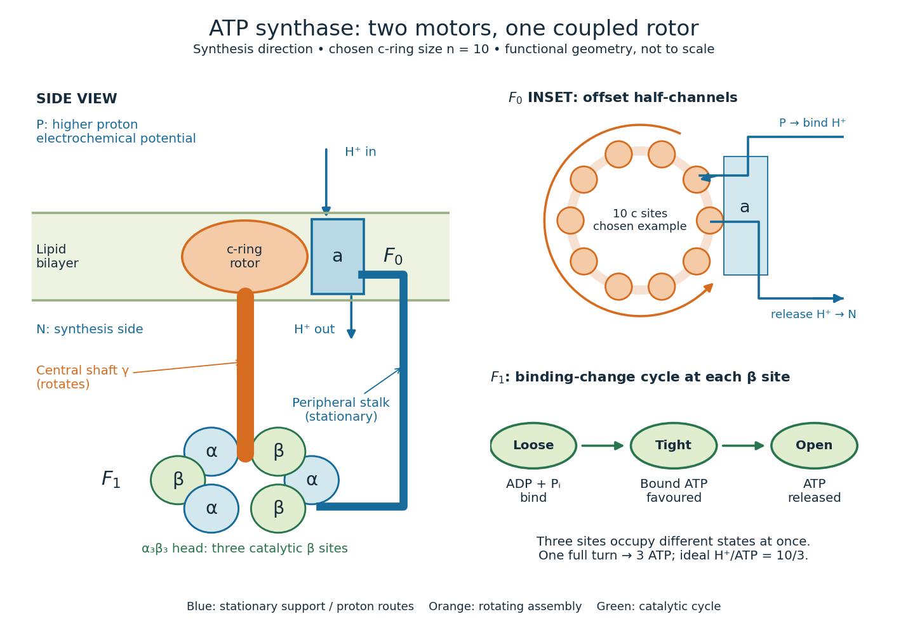

# ATP synthase rotary mechanism

↑ **Parent:** [ATP synthase](atp-synthase.md)

The membrane motor $F_0$ contains a rotating ring of $c$ subunits beside stationary subunit $a$. Two offset water-accessible half-channels connect opposite membrane sides to the ring. A [proton](proton.md) enters one half-channel and protonates a [glutamic acid residue](glutamic-acid-residue.md) on a $c$ subunit; neutralization permits that site to enter the [hydrophobic](hydrophobicity.md) [lipid bilayer](lipid-bilayer.md). Rotation carries it around to the other half-channel, where it releases the [proton](proton.md). A conserved [arginine](arginine.md) in subunit $a$ helps separate the routes and promotes release. Downhill [proton](proton.md) transfer biases rotation; this is not a freely open transmembrane pore.[Guo, Suzuki and Rubinstein, Structure of a bacterial ATP synthase, 2019, Figure 4B–D and Proton translocation through the FO region](structure-of-a-bacterial-atp-synthase-by-hui-guo-and-others.md)

The central shaft transmits [torque](torque.md) to $F_1$; a peripheral stalk prevents the catalytic head from simply co-rotating. Its three $\beta$ catalytic sites, within an $\alpha_3\beta_3$ head, cycle through different binding shapes. In the simplified binding-change picture, a loose site captures [ADP](adenosine-diphosphate.md) and [inorganic phosphate](inorganic-phosphate.md), a tight site favours bound [ATP](adenosine-triphosphate.md), and opening releases [ATP](adenosine-triphosphate.md). Rotation changes binding and release as well as chemistry.[Guo and Rubinstein, Structure of ATP synthase under strain during catalysis, 2022, Introduction and Figure 1: binding-change cycle](structure-of-atp-synthase-under-strain-during-catalysis-by-hui-guo-and-john-l-rubinstein.md)

**[Figure 7](#image-atp-synthase-proton-transfer-shaft-rotation-and-three-catalytic-sites). ATP synthase: proton transfer, shaft rotation and three catalytic sites**. Original functional schematic, not an atomic structure. The side view separates rotor and stationary support; the inset separates the two half-channels. Ten $c$ subunits are a chosen example.

One complete, tightly coupled turn cycles each catalytic site once, producing three [ATP](adenosine-triphosphate.md) [molecules](molecule-split.md). If the ring has $n$ [proton](proton.md)-binding subunits, the ideal motor budget is $n$ transferred [protons](proton.md) per turn, or $n/3$ per [ATP](adenosine-triphosphate.md). Ring size varies between organisms; the worked example chooses $n=10$, as in the studied bacterial systems, rather than assigning ten to every [ATP synthase](atp-synthase.md).[Watanabe, 2013, pp. 51–52: c-ring stoichiometry and H+/ATP ratio](rotary-catalysis-of-fof1-atp-synthase-by-rikiya-watanabe.md)

For this example the ring's repeat angle is $360^\circ/10=36^\circ$, whereas the three-site catalytic cycle repeats after $120^\circ$. Their ratio is $10/3$, not an integer. Counting complete turns avoids inventing a fixed integer [proton](proton.md) count for every catalytic event. The schematic does not require both parts to advance simultaneously as rigid gears; [elasticity](elasticity-physics-split.md) allows temporary twisting while their cycles proceed.[Guo and Rubinstein, 2022, Introduction and Figure 1: symmetry mismatch and elastic coupling](structure-of-atp-synthase-under-strain-during-catalysis-by-hui-guo-and-john-l-rubinstein.md)

## ↑ Ancestors (4)

1. [ATP synthase](atp-synthase.md)
2. [Enzyme](enzyme-split.md)
3. [Biology](biology-split.md)
4. [Codex Wiki](split.md)
