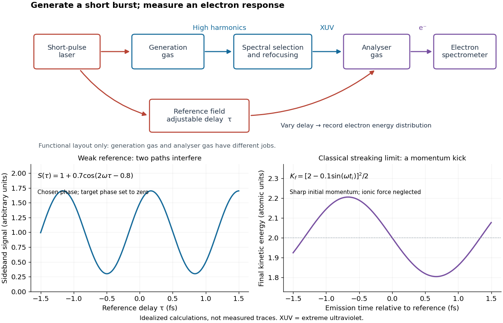

# Attosecond physics

↑ **Parent:** [Laser](laser-split.md)  
ⓦ [Wiki](https://en.wikipedia.org/wiki/Attosecond_physics)

[Attosecond physics](attosecond-physics.md) resolves changes on the scale of $10^{-18}$ [seconds](second.md), especially [electron](electron.md) dynamics. Its central trick is to convert a short optical event into an experimentally accessible [energy](energy-split.md) or [phase](phase-waves.md) change. A broad [optical spectrum](optical-spectrum.md) provides the ingredients for a short [optical pulse](optical-pulse.md); their [spectral phases](spectral-phase.md) determine when those ingredients add constructively. [High harmonic generation](high-harmonic-generation.md) supplies the [optical spectrum](optical-spectrum.md), while [RABBITT](reconstruction-of-attosecond-beating-by-interference-of-two-photon-transitions.md) and [attosecond streaking](attosecond-streaking.md) supply complementary timing measurements. XUV denotes [extreme ultraviolet](extreme-ultraviolet.md) radiation.

There are two separate timing problems: characterize the incident [optical pulse](optical-pulse.md), then infer the response of the target. A [photoelectron](photoelectron.md) measurement mixes the incident [spectral phase](spectral-phase.md), the target's transition response and the probing [electric field](electric-field-split.md). Recovering one requires constraints on the others. These methods measure distributions of [photoelectron](photoelectron.md) [energies](energy-split.md) over repeated shots, rather than photographing a moving [atomic orbital](atomic-orbital.md).

**[Figure 9](#image-attosecond-generation-and-electron-timing-use-separate-gas-interactions). Attosecond generation and electron timing use separate gas interactions**. Original functional schematic, not a reproduction of a historical apparatus. The upper path generates and selects short-wavelength radiation; the lower path supplies a delayed reference [electric field](electric-field-split.md). The analyser converts [photoionization](photoionization.md) into an [electron spectrometer](electron-spectrometer.md) readout. The two lower panels distinguish weak-reference two-path [wave interference](interference-wave-propagation.md) from a classical [momentum](momentum-split.md)-shift idealization.

**Table of contents**

- [High harmonic generation](high-harmonic-generation.md)
  - [Three-step model of high harmonic generation](three-step-model-of-high-harmonic-generation.md)
- [Attosecond pulse train](attosecond-pulse-train.md)
  - [Coherent harmonic pulse-train model](coherent-harmonic-pulse-train-model.md)
- [Isolated attosecond pulse](isolated-attosecond-pulse.md)
- [Reconstruction of attosecond beating by interference of two-photon transitions](reconstruction-of-attosecond-beating-by-interference-of-two-photon-transitions.md)
  - [Two-path attosecond phase reconstruction](two-path-attosecond-phase-reconstruction.md)
  - [2001 attosecond pulse-train experiment](2001-attosecond-pulse-train-experiment.md)
- [Attosecond streaking](attosecond-streaking.md)
  - [2001 isolated attosecond pulse experiment](2001-isolated-attosecond-pulse-experiment.md)

## ↑ Ancestors (5)

1. [Laser](laser-split.md)
2. [Optics](optics-split.md)
3. [Branches of physics](branches-of-physics.md)
4. [Physics](physics-split.md)
5. [Codex Wiki](split.md)

## ← Incoming links (2)

- [Attosecond physics](attosecond-physics.md)
- [Ferenc Krausz](ferenc-krausz.md)
