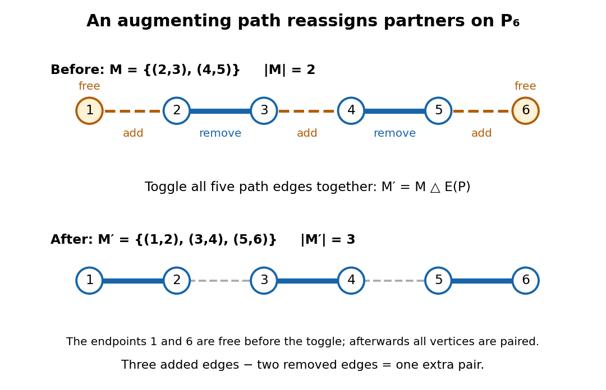

# Augmenting path in a matching

↑ **Parent:** [Matching (graph theory)](matching-graph-theory-split.md)

An [augmenting path in a matching](augmenting-path-in-a-matching.md) $M$ is a nonempty [alternating path in a matching](alternating-path-in-a-matching.md) with distinct endpoints that are both [unmatched vertices in a matching](unmatched-vertex-in-a-matching.md). Its first and last [edges](edge-of-a-graph.md) lie outside $M$. Thus it has $k+1$ unselected [edges](edge-of-a-graph.md) and $k$ selected [edges](edge-of-a-graph.md), for some $k\geq0$. Taking the [symmetric difference](symmetric-difference.md)

$$
M'=M\mathbin\triangle E(P)
=(M\setminus E(P))\cup(E(P)\setminus M)
$$

removes the selected [edges](edge-of-a-graph.md) on $P$ and inserts its unselected [edges](edge-of-a-graph.md). Each internal [vertex](vertex-graph-theory.md) exchanges one selected [edge](edge-of-a-graph.md) for another; each endpoint gains its first selected [edge](edge-of-a-graph.md). All choices away from $P$ stay in place, so $M'$ is a [matching in a graph](matching-graph-theory-split.md) with $|M'|=|M|+1$.[Matching, Covering and Packing, §2.1, printed p. 2: alternating paths, augmenting paths and symmetric difference](graph-theory-by-reinhard-diestel.md)

For an explicit repair, let the [path graph](path-graph.md) $P_6$ have [vertices](vertex-graph-theory.md) $1,2,3,4,5,6$ in that order and start with

$$
M=\{(2,3),(4,5)\},\qquad P=(1,2,3,4,5,6).
$$

The endpoints $1$ and $6$ are initially [unmatched vertices in a matching](unmatched-vertex-in-a-matching.md). Along $P$ the [edges](edge-of-a-graph.md) are outside, inside, outside, inside, outside $M$. Remove $(2,3)$ and $(4,5)$, then add $(1,2),(3,4),(5,6)$ together:

$$
M'=M\mathbin\triangle E(P)=\{(1,2),(3,4),(5,6)\}.
$$

This raises the [cardinality](cardinality.md) from two to three and gives a [perfect matching](perfect-matching.md). Six [vertices](vertex-graph-theory.md) allow at most three disjoint pairs, so it is also a [maximum cardinality matching](maximum-cardinality-matching.md). The initial $M$ is already a [maximal matching](maximal-matching.md): every unused [edge](edge-of-a-graph.md) touches a matched [vertex](vertex-graph-theory.md). Augmentation succeeds because it can replace earlier choices instead of only adding to them.

**[Figure 3](#image-the-augmenting-path-in-a-matching-on-p₆-replaces-two-selected-edges-by-three-using-symmetric-difference). The augmenting path in a matching on P₆ replaces two selected edges by three using symmetric difference**.

One unused [edge](edge-of-a-graph.md) joining two [unmatched vertices in a matching](unmatched-vertex-in-a-matching.md) is the shortest possible [augmenting path in a matching](augmenting-path-in-a-matching.md). Longer [augmenting paths in a matching](augmenting-path-in-a-matching.md) reassign several partners, explaining why a stalled [greedy matching](greedy-matching.md) need not be optimal. For edge benefits $w_e$, the change in total benefit is

$$
\sum_{e\in E(P)\setminus M}w_e-\sum_{e\in E(P)\cap M}w_e,
$$

which need not be positive even though the [cardinality](cardinality.md) increases. A [maximum-weight matching](maximum-weight-matching.md) therefore needs a different optimality test. In an assignment equality graph an [augmenting path in a matching](augmenting-path-in-a-matching.md) moves toward a [perfect matching](perfect-matching.md) while preserving zero [reduced costs](reduced-cost.md) on matched [edges](edge-of-a-graph.md); this is the setting used by the [Hungarian algorithm](hungarian-algorithm.md).

**Table of contents**

- [Berge's theorem](berge-s-theorem.md)
- [Short augmenting paths in a dense bipartite graph](short-augmenting-paths-in-a-dense-bipartite-graph.md)

## ↑ Ancestors (6)

1. [Matching (graph theory)](matching-graph-theory-split.md)
2. [Graph theory](graph-theory-split.md)
3. [Foundations of mathematics](foundations-of-mathematics-split.md)
4. [Area of mathematics](area-of-mathematics.md)
5. [Mathematics](mathematics-split.md)
6. [Codex Wiki](split.md)

## ← Incoming links (14)

- [Alternating path in a matching](alternating-path-in-a-matching.md)
- [Augmenting path in a matching](augmenting-path-in-a-matching.md)
- [Berge's theorem](berge-s-theorem.md)
- [Greedy matching](greedy-matching.md)
- [Hall's marriage theorem](hall-s-marriage-theorem.md)
- [Hall theorem proof outline](hall-theorem-proof-outline.md)
- [Matching (graph theory)](matching-graph-theory-split.md)
- [Maximal matching](maximal-matching.md)
- [Maximum cardinality matching](maximum-cardinality-matching.md)
- [Solution](past-exam-of-the-mathematics-course-of-the-university-of-cambridge/2011/ii/paper-1/17f/solution.md)
- [Solution](past-exam-of-the-mathematics-course-of-the-university-of-cambridge/2015/iii/paper-38/5/c/solution.md)
- [Solution](past-exam-of-the-mathematics-course-of-the-university-of-cambridge/2016/iii/paper-212/3/solution.md)
- [Short augmenting paths in a dense bipartite graph](short-augmenting-paths-in-a-dense-bipartite-graph.md)
- [Unmatched vertex in a matching](unmatched-vertex-in-a-matching.md)
