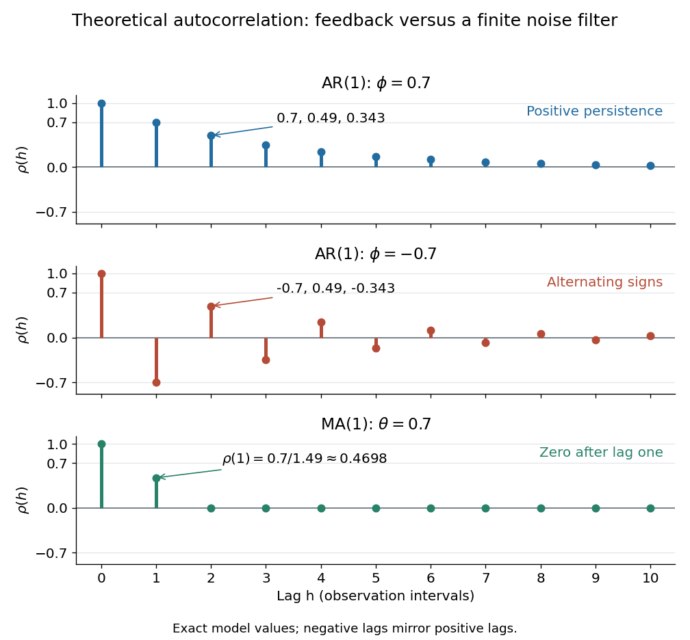

# Autocorrelation

↑ **Parent:** [Autocovariance](autocovariance.md)  
ⓦ [Wiki](https://en.wikipedia.org/wiki/Autocorrelation)

The [autocorrelation function](autocorrelation.md) of a real [weakly stationary process](weakly-stationary-process.md) with positive [variance](variance-split.md) is its normalized [autocovariance](autocovariance.md):

$$
\rho(h)=\frac{\gamma(h)}{\gamma(0)}=\operatorname{Corr}(X_{t+h},X_t).
$$

It is dimensionless, with $\rho(0)=1$, $\rho(-h)=\rho(h)$, and $|\rho(h)|\le1$ by the [Cauchy-Schwarz inequality](cauchy-schwarz-inequality.md). It is unchanged by replacing $X_t$ with $aX_t+b$ for fixed $a\ne0$. This makes [autocorrelation](autocorrelation.md) useful when comparing records measured on different scales. The [ACF](autocorrelation.md) is a property of the model; the [sample autocorrelation function](sample-autocorrelation-function.md) estimates it and will generally not reproduce theoretical zeros exactly.

An [AR(1)](autoregressive-process-of-order-one.md) with coefficient $\phi=0.7$ has [autocorrelations](autocorrelation.md) $0.7,0.49,0.343$ at lags one through three. With $\phi=-0.7$ these become $-0.7,0.49,-0.343$: the same diminishing magnitude, alternating in sign. An [MA(1)](moving-average-process-of-order-one.md) with $\theta=0.7$ instead has lag-one [autocorrelation](autocorrelation.md) $0.7/1.49=70/149\simeq0.4698$ and zero at every higher lag. Equal numerical coefficients in an [autoregressive model](autoregressive-model.md) and a [moving-average model](moving-average-model.md) do not mean equal dependence. See [Bartlett, lecture 3: theoretical ACFs and prediction](https://www.stat.berkeley.edu/~bartlett/courses/153-fall2010/lectures/3.pdf).

**[Figure 2](#image-theoretical-autocorrelation-ar-1-with-coefficients-0-7-and-0-7-compared-with-ma-1-with-coefficient-0-7). Theoretical autocorrelation: AR(1) with coefficients 0.7 and -0.7, compared with MA(1) with coefficient 0.7**.

The bars show exact model [autocorrelations](autocorrelation.md), not estimates from the illustrated [sample paths](sample-path.md) in [time series](time-series-split.md). The [AR(1)](autoregressive-process-of-order-one.md) retains a diminishing trace of a disturbance at arbitrarily large lags; the [MA(1)](moving-average-process-of-order-one.md) stops sharing driving noise after lag one. A zero [autocorrelation](autocorrelation.md) means [uncorrelated random variables](uncorrelated-random-variables.md), and does not generally imply [independent random variables](independent-random-variables.md). For a [Gaussian process](gaussian-process-split.md) it does imply independence of the two coordinates.

There is a direct prediction interpretation. Among affine predictions based on just $X_t$, the best [linear predictor](linear-predictor.md) of $X_{t+h}$ is $\mu+\rho(h)(X_t-\mu)$, with [mean squared prediction error](mean-squared-prediction-error.md) $\gamma(0)[1-\rho(h)^2]$. Thus negative [autocorrelation](autocorrelation.md) is also useful predictive information. A prediction using the whole observed past can do better; [best linear prediction from a finite past](best-linear-prediction-from-a-finite-past.md) describes that problem. Interpreting the affine prediction as a [conditional expectation](conditional-expectation.md) requires additional assumptions, such as a joint [normal distribution](normal-distribution.md).

**Table of contents**

- [Correlation time](correlation-time.md)
- [Partial autocorrelation function](partial-autocorrelation-function.md)
  - [Sample partial autocorrelation function](sample-partial-autocorrelation-function.md)
- [Sample autocorrelation function](sample-autocorrelation-function.md)
  - [Correlogram](correlogram.md)

## ↑ Ancestors (8)

1. [Autocovariance](autocovariance.md)
2. [Weakly stationary process](weakly-stationary-process.md)
3. [Stationary process](stationary-process.md)
4. [Time series](time-series-split.md)
5. [Probability and statistics](probability-and-statistics-split.md)
6. [Area of mathematics](area-of-mathematics.md)
7. [Mathematics](mathematics-split.md)
8. [Codex Wiki](split.md)

## ← Incoming links (56)

- [Autocorrelation](autocorrelation.md)
- [Autocorrelation of a square-integrable function](autocorrelation-of-a-square-integrable-function.md)
- [Autocovariance](autocovariance.md)
- [Autocovariance of an AR(1) process](autocovariance-of-an-ar-1-process.md)
- [Autocovariance of an MA(1) process](autocovariance-of-an-ma-1-process.md)
- [Correlation time](correlation-time.md)
- [Correlogram](correlogram.md)
- [Diffusive large-scale pair dispersion](diffusive-large-scale-pair-dispersion.md)
- [Ellipsoid rotational diffusion microscopy experiment](ellipsoid-rotational-diffusion-microscopy-experiment.md)
- [First-order optical coherence](first-order-optical-coherence.md)
- [Gaussian Gibbs sweep autocorrelation](gaussian-gibbs-sweep-autocorrelation.md)
- [Gaussian phase-screen correlation](gaussian-phase-screen-correlation.md)
- [Isotropic rotational diffusion in three dimensions](isotropic-rotational-diffusion-in-three-dimensions.md)
- [Lag of a time series](lag-of-a-time-series.md)
- [Lagrangian integral time](lagrangian-integral-time.md)
- [Lagrangian velocity autocorrelation](lagrangian-velocity-autocorrelation.md)
- [Markov chain Monte Carlo convergence diagnostics](markov-chain-monte-carlo-convergence-diagnostics.md)
- [Moment of inertia](moment-of-inertia.md)
- [Moving-average process of order one](moving-average-process-of-order-one.md)
- [Ornstein-Uhlenbeck stationary initialization](ornstein-uhlenbeck-stationary-initialization.md)
- [Partial autocorrelation function](partial-autocorrelation-function.md)
- [Solution](past-exam-of-the-chemistry-course-of-the-year-4-of-the-natural-sciences-course-of-the-university-of-cambridge/2022/paper-1/7/e/solution.md)
- [Solution](past-exam-of-the-mathematical-and-computational-biology-course-of-the-university-of-cambridge/2025/paper-1/6/f/solution.md)
- [Solution](past-exam-of-the-mathematics-course-of-the-university-of-cambridge/2001/iii/paper-33/2/ii/solution.md)
- [Solution](past-exam-of-the-mathematics-course-of-the-university-of-cambridge/2001/iii/paper-46/1/i/solution.md)
- [Solution](past-exam-of-the-mathematics-course-of-the-university-of-cambridge/2002/iii/paper-40/5/solution.md)
- [Solution](past-exam-of-the-mathematics-course-of-the-university-of-cambridge/2004/iii/paper-40/1/a/solution.md)
- [Solution](past-exam-of-the-mathematics-course-of-the-university-of-cambridge/2005/iii/paper-47/5/a/i/solution.md)
- [Solution](past-exam-of-the-mathematics-course-of-the-university-of-cambridge/2005/iii/paper-47/5/a/iii/solution.md)
- [Solution](past-exam-of-the-mathematics-course-of-the-university-of-cambridge/2006/ii/paper-3/26j/c/solution.md)
- [Solution](past-exam-of-the-mathematics-course-of-the-university-of-cambridge/2006/iii/paper-69/3/a/solution.md)
- [Solution](past-exam-of-the-mathematics-course-of-the-university-of-cambridge/2006/iii/paper-84/4/a/solution.md)
- [Solution](past-exam-of-the-mathematics-course-of-the-university-of-cambridge/2007/iii/paper-73/1/c/solution.md)
- [Solution](past-exam-of-the-mathematics-course-of-the-university-of-cambridge/2008/iii/paper-47/1/solution.md)
- [Solution](past-exam-of-the-mathematics-course-of-the-university-of-cambridge/2008/iii/paper-87/2/i/solution.md)
- [Solution](past-exam-of-the-mathematics-course-of-the-university-of-cambridge/2008/iii/paper-87/2/ii/solution.md)
- [Solution](past-exam-of-the-mathematics-course-of-the-university-of-cambridge/2014/iii/paper-36/1/a/solution.md)
- [Solution](past-exam-of-the-mathematics-course-of-the-university-of-cambridge/2014/iii/paper-36/2/b/solution.md)
- [Solution](past-exam-of-the-mathematics-course-of-the-university-of-cambridge/2015/iii/paper-37/2/b/solution.md)
- [Solution](past-exam-of-the-mathematics-course-of-the-university-of-cambridge/2015/iii/paper-37/3/b/solution.md)
- [Solution](past-exam-of-the-mathematics-course-of-the-university-of-cambridge/2016/iii/paper-335/1/b/solution.md)
- [Solution](past-exam-of-the-mathematics-course-of-the-university-of-cambridge/2017/iii/paper-206/5/d/solution.md)
- [Solution](past-exam-of-the-mathematics-course-of-the-university-of-cambridge/2018/ii/paper-4/5j/solution.md)
- [Solution](past-exam-of-the-mathematics-course-of-the-university-of-cambridge/2018/iii/paper-219/4/iii/c/solution.md)
- [Solution](past-exam-of-the-mathematics-course-of-the-university-of-cambridge/2019/iii/paper-219/3/c/solution.md)
- [Solution](past-exam-of-the-nonlinear-optics-and-quantum-states-of-light-course-of-the-university-of-cambridge/2012/paper-1/3/c/solution.md)
- [Solution](past-exam-of-the-optics-and-electrodynamics-course-of-the-university-of-cambridge/2012/paper-1/2/b/solution.md)
- [Solution](past-exam-of-the-systems-biology-course-of-the-university-of-cambridge/2024/paper-3/2/e/solution.md)
- [Planar rotational diffusion](planar-rotational-diffusion.md)
- [Power-law velocity-correlation dispersion](power-law-velocity-correlation-dispersion.md)
- [Rotational diffusion of a sphere](rotational-diffusion-of-a-sphere.md)
- [Taylor turbulent dispersion](taylor-turbulent-dispersion.md)
- [Three-regime turbulent pair-separation model](three-regime-turbulent-pair-separation-model.md)
- [Time series](time-series-split.md)
- [Trace plot](trace-plot.md)
- [Unnormalized time autocorrelation](unnormalized-time-autocorrelation.md)
