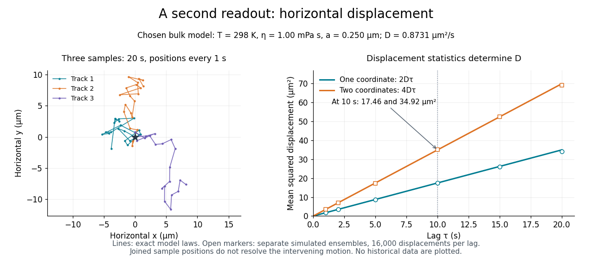

# Avogadro constant from sedimentation and diffusion

↑ **Parent:** [Perrin sedimentation experiment](perrin-sedimentation-experiment.md)

For two observed layers $z_2>z_1$, define the positive logarithmic count [slope](slope.md)

$$
b=\frac{\ln[\overline C(z_1)/\overline C(z_2)]}{z_2-z_1}=\frac1H.
$$

Since $k_B=R/N_A$, where $R$ is the [molar gas constant](molar-gas-constant.md), the [sedimentation scale height](sedimentation-scale-height.md) gives

$$
N_A^{\rm sed}=\frac{RTb}{m_bg}=\frac{RT}{m_bgH}.
$$

Several heights check whether one [slope](slope.md) fits the whole profile. A mixture of grain radii generally gives a sum of [exponential functions](exponential-function.md), with the larger grains depleted faster aloft; one apparent radius need not describe every height.

An independent readout uses horizontal displacements at lag $\tau$, avoiding the vertical gravitational [drift](drift-coefficient.md). Define the one-coordinate [mean squared displacement](mean-squared-displacement.md) $M_x(\tau)=\langle[x(t+\tau)-x(t)]^2\rangle$. In a stationary [liquid](liquid.md) without horizontal [advection](advection.md), [translational diffusion](translational-diffusion.md) predicts

$$
M_x(\tau)=2D\tau,\qquad
\langle(\Delta x)^2+(\Delta y)^2\rangle=4D\tau.
$$

A camera sees two horizontal coordinates, so its squared radial displacement has twice the one-coordinate mean. Neither observable is path length or instantaneous [velocity](velocity.md). The bulk [Stokes–Einstein relation](stokes-einstein-relation.md), with [dynamic viscosity](dynamic-viscosity-split.md) $\eta$, then gives

$$
D=\frac{k_BT}{6\pi\eta a},\qquad
N_A^{\rm diff}=\frac{RT}{6\pi\eta aD}.
$$

The 1926 lecture compares displacement-based and equilibrium determinations of the [Avogadro constant](avogadro-constant.md).[Nobel Lectures, Physics 1922–1941; Discontinuous structure of matter, pp. 152–154](nobel-lectures-physics-1922-1941/discontinuous-structure-of-matter-by-jean-baptiste-perrin.md)

[Rotational diffusion](rotational-diffusion.md) supplies a further observable when an identifiable grain orientation can be followed; centre positions alone cannot measure it.

For the chosen model above and $\eta=1.00\times10^{-3}\,\mathrm{Pa\,s}$, the bulk prediction is $D\simeq0.8731\,\mathrm{\mu m^2\,s^{-1}}$. At $\tau=10\,\mathrm s$, $M_x\simeq17.46\,\mathrm{\mu m^2}$ and the planar value is $34.92\,\mathrm{\mu m^2}$. Reconstructing $N_A$ from these stipulated model outputs returns $6.02214076\times10^{23}\,\mathrm{mol^{-1}}$ by construction; this arithmetic consistency check is not experimental confirmation. Historical force comes from comparing separately measured profiles and displacements using independently checked material parameters.

The [diffusive flux](diffusive-flux.md) and gravitational particle flux provide another useful connection. With constant drag coefficient $\zeta$, zero vertical net flux reads

$$
j_z=-D\frac{dn}{dz}-\frac{m_bg}{\zeta}n=0,\qquad
H=\frac{D\zeta}{m_bg}=\frac{D}{v_s},\qquad
v_s=\frac{m_bg}{\zeta},
$$

where $v_s$ is the downward [settling velocity](settling-velocity.md) magnitude. With $\zeta=6\pi\eta a$, the chosen model gives $v_s\simeq0.02725\,\mathrm{\mu m\,s^{-1}}$. The [equilibrium](equilibrium-point-of-a-dynamical-system.md) profile forgets how rapidly it was established, while displacement measurements retain that rate information.

**[Figure 3](#image-independent-horizontal-displacement-readout-for-the-chosen-brownian-model). Independent horizontal displacement readout for the chosen Brownian model**. Three simulated planar tracks illustrate sampled endpoints. The other panel compares exact one-coordinate and planar [mean squared displacement](mean-squared-displacement.md) laws with separate simulated ensembles at each lag. These model observations do not reuse the height counts and are not historical measurements. All use $D\simeq0.8731\,\mathrm{\mu m^2\,s^{-1}}$.

## ↑ Ancestors (8)

1. [Perrin sedimentation experiment](perrin-sedimentation-experiment.md)
2. [Brownian motion](brownian-motion-split.md)
3. [Stochastic process](stochastic-process-split.md)
4. [Probability theory](probability-theory-split.md)
5. [Probability and statistics](probability-and-statistics-split.md)
6. [Area of mathematics](area-of-mathematics.md)
7. [Mathematics](mathematics-split.md)
8. [Codex Wiki](split.md)
