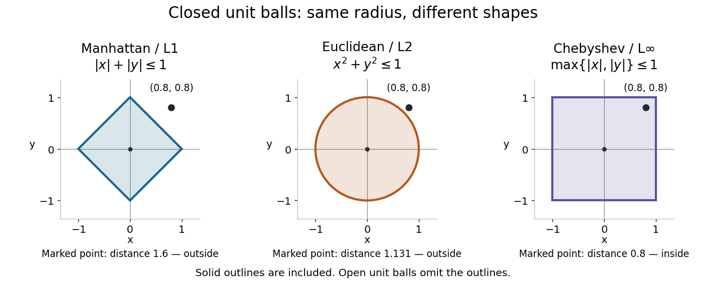

# Ball (mathematics)

↑ **Parent:** [Metric space](metric-space.md)  
ⓦ [Wiki](https://en.wikipedia.org/wiki/Ball_(mathematics))

In a [metric space](metric-space.md) $(X,d)$, an [open ball](open-ball.md) of radius $r>0$ about $a$ is $B_d(a,r)=\{x\in X:d(a,x)<r\}$. A [closed ball](closed-ball.md) instead uses $d(a,x)\leq r$. The strict inequality matters: a point at distance exactly $r$ belongs to the [closed ball](closed-ball.md) and is excluded from the [open ball](open-ball.md). In particular, $(1,0)$ is excluded from all three [open unit balls](open-unit-ball.md) above, and included in all three [closed unit balls](closed-unit-ball.md).

The three [closed unit balls](closed-unit-ball.md) centred at zero are $|x_1|+|x_2|\leq1$, $x_1^2+x_2^2\leq1$, and $\max\{|x_1|,|x_2|\}\leq1$. Their shapes are a diamond (a rotated [square](square.md)), a [disk](disk-mathematics.md) with a [circle](circle.md) as its [boundary](boundary-of-a-set.md), and an axis-aligned [square](square.md). A [ball](ball-mathematics.md) need not look round! The corresponding [open balls](open-ball.md) are the [interiors](interior-topology.md) of these shapes. At $(0.8,0.8)$, [Manhattan distance](manhattan-distance.md) from zero is $1.6$ and [Euclidean distance](euclidean-distance.md) is $\sqrt{1.28}\approx1.131$, whereas [Chebyshev distance](chebyshev-distance.md) is $0.8$: only the [square](square.md)'s [open unit ball](open-unit-ball.md) contains this point.

**[Figure 3](#image-three-closed-unit-balls-on-the-same-coordinate-scale). Three closed unit balls on the same coordinate scale**.

These shapes illustrate $B_1(0,1)\subseteq B_2(0,1)\subseteq B_\infty(0,1)$, with either the [open ball](open-ball.md) or [closed ball](closed-ball.md) convention used consistently. Their outlines are included in the displayed [closed balls](closed-ball.md). In an arbitrary [metric space](metric-space.md), however, points at distance exactly $r$ need not form the topological [boundary](boundary-of-a-set.md); the [discrete metric](discrete-metric.md) below shows why this distinction matters.

## ↑ Ancestors (6)

1. [Metric space](metric-space.md)
2. [Topological analysis](topological-analysis-split.md)
3. [Analysis](analysis-split.md)
4. [Area of mathematics](area-of-mathematics.md)
5. [Mathematics](mathematics-split.md)
6. [Codex Wiki](split.md)

## ← Incoming links (2)

- [Euclidean ball](euclidean-ball.md)
- [Open ball](open-ball.md)
