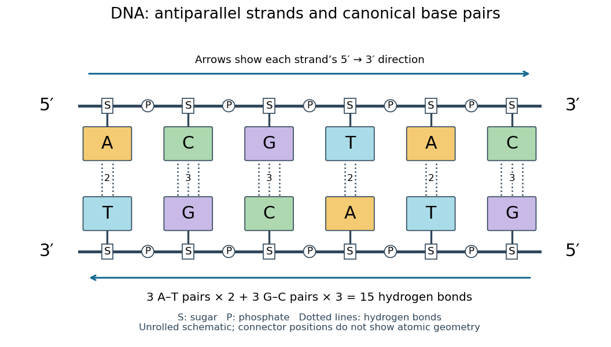

# Base pairing

↑ **Parent:** [Base pair](base-pair.md)

[Base pairing](base-pairing.md) is the recognition and association of compatible [nucleobases](nucleotide-base.md). In canonical Watson–Crick geometry, an [adenine](adenine.md)–[thymine](thymine.md) [base pair](base-pair.md) has two [hydrogen bonds](hydrogen-bond.md), while a [guanine](guanine.md)–[cytosine](cytosine.md) [base pair](base-pair.md) has three. These counts refer to those specific geometries and usual chemical forms; they are not a definition of every possible [base pair](base-pair.md). [RNA](ribonucleic-acid.md) can also contain other pairings, and canonical [adenine](adenine.md)–[uracil](uracil.md) pairing replaces [adenine](adenine.md)–[thymine](thymine.md) pairing. See [Clark, Douglas and Choi, Biology 2e: DNA structure](https://openstax.org/books/biology-2e/pages/14-2-dna-structure-and-sequencing).

**[Figure 10](#image-six-canonical-watson-crick-dna-base-pairs-opposite-backbone-directions-and-two-or-three-hydrogen-bonds-per-pair). Six canonical Watson–Crick DNA base pairs: opposite backbone directions and two or three hydrogen bonds per pair**.

For this illustrative duplex, the six [base pairs](base-pair.md) are A–T, C–G, G–C, T–A, A–T, and C–G. Thus three contribute two [hydrogen bonds](hydrogen-bond.md) each and three contribute three each:

$$
3\times2+3\times3=15.
$$

Each dotted connector in the diagram counts one [hydrogen bond](hydrogen-bond.md); coloured boxes denote whole [nucleobases](nucleotide-base.md), not individual [chemical atoms](atom-physics.md). The solid rails denote the [covalent bond](covalent-bond-split.md) scaffold. Separating the two strands disrupts [base pairing](base-pairing.md) and [base stacking](base-stacking.md) without requiring the backbone to be cut.

The count of fifteen [hydrogen bonds](hydrogen-bond.md) is not fifteen identical contributions to a duplex's [Gibbs free energy](gibbs-free-energy.md). [Base stacking](base-stacking.md), interactions with [water](water.md) and [ions](ion.md), [temperature](temperature-split.md), and the order of neighbouring [base pairs](base-pair.md) also matter. Knowing the fraction of [guanine](guanine.md)–[cytosine](cytosine.md) [base pairs](base-pair.md) alone does not fix a [nucleic acid double helix](nucleic-acid-double-helix.md)'s shape or stability. See [Brown, Genomes: pairing and stacking interactions](https://www.ncbi.nlm.nih.gov/books/NBK21134/). What makes [base pairing](base-pairing.md) especially useful is its selectivity: an exposed [DNA](deoxyribonucleic-acid.md) strand constrains the partner's [nucleic acid sequence](nucleic-acid-sequence.md), giving [DNA replication](dna-replication.md) a chemical recognition rule.

**Table of contents**

- [Watson-Crick base pairing](watson-crick-base-pairing.md)
- [Nucleic acid complementarity](nucleic-acid-complementarity.md)

## ↑ Ancestors (5)

1. [Base pair](base-pair.md)
2. [Nucleic acid](nucleic-acid.md)
3. [Polymer](polymer-split.md)
4. [Chemistry](chemistry-split.md)
5. [Codex Wiki](split.md)

## ← Incoming links (25)

- [Base pairing](base-pairing.md)
- [Base stacking](base-stacking.md)
- [Deoxyribonucleic acid](deoxyribonucleic-acid.md)
- [DNA ligation](dna-ligation.md)
- [DNA polymerase](dna-polymerase.md)
- [DNA replication](dna-replication.md)
- [DNA sequencing](dna-sequencing.md)
- [Double-stranded DNA](double-stranded-dna.md)
- [Nucleic acid](nucleic-acid.md)
- [Nucleic acid double helix](nucleic-acid-double-helix.md)
- [Nucleic acid sequence](nucleic-acid-sequence.md)
- [Solution](past-exam-of-the-biochemistry-course-of-the-university-of-cambridge/2024/paper-3/section-ii/6/solution.md)
- [Solution](past-exam-of-the-genetics-course-of-the-university-of-cambridge/2024/paper-2/7/solution.md)
- [PCR annealing](pcr-annealing.md)
- [PCR extension](pcr-extension.md)
- [PCR primer](pcr-primer.md)
- [PCR thermal cycle](pcr-thermal-cycle.md)
- [Polymerase chain reaction](polymerase-chain-reaction.md)
- [Reverse complement](reverse-complement.md)
- [Ribonucleic acid](ribonucleic-acid.md)
- [Ribonucleotide excision repair](ribonucleotide-excision-repair.md)
- [Ribozyme](ribozyme.md)
- [RNA secondary structure](rna-secondary-structure.md)
- [Sanger ladder reading](sanger-ladder-reading.md)
- [Translation (biology)](translation-biology.md)
