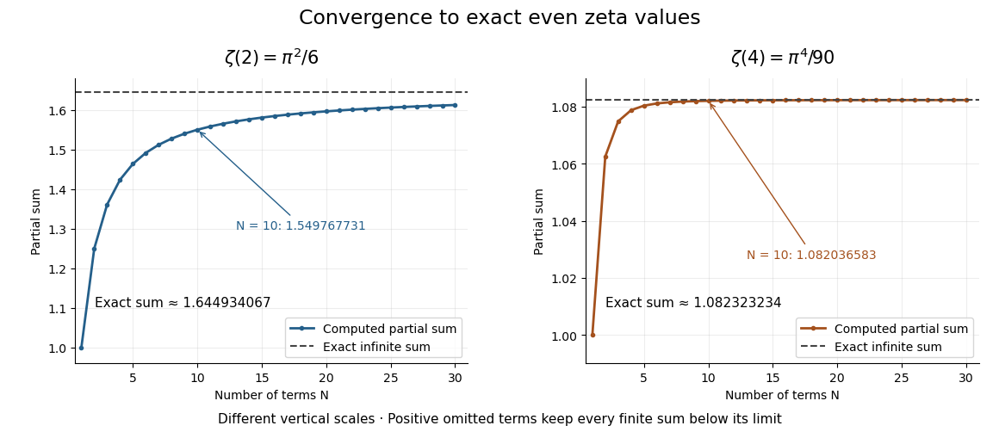

# Basel problem

↑ **Parent:** [Riemann zeta function](riemann-zeta-function.md)  
ⓦ [Wiki](https://en.wikipedia.org/wiki/Basel_problem)

The [Basel problem](basel-problem.md) asks for the exact [sum](sum.md) of the reciprocal squares of the [positive integers](positive-integer.md). The answer is

$$
\boxed{\sum_{n=1}^{\infty}\frac1{n^2}=\zeta(2)=\frac{\pi^2}{6}}.
$$

The [integral test](integral-test-for-convergence.md) proves that the [series](series-mathematics.md) converges, but does not identify this exact value. The [Euler evaluation of even zeta values](euler-evaluation-of-even-zeta-values.md) does: the equally spaced [poles](pole.md) of [cotangent](cotangent.md) connect reciprocal [integer](integer-split.md) powers to [Bernoulli numbers](bernoulli-number-split.md) and $\pi$. This separates three different questions: whether a [sum](sum.md) exists, how well a [partial sum](partial-sum.md) approximates it, and what its exact value is.

For example, the ten-term [partial sum](partial-sum.md) is about $1.549768$, while the exact value is about $1.644934$. The [zeta series truncation error](zeta-series-truncation-error.md) bounds the missing amount between $1/11$ and $1/10$; it is much larger than the first omitted term $1/121$. More terms improve the approximation, but a numerical coincidence with $\pi^2/6$ would not prove the identity.

**[Figure 1](#image-the-basel-series-converges-slowly-compared-with-the-reciprocal-fourth-power-series). The Basel series converges slowly compared with the reciprocal-fourth-power series**. The left panel shows original computed reciprocal-square [partial sums](partial-sum.md) approaching $\pi^2/6$. The right panel compares the faster convergence of reciprocal fourth powers. Each panel has its own vertical scale.

In [On the sums of series of reciprocals by Leonhard Euler](on-the-sums-of-series-of-reciprocals-by-leonhard-euler.md), §2 identifies the reciprocal-square [sum](sum.md) with one-sixth of the squared circumference of a unit-diameter [circle](circle.md). The translation's publication note dates the presentation to 5 December 1735 and publication to 1740.[English translation, p. 1, §2 and publication note](on-the-sums-of-series-of-reciprocals-by-leonhard-euler.md) The [cotangent coefficient proof of the even zeta values](cotangent-coefficient-proof-of-the-even-zeta-values.md) gives a short modern outline, while [zeta series truncation error](zeta-series-truncation-error.md) addresses the distinct approximation question.

## ↑ Ancestors (6)

1. [Riemann zeta function](riemann-zeta-function.md)
2. [Analytic number theory](analytic-number-theory-split.md)
3. [Number theory](number-theory-split.md)
4. [Area of mathematics](area-of-mathematics.md)
5. [Mathematics](mathematics-split.md)
6. [Codex Wiki](split.md)

## ← Incoming links (9)

- [Basel problem](basel-problem.md)
- [Cotangent contour summation](cotangent-contour-summation.md)
- [Euler evaluation of even zeta values](euler-evaluation-of-even-zeta-values.md)
- [Solution](past-exam-of-the-mathematics-course-of-the-university-of-cambridge/2008/ib/paper-4/5a/solution.md)
- [Solution](past-exam-of-the-mathematics-course-of-the-university-of-cambridge/2016/ib/paper-4/5a/solution.md)
- [Solution](past-exam-of-the-mathematics-course-of-the-university-of-cambridge/2017/iii/paper-137/3/a/solution.md)
- [Solution](past-exam-of-the-mathematics-course-of-the-university-of-cambridge/2018/ib/paper-2/13a/d/solution.md)
- [Solution](past-exam-of-the-mathematics-course-of-the-year-2-of-the-natural-sciences-course-of-the-university-of-cambridge/2006/paper-2/4/solution.md)
- [Summable and harmonic event probabilities](summable-and-harmonic-event-probabilities.md)
