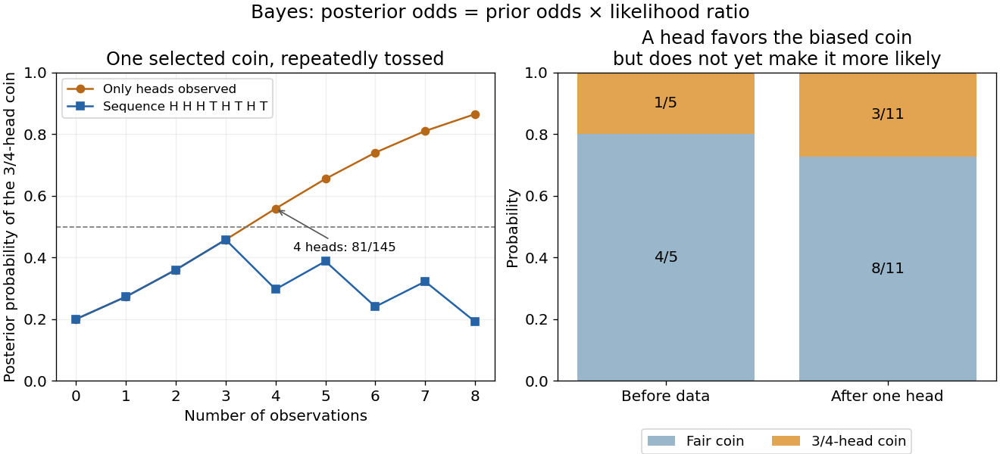

# Bayes' theorem

↑ **Parent:** [Conditional probability](conditional-probability.md)  
ⓦ [Wiki](https://en.wikipedia.org/wiki/Bayes'_theorem)

For a finite [measurable partition](measurable-partition.md) $(B_j)$ with positive [probabilities](probability.md), and an [event](event.md) $A$ of positive [probability](probability.md),

$$
\mathbb P(B_j\mid A)
=\frac{\mathbb P(A\mid B_j)\mathbb P(B_j)}
{\sum_k\mathbb P(A\mid B_k)\mathbb P(B_k)}.
$$

Its beauty is that a model predicting observations from a hidden state can also describe uncertainty about the state after an observation. Each numerator is a joint [probability](probability.md); the denominator, supplied by the [law of total probability](law-of-total-probability.md), makes the answers sum to one. This is a direct consequence of [conditional probability](conditional-probability.md), rather than an extra axiom.

Select the coin from [law of total probability](law-of-total-probability.md) once, then toss that same coin repeatedly, with [conditionally independent](conditional-independence.md) tosses given its identity. Let $B$ denote the $3/4$-head coin, initially of [prior probability](prior-probability.md) $1/5$. After one head $H$, its [posterior probability](posterior-probability.md) is

$$
\boxed{\mathbb P(B\mid H)=\frac{(1/5)(3/4)}{(1/5)(3/4)+(4/5)(1/2)}=\frac3{11}.}
$$

The [likelihood](likelihood-function.md) of a head is larger under $B$, but $B$ remains less likely than the other coin because its [prior probability](prior-probability.md) was smaller. A large [likelihood](likelihood-function.md) for an observation does not itself imply a large [posterior probability](posterior-probability.md) for the hypothesis.

After an ordered sequence containing $h$ heads and $t$ tails, its [likelihood ratio](likelihood-ratio.md) between the two coins is $(3/2)^h(1/2)^t$. Bayes' theorem therefore gives [posterior odds](posterior-odds.md)

$$
O_{B:B^c}=\frac14\left(\frac32\right)^h\left(\frac12\right)^t,\qquad
\mathbb P(B\mid\text{sequence})=\frac{O_{B:B^c}}{1+O_{B:B^c}}.
$$

Each head multiplies the [odds](odds.md) by $3/2$ and each tail by $1/2$. Three heads give [posterior probability](posterior-probability.md) $27/59$, still below one half; four give $81/145$, above one half. The finite-model update and the distinction between [prior probability](prior-probability.md), [likelihood](likelihood-function.md) and [posterior probability](posterior-probability.md) are set out in [MIT 18.05, Reading 11: Bayesian Updating with Discrete Priors](https://ocw.mit.edu/courses/18-05-introduction-to-probability-and-statistics-spring-2022/mit18_05_s22_statistics.pdf).

**[Figure 33](#image-updating-uncertainty-about-one-selected-coin-after-repeated-observations). Updating uncertainty about one selected coin after repeated observations**.

The hidden selection also creates dependence. Each toss has marginal head [probability](probability.md) $11/20$, but two heads have joint [probability](probability.md) $(4/5)(1/2)^2+(1/5)(3/4)^2=5/16$, greater than $(11/20)^2=121/400$. Their indicator [covariance](covariance.md) is $1/100$. Seeing a head makes the head-favoring coin more likely, so it also raises the chance of a future head. This is [covariance induced by a shared latent variable](covariance-induced-by-a-shared-latent-variable.md), despite [conditional independence](conditional-independence.md) of the tosses given the coin.

Historically, Thomas Bayes's essay on an unknown success [probability](probability.md) appeared in 1763 after his death, communicated by Richard Price. Its opening problem asks how observed successes and failures constrain that unknown [probability](probability.md); Price's introductory letter explains the connection to reasoning from experience. That is a more substantial inference problem than simply rearranging today's elementary identity. [Bayes, An Essay towards solving a Problem in the Doctrine of Chances, 1763; original text transcribed, introductory letter and statement of the problem](https://www.gtfp.cs.rhul.ac.uk/pulskamp/Bayes/bayesessay-rjp.pdf)

**Table of contents**

- [Posterior coin count after exactly one head](posterior-coin-count-after-exactly-one-head.md)
- [Posterior equality for proportional likelihoods](posterior-equality-for-proportional-likelihoods.md)
- [Posterior coin selection from repeated tosses](posterior-coin-selection-from-repeated-tosses.md)

## ↑ Ancestors (6)

1. [Conditional probability](conditional-probability.md)
2. [Probability theory](probability-theory-split.md)
3. [Probability and statistics](probability-and-statistics-split.md)
4. [Area of mathematics](area-of-mathematics.md)
5. [Mathematics](mathematics-split.md)
6. [Codex Wiki](split.md)

## ← Incoming links (76)

- [Base-rate effect in a positive study](base-rate-effect-in-a-positive-study.md)
- [Bayesian box search problem](bayesian-box-search-problem.md)
- [Bayesian network structure score](bayesian-network-structure-score.md)
- [Bayesian posterior](bayesian-posterior.md)
- [Bayesian statistics](bayesian-statistics.md)
- [Binary Brownian drift filter](binary-brownian-drift-filter.md)
- [Disease-ascertained transmission probability](disease-ascertained-transmission-probability.md)
- [EM for zero-inflated negative binomial regression](em-for-zero-inflated-negative-binomial-regression.md)
- [Frailty distribution among survivors](frailty-distribution-among-survivors.md)
- [Gaussian Brownian drift filter](gaussian-brownian-drift-filter.md)
- [Joint posterior of mutation rate and coalescent times](joint-posterior-of-mutation-rate-and-coalescent-times.md)
- [Likelihood function](likelihood-function.md)
- [Likelihood reconstruction from posterior simulation](likelihood-reconstruction-from-posterior-simulation.md)
- [Solution](past-exam-of-the-mathematics-course-of-the-university-of-cambridge/2001/iii/paper-28/2/i/solution.md)
- [Solution](past-exam-of-the-mathematics-course-of-the-university-of-cambridge/2001/iii/paper-29/5/a/solution.md)
- [Solution](past-exam-of-the-mathematics-course-of-the-university-of-cambridge/2002/ia/paper-2/9f/a/solution.md)
- [Solution](past-exam-of-the-mathematics-course-of-the-university-of-cambridge/2003/iii/paper-43/3/b/ii/solution.md)
- [Solution](past-exam-of-the-mathematics-course-of-the-university-of-cambridge/2004/ia/paper-2/10f/solution.md)
- [Solution](past-exam-of-the-mathematics-course-of-the-university-of-cambridge/2004/iii/paper-39/4/iv/solution.md)
- [Solution](past-exam-of-the-mathematics-course-of-the-university-of-cambridge/2005/ia/paper-2/10f/solution.md)
- [Solution](past-exam-of-the-mathematics-course-of-the-university-of-cambridge/2005/iii/paper-45/1/vi/solution.md)
- [Solution](past-exam-of-the-mathematics-course-of-the-university-of-cambridge/2005/iii/paper-45/3/iii/solution.md)
- [Solution](past-exam-of-the-mathematics-course-of-the-university-of-cambridge/2006/iii/paper-45/4/c/solution.md)
- [Solution](past-exam-of-the-mathematics-course-of-the-university-of-cambridge/2007/iii/paper-42/3/solution.md)
- [Solution](past-exam-of-the-mathematics-course-of-the-university-of-cambridge/2007/iii/paper-48/6/b/i/solution.md)
- [Solution](past-exam-of-the-mathematics-course-of-the-university-of-cambridge/2008/iii/paper-44/1/a/solution.md)
- [Solution](past-exam-of-the-mathematics-course-of-the-university-of-cambridge/2008/iii/paper-58/2/solution.md)
- [Solution](past-exam-of-the-mathematics-course-of-the-university-of-cambridge/2009/ia/paper-2/12f/solution.md)
- [Solution](past-exam-of-the-mathematics-course-of-the-university-of-cambridge/2009/iii/paper-36/1/a/solution.md)
- [Solution](past-exam-of-the-mathematics-course-of-the-university-of-cambridge/2009/iii/paper-39/4/i/solution.md)
- [Solution](past-exam-of-the-mathematics-course-of-the-university-of-cambridge/2010/iii/paper-36/1/b/solution.md)
- [Solution](past-exam-of-the-mathematics-course-of-the-university-of-cambridge/2011/ia/paper-2/9f/a/solution.md)
- [Solution](past-exam-of-the-mathematics-course-of-the-university-of-cambridge/2011/ia/paper-2/9f/b/solution.md)
- [Solution](past-exam-of-the-mathematics-course-of-the-university-of-cambridge/2012/ia/paper-2/3f/solution.md)
- [Solution](past-exam-of-the-mathematics-course-of-the-university-of-cambridge/2013/ia/paper-2/12f/a/solution.md)
- [Solution](past-exam-of-the-mathematics-course-of-the-university-of-cambridge/2013/ia/paper-2/12f/b/solution.md)
- [Solution](past-exam-of-the-mathematics-course-of-the-university-of-cambridge/2013/ia/paper-2/12f/solution.md)
- [Solution](past-exam-of-the-mathematics-course-of-the-university-of-cambridge/2013/iii/paper-34/1/b/solution.md)
- [Solution](past-exam-of-the-mathematics-course-of-the-university-of-cambridge/2013/iii/paper-34/4/d/solution.md)
- [Solution](past-exam-of-the-mathematics-course-of-the-university-of-cambridge/2013/iii/paper-34/4/e/solution.md)
- [Solution](past-exam-of-the-mathematics-course-of-the-university-of-cambridge/2014/iii/paper-33/6/b/ii/solution.md)
- [Solution](past-exam-of-the-mathematics-course-of-the-university-of-cambridge/2015/ia/paper-2/12f/solution.md)
- [Solution](past-exam-of-the-mathematics-course-of-the-university-of-cambridge/2015/iii/paper-35/1/c/solution.md)
- [Solution](past-exam-of-the-mathematics-course-of-the-university-of-cambridge/2015/iii/paper-37/6/i/a/solution.md)
- [Solution](past-exam-of-the-mathematics-course-of-the-university-of-cambridge/2017/iii/paper-206/1/f/solution.md)
- [Solution](past-exam-of-the-mathematics-course-of-the-university-of-cambridge/2017/iii/paper-207/2/b/iii/solution.md)
- [Solution](past-exam-of-the-mathematics-course-of-the-university-of-cambridge/2017/iii/paper-207/7/b/solution.md)
- [Solution](past-exam-of-the-mathematics-course-of-the-university-of-cambridge/2018/ii/paper-2/30k/a/solution.md)
- [Solution](past-exam-of-the-mathematics-course-of-the-university-of-cambridge/2018/iii/paper-219/2/ii/solution.md)
- [Solution](past-exam-of-the-mathematics-course-of-the-university-of-cambridge/2019/ia/paper-2/9f/a/solution.md)
- [Solution](past-exam-of-the-mathematics-course-of-the-university-of-cambridge/2019/ia/paper-2/9f/b/i/solution.md)
- [Solution](past-exam-of-the-mathematics-course-of-the-university-of-cambridge/2019/ia/paper-2/9f/c/solution.md)
- [Solution](past-exam-of-the-mathematics-course-of-the-university-of-cambridge/2019/iii/paper-207/1/d/solution.md)
- [Solution](past-exam-of-the-mathematics-course-of-the-university-of-cambridge/2019/iii/paper-219/2/d/solution.md)
- [Solution](past-exam-of-the-mathematics-course-of-the-university-of-cambridge/2019/iii/paper-350/1/a/solution.md)
- [Solution](past-exam-of-the-mathematics-course-of-the-university-of-cambridge/2019/iii/paper-350/3/b/solution.md)
- [Solution](past-exam-of-the-mathematics-course-of-the-university-of-cambridge/2020/ii/paper-4/3i/a/solution.md)
- [Solution](past-exam-of-the-mathematics-course-of-the-university-of-cambridge/2021/ia/paper-2/9e/a/i/solution.md)
- [Solution](past-exam-of-the-mathematics-course-of-the-university-of-cambridge/2021/iii/paper-326/3/1/a/solution.md)
- [Solution](past-exam-of-the-mathematics-course-of-the-university-of-cambridge/2021/iii/paper-326/3/3/d/solution.md)
- [Solution](past-exam-of-the-mathematics-course-of-the-university-of-cambridge/2022/iii/paper-207/6/b/solution.md)
- [Solution](past-exam-of-the-mathematics-course-of-the-university-of-cambridge/2022/iii/paper-219/3/a/solution.md)
- [Solution](past-exam-of-the-mathematics-course-of-the-university-of-cambridge/2022/iii/paper-219/4/a/i/solution.md)
- [Solution](past-exam-of-the-mathematics-course-of-the-university-of-cambridge/2022/iii/paper-219/4/b/solution.md)
- [Solution](past-exam-of-the-mathematics-course-of-the-university-of-cambridge/2022/iii/paper-221/4/iii/solution.md)
- [Solution](past-exam-of-the-mathematics-course-of-the-university-of-cambridge/2023/iii/paper-221/1/ii/solution.md)
- [Solution](past-exam-of-the-mathematics-course-of-the-university-of-cambridge/2024/iii/paper-207/3/c/iii/solution.md)
- [Solution](past-exam-of-the-mathematics-course-of-the-university-of-cambridge/2025/iii/paper-219/4/c/solution.md)
- [Solution](past-exam-of-the-mathematics-course-of-the-university-of-cambridge/2026/iii/paper-219/4/a/ii/solution.md)
- [Posterior coin count after exactly one head](posterior-coin-count-after-exactly-one-head.md)
- [Posterior coin selection from repeated tosses](posterior-coin-selection-from-repeated-tosses.md)
- [Posterior equality for proportional likelihoods](posterior-equality-for-proportional-likelihoods.md)
- [Posterior odds](posterior-odds.md)
- [Posterior structural-zero probability](posterior-structural-zero-probability.md)
- [Relative risk from group compositions](relative-risk-from-group-compositions.md)
- [Survival selection in a heterogeneous population](survival-selection-in-a-heterogeneous-population.md)
