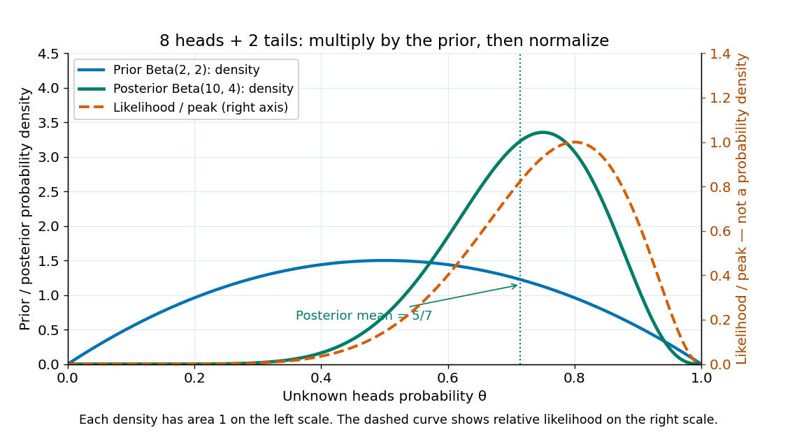

# Bayesian posterior

↑ **Parent:** [Bayesian statistics](bayesian-statistics-split.md)  
ⓦ [Wiki](https://en.wikipedia.org/wiki/Posterior_probability)

The [Bayesian posterior](bayesian-posterior.md) is the [conditional probability](conditional-probability.md) distribution of an unknown [statistical parameter](statistical-parameter.md) after observing data. Suppose a continuous [prior distribution](prior-probability.md) has [prior density](prior-density.md) $\pi(\theta)$ relative to [Lebesgue measure](lebesgue-measure.md) $d\theta$, and $p(d\mid\theta)$ is the sampling [probability mass function](probability-mass-function.md) or [probability density function](probability-density-function.md) of the observed data $d$ in the [statistical model](statistical-model-split.md). [Bayes' theorem](bayes-theorem.md) gives

$$
p(\theta\mid d)=\frac{p(d\mid\theta)\pi(\theta)}{m(d)},\qquad
m(d)=\int p(d\mid t)\pi(t)\,dt,\qquad 0<m(d)<\infty.
$$

The [Bayesian model evidence](bayesian-model-evidence.md) $m(d)$ is the [normalization constant](normalizing-constant.md) making the [posterior density](posterior-density.md) integrate to one. The strict positive, finite condition is essential: a zero or infinite normalizer does not define this [posterior distribution](bayesian-posterior.md), even if the unnormalized expression can be written down. Other reference measures give the corresponding density formula; discrete parameter values replace the integral by a sum. The [posterior propriety](posterior-propriety.md) article gives examples where normalization fails.

With $d$ fixed, $L(\theta;d)=p(d\mid\theta)$ is a [likelihood function](likelihood-function.md) of $\theta$. Its normalization as a sampling distribution is over possible data, not over parameter values. In particular, a [likelihood function](likelihood-function.md) is not a [probability density function](probability-density-function.md) for $\Theta$ and need not integrate to one over $\theta$. The [prior density](prior-density.md) supplies the probability weighting, and the [Bayesian model evidence](bayesian-model-evidence.md) normalizes their product. This distinction prevents a tempting mistake: reversing the conditioning merely by exchanging the words “data” and “parameter”.

For eight heads among ten conditionally independent [Bernoulli trials](bernoulli-trial.md), take the observed data to be the heads count $D=8$. Its [binomial distribution](binomial-distribution.md) [likelihood function](likelihood-function.md) and the $\operatorname{Beta}(2,2)$ [prior density](prior-density.md) give

$$
L(\theta;8)=\binom{10}{8}\theta^8(1-\theta)^2=45\theta^8(1-\theta)^2,\qquad
L(\theta;8)\pi(\theta)=270\theta^9(1-\theta)^3.
$$

Using the [Euler beta function](beta-function.md) $B(10,4)=1/2860$, the [Bayesian model evidence](bayesian-model-evidence.md) and normalized [posterior density](posterior-density.md) are

$$
m(8)=270B(10,4)=\frac{27}{286},\qquad
p(\theta\mid D=8)=2860\theta^9(1-\theta)^3,\quad 0<\theta<1.
$$

Thus the [posterior distribution](bayesian-posterior.md) is $\operatorname{Beta}(10,4)$. If the data are instead one particular ordered sequence with eight heads and two tails, its [likelihood function](likelihood-function.md) omits the factor 45 and its [Bayesian model evidence](bayesian-model-evidence.md) becomes $3/1430$. The factor cancels in [Bayes' theorem](bayes-theorem.md), leaving the same [posterior distribution](bayesian-posterior.md); these two data descriptions have different sampling probabilities but identical information about $\theta$ here.

**[Figure 2](#image-beta-2-2-prior-peak-normalized-bernoulli-likelihood-and-beta-10-4-posterior-after-eight-heads-and-two-tails). Beta(2,2) prior, peak-normalized Bernoulli likelihood, and Beta(10,4) posterior after eight heads and two tails**.

The [prior density](prior-density.md) and [posterior density](posterior-density.md) use the left axis and each integrate to one. The dashed [likelihood function](likelihood-function.md) uses the right axis and is divided by its maximum solely to compare its shape; it is not a parameter [probability density function](probability-density-function.md). The [likelihood function](likelihood-function.md) peaks at $8/10$, while the [posterior mode](maximum-a-posteriori-estimate.md) is $9/12=3/4$ and the [posterior mean](posterior-mean.md) is $5/7$. Multiplying by the [prior density](prior-density.md) shifts the preferred values toward one half while preserving a range of possibilities.

The resulting [posterior variance](posterior-variance.md) is $10\cdot4/(14^2\cdot15)=2/147\approx0.0136054$, compared with [prior](prior-probability.md) [variance](variance-split.md) $1/20$. In this example the update reduces uncertainty. The [posterior predictive probability](posterior-predictive-probability.md) of heads on the next conditionally independent toss is $\mathbb E[\Theta\mid D=8]=5/7$, and the [credible interval](credible-interval.md) above reports a 95% range. These are summaries of the same [posterior distribution](bayesian-posterior.md), rather than competing estimates of one density peak.

**Table of contents**

- [Normal mean posterior with an exponential prior](normal-mean-posterior-with-an-exponential-prior.md)
- [Posterior moment](posterior-moment.md)
- [Exponential posterior for a uniform endpoint](exponential-posterior-for-a-uniform-endpoint.md)
- [Bounded uniform-location posterior](bounded-uniform-location-posterior.md)
- [Discrete uniform endpoint posterior](discrete-uniform-endpoint-posterior.md)
- [Posterior rank distribution](posterior-rank-distribution.md)
- [Posterior variance](posterior-variance.md)
  - [Posterior covariance matrix](posterior-covariance-matrix.md)
- [Posterior predictive distribution](posterior-predictive-distribution.md)
  - [Posterior predictive check](posterior-predictive-check.md)
    - [Conditional versus marginal posterior predictive checks](conditional-versus-marginal-posterior-predictive-checks.md)
- [Flat-prior elimination of a Gaussian common mean](flat-prior-elimination-of-a-gaussian-common-mean.md)
- [Posterior predictive probability](posterior-predictive-probability.md)
- [Posterior density](posterior-density.md)
  - [Log-posterior](log-posterior.md)
- [Posterior mean](posterior-mean.md)
  - [Posterior expectation by Laplace approximation](posterior-expectation-by-laplace-approximation.md)
- [Posterior probability](posterior-probability.md)
  - [Posterior odds](posterior-odds.md)
    - [Base-rate effect in a positive study](base-rate-effect-in-a-positive-study.md)
- [Point-null mixture prior](point-null-mixture-prior.md)
  - [Marginal likelihood for a Gaussian point-null mixture](marginal-likelihood-for-a-gaussian-point-null-mixture.md)
    - [Posterior probability of a Gaussian point null](posterior-probability-of-a-gaussian-point-null.md)
      - [Jeffreys-Lindley paradox for a Gaussian point null](jeffreys-lindley-paradox-for-a-gaussian-point-null.md)
- [Improper prior](improper-prior.md)
  - [Haldane prior](haldane-prior.md)
  - [Scale-invariant prior](scale-invariant-prior.md)
  - [Improper posterior from a log-uniform random-effect scale prior](improper-posterior-from-a-log-uniform-random-effect-scale-prior.md)
  - [Posterior propriety](posterior-propriety.md)
    - [Empty component under an improper prior](empty-component-under-an-improper-prior.md)
- [Poisson-gamma conjugacy](poisson-gamma-conjugacy.md)
  - [Log-gamma prior for a Poisson log-intercept](log-gamma-prior-for-a-poisson-log-intercept.md)
  - [Poisson-gamma conjugacy with unequal exposures](poisson-gamma-conjugacy-with-unequal-exposures.md)
- [Gamma-exponential conjugacy](gamma-exponential-conjugacy.md)
- [Beta-binomial conjugacy](beta-binomial-conjugacy.md)
  - [Beta-geometric conjugacy](beta-geometric-conjugacy.md)
  - [Beta-binomial distribution](beta-binomial-distribution.md)
    - [Uniform-count predictive property](uniform-count-predictive-property.md)
      - [Hypergeometric allocation of exchangeable Bernoulli counts](hypergeometric-allocation-of-exchangeable-bernoulli-counts.md)
  - [Beta-binomial exchangeable coupling](beta-binomial-exchangeable-coupling.md)

## ↑ Ancestors (6)

1. [Bayesian statistics](bayesian-statistics-split.md)
2. [Statistical inference](statistical-inference-split.md)
3. [Probability and statistics](probability-and-statistics-split.md)
4. [Area of mathematics](area-of-mathematics.md)
5. [Mathematics](mathematics-split.md)
6. [Codex Wiki](split.md)

## ← Incoming links (43)

- [Bayesian credibility](bayesian-credibility.md)
- [Bayesian deviance](bayesian-deviance.md)
- [Bayesian model evidence](bayesian-model-evidence.md)
- [Bayesian posterior](bayesian-posterior.md)
- [Bayesian statistics](bayesian-statistics-split.md)
- [BUGS](bugs.md)
- [Credibility estimate](credibility-estimate.md)
- [Flat-prior elimination of a Gaussian common mean](flat-prior-elimination-of-a-gaussian-common-mean.md)
- [Gamma prior for an inverse-gamma scale](gamma-prior-for-an-inverse-gamma-scale.md)
- [Gaussian posterior in the zero-noise limit](gaussian-posterior-in-the-zero-noise-limit.md)
- [Hellinger bound for differences of expectations](hellinger-bound-for-differences-of-expectations.md)
- [Likelihood function](likelihood-function.md)
- [Partial pooling](partial-pooling.md)
- [Solution](past-exam-of-the-mathematics-course-of-the-university-of-cambridge/2001/iii/paper-29/4/i/solution.md)
- [Solution](past-exam-of-the-mathematics-course-of-the-university-of-cambridge/2002/iii/paper-35/3/solution.md)
- [Solution](past-exam-of-the-mathematics-course-of-the-university-of-cambridge/2008/iii/paper-43/4/solution.md)
- [Solution](past-exam-of-the-mathematics-course-of-the-university-of-cambridge/2009/iii/paper-39/4/i/solution.md)
- [Solution](past-exam-of-the-mathematics-course-of-the-university-of-cambridge/2009/iii/paper-39/4/ii/solution.md)
- [Solution](past-exam-of-the-mathematics-course-of-the-university-of-cambridge/2012/iii/paper-40/4/solution.md)
- [Solution](past-exam-of-the-mathematics-course-of-the-university-of-cambridge/2013/iii/paper-28/4/b/iv/solution.md)
- [Solution](past-exam-of-the-mathematics-course-of-the-university-of-cambridge/2014/iii/paper-34/3/solution.md)
- [Solution](past-exam-of-the-mathematics-course-of-the-university-of-cambridge/2014/iii/paper-35/1/b/solution.md)
- [Solution](past-exam-of-the-mathematics-course-of-the-university-of-cambridge/2014/iii/paper-35/1/e/solution.md)
- [Solution](past-exam-of-the-mathematics-course-of-the-university-of-cambridge/2014/iii/paper-35/1/f/solution.md)
- [Solution](past-exam-of-the-mathematics-course-of-the-university-of-cambridge/2014/iii/paper-35/1/g/solution.md)
- [Solution](past-exam-of-the-mathematics-course-of-the-university-of-cambridge/2014/iii/paper-35/2/c/solution.md)
- [Solution](past-exam-of-the-mathematics-course-of-the-university-of-cambridge/2014/iii/paper-35/2/d/solution.md)
- [Solution](past-exam-of-the-mathematics-course-of-the-university-of-cambridge/2014/iii/paper-35/3/i/solution.md)
- [Solution](past-exam-of-the-mathematics-course-of-the-university-of-cambridge/2015/iii/paper-35/1/d/solution.md)
- [Solution](past-exam-of-the-mathematics-course-of-the-university-of-cambridge/2016/iii/paper-208/4/d/solution.md)
- [Solution](past-exam-of-the-mathematics-course-of-the-university-of-cambridge/2022/iii/paper-218/6/a/solution.md)
- [Solution](past-exam-of-the-mathematics-course-of-the-university-of-cambridge/2025/ii/paper-4/28l/c/solution.md)
- [Persistent claim intensity can destroy the discount Markov property](persistent-claim-intensity-can-destroy-the-discount-markov-property.md)
- [Poisson change-point posterior](poisson-change-point-posterior.md)
- [Poisson credibility with a shape-three Pareto intensity](poisson-credibility-with-a-shape-three-pareto-intensity.md)
- [Poisson-uniform posterior mean](poisson-uniform-posterior-mean.md)
- [Posterior predictive distribution](posterior-predictive-distribution.md)
- [Posterior predictive probability](posterior-predictive-probability.md)
- [Posterior variance](posterior-variance.md)
- [Prior density](prior-density.md)
- [Prior probability](prior-probability.md)
- [Single-observation location minimax bound](single-observation-location-minimax-bound.md)
- [Zeros trick](zeros-trick.md)
