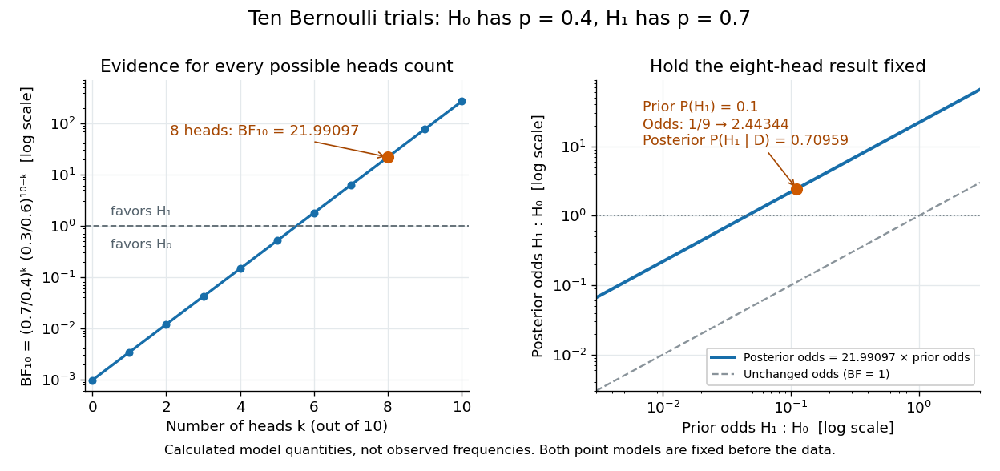
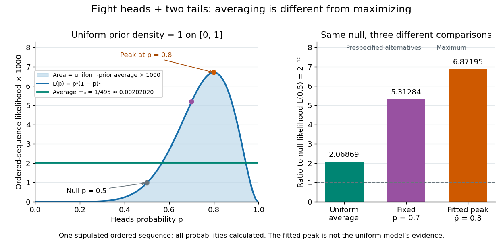

# Bayesian statistics

↑ **Parent:** [Statistical inference](statistical-inference.md)  
ⓦ [Wiki](https://en.wikipedia.org/wiki/Bayesian_statistics)

[Bayesian statistics](bayesian-statistics.md) expresses uncertainty about an unknown [statistical parameter](statistical-model.md#statistical-parameter) through a [probability distribution](probability-distribution.md), then uses [Bayes' theorem](probability-theory.md#bayes-theorem) to update it after observing data. The [prior distribution](#prior-probability) describes uncertainty before the current observations; the [likelihood function](maximum-likelihood-estimation.md#likelihood-function) describes how the [statistical model](statistical-model.md) generates those observations at each parameter value; the [posterior distribution](#bayesian-posterior) describes uncertainty conditional on the observations and that model. A physical parameter can have one fixed value while its value remains uncertain to us. Assigning it a [probability distribution](probability-distribution.md) represents that uncertainty under the chosen model, rather than requiring the physical parameter to change randomly between measurements.

For example, suppose ten [Bernoulli trials](discrete-probability-distribution.md#bernoulli-trial) are independent conditional on an unknown heads [probability](probability-theory.md#probability) $\theta$, with a [beta distribution](probability-distribution.md#beta-distribution) [prior](#prior-probability) $\operatorname{Beta}(2,2)$. Eight heads and two tails give the [posterior distribution](#bayesian-posterior) $\operatorname{Beta}(10,4)$ by [Beta-binomial conjugacy](#beta-binomial-conjugacy). Its [posterior mean](#posterior-mean) is $10/14=5/7\approx0.714286$, between the [prior](#prior-probability) [mean](expected-value.md) $1/2$ and observed [binomial proportion](discrete-probability-distribution.md#binomial-proportion) $8/10$. The [Bayesian posterior](#bayesian-posterior) below computes the whole update, and the [credible interval](#credible-interval) below summarizes its remaining uncertainty. The conjugate update is explained in [MIT 18.05, Reading 15: beta and normal conjugate priors](https://ocw.mit.edu/courses/18-05-introduction-to-probability-and-statistics-spring-2022/mit18_05_s22_class15-prep.pdf).

The useful feature is that one [posterior distribution](#bayesian-posterior) supports several questions: a [posterior mean](#posterior-mean) estimates a value, a [credible interval](#credible-interval) reports a range, and a [posterior predictive distribution](#posterior-predictive-distribution) predicts a future observation while averaging over parameter uncertainty. With conditionally independent new data, today's [posterior distribution](#bayesian-posterior) can become tomorrow's [prior distribution](#prior-probability). These conclusions remain conditional on the [statistical model](statistical-model.md) and [prior distribution](#prior-probability); a precise update does not establish that either assumption fits the experiment.

A historical starting point is Thomas Bayes's essay in the 1763 volume of the Royal Society's Philosophical Transactions, communicated after his death by Richard Price. Its opening problem asks for uncertainty about an unknown event [probability](probability-theory.md#probability) given observed successes and failures: the same direction of reasoning illustrated by the coin example. See [Bayes and Price, An Essay towards solving a Problem in the Doctrine of Chances, opening letter and problem](https://www.gtfp.cs.rhul.ac.uk/pulskamp/Bayes/bayesessay-rjp.pdf).

**Table of contents**

- [Selection conditioning in Bayesian inference](#selection-conditioning-in-bayesian-inference)
- [Likelihood reconstruction from posterior simulation](#likelihood-reconstruction-from-posterior-simulation)
- [BUGS](#bugs)
  - [Zeros trick](#zeros-trick)
- [Variational inference](#variational-inference)
  - [Reparameterization gradient](#reparameterization-gradient)
  - [Markov chain variational inference](#markov-chain-variational-inference)
  - [Mean-field variational inference](#mean-field-variational-inference)
- [Data augmentation](#data-augmentation)
- [Hierarchical Bayesian model](#hierarchical-bayesian-model)
  - [Conditional exchangeability of hospital risks](#conditional-exchangeability-of-hospital-risks)
  - [Non-centered Gaussian random-effect parameterization](#non-centered-gaussian-random-effect-parameterization)
  - [Partial pooling](#partial-pooling)
  - [Gamma–Poisson hierarchical model](#gamma-poisson-hierarchical-model)
    - [Poisson–exponential posterior shrinkage formula](#poisson-exponential-posterior-shrinkage-formula)
    - [Gamma-integrated baseline Poisson likelihood](#gamma-integrated-baseline-poisson-likelihood)
  - [Gaussian–exponential hierarchical colour model](#gaussian-exponential-hierarchical-colour-model)
- [Maximum a posteriori estimation](#maximum-a-posteriori-estimation)
  - [Maximum a posteriori estimate](#maximum-a-posteriori-estimate)
- [Credible interval](#credible-interval)
  - [Equal-tailed credible interval](#equal-tailed-credible-interval)
  - [One-sided credible interval](#one-sided-credible-interval)
- [Empirical Bayes method](#empirical-bayes-method)
  - [Maximum marginal likelihood estimator](#maximum-marginal-likelihood-estimator)
  - [Hyperparameter](#hyperparameter)
- [Dirichlet process](#dirichlet-process)
  - [Dirichlet-multinomial conjugacy](#dirichlet-multinomial-conjugacy)
- [Prior probability](#prior-probability)
  - [Prior mean](#prior-mean)
  - [Prior elicitation](#prior-elicitation)
  - [Prior odds](#prior-odds)
  - [Prior density](#prior-density)
  - [Continuous spike-and-slab prior](#continuous-spike-and-slab-prior)
  - [Uniform prior](#uniform-prior)
- [Bayesian posterior](#bayesian-posterior)
  - [Normal mean posterior with an exponential prior](#normal-mean-posterior-with-an-exponential-prior)
  - [Posterior moment](#posterior-moment)
  - [Exponential posterior for a uniform endpoint](#exponential-posterior-for-a-uniform-endpoint)
  - [Bounded uniform-location posterior](#bounded-uniform-location-posterior)
  - [Discrete uniform endpoint posterior](#discrete-uniform-endpoint-posterior)
  - [Posterior rank distribution](#posterior-rank-distribution)
  - [Posterior variance](#posterior-variance)
    - [Posterior covariance matrix](#posterior-covariance-matrix)
  - [Posterior predictive distribution](#posterior-predictive-distribution)
    - [Posterior predictive check](#posterior-predictive-check)
      - [Conditional versus marginal posterior predictive checks](#conditional-versus-marginal-posterior-predictive-checks)
  - [Flat-prior elimination of a Gaussian common mean](#flat-prior-elimination-of-a-gaussian-common-mean)
  - [Posterior predictive probability](#posterior-predictive-probability)
  - [Posterior density](#posterior-density)
    - [Log-posterior](#log-posterior)
  - [Posterior mean](#posterior-mean)
    - [Posterior expectation by Laplace approximation](#posterior-expectation-by-laplace-approximation)
  - [Posterior probability](#posterior-probability)
    - [Posterior odds](#posterior-odds)
      - [Base-rate effect in a positive study](#base-rate-effect-in-a-positive-study)
  - [Point-null mixture prior](#point-null-mixture-prior)
    - [Marginal likelihood for a Gaussian point-null mixture](#marginal-likelihood-for-a-gaussian-point-null-mixture)
      - [Posterior probability of a Gaussian point null](#posterior-probability-of-a-gaussian-point-null)
        - [Jeffreys-Lindley paradox for a Gaussian point null](#jeffreys-lindley-paradox-for-a-gaussian-point-null)
  - [Improper prior](#improper-prior)
    - [Haldane prior](#haldane-prior)
    - [Scale-invariant prior](#scale-invariant-prior)
    - [Improper posterior from a log-uniform random-effect scale prior](#improper-posterior-from-a-log-uniform-random-effect-scale-prior)
    - [Posterior propriety](#posterior-propriety)
      - [Empty component under an improper prior](#empty-component-under-an-improper-prior)
  - [Poisson-gamma conjugacy](#poisson-gamma-conjugacy)
    - [Log-gamma prior for a Poisson log-intercept](#log-gamma-prior-for-a-poisson-log-intercept)
    - [Poisson-gamma conjugacy with unequal exposures](#poisson-gamma-conjugacy-with-unequal-exposures)
  - [Gamma-exponential conjugacy](#gamma-exponential-conjugacy)
  - [Beta-binomial conjugacy](#beta-binomial-conjugacy)
    - [Beta-geometric conjugacy](#beta-geometric-conjugacy)
    - [Beta-binomial distribution](#beta-binomial-distribution)
      - [Uniform-count predictive property](#uniform-count-predictive-property)
        - [Hypergeometric allocation of exchangeable Bernoulli counts](#hypergeometric-allocation-of-exchangeable-bernoulli-counts)
    - [Beta-binomial exchangeable coupling](#beta-binomial-exchangeable-coupling)
- [Bayes estimator](#bayes-estimator)
  - [Bayes estimator under weighted absolute loss](#bayes-estimator-under-weighted-absolute-loss)
  - [Bayes decision rule](#bayes-decision-rule)
    - [Extended Bayes rule](#extended-bayes-rule)
  - [Bayes estimator under squared error loss](#bayes-estimator-under-squared-error-loss)
    - [Proper-prior obstruction to homogeneous variance Bayes rules](#proper-prior-obstruction-to-homogeneous-variance-bayes-rules)
    - [Gaussian normal-mean shrinkage Bayes estimator](#gaussian-normal-mean-shrinkage-bayes-estimator)
  - [Bayes estimator under parameter-weighted squared error](#bayes-estimator-under-parameter-weighted-squared-error)
  - [Bayes estimator under reciprocal weighted quadratic loss](#bayes-estimator-under-reciprocal-weighted-quadratic-loss)
  - [Posterior expected loss](#posterior-expected-loss)
- [Markov chain Monte Carlo](#markov-chain-monte-carlo)
  - [Autocorrelation time](#autocorrelation-time)
  - [Burn-in](#burn-in)
  - [MCMC trace diagnosis and proposal tuning](#mcmc-trace-diagnosis-and-proposal-tuning)
  - [Coupling from the past](#coupling-from-the-past)
    - [Monotone coupling from the past](#monotone-coupling-from-the-past)
  - [Reversible-jump Markov chain Monte Carlo](#reversible-jump-markov-chain-monte-carlo)
    - [Trans-dimensional annealing for penalized likelihood](#trans-dimensional-annealing-for-penalized-likelihood)
      - [Binomial-normal reversible-jump annealing](#binomial-normal-reversible-jump-annealing)
    - [Birth and death moves for Bayesian variable selection](#birth-and-death-moves-for-bayesian-variable-selection)
    - [Centered polynomial birth move in reversible-jump sampling](#centered-polynomial-birth-move-in-reversible-jump-sampling)
    - [Pseudo-prior](#pseudo-prior)
      - [Pseudo-prior augmentation for model comparison](#pseudo-prior-augmentation-for-model-comparison)
        - [Poisson mean equality model comparison](#poisson-mean-equality-model-comparison)
    - [Equal-dimension reversible-jump acceptance probability](#equal-dimension-reversible-jump-acceptance-probability)
  - [Hit-and-run sampler](#hit-and-run-sampler)
    - [Hit-and-run kernel density](#hit-and-run-kernel-density)
  - [Markov chain Monte Carlo convergence diagnostics](#markov-chain-monte-carlo-convergence-diagnostics)
    - [Potential scale reduction factor](#potential-scale-reduction-factor)
    - [Trace plot](#trace-plot)
  - [Thinning of a Markov chain](#thinning-of-a-markov-chain)
  - [Geometric ergodicity](#geometric-ergodicity)
    - [Central limit theorem for a geometrically ergodic Markov chain](#central-limit-theorem-for-a-geometrically-ergodic-markov-chain)
    - [Uniform geometric ergodicity](#uniform-geometric-ergodicity)
    - [Burn-in total variation comparison](#burn-in-total-variation-comparison)
    - [Absolute L2 spectral gap of a reversible Markov chain](#absolute-l2-spectral-gap-of-a-reversible-markov-chain)
      - [Stationary covariance bound for reversible Markov chains](#stationary-covariance-bound-for-reversible-markov-chains)
    - [Markov-chain law of large numbers](#markov-chain-law-of-large-numbers)
    - [Minorization condition](#minorization-condition)
      - [Doeblin's condition](#doeblin-s-condition)
    - [Small set](#small-set)
    - [Drift-minorisation condition](#drift-minorisation-condition)
      - [Geometric drift condition](#geometric-drift-condition)
        - [Bounded conditional moments imply a geometric drift](#bounded-conditional-moments-imply-a-geometric-drift)
  - [Markov chain Monte Carlo asymptotic variance](#markov-chain-monte-carlo-asymptotic-variance)
  - [Discrete-time Poincaré inequality for a Markov kernel](#discrete-time-poincare-inequality-for-a-markov-kernel)
  - [Peskun ordering](#peskun-ordering)
  - [Hamiltonian Monte Carlo](#hamiltonian-monte-carlo)
    - [Surrogate Hamiltonian Monte Carlo](#surrogate-hamiltonian-monte-carlo)
  - [Metropolis–Hastings algorithm](#metropolis-hastings-algorithm)
    - [Metropolis-within-Gibbs algorithm](#metropolis-within-gibbs-algorithm)
    - [Pseudo-marginal Metropolis–Hastings algorithm](#pseudo-marginal-metropolis-hastings-algorithm)
      - [Unbiased likelihood estimator](#unbiased-likelihood-estimator)
    - [Metropolis–Hastings acceptance probability](#metropolis-hastings-acceptance-probability)
    - [Proposal distribution](#proposal-distribution)
      - [Involutive Metropolis proposal](#involutive-metropolis-proposal)
      - [Orthogonal-mixture Metropolis proposal](#orthogonal-mixture-metropolis-proposal)
      - [Gaussian autoregressive proposal reversible with respect to a standard normal distribution](#gaussian-autoregressive-proposal-reversible-with-respect-to-a-standard-normal-distribution)
        - [Preconditioned Crank–Nicolson algorithm](#preconditioned-crank-nicolson-algorithm)
    - [Random-walk Metropolis algorithm](#random-walk-metropolis-algorithm)
      - [Positive-parameter random walk with boundary rejection](#positive-parameter-random-walk-with-boundary-rejection)
      - [Proposal scale and random-walk Metropolis efficiency](#proposal-scale-and-random-walk-metropolis-efficiency)
    - [Independence Metropolis–Hastings algorithm](#independence-metropolis-hastings-algorithm)
  - [Effective sample size of a Markov chain](#effective-sample-size-of-a-markov-chain)
    - [Integrated autocorrelation time](#integrated-autocorrelation-time)
  - [Gibbs sampler](#gibbs-sampler)
    - [Gaussian Gibbs sweep autocorrelation](#gaussian-gibbs-sweep-autocorrelation)
    - [Gaussian two-coordinate Gibbs recursion](#gaussian-two-coordinate-gibbs-recursion)
    - [WinBUGS](#winbugs)
    - [Linear contraction of a two-coordinate Gaussian Gibbs sweep](#linear-contraction-of-a-two-coordinate-gaussian-gibbs-sweep)
    - [Gibbs sampling for a finite hidden spin field](#gibbs-sampling-for-a-finite-hidden-spin-field)
      - [Local likelihood factors in a hidden spin field](#local-likelihood-factors-in-a-hidden-spin-field)
    - [Systematic Gibbs sampling need not be reversible](#systematic-gibbs-sampling-need-not-be-reversible)
    - [Blocked Gibbs sampler](#blocked-gibbs-sampler)
      - [Checkerboard Gibbs sampling](#checkerboard-gibbs-sampling)
    - [Random-scan Gibbs sampler](#random-scan-gibbs-sampler)
      - [Detailed balance of a random-scan Gibbs sampler](#detailed-balance-of-a-random-scan-gibbs-sampler)
    - [Tempered Gibbs sampler](#tempered-gibbs-sampler)
    - [Stationarity of the two-coordinate Gibbs sampler](#stationarity-of-the-two-coordinate-gibbs-sampler)
    - [Normal mean-precision Gibbs sampler](#normal-mean-precision-gibbs-sampler)
- [Bayesian model evidence](#bayesian-model-evidence)
  - [Evidence averaging under an interval prior](#evidence-averaging-under-an-interval-prior)
    - [Laplace-likelihood interval evidence](#laplace-likelihood-interval-evidence)
  - [Prior predictive check](#prior-predictive-check)
  - [Harmonic mean estimator of Bayesian model evidence](#harmonic-mean-estimator-of-bayesian-model-evidence)
  - [Bayes factor](#bayes-factor)
    - [Uniform-alternative binomial Bayes factor](#uniform-alternative-binomial-bayes-factor)
    - [Gaussian practical-null mixture](#gaussian-practical-null-mixture)
    - [Savage-Dickey density ratio](#savage-dickey-density-ratio)
- [Bayesian model averaging](#bayesian-model-averaging)
- [Evidence lower bound](#evidence-lower-bound)

## Selection conditioning in Bayesian inference

↑ **Parent:** [Bayesian statistics](bayesian-statistics.md)

If inclusion depends only on fully observed data $d$, then $p(S\mid d,\theta)=p(S\mid d)$ cancels from [Bayes' theorem](probability-theory.md#bayes-theorem) for that individual's parameters. Selection can still matter for unknown population parameters and for missing or unconditioned features. For independent detected observations conditional on their count and population parameters $\Lambda$, each [likelihood](maximum-likelihood-estimation.md#likelihood-function) has normalization $\alpha(\Lambda)=\int S(d)p(d\mid\Lambda)\,dd$. A model for the detected count adds its own count [likelihood](maximum-likelihood-estimation.md#likelihood-function). Do not combine a selected-population [prior](#prior-probability) with a truncated-data [likelihood](maximum-likelihood-estimation.md#likelihood-function) in a way that counts the same selection twice.

## Likelihood reconstruction from posterior simulation

↑ **Parent:** [Bayesian statistics](bayesian-statistics.md)

For data $x$, a positive [prior distribution](#prior-probability) density $\pi$ and [likelihood function](maximum-likelihood-estimation.md#likelihood-function) $\ell$, [Bayes' theorem](probability-theory.md#bayes-theorem) gives posterior density $h(\theta\mid x)=\pi(\theta)\ell(\theta)/m(x)$. Thus $h/\pi$ reconstructs the likelihood up to a constant. Estimate the posterior density from simulation, divide by the known prior density and maximize over the search region. A [posterior mode](#maximum-a-posteriori-estimate) alone instead estimates a [maximum a posteriori estimate](#maximum-a-posteriori-estimate); it estimates a likelihood maximizer only when the prior is constant there. Prior support must include the likelihood maximizer of interest.

// Target: biology.bigb

## BUGS

↑ **Parent:** [Bayesian statistics](bayesian-statistics.md)

[BUGS](#bugs) specifies a probabilistic model through stochastic nodes, deterministic nodes and observed data, then uses [Markov chain Monte Carlo](#markov-chain-monte-carlo) to simulate its [Bayesian posterior](#bayesian-posterior). Its normal sampling notation uses a [precision parameter](statistical-modelling.md#precision-parameter) rather than a [variance](variance.md), and its gamma notation uses shape and rate.

### Zeros trick

↑ **Parent:** [BUGS](#bugs)

A [zeros trick](#zeros-trick) implements a positive [likelihood function](maximum-likelihood-estimation.md#likelihood-function) $L(\theta)$ by adding an observed zero with [Poisson distribution](discrete-probability-distribution.md#poisson-distribution) mean $K-\log L(\theta)$. If this mean is nonnegative throughout the parameter support, its likelihood is $e^{-K}L(\theta)$ and yields the intended [Bayesian posterior](#bayesian-posterior). The constant $K$ must be independent of the parameter; arbitrary clipping changes the target.

## Variational inference

↑ **Parent:** [Bayesian statistics](bayesian-statistics.md)  
ⓦ [Wiki](https://en.wikipedia.org/wiki/Variational_inference)

[Variational inference](#variational-inference) approximates a [posterior distribution](#bayesian-posterior) by minimizing a [Kullback-Leibler divergence](f-divergence.md#kullback-leibler-divergence) over a chosen family of [probability distributions](probability-distribution.md). For an unnormalized [posterior density](#posterior-density) $h$ and a trial [probability density function](continuous-probability-distribution.md#probability-density-function) $q$, minimizing $\mathbb E_q[\log q-\log h]$ is equivalent to minimizing $\operatorname{KL}(q\Vert h/\int h)$.

### Reparameterization gradient

↑ **Parent:** [Variational inference](#variational-inference)

A [reparameterization gradient](#reparameterization-gradient) differentiates an [expected value](expected-value.md) by representing the simulated [random variable](random-variable.md) as a differentiable transformation of parameter-independent noise. For $X_\eta=g_\eta(\varepsilon)$, the identity $\nabla_\eta\mathbb E[F_\eta(X_\eta)]=\mathbb E[\nabla_\eta F_\eta(g_\eta(\varepsilon))]$ requires justified [differentiation under the integral sign](analysis.md#differentiation-under-the-integral-sign). For a [normal distribution](probability-distribution.md#normal-distribution), use $X=m+e^\rho\varepsilon$ with $\varepsilon$ drawn from the [standard normal distribution](probability-distribution.md#standard-normal-distribution).

### Markov chain variational inference

↑ **Parent:** [Variational inference](#variational-inference)

[Markov chain variational inference](#markov-chain-variational-inference) optimizes an initial parametric [probability distribution](probability-distribution.md) $\nu_\eta$ by minimizing $\operatorname{KL}(K^t\nu_\eta\Vert\pi)$ after a fixed number of [Markov kernel](markov-chain.md#markov-kernel) updates. The best initial [probability distribution](probability-distribution.md) can depend on $t$; [Kullback-Leibler divergence](f-divergence.md#kullback-leibler-divergence) contraction does not imply that optimization commutes with applying the [Markov kernel](markov-chain.md#markov-kernel).

### Mean-field variational inference

↑ **Parent:** [Variational inference](#variational-inference)

[Mean-field variational inference](#mean-field-variational-inference) restricts the trial [probability density function](continuous-probability-distribution.md#probability-density-function) to $q(x)=\prod_iq_i(x_i)$. With the other factors fixed, $q_j^*(x_j)\propto\exp(\mathbb E_{q_{-j}}\log\pi(x_j,X_{-j}))$, provided this expression has a finite positive [normalization constant](continuous-probability-distribution.md#normalizing-constant). Subtracting the objective at $q_j^*$ leaves $\operatorname{KL}(q_j\Vert q_j^*)\geq0$, proving the update is optimal when the terms are well defined.

## Data augmentation

↑ **Parent:** [Bayesian statistics](bayesian-statistics.md)

[Data augmentation](#data-augmentation) enlarges a [posterior distribution](#bayesian-posterior) with [latent variables](latent-variable.md) whose removal by [marginalization](probability-distribution.md#marginalization) recovers the original [posterior distribution](#bayesian-posterior). Convenient [full conditional distributions](probability-theory.md#full-conditional-distribution) then permit a [Gibbs sampler](#gibbs-sampler) on the enlarged space.

## Hierarchical Bayesian model

↑ **Parent:** [Bayesian statistics](bayesian-statistics.md)

A hierarchical Bayesian model assigns distributions to local [latent variables](latent-variable.md) conditional on shared [hyperparameters](#hyperparameter), then distributions to observations conditional on those latent variables. Its [probabilistic graphical model](statistical-model.md#probabilistic-graphical-model) records this conditional factorization, often using a plate for repeated observations. Integrating out latent variables gives the marginal likelihood of the hyperparameters. Priors described as flat on logarithms require a [Jacobian determinant](multivariable-calculus.md#jacobian-determinant) when densities are written in the original positive variables.

### Conditional exchangeability of hospital risks

↑ **Parent:** [Hierarchical Bayesian model](#hierarchical-bayesian-model)

Unknown hospital event probabilities can be modelled as [exchangeable random variables](probability-distribution.md#exchangeable-random-variables) conditional on shared hyperparameters, for example $P_j\mid m,\kappa\sim\operatorname{Beta}(m\kappa,(1-m)\kappa)$ independently. Different sample sizes affect the binomial observations but do not by themselves invalidate exchangeability of the risks. Known systematic covariate differences, such as case mix or procedure type, should instead enter the risk model; only residual effects may then be exchangeable. Exchangeability permits heterogeneous realized risks and is not an assertion that all risks are equal.

// Target: biology.bigb

### Non-centered Gaussian random-effect parameterization

↑ **Parent:** [Hierarchical Bayesian model](#hierarchical-bayesian-model)

A normal local effect $\alpha_i\mid\delta,\tau\sim N(\delta,\tau^2)$ can be represented by a standardized [latent variable](latent-variable.md) $z_i\sim N(0,1)$ independent of the hyperparameters, with $\alpha_i=\delta+\tau z_i$. This preserves the hierarchical model while changing the coordinates explored by [Markov chain Monte Carlo](#markov-chain-monte-carlo). It often improves mixing when individual effects are weakly informed, reducing strong scale-effect dependence. Centered coordinates can be better with very informative individual data. The stochastic prior on $z_i$ implements the transformation correctly; re-expressing an existing density directly instead requires the appropriate [Jacobian determinant](multivariable-calculus.md#jacobian-determinant).

### Partial pooling

↑ **Parent:** [Hierarchical Bayesian model](#hierarchical-bayesian-model)

[Partial pooling](#partial-pooling) estimates related local parameters jointly through shared [hyperparameters](#hyperparameter). Each local [Bayesian posterior](#bayesian-posterior) balances its own [likelihood function](maximum-likelihood-estimation.md#likelihood-function) against a group [prior distribution](#prior-probability), with stronger shrinkage when its data are weak or the group variation is small. It lies between forcing all local parameters to be equal and estimating them independently. [Random-effects meta-analysis](statistical-inference.md#random-effects-meta-analysis) is an important application.

<h3 id="gamma-poisson-hierarchical-model">Gamma–Poisson hierarchical model</h3>

↑ **Parent:** [Hierarchical Bayesian model](#hierarchical-bayesian-model)

A [Gamma–Poisson hierarchical model](#gamma-poisson-hierarchical-model) uses $Y_i\mid\theta_i\sim\operatorname{Poisson}(t_i\theta_i)$, $\theta_i\mid b\sim\operatorname{Gamma}(a,b)$, and $b\sim\operatorname{Gamma}(c,r)$, with [gamma distributions](continuous-probability-distribution.md#gamma-distribution) in shape-rate convention. [Conditional independence](random-variable.md#conditional-independence) gives [full conditional distributions](probability-theory.md#full-conditional-distribution) $\theta_i\mid b,y\sim\operatorname{Gamma}(a+y_i,b+t_i)$ and $b\mid\theta,y\sim\operatorname{Gamma}(c+na,r+\sum_i\theta_i)$.

<h4 id="poisson-exponential-posterior-shrinkage-formula">Poisson–exponential posterior shrinkage formula</h4>

↑ **Parent:** [Gamma–Poisson hierarchical model](#gamma-poisson-hierarchical-model)

For $Y_i\mid\theta_i\sim\operatorname{Poisson}(\theta_i)$ and $\theta_i\mid\psi\sim\operatorname{Exp}(\psi)$, a [scale-invariant prior](#scale-invariant-prior) $d\psi/\psi$ induces the [Haldane prior](#haldane-prior) on $\phi=(1+\psi)^{-1}$. Integrating out each local mean gives $p(y_i\mid\phi)=(1-\phi)\phi^{y_i}$. Thus $\phi\mid y\sim\operatorname{Beta}(s,n)$ for $s=\sum_i y_i>0$. The gamma [full conditional distribution](probability-theory.md#full-conditional-distribution) has mean $(y_i+1)\phi$, so the [tower property](measure-theory.md#law-of-total-expectation) gives $(y_i+1)s/(s+n)$, equal to the displayed [partial pooling](#partial-pooling) formula. For $s=0$, the posterior is improper and this expectation is undefined.

#### Gamma-integrated baseline Poisson likelihood

↑ **Parent:** [Gamma–Poisson hierarchical model](#gamma-poisson-hierarchical-model)

For independent [Poisson distributions](discrete-probability-distribution.md#poisson-distribution) with means $u e^{\eta_k}$ and a shape–rate [Gamma distribution](continuous-probability-distribution.md#gamma-distribution) prior on $u$, integrating $u$ adds $a$ to the total-count exponent and $b$ to the sum of relative rates. This distinguishes gamma mixing from conditioning on the total count, which gives a [multinomial distribution](discrete-probability-distribution.md#multinomial-distribution).

<h3 id="gaussian-exponential-hierarchical-colour-model">Gaussian–exponential hierarchical colour model</h3>

↑ **Parent:** [Hierarchical Bayesian model](#hierarchical-bayesian-model)

An observed astronomical colour is the sum of a normal intrinsic colour, a nonnegative dust contribution with an [exponential distribution](continuous-probability-distribution.md#exponential-distribution), and normal measurement noise. With latent $C_s\sim N(\mu,v)$, $E_s\sim\operatorname{Exp}(\text{mean }\tau)$ and $O_s\mid C_s,E_s\sim N(C_s+E_s,r_s)$, the [Gibbs sampler](#gibbs-sampler) conditionals for $C_s$ are normal and those for $E_s$ are [truncated normal distributions](probability-distribution.md#truncated-normal-distribution). A flat prior on $\mu$ and inverse-gamma priors on $v,\tau$ give inverse-gamma conditional updates for the two scales. Log-flat priors on both scales instead make the joint posterior improper when all $r_s>0$, despite formally proper full conditionals at generic latent states: the marginal observed likelihood has a positive limit at either zero-scale boundary. Proper positive-scale priors restore a genuine joint posterior.

## Maximum a posteriori estimation

↑ **Parent:** [Bayesian statistics](bayesian-statistics.md)  
ⓦ [Wiki](https://en.wikipedia.org/wiki/Maximum_a_posteriori_estimation)

[Maximum a posteriori estimation](#maximum-a-posteriori-estimation) selects a parameter value maximizing its posterior density relative to a specified reference measure. Its output is a [maximum a posteriori estimate](#maximum-a-posteriori-estimate). The maximizing value need not be invariant under a nonlinear reparameterization, because a density transforms with a Jacobian.

### Maximum a posteriori estimate

↑ **Parent:** [Maximum a posteriori estimation](#maximum-a-posteriori-estimation)

A maximum a posteriori estimate maximizes the posterior density of a parameter or latent configuration. Equivalently, it maximizes the sum of the log likelihood and log prior, relative to the chosen reference measure.

## Credible interval

↑ **Parent:** [Bayesian statistics](bayesian-statistics.md)  
ⓦ [Wiki](https://en.wikipedia.org/wiki/Credible_interval)

A [credible interval](#credible-interval) is an [interval](real-analysis.md#interval-mathematics) $C(d)$ containing a prescribed amount $1-\alpha$ of [posterior probability](#posterior-probability) for an unknown scalar [statistical parameter](statistical-model.md#statistical-parameter) $\Theta$. For a continuous [posterior distribution](#bayesian-posterior) with [posterior density](#posterior-density) $p(\theta\mid d)$, its endpoints satisfy

$$
\mathbb P(a\leq\Theta\leq b\mid D=d)=\int_a^b p(\theta\mid d)\,d\theta=1-\alpha.
$$

The conditioning includes the chosen [statistical model](statistical-model.md) and [prior distribution](#prior-probability). For a discrete [posterior distribution](#bayesian-posterior), exact equality may be impossible because of its [probability masses](probability-distribution.md#probability-mass); an interval can instead be required to contain at least the requested [posterior probability](#posterior-probability). An interval compresses the full [posterior distribution](#bayesian-posterior) into a range whose uncertainty can be communicated in the parameter's own units. See [MIT 18.05, Class 16: probability intervals](https://ocw.mit.edu/courses/18-05-introduction-to-probability-and-statistics-spring-2022/mit18_05_s22_statistics.pdf#page=68).

For the eight-head, two-tail example in [Bayesian statistics](bayesian-statistics.md), the [posterior density](#posterior-density) is $2860\theta^9(1-\theta)^3$ on $[0,1]$. Its [cumulative distribution function](probability-distribution.md#cumulative-distribution-function), obtained by [integration](integral.md) of this [polynomial](polynomial.md), is

$$
F(t)=286t^{10}-780t^{11}+715t^{12}-220t^{13},\qquad 0\leq t\leq1.
$$

Solving $F(a)=0.025$ and $F(b)=0.975$ by the [bisection method](numerical-analysis.md#bisection-method) gives

$$
a\approx0.461868461,\qquad b\approx0.909079605,\qquad F(b)-F(a)=0.95.
$$

These are numerical approximations to the exact [quantiles](probability-distribution.md#quantile-function) defined by those equations; the endpoints were computed from the [cumulative distribution function](probability-distribution.md#cumulative-distribution-function), rather than read off a plot. The resulting [equal-tailed credible interval](#equal-tailed-credible-interval) leaves 2.5% [posterior probability](#posterior-probability) on each side. Its shaded area is 95% of the total area under the [posterior density](#posterior-density).

**[Figure 1](#image-two-different-95-percent-credible-intervals-for-the-same-beta-10-4-posterior). Two different 95 percent credible intervals for the same Beta(10,4) posterior**.

[Credible intervals](#credible-interval) are not unique. The [one-sided credible interval](#one-sided-credible-interval) $[0,F^{-1}(0.95)]\approx[0,0.887334219]$ also has 95% [posterior probability](#posterior-probability), but leaves all 5% outside it on the right. A [highest density region](statistical-inference.md#highest-density-region) instead selects points above a density threshold; it need not be an [equal-tailed credible interval](#equal-tailed-credible-interval), and when the [posterior density](#posterior-density) has separated peaks it need not be one [interval](real-analysis.md#interval-mathematics) at all. Thus a reported [credible interval](#credible-interval) should specify its construction.

A 95% [credible interval](#credible-interval) makes a statement about the [statistical parameter](statistical-model.md#statistical-parameter) conditional on these observed data and the Bayesian model. A 95% [confidence interval](statistical-inference.md#confidence-interval) instead refers to the [coverage probability](statistical-inference.md#coverage-probability) of a procedure under repeated sampling at a fixed parameter value. These are different conditioning statements: 95% [posterior probability](#posterior-probability) does not by itself imply 95% [coverage probability](statistical-inference.md#coverage-probability) for every fixed parameter. The [confidence interval](statistical-inference.md#confidence-interval) article develops that sampling interpretation.

### Equal-tailed credible interval

↑ **Parent:** [Credible interval](#credible-interval)

An [equal-tailed credible interval](#equal-tailed-credible-interval) uses [quantiles](probability-distribution.md#quantile-function) of a continuous [posterior distribution](#bayesian-posterior) to leave [posterior probability](#posterior-probability) $\alpha/2$ in each tail. It is also called a [central credible interval](#equal-tailed-credible-interval); central refers to equal tail probabilities, not equal distances from the [posterior mean](#posterior-mean). For the [beta distribution](probability-distribution.md#beta-distribution) $\operatorname{Beta}(10,4)$ in [credible interval](#credible-interval), the 95% endpoints are approximately $0.461868461$ and $0.909079605$, whose midpoint $0.685474033$ differs from the [posterior mean](#posterior-mean) $5/7$.

### One-sided credible interval

↑ **Parent:** [Credible interval](#credible-interval)

A [one-sided credible interval](#one-sided-credible-interval) puts all excluded [posterior probability](#posterior-probability) in one tail. For a continuous [posterior distribution](#bayesian-posterior), an upper bound $u=F^{-1}(1-\alpha)$ satisfies $\mathbb P(\Theta\leq u\mid D=d)=1-\alpha$; a lower bound uses $F^{-1}(\alpha)$. Intersecting with the parameter's allowed range removes points of zero [posterior probability](#posterior-probability). For the [beta distribution](probability-distribution.md#beta-distribution) $\operatorname{Beta}(10,4)$, the upper 95% bound is $u\approx0.887334219$, so $[0,u]$ is the alternative [credible interval](#credible-interval) shown above.

## Empirical Bayes method

↑ **Parent:** [Bayesian statistics](bayesian-statistics.md)  
ⓦ [Wiki](https://en.wikipedia.org/wiki/Empirical_Bayes_method)

An empirical Bayes method estimates prior hyperparameters from the marginal distribution of the observed data and then uses the resulting fitted prior in Bayesian inference.

### Maximum marginal likelihood estimator

↑ **Parent:** [Empirical Bayes method](#empirical-bayes-method)

A maximum marginal likelihood estimator chooses a [hyperparameter](#hyperparameter) by maximizing the data density obtained after integrating the model parameter against its prior distribution.

### Hyperparameter

↑ **Parent:** [Empirical Bayes method](#empirical-bayes-method)  
ⓦ [Wiki](https://en.wikipedia.org/wiki/Hyperparameter)

A hyperparameter controls a family of [prior distributions](#prior-probability) or statistical models and is fixed, estimated, or assigned a further prior at a higher level of a hierarchical model.

## Dirichlet process

↑ **Parent:** [Bayesian statistics](bayesian-statistics.md)  
ⓦ [Wiki](https://en.wikipedia.org/wiki/Dirichlet_process)

A Dirichlet process is a distribution over probability measures such that the masses assigned to every finite measurable partition have a [Dirichlet distribution](continuous-probability-distribution.md#dirichlet-distribution). Its draws are almost surely discrete.

### Dirichlet-multinomial conjugacy

↑ **Parent:** [Dirichlet process](#dirichlet-process)

A Dirichlet prior with parameters $(\alpha_1,\ldots,\alpha_K)$ combined with categorical labels having counts $(N_1,\ldots,N_K)$ gives a Dirichlet posterior with parameters $(\alpha_1+N_1,\ldots,\alpha_K+N_K)$.

## Prior probability

↑ **Parent:** [Bayesian statistics](bayesian-statistics.md)  
ⓦ [Wiki](https://en.wikipedia.org/wiki/Prior_probability)

[Prior probability](#prior-probability) describes uncertainty before the current observations are incorporated. For a [statistical parameter](statistical-model.md#statistical-parameter) $\Theta$, a [prior distribution](#prior-probability) assigns [probabilities](probability-theory.md#probability) to its possible ranges, conditional on background information and a [statistical model](statistical-model.md). A continuous [prior density](#prior-density) $\pi(\theta)$ specifies these probabilities through [integration](integral.md):

$$
\mathbb P(\Theta\in A)=\int_A\pi(\theta)\,d\theta,\qquad \pi(\theta)\geq0,\qquad \int\pi(\theta)\,d\theta=1.
$$

Here the [probability density function](continuous-probability-distribution.md#probability-density-function) is relative to [Lebesgue measure](measure-theory.md#lebesgue-measure) $d\theta$; a discrete [prior distribution](#prior-probability) instead uses a [probability mass function](probability-distribution.md#probability-mass-function) and sums. Density at one point is not the [probability](probability-theory.md#probability) of that point. A nonnegative kernel with infinite total mass is an [improper prior](#improper-prior), whose use requires a separate check of [posterior propriety](#posterior-propriety).

For the coin model in [Bayesian statistics](bayesian-statistics.md), the [beta distribution](probability-distribution.md#beta-distribution) $\operatorname{Beta}(2,2)$ has [prior density](#prior-density) $\pi(\theta)=6\theta(1-\theta)$ on $[0,1]$. Its [mean](expected-value.md) is $1/2$ and its [variance](variance.md) is $1/20$. It favors moderate heads probabilities without ruling out values near zero or one. For example,

$$
\mathbb P(\Theta>3/4)=\int_{3/4}^1 6\theta(1-\theta)\,d\theta=\frac5{32}=0.15625.
$$

The prior curve in [Bayesian posterior](#bayesian-posterior) makes this preference visible; [moment matching for a beta prior](probability-distribution.md#moment-matching-for-a-beta-prior) explains how to choose a [beta distribution](probability-distribution.md#beta-distribution) from a desired [mean](expected-value.md) and [variance](variance.md).

A [prior distribution](#prior-probability) lets earlier evidence or elicited knowledge contribute to [statistical inference](statistical-inference.md) when the current [sample size](probability-and-statistics.md#sample-size) is limited. It also exposes assumptions that can be checked by [prior elicitation](#prior-elicitation) and a [prior predictive check](#prior-predictive-check). Before the same eight heads and two tails, a [uniform prior](#uniform-prior) $\operatorname{Beta}(1,1)$ would give [posterior mean](#posterior-mean) $9/12=3/4$, compared with $5/7$ under $\operatorname{Beta}(2,2)$: the observations do not uniquely determine a [Bayesian posterior](#bayesian-posterior). Even a [uniform prior](#uniform-prior) makes a choice of parameter coordinates; its child article explains why changing coordinates can destroy uniformity.

### Prior mean

↑ **Parent:** [Prior probability](#prior-probability)

The [prior mean](#prior-mean) is the [expected value](expected-value.md) of a [statistical parameter](statistical-model.md#statistical-parameter) under its [prior distribution](#prior-probability), when this [expected value](expected-value.md) exists. The [posterior mean](#posterior-mean) instead uses the [posterior distribution](#bayesian-posterior) after conditioning on observations.

### Prior elicitation

↑ **Parent:** [Prior probability](#prior-probability)

Translate external information into a [prior distribution](#prior-probability) by asking for representative values, uncertainty intervals and tail probabilities. Fit parameters of a suitable distribution to those judgments and inspect the resulting [prior predictive distribution](#bayesian-model-evidence). For a probability believed near $0.1$, a [beta distribution](probability-distribution.md#beta-distribution) with parameters $0.1\kappa,0.9\kappa$ has the desired mean; its concentration $\kappa$ can be chosen to match a stated probability of exceeding $0.15$. The words “near” and “unlikely” alone do not specify one unique prior.

### Prior odds

↑ **Parent:** [Prior probability](#prior-probability)

For two exhaustive mutually exclusive models of positive [prior probability](#prior-probability), prior odds compare their probabilities before observing the data. They must be distinguished from the parameter [prior distributions](#prior-probability) within those models. A [Bayes factor](#bayes-factor) multiplies these prior odds to produce [posterior odds](#posterior-odds).

### Prior density

↑ **Parent:** [Prior probability](#prior-probability)

A [prior density](#prior-density) is the [probability density function](continuous-probability-distribution.md#probability-density-function) of a continuous [prior distribution](#prior-probability) with respect to a specified reference measure. A proper prior density is nonnegative and integrates to one. Prior-density factors enter [Bayesian posterior](#bayesian-posterior) and [RJ-MCMC](#reversible-jump-markov-chain-monte-carlo) acceptance formulas along with the likelihood and model prior probabilities.

### Continuous spike-and-slab prior

↑ **Parent:** [Prior probability](#prior-probability)

A [continuous spike-and-slab prior](#continuous-spike-and-slab-prior) mixes a narrow continuous [probability distribution](probability-distribution.md) around zero with a much wider component. It permits practical effect selection while retaining a continuous [posterior density](#posterior-density). Its narrow component is not the exact-zero mass of a [point-null mixture prior](#point-null-mixture-prior). A latent component indicator aids computation; a wide-component draw can still have small magnitude, so posterior effect thresholds and component membership answer different questions.

### Uniform prior

↑ **Parent:** [Prior probability](#prior-probability)

A [uniform prior](#uniform-prior) on a finite-volume parameter region assigns constant [probability](probability-theory.md#probability) density there and zero outside. On $[0,1]$ it is $\operatorname{Beta}(1,1)$, giving a [beta distribution](probability-distribution.md#beta-distribution) posterior after [binomial distribution](discrete-probability-distribution.md#binomial-distribution) data. Uniformity depends on the coordinate: a nonlinear reparametrization introduces a Jacobian and generally does not preserve a uniform density.

## Bayesian posterior

↑ **Parent:** [Bayesian statistics](bayesian-statistics.md)  
ⓦ [Wiki](https://en.wikipedia.org/wiki/Posterior_probability)

The [Bayesian posterior](#bayesian-posterior) is the [conditional probability](probability-theory.md#conditional-probability) distribution of an unknown [statistical parameter](statistical-model.md#statistical-parameter) after observing data. Suppose a continuous [prior distribution](#prior-probability) has [prior density](#prior-density) $\pi(\theta)$ relative to [Lebesgue measure](measure-theory.md#lebesgue-measure) $d\theta$, and $p(d\mid\theta)$ is the sampling [probability mass function](probability-distribution.md#probability-mass-function) or [probability density function](continuous-probability-distribution.md#probability-density-function) of the observed data $d$ in the [statistical model](statistical-model.md). [Bayes' theorem](probability-theory.md#bayes-theorem) gives

$$
p(\theta\mid d)=\frac{p(d\mid\theta)\pi(\theta)}{m(d)},\qquad
m(d)=\int p(d\mid t)\pi(t)\,dt,\qquad 0<m(d)<\infty.
$$

The [Bayesian model evidence](#bayesian-model-evidence) $m(d)$ is the [normalization constant](continuous-probability-distribution.md#normalizing-constant) making the [posterior density](#posterior-density) integrate to one. The strict positive, finite condition is essential: a zero or infinite normalizer does not define this [posterior distribution](#bayesian-posterior), even if the unnormalized expression can be written down. Other reference measures give the corresponding density formula; discrete parameter values replace the integral by a sum. The [posterior propriety](#posterior-propriety) article gives examples where normalization fails.

With $d$ fixed, $L(\theta;d)=p(d\mid\theta)$ is a [likelihood function](maximum-likelihood-estimation.md#likelihood-function) of $\theta$. Its normalization as a sampling distribution is over possible data, not over parameter values. In particular, a [likelihood function](maximum-likelihood-estimation.md#likelihood-function) is not a [probability density function](continuous-probability-distribution.md#probability-density-function) for $\Theta$ and need not integrate to one over $\theta$. The [prior density](#prior-density) supplies the probability weighting, and the [Bayesian model evidence](#bayesian-model-evidence) normalizes their product. This distinction prevents a tempting mistake: reversing the conditioning merely by exchanging the words “data” and “parameter”.

For eight heads among ten conditionally independent [Bernoulli trials](discrete-probability-distribution.md#bernoulli-trial), take the observed data to be the heads count $D=8$. Its [binomial distribution](discrete-probability-distribution.md#binomial-distribution) [likelihood function](maximum-likelihood-estimation.md#likelihood-function) and the $\operatorname{Beta}(2,2)$ [prior density](#prior-density) give

$$
L(\theta;8)=\binom{10}{8}\theta^8(1-\theta)^2=45\theta^8(1-\theta)^2,\qquad
L(\theta;8)\pi(\theta)=270\theta^9(1-\theta)^3.
$$

Using the [Euler beta function](complex-analysis.md#beta-function) $B(10,4)=1/2860$, the [Bayesian model evidence](#bayesian-model-evidence) and normalized [posterior density](#posterior-density) are

$$
m(8)=270B(10,4)=\frac{27}{286},\qquad
p(\theta\mid D=8)=2860\theta^9(1-\theta)^3,\quad 0<\theta<1.
$$

Thus the [posterior distribution](#bayesian-posterior) is $\operatorname{Beta}(10,4)$. If the data are instead one particular ordered sequence with eight heads and two tails, its [likelihood function](maximum-likelihood-estimation.md#likelihood-function) omits the factor 45 and its [Bayesian model evidence](#bayesian-model-evidence) becomes $3/1430$. The factor cancels in [Bayes' theorem](probability-theory.md#bayes-theorem), leaving the same [posterior distribution](#bayesian-posterior); these two data descriptions have different sampling probabilities but identical information about $\theta$ here.

**[Figure 2](#image-beta-2-2-prior-peak-normalized-bernoulli-likelihood-and-beta-10-4-posterior-after-eight-heads-and-two-tails). Beta(2,2) prior, peak-normalized Bernoulli likelihood, and Beta(10,4) posterior after eight heads and two tails**.

The [prior density](#prior-density) and [posterior density](#posterior-density) use the left axis and each integrate to one. The dashed [likelihood function](maximum-likelihood-estimation.md#likelihood-function) uses the right axis and is divided by its maximum solely to compare its shape; it is not a parameter [probability density function](continuous-probability-distribution.md#probability-density-function). The [likelihood function](maximum-likelihood-estimation.md#likelihood-function) peaks at $8/10$, while the [posterior mode](#maximum-a-posteriori-estimate) is $9/12=3/4$ and the [posterior mean](#posterior-mean) is $5/7$. Multiplying by the [prior density](#prior-density) shifts the preferred values toward one half while preserving a range of possibilities.

The resulting [posterior variance](#posterior-variance) is $10\cdot4/(14^2\cdot15)=2/147\approx0.0136054$, compared with [prior](#prior-probability) [variance](variance.md) $1/20$. In this example the update reduces uncertainty. The [posterior predictive probability](#posterior-predictive-probability) of heads on the next conditionally independent toss is $\mathbb E[\Theta\mid D=8]=5/7$, and the [credible interval](#credible-interval) above reports a 95% range. These are summaries of the same [posterior distribution](#bayesian-posterior), rather than competing estimates of one density peak.

### Normal mean posterior with an exponential prior

↑ **Parent:** [Bayesian posterior](#bayesian-posterior)

For [independent and identically distributed](random-variable.md#independent-and-identically-distributed-random-variables) observations from a [normal distribution](probability-distribution.md#normal-distribution) with known [variance](variance.md) $\sigma^2$, an [exponential distribution](continuous-probability-distribution.md#exponential-distribution) prior of rate $\lambda$ on their nonnegative mean gives this [truncated normal distribution](probability-distribution.md#truncated-normal-distribution) [posterior](#bayesian-posterior). Complete the square in $-n(\mu-\bar x)^2/(2\sigma^2)-\lambda\mu$; the truncation remains essential even when the untruncated normal mean is negative.

### Posterior moment

↑ **Parent:** [Bayesian posterior](#bayesian-posterior)

A [posterior moment](#posterior-moment) is a [moment](expected-value.md#moment) computed under a [posterior distribution](#bayesian-posterior). Its first raw [moment](expected-value.md#moment) is the [posterior mean](#posterior-mean); its second central [moment](expected-value.md#moment) is the [posterior variance](#posterior-variance).

### Exponential posterior for a uniform endpoint

↑ **Parent:** [Bayesian posterior](#bayesian-posterior)

For one observation from a [continuous uniform distribution](continuous-probability-distribution.md#continuous-uniform-distribution) on $[0,\theta]$ and prior density $\theta e^{-\theta}$, the likelihood cancels the factor $\theta$ and leaves $e^{-\theta}1_{\{\theta\ge x\}}$. Normalization gives posterior density $e^{-(\theta-x)}1_{\{\theta\ge x\}}$, for $x\ge0$. Its mean is $x+1$ and variance one. The [Bayes estimator under squared error loss](#bayes-estimator-under-squared-error-loss) is therefore $x+1$, unchanged by multiplying the loss by a positive constant.

### Bounded uniform-location posterior

↑ **Parent:** [Bayesian posterior](#bayesian-posterior)

For independent observations uniform on $(\theta-d,\theta+d)$ and a uniform prior on $(A,B)$, the [likelihood](maximum-likelihood-estimation.md#likelihood-function) is constant wherever all data-compatible intervals overlap. The posterior is therefore uniform on the displayed intersection, provided it has positive length. Both squared-error and absolute-error Bayes estimates are its midpoint. An empty or zero-length interval has zero marginal [likelihood](maximum-likelihood-estimation.md#likelihood-function) and cannot be normalized into this ordinary posterior density.

### Discrete uniform endpoint posterior

↑ **Parent:** [Bayesian posterior](#bayesian-posterior)

For one uniformly sampled integer $Y\in\{1,\ldots,N\}$, the [likelihood function](maximum-likelihood-estimation.md#likelihood-function) for the unknown endpoint is $N^{-1}\mathbf1_{N\geq y}$. A flat [improper prior](#improper-prior) on positive integers gives an improper [posterior distribution](#bayesian-posterior), since the harmonic series diverges. A reciprocal prior instead gives a proper posterior proportional to $N^{-2}$ for $N\geq y$, with approximate survival probability $y/n$ and finite [quantiles](probability-distribution.md#quantile-function), but infinite [posterior mean](#posterior-mean). A uniform prior cut off at $M$ gives posterior mean $(M-y+1)/(H_M-H_{y-1})\sim M/\log M$, demonstrating sensitivity to that arbitrary cutoff.

### Posterior rank distribution

↑ **Parent:** [Bayesian posterior](#bayesian-posterior)

For continuously distributed uncertain quantities, define rank one to be the largest. A joint [posterior distribution](#bayesian-posterior) induces a discrete distribution on each quantity's rank. Estimate it by ranking the whole vector in each joint draw and averaging rank indicators; the probability of rank one is the probability of being largest. Ranking [posterior means](#posterior-mean) does not recover this uncertainty. The joint draws must preserve any posterior dependence, and tie conventions must be specified for models with atoms.

### Posterior variance

↑ **Parent:** [Bayesian posterior](#bayesian-posterior)

A [posterior variance](#posterior-variance) is the [variance](variance.md) of a parameter under its [Bayesian posterior](#bayesian-posterior), namely $\mathbb E[(\theta-\mathbb E[\theta\mid y])^2\mid y]$ when finite. It describes remaining uncertainty after observing data and is distinct from the repeated-sampling variance of a fitted estimator.

#### Posterior covariance matrix

↑ **Parent:** [Posterior variance](#posterior-variance)

For a vector parameter with finite second moments and [posterior mean](#posterior-mean) $m_y$, the posterior covariance matrix records its uncertainty and linear dependence after conditioning on the observations. Its diagonal entries are [posterior variances](#posterior-variance). In a regular locally flat-prior [normal distribution](probability-distribution.md#normal-distribution) approximation it is the inverse observed information. A [quadratic form](quadratic-form.md) has posterior expectation equal to the form at the posterior mean plus the trace of its matrix times this covariance.

### Posterior predictive distribution

↑ **Parent:** [Bayesian posterior](#bayesian-posterior)

The distribution of a new or missing quantity integrates its model over the [Bayesian posterior](#bayesian-posterior): $p(y^*\mid y)=\int p(y^*\mid\phi,y)p(\phi\mid y)d\phi$. Both parameter and residual uncertainty should enter predictive draws used for [multiple imputation](probability-and-statistics.md#multiple-imputation).

#### Posterior predictive check

↑ **Parent:** [Posterior predictive distribution](#posterior-predictive-distribution)

A [posterior predictive check](#posterior-predictive-check) compares a summary of the observed data with the same summary in replicated data drawn from a model's [posterior predictive distribution](#posterior-predictive-distribution). The replication must match the target: replicating an existing group's observations conditional on its effect differs from predicting a new group with a newly drawn effect. Such checks expose mismatches in dispersion, tails or other features; using the observations to fit and check the model means they are not automatically calibrated frequentist tests.

##### Conditional versus marginal posterior predictive checks

↑ **Parent:** [Posterior predictive check](#posterior-predictive-check)

In a [hierarchical Bayesian model](#hierarchical-bayesian-model), replication conditional on fitted observation-level [random effects](latent-variable.md#random-effect) checks the sampling layer. Replication with fresh random effects drawn from their population law also checks the population mean and variation. To assess a dose-response curve, sample the global parameters from their [posterior distribution](#bayesian-posterior), draw fresh effects for new plates at each existing dose, and compare replicated means, spreads and trend discrepancies with the observed values. Reusing the fitted plate effects can conceal a misspecified mean curve by reproducing deviations those effects already absorbed.

### Flat-prior elimination of a Gaussian common mean

↑ **Parent:** [Bayesian posterior](#bayesian-posterior)

For independent observations $y_s\sim N(\beta+d_s,V_s)$, put $a_s=V_s^{-1}$, $S=\sum_sa_s$, $r_s=y_s-d_s$, $\bar r=S^{-1}\sum_sa_sr_s$ and $Q=\sum_sa_s(r_s-\bar r)^2$. Integrating the [likelihood function](maximum-likelihood-estimation.md#likelihood-function) against a flat [improper prior](#improper-prior) on $\beta$ gives, up to the arbitrary prior constant,

$$
(2\pi)^{-(N-1)/2}S^{-1/2}\prod_sV_s^{-1/2}\exp(-Q/2).
$$

Indeed $\sum_sa_s(r_s-\beta)^2=Q+S(\beta-\bar r)^2$, and the remaining one-dimensional [Gaussian integral](integral.md#gaussian-integral) is $\sqrt{2\pi/S}$. The conditional [Bayesian posterior](#bayesian-posterior) of $\beta$ is $N(\bar r,S^{-1})$.

### Posterior predictive probability

↑ **Parent:** [Bayesian posterior](#bayesian-posterior)

A posterior predictive probability averages a future-event probability over the [Bayesian posterior](#bayesian-posterior). For a [Bernoulli distribution](discrete-probability-distribution.md#bernoulli-distribution) with unknown parameter $p$, it is $\mathbb E[p\mid\mathcal D]$. Under [Beta-binomial conjugacy](#beta-binomial-conjugacy) with posterior $\operatorname{Beta}(a,b)$, the predictive success probability is $a/(a+b)$.

### Posterior density

↑ **Parent:** [Bayesian posterior](#bayesian-posterior)

A posterior density is the density of a [posterior distribution](#bayesian-posterior) with respect to a chosen reference measure.

#### Log-posterior

↑ **Parent:** [Posterior density](#posterior-density)

The log-posterior is the logarithm of a positive [posterior density](#posterior-density). Its gradient is the [posterior score control variate](monte-carlo-method.md#posterior-score-control-variate) when boundary terms vanish. An additive constant independent of the parameter does not affect optimization or differentiation.

### Posterior mean

↑ **Parent:** [Bayesian posterior](#bayesian-posterior)

The posterior mean is the [expected value](expected-value.md) of a parameter under its [posterior distribution](#bayesian-posterior); under squared-error loss it is the Bayes estimator.

#### Posterior expectation by Laplace approximation

↑ **Parent:** [Posterior mean](#posterior-mean)

Write the log posterior kernel as $H_n(\theta)=\log p(\theta)+\sum_i\log f(Y_i\mid\theta)$, with a unique concentrating interior mode $\widetilde\theta$ and $J_n=-H_n''(\widetilde\theta)>0$. Apply [Laplace's method](asymptotic-expansion.md#laplace-s-method) to the numerator and denominator of the [expected value](expected-value.md) under the [posterior distribution](#bayesian-posterior). Their common leading Gaussian factor cancels. Under smoothness and localization, the first correction is $g''(\widetilde\theta)/(2J_n)+g'(\widetilde\theta)H_n'''(\widetilde\theta)/(2J_n^2)$, of order $n^{-1}$ when the posterior curvature and log-kernel derivatives have their usual order $n$.

### Posterior probability

↑ **Parent:** [Bayesian posterior](#bayesian-posterior)

A posterior probability is the probability assigned to an event by the [posterior distribution](#bayesian-posterior) after conditioning on the observed data.

#### Posterior odds

↑ **Parent:** [Posterior probability](#posterior-probability)

For two exhaustive mutually exclusive models, posterior odds are the ratio of their [posterior probabilities](#posterior-probability). [Bayes' theorem](probability-theory.md#bayes-theorem) gives

$$
\frac{\mathbb P(H_0\mid y)}{\mathbb P(H_1\mid y)}
=\frac{\mathbb P(H_0)}{\mathbb P(H_1)}\frac{p(y\mid H_0)}{p(y\mid H_1)}.
$$

The second factor is the [Bayes factor](#bayes-factor), formed from model [prior predictive distributions](#bayesian-model-evidence). Evidence favouring one model need not make that model's posterior probability exceed one half if its prior probability was sufficiently small.

##### Base-rate effect in a positive study

↑ **Parent:** [Posterior odds](#posterior-odds)

When the [prior odds](#prior-odds) of a real effect are $R$, a study's [Type I error](information-theory.md#type-i-and-type-ii-errors) is $\alpha$, and its [statistical power](probability-and-statistics.md#statistical-power) is $1-\beta$, a positive report updates those odds to $R(1-\beta)/\alpha$. This follows directly from [Bayes' theorem](probability-theory.md#bayes-theorem). A small false-positive rate does not itself make the effect's [posterior probability](#posterior-probability) high: the prior odds and power also matter. The posterior exceeds one half exactly when $R>\alpha/(1-\beta)$.

### Point-null mixture prior

↑ **Parent:** [Bayesian posterior](#bayesian-posterior)

A point-null mixture prior assigns positive mass to one parameter value and distributes the remaining mass continuously over alternatives. Posterior point mass is obtained by dividing the null component of the marginal density by the full marginal density.

#### Marginal likelihood for a Gaussian point-null mixture

↑ **Parent:** [Point-null mixture prior](#point-null-mixture-prior)

For $\overline X\mid\mu\sim N(\mu,1/n)$ and an equal mixture of $\mu=0$ and $\mu\sim N(0,\tau^2)$,

$$
m(x)=\frac12\phi_{1/n}(x)+\frac12\phi_{\tau^2+1/n}(x).
$$

##### Posterior probability of a Gaussian point null

↑ **Parent:** [Marginal likelihood for a Gaussian point-null mixture](#marginal-likelihood-for-a-gaussian-point-null-mixture)

For the equal point-null mixture,

$$
\mathbb P(\mu=0\mid\overline X=x)
=\left[1+\frac{1}{\sqrt{1+n\tau^2}}
\exp\left(\frac{n^2\tau^2x^2}{2(1+n\tau^2)}\right)
\right]^{-1}.
$$

###### Jeffreys-Lindley paradox for a Gaussian point null

↑ **Parent:** [Posterior probability of a Gaussian point null](#posterior-probability-of-a-gaussian-point-null)

With a fixed diffuse alternative prior, a frequentist p-value and the posterior probability of a point null can order evidence differently. For $n=100$ and $\tau=1$, the p-value exceeds the null posterior near zero, while sufficiently far in the tails the null posterior exceeds the p-value because it has a slightly slower Gaussian decay.

### Improper prior

↑ **Parent:** [Bayesian posterior](#bayesian-posterior)  
ⓦ [Wiki](https://en.wikipedia.org/wiki/Improper_prior)

An improper prior is a nonnegative prior kernel with infinite total mass. It can still produce a proper posterior after multiplication by the likelihood and normalization.

#### Haldane prior

↑ **Parent:** [Improper prior](#improper-prior)

The Haldane prior has formal [beta distribution](probability-distribution.md#beta-distribution) parameters $(0,0)$. It is an [improper prior](#improper-prior), with infinite mass at both endpoints of $(0,1)$. For a [binomial distribution](discrete-probability-distribution.md#binomial-distribution) likelihood with $s$ successes and $f$ failures, its posterior is $\operatorname{Beta}(s,f)$ only when $s,f>0$. A density flat in the log odds induces this kernel by the [Jacobian determinant](multivariable-calculus.md#jacobian-determinant) $d\log[p/(1-p)]/dp=1/[p(1-p)]$.

#### Scale-invariant prior

↑ **Parent:** [Improper prior](#improper-prior)

The measure $d\sigma/\sigma$ is invariant under multiplication by every positive constant. In the logarithmic coordinate it is [Lebesgue measure](measure-theory.md#lebesgue-measure). It cannot be normalized over $(0,\infty)$, although a bounded truncation is a [log-uniform distribution](continuous-probability-distribution.md#log-uniform-distribution).

#### Improper posterior from a log-uniform random-effect scale prior

↑ **Parent:** [Improper prior](#improper-prior)

A random-effect model with positive marginal likelihood at scale zero cannot yield a proper [posterior distribution](#bayesian-posterior) under a prior proportional to the reciprocal scale near zero. On a compact set of the other parameters, continuity and positivity give a positive likelihood lower bound, while $\int_0^\varepsilon d\lambda/\lambda=\infty$. Individual full [conditional distributions](probability-theory.md#conditional-distribution) can still be proper, so their existence alone does not justify a [Gibbs sampler](#gibbs-sampler) with a probability distribution as its joint target.

#### Posterior propriety

↑ **Parent:** [Improper prior](#improper-prior)

A posterior kernel $L(\theta)\pi(\theta)$ defines a [posterior distribution](#bayesian-posterior) exactly when its integral is finite and nonzero. Proper full conditional densities do not suffice. For example, if a known positive measurement variance makes a marginal normal likelihood approach a strictly positive limit as a latent variance $v$ tends to zero, the log-flat prior $dv/v$ gives infinite posterior mass at that boundary. The same problem occurs for a latent exponential scale $\tau$ with $d\tau/\tau$ when the observed likelihood has a positive limit as the exponential contribution vanishes.

##### Empty component under an improper prior

↑ **Parent:** [Posterior propriety](#posterior-propriety)

If a model configuration leaves a parameter absent from its [likelihood function](maximum-likelihood-estimation.md#likelihood-function), giving that parameter an independent flat [improper prior](#improper-prior) makes the [posterior distribution](#bayesian-posterior) normalization infinite whenever the configuration has positive [prior distribution](#prior-probability) mass. Integrate first over that parameter: a positive constant [likelihood function](maximum-likelihood-estimation.md#likelihood-function) factor is repeated over all of $\mathbb R$. This occurs for the second segment mean of a [Gaussian](probability-distribution.md#normal-distribution) [change-point detection](probability-and-statistics.md#change-point-detection) model when the proposed split is after the final observation. There is no [posterior distribution](#bayesian-posterior) or valid [Gibbs sampler](#gibbs-sampler) for that joint kernel. A proper [prior distribution](#prior-probability) on the unused parameter is necessary if the no-change configuration is retained.

### Poisson-gamma conjugacy

↑ **Parent:** [Bayesian posterior](#bayesian-posterior)

For a Poisson observation of mean $\theta$ and a gamma prior with shape $\alpha$ and rate $\lambda$, the posterior is gamma with shape $\alpha+X$ and rate $\lambda+1$.

#### Log-gamma prior for a Poisson log-intercept

↑ **Parent:** [Poisson-gamma conjugacy](#poisson-gamma-conjugacy)

If the positive baseline rate has a [gamma distribution](continuous-probability-distribution.md#gamma-distribution) of shape $a$ and rate $b$, its [logarithm](calculus.md#logarithm) has this [probability density function](continuous-probability-distribution.md#probability-density-function) with respect to $d\mu$. The extra factor $e^\mu$ is the [Jacobian determinant](multivariable-calculus.md#jacobian-determinant) of the transformation. After a [Gibbs sampler](#gibbs-sampler) draws the conditional baseline rate, taking its [logarithm](calculus.md#logarithm) is an exact update of the intercept. Omitting the Jacobian changes the prior.

#### Poisson-gamma conjugacy with unequal exposures

↑ **Parent:** [Poisson-gamma conjugacy](#poisson-gamma-conjugacy)

Given $\Theta$, independent observations $Y_j$ have [Poisson distribution](discrete-probability-distribution.md#poisson-distribution) with means $m_j\Theta$ for known exposures. A [gamma distribution](continuous-probability-distribution.md#gamma-distribution) prior of shape $\alpha$ and rate $\beta$ yields a gamma posterior with shape $\alpha+\sum_jY_j$ and rate $\beta+\sum_jm_j$. The likelihood kernel is $\theta^{\sum_jY_j}e^{-\theta\sum_jm_j}$. Thus the [posterior mean](#posterior-mean) depends on total claims and total exposure, not the number of periods alone.

### Gamma-exponential conjugacy

↑ **Parent:** [Bayesian posterior](#bayesian-posterior)  
ⓦ [Wiki](https://en.wikipedia.org/wiki/Gamma-exponential_conjugacy)

A gamma prior with shape $\alpha$ and rate $\beta$ combined with $n$ independent observations from an [exponential distribution](continuous-probability-distribution.md#exponential-distribution) of rate $\theta$ gives the posterior

$$
\theta\mid X_1,\ldots,X_n
\sim\operatorname{Gamma}\left(\alpha+n,\beta+\sum_{i=1}^nX_i\right).
$$

Under [squared-error loss](statistical-inference.md#squared-error-loss), the [Bayes estimator](#bayes-estimator) is its posterior mean $(\alpha+n)/(\beta+\sum_iX_i)$.

### Beta-binomial conjugacy

↑ **Parent:** [Bayesian posterior](#bayesian-posterior)

A beta prior $\operatorname{Beta}(\alpha,\beta)$ combined with $s$ Bernoulli successes and $f$ failures gives posterior $\operatorname{Beta}(\alpha+s,\beta+f)$.

#### Beta-geometric conjugacy

↑ **Parent:** [Beta-binomial conjugacy](#beta-binomial-conjugacy)

For independent [geometric random variables](discrete-probability-distribution.md#geometric-distribution) with success [probability](probability-theory.md#probability) $p$, observing $d$ terminal events and $F$ preceding failed [Bernoulli trials](discrete-probability-distribution.md#bernoulli-trial) gives [likelihood function](maximum-likelihood-estimation.md#likelihood-function) proportional to $p^d(1-p)^F$. Multiplication by a [beta distribution](probability-distribution.md#beta-distribution) prior $\operatorname{Beta}(a,b)$ gives the [posterior distribution](#bayesian-posterior) $\operatorname{Beta}(a+d,b+F)$. With complete waiting times $x_1,\ldots,x_n$, take $d=n$ and $F=\sum_i(x_i-1)$.

A waiting time that is [right-censored](survival-analysis.md#right-censoring) after $c$ failed trials contributes $(1-p)^c$: increase $F$ by $c$ without increasing $d$. This requires the censoring mechanism to be ignorable, as with an externally fixed observation horizon. Counting a censored waiting time as an observed event changes the [likelihood function](maximum-likelihood-estimation.md#likelihood-function) and biases the update.

#### Beta-binomial distribution

↑ **Parent:** [Beta-binomial conjugacy](#beta-binomial-conjugacy)  
ⓦ [Wiki](https://en.wikipedia.org/wiki/Beta-binomial_distribution)

Mix a [binomial distribution](discrete-probability-distribution.md#binomial-distribution) with a [beta distribution](probability-distribution.md#beta-distribution) for its success probability: $\Theta\sim\operatorname{Beta}(\alpha,\beta)$ and $Y\mid\Theta\sim\operatorname{Binomial}(n,\Theta)$. Integrating their densities gives the displayed mass for $y=0,\ldots,n$. Its [expectation](expected-value.md) is $n\alpha/(\alpha+\beta)$, and its [variance](variance.md) is $n\alpha\beta(\alpha+\beta+n)/[(\alpha+\beta)^2(\alpha+\beta+1)]$. It is the [posterior predictive distribution](#posterior-predictive-distribution) for repeated [Bernoulli trials](discrete-probability-distribution.md#bernoulli-trial) after a beta-prior update.

##### Uniform-count predictive property

↑ **Parent:** [Beta-binomial distribution](#beta-binomial-distribution)

A uniform [prior distribution](#prior-probability) on the success chance makes the number of successes in any fixed number $n$ of [Bernoulli trials](discrete-probability-distribution.md#bernoulli-trial) uniform on $0,\ldots,n$, because $\binom ny\mathrm B(y+1,n-y+1)=1/(n+1)$. This is a statement about counts, not a uniform distribution over the $2^n$ ordered outcome sequences. It also makes predictions reversible between equally sized batches: their joint [probability distribution](probability-distribution.md) is symmetric and their marginal count distributions are the same uniform distribution.

###### Hypergeometric allocation of exchangeable Bernoulli counts

↑ **Parent:** [Uniform-count predictive property](#uniform-count-predictive-property)

Conditional on the pooled number $s$ of successes in $m+n$ [exchangeable random variables](probability-distribution.md#exchangeable-random-variables) that are binary, all placements of those successes are equally likely under a common success-chance mixture. The count in a chosen batch of size $n$ therefore has a [hypergeometric distribution](discrete-probability-distribution.md#hypergeometric-distribution), with mass $\binom sy\binom{m+n-s}{n-y}/\binom{m+n}n$. Under the [uniform-count predictive property](#uniform-count-predictive-property), $s$ is uniform on $0,\ldots,m+n$. Dividing the joint pooled-and-batch probability by the first batch's uniform marginal gives the [posterior predictive distribution](#posterior-predictive-distribution), with factor $(m+1)/(m+n+1)$. Substituting $s=x+y$ in the hypergeometric expression does not give a single normalized hypergeometric mass as $y$ varies, since its population success total then varies too.

#### Beta-binomial exchangeable coupling

↑ **Parent:** [Beta-binomial conjugacy](#beta-binomial-conjugacy)

Draw $P\sim\operatorname{Beta}(\alpha,\beta)$, $X\mid P\sim\operatorname{Binomial}(n,P)$ and $Q\mid X\sim\operatorname{Beta}(\alpha+X,\beta+n-X)$, with $\alpha,\beta>0$ and integer $n\ge0$. The joint density of $(P,X,Q)$ is symmetric in $P,Q$, making them [exchangeable random variables](probability-distribution.md#exchangeable-random-variables) with identical [beta distribution](probability-distribution.md#beta-distribution) [marginal distributions](probability-distribution.md#marginal-distribution). The posterior beta [normalization constant](continuous-probability-distribution.md#normalizing-constant) depends on $X$ and must be retained. The [correlation coefficient](variance.md#pearson-correlation-coefficient) is $n/(n+\alpha+\beta)$: this constructs tunable dependence without altering either marginal.

## Bayes estimator

↑ **Parent:** [Bayesian statistics](bayesian-statistics.md)  
ⓦ [Wiki](https://en.wikipedia.org/wiki/Bayes_estimator)

A Bayes estimator minimizes posterior expected loss.

### Bayes estimator under weighted absolute loss

↑ **Parent:** [Bayes estimator](#bayes-estimator)

Under loss $w(\theta)|\theta-a|$, assume $0<\mathbb E[w(\theta)\mid x]<\infty$. The [posterior expected loss](#posterior-expected-loss) is a positive constant times ordinary [absolute-error loss](statistical-inference.md#absolute-error-loss) under the probability density proportional to $w(\theta)\pi(\theta\mid x)$. Its minimizers are the [medians](probability-distribution.md#median) of that weighted posterior: slopes of the loss change sign where the weighted probability below $a$ crosses one half. In particular, relative absolute loss has $w(\theta)=1/\theta$ for positive parameters. For a [Gamma distribution](continuous-probability-distribution.md#gamma-distribution) posterior of shape two and rate $b$, the weighted posterior is an [exponential distribution](continuous-probability-distribution.md#exponential-distribution) of rate $b$, so the estimate is $(\log2)/b$.

### Bayes decision rule

↑ **Parent:** [Bayes estimator](#bayes-estimator)

A Bayes decision rule maximizes posterior expected utility, equivalently minimizes posterior expected loss, separately at each observed data value.

#### Extended Bayes rule

↑ **Parent:** [Bayes decision rule](#bayes-decision-rule)

A decision rule $\delta$ is extended Bayes if, for every $\varepsilon>0$, there is a proper prior $\pi$ with $r(\pi,\delta)\le r^*(\pi)+\varepsilon$, where $r^*(\pi)$ is the infimum Bayes risk. Equivalently a sequence of priors makes the rule's excess Bayes risk tend to zero. If its [risk function](statistical-modelling.md#risk-function) is also the finite constant $c$, then $r^*(\pi)\ge c-\varepsilon$, so every rule has maximum risk at least $c-\varepsilon$. Letting $\varepsilon\to0$ proves that this equalizer rule is [minimax](statistical-inference.md#minimax-decision-rule).

### Bayes estimator under squared error loss

↑ **Parent:** [Bayes estimator](#bayes-estimator)  
ⓦ [Wiki](https://en.wikipedia.org/wiki/Bayes_estimator_under_squared_error_loss)

Under squared error loss, the Bayes estimator is the posterior mean.

#### Proper-prior obstruction to homogeneous variance Bayes rules

↑ **Parent:** [Bayes estimator under squared error loss](#bayes-estimator-under-squared-error-loss)

For independent $N(0,v)$ observations, the quadratic-loss risk of the displayed estimator is $v^2[n(n+2)\alpha^2-2n\alpha+1]$. Within homogeneous rules its uniform minimum occurs at $\alpha=1/(n+2)$; within affine rules a nonzero optimal intercept improves the integrated risk of a homogeneous rule unless $\alpha=1/n$, when the prior moments are finite. More generally a proper prior cannot produce an exactly homogeneous posterior mean: writing its marginal kernel $m(s)$ for $s=|X|^2$, the identity $E[v\mid s]=\alpha s$ forces $m(s)=Cs^{-1-1/(2\alpha)}$, whose induced density for $s$ is a pure power and is not integrable at both zero and infinity. Finite posterior quadratic losses, or finite Bayes risk for the integrated-risk argument, exclude vacuous infinite-loss minimization.

#### Gaussian normal-mean shrinkage Bayes estimator

↑ **Parent:** [Bayes estimator under squared error loss](#bayes-estimator-under-squared-error-loss)

For $X\mid\theta\sim N_p(\theta,I_p)$ and $\theta\sim N_p(0,c^2I_p)$, the posterior is

$$
\theta\mid X
\sim N_p\left(\frac{c^2}{1+c^2}X,
\frac{c^2}{1+c^2}I_p\right).
$$

The Bayes estimator under [quadratic loss](statistical-inference.md#squared-error-loss) is the posterior mean and its Bayes risk is the trace of the posterior covariance, $pc^2/(1+c^2)$.

### Bayes estimator under parameter-weighted squared error

↑ **Parent:** [Bayes estimator](#bayes-estimator)

For loss $L(\theta,a)=q(\theta)(\theta-a)^2$ with $q(\theta)>0$, the Bayes estimator is the mean under the posterior reweighted by $q$:

$$
\widehat\theta_B
=\frac{\mathbb E[\theta q(\theta)\mid X]}
{\mathbb E[q(\theta)\mid X]}.
$$

### Bayes estimator under reciprocal weighted quadratic loss

↑ **Parent:** [Bayes estimator](#bayes-estimator)

Under $L(d,\theta)=\theta^{-1}(\theta-d)^2$, the posterior expected loss is minimized at

$$
d=\big(\mathbb E[\theta^{-1}\mid X]\big)^{-1},
$$

provided the conditional inverse moment is finite and positive.

### Posterior expected loss

↑ **Parent:** [Bayes estimator](#bayes-estimator)  
ⓦ [Wiki](https://en.wikipedia.org/wiki/Posterior_expected_loss)

Posterior expected loss averages the loss over the posterior and is minimized pointwise in the data.

## Markov chain Monte Carlo

↑ **Parent:** [Bayesian statistics](bayesian-statistics.md)  
ⓦ [Wiki](https://en.wikipedia.org/wiki/Markov_chain_Monte_Carlo)

Markov chain Monte Carlo constructs an ergodic Markov chain whose stationary distribution is the target law and uses its post-burn-in states as approximate dependent samples.

### Autocorrelation time

↑ **Parent:** [Markov chain Monte Carlo](#markov-chain-monte-carlo)

A characteristic duration or step count over which repeated measurements remain correlated. Integrated autocorrelation controls the variance of a sample mean, while exponential relaxation probes the slowest decay mode.

### Burn-in

↑ **Parent:** [Markov chain Monte Carlo](#markov-chain-monte-carlo)

The initial segment of a [Markov chain Monte Carlo](#markov-chain-monte-carlo) run discarded to reduce dependence on its starting state. A fixed discarded count is a choice to assess using [Markov chain Monte Carlo convergence diagnostics](#markov-chain-monte-carlo-convergence-diagnostics), not a proof that the retained sample has reached its [stationary distribution](markov-chain.md#stationary-distribution).

### MCMC trace diagnosis and proposal tuning

↑ **Parent:** [Markov chain Monte Carlo](#markov-chain-monte-carlo)

A trace of a [Markov chain Monte Carlo](#markov-chain-monte-carlo) parameter helps distinguish slow movement, long rejection plateaus, and movement between separated regions. Very small random-walk proposals give high acceptance but slow diffusion; very large proposals produce low acceptance and repeated states. Record acceptance rates alongside [trace plots](#trace-plot) and [effective sample size of a Markov chain](#effective-sample-size-of-a-markov-chain) before deciding which scale to change. Correlated [posterior](#bayesian-posterior) directions often benefit from block proposals with a [covariance](variance.md#covariance) fitted during a preliminary tuning run. A trace alone cannot prove convergence or identify the unique cause of poor movement; dispersed chains and stationary summaries provide additional evidence. Freeze tuning before the main sampling phase, or use adaptation satisfying an appropriate ergodicity theorem.

### Coupling from the past

↑ **Parent:** [Markov chain Monte Carlo](#markov-chain-monte-carlo)  
ⓦ [Wiki](https://en.wikipedia.org/wiki/Coupling_from_the_past)

[Coupling from the past](#coupling-from-the-past) uses a fixed two-sided sequence of random update maps for a finite [Markov chain](markov-chain.md). Increase a backward horizon until the composition from that horizon to time zero sends every starting state to the same state. Retain the maps at previously exposed times. The resulting common image is an exact stationary sample. If a length-$m$ block has positive probability $\varepsilon$ of mapping every state to one state, independent disjoint blocks imply failure to coalesce by horizon $T$ has probability at most $(1-\varepsilon)^{\lfloor T/m\rfloor}$. For a deterministic horizon, a stationary initial state yields a stationary final state, and agrees with the algorithm's output on coalescence. Letting the deterministic horizon tend to infinity proves the output has the stationary law without conditioning on a random stopping horizon.

#### Monotone coupling from the past

↑ **Parent:** [Coupling from the past](#coupling-from-the-past)

If update maps preserve a finite partial order with a bottom and top state, it suffices to run those two extremal states from the same backward horizon. Equality of their time-zero images forces equality of all initial states by the order sandwich. For ferromagnetic [Ising](spin-model.md#ising-model) heat-bath updates, use the same updated vertex and uniform variable in every chain; the conditional probability of $+1$ increases with every neighbour's spin. A block visiting all vertices once with all uniforms below the least conditional probability of $+1$ maps every state to all plus, proving almost-sure termination.

### Reversible-jump Markov chain Monte Carlo

↑ **Parent:** [Markov chain Monte Carlo](#markov-chain-monte-carlo)  
ⓦ [Wiki](https://en.wikipedia.org/wiki/Reversible-jump_Markov_chain_Monte_Carlo)

[Reversible-jump Markov chain Monte Carlo](#reversible-jump-markov-chain-monte-carlo) samples a posterior on a disjoint union of model-specific parameter spaces. A dimension-matching bijection between old parameters plus auxiliary variables and new parameters plus reverse auxiliary variables supplies a reversible proposal. Its acceptance ratio includes posterior-density, model-selection, proposal-density, and [Jacobian determinant](multivariable-calculus.md#jacobian-determinant) factors. The [equal-dimension reversible-jump acceptance probability](#equal-dimension-reversible-jump-acceptance-probability) is the ordinary density-based special case.

#### Trans-dimensional annealing for penalized likelihood

↑ **Parent:** [Reversible-jump Markov chain Monte Carlo](#reversible-jump-markov-chain-monte-carlo)

To minimize $E_j(\theta)=2k_j-2\ell_j(\theta)$ over models with different parameter dimensions, sample from a target proportional to $w_j e^{-E_j(\theta)/(2T)}$ and cool $T$. A dimension-matching proposal augments the smaller model by auxiliary variables, transforms them bijectively into the larger parameter vector, and includes the proposal [probability density function](continuous-probability-distribution.md#probability-density-function) and absolute [Jacobian determinant](multivariable-calculus.md#jacobian-determinant) in the [Metropolis–Hastings acceptance probability](#metropolis-hastings-acceptance-probability). For a positive Poisson [mean](expected-value.md) $\lambda$ and normal parameters $(\mu,v)$, one convenient transformation is

$$
u\sim N(0,\tau^2),\qquad(\mu,v)=(\lambda+u,\lambda),
\qquad(\lambda,u)=(v,\mu-v).
$$

Its absolute [Jacobian determinant](multivariable-calculus.md#jacobian-determinant) is one. If the forward and reverse model-jump selection [probabilities](probability-theory.md#probability) are $b$ and $d$, the Poisson-to-normal ratio is

$$
R=\frac{w_Nd}{w_Pb\,q(u)}
\exp\!\left[-\frac{E_N(\lambda+u,\lambda)-E_P(\lambda)}{2T}\right].
$$

The reverse ratio is its reciprocal at the inverse map. This enforces [detailed balance](markov-chain.md#detailed-balance). When the target is proper and the annealing chain explores it adequately, the low-temperature laws concentrate on the minimum [Akaike information criterion](statistical-modelling.md#akaike-information-criterion), rather than the maximum marginal model evidence. [Likelihoods](maximum-likelihood-estimation.md#likelihood-function) compared across models must describe the same observed data with a compatible reference measure.

##### Binomial-normal reversible-jump annealing

↑ **Parent:** [Trans-dimensional annealing for penalized likelihood](#trans-dimensional-annealing-for-penalized-likelihood)

For one-parameter binomial and two-parameter normal models, the displayed dimension-matching map has inverse $(p,u)=((1+e^{-\mu})^{-1},\log v)$ and absolute [Jacobian determinant](multivariable-calculus.md#jacobian-determinant) $v/[p(1-p)]$. With auxiliary density $h(u)$ and model-jump probabilities $b,d$, an annealing target proportional to $e^{(\ell_j-k_j)/T}$ gives forward acceptance ratio

$$
R=\exp\!\left(\frac{\ell_N-2-\ell_B+1}{T}\right)\frac d{bh(u)}\frac v{p(1-p)}.
$$

The reverse ratio is its reciprocal at the inverse map. Keep model-dependent likelihood constants. Comparing continuous densities directly with discrete masses is not invariant to measurement units; a scientifically meaningful comparison needs models for the same recorded observations with a compatible reference measure, for example bin-integrated normal probabilities for integer-valued measurements.

#### Birth and death moves for Bayesian variable selection

↑ **Parent:** [Reversible-jump Markov chain Monte Carlo](#reversible-jump-markov-chain-monte-carlo)

For nested regression models, append one coefficient $u$ drawn from density $g_k$ while retaining the variance $v$ and existing coefficients $a$. The dimension-matching map $(a,v,u)\mapsto(a,u,v)$ has absolute Jacobian one. With joint model/parameter target $t_k$, birth-selection probability $b_k$, and reverse death-selection probability $d_{k+1}$, the displayed acceptance probability and its reciprocal death rule enforce [detailed balance](markov-chain.md#detailed-balance). Include normalized parameter-prior densities and a model-order prior in $t_k$: constants that depend on model order cannot be dropped from a cross-model ratio.

#### Centered polynomial birth move in reversible-jump sampling

↑ **Parent:** [Reversible-jump Markov chain Monte Carlo](#reversible-jump-markov-chain-monte-carlo)

A [polynomial regression](linear-regression.md#polynomial-regression) birth move can introduce a coefficient $z$ while shifting the intercept by $-cz$, with $c$ the sample average of the new monomial. The fitted-value increment is $z(x^{k+1}-c)$, whose sample average vanishes. The [Jacobian determinant](multivariable-calculus.md#jacobian-determinant) of the coefficient transformation is one. A [reversible-jump Markov chain Monte Carlo](#reversible-jump-markov-chain-monte-carlo) acceptance ratio must still include the normalized dimension-dependent [prior distributions](#prior-probability), the model-order [prior distribution](#prior-probability), the birth/death selection probabilities and the proposal density for $z$.

#### Pseudo-prior

↑ **Parent:** [Reversible-jump Markov chain Monte Carlo](#reversible-jump-markov-chain-monte-carlo)

A [pseudo-prior](#pseudo-prior) is a proper density assigned to a parameter that is inactive under a particular model. Integrating it out leaves that model's likelihood and marginal evidence unchanged. Its choice affects movement between model states, but not the intended marginal posterior over models.

##### Pseudo-prior augmentation for model comparison

↑ **Parent:** [Pseudo-prior](#pseudo-prior)

A [pseudo-prior](#pseudo-prior) can make model parameter vectors have equal dimensions, allowing identity-matched [RJ-MCMC](#reversible-jump-markov-chain-monte-carlo) moves. If active and inactive coordinates share the same prior density in the two augmented targets, these factors cancel in model-switch ratios. Within-model updates must preserve the augmented target, including the inactive coordinate's pseudo-prior law.

###### Poisson mean equality model comparison

↑ **Parent:** [Pseudo-prior augmentation for model comparison](#pseudo-prior-augmentation-for-model-comparison)

Compare independent Poisson means with one shared mean under proper shape-rate [gamma distribution](continuous-probability-distribution.md#gamma-distribution) priors. Adding the second mean as an inactive parameter under the shared-mean model gives a simple identity model switch. With equal model priors and identical active/inactive priors, its ratio from separate to shared means is $e^{\gamma_2-\gamma_1}(\gamma_1/\gamma_2)^{x_2}$. [Poisson-gamma conjugacy](#poisson-gamma-conjugacy) supplies exact within-model updates, and integrating the gamma kernels supplies an independent [Bayes factor](#bayes-factor) benchmark.

#### Equal-dimension reversible-jump acceptance probability

↑ **Parent:** [Reversible-jump Markov chain Monte Carlo](#reversible-jump-markov-chain-monte-carlo)

For unnormalized model posterior densities $h_j$, model-selection probabilities $s_{jk}$ and parameter-proposal densities $q_{jk}$, accept a proposal $(j,\theta)\to(k,\theta')$ with the minimum of one and $h_k(\theta')s_{kj}(\theta')q_{kj}(\theta\mid\theta')/[h_j(\theta)s_{jk}(\theta)q_{jk}(\theta'\mid\theta)]$. A deterministic matching-map formulation instead includes its explicit [Jacobian determinant](multivariable-calculus.md#jacobian-determinant); it must not be counted again when already absorbed into a direct proposal density.

### Hit-and-run sampler

↑ **Parent:** [Markov chain Monte Carlo](#markov-chain-monte-carlo)  
ⓦ [Wiki](https://en.wikipedia.org/wiki/Hit-and-run_sampler)

The hit-and-run sampler moves within a full-dimensional compact [convex set](convex-set.md) by choosing a uniform direction, then a uniform point on the chord through the current point in that direction. Its invariant law is the [uniform distribution](continuous-probability-distribution.md#continuous-uniform-distribution) on the set. Starting in the interior keeps the chain in the interior almost surely. To define absolutely continuous transitions also at boundary points, redraw directions whose chords have zero length. Without this convention, a corner can have a positive holding atom.

#### Hit-and-run kernel density

↑ **Parent:** [Hit-and-run sampler](#hit-and-run-sampler)

For a planar [hit-and-run sampler](#hit-and-run-sampler), let $\ell(x,u)$ be the chord length and $a(x)$ the fraction of directions with positive chord length. With zero-length chords redrawn, the [probability density function](continuous-probability-distribution.md#probability-density-function) is

$$
p(x,y)=\frac1{\pi a(x)\ell(x,(y-x)/|y-x|)|y-x|}\quad(y\ne x)
$$

for almost every $y$ in the body. Interior points have $a(x)=1$. The two signed representations of a direction contribute the factor two in the polar-coordinate calculation. If the body has diameter $D$, a version of this density is bounded below by $1/(\pi D^2)$. This is a global [Doeblin condition](#doeblin-s-condition) after normalization by the body's area.

### Markov chain Monte Carlo convergence diagnostics

↑ **Parent:** [Markov chain Monte Carlo](#markov-chain-monte-carlo)

Several chains from dispersed initial states, trace plots, [autocorrelation](time-series.md#autocorrelation), effective sample sizes, and the rank-normalized split potential scale reduction factor $\widehat R$ assess mixing and disagreement between chains. An $\widehat R$ close to one is useful evidence but cannot prove convergence or prove [posterior propriety](#posterior-propriety). Comparing chains that explore different modes is especially important; monitor each scientifically important observable and its Monte Carlo uncertainty. A long apparent plateau can also occur when an improper-target sampler is drifting toward a boundary.

#### Potential scale reduction factor

↑ **Parent:** [Markov chain Monte Carlo convergence diagnostics](#markov-chain-monte-carlo-convergence-diagnostics)

The [potential scale reduction factor](#potential-scale-reduction-factor) compares variation within simulated chains to a variance estimate also incorporating differences between chains. In its classical form, $\widehat R=\sqrt{\widehat V/W}$, where $W$ is the average within-chain [sample variance](statistical-inference.md#sample-variance). Values appreciably above one indicate disagreement; values close to one do not prove convergence. Splitting chains helps expose changes over time, and modern rank-based variants improve robustness.[Posterior Analysis, “Potential scale reduction”, “Split R-hat for detecting non-stationarity”, and “Rank normalization helps when there are heavy tails”](mathematics-bibliography.md#stan-reference-manual-by-stan-development-team)

#### Trace plot

↑ **Parent:** [Markov chain Monte Carlo convergence diagnostics](#markov-chain-monte-carlo-convergence-diagnostics)

A [trace plot](#trace-plot) displays an observable along successive iterations of a [Markov chain Monte Carlo](#markov-chain-monte-carlo) algorithm. Its horizontal axis is iteration and its vertical axis is the observed parameter or function value. Trends suggest an initial transient or slow exploration, separated regimes suggest transitions between [posterior](#bayesian-posterior) regions, and exact plateaus show repeated states. The plot should be read with acceptance statistics, [autocorrelation](time-series.md#autocorrelation) and multiple starting states; its visual appearance alone cannot prove [stationarity](time-series.md#stationary-process) or identify the unique cause of poor mixing.

### Thinning of a Markov chain

↑ **Parent:** [Markov chain Monte Carlo](#markov-chain-monte-carlo)

Thinning keeps every $L$th state of a [Markov chain](markov-chain.md). The retained chain has transition kernel $K^L$ and the same stationary distribution. It is generally still dependent, and reducing correlation between retained draws does not by itself improve precision per original transition. Keep all post-warmup draws unless storage or later processing requires thinning; assess precision using the [effective sample size of a Markov chain](#effective-sample-size-of-a-markov-chain).

### Geometric ergodicity

↑ **Parent:** [Markov chain Monte Carlo](#markov-chain-monte-carlo)

A Markov kernel is geometrically ergodic when its iterates converge to stationarity in total variation at a geometric rate, with a finite state-dependent prefactor.

#### Central limit theorem for a geometrically ergodic Markov chain

↑ **Parent:** [Geometric ergodicity](#geometric-ergodicity)

For an aperiodic positive Harris recurrent [Markov chain](markov-chain.md) with [geometric ergodicity](#geometric-ergodicity), an observable with stationary moment $\pi(|h|^{2+\delta})<\infty$ for some $\delta>0$ satisfies a [central limit theorem](convergence-of-random-variables.md#central-limit-theorem). Its asymptotic [variance](variance.md) is $\gamma_h(0)+2\sum_{k\geq1}\gamma_h(k)$, with stationary covariances. Ergodicity alone does not guarantee this theorem.

#### Uniform geometric ergodicity

↑ **Parent:** [Geometric ergodicity](#geometric-ergodicity)

Uniform geometric ergodicity strengthens [geometric ergodicity](#geometric-ergodicity) by bounding the prefactor uniformly over the starting state. If $P(x,\cdot)\geq\varepsilon\mu(\cdot)$ globally and $\mu$ is invariant, then

$$
\sup_x\|P^n(x,\cdot)-\mu\|_{\mathrm{TV}}\leq(1-\varepsilon)^n.
$$

Write $P=\varepsilon\Pi+(1-\varepsilon)R$, where $\Pi$ draws independently from $\mu$, to obtain the bound.

#### Burn-in total variation comparison

↑ **Parent:** [Geometric ergodicity](#geometric-ergodicity)

Applying a [Markov kernel](markov-chain.md#markov-kernel) to two initial laws cannot increase their [total variation distance](probability-and-statistics.md#total-variation-distance), even for the distribution of an entire subsequent finite trajectory. If a bounded summand has absolute value at most $B$, the [variance](variance.md) of a length-$N$ path sum differs between these laws by at most $6B^2N^2$ times their [total variation distance](probability-and-statistics.md#total-variation-distance). Thus a geometrically long enough burn-in makes this difference negligible relative to $N$.

#### Absolute L2 spectral gap of a reversible Markov chain

↑ **Parent:** [Geometric ergodicity](#geometric-ergodicity)

For a [reversible Markov chain](markov-chain.md#reversible-markov-chain) with invariant law $\mu$, its [Markov kernel](markov-chain.md#markov-kernel) acts as a [self-adjoint operator](linear-operator-theory.md#self-adjoint-operator) $P$ on $L^2(\mu)$. An absolute [spectral gap](linear-operator-theory.md#spectral-gap) means that $\|P\|$ on the mean-zero functions is at most $r<1$. [Geometric ergodicity](#geometric-ergodicity) implies this gap for a reversible chain. Indeed, for bounded mean-zero $g$ supported where the geometric prefactor is bounded, the total-variation estimate gives $\langle g,P^{2n}g\rangle\leq C_g r^{2n}$. The [spectral theorem for normal operators](hilbert-space.md#spectral-theorem-for-normal-operators) puts its spectral measure in $[-r,r]$. Such test functions are dense in the mean-zero subspace.

##### Stationary covariance bound for reversible Markov chains

↑ **Parent:** [Absolute L2 spectral gap of a reversible Markov chain](#absolute-l2-spectral-gap-of-a-reversible-markov-chain)

If $\|P\|_{L^2_0(\mu)}\leq r<1$, a stationary [reversible Markov chain](markov-chain.md#reversible-markov-chain) satisfies

$$
|\operatorname{Cov}(f(X_0),f(X_k))|\leq r^k\operatorname{Var}_\mu(f).
$$

Consequently the [variance](variance.md) of a sum of $N$ consecutive values is at most $N(1+r)/(1-r)$ times the stationary [variance](variance.md) of one value. This bounds the [Markov chain Monte Carlo asymptotic variance](#markov-chain-monte-carlo-asymptotic-variance) uniformly over square-integrable functions.

#### Markov-chain law of large numbers

↑ **Parent:** [Geometric ergodicity](#geometric-ergodicity)

For a stationary ergodic Markov chain with invariant distribution $\pi$ and an integrable function $h$, the sample mean $n^{-1}\sum_{t=1}^nh(X_t)$ converges almost surely to $\int h\,d\pi$. Geometric ergodicity supplies standard sufficient conditions for this conclusion and stronger limit theorems.

#### Minorization condition

↑ **Parent:** [Geometric ergodicity](#geometric-ergodicity)

A minorization condition gives a common component of transition laws: $K^m(x,\mathord\cdot)\geq\alpha\nu(\mathord\cdot)$ for every $x$ in a specified set, some $m\geq1$, $\alpha>0$, and a probability measure $\nu$.

<h5 id="doeblin-s-condition">Doeblin's condition</h5>

↑ **Parent:** [Minorization condition](#minorization-condition)  
ⓦ [Wiki](https://en.wikipedia.org/wiki/Doeblin's_condition)

A Doeblin condition is a minorization of the whole state space. It implies uniform geometric convergence in [total variation distance](probability-and-statistics.md#total-variation-distance).

#### Small set

↑ **Parent:** [Geometric ergodicity](#geometric-ergodicity)

A set $A$ is $\alpha$-small when some iterate satisfies $K^m(x,\mathord\cdot)\geq\alpha\nu(\mathord\cdot)$ for every $x\in A$ and some probability measure $\nu$.

#### Drift-minorisation condition

↑ **Parent:** [Geometric ergodicity](#geometric-ergodicity)

A geometric drift $KV\leq\lambda V+b\mathbf1_A$ with $\lambda<1$, together with a small-set minorisation on $A$ and irreducibility and aperiodicity, implies geometric ergodicity.

##### Geometric drift condition

↑ **Parent:** [Drift-minorisation condition](#drift-minorisation-condition)

A geometric drift condition requires a measurable $V\geq1$, a [small set](#small-set) $C$, constants $\lambda<1$ and $b<\infty$, and

$$
PV(x)\leq\lambda V(x)+b\mathbf1_C(x).
$$

Together with irreducibility and aperiodicity, it implies [geometric ergodicity](#geometric-ergodicity). A global [Doeblin condition](#doeblin-s-condition) allows $C$ to be the entire state space and $V=1$.

###### Bounded conditional moments imply a geometric drift

↑ **Parent:** [Geometric drift condition](#geometric-drift-condition)

Suppose a [Markov kernel](markov-chain.md#markov-kernel) satisfies $PV(x)\leq M<\infty$ for a measurable $V\geq1$. For $0<\rho<1$ and $R>M/\rho$, the sublevel set $C=\{V\leq R\}$ gives $PV\leq\rho V+M\mathbf1_C$. If $C$ is a [small set](#small-set), this is a [geometric drift condition](#geometric-drift-condition). The hypotheses of an [irreducible Markov chain](markov-chain.md#irreducible-markov-chain) and an [aperiodic Markov chain](markov-chain.md#aperiodic-markov-chain) are also required for the usual [geometric ergodicity](#geometric-ergodicity) theorem.

### Markov chain Monte Carlo asymptotic variance

↑ **Parent:** [Markov chain Monte Carlo](#markov-chain-monte-carlo)

For a stationary chain, the asymptotic variance of the sample mean is $\operatorname{Var}_\pi\psi+2\sum_{k\geq1}\operatorname{Cov}_\pi(\psi(X_0),\psi(X_k))$ when the series converges.

<h3 id="discrete-time-poincare-inequality-for-a-markov-kernel">Discrete-time Poincaré inequality for a Markov kernel</h3>

↑ **Parent:** [Markov chain Monte Carlo](#markov-chain-monte-carlo)

For a reversible kernel $K$, the inequality $\operatorname{Var}_\pi(f)\leq C\mathcal E_{K^2}(f)$ is equivalent to geometric contraction of variance under iteration of $K$.

### Peskun ordering

↑ **Parent:** [Markov chain Monte Carlo](#markov-chain-monte-carlo)  
ⓦ [Wiki](https://en.wikipedia.org/wiki/Peskun_ordering)

One Markov kernel dominates another in Peskun ordering when it assigns at least as much transition probability to every measurable set not containing the current state. For reversible kernels this increases [Dirichlet energy](markov-chain.md#dirichlet-form-of-a-markov-chain) and cannot decrease the spectral gap.

### Hamiltonian Monte Carlo

↑ **Parent:** [Markov chain Monte Carlo](#markov-chain-monte-carlo)  
ⓦ [Wiki](https://en.wikipedia.org/wiki/Hamiltonian_Monte_Carlo)

Hamiltonian Monte Carlo introduces an auxiliary Gaussian momentum, approximately follows Hamiltonian dynamics by a reversible volume-preserving integrator, and applies a Metropolis correction.

#### Surrogate Hamiltonian Monte Carlo

↑ **Parent:** [Hamiltonian Monte Carlo](#hamiltonian-monte-carlo)

[Surrogate Hamiltonian Monte Carlo](#surrogate-hamiltonian-monte-carlo) uses an auxiliary smooth [probability density function](continuous-probability-distribution.md#probability-density-function) $\nu$ to generate trajectories but applies a [Metropolis–Hastings acceptance probability](#metropolis-hastings-acceptance-probability) using the intended target $\mu$. For Gaussian momenta and an [involutive Metropolis proposal](#involutive-metropolis-proposal) generated by flipped [leapfrog integration](hamiltonian-mechanics.md#leapfrog-integration), the acceptance probability is $\min(1,\mu(x')e^{-\|p'\|^2/2}/[\mu(x)e^{-\|p\|^2/2}])$. Only the surrogate [gradient](multivariable-calculus.md#gradient) is required during the trajectory; target density evaluations are still required at the endpoints.

<h3 id="metropolis-hastings-algorithm">Metropolis–Hastings algorithm</h3>

↑ **Parent:** [Markov chain Monte Carlo](#markov-chain-monte-carlo)  
ⓦ [Wiki](https://en.wikipedia.org/wiki/Metropolis–Hastings_algorithm)

The Metropolis–Hastings algorithm proposes $y$ from $q(x,\mathord\cdot)$ at state $x$ and accepts it with probability

$$
1\wedge\frac{\pi(y)q(y,x)}{\pi(x)q(x,y)}.
$$

This acceptance rule enforces [detailed balance](markov-chain.md#detailed-balance) with the target density $\pi$.

#### Metropolis-within-Gibbs algorithm

↑ **Parent:** [Metropolis–Hastings algorithm](#metropolis-hastings-algorithm)

A [Metropolis-within-Gibbs](#metropolis-within-gibbs-algorithm) sweep updates one coordinate or block at a time by a [Metropolis–Hastings algorithm](#metropolis-hastings-algorithm) transition whose invariant law is that block's [full conditional distribution](probability-theory.md#full-conditional-distribution). For a proposal changing only block $j$, the acceptance ratio uses the full joint target with the other coordinates fixed, together with the reverse/forward proposal ratio. Each block kernel preserves the joint [posterior](#bayesian-posterior), so their composition does as well. Conjugate blocks can instead use exact [Gibbs sampling](#gibbs-sampler) draws. Systematic composition need not be reversible, even when every block kernel is reversible.

<h4 id="pseudo-marginal-metropolis-hastings-algorithm">Pseudo-marginal Metropolis–Hastings algorithm</h4>

↑ **Parent:** [Metropolis–Hastings algorithm](#metropolis-hastings-algorithm)

A [pseudo-marginal Metropolis–Hastings algorithm](#pseudo-marginal-metropolis-hastings-algorithm) replaces an intractable [likelihood function](maximum-likelihood-estimation.md#likelihood-function) by a nonnegative [unbiased likelihood estimator](#unbiased-likelihood-estimator) and includes its auxiliary randomness in the state. If $\mathbb E[\widehat L(\theta,U)]=L(\theta)$ for $U\sim m_\theta$, the extended target is proportional to $p(\theta)\widehat L(\theta,u)m_\theta(u)$. An [independence](random-variable.md#independent-random-variables) proposal for new auxiliary randomness cancels the $m_\theta$ factors in the [Metropolis–Hastings acceptance probability](#metropolis-hastings-acceptance-probability). On rejection the old estimate must be retained. Integrating the extended target gives the desired marginal [posterior distribution](#bayesian-posterior) exactly.

##### Unbiased likelihood estimator

↑ **Parent:** [Pseudo-marginal Metropolis–Hastings algorithm](#pseudo-marginal-metropolis-hastings-algorithm)

An [unbiased likelihood estimator](#unbiased-likelihood-estimator) has expectation equal to the [likelihood function](maximum-likelihood-estimation.md#likelihood-function) at each parameter. A [pseudo-marginal algorithm](#pseudo-marginal-metropolis-hastings-algorithm) requires this estimator to be nonnegative. [Importance sampling](monte-carlo-method.md#importance-sampling) provides $\widehat L=M^{-1}\sum_j\ell(F_j)p_\theta(F_j)/g_\theta(F_j)$ for [independent random variables](random-variable.md#independent-random-variables) $F_j\sim g_\theta$, provided the proposal covers the target support. Relative [variance](variance.md) affects the [mixing time](markov-chain.md#mixing-time-of-a-markov-chain) even though unbiasedness guarantees the correct marginal target.

<h4 id="metropolis-hastings-acceptance-probability">Metropolis–Hastings acceptance probability</h4>

↑ **Parent:** [Metropolis–Hastings algorithm](#metropolis-hastings-algorithm)

For target density $\pi$ and proposal density $q$, the Metropolis–Hastings acceptance probability is $1\wedge\{\pi(y)q(y,x)/(\pi(x)q(x,y))\}$.

#### Proposal distribution

↑ **Parent:** [Metropolis–Hastings algorithm](#metropolis-hastings-algorithm)

At the current state $x$, a [Metropolis–Hastings algorithm](#metropolis-hastings-algorithm) draws a candidate state $y$ from its proposal distribution $q(\mathord\cdot\mid x)$. The [Metropolis–Hastings acceptance probability](#metropolis-hastings-acceptance-probability) corrects the proposal's bias so that the target distribution remains invariant.

##### Involutive Metropolis proposal

↑ **Parent:** [Proposal distribution](#proposal-distribution)

An [involutive Metropolis proposal](#involutive-metropolis-proposal) uses a deterministic bijection $S$ satisfying $S^2=I$. For a volume-preserving $S$ and target [probability density function](continuous-probability-distribution.md#probability-density-function) $\rho$, accept $S(z)$ with probability $\min(1,\rho(S(z))/\rho(z))$. The identity $\rho(z)\alpha(z)=\min(\rho(z),\rho(S(z)))$ and a change of variables under $S$ prove [detailed balance](markov-chain.md#detailed-balance). A non-unit [Jacobian determinant](multivariable-calculus.md#jacobian-determinant) must be included when volume is not preserved.

##### Orthogonal-mixture Metropolis proposal

↑ **Parent:** [Proposal distribution](#proposal-distribution)

For a proposal $Y=AX+Z$, with isotropic $Z\sim N(0,I)$ and an independent random [orthogonal matrix](linear-algebra.md#orthogonal-matrix) $A$, invariance of the distribution of $A$ under transpose makes the [proposal distribution](#proposal-distribution) symmetric. Indeed $|y-Ax|=|x-A^Ty|$, and averaging the isotropic Gaussian density over an inversion-invariant law yields $q(x,y)=q(y,x)$. The [Metropolis–Hastings algorithm](#metropolis-hastings-algorithm) therefore accepts with the target density ratio alone.

##### Gaussian autoregressive proposal reversible with respect to a standard normal distribution

↑ **Parent:** [Proposal distribution](#proposal-distribution)

Let $0<\beta\leq1$, let $X\in\mathbb R^p$, and propose

$$
Y=\sqrt{1-\beta^2}\,X+\beta Z,
\qquad Z\sim N(0,I_p).
$$

The [proposal distribution](#proposal-distribution) is $N(\sqrt{1-\beta^2}\,X,\beta^2I_p)$. If $X\sim N(0,I_p)$ independently of $Z$, then $(X,Y)$ is a jointly [multivariate normal distribution](probability-and-statistics.md#multivariate-normal-distribution) invariant under exchanging $X$ and $Y$, because both [random vectors](random-variable.md#random-vector) have [covariance matrix](variance.md#covariance-matrix) $I_p$ and their cross-covariance matrices are both $\sqrt{1-\beta^2}I_p$. Consequently its density $q$ satisfies

$$
\phi(x)q(y\mid x)=\phi(y)q(x\mid y),
$$

where $\phi$ is the standard-normal density. Thus the proposal is [reversible](markov-chain.md#reversible-markov-chain) with respect to the standard normal distribution.

<h6 id="preconditioned-crank-nicolson-algorithm">Preconditioned Crank–Nicolson algorithm</h6>

↑ **Parent:** [Gaussian autoregressive proposal reversible with respect to a standard normal distribution](#gaussian-autoregressive-proposal-reversible-with-respect-to-a-standard-normal-distribution)

The preconditioned Crank–Nicolson algorithm, or pCN algorithm, uses a [Gaussian autoregressive proposal reversible with respect to a standard normal distribution](#gaussian-autoregressive-proposal-reversible-with-respect-to-a-standard-normal-distribution) in a [Metropolis–Hastings algorithm](#metropolis-hastings-algorithm). When the target density is a likelihood times the proposal's invariant Gaussian prior density, the Gaussian factors cancel from the [Metropolis–Hastings acceptance probability](#metropolis-hastings-acceptance-probability), leaving the likelihood ratio.

#### Random-walk Metropolis algorithm

↑ **Parent:** [Metropolis–Hastings algorithm](#metropolis-hastings-algorithm)

Random-walk Metropolis proposes a symmetric increment from the current state and accepts a proposal $y$ from $x$ with probability $\min\{1,\pi(y)/\pi(x)\}$.

##### Positive-parameter random walk with boundary rejection

↑ **Parent:** [Random-walk Metropolis algorithm](#random-walk-metropolis-algorithm)

To update a positive parameter, a symmetric additive [proposal distribution](#proposal-distribution) can be generated on the whole real line. Reject nonpositive proposals; accept positive ones using the target density ratio. The off-diagonal proposal remains symmetric. Repeatedly redrawing until the proposal is positive instead truncates and renormalizes the proposal differently at different current states, so a Hastings correction is then required. A symmetric walk in $\log v$ is another valid method, but its transformed target includes the [Jacobian determinant](multivariable-calculus.md#jacobian-determinant) factor $v$.

##### Proposal scale and random-walk Metropolis efficiency

↑ **Parent:** [Random-walk Metropolis algorithm](#random-walk-metropolis-algorithm)

A small proposal scale increases acceptance while making successive states almost equal. A large scale often proposes low-density states and creates long rejection runs. A pilot comparison can optimize [effective sample size of a Markov chain](#effective-sample-size-of-a-markov-chain) per unit computing time, or expected accepted squared displacement, rather than acceptance alone. Tune on representative functions and then fix the scale for production; an arbitrarily history-dependent adaptation is not automatically a chain with the desired invariant distribution.

<h4 id="independence-metropolis-hastings-algorithm">Independence Metropolis–Hastings algorithm</h4>

↑ **Parent:** [Metropolis–Hastings algorithm](#metropolis-hastings-algorithm)

An independence Metropolis–Hastings algorithm proposes from a fixed density $q$ independent of the current state. If $\sup_x\pi(x)/q(x)<\infty$, it is uniformly and hence geometrically ergodic.

### Effective sample size of a Markov chain

↑ **Parent:** [Markov chain Monte Carlo](#markov-chain-monte-carlo)

The effective sample size discounts a correlated chain's raw length by its integrated autocorrelation time.

#### Integrated autocorrelation time

↑ **Parent:** [Effective sample size of a Markov chain](#effective-sample-size-of-a-markov-chain)

For a stationary [Markov chain](markov-chain.md) and a scalar observable with summable [autocorrelation function](time-series.md#autocorrelation) $\rho(k)$, the asymptotic variance of its sample mean is $\operatorname{Var}(h)\tau_{\rm int}/n$. Thus the [effective sample size of a Markov chain](#effective-sample-size-of-a-markov-chain) is approximately $n/\tau_{\rm int}$. Different observables can have very different autocorrelation times.

### Gibbs sampler

↑ **Parent:** [Markov chain Monte Carlo](#markov-chain-monte-carlo)  
ⓦ [Wiki](https://en.wikipedia.org/wiki/Gibbs_sampler)

For a joint density $f_{XY}$, a two-coordinate Gibbs update draws

$$
Y_m\sim f_{Y\mid X}(\,\cdot\mid X_{m-1}),
\qquad
X_m\sim f_{X\mid Y}(\,\cdot\mid Y_m).
$$

#### Gaussian Gibbs sweep autocorrelation

↑ **Parent:** [Gibbs sampler](#gibbs-sampler)

In a systematic [Gibbs sampler](#gibbs-sampler) for a standardized [bivariate normal distribution](probability-and-statistics.md#bivariate-normal-distribution) with [correlation](variance.md#pearson-correlation-coefficient) $\rho$, update $Z_1$ conditionally on the old $Z_2$, then update $Z_2$ using the new $Z_1$. Substitution gives the displayed [autoregressive process of order one](time-series.md#autoregressive-process-of-order-one), with [independent](random-variable.md#independent-random-variables) noises with the [standard normal distribution](probability-distribution.md#standard-normal-distribution) $\eta_{1,r},\eta_{2,r}$. The sweep-to-sweep [autocorrelation](time-series.md#autocorrelation) of $Z_2$ at lag $h$ is $\rho^{2h}$, so the chain mixes slowly as $|\rho|$ approaches one.

#### Gaussian two-coordinate Gibbs recursion

↑ **Parent:** [Gibbs sampler](#gibbs-sampler)

For a standard bivariate [normal distribution](probability-distribution.md#normal-distribution) with correlation $\rho$, each conditional has variance $1-\rho^2$ and mean $\rho$ times the other coordinate. A sweep draws $X_{n+1}=\rho Y_n+\sqrt{1-\rho^2}Z_1$, then $Y_{n+1}=\rho X_{n+1}+\sqrt{1-\rho^2}Z_2$. The resulting coordinate chain is an [AR(1)](time-series.md#autoregressive-process-of-order-one) process with coefficient $\rho^2$ and innovation variance $1-\rho^4$. It shows explicitly why near-unit correlation slows successive Gibbs sweeps.

#### WinBUGS

↑ **Parent:** [Gibbs sampler](#gibbs-sampler)  
ⓦ [Wiki](https://en.wikipedia.org/wiki/WinBUGS)

Software for [Bayesian inference](bayesian-statistics.md) through [Markov chain Monte Carlo](#markov-chain-monte-carlo) in directed statistical models. Its model language uses `dnorm(mean, precision)`, so the second argument is inverse [variance](variance.md); `dcat` indexes a supplied probability vector, and `dbern` introduces a binary [latent variable](latent-variable.md). The model is declarative, so the order of deterministic node definitions does not impose procedural evaluation order.

#### Linear contraction of a two-coordinate Gaussian Gibbs sweep

↑ **Parent:** [Gibbs sampler](#gibbs-sampler)

For Gaussian precision $\left(\begin{smallmatrix}A&C\\C&D\end{smallmatrix}\right)$, a systematic update of the first coordinate followed by the second makes the centered second coordinate an AR(1) chain with coefficient $C^2/(AD)<1$. Independent conditional Gaussian noise supplies its stable innovation. This proves convergence of the Gaussian Gibbs sampler and explains slower mixing when posterior correlation has magnitude near one.

#### Gibbs sampling for a finite hidden spin field

↑ **Parent:** [Gibbs sampler](#gibbs-sampler)

For a strictly positive posterior on finitely many binary spins, a [Random-scan Gibbs sampler](#random-scan-gibbs-sampler) uses the two local posterior weights to redraw one spin. Positive [full conditional distribution](probability-theory.md#full-conditional-distribution) probabilities allow every finite sequence of spin changes, giving an [irreducible Markov chain](markov-chain.md#irreducible-markov-chain) with positive self-transition probabilities.

##### Local likelihood factors in a hidden spin field

↑ **Parent:** [Gibbs sampling for a finite hidden spin field](#gibbs-sampling-for-a-finite-hidden-spin-field)

When an observation mean depends on the neighboring spins, changing a spin affects observations centered at its neighbors. Its own observation need not involve that spin. Selecting precisely the affected factors gives a correct local [full conditional distribution](probability-theory.md#full-conditional-distribution) without recomputing the entire posterior.

#### Systematic Gibbs sampling need not be reversible

↑ **Parent:** [Gibbs sampler](#gibbs-sampler)

Every full-conditional coordinate update satisfies [detailed balance](markov-chain.md#detailed-balance) with the target distribution. Their systematic ordered composition preserves the target but need not satisfy [detailed balance](markov-chain.md#detailed-balance), since compositions of reversible kernels need not be reversible. A fixed-probability random-scan mixture remains reversible.

#### Blocked Gibbs sampler

↑ **Parent:** [Gibbs sampler](#gibbs-sampler)

A [blocked Gibbs sampler](#blocked-gibbs-sampler) draws groups of coordinates jointly from their [full conditional distributions](probability-theory.md#full-conditional-distribution). Each update preserves the [joint probability distribution](probability-distribution.md#joint-probability-distribution); dependence between blocks can still cause a long [mixing time](markov-chain.md#mixing-time-of-a-markov-chain).

##### Checkerboard Gibbs sampling

↑ **Parent:** [Blocked Gibbs sampler](#blocked-gibbs-sampler)

On a bipartite image graph, the pixels of one color are conditionally independent given the other color. Draw all black pixels from their independent full conditionals, then draw all whites conditional on the new blacks. Each color update preserves the target law, so their composition does too.

#### Random-scan Gibbs sampler

↑ **Parent:** [Gibbs sampler](#gibbs-sampler)

A random-scan Gibbs sampler chooses one coordinate, commonly uniformly at random, and redraws it from its complete conditional distribution while leaving all other coordinates fixed. Each coordinate update preserves the target distribution.

##### Detailed balance of a random-scan Gibbs sampler

↑ **Parent:** [Random-scan Gibbs sampler](#random-scan-gibbs-sampler)

A single-coordinate [Gibbs sampler](#gibbs-sampler) update preserves the remaining coordinates and independently redraws the selected coordinate from its [full conditional distribution](probability-theory.md#full-conditional-distribution). The joint measure of old and new states factors into a marginal and two identical conditional factors, making it symmetric. A fixed-probability mixture of such kernels therefore satisfies [detailed balance](markov-chain.md#detailed-balance).

#### Tempered Gibbs sampler

↑ **Parent:** [Gibbs sampler](#gibbs-sampler)

A tempered Gibbs sampler changes the coordinate-selection probabilities and compensates by drawing from modified complete conditionals. Its invariant law can differ from the desired target, so expectations under the target are recovered with explicit importance weights.

#### Stationarity of the two-coordinate Gibbs sampler

↑ **Parent:** [Gibbs sampler](#gibbs-sampler)

The joint target density is stationary for a full Gibbs sweep, since

$$
\int f_X(x)f_{Y\mid X}(y'\mid x)
f_{X\mid Y}(x'\mid y')\,dx
=f_Y(y')f_{X\mid Y}(x'\mid y')
=f_{XY}(x',y').
$$

#### Normal mean-precision Gibbs sampler

↑ **Parent:** [Gibbs sampler](#gibbs-sampler)

For independent $Z_i\mid\mu,\omega\sim N(\mu,\omega^{-1})$, a flat prior on $\mu$, and an exponential prior of rate $\lambda$ on $\omega$, the full conditionals are

$$
\mu\mid\omega,z\sim N\left(\bar z,\frac1{n\omega}\right),
$$

and

$$
\omega\mid\mu,z\sim
\operatorname{Gamma}\left(\frac n2+1,\,
\lambda+\frac12\sum_i(z_i-\mu)^2\right),
$$

where the gamma distribution is parametrized by shape and rate.

## Bayesian model evidence

↑ **Parent:** [Bayesian statistics](bayesian-statistics.md)  
ⓦ [Wiki](https://en.wikipedia.org/wiki/Bayesian_model_evidence)

The [Bayesian model evidence](#bayesian-model-evidence) is the [prior predictive distribution](#bayesian-model-evidence) evaluated at the data $D$. For a [statistical model](statistical-model.md) $H_j$ with a normalized [prior density](#prior-density) $\pi_j$, its [marginal likelihood](#bayesian-model-evidence) is

$$
m_j(D)=p(D\mid H_j)=\mathcal Z_j
=\int p(D\mid\theta_j,H_j)\pi_j(\theta_j\mid H_j)\,d\theta_j.
$$

This is an [expected value](expected-value.md) of the [likelihood function](maximum-likelihood-estimation.md#likelihood-function) under the [prior distribution](#prior-probability); for discrete [statistical parameters](statistical-model.md#statistical-parameter), replace the [integral](integral.md) by a sum. For continuous observations, $m_j(D)$ is a [probability density function](continuous-probability-distribution.md#probability-density-function) value with respect to a specified data reference measure, rather than a [probability](probability-theory.md#probability) of one exact observation. Comparisons must use the same data and reference measure. The same $m_j(D)$ normalizes the within-model [Bayesian posterior](#bayesian-posterior) and supplies the between-model comparison in a [Bayes factor](#bayes-factor).[Kass and Raftery, Bayes Factors (1995), section 3.1, p. 776, equations (1)–(2): integrating over parameter priors](mathematics-bibliography.md#bayes-factors-by-robert-e-kass-and-adrian-e-raftery)

A normalized [prior distribution](#prior-probability) makes the [Bayesian model evidence](#bayesian-model-evidence) an average, so it cannot exceed the largest [likelihood function](maximum-likelihood-estimation.md#likelihood-function) value on its support. A broad [prior distribution](#prior-probability) can assign little mass to values that predict the data well, even when one value gives an excellent fit. The worked [uniform-alternative binomial Bayes factor](#uniform-alternative-binomial-bayes-factor) below makes the difference between averaging and [maximum likelihood estimation](maximum-likelihood-estimation.md) explicit.

### Evidence averaging under an interval prior

↑ **Parent:** [Bayesian model evidence](#bayesian-model-evidence)

For a normalized [uniform prior](#uniform-prior) on $[a,b]$, [Bayesian model evidence](#bayesian-model-evidence) is $Z=(b-a)^{-1}\int_a^b\mathcal L(\theta)d\theta$. It averages the [likelihood](maximum-likelihood-estimation.md#likelihood-function) over the prior range. Extending a well-placed interval into low-likelihood regions reduces that average, but moving or widening a poorly placed interval can improve it. A model prior is separate: posterior model odds equal the evidence ratio multiplied by prior model odds.

#### Laplace-likelihood interval evidence

↑ **Parent:** [Evidence averaging under an interval prior](#evidence-averaging-under-an-interval-prior)

If $\mathcal L(\theta)=C e^{-|\theta-\mu|/s}$, integrate the two exponential branches at $\mu$. An interval of half-width $w$ centred at $\mu$ has $Z/C=(s/w)(1-e^{-w/s})$. An interval entirely below the peak has $Z/C=s[e^{(b-\mu)/s}-e^{(a-\mu)/s}]/(b-a)$. These expressions show quantitatively how fit location and prior width combine.

### Prior predictive check

↑ **Parent:** [Bayesian model evidence](#bayesian-model-evidence)

A prior predictive check simulates parameters from the [prior distribution](#prior-probability) and observations from their sampling model, then examines whether those observations are plausible before conditioning on data. This reveals unintended information from apparently broad priors, especially after nonlinear transformations or when scales and correlations are coupled. It differs from a [posterior predictive check](#posterior-predictive-check), which uses the [posterior distribution](#bayesian-posterior).

### Harmonic mean estimator of Bayesian model evidence

↑ **Parent:** [Bayesian model evidence](#bayesian-model-evidence)

Given posterior draws $\theta_i$, the harmonic mean estimator is

$$
\widehat Z=\left[\frac1m\sum_{i=1}^mL(\theta_i)^{-1}\right]^{-1}.
$$

Although the average inside brackets estimates $Z^{-1}$, its variance is often infinite because reciprocal likelihoods grow rapidly in the posterior tails.

### Bayes factor

↑ **Parent:** [Bayesian model evidence](#bayesian-model-evidence)  
ⓦ [Wiki](https://en.wikipedia.org/wiki/Bayes_factor)

A [Bayes factor](#bayes-factor) measures how data change the relative support for two specified [statistical models](statistical-model.md). Write $m_j(D)=p(D\mid H_j)$ for their [Bayesian model evidence](#bayesian-model-evidence) and define the direction explicitly:

$$
\mathrm{BF}_{10}(D)=\frac{m_1(D)}{m_0(D)}.
$$

For positive finite $m_0(D),m_1(D)$, a value above one favors $H_1$ over $H_0$; a value below one favors $H_0$ over $H_1$. Reversing the comparison gives $B_{01}=\mathrm{BF}_{01}=1/\mathrm{BF}_{10}$, the opposite direction used in some formulas below.

For mutually exclusive, exhaustive $H_0,H_1$ with positive [prior probabilities](#prior-probability), divide their two [Bayes' theorem](probability-theory.md#bayes-theorem) formulas. Their common data normalizer cancels, leaving

$$
\underbrace{\frac{\mathbb P(H_1\mid D)}{\mathbb P(H_0\mid D)}}_{\text{posterior odds}}
=\underbrace{\frac{m_1(D)}{m_0(D)}}_{\mathrm{BF}_{10}}
\underbrace{\frac{\mathbb P(H_1)}{\mathbb P(H_0)}}_{\text{prior odds}}.
$$

The [Bayes factor](#bayes-factor) therefore multiplies [prior odds](#prior-odds) into [posterior odds](#posterior-odds). It is evidence conditional on the specified [statistical models](statistical-model.md) and their within-model [prior distributions](#prior-probability); it is not $\mathbb P(H_1\mid D)$. Model [prior probabilities](#prior-probability) supply a separate input.[Kass and Raftery, Bayes Factors (1995), section 3.1, p. 776: posterior odds, prior odds, and direction of the Bayes factor](mathematics-bibliography.md#bayes-factors-by-robert-e-kass-and-adrian-e-raftery)

For an original stipulated example, consider ten [independent and identically distributed](random-variable.md#independent-and-identically-distributed-random-variables) [Bernoulli trials](discrete-probability-distribution.md#bernoulli-trial), with heads as success. Compare $H_0:p=0.4$ with $H_1:p=0.7$, both fixed before seeing the data. Take $D$ to be one particular ordered sequence containing eight heads and two tails. The [likelihood function](maximum-likelihood-estimation.md#likelihood-function) under either point model is $p^8(1-p)^2$, so

$$
\mathrm{BF}_{10}
=\frac{0.7^8\,0.3^2}{0.4^8\,0.6^2}
=\left(\frac{0.7}{0.4}\right)^8\left(\frac{0.3}{0.6}\right)^2
=\frac{5764801}{262144}\approx21.9909706.
$$

If $\mathbb P(H_1)=0.1$, the [prior odds](#prior-odds) for $H_1$ against $H_0$ are $1/9$. Hence the [posterior odds](#posterior-odds) are $21.9909706/9\approx2.4434412$, and

$$
\mathbb P(H_1\mid D)
=\frac{\mathrm{BF}_{10}}{9+\mathrm{BF}_{10}}
=\frac{5764801}{8124097}\approx0.7095928.
$$

Equal model [prior probabilities](#prior-probability) would instead give $\mathrm{BF}_{10}/(1+\mathrm{BF}_{10})\approx0.956505$. The same [Bayes factor](#bayes-factor) can thus accompany different [posterior probabilities](#posterior-probability). These statements condition on the two-model comparison; they do not establish that either [statistical model](statistical-model.md) describes a real coin.

**[Figure 3](#image-evidence-across-heads-counts-and-its-multiplication-of-prior-odds). Evidence across heads counts and its multiplication of prior odds**. Original calculated [Bernoulli trials](discrete-probability-distribution.md#bernoulli-trial) example, with ten trials and fixed point models $H_0:p=0.4$, $H_1:p=0.7$. Left: the [Bayes factor](#bayes-factor) for each possible heads count; the highlighted eight-head result favors $H_1$. Right: at that fixed result, the [posterior odds](#posterior-odds) equal $21.9909706$ times the [prior odds](#prior-odds). The marked prior $\mathbb P(H_1)=0.1$ becomes [posterior probability](#posterior-probability) $0.7095928$. No empirical observations are plotted.

Using the heads count $K=8$ instead of the ordered sequence changes the [sample space](probability-space.md#sample-space). The [binomial distribution](discrete-probability-distribution.md#binomial-distribution) assigns it mass $\binom{10}{8}p^8(1-p)^2$. The same [binomial coefficient](binomial-coefficient.md) multiplies both models' [Bayesian model evidence](#bayesian-model-evidence) and cancels in their [Bayes factor](#bayes-factor). Mixing an ordered-sequence numerator with a count denominator would introduce an erroneous factor of $45$.

Fix the candidate [statistical models](statistical-model.md), their parameter [prior distributions](#prior-probability), and model [prior probabilities](#prior-probability) before using the current data for this update. The [Bayes factor](#bayes-factor) is useful because it separates evidence from model [prior odds](#prior-odds), but it still depends on the parameter [prior distributions](#prior-probability). An [improper prior](#improper-prior) has an arbitrary multiplicative normalization: multiplying its kernel by $c$ multiplies its formal [marginal likelihood](#bayesian-model-evidence) by $c$, even if the within-model [posterior distribution](#bayesian-posterior) is normalizable. Without a separately justified convention, the ordinary [Bayes factor](#bayes-factor) is then undefined up to arbitrary constants.[Kass and Raftery, Bayes Factors (1995), sections 5.2–5.3, pp. 782–783: prior sensitivity and undefined multiplicative constants](mathematics-bibliography.md#bayes-factors-by-robert-e-kass-and-adrian-e-raftery)

#### Uniform-alternative binomial Bayes factor

↑ **Parent:** [Bayes factor](#bayes-factor)

For a [binomial distribution](discrete-probability-distribution.md#binomial-distribution) count, compare a point null $\theta=1/2$ with the uniform alternative [prior distribution](#prior-probability) on $(0,1)$. The alternative [Bayesian model evidence](#bayesian-model-evidence) is

$$
\binom ny\int_0^1\theta^y(1-\theta)^{n-y}\,d\theta=\frac1{n+1},
$$

so the exact [Bayes factor](#bayes-factor) favouring the point null is $(n+1)\binom ny2^{-n}$. With standardized deviation $z=2(y-n/2)/\sqrt n$, the local [normal distribution](probability-distribution.md#normal-distribution) approximation is $B_{01}\approx\sqrt{2n/\pi}e^{-z^2/2}$. At fixed $z$ the frequentist [p-value](statistical-hypothesis-test.md#p-value) remains approximately constant, while the factor grows like $\sqrt n$. This demonstrates the prior-width mechanism behind the [Jeffreys-Lindley paradox for a Gaussian point null](#jeffreys-lindley-paradox-for-a-gaussian-point-null) in a discrete sampling model.

For a separate original example, change the point null to $H_0:p=1/2$ and take $H_U$ to have a [uniform prior](#uniform-prior) $p\sim\operatorname{Beta}(1,1)$, fixed before the ten [Bernoulli trials](discrete-probability-distribution.md#bernoulli-trial). Here $p$ is drawn once under $H_U$ and shared by all ten trials: they are [independent](random-variable.md#independent-random-variables) conditional on $p$. For one particular ordered sequence with eight heads and two tails, the [Euler beta function](complex-analysis.md#beta-function) gives

$$
m_0(D)=2^{-10},\qquad
m_U(D)=\int_0^1p^8(1-p)^2\,dp
=B(9,3)=\frac{8!\,2!}{11!}=\frac1{495}.
$$

Thus the [Bayes factor](#bayes-factor) for the uniform alternative against the point null is

$$
\mathrm{BF}_{U0}=\frac{1024}{495}\approx2.0686869,
\qquad B_{0U}=\frac{495}{1024}\approx0.4833984.
$$

The [binomial distribution](discrete-probability-distribution.md#binomial-distribution) count formulation gives $m_0(K=8)=45/1024$ and $m_U(K=8)=45/495=1/11$. Their ratio is again $1024/495$; these count masses must not be combined with the ordered-sequence masses above. The general $B_{01}$ formula at the start of this article puts the point null in the numerator, so it equals $B_{0U}$ here.

In contrast, [maximum likelihood estimation](maximum-likelihood-estimation.md) gives $\widehat p=0.8$: differentiating the [log-likelihood](maximum-likelihood-estimation.md#log-likelihood) yields $8/p-2/(1-p)=0$, and the endpoints have zero [likelihood](maximum-likelihood-estimation.md#likelihood-function). Its peak-to-null [likelihood ratio](statistical-hypothesis-test.md#likelihood-ratio) is

$$
\frac{L(0.8)}{L(0.5)}
=\frac{0.8^8\,0.2^2}{2^{-10}}\approx6.8719477.
$$

This peak is chosen after seeing the data, so it is not the [Bayes factor](#bayes-factor) of the prespecified $H_U$. The [Bayesian model evidence](#bayesian-model-evidence) for $H_U$ averages $L(p)$ over its entire [uniform prior](#uniform-prior); it is smaller than the peak. It is also smaller than $L(0.7)=0.7^8\,0.3^2\approx0.00518832$. Against the same $p=0.5$ null, a point alternative fixed at $p=0.7$ would give a [Bayes factor](#bayes-factor) about $5.31284$, greater than $2.06869$. An integrated alternative need not outperform a point alternative.

**[Figure 4](#image-a-uniform-prior-average-of-the-likelihood-differs-from-its-maximum). A uniform-prior average of the likelihood differs from its maximum**. Original calculation for a stipulated ordered sequence with eight heads and two tails. Left: the [likelihood function](maximum-likelihood-estimation.md#likelihood-function) $L(p)=p^8(1-p)^2$ and its [uniform prior](#uniform-prior) average $m_U=1/495$, with the point null at $p=0.5$ and peak at $p=0.8$. Right: the average, fixed $p=0.7$ value, and peak divided by the same null value $2^{-10}$. Only the first two comparisons use prespecified alternatives; the peak uses a [maximum-likelihood estimate](maximum-likelihood-estimation.md#maximum-likelihood-estimator). These are calculated model quantities, not measured frequencies.

For a general proper [beta distribution](probability-distribution.md#beta-distribution) [prior distribution](#prior-probability) $\operatorname{Beta}(a,b)$ with $a,b>0$, the same ordered-sequence [marginal likelihood](#bayesian-model-evidence) is $B(8+a,2+b)/B(a,b)$. This follows by substituting the normalized [prior density](#prior-density) into the [integral](integral.md), and shows exactly where the parameter [prior distribution](#prior-probability) changes the [Bayes factor](#bayes-factor). Holding the parameter [prior distributions](#prior-probability) fixed while changing model [prior odds](#prior-odds) leaves that [Bayes factor](#bayes-factor) unchanged.

#### Gaussian practical-null mixture

↑ **Parent:** [Bayes factor](#bayes-factor)

A [Gaussian practical-null mixture](#gaussian-practical-null-mixture) compares a narrow centered [normal distribution](probability-distribution.md#normal-distribution) prior with a wider centered [normal distribution](probability-distribution.md#normal-distribution) prior. Neither component is a point mass. With observed mean $y\mid\beta\sim N(\beta,1/n)$ and prior precisions $q_0>q_1>0$, its model predictive variances are $V_i=1/n+1/q_i$, and the [Bayes factor](#bayes-factor) is

$$
B_{01}(y)=\sqrt{V_1/V_0}\exp[-y^2(V_0^{-1}-V_1^{-1})/2].
$$

The overall [posterior density](#posterior-density) is a [Bayesian model averaging](#bayesian-model-averaging) mixture with component means $ny/(n+q_i)$. A wide-prior penalty can favor the practical null near zero; its dominance depends quantitatively on both prior scales and the observation, not merely on the observation being of order $n^{-1/2}$.

#### Savage-Dickey density ratio

↑ **Parent:** [Bayes factor](#bayes-factor)

For suitable nested models whose common nuisance parameters have matching priors, the Savage-Dickey density ratio expresses a [Bayes factor](#bayes-factor) as posterior density divided by prior density at the nested parameter value.

## Bayesian model averaging

↑ **Parent:** [Bayesian statistics](bayesian-statistics.md)  
ⓦ [Wiki](https://en.wikipedia.org/wiki/Bayesian_model_averaging)

Bayesian model averaging weights each model-specific posterior by that model's posterior probability.

## Evidence lower bound

↑ **Parent:** [Bayesian statistics](bayesian-statistics.md)  
ⓦ [Wiki](https://en.wikipedia.org/wiki/Evidence_lower_bound)

For posterior proportional to $L(\theta)\pi(\theta)$ and approximation $q$,

$$
\operatorname{ELBO}(q)=\mathbb E_q\log L(\theta)-D_{\mathrm{KL}}(q\Vert\pi),
$$

and $\log Z=\operatorname{ELBO}(q)+D_{\mathrm{KL}}(q\Vert p(\theta\mid y))$.

## ↑ Ancestors (5)

1. [Statistical inference](statistical-inference.md)
2. [Probability and statistics](probability-and-statistics.md)
3. [Area of mathematics](mathematics.md#area-of-mathematics)
4. [Mathematics](mathematics.md)
5. [Codex Wiki](README.md)

## ← Incoming links (5)

- [Bayesian statistics](bayesian-statistics.md)
- [Credible interval](#credible-interval)
- [Maximum likelihood estimation](maximum-likelihood-estimation.md)
- [Prior probability](#prior-probability)
- [Statistical parameter](statistical-model.md#statistical-parameter)
