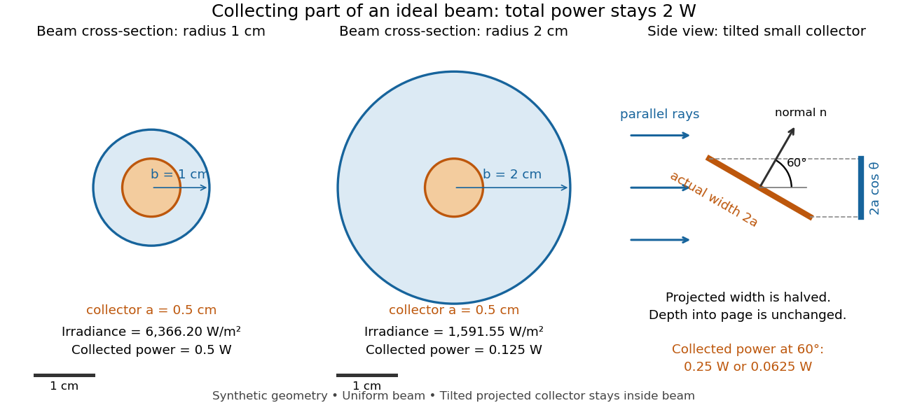

# Beam collection at fixed radiant flux

↑ **Parent:** [Radiant flux](radiant-flux.md)

Consider an ideal parallel circular beam with uniform [irradiance](irradiance.md) inside radius $b$, zero outside, and total [radiant flux](radiant-flux.md) $P=2\,\mathrm W$. A centred circular collector of radius $a$, perpendicular to the [light rays](light-ray.md), intercepts

$$
E_b=\frac{P}{\pi b^2},\qquad
\Phi_{\rm collected}=E_b\pi\min(a,b)^2
=P\min\!\left(1,\frac{a^2}{b^2}\right).
$$

For $b=1\,\mathrm{cm}$ and $a=0.5\,\mathrm{cm}$, $E_b=20000/\pi\,\mathrm{W\,m^{-2}}\simeq6366.20\,\mathrm{W\,m^{-2}}$ and the collected [radiant flux](radiant-flux.md) is $0.50\,\mathrm W$. Expanding the beam to $b=2\,\mathrm{cm}$ while keeping $P$ fixed divides [irradiance](irradiance.md) and the same collector's [radiant flux](radiant-flux.md) by four: $E_b\simeq1591.55\,\mathrm{W\,m^{-2}}$ and $\Phi_{\rm collected}=0.125\,\mathrm W$. A collector covering either entire beam still receives $2\,\mathrm W$.

Tilting a flat collector of actual [area](surface-area.md) $A$ by an [angle](angle.md) $\theta$ to the beam direction gives $\Phi_{\rm collected}=E_b A\cos\theta$ if its entire [projected area](projected-area.md) remains inside the uniform beam. At $60^\circ$ the small collector's [radiant flux](radiant-flux.md) halves. A collector large enough to intercept the whole beam after tilting still receives $P$: the footprint on its surface grows as $1/\cos\theta$ and cancels the [irradiance](irradiance.md) factor. This model ignores [diffraction](diffraction.md), beam-edge structure, and changes in absorption with incidence [angle](angle.md); it counts incident rather than absorbed [power](power.md).

**[Figure 1](#radiant-flux-beam-collection-geometry). Fixed radiant flux, different beam widths and collecting projected areas**. Original ideal geometry, not measurements. The beam cross-sections use the same centimetre scale and total [radiant flux](radiant-flux.md) of $2\,\mathrm W$; both collectors have radius $0.5\,\mathrm{cm}$. The side view shows a collector's cross-section at $60^\circ$: its projection perpendicular to the [light rays](light-ray.md) has half the width, with depth unchanged. The stated half-power result requires the projected collector to stay inside the uniform beam.

## ↑ Ancestors (6)

1. [Radiant flux](radiant-flux.md)
2. [Radiometry](radiometry.md)
3. [Optics](optics-split.md)
4. [Branches of physics](branches-of-physics.md)
5. [Physics](physics-split.md)
6. [Codex Wiki](split.md)
