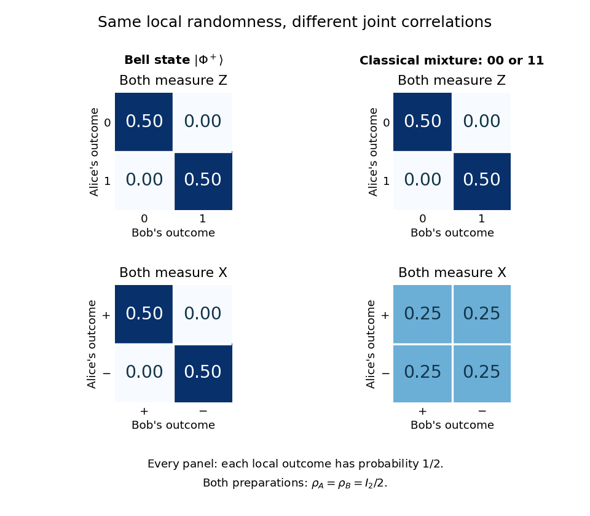

# Bell correlations versus a classical mixture

↑ **Parent:** [Quantum information](quantum-information.md)

Give Alice the first [qubit](qubit.md) $A$ and Bob the second $B$. Compare the [Bell state](bell-state-split.md) $|\Phi^+\rangle$ with a preparation that tosses a fair classical [bit](bit.md) and gives both parties its value. Their [density operators](density-matrix.md), written in the [computational basis](computational-basis.md) ordered $00,01,10,11$, are

$$
\rho_{\mathrm{Bell}}=\frac12\begin{pmatrix}1&0&0&1\\0&0&0&0\\0&0&0&0\\1&0&0&1\end{pmatrix},\qquad
\rho_{\mathrm{mix}}=\frac12\begin{pmatrix}1&0&0&0\\0&0&0&0\\0&0&0&0\\0&0&0&1\end{pmatrix}.
$$

They have identical diagonal [quantum state populations](quantum-state-population.md). The off-diagonal entries of the [Bell state](bell-state-split.md) retain [quantum coherence](quantum-coherence-in-a-specified-basis.md) between $00$ and $11$; the classical mixture has none in this basis.

If both parties perform a [Pauli measurement](measurement-of-a-pauli-observable.md) of $Z$, the [Born rule](born-rule.md) gives $P(00)=P(11)=1/2$ and $P(01)=P(10)=0$ for both preparations. Perfect agreement here therefore cannot establish [entanglement](entangled-state.md): an ordinary shared random [bit](bit.md) already explains it.

Now both measure $X$, whose normalized eigenstates are $|+\rangle=(|0\rangle+|1\rangle)/\sqrt2$ and $|-\rangle=(|0\rangle-|1\rangle)/\sqrt2$. Changing basis gives

$$
|\Phi^+\rangle=\frac{|++\rangle+|--\rangle}{\sqrt2}.
$$

The [Bell state](bell-state-split.md) again has matching outcomes, each with [probability](probability.md) $1/2$. For either product state $|00\rangle$ or $|11\rangle$, each of the four $X$ outcome pairs has [probability](probability.md) $1/4$, so their classical mixture does too. Equivalently, the [Pauli correlator](pauli-correlator.md) $\langle X\otimes X\rangle$ is one for the [Bell state](bell-state-split.md) and zero for this mixture, while $\langle Z\otimes Z\rangle$ is one for both.

**[Figure 1](#image-joint-measurement-probabilities-distinguish-a-bell-state-from-a-classical-mixture-while-every-local-outcome-remains-uniformly-random). Joint measurement probabilities distinguish a Bell state from a classical mixture while every local outcome remains uniformly random**.

Taking a [partial trace](partial-trace.md) gives $\rho_A=\rho_B=I_2/2$ for both preparations. Thus every measurement confined to Alice's system has the same statistics in the two cases, and so does every measurement confined to Bob's. They reveal the difference by comparing records through [classical communication](classical-communication.md). Conditional on Alice's result, Bob can predict a matching $X$ result for the [Bell state](bell-state-split.md); without that result, his outcomes remain evenly split. An uncommunicated local [quantum channel](quantum-channel.md), including a measurement with its outcome discarded, leaves his [reduced density matrix](reduced-density-matrix.md) unchanged. This is [quantum no-signalling](quantum-no-signalling.md), even when conditional states change. [Watrous, Basic notions of quantum information, sections 2.1.3 and 2.2.1, on reductions and channels](https://jhwatrous.github.io/TQI.2.pdf)

The [Von Neumann entropy](von-neumann-entropy-split.md) makes the joint-versus-local distinction numerical. With base-two logarithms, the [Bell state](bell-state-split.md) has [eigenvalues](eigenvalue.md) $1,0,0,0$, giving $S(AB)=0$, whereas the mixture has $1/2,1/2,0,0$, giving $S(AB)=1$. Both have $S(A)=S(B)=1$. Their [quantum mutual information](quantum-mutual-information.md) $I(A:B)=S(A)+S(B)-S(AB)$ is consequently two and one [bits](bit.md), respectively. The value two is not two readable classical [bits](bit.md) in either local [qubit](qubit.md): the matching $Z$ records have ordinary [mutual information](mutual-information.md) one [bit](bit.md) in both cases. Random records can come from a globally [pure state](pure-state.md). [Watrous, Quantum entropy and source coding, on Von Neumann entropy and quantum mutual information](https://jhwatrous.github.io/TQI.5.pdf)

These two matching-axis measurements distinguish the specified preparations; they alone are not a test of a [Bell inequality](bell-inequality.md). A [local hidden-variable theory](local-hidden-variable-theory.md) could assign shared random answers separately to these two axes. [Bell theorem](bell-theorem.md) concerns incompatible correlations across a suitable larger collection of measurement settings. Bell's 1964 paper established the obstruction for local hidden-variable descriptions of the predicted correlations. [Bell, On the Einstein Podolsky Rosen paradox, 1964](https://journals.aps.org/ppf/pdf/10.1103/PhysicsPhysiqueFizika.1.195)

## ↑ Ancestors (6)

1. [Quantum information](quantum-information.md)
2. [Quantum information theory](quantum-information-theory-split.md)
3. [Quantum theory](quantum-theory-split.md)
4. [Branches of physics](branches-of-physics.md)
5. [Physics](physics-split.md)
6. [Codex Wiki](split.md)

## ← Incoming links (3)

- [Dephasing channel](dephasing-channel.md)
- [Quantum information theory](quantum-information-theory-split.md)
- [Separable quantum state](separable-quantum-state.md)
