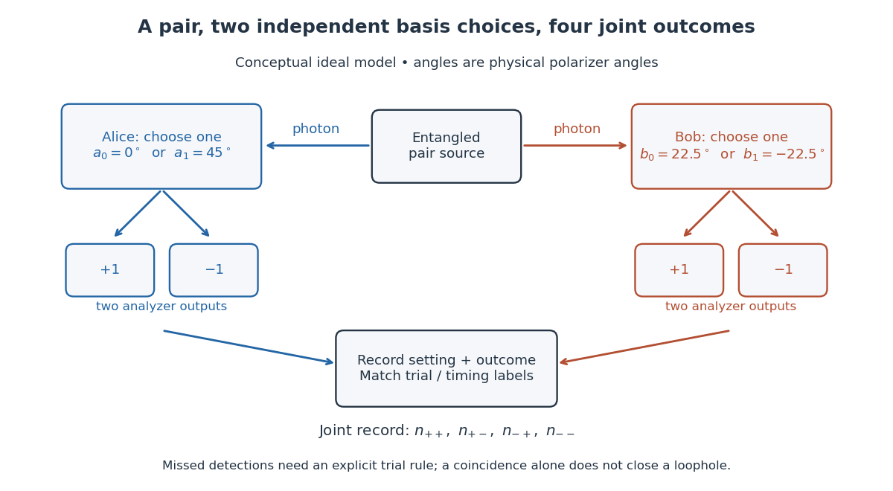

# Bell test

↑ **Parent:** [Bell theorem](bell-theorem.md)  
ⓦ [Wiki](https://en.wikipedia.org/wiki/Bell_test)

A [Bell test](bell-test.md) compares experimental [probabilities](probability.md) or [expectation values](expectation-value.md) with a [Bell inequality](bell-inequality.md). In a two-setting [photon polarization](photon-polarization.md) test, each station chooses a [polarizer](polarizer.md) orientation and records an outcome. A [coincidence circuit](coincidence-circuit.md) identifies candidate pairs using an agreed timing rule. The choice of which trials enter the statistic is part of the experiment: correlations calculated only from detected pairs can differ from correlations of all emitted pairs. The [Polarization CHSH count model](polarization-chsh-count-model.md) separates ideal [expectation values](expectation-value.md) from this experimental selection problem.

**[Figure 1](#image-two-setting-polarization-measurements-and-coincidence-readout). Two-setting polarization measurements and coincidence readout**. Conceptual apparatus for the ideal two-output model. The displayed angles belong to the worked CHSH example; they are not a reconstruction of a historical apparatus. Each station chooses one basis, then records either output. The coincidence record also needs a rule for missed detections.

**Table of contents**

- [Delft electron-spin Bell test](delft-electron-spin-bell-test.md)
- [Freedman-Clauser experiment](freedman-clauser-experiment.md)
- [Aspect switching experiment](aspect-switching-experiment.md)
- [Photonic entanglement-swapping experiment](photonic-entanglement-swapping-experiment.md)
- [Photonic Bell test with efficient detection and random settings](photonic-bell-test-with-efficient-detection-and-random-settings.md)
- [Detection loophole](detection-loophole.md)
  - [Fair sampling](fair-sampling.md)
- [Locality loophole](locality-loophole.md)

## ↑ Ancestors (6)

1. [Bell theorem](bell-theorem.md)
2. [Foundations of quantum mechanics](foundations-of-quantum-mechanics-split.md)
3. [Quantum theory](quantum-theory-split.md)
4. [Branches of physics](branches-of-physics.md)
5. [Physics](physics-split.md)
6. [Codex Wiki](split.md)

## ← Incoming links (8)

- [Bell test](bell-test.md)
- [Bell theorem](bell-theorem.md)
- [Delft electron-spin Bell test](delft-electron-spin-bell-test.md)
- [Fair sampling](fair-sampling.md)
- [Solution](past-exam-of-the-quantum-information-course-of-the-university-of-cambridge/2012/paper-1/2/solution.md)
- [Solution](past-exam-of-the-quantum-information-course-of-the-university-of-cambridge/2016/paper-1/1/solution.md)
- [Photonic entanglement-swapping experiment](photonic-entanglement-swapping-experiment.md)
- [Polarization CHSH count model](polarization-chsh-count-model.md)
