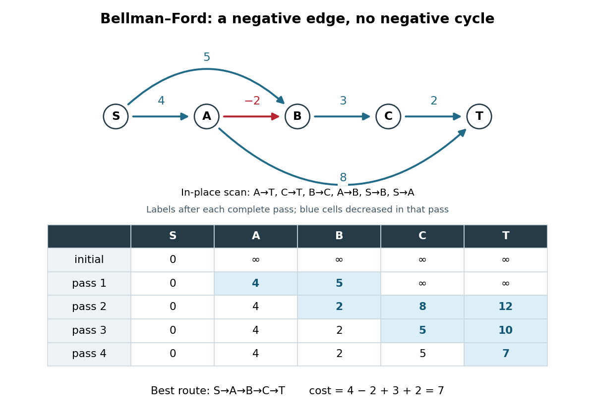

# Bellman-Ford algorithm

↑ **Parent:** [Shortest path problem](shortest-path-problem-split.md)  
ⓦ [Wiki](https://en.wikipedia.org/wiki/Bellman-Ford_algorithm)

The [Bellman-Ford algorithm](bellman-ford-algorithm.md) solves the single-source [shortest path problem](shortest-path-problem-split.md) in a finite [directed graph](directed-graph.md) with finite real [edge](edge-of-a-graph.md) weights, allowing negative weights. It repeatedly applies [edge relaxation](edge-relaxation.md), so an improved [tentative distance](tentative-distance.md) can improve its neighbours on a later visit. This makes it a [label-correcting shortest-path algorithm](label-correcting-shortest-path-algorithm.md).[Algorithms, 4th edition by Robert Sedgewick and others; Robert Sedgewick and Kevin Wayne, BellmanFordSP.java, signed-weight single-source solver and queue-based relaxation](algorithms-4th-edition-by-robert-sedgewick-and-others/bellmanfordsp-java.md) If no negative-cost [directed cycle](directed-cycle.md) is reachable from the source, at most $|V|-1$ complete passes suffice for all distances; a further check detects a reachable negative-cost [directed cycle](directed-cycle.md).[6.006 Introduction to Algorithms, Fall 2011 by Massachusetts Institute of Technology, 6.006 course staff; MIT 6.006, Lecture 17, pp. 3–4: complete-pass algorithm, proof and reachable-cycle corollary](6-006-introduction-to-algorithms-fall-2011-by-massachusetts-institute-of-technology-6-006-course-staff/lecture-17-shortest-paths-iii-bellman-ford.md)

There are two orientations to keep distinct. The usual single-source problem asks for distances _from_ $s$, extending routes along outgoing [directed edges](directed-edge.md). The [Bellman inequalities](bellman-inequalities.md) above instead concern distances _to_ a sink $r$, prepending incoming [directed edges](directed-edge.md) to known routes. The [All-to-one Bellman-Ford recurrence](all-to-one-bellman-ford-recurrence.md) below preserves that convention. Reversing every [directed edge](directed-edge.md), with its weight unchanged, converts one problem into the other.

Here is an original single-source example with source $S$, [vertex set](vertex-set.md) $V=\{S,A,B,C,T\}$, and precisely these [directed edges](directed-edge.md):

$$
w_{SA}=4,\qquad w_{SB}=5,\qquad w_{AB}=-2,\qquad w_{BC}=3,\qquad w_{CT}=2,\qquad w_{AT}=8.
$$

The negative [edge](edge-of-a-graph.md) $A\to B$ is harmless: this [directed graph](directed-graph.md) has no [directed cycle](directed-cycle.md). Its best route to $T$ is $S\to A\to B\to C\to T$, of cost $4-2+3+2=7$. The other routes to $T$ cost $12$ through $S,A,T$ and $10$ through $S,B,C,T$.

**[Figure 3](#image-four-in-place-bellman-ford-algorithm-passes-propagate-an-improvement-across-a-negative-weight-edge). Four in-place Bellman-Ford algorithm passes propagate an improvement across a negative-weight edge**.

Initialize $d(S)=0$ and the other [tentative distances](tentative-distance.md) to $\infty$. In each pass apply single-source [edge relaxation](edge-relaxation.md), $d(v)\gets\min\{d(v),d(u)+w_{uv}\}$, scanning in the order $A\to T$, $C\to T$, $B\to C$, $A\to B$, $S\to B$, $S\to A$. Skip a candidate with $d(u)=\infty$. The figure records labels _after_ each complete pass and uses current labels immediately: it is an in-place trace. In pass 2, $B\to C$ still uses $d(B)=5$, giving $8$; only later does $A\to B$ lower $B$ to $2$. Pass 3 carries that improvement to $C$, and pass 4 carries it to $T$. The final labels in order $(S,A,B,C,T)$ are $(0,4,2,5,7)$; the final [shortest-path predecessors](shortest-path-predecessor.md) are $S,A,B,C$ for $A,B,C,T$ respectively.

The scan order explains the delay. Scanning instead as $S\to A$, $S\to B$, $A\to B$, $B\to C$, $C\to T$, $A\to T$ gives those same final labels in just one in-place pass. The [Synchronous Bellman-Ford recurrence](synchronous-bellman-ford-recurrence.md) has a precise bound on the number of [edges](edge-of-a-graph.md) used by a recorded route; an in-place pass can propagate along several [edges](edge-of-a-graph.md) and need not have that interpretation. Both implementations have the $|V|-1$ pass guarantee under the stated no-reachable-negative-cycle hypothesis.

With a stored list of [edges](edge-of-a-graph.md), complete-pass [Bellman-Ford algorithm](bellman-ford-algorithm.md) has [time complexity](time-complexity.md) $O(|V||E|+|V|)$ and uses $O(|V|)$ extra space for labels and [shortest-path predecessors](shortest-path-predecessor.md), using [Big O notation](big-o-notation.md) and constant-cost arithmetic. The extra $|V|$ accounts for initialization even when $E$ is empty. A pass with no strict decrease permits early termination. A queue variant instead revisits outgoing [edges](edge-of-a-graph.md) of [vertices](vertex-graph-theory.md) whose labels improved; the authored implementation provides this alternative and has $O(|V||E|)$ worst-case running time on its usual nontrivial instances.[Algorithms, 4th edition by Robert Sedgewick and others; Robert Sedgewick and Kevin Wayne, BellmanFordSP.java, class documentation, constructor and relax method](algorithms-4th-edition-by-robert-sedgewick-and-others/bellmanfordsp-java.md) For nonnegative weights, the [Dijkstra algorithm](dijkstra-algorithm.md) and its existing distance-frontier figure explain how permanent labels can avoid these repeated passes; the existing [edge relaxation](edge-relaxation.md) figure illustrates one update at a time.

**Table of contents**

- [Synchronous Bellman-Ford recurrence](synchronous-bellman-ford-recurrence.md)
- [Bellman-Ford negative-cycle detection](bellman-ford-negative-cycle-detection.md)
- [All-to-one Bellman-Ford recurrence](all-to-one-bellman-ford-recurrence.md)

## ↑ Ancestors (6)

1. [Shortest path problem](shortest-path-problem-split.md)
2. [Graph theory](graph-theory-split.md)
3. [Foundations of mathematics](foundations-of-mathematics-split.md)
4. [Area of mathematics](area-of-mathematics.md)
5. [Mathematics](mathematics-split.md)
6. [Codex Wiki](split.md)

## ← Incoming links (6)

- [Bellman-Ford algorithm](bellman-ford-algorithm.md)
- [Bellman inequalities](bellman-inequalities.md)
- [Dijkstra algorithm](dijkstra-algorithm.md)
- [Edge relaxation](edge-relaxation.md)
- [Label-correcting shortest-path algorithm](label-correcting-shortest-path-algorithm.md)
- [Solution](past-exam-of-the-mathematics-course-of-the-university-of-cambridge/2001/iii/paper-31/4/solution.md)
