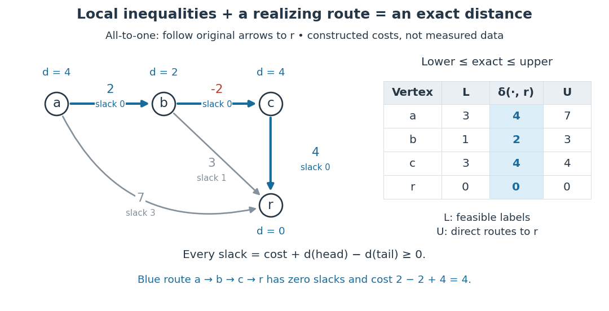

# Bellman inequalities

↑ **Parent:** [Shortest path problem](shortest-path-problem.md)

The Bellman inequalities turn local [directed edge](directed-edge.md) checks into a global certificate for the [shortest path problem](shortest-path-problem.md). Here the convention is _all-to-one_: every journey ends at a fixed [vertex](vertex-graph-theory.md) $r$, and $c_{ij}$ is the cost of the original [directed edge](directed-edge.md) $i\to j$. Work in a finite [directed graph](directed-graph.md) with finite real costs. Write $L_i$ for candidate labels, normalized by $L_r=0$, on the [vertices](vertex-graph-theory.md) that can reach $r$. A feasible potential means precisely that these finite labels satisfy

$$
L_i\le c_{ij}+L_j
$$

for every [directed edge](directed-edge.md) within that set. These labels give [lower bounds](lower-bound-in-a-partially-ordered-set.md) on costs _to_ $r$. A discovered [directed path](directed-path.md) of cost $U_i$ instead gives an [upper bound](upper-bound-in-a-partially-ordered-set.md). The following constructed [graph](graph-split.md) shows both bounds and the exact distances between them; its weights are illustrative costs, not measured travel data.

**[Figure 4](#image-bellman-inequalities-and-explicit-directed-paths-certify-distances-to-r-from-opposite-sides). Bellman inequalities and explicit directed paths certify distances to $r$ from opposite sides**.

The arrows in the picture point toward the destination, whereas [edge relaxation](edge-relaxation.md) propagates an improved label in the opposite direction: an improved $d_j$ can lower $d_i$. In the pictured [graph](graph-split.md), the [directed paths](directed-path.md) from $a$ to $r$ cost $7$, $2+3=5$, and $2-2+4=4$. Thus $\delta(a,r)=4$. The candidate $L=(3,1,3,0)$ in [vertex](vertex-graph-theory.md) order $(a,b,c,r)$ is feasible, but underestimates the exact distances $(4,2,4,0)$. Merely satisfying the [Bellman inequalities](bellman-inequalities.md) does not make a candidate exact.

Why do they give [lower bounds](lower-bound-in-a-partially-ordered-set.md)? Along any [directed path](directed-path.md) $i=v_0\to v_1\to\cdots\to v_k=r$, successive substitution gives

$$
L_i\le\sum_{\ell=0}^{k-1}c_{v_\ell v_{\ell+1}}+L_r=\sum_{\ell=0}^{k-1}c_{v_\ell v_{\ell+1}}.
$$

The same calculation works for a [directed walk](directed-walk.md), with repeated [vertices](vertex-graph-theory.md) allowed. Taking the [infimum](infimum.md) of route costs gives $L_i\le\delta(i,r)$. A discovered route gives $\delta(i,r)\le U_i$. If the bounds meet, $L_i=U_i$, they certify an optimum without enumerating routes. Equivalently, check the [Bellman inequalities](bellman-inequalities.md) for the proposed distances and exhibit [directed paths](directed-path.md) realizing them. The authored [Bellman-Ford algorithm](bellman-ford-algorithm.md) implementation checks the corresponding single-source inequalities and equality on recorded route [edges](edge-of-a-graph.md); reversing every [directed edge](directed-edge.md) gives this all-to-one convention.[Sedgewick and Wayne, BellmanFordSP.java, optimality checks](https://raw.githubusercontent.com/kevin-wayne/algs4/master/src/main/java/edu/princeton/cs/algs4/BellmanFordSP.java)

For the exact labels in the picture, the slack $c_{ij}+d_j-d_i$ is respectively $0,3,1,0,0$ on $a\to b$, $a\to r$, $b\to r$, $b\to c$, $c\to r$. Zero slack means equality; the zero-slack [directed path](directed-path.md) $a\to b\to c\to r$ realizes the cost $4$. This is the useful beauty of the certificate: a few local [inequalities](inequality-mathematics.md) rule out every cheaper journey, while one explicit journey attains the bound.

Keep unreachable [vertices](vertex-graph-theory.md) separate: $\delta(i,r)=\infty$ when no [directed path](directed-path.md) to $r$ exists, and a finite [lower bound](lower-bound-in-a-partially-ordered-set.md) alone cannot certify that fact. Extended labels can use $\infty+c=\infty$ for finite $c$, but never compute a slack as $\infty-\infty$. If $i$ can reach a negative-cost [directed cycle](directed-cycle.md) and then reach $r$, repeatedly traversing the [directed cycle](directed-cycle.md) makes route costs unbounded below: their [infimum](infimum.md) is $-\infty$, with no finite shortest [directed walk](directed-walk.md). A finite feasible potential on such a [directed cycle](directed-cycle.md) is impossible, since summing its [Bellman inequalities](bellman-inequalities.md) would give $0\le\sum c_{ij}<0$. A negative-cost [directed cycle](directed-cycle.md) that cannot reach $r$ does not affect distances to $r$. These are statements about unrestricted [directed walks](directed-walk.md); requiring a [directed path](directed-path.md) with no repeated [vertices](vertex-graph-theory.md) is a different optimization problem when negative-cost [directed cycles](directed-cycle.md) exist.[MIT 6.006, Lecture 17, pp. 1 and 5: relevant negative cycles and simple paths](https://ocw.mit.edu/courses/6-006-introduction-to-algorithms-fall-2011/5edb13fb34cbe7f4cdccc13d131772e7_MIT6_006F11_lec17.pdf)

For the single-source convention, the same original [directed edge](directed-edge.md) $u\to v$ instead gives $L(v)\le L(u)+w_{uv}$ with $L(s)=0$, a [lower bound](lower-bound-in-a-partially-ordered-set.md) on distance _from_ $s$. The endpoint carrying the label on the left therefore changes with the direction of the problem.

## ↑ Ancestors (6)

1. [Shortest path problem](shortest-path-problem.md)
2. [Graph theory](graph-theory-split.md)
3. [Foundations of mathematics](foundations-of-mathematics-split.md)
4. [Area of mathematics](area-of-mathematics.md)
5. [Mathematics](mathematics-split.md)
6. [Codex Wiki](split.md)

## ← Incoming links (6)

- [Bellman inequalities](bellman-inequalities.md)
- [Edge relaxation](edge-relaxation.md)
- [Label-correcting shortest-path algorithm](label-correcting-shortest-path-algorithm.md)
- [Solution](past-exam-of-the-mathematics-course-of-the-university-of-cambridge/2001/iii/paper-31/4/solution.md)
- [Shortest-path predecessor](shortest-path-predecessor.md)
- [Tentative distance](tentative-distance.md)
