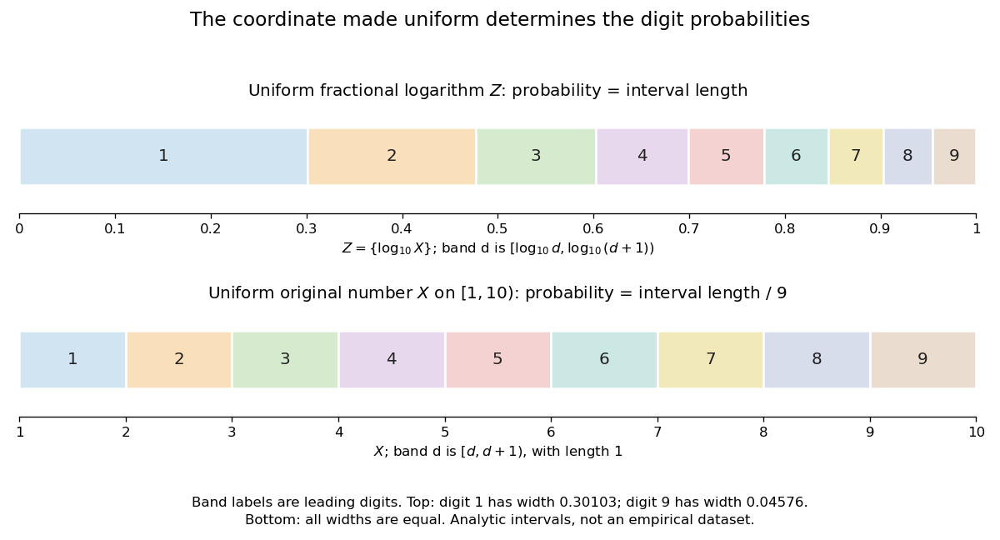

# Benford law from logarithmic uniformity

↑ **Parent:** [Benford law](benford-law.md)

For a positive [random variable](random-variable-split.md) $X$, write its base-ten [logarithm](logarithm.md) as an [integer](integer-split.md) part plus a [fractional part](fractional-part.md):

$$
K=\lfloor\log_{10}X\rfloor,\qquad Z=\{\log_{10}X\}=\log_{10}X-K\in[0,1),\qquad X=10^K10^Z.
$$

The [floor function](floor-function.md) handles values below one as well: for $X=0.0042$, $K=-3$ and the [decimal significand](decimal-significand.md) is $10^Z=4.2$. Since $10^Z\in[1,10)$, the first nonzero decimal digit is $D=\lfloor10^Z\rfloor$. The monotonicity of the [logarithm](logarithm.md) gives the exact event equivalence

$$
D=d\quad\Longleftrightarrow\quad d\leq10^Z<d+1\quad\Longleftrightarrow\quad\log_{10}d\leq Z<\log_{10}(d+1).
$$

If $Z$ has the [uniform distribution](continuous-uniform-distribution.md) on $[0,1)$, the [probability](probability.md) of this interval is its length. Consequently $\mathbb P(D=d)=\log_{10}(d+1)-\log_{10}d$, proving the [Benford law](benford-law.md). This argument assumes uniformity of the [fractional part](fractional-part.md) of the [logarithm](logarithm.md), rather than uniformity of $X$ itself. See the logarithmic-coordinate explanation in [Peter Sheridan Dodds, Benford's Law, essential story](https://pdodds.w3.uvm.edu/pocs/docs/2025-2026pocsverse-benfordslaw-freeze-dried.pdf).

**[Figure 2](#image-leading-digit-intervals-have-unequal-lengths-in-the-fractional-logarithm-and-equal-lengths-in-the-original-number). Leading-digit intervals have unequal lengths in the fractional logarithm and equal lengths in the original number**.

An exact constructed example is the [log-uniform distribution](log-uniform-distribution.md) on $[1,10)$, with [probability density function](probability-density-function.md) $f_X(x)=1/(x\ln10)$ there and zero elsewhere. Its total mass is $\int_1^{10}dx/(x\ln10)=1$. The [change of variables formula](change-of-variables-formula.md) with $x=10^z$ gives $f_Z(z)=f_X(10^z)(\ln10)10^z=1$ for $0\leq z<1$. Equivalently, integrating directly gives

$$
\mathbb P(D=d)=\int_d^{d+1}\frac{dx}{x\ln10}=\frac{\ln(d+1)-\ln d}{\ln10}=\log_{10}\!\left(\frac{d+1}{d}\right).
$$

For example, the [probability](probability.md) of first digit four is $\log_{10}(5/4)\approx0.096910013$. By contrast, an ordinary [uniform distribution](continuous-uniform-distribution.md) for $X$ on $[1,10)$ has [probability density function](probability-density-function.md) $1/9$ there, so $\mathbb P(D=d)=\int_d^{d+1}dx/9=1/9$ for every digit. This is a concrete counterexample to any claim that the [Benford law](benford-law.md) holds for every positive [random variable](random-variable-split.md).

More generally, a [log-uniform distribution](log-uniform-distribution.md) on $[A,B)$ with $0<A<B$ has uniform $Y=\log_{10}X$ on $[\log_{10}A,\log_{10}B)$. If its logarithmic span $\log_{10}(B/A)=m$ is a positive [integer](integer-split.md), reduction to the [fractional part](fractional-part.md) wraps an interval of length $m$ around the unit interval exactly $m$ times, making $Z$ uniform even when $A$ is not a power of ten. Arbitrary partial-decade truncations generally do not have this property: for a [log-uniform distribution](log-uniform-distribution.md) on $[1,2)$, the first digit is always one.

Under the uniform fractional-logarithm assumption, multiplication by any constant $c>0$ replaces $Z$ by $Z'=\{Z+\log_{10}c\}$. This is a rotation modulo one, which preserves the [uniform distribution](continuous-uniform-distribution.md) and therefore preserves the [Benford law](benford-law.md); see [scale invariance of decimal significands](scale-invariance-of-decimal-significands.md). For the constructed $[1,10)$ example, multiplying by $0.001$ gives a [log-uniform distribution](log-uniform-distribution.md) on $[0.001,0.01)$ with the same digit [probabilities](probability.md). The claim concerns the [decimal significand](decimal-significand.md) law: there is no proper [probability density function](probability-density-function.md) proportional to $1/x$ over all of $(0,\infty)$, since its integral diverges. The existing [scale-invariant prior](scale-invariant-prior.md) describes that unnormalizable measure, while a finite [log-uniform distribution](log-uniform-distribution.md) is normalizable.

## ↑ Ancestors (8)

1. [Benford law](benford-law.md)
2. [Discrete probability distribution](discrete-probability-distribution-split.md)
3. [Probability distribution](probability-distribution-split.md)
4. [Probability theory](probability-theory-split.md)
5. [Probability and statistics](probability-and-statistics-split.md)
6. [Area of mathematics](area-of-mathematics.md)
7. [Mathematics](mathematics-split.md)
8. [Codex Wiki](split.md)

## ← Incoming links (2)

- [Benford law](benford-law.md)
- [Solution](past-exam-of-the-mathematics-course-of-the-university-of-cambridge/2013/iii/paper-34/2/f/solution.md)
