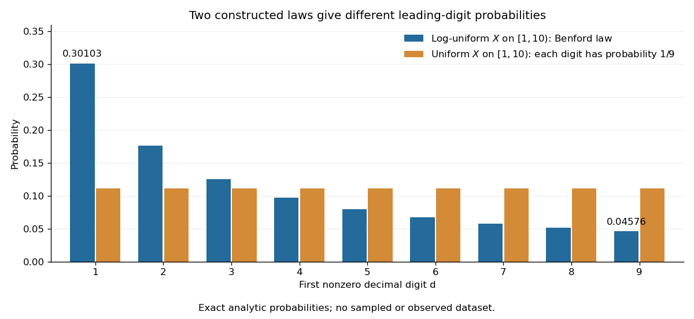

# Benford law

↑ **Parent:** [Discrete probability distribution](discrete-probability-distribution-split.md)

For a positive [random variable](random-variable-split.md) $X$, let $D\in\{1,\ldots,9\}$ be its first nonzero base-ten digit. The [Benford law](benford-law.md) is the [discrete probability distribution](discrete-probability-distribution-split.md) with [probability mass function](probability-mass-function.md)

$$
\mathbb P(D=d)=\log_{10}\!\left(\frac{d+1}{d}\right)=\log_{10}(1+1/d),\qquad d=1,\ldots,9.
$$

Here $X$ need not be an [integer](integer.md): $0.0042$, $4.2$ and $4200$ all have $D=4$. Multiplication by an [integer](integer.md) power of ten changes the decimal point's position and leaves the first nonzero digit unchanged. Zero has no first nonzero digit, so exclude it. For negative inputs one may explicitly use their [absolute values](absolute-value.md), still excluding zero; that convention must be stated rather than applying a [logarithm](logarithm.md) to a negative number.

The [Benford law](benford-law.md) favors small digits: $\mathbb P(D=1)=\log_{10}2\approx0.301029996$, whereas $\mathbb P(D=9)=\log_{10}(10/9)\approx0.04575749$. Thus the model assigns about $30.10\%$ to digit one and $4.58\%$ to digit nine. The masses are positive and their normalization is a finite [telescoping series](telescoping-series.md):

$$
\sum_{d=1}^9\mathbb P(D=d)=\sum_{d=1}^9\bigl(\log_{10}(d+1)-\log_{10}d\bigr)=\log_{10}10-\log_{10}1=1.
$$

**[Figure 1](#image-benford-probabilities-compared-with-equal-leading-digit-probabilities-in-two-constructed-laws). Benford probabilities compared with equal leading-digit probabilities in two constructed laws**.

Why can digit one be so common? In a [decimal significand](decimal-significand.md) interval $[1,10)$, the digit-one region $[1,2)$ occupies a larger fraction of the [logarithmic scale](logarithmic-scale.md) than the digit-nine region $[9,10)$. The precise assumption is that the [fractional part](fractional-part.md) of the base-ten [logarithm](logarithm.md) is distributed uniformly on $[0,1)$; [Benford law from logarithmic uniformity](benford-law-from-logarithmic-uniformity.md) turns those unequal interval lengths into [probabilities](probability.md). This makes a surprising digit pattern into a simple geometry of multiplicative size. The logarithmic explanation is also presented in [Peter Sheridan Dodds, Benford's Law, essential story](https://pdodds.w3.uvm.edu/pocs/docs/2025-2026pocsverse-benfordslaw-freeze-dried.pdf).

The [Benford law](benford-law.md) is useful as a proposed model for leading digits when the mechanism supports logarithmic uniformity or an appropriate limiting argument, such as [Benford frequencies for powers of an integer](benford-frequencies-for-powers-of-an-integer.md). Merely spanning many powers of ten does not establish that assumption. A discrepancy from the [Benford law](benford-law.md) can prompt investigation of the model and data collection; by itself it does not establish fraud, and agreement does not establish authenticity.

Simon Newcomb's 1881 paper, _Note on the Frequency of Use of the Different Digits in Natural Numbers_, appeared in the _American Journal of Mathematics_ 4, pp. 39–40. Its opening connects unequal leading-digit frequencies with the faster wear of early pages in [logarithm](logarithm.md) tables. The publication metadata and original opening excerpt are available in [Newcomb (1881), original publication record](https://www.jstor.org/stable/2369148) and [Newcomb (1881), reproduced opening excerpt](https://www.benfordonline.net/fullreference/414). Frank Benford's _The Law of Anomalous Numbers_, _Proceedings of the American Philosophical Society_ 78 (1938), pp. 551–572, likewise discusses worn [logarithm](logarithm.md) tables on p. 551 and tabulates observations on p. 553. See [Benford (1938), transcription of the original paper with page numbers and publication metadata](https://pdfcoffee.com/the-law-of-anomalous-numbers-pdf-free.html). These observations motivated study of the digit pattern; they do not make the [Benford law](benford-law.md) universal.

**Table of contents**

- [Scale invariance of decimal significands](scale-invariance-of-decimal-significands.md)
  - [Decimal significand](decimal-significand.md)
- [Benford law from logarithmic uniformity](benford-law-from-logarithmic-uniformity.md)
- [Benford frequencies for powers of an integer](benford-frequencies-for-powers-of-an-integer.md)

## ↑ Ancestors (7)

1. [Discrete probability distribution](discrete-probability-distribution-split.md)
2. [Probability distribution](probability-distribution.md)
3. [Probability theory](probability-theory-split.md)
4. [Probability and statistics](probability-and-statistics-split.md)
5. [Area of mathematics](area-of-mathematics.md)
6. [Mathematics](mathematics-split.md)
7. [Codex Wiki](split.md)

## ← Incoming links (8)

- [Benford law](benford-law.md)
- [Benford law from logarithmic uniformity](benford-law-from-logarithmic-uniformity.md)
- [Solution](past-exam-of-the-mathematics-course-of-the-university-of-cambridge/2013/iii/paper-34/2/e/solution.md)
- [Solution](past-exam-of-the-mathematics-course-of-the-university-of-cambridge/2013/iii/paper-34/2/f/solution.md)
- [Solution](past-exam-of-the-mathematics-course-of-the-university-of-cambridge/2013/iii/paper-34/2/h/solution.md)
- [Solution](past-exam-of-the-mathematics-course-of-the-university-of-cambridge/2013/iii/paper-34/2/i/solution.md)
- [Solution](past-exam-of-the-mathematics-course-of-the-university-of-cambridge/2013/iii/paper-34/2/j/solution.md)
- [Scale invariance of decimal significands](scale-invariance-of-decimal-significands.md)
