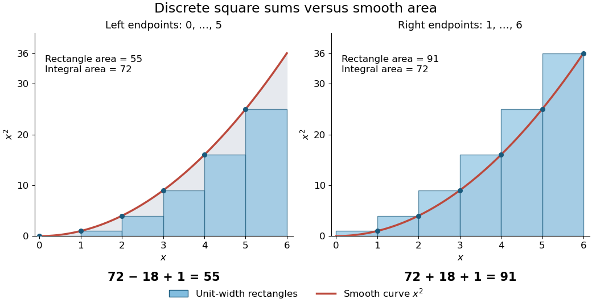
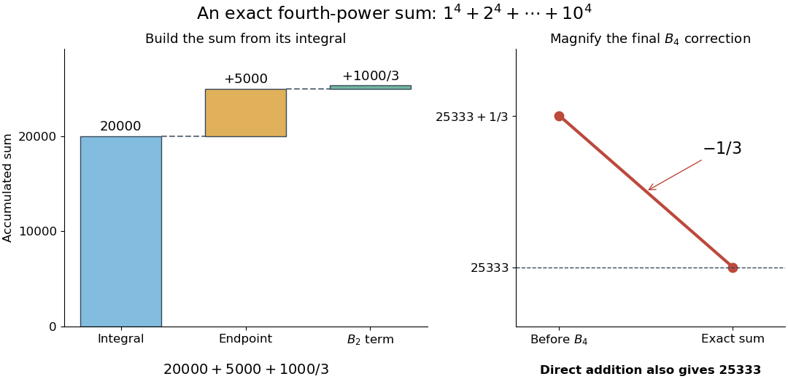

# Bernoulli corrections for polynomial sums

↑ **Parent:** [Integer power sum](integer-power-sum.md)

For a concrete comparison, take $f(x)=x^2$ on $[0,6]$. The [integral](integral.md) is $I=\int_0^6x^2\,dx=72$, whereas the unit-width left and right [Riemann sums](riemann-sum.md) are $L=55$ and $R=91$. The exact [integer power sum](integer-power-sum.md) formula gives

$$
L=I-\frac{6^2}{2}+\frac66=55,\qquad
R=I+\frac{6^2}{2}+\frac66=91.
$$

The endpoint choice explains the opposite signs of the $18$ correction. The remaining correction is one in both cases.

**[Figure 5](#image-left-and-right-riemann-sums-for-x-2-differ-from-its-integral-by-exact-bernoulli-number-corrections). Left and right Riemann sums for $x^2$ differ from its integral by exact Bernoulli number corrections**. Six rectangles of width one sample $x^2$ at $0,\ldots,5$ on the left and $1,\ldots,6$ on the right. Their areas are $55$ and $91$; the smooth area is $72$. The endpoint terms are $-18$ and $+18$, while the $B_2$ correction adds one in each case.

The same method is useful far beyond [squares of numbers](square-of-a-number.md). Substituting $B_0$, $B_1$, $B_2$ and $B_4$ into the [integer power sum](integer-power-sum.md) formula gives the exact fourth-power result

$$
\sum_{k=1}^{N}k^4=\frac{N^5}{5}+\frac{N^4}{2}+\frac{N^3}{3}-\frac{N}{30}.
$$

At $N=10$, this is

$$
\underbrace{20000}_{\text{integral}}+\underbrace{5000}_{\text{endpoint}}+
\underbrace{\frac{1000}{3}}_{B_2\text{ term}}-
\underbrace{\frac13}_{B_4\text{ term}}=25333.
$$

Thus a finite [polynomial](polynomial-split.md) calculation replaces ten additions, or a million additions if $N$ is a million. Although the individual corrections can be [rational numbers](rational-number.md), the result is the exact [integer](integer.md) sum.

**[Figure 6](#image-exact-bernoulli-number-corrections-turn-an-integral-into-the-fourth-power-sum-1-4-plus-cdots-plus-10-4). Exact Bernoulli number corrections turn an integral into the fourth-power sum $1^4+\cdots+10^4$**. The first panel builds the sum from integral $20000$, endpoint term $5000$, and $B_2$ term $1000/3$. The enlarged second panel resolves the final $B_4$ correction $-1/3$, reaching $25333$, checked independently by direct addition.

There is also a useful [numerical integration](numerical-integration.md) interpretation. The average of the left and right [Riemann sums](riemann-sum.md) is the composite [trapezoidal rule](trapezoidal-rule.md). For $x^2$, the endpoint corrections cancel but its value is $73$, one above the true [integral](integral.md). Subtracting the $B_2$ correction makes this particular [polynomial](polynomial-split.md) example exact. For $f(x)=x^4$, the two interior corrections above can be written $B_2(f'(N)-f'(0))/2!$ and $B_4(f'''(N)-f'''(0))/4!$. These are exact identities for these [polynomials](polynomial-split.md); extending such corrections to general [functions](function-split.md) requires a separate error analysis.

## ↑ Ancestors (7)

1. [Integer power sum](integer-power-sum.md)
2. [Bernoulli polynomial](bernoulli-polynomial.md)
3. [Bernoulli number](bernoulli-number.md)
4. [Number theory](number-theory-split.md)
5. [Area of mathematics](area-of-mathematics.md)
6. [Mathematics](mathematics-split.md)
7. [Codex Wiki](split.md)
