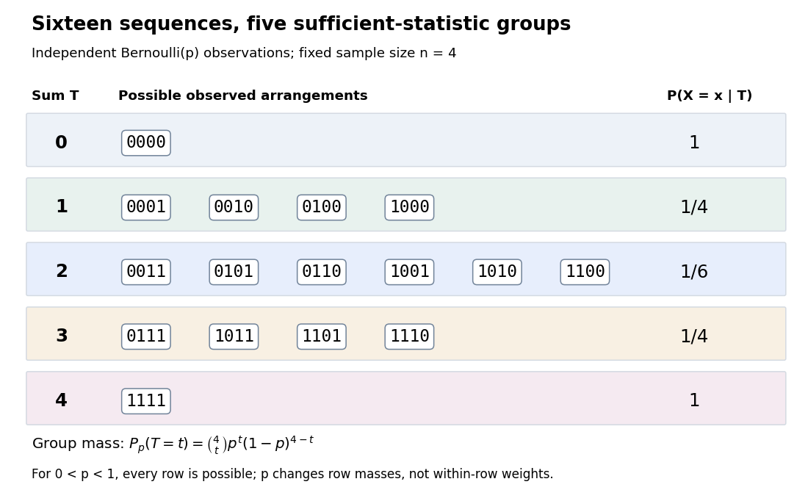

# Bernoulli sample sum as a sufficient statistic

↑ **Parent:** [Sufficient statistic](sufficient-statistic.md)

Let $n$ be fixed and known, and let $X_1,\ldots,X_n$ be [independent and identically distributed](independent-and-identically-distributed-random-variables.md) [Bernoulli random variables](bernoulli-distribution.md) with common success [probability](probability.md) $p$. Their joint [probability mass function](probability-mass-function.md), on the binary [sample space](sample-space.md) $\{0,1\}^n$, is

$$
P_p(X=x)=\prod_{i=1}^n p^{x_i}(1-p)^{1-x_i}=p^{t}(1-p)^{n-t},\qquad t=T(x)=\sum_{i=1}^nx_i.
$$

There are $\binom nt$ arrangements with $t$ successes, so $T$ has the [binomial distribution](binomial-distribution.md). For $0<p<1$ and $t\in\{0,\ldots,n\}$, its exact conditional full-data [probability mass function](probability-mass-function.md) is

$$
P_p(X=x\mid T=t)=\frac{p^t(1-p)^{n-t}\mathbf1_{\{T(x)=t\}}}{\binom nt p^t(1-p)^{n-t}}=\frac{\mathbf1_{\{T(x)=t\}}}{\binom nt}.
$$

This [conditional distribution](conditional-distribution.md) is uniform over arrangements, with no dependence on $p$: the sum is a [sufficient statistic](sufficient-statistic.md). [Sufficiency, Will Fithian, “Independent Bernoulli sequence”: conditional pmf](sufficiency-stat-210a-fall-2025-by-will-fithian.md)

**[Figure 11](#image-four-bernoulli-observations-grouped-by-their-sufficient-sum). Four Bernoulli observations grouped by their sufficient sum**. All sixteen binary sequences are grouped by $T$. Within each group the [conditional distribution](conditional-distribution.md) is uniform; changing $p$ changes the group's total [probability](probability.md), not the conditional weights within it.

For $n=4$, the group sizes are $1,4,6,4,1$ and the within-group conditional [probabilities](probability.md) are respectively $1,1/4,1/6,1/4,1$. For example, $T=2$ leaves exactly $0011,0101,0110,1001,1010,1100$, each with conditional [probability](probability.md) $1/6$. At $p=1/4$, each such sequence has unconditional [probability](probability.md) $9/256$ and the group has [probability](probability.md) $54/256$. At $p=1/2$, these values are $1/16$ and $6/16$; at $p=3/4$ they return to $9/256$ and $54/256$. The conditional weights stay $1/6$ in all three cases.

At the boundary $p=0$, only $T=0$ has positive [probability](probability.md); at $p=1$, only $T=n$ does. Dividing by $P_p(T=t)$ on the other groups would divide by zero. Nevertheless, the same uniform-on-arrangements [Markov kernel](markov-kernel.md) is a valid common version for the entire family $0\leq p\leq1$: it gives the correct point mass on the one observed group at each boundary and assigns permissible versions on its unobserved groups. Define the joint [probability mass function](probability-mass-function.md) there by the original product of the one-trial [Bernoulli](bernoulli-distribution.md) [probability mass functions](probability-mass-function.md), or use the limiting convention $0^0=1$ in the compact formula.

The [sample mean](sample-mean.md) $T/n$ is an [unbiased estimator](unbiased-estimator.md) of $p$ and retains the [sufficient statistic](sufficient-statistic.md) because $n$ is known. By contrast, $X_1$ is also an [unbiased estimator](unbiased-estimator.md) of $p$ but, for $n\geq2$, is not sufficient: the conditional success [probability](probability.md) of the [independent](independent-random-variables.md) $X_2$ given $X_1$ is still $p$. Thus unbiasedness does not imply sufficiency.

Sufficiency also does not imply [completeness of a statistic](complete-statistic.md). For $n\geq2$, the full-data [sufficient statistic](sufficient-statistic.md) $X$ admits the nonzero function $g(X)=X_1-X_2$ with [expectation](expected-value-split.md) zero for every $p$. Nor does minimality imply [completeness of a statistic](complete-statistic.md): for $n=2$ and the restricted [statistical model](statistical-model-split.md) $p\in\{1/4,3/4\}$, $T$ is a [minimal sufficient statistic](minimal-sufficient-statistic.md) since the [likelihood ratio](likelihood-ratio.md) $P_{3/4}(X=x)/P_{1/4}(X=x)=3^{2t-2}$ distinguishes its three values. Yet $g(0)=3,g(1)=-5,g(2)=3$ has [expectation](expected-value-split.md) $(27-30+3)/16=0$ at both parameter values and is never zero. Changing the parameter family can change [completeness of a statistic](complete-statistic.md) even while preserving sufficiency.

## ↑ Ancestors (5)

1. [Sufficient statistic](sufficient-statistic.md)
2. [Probability and statistics](probability-and-statistics-split.md)
3. [Area of mathematics](area-of-mathematics.md)
4. [Mathematics](mathematics-split.md)
5. [Codex Wiki](split.md)

## ← Incoming links (1)

- [Statistical data compression by a sufficient statistic](statistical-data-compression-by-a-sufficient-statistic.md)
