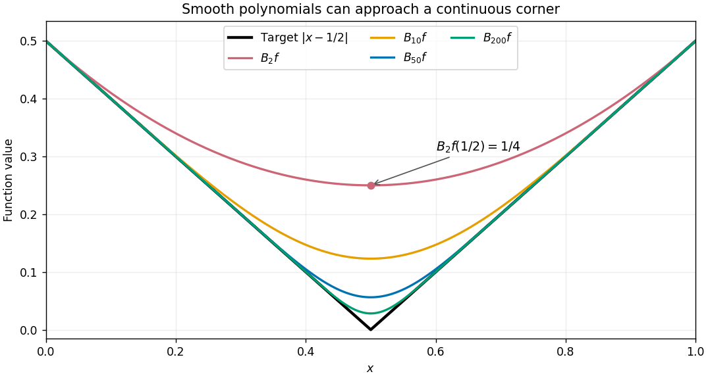

# Bernstein approximation of a corner

↑ **Parent:** [Bernstein polynomial](bernstein-polynomial.md)

Take the [continuous](continuous-function.md) function $f(x)=|x-1/2|$ on $[0,1]$. It is [Lipschitz continuous](lipschitz-continuity.md) with [Lipschitz constant](lipschitz-constant.md) one, but is not [differentiable](differentiable-function.md) at $x=1/2$. For $n=2$, the sample values are $1/2,0,1/2$, so

$$
B_2f(x)=\frac12(1-x)^2+\frac12x^2,
\qquad B_2f(1/2)=\frac14\ne f(1/2).
$$

This is already a useful warning: the [Bernstein polynomial](bernstein-polynomial.md) is built from grid values but is not generally their [polynomial interpolation](polynomial-interpolation.md).

**[Figure 1](#image-bernstein-polynomials-approximate-the-values-of-an-absolute-value-function-including-its-corner). Bernstein polynomials approximate the values of an absolute value function, including its corner**. The black target is $|x-1/2|$ on $[0,1]$; colored curves are the explicitly computed [Bernstein polynomials](bernstein-polynomial.md) of degrees $2$, $10$, $50$, and $200$. Each has exact endpoint values and a smooth middle. These are theoretical functions, not measured data.

Every finite approximant is [differentiable](differentiable-function.md), and symmetry makes its [derivative](derivative.md) zero at the center. The target instead has left [derivative](derivative.md) $-1$ and right [derivative](derivative.md) $1$. Smooth curves can therefore approach a corner in [supremum norm](supremum-norm.md) while their center [derivatives](derivative.md) have no target value to approach. The [Lipschitz error bound for Bernstein approximation](lipschitz-error-bound-for-bernstein-approximation.md) quantifies the improvement in values.

## ↑ Ancestors (8)

1. [Bernstein polynomial](bernstein-polynomial.md)
2. [Weierstrass approximation theorem](weierstrass-approximation-theorem.md)
3. [Stone-Weierstrass theorem](stone-weierstrass-theorem.md)
4. [Functional analysis](functional-analysis-split.md)
5. [Analysis](analysis-split.md)
6. [Area of mathematics](area-of-mathematics.md)
7. [Mathematics](mathematics-split.md)
8. [Codex Wiki](split.md)

## ← Incoming links (2)

- [Lipschitz error bound for Bernstein approximation](lipschitz-error-bound-for-bernstein-approximation.md)
- [Weierstrass approximation theorem](weierstrass-approximation-theorem.md)
