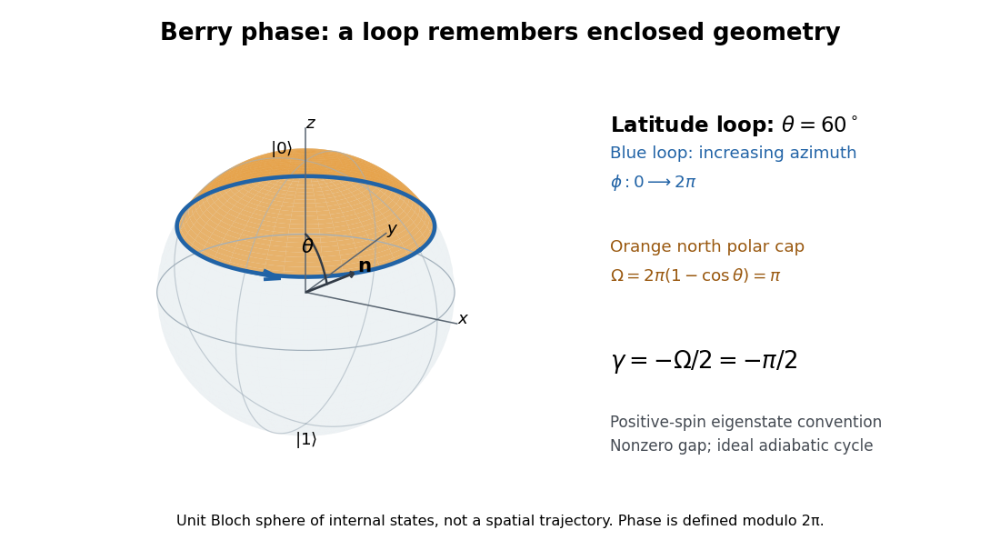

# Berry phase of a Bloch-sphere latitude

↑ **Parent:** [Berry phase](berry-phase.md)

Choose the [computational basis](computational-basis.md) $|0\rangle=|\uparrow_z\rangle$, $|1\rangle=|\downarrow_z\rangle$ for a [spin one-half](spin-one-half.md) [qubit](qubit.md). On the [Bloch sphere](bloch-sphere.md), let $\mathbf n=(\sin\theta\cos\phi,\sin\theta\sin\phi,\cos\theta)$ and use the normalized [quantum state](quantum-state.md)

$$
|\psi(\theta,\phi)\rangle=\cos\frac{\theta}{2}|0\rangle+e^{i\phi}\sin\frac{\theta}{2}|1\rangle.
$$

This is the $+1$ [eigenstate](eigenstate.md) of $\mathbf n\cdot\boldsymbol\sigma$, where $\boldsymbol\sigma$ are the [Pauli matrices](pauli-matrices.md). To make it an instantaneous [ground state](ground-state.md), take the model [Hamiltonian operator](hamiltonian-quantum-mechanics.md) $H=-\Delta\,\mathbf n\cdot\boldsymbol\sigma/2$ with constant $\Delta>0$. Its [energy eigenvalues](energy-eigenvalue.md) are $-\Delta/2$ and $+\Delta/2$, so its [spectral gap](spectral-gap.md) is $\Delta$ everywhere. The [spin](spin.md) points along $\mathbf n$; this explicit convention fixes the sign of the [Berry phase](berry-phase.md).

Keep the polar angle $\theta$ fixed and increase the azimuth $\phi$ from $0$ to $2\pi$, slowly enough for the [adiabatic theorem](adiabatic-theorem.md). The state vector written above is periodic in $\phi$. Directly differentiating gives

$$
\partial_\phi|\psi\rangle=i e^{i\phi}\sin\frac{\theta}{2}|1\rangle,\qquad
\langle\psi|\partial_\phi\psi\rangle=i\sin^2\frac{\theta}{2}.
$$

Thus the azimuthal [Berry connection](berry-connection.md) is $A_\phi=-\sin^2(\theta/2)$ and its [line integral](line-integral.md) is

$$
\gamma=i\int_0^{2\pi}\langle\psi|\partial_\phi\psi\rangle\,d\phi
=-2\pi\sin^2\frac{\theta}{2}=-\pi(1-\cos\theta)=-\frac{\Omega}{2}\pmod{2\pi}.
$$

The north polar cap has oriented [solid angle](solid-angle.md) $\Omega=\int_0^{2\pi}\int_0^\theta\sin\vartheta\,d\vartheta\,d\phi=2\pi(1-\cos\theta)$, positive for increasing $\phi$. Reversing the loop reverses the [Berry phase](berry-phase.md). The opposite [spin](spin.md) [eigenstate](eigenstate.md) has the opposite [Berry phase](berry-phase.md) modulo $2\pi$.

**[Figure 5](#image-a-60-degree-latitude-on-the-bloch-sphere-encloses-a-north-polar-cap-of-solid-angle-pi). A 60-degree latitude on the Bloch sphere encloses a north polar cap of solid angle pi**.

At $\theta=60^\circ$, the [solid angle](solid-angle.md) is $\pi$ and the [Berry phase](berry-phase.md) is $-\pi/2$. At $\theta=90^\circ$, the [solid angle](solid-angle.md) is $2\pi$ and the [Berry phase](berry-phase.md) is $-\pi$. At $\theta=0$, the loop collapses and $\gamma=0$. At $\theta=\pi$, the same expression gives $-2\pi\equiv0$: the [Bloch vector](bloch-vector.md) stays at the south pole, while this representative is $e^{i\phi}|1\rangle$. Its winding is only a choice of [global phase](global-phase.md), so the physically relevant phase factor is again one. The displayed formula is a continuous, unwrapped representative, not a unique real-valued [observable](observable.md).

## ↑ Ancestors (5)

1. [Berry phase](berry-phase.md)
2. [Quantum mechanics](quantum-mechanics-split.md)
3. [Branches of physics](branches-of-physics.md)
4. [Physics](physics-split.md)
5. [Codex Wiki](split.md)

## ← Incoming links (2)

- [Berry phase](berry-phase.md)
- [Berry-phase interference with a reference path](berry-phase-interference-with-a-reference-path.md)
