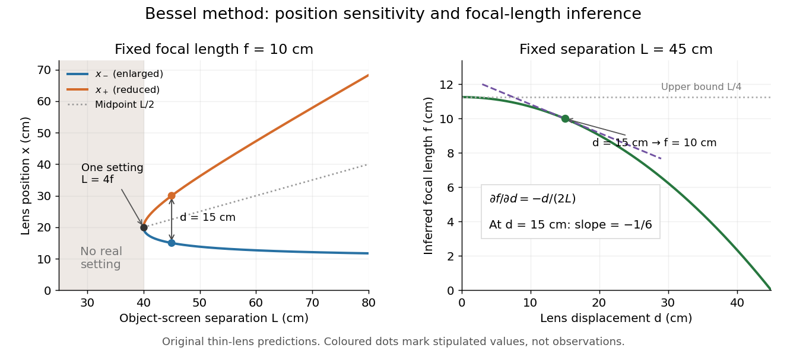

# Bessel focal length uncertainty

↑ **Parent:** [Bessel lens displacement method](bessel-lens-displacement-method.md)

For small [measurement errors](measurement-error.md), write $f=L/4-d^2/(4L)$. Its [partial derivatives](partial-derivative.md) and first-order [propagation of uncertainty](propagation-of-uncertainty.md) are

$$
A=\frac{\partial f}{\partial L}=\frac14\left(1+\frac{d^2}{L^2}\right),\qquad B=\frac{\partial f}{\partial d}=-\frac{d}{2L},
$$

$$
\sigma_f^2\simeq A^2\sigma_L^2+B^2\sigma_d^2+2AB\operatorname{Cov}(L,d).
$$

Here the $\sigma$ values are [standard deviations](standard-deviation.md) used to describe uncertainty, and $\operatorname{Cov}(L,d)$ is the [covariance](covariance.md). Independent carrier-reading errors give $\sigma_d^2=\sigma_{r_-}^2+\sigma_{r_+}^2$; correlated readings require the term $-2\operatorname{Cov}(r_-,r_+)$. Averaging repeated independent pairs reduces the random component of the uncertainty of the mean, but does not remove calibration or model errors.

As a stipulated uncertainty calculation, let $L=45\,\mathrm{cm}$, $d=15\,\mathrm{cm}$, $\sigma_L=0.10\,\mathrm{cm}$ and $\sigma_{r_-}=\sigma_{r_+}=0.05\,\mathrm{cm}$, with all three input errors independent. Then $\sigma_d=0.0707\,\mathrm{cm}$, $A=5/18$, $B=-1/6$ and $\sigma_f\simeq0.0302\,\mathrm{cm}$. The result would be $f=10.000\,\mathrm{cm}$ with this standard uncertainty in the stipulated [thin lens](thin-lens.md) model; these numbers are not a measured uncertainty budget. A small neglected principal-plane separation gives an additional first-order bias $f_{\rm thin}-f\simeq Ah$, distinct from that random budget.

**[Figure 9](#image-bessel-lens-displacement-method-merging-settings-and-focal-length-sensitivity). Bessel lens displacement method: merging settings and focal length sensitivity**. Original ideal-model curves. Left: settings versus object-screen separation for fixed $f=10\,\mathrm{cm}$; below $L=40\,\mathrm{cm}$ there is no real setting on the fixed screen. Right: inferred [focal length](focal-length.md) versus measured displacement at fixed $L=45\,\mathrm{cm}$, with its tangent at the stipulated $d=15\,\mathrm{cm}$. The curves are predictions, not experimental points.

The two kinds of sensitivity must be distinguished. At fixed [focal length](focal-length.md),

$$
\frac{\partial d}{\partial L}=\frac{L-2f}{d},\qquad \frac{\partial x_\pm}{\partial L}=\frac12\left(1\pm\frac{L-2f}{d}\right).
$$

These [derivatives](derivative.md) diverge as $L$ approaches $4f$ from above: a small change in object-screen spacing strongly changes the separation of the two settings. Yet the inferred [focal length](focal-length.md)'s displacement sensitivity $|B|=d/(2L)$ tends to zero. That does not make coalescing settings easy to measure. For fixed $L$, define the axial mismatch between the predicted [real image](real-image.md) and the screen as $g(x)=fx/(x-f)-(L-x)$, for $x>f$. At a focused setting,

$$
g'(x)=1-\frac{f^2}{(x-f)^2}=1-m^2.
$$

Near $u=v=2f$, moving the [optical lens](lens-optics.md) changes this mismatch only weakly, making visual discrimination of the two settings difficult. At the example's settings $g'(15\,\mathrm{cm})=-3$ and $g'(30\,\mathrm{cm})=3/4$, so equal carrier motion produces different axial [defocus](defocus-aberration.md) responses. This is an axial mismatch calculation, not a full prediction of perceived image sharpness.

Choose $L$ sufficiently above $4f$ to separate the two accepted focusing ranges, while retaining both [real images](real-image.md) on the available screen and rail. There is no universal best $L$: focusing uncertainty itself depends on [aperture](aperture.md), [transverse magnification](transverse-magnification.md), [optical aberrations](optical-aberration.md) and the target. Close to $d=0$, the nonnegative measured separation and the quadratic term in $d$ also make first-order [propagation of uncertainty](propagation-of-uncertainty.md) unreliable if its error is comparable to its value. Repeatability, controls and the [principal plane](principal-plane.md) correction determine whether the elegant two-distance formula is an adequate measurement model.

## ↑ Ancestors (8)

1. [Bessel lens displacement method](bessel-lens-displacement-method.md)
2. [Thin lens](thin-lens.md)
3. [Lens (optics)](lens-optics.md)
4. [Geometrical optics](geometrical-optics-split.md)
5. [Optics](optics-split.md)
6. [Branches of physics](branches-of-physics.md)
7. [Physics](physics-split.md)
8. [Codex Wiki](split.md)
