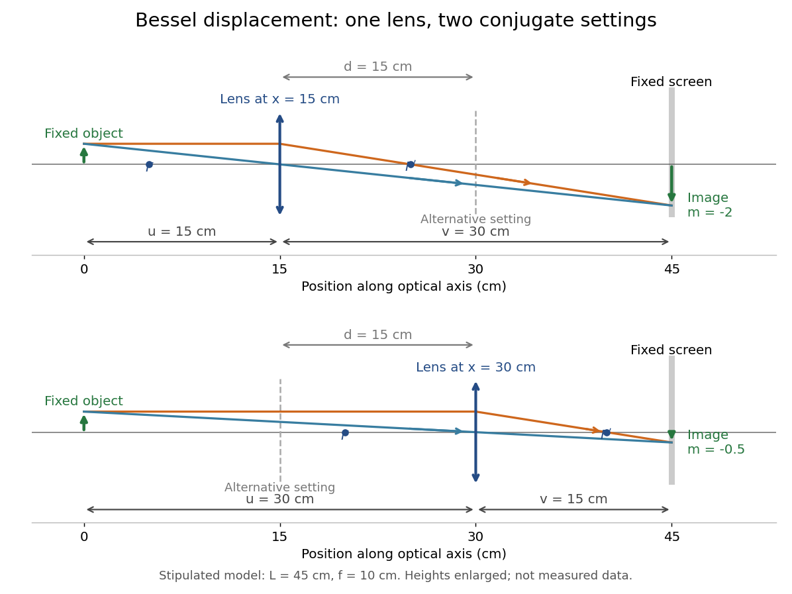

# Bessel lens displacement method

↑ **Parent:** [Thin lens](thin-lens.md)

The [Bessel lens displacement method](bessel-lens-displacement-method.md) measures a converging [thin lens](thin-lens.md)'s [focal length](focal-length.md) by moving only the [optical lens](lens-optics.md) between a fixed object and screen. If their separation is $L>4f$, two settings give sharp [real images](real-image.md): one enlarged, the other reduced. Read their separation $d$ on an [optical bench](optical-bench.md), then calculate

$$
d=\sqrt{L^2-4Lf},\qquad f=\frac{L^2-d^2}{4L}.
$$

The two settings exchange object and image distances, so their signed [transverse magnifications](transverse-magnification.md) are reciprocals. This makes the experiment a visible test of [conjugate optical planes](conjugate-optical-plane.md) as well as a [focal length](focal-length.md) measurement.[p. 13, Practice problem 2 and adjacent magnification relation](mit-2-71-and-2-710-optics-spring-2014-by-nicholas-x-fang/lecture-notes-on-geometrical-optics.md)

For an original stipulated example, put the object at $x=0$, the screen at $x=L=45\,\mathrm{cm}$, and take an ideal [thin lens](thin-lens.md) with $f=10\,\mathrm{cm}$. Its two settings are $x_-=15\,\mathrm{cm}$ and $x_+=30\,\mathrm{cm}$, with $d=15\,\mathrm{cm}$. The [transverse magnifications](transverse-magnification.md) are $m_-=-2$ and $m_+=-1/2$: both [real images](real-image.md) are inverted. An object $0.50\,\mathrm{cm}$ tall would give signed image heights $-1.00\,\mathrm{cm}$ and $-0.25\,\mathrm{cm}$. Conversely, stipulated readings $L=45\,\mathrm{cm}$ and $d=15\,\mathrm{cm}$ give $f=(45^2-15^2)/(4\times45)=10\,\mathrm{cm}$. These are model calculations, not measured data or a manufacturer's calibration.

**[Figure 8](#image-two-thin-lens-settings-image-the-same-fixed-object-onto-the-same-fixed-screen). Two thin lens settings image the same fixed object onto the same fixed screen**. Original [ray tracing](ray-tracing.md) for the stipulated $L=45\,\mathrm{cm}$, $f=10\,\mathrm{cm}$ example. Each panel contains one physical [thin lens](thin-lens.md); its alternative setting is dashed. The object and screen stay fixed, while object and image distances exchange. Both panels use the same scales, with heights enlarged for visibility.

A fixed offset between a carrier's reference mark and an ideal [thin lens](thin-lens.md) plane cancels when subtracting the two carrier readings. That useful cancellation does not make a [thick lens](thick-lens.md) equivalent to one unknown optical centre: its two [principal planes](principal-plane.md) can be separated. The [Bessel lens displacement experiment](bessel-lens-displacement-experiment.md) below makes this limitation explicit.

**Table of contents**

- [Bessel two focus positions](bessel-two-focus-positions.md)
- [Bessel lens displacement experiment](bessel-lens-displacement-experiment.md)
- [Bessel focal length uncertainty](bessel-focal-length-uncertainty.md)

## ↑ Ancestors (7)

1. [Thin lens](thin-lens.md)
2. [Lens (optics)](lens-optics.md)
3. [Geometrical optics](geometrical-optics-split.md)
4. [Optics](optics-split.md)
5. [Branches of physics](branches-of-physics.md)
6. [Physics](physics-split.md)
7. [Codex Wiki](split.md)

## ← Incoming links (6)

- [Bessel focal length uncertainty](bessel-focal-length-uncertainty.md)
- [Bessel lens displacement method](bessel-lens-displacement-method.md)
- [Conjugate optical plane](conjugate-optical-plane.md)
- [Solution](past-exam-of-the-mathematics-course-of-the-university-of-cambridge/2019/iii/paper-338/3/a/solution.md)
- [Principal plane](principal-plane.md)
- [Transverse magnification](transverse-magnification.md)
