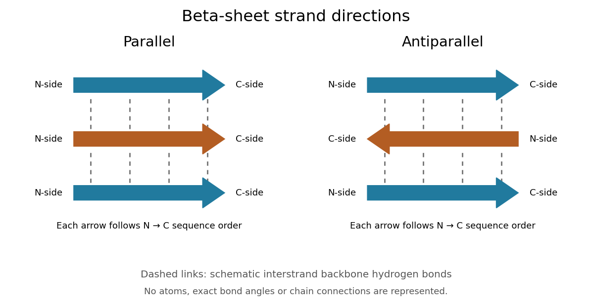
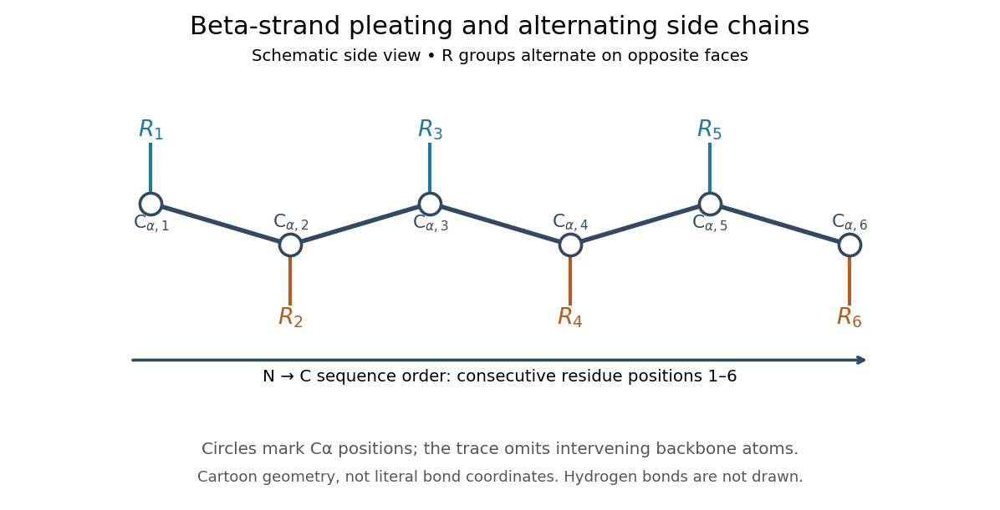

# Beta sheet

↑ **Parent:** [Protein secondary structure](protein-secondary-structure.md)  
ⓦ [Wiki](https://en.wikipedia.org/wiki/Beta_sheet)

A [beta sheet](beta-sheet.md) consists of extended stretches of [protein backbone](protein-backbone.md) lying alongside one another, joined by [backbone hydrogen bonds](backbone-hydrogen-bond.md). The stretches can belong to different portions of the same [polypeptide chain](polypeptide.md) or to different chains.

Each extended stretch is a [beta strand](beta-strand.md). Neighboring [beta strands](beta-strand.md) pack side by side, with repeated [backbone hydrogen bonds](backbone-hydrogen-bond.md) between their backbone $\mathrm{C=O}$ and $\mathrm{N-H}$ groups: the [oxygen](oxygen.md) is a [hydrogen bond acceptor](hydrogen-bond-acceptor.md), and the backbone [nitrogen](nitrogen.md) with its attached [hydrogen](hydrogen.md) provides a [hydrogen bond donor](hydrogen-bond-donor.md). These are interactions of the shared [protein backbone](protein-backbone.md), not merely contacts between [amino acid side chains](amino-acid-side-chain.md). Unlike an [alpha helix](alpha-helix.md), a [beta sheet](beta-sheet.md) joins adjacent extended stretches rather than coiling one stretch around an axis. See [Clark, Douglas and Choi, Biology 2e, 3.4: backbone groups in secondary structure](https://openstax.org/books/biology-2e/pages/3-4-proteins).

Read each [beta strand](beta-strand.md) in the sequence direction from the [N-terminus](n-terminus.md) toward the [C-terminus](c-terminus.md), even when it is an internal part of a longer [polypeptide chain](polypeptide.md). In a [parallel beta sheet](parallel-beta-sheet.md), neighboring [beta strands](beta-strand.md) run in the same N→C direction; in an [antiparallel beta sheet](antiparallel-beta-sheet.md), they run in opposite N→C directions. A three-strand example can therefore have arrows right–right–right or right–left–right. A [beta sheet](beta-sheet.md) can also mix the two arrangements. Direction does not identify chain membership: a single [polypeptide chain](polypeptide.md) can fold back to supply several [beta strands](beta-strand.md), and different [polypeptide chains](polypeptide.md) can contribute to one [beta sheet](beta-sheet.md). See [Alberts et al., Molecular Biology of the Cell: beta-sheet strand arrangements](https://www.ncbi.nlm.nih.gov/books/NBK26830/).

**[Figure 13](#image-parallel-beta-sheet-and-antiparallel-beta-sheet-sequence-directions). Parallel beta sheet and antiparallel beta sheet: sequence directions**. Three [beta strands](beta-strand.md) in each panel, with arrows showing N→C sequence direction. N-side and C-side labels indicate direction toward the [N-terminus](n-terminus.md) and [C-terminus](c-terminus.md), not necessarily free chain ends. Dashed links symbolize interstrand [backbone hydrogen bonds](backbone-hydrogen-bond.md); they locate no [chemical atoms](atom-physics.md) and specify neither actual bond angles nor an exact pairing of [amino acid residues](amino-acid-residue.md). Chain connections are omitted.

The pleated appearance comes from the geometry of the [protein backbone](protein-backbone.md). Successive [amino acid residues](amino-acid-residue.md) carry [amino acid side chains](amino-acid-side-chain.md) on alternating faces of an ideal [beta strand](beta-strand.md), conventionally drawn above and below the sheet. The attachment positions are the [amino acid alpha carbons](amino-acid-alpha-carbon.md). Thus a six-position cartoon has groups 1, 3 and 5 on one face and 2, 4 and 6 on the other. This alternation is a spatial pattern, not a rule that alternating positions must contain identical [amino acids](amino-acid.md). See [Clark, Douglas and Choi: side chains above and below the pleats](https://openstax.org/books/biology-2e/pages/3-4-proteins).

**[Figure 14](#image-pleating-and-alternating-amino-acid-side-chains-along-a-beta-strand). Pleating and alternating amino acid side chains along a beta strand**. An original two-dimensional side-view cartoon of six consecutive [amino acid alpha carbons](amino-acid-alpha-carbon.md), numbered in N→C sequence order, with generic R groups alternating above and below. Segments between marked positions summarize the intervening [protein backbone](protein-backbone.md), not every individual [covalent bond](covalent-bond-split.md) or literal atomic coordinates. No [backbone hydrogen bonds](backbone-hydrogen-bond.md) are drawn: their [hydrogen bond donor](hydrogen-bond-donor.md) and [hydrogen bond acceptor](hydrogen-bond-acceptor.md) groups would have to be shown separately from the marked [carbon](carbon.md) positions.

Real [beta sheets](beta-sheet.md) commonly twist and curve; pleating does not make them perfectly flat plates. Which [beta strands](beta-strand.md) are neighbors, how connecting regions join them, and how their faces pack are features of the three-dimensional [protein structure](protein-structure.md). An alternating pattern in the [protein primary structure](protein-primary-structure.md) alone neither establishes a [beta sheet](beta-sheet.md) nor specifies a unique fold independently of surroundings and interacting [molecules](molecule-split.md). See [Breda et al., Protein Structure, Modelling and Applications: extended strands, sheet twist and three-dimensional organization](https://www.ncbi.nlm.nih.gov/books/NBK6824/) and [protein folding](protein-folding.md).

Why this arrangement is useful: repeated [backbone hydrogen bonds](backbone-hydrogen-bond.md) organize extended chain regions into a framework that can contribute to the interior of a folded [protein](protein-split.md). [Amino acid side chains](amino-acid-side-chain.md) and connecting loops give that framework chemical variety and can shape a [protein binding site](protein-binding-site.md) for a [ligand](ligand-biochemistry.md). Its attractive feature is the combination of a reusable backbone pattern with variable exposed groups: similar [beta sheets](beta-sheet.md) can support different recognition surfaces. See [Alberts et al.: beta-sheet cores and loops that form binding sites](https://www.ncbi.nlm.nih.gov/books/NBK26830/).

Historically, Linus Pauling and Robert B. Corey published _The Pleated Sheet, a New Layer Configuration of Polypeptide Chains_ in PNAS 37, 251–256 (1951). They reasoned from [peptide bond](peptide-bond.md) geometry and possible [backbone hydrogen bonds](backbone-hydrogen-bond.md), proposing an idealized layer rather than measuring every modern [beta sheet](beta-sheet.md). Their initial model should not be identified with all present-day [beta sheet](beta-sheet.md) geometries; they published further pleated-sheet configurations later in 1951. See [Pauling and Corey: original 1951 paper and scan](https://authors.library.caltech.edu/records/esvfg-ahe09), [accessible scan of the original paper](https://williams.chemistry.gatech.edu/course_Information/6572/papers/Pauling_PNAS-1951_sheet.pdf), and [Pauling and Corey, Configurations of Polypeptide Chains With Favored Orientations Around Single Bonds: Two New Pleated Sheets, PNAS 37, 729–740 (1951)](https://authors.library.caltech.edu/records/hq2fj-hqw64).

**Table of contents**

- [Beta strand](beta-strand.md)
- [Parallel beta sheet](parallel-beta-sheet.md)
- [Antiparallel beta sheet](antiparallel-beta-sheet.md)

## ↑ Ancestors (5)

1. [Protein secondary structure](protein-secondary-structure.md)
2. [Protein structure](protein-structure.md)
3. [Protein](protein-split.md)
4. [Biology](biology-split.md)
5. [Codex Wiki](split.md)

## ← Incoming links (4)

- [Beta sheet](beta-sheet.md)
- [Beta strand](beta-strand.md)
- [Protein binding site](protein-binding-site.md)
- [Protein secondary structure](protein-secondary-structure.md)
