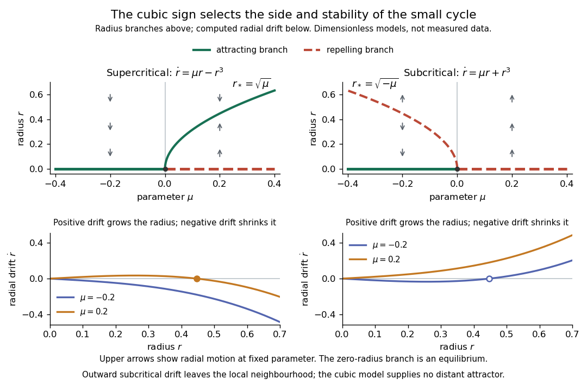

# Bifurcation theory

↑ **Parent:** [Dynamical systems](dynamical-systems.md)  
ⓦ [Wiki](https://en.wikipedia.org/wiki/Bifurcation_theory)

Bifurcation theory studies qualitative changes in equilibria and invariant sets as parameters vary.

**Table of contents**

- [Bifurcation parameter](#bifurcation-parameter)
- [Global bifurcation](#global-bifurcation)
- [Neimark–Sacker bifurcation](#neimark-sacker-bifurcation)
  - [Cubic radial coefficient of a quadratic planar map](#cubic-radial-coefficient-of-a-quadratic-planar-map)
  - [Strong resonance of a planar map](#strong-resonance-of-a-planar-map)
- [Bifurcation](#bifurcation)
- [Normal form (dynamical systems)](#normal-form-dynamical-systems)
  - [Quadratic even-odd mode interaction](#quadratic-even-odd-mode-interaction)
  - [Near-identity transformation](#near-identity-transformation)
- [Steady-state bifurcation](#steady-state-bifurcation)
- [Subcritical bifurcation](#subcritical-bifurcation)
- [Supercritical bifurcation](#supercritical-bifurcation)
- [Codimension-two bifurcation](#codimension-two-bifurcation)
  - [Cusp bifurcation](#cusp-bifurcation)
  - [Fold-Hopf bifurcation](#fold-hopf-bifurcation)
    - [First integral of the quadratic fold-Hopf amplitude flow](#first-integral-of-the-quadratic-fold-hopf-amplitude-flow)
  - [Saddle-node separatrix-loop bifurcation](#saddle-node-separatrix-loop-bifurcation)
  - [Bogdanov–Takens bifurcation](#bogdanov-takens-bifurcation)
    - [Quadratic-product flow with a double-zero bifurcation](#quadratic-product-flow-with-a-double-zero-bifurcation)
      - [Quadratic escape desingularization](#quadratic-escape-desingularization)
    - [Quadratic Bogdanov–Takens unfolding](#quadratic-bogdanov-takens-unfolding)
    - [Reflection-symmetric cubic double-zero normal form](#reflection-symmetric-cubic-double-zero-normal-form)
      - [Nilpotent cubic damping invariant](#nilpotent-cubic-damping-invariant)
        - [Cubic elimination at a nilpotent double-zero point](#cubic-elimination-at-a-nilpotent-double-zero-point)
      - [Hamiltonian blow-up of a reflection-symmetric double-zero point](#hamiltonian-blow-up-of-a-reflection-symmetric-double-zero-point)
  - [Steady–Hopf mode interaction](#steady-hopf-mode-interaction)
- [Stationary bifurcation](#stationary-bifurcation)
- [Amplitude equation](#amplitude-equation)
  - [Conserved-mean convection amplitude equations](#conserved-mean-convection-amplitude-equations)
  - [Conserved-field real amplitude equation](#conserved-field-real-amplitude-equation)
    - [Coexistence fraction of a conserved-field amplitude mesa](#coexistence-fraction-of-a-conserved-field-amplitude-mesa)
    - [Periodic stability criterion for a conserved-field uniform amplitude](#periodic-stability-criterion-for-a-conserved-field-uniform-amplitude)
  - [Directly forced cubic amplitude equation](#directly-forced-cubic-amplitude-equation)
    - [Fold and Hopf thresholds of a directly forced cubic amplitude](#fold-and-hopf-thresholds-of-a-directly-forced-cubic-amplitude)
  - [Parametrically forced counterpropagating waves](#parametrically-forced-counterpropagating-waves)
    - [Positivity condition for a phase-locked standing wave](#positivity-condition-for-a-phase-locked-standing-wave)
  - [Newell–Whitehead–Segel equation](#newell-whitehead-segel-equation)
    - [Anisotropic transverse scaling of an isotropic roll envelope](#anisotropic-transverse-scaling-of-an-isotropic-roll-envelope)
  - [Signed cyclic three-mode amplitude equations](#signed-cyclic-three-mode-amplitude-equations)
    - [Conserved octant dynamics of a cyclic amplitude system](#conserved-octant-dynamics-of-a-cyclic-amplitude-system)
  - [Chiral hexagonal amplitude equations](#chiral-hexagonal-amplitude-equations)
    - [Chiral hexagon Hopf threshold](#chiral-hexagon-hopf-threshold)
    - [Uniqueness of positive hexagon equilibria with straddling cross-couplings](#uniqueness-of-positive-hexagon-equilibria-with-straddling-cross-couplings)
    - [Phase locking of a resonant hexagonal triad](#phase-locking-of-a-resonant-hexagonal-triad)
  - [Three-to-one spatially forced amplitude equation](#three-to-one-spatially-forced-amplitude-equation)
    - [Hamiltonian limit of three-to-one forcing](#hamiltonian-limit-of-three-to-one-forcing)
    - [Threefold phase-locked equilibria](#threefold-phase-locked-equilibria)
    - [Rotating-frame normalization of resonant amplitude forcing](#rotating-frame-normalization-of-resonant-amplitude-forcing)
  - [Real Ginzburg–Landau equation](#real-ginzburg-landau-equation)
    - [Quintic real Ginzburg-Landau equation](#quintic-real-ginzburg-landau-equation)
      - [Modulation cutoff of a cubic-quintic uniform pattern](#modulation-cutoff-of-a-cubic-quintic-uniform-pattern)
    - [Eckhaus instability](#eckhaus-instability)
      - [Sideband spectrum of a real Ginzburg-Landau plane wave](#sideband-spectrum-of-a-real-ginzburg-landau-plane-wave)
      - [Eckhaus boundary for a subcritical quintic amplitude equation](#eckhaus-boundary-for-a-subcritical-quintic-amplitude-equation)
  - [Landau amplitude equation](#landau-amplitude-equation)
    - [Spatially forced convection amplitude equation](#spatially-forced-convection-amplitude-equation)
      - [Stable equilibria of a conjugately forced Landau equation](#stable-equilibria-of-a-conjugately-forced-landau-equation)
      - [Vanishing two-to-one forcing coefficient for Stokes convection](#vanishing-two-to-one-forcing-coefficient-for-stokes-convection)
- [Eigenvalue-crossing bifurcation test](#eigenvalue-crossing-bifurcation-test)
- [Saddle-node bifurcation](#saddle-node-bifurcation)
  - [Saddle-node bifurcation on an invariant circle](#saddle-node-bifurcation-on-an-invariant-circle)
    - [Inverse-square-root period law near a saddle-node bottleneck](#inverse-square-root-period-law-near-a-saddle-node-bottleneck)
- [Pitchfork bifurcation normal form](#pitchfork-bifurcation-normal-form)
  - [Rational equilibrium curve at a degenerate pitchfork](#rational-equilibrium-curve-at-a-degenerate-pitchfork)
  - [Degenerate pitchfork in the cubic confinement model](#degenerate-pitchfork-in-the-cubic-confinement-model)
  - [Supercritical pitchfork bifurcation](#supercritical-pitchfork-bifurcation)
  - [Subcritical pitchfork bifurcation](#subcritical-pitchfork-bifurcation)
  - [Symmetry-forced pitchfork bifurcation](#symmetry-forced-pitchfork-bifurcation)
    - [Imperfect pitchfork bifurcation](#imperfect-pitchfork-bifurcation)
      - [Quintic saturation of a symmetry-broken pitchfork](#quintic-saturation-of-a-symmetry-broken-pitchfork)
- [Structural stability of a bifurcation](#structural-stability-of-a-bifurcation)
- [Bifurcation diagram](#bifurcation-diagram)
  - [Bifurcation diagram of the 2023 Cambridge quadratic-product system](#bifurcation-diagram-of-the-2023-cambridge-quadratic-product-system)
  - [Bifurcations of the 2020 Cambridge quintic system](#bifurcations-of-the-2020-cambridge-quintic-system)
- [Hopf bifurcation](#hopf-bifurcation)
  - [Reflection-symmetric one-to-one Hopf resonance](#reflection-symmetric-one-to-one-hopf-resonance)
    - [Secondary steady and Hopf thresholds of a resonant pure mode](#secondary-steady-and-hopf-thresholds-of-a-resonant-pure-mode)
  - [Generalized Hopf bifurcation](#generalized-hopf-bifurcation)
  - [Hopf criticality for an asymmetric Lienard center](#hopf-criticality-for-an-asymmetric-lienard-center)
  - [Supercritical Hopf bifurcation](#supercritical-hopf-bifurcation)
  - [Hopf normal form](#hopf-normal-form)
  - [Subcritical Hopf bifurcation](#subcritical-hopf-bifurcation)
- [Saddle-node bifurcation of periodic orbits](#saddle-node-bifurcation-of-periodic-orbits)
- [Quintic radial Hopf equation](#quintic-radial-hopf-equation)
- [Interior equilibrium branch connecting two boundary bifurcations](#interior-equilibrium-branch-connecting-two-boundary-bifurcations)
  - [Two-stage stability exchange in a symmetric planar system](#two-stage-stability-exchange-in-a-symmetric-planar-system)

## Bifurcation parameter

↑ **Parent:** [Bifurcation theory](bifurcation-theory.md)

A bifurcation parameter labels a family of [dynamical systems](dynamical-systems.md) in which a qualitative change of [equilibria](dynamical-systems.md#equilibrium-point-of-a-dynamical-system) or other invariant sets is studied. Near a simple critical [eigenvalue](linear-operator-theory.md#eigenvalue) crossing, a nonzero derivative with respect to the physical control parameter permits using that eigenvalue itself as a local parameter. At a [codimension-two bifurcation](#codimension-two-bifurcation), two independent parameters are generally needed.

## Global bifurcation

↑ **Parent:** [Bifurcation theory](bifurcation-theory.md)

A [global bifurcation](#global-bifurcation) changes an [invariant set](ergodic-theory.md#invariant-set-of-a-measure-preserving-transformation) through a global orbit connection or collision that cannot be identified by a single [equilibrium point](dynamical-systems.md#equilibrium-point-of-a-dynamical-system)'s [linearization](algebra.md#linearization) alone. For example, a [global bifurcation](#global-bifurcation) through a saddle [homoclinic orbit](dynamical-systems.md#homoclinic-orbit) occurs when an outgoing unstable [separatrix](dynamical-systems.md#separatrix) returns to the same [saddle equilibrium](dynamical-systems.md#saddle-equilibrium)'s [stable manifold](dynamical-systems.md#stable-manifold). A smooth global [Poincaré return map](dynamical-systems.md#poincare-map) then combines with a local passage map to determine which side contains a [periodic orbit](dynamical-systems.md#periodic-orbit). A [heteroclinic orbit](dynamical-systems.md#heteroclinic-orbit) instead joins distinct [equilibrium points](dynamical-systems.md#equilibrium-point-of-a-dynamical-system); an energy-balance or Melnikov [integral](integral.md) can locate its breaking in a nearly [Hamiltonian system](hamiltonian-mechanics.md#hamiltonian-system).

<h2 id="neimark-sacker-bifurcation">Neimark–Sacker bifurcation</h2>

↑ **Parent:** [Bifurcation theory](bifurcation-theory.md)

A Neimark–Sacker bifurcation of a smooth planar map occurs when a simple complex-conjugate pair of fixed-point [Floquet multipliers](dynamical-systems.md#floquet-multiplier) crosses the [unit circle](complex-analysis.md#complex-unit-circle) away from low-order resonances. If its radial [normal form](#normal-form-dynamical-systems) is $r'=r(1+\eta+dr^2)+\cdots$ with $d\ne0$, a small invariant closed curve has $r^2=-\eta/d+\cdots$. For $d<0$ it appears on $\eta>0$, where the [fixed point](function.md#fixed-point) has become unstable, and its radial [Floquet multiplier](dynamical-systems.md#floquet-multiplier) is $1-2\eta+\cdots$, so the bifurcation is supercritical. For $d>0$ the curve lies on $\eta<0$ and is unstable, giving a subcritical bifurcation. [Area-preserving maps](discrete-dynamical-system.md#area-preserving-map) have a vanishing cubic radial drift at an elliptic point and do not meet this dissipative nondegeneracy condition.

### Cubic radial coefficient of a quadratic planar map

↑ **Parent:** [Neimark–Sacker bifurcation](#neimark-sacker-bifurcation)

In a complex coordinate write $z'=\lambda z+f_{20}z^2+f_{11}z\overline z+f_{02}\overline z^2$, with $|\lambda|=1$. Away from [strong resonances of a planar map](#strong-resonance-of-a-planar-map), the quadratic change $z=w+h_{20}w^2+h_{11}w\overline w+h_{02}\overline w^2$ has $h_{20}=f_{20}/(\lambda^2-\lambda)$, $h_{11}=f_{11}/(1-\lambda)$ and $h_{02}=f_{02}/(\overline\lambda^2-\lambda)$. Substituting and collecting $w^2\overline w$ gives $g_{21}=2f_{20}h_{11}+f_{11}h_{20}+f_{11}\overline h_{11}+2f_{02}\overline h_{02}$. The cubic radial coefficient is $\ell=\operatorname{Re}(\overline\lambda g_{21})$; $\ell<0$ gives a supercritical crossing when the multiplier modulus increases through one.

### Strong resonance of a planar map

↑ **Parent:** [Neimark–Sacker bifurcation](#neimark-sacker-bifurcation)

At a [strong resonance of a planar map](#strong-resonance-of-a-planar-map) the [Floquet multiplier](dynamical-systems.md#floquet-multiplier) of a [fixed point](function.md#fixed-point) is a root of unity of low order. The usual nonresonant [Neimark–Sacker bifurcation](#neimark-sacker-bifurcation) requires $\lambda^k\ne1$ for $k=1,2,3,4$. At a 1:3 resonance a quadratic term $\overline z^2$ cannot be removed from the [normal form](#normal-form-dynamical-systems); at a 1:4 resonance a cubic term $\overline z^3$ remains. Consequently one cannot infer a quasiperiodic invariant curve from the unit-modulus crossing alone.

## Bifurcation

↑ **Parent:** [Bifurcation theory](bifurcation-theory.md)

A bifurcation is a qualitative change in the phase portrait of a [dynamical system](dynamical-systems.md#dynamical-system) as a parameter varies, for example creation of [equilibrium points](dynamical-systems.md#equilibrium-point-of-a-dynamical-system) or a change in their stability.

## Normal form (dynamical systems)

↑ **Parent:** [Bifurcation theory](bifurcation-theory.md)

A simplified local vector field obtained by smooth changes of state variables, and sometimes time or parameter, retaining the terms that cannot be removed at the required order. Near a simple zero eigenvalue, reduction to a [centre manifold](dynamical-systems.md#center-manifold) can give the transcritical form $\dot v=\epsilon v-v^2$ or a reflection-symmetric pitchfork form $\dot x=\epsilon x\pm x^3$. The nonzero leading coefficients and permitted coordinate changes are part of the classification.

### Quadratic even-odd mode interaction

↑ **Parent:** [Normal form (dynamical systems)](#normal-form-dynamical-systems)

A [reflection](linear-algebra.md#reflection-mathematics) acting as $(A,B)\mapsto(A,-B)$ forces an [equivariant](group-action.md#equivariant-map) [vector field](multivariable-calculus.md#vector-field) to have $\dot A$ even and $\dot B$ odd in $B$. With the zero solution preserved, its quadratic [normal form](#normal-form-dynamical-systems) is $\dot A=\lambda_1A+a_1A^2+a_2B^2$, $\dot B=\lambda_2B+a_3AB$. For positive coefficients, every mixed [equilibrium](dynamical-systems.md#equilibrium-point-of-a-dynamical-system) with $B\ne0$ has [Jacobian determinant](multivariable-calculus.md#jacobian-determinant) $-2a_2a_3B^2<0$, hence is a [saddle equilibrium](dynamical-systems.md#saddle-equilibrium). The two invariant-axis equilibria meet in a [transcritical bifurcation](dynamical-systems.md#transcritical-bifurcation), and the mixed branches meet them in [pitchfork bifurcations](#pitchfork-bifurcation-normal-form).

### Near-identity transformation

↑ **Parent:** [Normal form (dynamical systems)](#normal-form-dynamical-systems)

A near-identity transformation is a local [change of variables](multivariable-calculus.md#change-of-variables-formula) whose derivative at the reference point is the identity. In a [normal form of a dynamical system](#normal-form-dynamical-systems), substituting $x=y+h(y)$ and solving $(I+Dh(y))\dot y=f(y+h(y))$ determines which nonlinear coefficients can be removed. The transformation is locally invertible by the [inverse function theorem](multivariable-calculus.md#inverse-function-theorem). Terms whose removal equations are singular are resonant and must be retained; a computed zero resonant coefficient cannot be assigned an arbitrary nonzero value by normalization.

## Steady-state bifurcation

↑ **Parent:** [Bifurcation theory](bifurcation-theory.md)

A change in local branches or stability of [equilibrium points of a dynamical system](dynamical-systems.md#equilibrium-point-of-a-dynamical-system) as a parameter varies. A zero Jacobian eigenvalue is necessary for the equilibrium-branch bifurcations of a smooth finite-dimensional system: without it, the [implicit function theorem](multivariable-calculus.md#implicit-function-theorem) gives a unique nearby equilibrium branch. It is not sufficient by itself; nonzero coefficients in the reduced [normal form of a dynamical system](#normal-form-dynamical-systems) establish the bifurcation type. A Hopf crossing has nonzero imaginary eigenvalues and is a different local bifurcation.

## Subcritical bifurcation

↑ **Parent:** [Bifurcation theory](bifurcation-theory.md)

A subcritical branch emerges on the parameter side where the original state remains stable. In the cubic [Landau amplitude equation](#landau-amplitude-equation) $\dot A=\mu A-g|A|^2A$ with $g<0$, the small nonzero branch lies at $\mu<0$ and is unstable to radial amplitude perturbations. Higher-order saturation can generate a finite-amplitude stable branch and hysteresis, but this does not follow from a cubic truncation alone.

## Supercritical bifurcation

↑ **Parent:** [Bifurcation theory](bifurcation-theory.md)

A supercritical branch emerges on the parameter side where the original state loses stability. In the cubic [Landau amplitude equation](#landau-amplitude-equation) $\dot A=\mu A-g|A|^2A$ with $g>0$, the nonzero branch $|A|^2=\mu/g$ lies at $\mu>0$ and is stable to radial amplitude perturbations. Continuous phase symmetry still leaves a neutral phase direction. The direction of a branch and its stability should both be checked in a general problem of [bifurcation theory](bifurcation-theory.md).

## Codimension-two bifurcation

↑ **Parent:** [Bifurcation theory](bifurcation-theory.md)

A codimension-two bifurcation requires two independent parameter conditions to hold simultaneously. Simultaneous stationary and [Hopf bifurcation](#hopf-bifurcation) thresholds require both kinds of critical mode in the reduced [amplitude equation](#amplitude-equation). A crossing of modes at different [wavenumbers](wave-equation.md#wavenumber) is different from a zero-frequency double-zero degeneration of one fixed-wave-number cubic.

### Cusp bifurcation

↑ **Parent:** [Codimension-two bifurcation](#codimension-two-bifurcation)

A cusp is a two-parameter degeneracy at which two [saddle-node bifurcation](#saddle-node-bifurcation) curves meet and the reduced steady equation has a triple root. In the displayed scalar [normal form](#normal-form-dynamical-systems), simultaneous vanishing of the polynomial and its derivative gives $\beta_2=3x^2$, $\beta_1=-2x^3$. Thus the folds satisfy $4\beta_2^3=27\beta_1^2$, with $\beta_2\geq0$. Between the folds there are three real [equilibria](dynamical-systems.md#equilibrium-point-of-a-dynamical-system), and outside them one. A transverse stable direction may be present in a higher-dimensional realization.

### Fold-Hopf bifurcation

↑ **Parent:** [Codimension-two bifurcation](#codimension-two-bifurcation)

A fold-Hopf bifurcation combines a simple zero [eigenvalue](linear-operator-theory.md#eigenvalue) and a nonzero imaginary pair at an [equilibrium point](dynamical-systems.md#equilibrium-point-of-a-dynamical-system). In a three-dimensional [centre manifold](dynamical-systems.md#center-manifold), a [normal form of a dynamical system](#normal-form-dynamical-systems) separates a real fold amplitude from a complex oscillatory amplitude. A rotationally symmetric [normal form](#normal-form-dynamical-systems) permits reduction to two real amplitude equations, while the oscillation phase continues to evolve. Secondary bifurcations of the amplitude flow can produce invariant [tori](topological-surface.md#torus) in the full [dynamical system](dynamical-systems.md#dynamical-system).

#### First integral of the quadratic fold-Hopf amplitude flow

↑ **Parent:** [Fold-Hopf bifurcation](#fold-hopf-bifurcation)

The amplitude equations $u'=-2uv$, $v'=\lambda_2+v^2+u^2$ satisfy $u'=F_v$, $v'=-F_u$, hence preserve the displayed [first integral](differential-equation.md#first-integral). For $\lambda_2=-a^2<0$ and $u\ge0$, the [centre equilibrium](dynamical-systems.md#center-equilibrium) is $(a,0)$ with $F=2a^3/3$, while the two boundary [saddle equilibria](dynamical-systems.md#saddle-equilibrium) are $(0,\pm a)$ with $F=0$. The level $F=0$ contains the boundary connection and the arc $u^2=3(a^2-v^2)$ joining the two [saddle equilibria](dynamical-systems.md#saddle-equilibrium). Levels $0<F<2a^3/3$ form closed [periodic orbits](dynamical-systems.md#periodic-orbit). Adding an independent rotating phase turns these closed amplitude trajectories into invariant [tori](topological-surface.md#torus).

### Saddle-node separatrix-loop bifurcation

↑ **Parent:** [Codimension-two bifurcation](#codimension-two-bifurcation)

A saddle-node separatrix-loop point occurs when a saddle-node equilibrium simultaneously has a global returning separatrix at its strong stable manifold. In the local form $\dot x=x^2-\mu$, $\dot y=-\lambda y$, a global return to $y=h$ at $x=\nu$ makes the codimension-two point $\mu=\nu=0$. For $\mu>0$ a saddle loop occurs on $\nu=\sqrt\mu$. The saddle-node boundary $\mu=0$ has an invariant-circle segment on the $\nu<0$ side, while for $\nu>0$ a nearby periodic orbit avoids the bottleneck and survives the local equilibrium fold. The return geometry, rather than the local saddle-node normal form alone, determines the global orbit.

<h3 id="bogdanov-takens-bifurcation">Bogdanov–Takens bifurcation</h3>

↑ **Parent:** [Codimension-two bifurcation](#codimension-two-bifurcation)

A Bogdanov–Takens bifurcation has a double zero eigenvalue with a nontrivial Jordan block and generic two-parameter unfolding. Its local diagram includes [saddle-node bifurcations](#saddle-node-bifurcation), [Hopf bifurcations](#hopf-bifurcation), and a curve of small [homoclinic orbits](dynamical-systems.md#homoclinic-orbit). A weakly perturbed Hamiltonian scaling can locate the homoclinic curve through energy balance.

#### Quadratic-product flow with a double-zero bifurcation

↑ **Parent:** [Bogdanov–Takens bifurcation](#bogdanov-takens-bifurcation)

For $\lambda>0$, the [equilibrium points](dynamical-systems.md#equilibrium-point-of-a-dynamical-system) are the origin and $(s,s^2)$ with $s=(1\pm\sqrt{1+4\mu})/2$. The nonzero branches have Jacobian trace $s-\lambda$ and determinant $\lambda s(2s-1)$. They have a [saddle-node bifurcation](#saddle-node-bifurcation) at $\mu=-1/4$, $s=1/2$; the origin exchanges stability with the lower branch at the [transcritical bifurcation](dynamical-systems.md#transcritical-bifurcation) $\mu=0$. A [Hopf bifurcation](#hopf-bifurcation) occurs on the upper branch at $\mu=\lambda(\lambda-1)$ for $\lambda>1/2$. The point $(\mu,\lambda)=(-1/4,1/2)$ has a double zero [eigenvalue](linear-operator-theory.md#eigenvalue) and a nontrivial Jordan block. Its generic unfolding includes a saddle-loop curve and the intervening stable [periodic orbit](dynamical-systems.md#periodic-orbit) region.

##### Quadratic escape desingularization

↑ **Parent:** [Quadratic-product flow with a double-zero bifurcation](#quadratic-product-flow-with-a-double-zero-bifurcation)

For $\dot u=u(\mu+u-v)$, $\dot v=\lambda u^2$ in $u>0$, the time change $d\tau/dt=u$ gives the affine linear system $u_\tau=\mu+u-v$, $v_\tau=\lambda u$. Shifting $w=v-\mu$ removes the forcing. Its [eigenvalues](linear-operator-theory.md#eigenvalue) are $(1\pm\sqrt{1-4\lambda})/2$. For $\lambda>1/4$, putting $\omega=\sqrt{4\lambda-1}/2$ gives

$$
u(\tau)=e^{\tau/2}\left[h\cos(\omega\tau)+\frac{\mu+h/2-v_0}{\omega}\sin(\omega\tau)\right].
$$

For fixed $\mu>0$ and initial $h,v_0$ tending to zero, the first return to small positive $u$ occurs after approximately $\pi/\omega=2\pi/\sqrt{4\lambda-1}$. This is a half-turn, not a full turn. At $\lambda=1/4$, $u=e^{\tau/2}[h+(\mu+h/2-v_0)\tau]$ does not return and grows without bound. The loss of return diagnoses escape to infinity rather than a finite-amplitude [homoclinic orbit](dynamical-systems.md#homoclinic-orbit). Physical time obeys $dt=d\tau/u$ and need not share the divergent desingularized travel time.

<h4 id="quadratic-bogdanov-takens-unfolding">Quadratic Bogdanov–Takens unfolding</h4>

↑ **Parent:** [Bogdanov–Takens bifurcation](#bogdanov-takens-bifurcation)

For $\lambda>0$, the [equilibrium points](dynamical-systems.md#equilibrium-point-of-a-dynamical-system) are $x=\pm\sqrt\lambda$, $y=0$. The positive branch is a saddle; the negative branch has a subcritical [Hopf bifurcation](#hopf-bifurcation) at $\mu=\sqrt\lambda$. A [homoclinic orbit](dynamical-systems.md#homoclinic-orbit) occurs at $\mu=(5/7)\sqrt\lambda+O(\lambda)$ near the double-zero point. Between this homoclinic curve and the Hopf curve, an unstable [periodic orbit](dynamical-systems.md#periodic-orbit) surrounds a stable [equilibrium point](dynamical-systems.md#equilibrium-point-of-a-dynamical-system). The factor $5/7$ follows from a [Melnikov energy-balance method](dynamical-systems.md#melnikov-energy-balance-method), using the integrals of $v^2$ and $uv^2$ along the leading conservative saddle loop.

// Destination: dynamical-systems.bigb

#### Reflection-symmetric cubic double-zero normal form

↑ **Parent:** [Bogdanov–Takens bifurcation](#bogdanov-takens-bifurcation)

The sign $\sigma=\pm1$ distinguishes an inverted quartic potential from a double-well potential. The origin has determinant $\lambda$ and trace $\kappa$. Nonzero equilibria obey $q^2=\lambda/\sigma$, with determinant $-2\lambda$ and trace $\kappa-2\lambda$. Its energy $p^2/2+\lambda q^2/2-\sigma q^4/4$ has derivative $(\kappa-2\sigma q^2)p^2$. The origin's Hopf bifurcation is supercritical for $\sigma=1$ and subcritical for $\sigma=-1$. In the latter case the nonzero equilibria have supercritical Hopf bifurcations at $\kappa=2\lambda<0$.

// Target: dynamical-systems.bigb

##### Nilpotent cubic damping invariant

↑ **Parent:** [Reflection-symmetric cubic double-zero normal form](#reflection-symmetric-cubic-double-zero-normal-form)

For a reflection-symmetric [vector field](multivariable-calculus.md#vector-field) $\dot u=v+f_{30}u^3+f_{21}u^2v+\cdots$, $\dot v=g_{30}u^3+g_{21}u^2v+\cdots$, introduce $x=u$, $y=\dot u$. Differentiating gives $\dot x=y$ and a cubic acceleration with $x^2y$ coefficient $b=g_{21}+3f_{30}$. The contribution $3f_{30}$ comes from differentiating the first equation's cubic term. Further cubic [near-identity transformations](#near-identity-transformation) can remove nonresonant terms but cannot turn $b=0$ into a nonzero coefficient by a nonsingular scaling. This is a useful check before assigning a generic reflection-symmetric [Bogdanov–Takens bifurcation](#bogdanov-takens-bifurcation) to a calculated [Taylor expansion](calculus.md#taylor-expansion).

###### Cubic elimination at a nilpotent double-zero point

↑ **Parent:** [Nilpotent cubic damping invariant](#nilpotent-cubic-damping-invariant)

For a [vector field](multivariable-calculus.md#vector-field) with linear part $\dot u=v$, $\dot v=0$ and cubic terms $a_i u^3+b_i u^2v+c_iuv^2+d_iv^3$, write $(u,v)=(x,y)+(h_1,h_2)$ with homogeneous cubic $h_i$. The transformed cubic field is $f_3+Ah-Dh\,A(x,y)^T$, where $A(x,y)^T=(y,0)^T$. Taking the coefficients of $h_2$ to be $(-a_1,c_2/2,d_2,0)$ and those of $h_1$ to be $((b_1+c_2/2)/3,(c_1+d_2)/2,d_1,0)$ eliminates every cubic term in $\dot x$ and the $xy^2,y^3$ terms in $\dot y$. The remaining [normal form](#normal-form-dynamical-systems) is $\dot x=y$, $\dot y=Px^3+Qx^2y$ through cubic order. The invariant damping coefficient contains the contribution $3a_1$ from differentiating the first equation.

##### Hamiltonian blow-up of a reflection-symmetric double-zero point

↑ **Parent:** [Reflection-symmetric cubic double-zero normal form](#reflection-symmetric-cubic-double-zero-normal-form)

Near a nilpotent origin with $\sigma=1$, $\mu=0$, the weighted scaling $u_{\rm old}=\varepsilon^2u$, $v_{\rm old}=\varepsilon v$, $\tau=\varepsilon t$, $\mu_{\rm old}=\varepsilon^2\mu$, $\sigma=1+\varepsilon^2s$ makes the leading cubic confinement flow $u'=-sv+v^3/2$, $v'=2u$. Direct differentiation proves conservation of $H=u^2+sv^2/2-v^4/8$. For $s>0$ the origin is a centre and $(0,\pm\sqrt{2s})$ are saddles. Their heteroclinic connections have $H=s^2/2$ and $u=\pm(2s-v^2)/(2\sqrt2)$ for $|v|\le\sqrt{2s}$. Positive lower energy levels surround the centre; higher levels escape the potential well.

<h3 id="steady-hopf-mode-interaction">Steady–Hopf mode interaction</h3>

↑ **Parent:** [Codimension-two bifurcation](#codimension-two-bifurcation)

For a chosen orientation and phase-reduced steady amplitude $a$ and nonresonant oscillatory amplitude $z$, a schematic normal form is $\dot a=r_sa-g_sa^3-h_sa|z|^2$, $\dot z=(r_o+i\omega_0)z-g_o|z|^2z-h_oa^2z$. For $r_s,g_s>0$ the pure steady branch exists and is radially attracting; its oscillatory perturbation is damped when $r_o-h_{o,r}r_s/g_s<0$, where $h_{o,r}=\operatorname{Re}(h_o)$. For $r_o,g_{o,r}>0$, $g_{o,r}=\operatorname{Re}(g_o)$, the pure oscillatory branch exists and is radially attracting; its steady perturbation is damped when $r_s-h_sr_o/g_{o,r}<0$. The transverse inequalities are not existence or full stability tests by themselves. Mixed intensities $u=a^2>0$, $v=|z|^2>0$ solve $g_su+h_sv=r_s$, $h_{o,r}u+g_{o,r}v=r_o$. Their intensity [Jacobian matrix](multivariable-calculus.md#jacobian-matrix) has trace $-2(g_su+g_{o,r}v)$ and determinant $4uv(g_sg_{o,r}-h_sh_{o,r})$, giving attraction in intensities when the trace is negative and determinant positive. Resonant phases, oppositely travelling modes or zero-frequency limits need additional retained amplitudes; this schematic pair is not a universal complete normal form.

## Stationary bifurcation

↑ **Parent:** [Bifurcation theory](bifurcation-theory.md)

At a stationary bifurcation, a real [eigenvalue](linear-operator-theory.md#eigenvalue) of the linearized system passes through zero. Nearby equilibria may then be created, destroyed, or exchange stability.

## Amplitude equation

↑ **Parent:** [Bifurcation theory](bifurcation-theory.md)

An amplitude equation describes the slow evolution of the coefficient of a critical mode near an instability threshold. Symmetry and solvability determine its leading nonlinear terms.

### Conserved-mean convection amplitude equations

↑ **Parent:** [Amplitude equation](#amplitude-equation)

The [partial differential equation](partial-differential-equation.md) $T_t=-\mu\Delta T-\Delta^2T+\nabla\cdot(|\nabla T|^2\nabla T)$ on a $2\pi$-periodic square conserves the spatial mean. On a fixed-mean subspace its first instability is at $\mu=1$ and has four real critical [amplitudes](wave.md#wave-amplitude). With $\mu=1+\varepsilon^2\nu$ and $T=\varepsilon(Ae^{ix}+Be^{iy}+\text{complex conjugate})+\cdots$, projection onto the critical [Fourier modes](fourier-analysis.md#fourier-mode) gives the displayed equation and its $A,B$ interchange. For $\nu>0$, squares have $|A|^2=|B|^2=\nu/5$, [amplitude](wave.md#wave-amplitude) [eigenvalues](linear-operator-theory.md#eigenvalue) $-2\nu,-2\nu/5$, and neutral translation [phases](wave.md#phase-waves). Rolls have a positive transverse growth rate $\nu/3$.

### Conserved-field real amplitude equation

↑ **Parent:** [Amplitude equation](#amplitude-equation)

With [periodic boundary conditions](differential-equation.md#periodic-boundary-conditions), the spatial mean of $B$ is a [conserved quantity](hamiltonian-mechanics.md#conserved-quantity). For zero mean write $B=H_X$ with periodic zero-mean $H$. The functional $V=\langle\mu A^2/2+\alpha A^3/3-A^4/4-A_X^2/2-A^2H_X/2-H_X^2/(4\delta)\rangle$ generates $A_T=\delta V/\delta A$, $H_T=2\delta\sigma\,\delta V/\delta H$. Thus $V_T=\langle A_T^2+H_T^2/(2\delta\sigma)\rangle\geq0$. Completing the square in $H_X$ bounds $V$ above by a coercive quartic polynomial when $0<\delta<1$, ruling out nonconstant recurrent motion on regular precompact trajectories.

#### Coexistence fraction of a conserved-field amplitude mesa

↑ **Parent:** [Conserved-field real amplitude equation](#conserved-field-real-amplitude-equation)

For $0<\delta<1$ and $\alpha\ne0$, a broad localized plateau in the [conserved-field real amplitude equation](#conserved-field-real-amplitude-equation) has effective parameter $\nu=\mu-\delta\langle A^2\rangle$ and stationary equation $A''+\nu A+\alpha A^2-(1-\delta)A^3=0$. Equal endpoint values of its first integral give $R=2\alpha/[3(1-\delta)]$, $\nu=-2\alpha^2/[9(1-\delta)]$. If the plateau occupies fraction $h$ of a long periodic interval, $\langle A^2\rangle\simeq hR^2$ supplies the displayed relation. It applies when both the plateau and exterior are long relative to the front width; $0<h<1$ gives its leading existence interval.

#### Periodic stability criterion for a conserved-field uniform amplitude

↑ **Parent:** [Conserved-field real amplitude equation](#conserved-field-real-amplitude-equation)

A nonzero uniform [equilibrium](dynamical-systems.md#equilibrium-point-of-a-dynamical-system) of the [conserved-field real amplitude equation](#conserved-field-real-amplitude-equation) obeys $\mu=R^2-\alpha R$. Fixed zero mean excludes the constant $B$ perturbation. Its homogeneous amplitude [eigenvalue](linear-operator-theory.md#eigenvalue) is $-r$. For a nonzero Fourier [wavenumber](wave-equation.md#wavenumber) $k$, the [stability matrix](dynamical-systems.md#stability-matrix) has [trace](linear-algebra.md#matrix-trace) $-r-(1+\sigma)k^2$ and [determinant](multilinear-algebra.md#determinant) $\sigma k^2(k^2+r-2\delta R^2)$. The displayed conditions are necessary and sufficient for strict [linear stability](dynamical-systems.md#linear-stability) on a period $2L$. In an infinite-domain limit the nonzero-mode condition becomes $r\geq2\delta R^2$; a long-wave instability need not occur in a sufficiently short domain.

### Directly forced cubic amplitude equation

↑ **Parent:** [Amplitude equation](#amplitude-equation)

A forcing at the carrier [wavenumber](wave-equation.md#wavenumber) breaks continuous spatial [translation symmetry](physics.md#translational-symmetry) and adds a constant to its complex [amplitude equation](#amplitude-equation). In a frame following a moving forcing pattern, its phase drift gives $i\Lambda A$. A nonzero forcing coefficient is normalized to one by scaling amplitude by its cube root and time by its two-thirds power. A steady intensity $s=|A|^2$ satisfies $s[(\mu-s)^2+\Lambda^2]=1$, and its phase is uniquely determined by the steady complex equation.

#### Fold and Hopf thresholds of a directly forced cubic amplitude

↑ **Parent:** [Directly forced cubic amplitude equation](#directly-forced-cubic-amplitude-equation)

For the [directly forced cubic amplitude equation](#directly-forced-cubic-amplitude-equation), a [saddle-node bifurcation](#saddle-node-bifurcation) requires $\Lambda^2=1/s-1/(4s^4)$ and $\mu=s+1/(2s^2)$. The right side has its unique maximum $3/4$ at $s=1$, giving a [cusp bifurcation](#cusp-bifurcation) at $(\Lambda,\mu,s)=(\sqrt3/2,3/2,1)$. The [stability matrix](dynamical-systems.md#stability-matrix) has [trace](linear-algebra.md#matrix-trace) $2(\mu-2s)$ and [determinant](multilinear-algebra.md#determinant) $(\mu-3s)(\mu-s)+\Lambda^2$. A [Hopf bifurcation](#hopf-bifurcation) requires $\mu=2s$, $s(s^2+\Lambda^2)=1$ and $\Lambda^2-s^2>0$. These imply $\Lambda>2^{-1/3}$; equality is a double-zero linear degeneracy rather than an ordinary [Hopf bifurcation](#hopf-bifurcation).

### Parametrically forced counterpropagating waves

↑ **Parent:** [Amplitude equation](#amplitude-equation)

Two counterpropagating modes transform as $(A,B)\mapsto(e^{ik\delta}A,e^{-ik\delta}B)$ under [spatial translation](general-relativity.md#spatial-translation). Forcing at twice their natural frequency breaks continuous temporal phase symmetry but preserves simultaneous sign reversal. Hence $\overline B$ transforms like $A$ and $\overline A$ like $B$, allowing linear parametric coupling. An equal-amplitude phase-locked [standing wave](mathematical-physics.md#standing-wave) has $|A|^2=|B|^2=z>0$ with $|\beta+\gamma|^2z^2-2\mu\operatorname{Re}(\beta+\gamma)z+\mu^2-\nu^2=0$. A nonnegative [discriminant](polynomial.md#discriminant) is only an algebraic compatibility condition: a physical nonzero wave also requires a positive root.

#### Positivity condition for a phase-locked standing wave

↑ **Parent:** [Parametrically forced counterpropagating waves](#parametrically-forced-counterpropagating-waves)

Writing $U=\operatorname{Re}(\beta+\gamma)$ and $V=\operatorname{Im}(\beta+\gamma)$, the squared amplitude is $z_\pm=[\mu U\pm\sqrt{(U^2+V^2)\nu^2-\mu^2V^2}]/(U^2+V^2)$. Reality of the square root does not guarantee positivity. For example, $U=1,V=0,\mu=-1,\nu=1/2$ gives two negative roots. Under the usual supercritical assumptions $\mu>0,U>0$, the plus root is positive whenever the [discriminant](polynomial.md#discriminant) is nonnegative.

// Destination: mathematical-biology.bigb

<h3 id="newell-whitehead-segel-equation">Newell–Whitehead–Segel equation</h3>

↑ **Parent:** [Amplitude equation](#amplitude-equation)

The Newell–Whitehead–Segel equation is an [amplitude equation](#amplitude-equation) for slowly modulated stationary rolls in an isotropic pattern-forming medium. With the displayed sign convention, a roll $A=R e^{iqX}$ has $R^2=\mu-q^2$. A transverse [phase modulation](dynamical-systems.md#phase-modulation) has linear growth rate $qk^2-k^4/4$, so long-wave transverse instability occurs for $q>0$. Reversing the carrier-wave convention reverses the sign attached to its detuning $q$; one must derive the stability sign from the operator actually used.

#### Anisotropic transverse scaling of an isotropic roll envelope

↑ **Parent:** [Newell–Whitehead–Segel equation](#newell-whitehead-segel-equation)

At a nonzero critical [wavenumber](wave-equation.md#wavenumber) in an isotropic medium, a small transverse wavevector changes its magnitude only at second order. Balancing radial detuning therefore requires the displayed unequal slow-space scales. With the positive carrier $e^{ik_cx}$, the leading [Newell–Whitehead–Segel equation](#newell-whitehead-segel-equation) spatial term is $\xi(\partial_X-i\partial_Y^2/(2k_c))^2A$. A roll detuning $q$ has transverse phase growth $-\xi qp^2/k_c-\xi p^4/(4k_c^2)$; negative $q$ permits a [zigzag instability](dynamical-systems.md#zigzag-instability). Changing the carrier convention changes the accompanying sign of $q$. Replacing this operator by an isotropic second-order Laplacian misses the critical circle's geometry.

### Signed cyclic three-mode amplitude equations

↑ **Parent:** [Amplitude equation](#amplitude-equation)

Independent sign changes of three amplitudes and a cyclic coordinate permutation force each cubic component to be its own amplitude times a cyclic permutation of one quadratic polynomial. One convenient parametrization is $\dot x=x(\mu-aX-cy^2+ez^2)$ with cyclic companions and $X=x^2+y^2+z^2$. The axial and diagonal isotropy types give primary branches; two-coordinate branches can emerge in secondary [pitchfork bifurcations](#pitchfork-bifurcation-normal-form) when cross-couplings change sign.

#### Conserved octant dynamics of a cyclic amplitude system

↑ **Parent:** [Signed cyclic three-mode amplitude equations](#signed-cyclic-three-mode-amplitude-equations)

When $c=e$ in the [signed cyclic three-mode amplitude equations](#signed-cyclic-three-mode-amplitude-equations), $\dot X=2X(\mu-aX)$ and $\dot V=3V(\mu-aX)$ for $V=xyz$. Thus $V/X^{3/2}$ is conserved wherever $X>0$, precluding asymptotically stable isolated equilibria. On $X=\mu/a$, each octant contains closed contours of $V$ around the equal-magnitude equilibrium, bounded by heteroclinic arcs between coordinate axes if $c\ne0$. For $c=0$ the sphere consists entirely of equilibria.

### Chiral hexagonal amplitude equations

↑ **Parent:** [Amplitude equation](#amplitude-equation)

Three Fourier wavevectors sum to zero and form a hexagonal star. Translations give each amplitude the phase of its own wavevector; cyclic rotations permute them, and a half-turn conjugates them. These symmetries permit the resonant quadratic term and force its coefficients to be real. A spatial reflection would interchange the two cross-couplings and require $b=c$, but chiral patterns need not have that extra symmetry. The equations describe rolls, hexagons, phase locking and oscillatory changes in dominant orientation.

#### Chiral hexagon Hopf threshold

↑ **Parent:** [Chiral hexagonal amplitude equations](#chiral-hexagonal-amplitude-equations)

For equal positive amplitudes $r$, let $s=a+b+c$ and use $\mu+\alpha r-sr^2=0$. The radial Jacobian eigenvalue is $\alpha r-2sr^2$. The conjugate pair has real part $(b+c-2a)r^2-2\alpha r$ and imaginary parts $\pm\sqrt3(b-c)r^2$. When $b+c>2a>0$ and $b\ne c$, the upper hexagon branch loses amplitude stability through this pair at the displayed radius. The associated parameter is $\mu_H=2\alpha^2(4a+b+c)/(b+c-2a)^2$. Nonlinear terms decide the direction and stability of the resulting periodic branch.

#### Uniqueness of positive hexagon equilibria with straddling cross-couplings

↑ **Parent:** [Chiral hexagonal amplitude equations](#chiral-hexagonal-amplitude-equations)

At a positive equilibrium set $x_i=r_i^2$ and $p=r_1r_2r_3$. The equations imply $a x_i+b x_{i+1}+c x_{i+2}-\alpha p/x_i=\mu$. Suppose $b>a>c$ and relabel cyclically so $x_1$ is maximal. If $x_2\geq x_3$, subtracting equations one and two makes the cubic side positive unless all are equal, whereas $\alpha p(1/x_1-1/x_2)$ is nonpositive. If $x_2\leq x_3$, subtracting equations two and three gives the opposite sign contradiction. Interchanging the orientation handles $c>a>b$. Thus all positive equilibria have equal amplitudes. With $\alpha\ne0$, a state with exactly two nonzero amplitudes cannot be an equilibrium because it immediately forces the third.

#### Phase locking of a resonant hexagonal triad

↑ **Parent:** [Chiral hexagonal amplitude equations](#chiral-hexagonal-amplitude-equations)

For $A_i=r_ie^{i\phi_i}$ with all $r_i>0$, the translation-invariant total phase is $\Phi=\phi_1+\phi_2+\phi_3$. With $\alpha>0$, the displayed equation makes $\Phi=0$ stable and $\Phi=\pi$ unstable. A spatial translation can remove two phases, so the stable locked states have all amplitudes positive real in a suitable origin. This is a statement modulo translation, not that every translated representative is real; the zero solution and rolls belong to boundary strata.

### Three-to-one spatially forced amplitude equation

↑ **Parent:** [Amplitude equation](#amplitude-equation)

A critical pattern [Fourier mode](fourier-analysis.md#fourier-mode) transforms under a spatial translation as $A\mapsto e^{i\phi}A$. A forcing at three times the critical [wavenumber](wave-equation.md#wavenumber) transforms as $F\mapsto e^{3i\phi}F$. Their lowest resonant product with phase weight one is $F\overline A^{\,2}$. This determines the form of the leading weak-forcing [amplitude equation](#amplitude-equation), while projection onto an [adjoint eigenfunction](linear-operator-theory.md#adjoint-eigenfunction) determines its coefficient. Symmetry permits this coupling but does not ensure that it is nonzero. Travelling forcing gives a time-dependent phase to $F$.

#### Hamiltonian limit of three-to-one forcing

↑ **Parent:** [Three-to-one spatially forced amplitude equation](#three-to-one-spatially-forced-amplitude-equation)

For small positive forcing-frame frequency $\omega$, use $\mu=\widehat\mu\omega^2$, $C=\omega z$ and $\tau=\omega T$ in the [three-to-one spatially forced amplitude equation](#three-to-one-spatially-forced-amplitude-equation). The leading system is $z_\tau+iz=\overline z^{\,2}$. Writing $z=x+iy$ gives the [Hamiltonian system](hamiltonian-mechanics.md#hamiltonian-system) $(x_\tau,y_\tau)=(H_y/2,-H_x/2)$ and the displayed [first integral](differential-equation.md#first-integral). The origin is a [center equilibrium](dynamical-systems.md#center-equilibrium); three [saddle equilibria](dynamical-systems.md#saddle-equilibrium) at $(0,1)$ and $(\pm\sqrt3/2,-1/2)$ lie on $H=1/3$. The factorization $H-1/3=(1+2y)[x^2-(y-1)^2/3]$ reveals a triangular [heteroclinic cycle](dynamical-systems.md#heteroclinic-cycle), containing closed [periodic orbits](dynamical-systems.md#periodic-orbit) for every $0<H<1/3$.

#### Threefold phase-locked equilibria

↑ **Parent:** [Three-to-one spatially forced amplitude equation](#three-to-one-spatially-forced-amplitude-equation)

The canonical [three-to-one spatially forced amplitude equation](#three-to-one-spatially-forced-amplitude-equation) has nonzero [equilibrium points](dynamical-systems.md#equilibrium-point-of-a-dynamical-system) $C=Re^{i\theta}$ satisfying $\cos3\theta=(R^2-\mu)/R$ and $\sin3\theta=-\omega/R$. Thus $(R^2-\mu)^2+\omega^2=R^2$. Each positive amplitude has three phases separated by $2\pi/3$: two amplitude branches normally mean six complex [equilibrium points](dynamical-systems.md#equilibrium-point-of-a-dynamical-system). For $\mu>\omega^2-1/4$ the larger branch is asymptotically stable and the smaller consists of [saddle equilibria](dynamical-systems.md#saddle-equilibrium), except that its zero-amplitude root at $(\mu,\omega)=(0,0)$ is not a nonzero [equilibrium point](dynamical-systems.md#equilibrium-point-of-a-dynamical-system). Equality gives a [saddle-node bifurcation](#saddle-node-bifurcation). This [phase locking](dynamical-systems.md#phase-locking) breaks continuous translation symmetry down to threefold symmetry.

#### Rotating-frame normalization of resonant amplitude forcing

↑ **Parent:** [Three-to-one spatially forced amplitude equation](#three-to-one-spatially-forced-amplitude-equation)

For the [three-to-one spatially forced amplitude equation](#three-to-one-spatially-forced-amplitude-equation) with forcing $e\exp[3i(\Omega T+\delta)]$, put $A=B\exp[i(\Omega T+\delta)]$. The real phase constant $\delta$ belongs inside the factor of $i$. If $c>0$ and the phase has been chosen so that $e>0$, the scaling $B=(e/c)C$, $\mathcal T=(e^2/c)T$ gives the displayed canonical [amplitude equation](#amplitude-equation), with $\mu=c\widetilde\mu/e^2$ and $\omega=c\Omega/e^2$. A negative cubic saturation coefficient cannot give the same cubic sign under a forward-time normalization; zero forcing or zero cubic coefficient requires another scaling.

<h3 id="real-ginzburg-landau-equation">Real Ginzburg–Landau equation</h3>

↑ **Parent:** [Amplitude equation](#amplitude-equation)

The real-coefficient Ginzburg–Landau [amplitude equation](#amplitude-equation) has complex $A$ and real parameters, usually $\xi,g>0$ near a supercritical stationary pattern onset. A detuned plane wave $A=\rho e^{iQX}$ has $\rho^2=(r-\xi Q^2)/g$. Its phase and amplitude sidebands determine the narrower [Eckhaus instability](#eckhaus-instability) stability band. It is a local envelope model; additional conserved fields or mean flows may need their own equations.

#### Quintic real Ginzburg-Landau equation

↑ **Parent:** [Real Ginzburg–Landau equation](#real-ginzburg-landau-equation)

A cubic destabilizing term and quintic saturation describe a subcritical stationary pattern bifurcation. A plane wave $A=Re^{iQX}$ has squared amplitude $x=R^2$ satisfying $\mu-Q^2+\alpha x-x^2=0$. The nonzero branches meet at $x=\alpha/2$, $\mu=Q^2-\alpha^2/4$. The lower branch is unstable to amplitude perturbations; the upper branch can also undergo an [Eckhaus instability](#eckhaus-instability) of its phase.

##### Modulation cutoff of a cubic-quintic uniform pattern

↑ **Parent:** [Quintic real Ginzburg-Landau equation](#quintic-real-ginzburg-landau-equation)

For $A_T=\mu A+3\hat sA|A|^2-10A|A|^4+4A_{XX}$, a nonzero uniform real state with $B=A_0^2$ obeys $\mu=-3\hat sB+10B^2$. Real amplitude sidebands grow at $6\hat sB-40B^2-4\ell^2$, while phase sidebands grow at $-4\ell^2$. The maximum amplitude growth coefficient is $9\hat s^2/40$, attained at $B=3\hat s/40$. Thus nonzero uniform states cannot have modulation bifurcations if the smallest allowed slow wavenumber exceeds $3\hat s/(4\sqrt{10})$. For a physical domain of length $L$ and $X=\varepsilon^2x$, this gives $L<8\pi\sqrt{10}/(3s)$. The zero state is an exception: it has sideband thresholds $\mu=4\ell^2$ for every positive allowed wavenumber, so an assertion including all uniform states would be false.

#### Eckhaus instability

↑ **Parent:** [Real Ginzburg–Landau equation](#real-ginzburg-landau-equation)

For $r,\xi,g>0$, longitudinal phase modulation of a detuned [convection roll](convection.md#convection-roll) yields diffusion coefficient $D_\phi=\xi(r-3\xi Q^2)/(r-\xi Q^2)$. The expression follows by eliminating the fast amplitude correction from the coupled linear amplitude-phase equations at small modulation [wavenumber](wave-equation.md#wavenumber). Thus [convection rolls](convection.md#convection-roll) become unstable for $Q^2>r/(3\xi)$ although they exist for $Q^2<r/\xi$. At the boundary the leading phase diffusion vanishes and higher spatial orders matter.

##### Sideband spectrum of a real Ginzburg-Landau plane wave

↑ **Parent:** [Eckhaus instability](#eckhaus-instability)

For a [real Ginzburg–Landau equation](#real-ginzburg-landau-equation) plane wave with amplitude squared $b/g>0$, perturbing its amplitude and phase couples Fourier modes on either side of its carrier [wavenumber](wave-equation.md#wavenumber). The displayed [eigenvalues](linear-operator-theory.md#eigenvalue) follow from the real-linear two-component perturbation equation. Their small-$p$ phase branch is $-\xi(\mu-3\xi q^2)p^2/(\mu-\xi q^2)+O(p^4)$, so the robust infinite-domain stable band is $q^2<\mu/(3\xi)$. On a finite periodic envelope domain only discrete $p$ are allowed; an instability requires an allowed $p$ with $p^2<6q^2-2\mu/\xi$. Uniform amplitude perturbations alone cannot determine this [Eckhaus instability](#eckhaus-instability).

##### Eckhaus boundary for a subcritical quintic amplitude equation

↑ **Parent:** [Eckhaus instability](#eckhaus-instability)

For the upper plane-wave branch of the [quintic real Ginzburg-Landau equation](#quintic-real-ginzburg-landau-equation), put $\Lambda=2R^2(2R^2-\alpha)>0$. A modulation of wavenumber $p$ has growth rates $-p^2-\Lambda/2\pm\sqrt{\Lambda^2/4+4Q^2p^2}$. Long-wave phase diffusion is positive when $4Q^2<\Lambda$, giving the displayed stability boundary. At equality the leading phase growth is $-p^4/\Lambda$, so the boundary is marginal in the diffusion coefficient but damped at the next spatial order. In the $(\mu,Q)$ plane the boundary is $\mu=2Q^2-\alpha[\alpha+\sqrt{\alpha^2+16Q^2}]/8$.

### Landau amplitude equation

↑ **Parent:** [Amplitude equation](#amplitude-equation)

The cubic Landau amplitude equation

$$
\dot A=\mu A-gA^3
$$

with $g>0$ describes saturation through a supercritical [pitchfork bifurcation](#pitchfork-bifurcation-normal-form) when a reflection symmetry permits both signs of $A$.

#### Spatially forced convection amplitude equation

↑ **Parent:** [Landau amplitude equation](#landau-amplitude-equation)

A steady spatial forcing at twice the critical [wavenumber](wave-equation.md#wavenumber) permits coupling of the negative critical [Fourier mode](fourier-analysis.md#fourier-mode) to the positive critical mode. A [weakly nonlinear expansion](singular-perturbation.md#weakly-nonlinear-expansion) then permits a term $\beta\overline A$ in the [Landau amplitude equation](#landau-amplitude-equation). Its coefficient is found by projecting the resonant forcing-advection terms onto the [adjoint eigenfunction](linear-operator-theory.md#adjoint-eigenfunction). Reflection-symmetric forcing permits real coefficients. The [symmetry](physics.md#symmetry-physics) permission does not prove a nonzero coefficient: it can vanish for a particular model or mode structure.

##### Stable equilibria of a conjugately forced Landau equation

↑ **Parent:** [Spatially forced convection amplitude equation](#spatially-forced-convection-amplitude-equation)

For real $\mu,\beta$ and $\lambda>0$, writing $A=x+iy$ gives a [gradient flow](analysis.md#gradient-flow) with potential $V=-(\mu+\beta)x^2/2-(\mu-\beta)y^2/2+\lambda(x^2+y^2)^2/4$. The origin has exponential [asymptotic stability](dynamical-systems.md#asymptotic-stability) for $\mu<-|\beta|$, is algebraically attracting at equality, and is unstable above it. Nonzero stable equilibria are the real pair $\pm\sqrt{(\mu+\beta)/\lambda}$ for $\beta>0$, or the imaginary pair $\pm i\sqrt{(\mu-\beta)/\lambda}$ for $\beta<0$, when their squared amplitudes are positive. Differentiating the two real equations gives [eigenvalues](linear-operator-theory.md#eigenvalue) $-2(\mu+\beta),-2\beta$ on the real branch and $-2(\mu-\beta),2\beta$ on the imaginary branch. For $\beta=0$, $\mu>0$ gives a radially attracting circle with neutral phase, so individual [equilibrium points](dynamical-systems.md#equilibrium-point-of-a-dynamical-system) have [Lyapunov stability](dynamical-systems.md#lyapunov-stability) but are not individually asymptotically attracting.

##### Vanishing two-to-one forcing coefficient for Stokes convection

↑ **Parent:** [Spatially forced convection amplitude equation](#spatially-forced-convection-amplitude-equation)

In the free-slip [Stokes flow](stokes-flow.md) [temperature](temperature.md) model, let the critical [temperature](temperature.md) be $g=\sin\pi z$ and vertical [velocity](classical-mechanics.md#velocity) $f=sg$, $s=k_c^2+\pi^2$. A forced positive second harmonic $(W,\Theta)e^{2ik_cx}$ couples to the negative critical harmonic. Its [temperature](temperature.md) [solvability condition](linear-operator-theory.md#solvability-condition) has integrand

$$
g(2f'\Theta+f\Theta'+W'g/2+Wg')=(sg^2\Theta+g^2W/2)'.
$$

The identity follows by substituting $f=sg$ and differentiating. Its integral is zero because $g$ vanishes on both plates, regardless of the forced boundary value of $\Theta$. Thus the first resonant forcing coefficient vanishes. A generic nonzero conjugate-amplitude term cannot be inferred from wave-number matching alone.

## Eigenvalue-crossing bifurcation test

↑ **Parent:** [Bifurcation theory](bifurcation-theory.md)

A simple eigenvalue crossing the imaginary axis signals loss of hyperbolicity and a possible local bifurcation, while the remaining eigenvalues stay away from it.

## Saddle-node bifurcation

↑ **Parent:** [Bifurcation theory](bifurcation-theory.md)  
ⓦ [Wiki](https://en.wikipedia.org/wiki/Saddle-node_bifurcation)

A saddle-node bifurcation occurs when a stable and an unstable equilibrium coalesce at a nonhyperbolic equilibrium and disappear as a parameter crosses a critical value.

### Saddle-node bifurcation on an invariant circle

↑ **Parent:** [Saddle-node bifurcation](#saddle-node-bifurcation)

When a saddle-node lies on a returning invariant circle, removing the equilibria creates passage around a periodic orbit through a slow bottleneck. For $\dot x=x^2+\eta$ with $\eta>0$, crossing a fixed interval $[-h,h]$ takes $2\arctan(h/\sqrt\eta)/\sqrt\eta\sim\pi/\sqrt\eta$. If the remaining orbit takes bounded time, this is also its leading period. Strong transverse contraction makes the newborn periodic orbit attracting. This global saddle-node mechanism differs from a local fold occurring away from an already existing cycle.

#### Inverse-square-root period law near a saddle-node bottleneck

↑ **Parent:** [Saddle-node bifurcation on an invariant circle](#saddle-node-bifurcation-on-an-invariant-circle)

A periodic orbit entering the local flow $\dot x=x^2+k^2$ at a fixed negative $\nu$ and leaving at positive $h$ has passage time $T_{\rm loc}=[\arctan(h/k)-\arctan(\nu/k)]/k\sim\pi/k$. The same coefficient holds if $-\nu/k\to\infty$. It is not uniform in the joint limit $\nu,k\to0$: if $\nu/k\to-C$, the leading coefficient is $\pi/2+\arctan C$. For entry at zero it is $\pi/2$, while entry at a fixed positive $\nu$ gives bounded passage time. These distinctions matter near a [saddle-node separatrix-loop bifurcation](#saddle-node-separatrix-loop-bifurcation).

## Pitchfork bifurcation normal form

↑ **Parent:** [Bifurcation theory](bifurcation-theory.md)

The supercritical pitchfork normal form is $\dot x=\mu x-x^3$: the trivial branch is stable for $\mu<0$ and two stable nonzero branches emerge for $\mu>0$.

### Rational equilibrium curve at a degenerate pitchfork

↑ **Parent:** [Pitchfork bifurcation normal form](#pitchfork-bifurcation-normal-form)

For $k>1$, the rational [equilibrium point](dynamical-systems.md#equilibrium-point-of-a-dynamical-system) curve in the display has expansion $r=1+q+[1-q(k-1)]u+qk(k-1)u^2+\cdots$. Its cubic [pitchfork bifurcation](#pitchfork-bifurcation-normal-form) coefficient vanishes at $q=1/(k-1)$, leaving $r-(1+q)=ku^2+\cdots$. For larger $q$, the nonzero branch folds at $u=[\sqrt{q(k-1)}-1]/k$ and $r=[k-1+q+2\sqrt{q(k-1)}]/k$. If the other [eigenvalues](linear-operator-theory.md#eigenvalue) remain stable, the two folds bound a bistable wedge between stable zero and stable nonzero states, separated by an unstable branch. If another [eigenvalue](linear-operator-theory.md#eigenvalue) is critical, a higher-dimensional [centre manifold](dynamical-systems.md#center-manifold) is required instead.

### Degenerate pitchfork in the cubic confinement model

↑ **Parent:** [Pitchfork bifurcation normal form](#pitchfork-bifurcation-normal-form)

The [polar form of the cubic confinement model](dynamical-systems.md#polar-form-of-the-cubic-confinement-model) has an origin pitchfork on $\mu^2+\sigma^2=1$ when $\mu\ne0$. Its small squared amplitude satisfies $S\sim2\mu\delta\mu/(\mu+\sigma)$ along fixed $\sigma$. Thus the leading cubic coefficient vanishes when $\mu+\sigma=0$, at $(\sigma,\mu)=(\pm1/\sqrt2,\mp1/\sqrt2)$. At either point the exact radius equation gives $\delta\mu=-S^2/(4\mu_0)+o(S^2)$, so amplitude scales as $|\delta\mu|^{1/4}$. The lower point has a stabilizing quintic coefficient $1/(4\mu_0)<0$; folds of nonzero equilibrium pairs meet the pitchfork curve there. The upper point has the opposite quintic sign and an already unstable transverse eigenvalue.

### Supercritical pitchfork bifurcation

↑ **Parent:** [Pitchfork bifurcation normal form](#pitchfork-bifurcation-normal-form)

In the displayed [pitchfork bifurcation](#pitchfork-bifurcation-normal-form) normal form, zero is stable for $\mu<0$ and unstable for $\mu>0$. At $\mu=0$, a symmetric stable pair $x=\pm\sqrt\mu$ appears on the side where zero is unstable. Reversing the parameter orientation changes the side, while retaining the supercritical relationship between the new stable branches and the destabilized central branch.

### Subcritical pitchfork bifurcation

↑ **Parent:** [Pitchfork bifurcation normal form](#pitchfork-bifurcation-normal-form)

The normal form $\dot x=\mu x+x^3$ has a stable trivial equilibrium for $\mu<0$ and two unstable nonzero equilibria for $\mu<0$. They collide with the trivial branch at $\mu=0$, after which that branch is unstable.

### Symmetry-forced pitchfork bifurcation

↑ **Parent:** [Pitchfork bifurcation normal form](#pitchfork-bifurcation-normal-form)

Reflection symmetry $x\mapsto-x$ forces the reduced vector field to be odd in $x$, naturally producing paired nonzero equilibrium branches.

#### Imperfect pitchfork bifurcation

↑ **Parent:** [Symmetry-forced pitchfork bifurcation](#symmetry-forced-pitchfork-bifurcation)

Adding a small symmetry-breaking term to a [pitchfork bifurcation](#pitchfork-bifurcation-normal-form) disconnects its two symmetric daughter branches and generically leaves one or more [saddle-node bifurcations](#saddle-node-bifurcation). This unfolding is called an imperfect pitchfork.

##### Quintic saturation of a symmetry-broken pitchfork

↑ **Parent:** [Imperfect pitchfork bifurcation](#imperfect-pitchfork-bifurcation)

For $C>0$, nonzero [equilibrium points](dynamical-systems.md#equilibrium-point-of-a-dynamical-system) satisfy $\eta=g(a)=a-Ca^2+a^4$ and are stable exactly when $ag'(a)>0$. The origin is stable for $\eta<0$. The quadratic term removes the odd symmetry and changes the local branch crossing into a [transcritical bifurcation](dynamical-systems.md#transcritical-bifurcation), with $a=\eta+O(\eta^2)$. The negative quintic term bounds trajectories. There is one negative-amplitude fold, supplying a stable finite-amplitude branch and hysteresis with the stable origin. Positive-amplitude folds occur precisely when $C>3/2$: $g'(a)=1-2Ca+4a^3$ has two positive roots then, a double positive root at $C=3/2$, and none below it. All branches and stability assignments therefore depend on $C$; a single symmetric pitchfork sketch cannot describe this family.

## Structural stability of a bifurcation

↑ **Parent:** [Bifurcation theory](bifurcation-theory.md)

A bifurcation is structurally stable within a specified class of systems when every sufficiently small allowed perturbation preserves its local qualitative bifurcation diagram up to smooth changes of state and parameter coordinates. A generic [saddle-node bifurcation](#saddle-node-bifurcation) is structurally stable in one-parameter families, whereas a [pitchfork bifurcation](#pitchfork-bifurcation-normal-form) requires a symmetry and a [transcritical bifurcation](dynamical-systems.md#transcritical-bifurcation) requires intersecting equilibrium branches, so unrestricted perturbations destroy either one.

## Bifurcation diagram

↑ **Parent:** [Bifurcation theory](bifurcation-theory.md)  
ⓦ [Wiki](https://en.wikipedia.org/wiki/Bifurcation_diagram)

A bifurcation diagram plots equilibrium values against a parameter and distinguishes stable, unstable, and nonhyperbolic branch segments.

### Bifurcation diagram of the 2023 Cambridge quadratic-product system

↑ **Parent:** [Bifurcation diagram](#bifurcation-diagram)

The equilibria of $\dot x=(a^2-x)(a-y^2)$, $\dot y=x-y$ lie on

$$
x=y=a^2
$$

for every $a$, and on $x=y=\pm\sqrt a$ for $a\geq0$. They meet in a [subcritical pitchfork bifurcation](#subcritical-pitchfork-bifurcation) at $a=0$; the positive square-root branch meets the $a^2$ branch and exchanges stability in a [transcritical bifurcation](dynamical-systems.md#transcritical-bifurcation) at $a=1$.

### Bifurcations of the 2020 Cambridge quintic system

↑ **Parent:** [Bifurcation diagram](#bifurcation-diagram)

For

$$
\dot x=-x(x^2-2\mu)(x^2-\mu+a),
$$

the equilibrium branches are $x=0$, $x=\pm\sqrt{2\mu}$, and $x=\pm\sqrt{\mu-a}$ wherever the square roots are real. If $a<0$, pitchforks occur at $\mu=a$ and $\mu=0$, and the two nonzero branch pairs meet in two [transcritical bifurcations](dynamical-systems.md#transcritical-bifurcation) at $\mu=-a$. If $a=0$, all five branches meet in one degenerate fifth-order bifurcation. If $a>0$, separate pitchforks occur at $\mu=0$ and $\mu=a$. A constant perturbation produces [imperfect pitchforks](#imperfect-pitchfork-bifurcation) and saddle nodes, so none of these unperturbed bifurcations is structurally stable without the reflection symmetry.

## Hopf bifurcation

↑ **Parent:** [Bifurcation theory](bifurcation-theory.md)  
ⓦ [Wiki](https://en.wikipedia.org/wiki/Hopf_bifurcation)

A Hopf bifurcation creates or destroys a small [periodic orbit](dynamical-systems.md#periodic-orbit) near an [equilibrium point](dynamical-systems.md#equilibrium-point-of-a-dynamical-system) as a pair of [complex conjugate](complex-analysis.md#complex-conjugate) [eigenvalues](linear-operator-theory.md#eigenvalue) crosses the imaginary axis. It explains how a resting state can give way to sustained [oscillations](wave.md#oscillation): the [linearization of a dynamical system](algebra.md#linearization-of-a-dynamical-system) supplies rotation and growth, while a nonlinear term can saturate that growth at a nonzero [amplitude](wave.md#wave-amplitude).

The simplest [supercritical Hopf bifurcation](#supercritical-hopf-bifurcation) is the exact [Hopf normal form](#hopf-normal-form)

$$
\dot z=(\mu+i\omega)z-|z|^2z,\qquad z=x+iy,\qquad \omega>0.
$$

Here $z$ is a [complex number](complex-analysis.md#complex-number), $\mu$ is the [bifurcation parameter](#bifurcation-parameter), and $\omega$ is the [angular frequency](lagrangian-mechanics.md#angular-frequency). In [polar coordinates](multivariable-calculus.md#polar-coordinates) $z=re^{i\theta}$, the equations become $\dot r=\mu r-r^3$ and $\dot\theta=\omega$ for $r>0$. At $\mu<0$, each turn shrinks towards the [equilibrium point](dynamical-systems.md#equilibrium-point-of-a-dynamical-system). At $\mu>0$, small radii grow and large radii shrink towards $r=\sqrt\mu$, producing a [limit cycle](dynamical-systems.md#limit-cycle). For example, $\mu=0.04$ and $\omega=2$ give radius $0.2$, period $\pi$, and [frequency](wave.md#frequency) $1/\pi$ cycles per unit [time](classical-mechanics.md#time-in-physics). The limiting [angular frequency](lagrangian-mechanics.md#angular-frequency) stays nonzero while the [amplitude](wave.md#wave-amplitude) tends to zero: a tiny newborn [oscillation](wave.md#oscillation) can still repeat at a finite rate.

**[Figure 1](#image-computed-phase-portraits-across-a-supercritical-hopf-bifurcation). Computed phase portraits across a supercritical Hopf bifurcation**. Exact [orbits](dynamical-systems.md#orbit-dynamical-system) of the displayed [Hopf normal form](#hopf-normal-form) with $\omega=1$, at $\mu=-0.2,0,0.2$. Arrows follow increasing [time](classical-mechanics.md#time-in-physics); the two starting radii are $0.82$ and $0.13$. The green circle at $\mu=0.2$ has radius $\sqrt{0.2}$. At $\mu=0$, nonlinear decay still attracts [orbits](dynamical-systems.md#orbit-dynamical-system), despite purely imaginary linear [eigenvalues](linear-operator-theory.md#eigenvalue). These are dimensionless model calculations, not measured data.

For a precise generic statement, consider a [smooth function](analysis.md#smooth-function) $f$ defining an [autonomous differential equation](dynamical-systems.md#autonomous-system-mathematics) $\dot x=f(x,\alpha)$ on $\mathbb R^n$, with a smooth branch of [equilibrium points](dynamical-systems.md#equilibrium-point-of-a-dynamical-system) $x_*(\alpha)$ and critical parameter $\alpha=0$. Require:
- the [Jacobian matrix](multivariable-calculus.md#jacobian-matrix) $D_xf(x_*(\alpha),\alpha)$ to have a simple pair of [eigenvalues](linear-operator-theory.md#eigenvalue) $\beta(\alpha)\pm i\omega(\alpha)$, with $\beta(0)=0$ and $\omega(0)>0$;
- every other [eigenvalue](linear-operator-theory.md#eigenvalue) to have nonzero [real part](complex-analysis.md#real-part) at $\alpha=0$;
- a transverse crossing, $\beta'(0)\ne0$;
- a nonzero cubic radial coefficient $a=\operatorname{Re}\ell(0)\ne0$ in the reduced [Hopf normal form](#hopf-normal-form).
Then a locally unique branch of small [periodic orbits](dynamical-systems.md#periodic-orbit), up to [phase](wave.md#phase-waves), emerges on the side $\beta a<0$. On the two-dimensional [centre manifold](dynamical-systems.md#center-manifold), the branch attracts for $a<0$ and repels for $a>0$. Attraction in the full [phase space](hamiltonian-mechanics.md#phase-space) additionally requires all remaining [eigenvalues](linear-operator-theory.md#eigenvalue) to have negative [real part](complex-analysis.md#real-part); any transverse unstable direction makes the [periodic orbit](dynamical-systems.md#periodic-orbit) unstable there.[Yuri A. Kuznetsov's authored account of the generic Hopf theorem](https://www.scholarpedia.org/article/Andronov-Hopf_bifurcation)

An [eigenvalue-crossing bifurcation test](#eigenvalue-crossing-bifurcation-test) alone cannot establish these nonlinear conclusions. For example, the purely linear equation $\dot z=(\mu+i\omega)z$ has the same crossing but no isolated [periodic orbit](dynamical-systems.md#periodic-orbit): at $\mu=0$ every nonzero radius is constant, and at $\mu\ne0$ none is. If the cubic coefficient vanishes, higher-order terms must be examined; a [generalized Hopf bifurcation](#generalized-hopf-bifurcation) is one possible degeneracy. The usefulness of the generic theorem is that a large system can have its small oscillatory onset understood through one [Hopf normal form](#hopf-normal-form), subject to these hypotheses and local limits.

### Reflection-symmetric one-to-one Hopf resonance

↑ **Parent:** [Hopf bifurcation](#hopf-bifurcation)

Two complex Hopf [amplitudes](wave.md#wave-amplitude) of even and odd spatial parity transform under [reflection](linear-algebra.md#reflection-mathematics) as $(A,B)\mapsto(A,-B)$. In a nonresonant double [Hopf bifurcation](#hopf-bifurcation), the cubic terms are $A|A|^2,A|B|^2$ and their $B$ counterparts. At equal temporal frequencies, common [phase](wave.md#phase-waves) covariance also permits $B^2\overline A$ and $A^2\overline B$. Distinct frequencies alone do not guarantee nonresonance: a ratio of two allows the quadratic terms $B^2$ and $A\overline B$. The frequency assumptions must therefore be included when deriving the [normal form of a dynamical system](#normal-form-dynamical-systems).

#### Secondary steady and Hopf thresholds of a resonant pure mode

↑ **Parent:** [Reflection-symmetric one-to-one Hopf resonance](#reflection-symmetric-one-to-one-hopf-resonance)

In the symmetric resonant cubic [amplitude equation](#amplitude-equation), put $A=\sqrt r\,e^{i\Omega t}$, $B=C e^{i\Omega t}$, with $d_R>0$, $\beta_R<0$. The transverse equation is $\dot C=-(d+\beta r)C-\beta r\overline C$. Its real matrix has trace $-2(d_R+\beta_Rr)$ and determinant $|d|^2+2rQ$, where $Q=\operatorname{Re}(\beta\overline d)$. A positive steady threshold requires $Q<0$; a simple zero [eigenvalue](linear-operator-theory.md#eigenvalue) also requires $Q\ne Q_*=\beta_R|d|^2/(2d_R)$. A [Hopf bifurcation](#hopf-bifurcation) requires $Q>Q_*$, giving a positive determinant at $r_H$. For $Q<Q_*$ the first instability is steady, producing reflection-related mixed phase-locked periodic branches. For $Q>Q_*$ it is Hopf, producing modulated oscillations, generically quasiperiodic in the original variables. Equality is a double-zero degeneracy.

### Generalized Hopf bifurcation

↑ **Parent:** [Hopf bifurcation](#hopf-bifurcation)

A generalized [Hopf bifurcation](#hopf-bifurcation) has a vanishing cubic radial coefficient and nonzero quintic coefficient. The two parameters unfold the [eigenvalue](linear-operator-theory.md#eigenvalue) real part and cubic coefficient. With $R=r^2$, [periodic orbits](dynamical-systems.md#periodic-orbit) satisfy $\tau+aR+bR^2=0$. Their [saddle-node bifurcation](#saddle-node-bifurcation) curve is $\tau=a^2/(4b)$ with $R=-a/(2b)>0$, hence $ab<0$. For $b>0$ the smaller-radius [limit cycle](dynamical-systems.md#limit-cycle) is stable and the larger one unstable where both exist; their collision explains why the criticality change of a [Hopf bifurcation](#hopf-bifurcation) curve brings a [saddle-node bifurcation](#saddle-node-bifurcation) of [periodic orbits](dynamical-systems.md#periodic-orbit).

// Destination: partial-differential-equation.bigb

### Hopf criticality for an asymmetric Lienard center

↑ **Parent:** [Hopf bifurcation](#hopf-bifurcation)

For $\ddot q=-\omega^2q+g_2q^2+g_3q^3+(\tau+f_1q+f_2q^2)\dot q+\cdots$, the [Hopf bifurcation](#hopf-bifurcation) amplitude equation has cubic coefficient $(f_2+f_1g_2/\omega^2)/8$ in the leading position amplitude. The quadratic restoring term produces mean shift $g_2r^2/(2\omega^2)$ and second harmonic $-g_2r^2\cos(2\omega t)/(6\omega^2)$. Consequently $\langle q\dot q^2\rangle=g_2r^4/8$ and $\langle q^2\dot q^2\rangle=\omega^2r^4/8$, giving the coefficient by [energy](energy.md) averaging. A negative value gives a supercritical stable [limit cycle](dynamical-systems.md#limit-cycle); a zero value requires higher-order analysis.

### Supercritical Hopf bifurcation

↑ **Parent:** [Hopf bifurcation](#hopf-bifurcation)

In a supercritical [Hopf bifurcation](#hopf-bifurcation), a small [periodic orbit](dynamical-systems.md#periodic-orbit) attracts within the critical [centre manifold](dynamical-systems.md#center-manifold) on the side where the [equilibrium point](dynamical-systems.md#equilibrium-point-of-a-dynamical-system) repels within that manifold. Orient the parameter so that its critical [eigenvalue](linear-operator-theory.md#eigenvalue) [real part](complex-analysis.md#real-part) increases through zero. For the exact [Hopf normal form](#hopf-normal-form) $\dot z=(\mu+i\omega)z-|z|^2z$, with $\omega>0$, the nonzero constant radius solves

$$
0=\mu r-r^3,\qquad r_*=\sqrt\mu\quad(\mu>0).
$$

For $0<r<r_*$ the radius grows; for $r>r_*$ it shrinks. A radial disturbance $\delta r$ therefore has leading equation $\dot{\delta r}=-2\mu\,\delta r$, since $\partial_r(\mu r-r^3)|_{r_*}=-2\mu<0$. This is [orbital stability](dynamical-systems.md#orbital-stability): nearby [orbits](dynamical-systems.md#orbit-dynamical-system) approach the circle, but their [phase](wave.md#phase-waves) need not match a chosen representative. The exact [angular frequency](lagrangian-mechanics.md#angular-frequency) is $\omega$, so the period is $2\pi/\omega$ and the [frequency](wave.md#frequency) is $\omega/(2\pi)$.

The [Jacobian matrix](multivariable-calculus.md#jacobian-matrix) at zero is $\begin{pmatrix}\mu&-\omega\\\omega&\mu\end{pmatrix}$, with [eigenvalues](linear-operator-theory.md#eigenvalue) $\mu\pm i\omega$. Zero attracts for $\mu<0$ and repels for $\mu>0$. Exactly at $\mu=0$, $\dot r=-r^3$ gives

$$
r(t)=\frac{r_0}{\sqrt{1+2r_0^2t}},\qquad t\geq0.
$$

Thus zero still has [asymptotic stability](dynamical-systems.md#asymptotic-stability) in this model, with algebraic decay, and there is no nonzero [limit cycle](dynamical-systems.md#limit-cycle) at the threshold itself. As $\mu\downarrow0$ on the cycle branch, both its radius $\sqrt\mu$ and its radial attraction rate $2\mu$ vanish. Small cycles consequently become slow to settle in radius even though their [angular frequency](lagrangian-mechanics.md#angular-frequency) stays fixed.

// Target: dynamical-systems.bigb

### Hopf normal form

↑ **Parent:** [Hopf bifurcation](#hopf-bifurcation)

The Hopf normal form is a local [normal form of a dynamical system](#normal-form-dynamical-systems) on the critical two-dimensional [centre manifold](dynamical-systems.md#center-manifold). After shifting the [equilibrium point](dynamical-systems.md#equilibrium-point-of-a-dynamical-system) and changing coordinates, its cubic truncation can be written

$$
\dot z=(\mu+i\omega(\mu))z+(a+ib)z|z|^2,\qquad
\dot r=\mu r+ar^3,\qquad
\dot\theta=\omega(\mu)+br^2,
$$

where $\mu$ is the critical [eigenvalue](linear-operator-theory.md#eigenvalue) [real part](complex-analysis.md#real-part), $a=\operatorname{Re}\ell(0)$, $b=\operatorname{Im}\ell(0)$, and $\omega(0)>0$. Smooth parameter dependence of the cubic coefficients and higher-order terms are omitted in this truncation. The real coefficient $a$ controls radial saturation; the imaginary coefficient $b$ changes the [angular frequency](lagrangian-mechanics.md#angular-frequency) with [amplitude](wave.md#wave-amplitude). This finite-order reduction, rather than literal equality to a cubic equation everywhere, is the meaning of the [Hopf normal form](#hopf-normal-form) for a general system.[Dmitry Turaev's bifurcation-theory notes, section 3, parameter-dependent complex normal form](https://www.ma.imperial.ac.uk/~dturaev/bif_theory3.pdf)

In the cubic truncation, $r_*^2=-\mu/a$ whenever $\mu a<0$. Substituting into the angular equation gives $\Omega=\omega(\mu)-b\mu/a$. For the full smooth system, the leading [normal form](#normal-form-dynamical-systems) radius satisfies $r_*^2=-\mu/a+o(|\mu|)$ and the period tends to $2\pi/\omega(0)$. The exact circle and exactly constant [angular frequency](lagrangian-mechanics.md#angular-frequency) of the special model $a=-1$, $b=0$, $\omega(\mu)=\omega$ are conveniences of that model. In the original coordinates the small [periodic orbit](dynamical-systems.md#periodic-orbit) need not be a circle. Radial scaling can normalize a nonzero $a$ to $-1$ or $+1$, so $\sqrt{|\mu|}$ is a normalized leading [amplitude](wave.md#wave-amplitude), not a universal physical radius.

**[Figure 2](#image-computed-radius-branches-and-radial-drift-for-the-two-hopf-criticalities). Computed radius branches and radial drift for the two Hopf criticalities**. The exact cubic [Hopf normal forms](#hopf-normal-form) $\dot r=\mu r-r^3$ and $\dot r=\mu r+r^3$, with nonzero angular motion understood. The upper [bifurcation diagrams](#bifurcation-diagram) distinguish attracting solid branches from repelling dashed branches; $r=0$ is an [equilibrium point](dynamical-systems.md#equilibrium-point-of-a-dynamical-system), while a nonzero constant radius is a [periodic orbit](dynamical-systems.md#periodic-orbit). Vertical arrows show radial motion at fixed $\mu$. Below, the sign of $\dot r$ shows why the nonzero roots attract or repel. Stability is within the reduced plane. These are original dimensionless calculations, not measured data; continuation away from zero is a property of the chosen cubic equations, not a global prediction of the local [Hopf bifurcation](#hopf-bifurcation) theorem.

### Subcritical Hopf bifurcation

↑ **Parent:** [Hopf bifurcation](#hopf-bifurcation)  
ⓦ [Wiki](https://en.wikipedia.org/wiki/Subcritical_Hopf_bifurcation)

In a subcritical [Hopf bifurcation](#hopf-bifurcation), the small [periodic orbit](dynamical-systems.md#periodic-orbit) repels within the critical [centre manifold](dynamical-systems.md#center-manifold) and lies on the side where the [equilibrium point](dynamical-systems.md#equilibrium-point-of-a-dynamical-system) attracts within that manifold. With the critical [eigenvalue](linear-operator-theory.md#eigenvalue) [real part](complex-analysis.md#real-part) increasing through zero, the positive cubic sign gives the exact radial [Hopf normal form](#hopf-normal-form)

$$
\dot r=\mu r+r^3,\qquad \dot\theta=\omega>0.
$$

For $\mu<0$, the nonzero radius is $r_*=\sqrt{-\mu}$. Radii below $r_*$ shrink to zero, whereas radii above it grow. The radial [derivative](calculus.md#derivative) at the cycle is $\mu+3r_*^2=-2\mu>0$, proving that the [periodic orbit](dynamical-systems.md#periodic-orbit) repels. For example, $\mu=-0.04$ gives an unstable circle of radius $0.2$: a radius of $0.1$ decays while one of $0.3$ grows. The unstable circle shrinks into zero as $\mu\uparrow0$; at $\mu=0$, $\dot r=r^3$ already drives every small positive radius outward.

For $\mu>0$ there is no nonzero constant radius in this cubic model, and zero repels. In a general [dynamical system](dynamical-systems.md#dynamical-system), this says only that the nearby [orbits](dynamical-systems.md#orbit-dynamical-system) leave the local neighbourhood. It does not guarantee a distant attracting [limit cycle](dynamical-systems.md#limit-cycle), a jump to a particular [amplitude](wave.md#wave-amplitude), or [hysteresis](critical-phenomenon.md#hysteresis). Additional nonlinear or global information is needed; the [quintic radial Hopf equation](#quintic-radial-hopf-equation) illustrates one possible stabilizing extension. Reversing the parameter orientation reverses which numerical side contains the branch, so the defining distinction between [supercritical Hopf bifurcation](#supercritical-hopf-bifurcation) and subcritical [Hopf bifurcation](#hopf-bifurcation) is their reduced stability and their relation to the [equilibrium point](dynamical-systems.md#equilibrium-point-of-a-dynamical-system), rather than the bare sign of an arbitrarily named parameter.

## Saddle-node bifurcation of periodic orbits

↑ **Parent:** [Bifurcation theory](bifurcation-theory.md)

A stable and an unstable periodic orbit coalesce into one semistable periodic orbit and disappear at a saddle-node bifurcation of periodic orbits.

## Quintic radial Hopf equation

↑ **Parent:** [Bifurcation theory](bifurcation-theory.md)

For

$$
\dot r=r(\mu+\lambda r^2-r^4),\qquad \lambda>0,
$$

nonzero periodic orbits have

$$
r_\pm^2=\frac{\lambda\pm\sqrt{\lambda^2+4\mu}}2.
$$

They are born together at $\mu=-\lambda^2/4$; the inner unstable orbit then vanishes in a subcritical Hopf bifurcation at $\mu=0$, while the outer orbit is stable.

## Interior equilibrium branch connecting two boundary bifurcations

↑ **Parent:** [Bifurcation theory](bifurcation-theory.md)

In a quadrant-invariant planar system, a stable interior equilibrium branch may emerge from one boundary equilibrium and terminate at another, transferring stability at each endpoint.

### Two-stage stability exchange in a symmetric planar system

↑ **Parent:** [Interior equilibrium branch connecting two boundary bifurcations](#interior-equilibrium-branch-connecting-two-boundary-bifurcations)

Successive symmetry-breaking bifurcations can pass stability from one boundary branch to an interior branch and then to a second boundary branch.

## ↑ Ancestors (4)

1. [Dynamical systems](dynamical-systems.md)
2. [Branches of physics](physics.md#branches-of-physics)
3. [Physics](physics.md)
4. [Codex Wiki](README.md)

## ← Incoming links (1)

- [Supercritical bifurcation](#supercritical-bifurcation)
