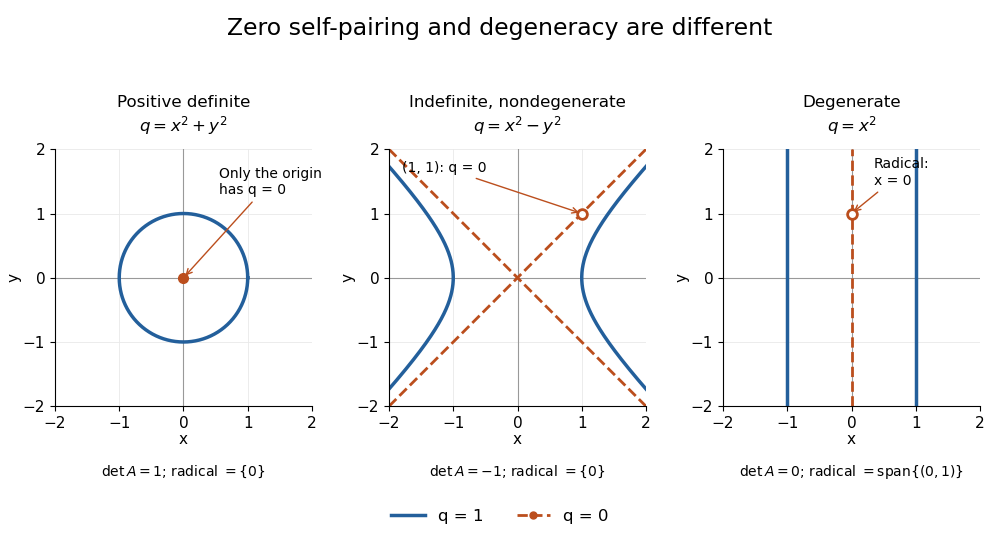
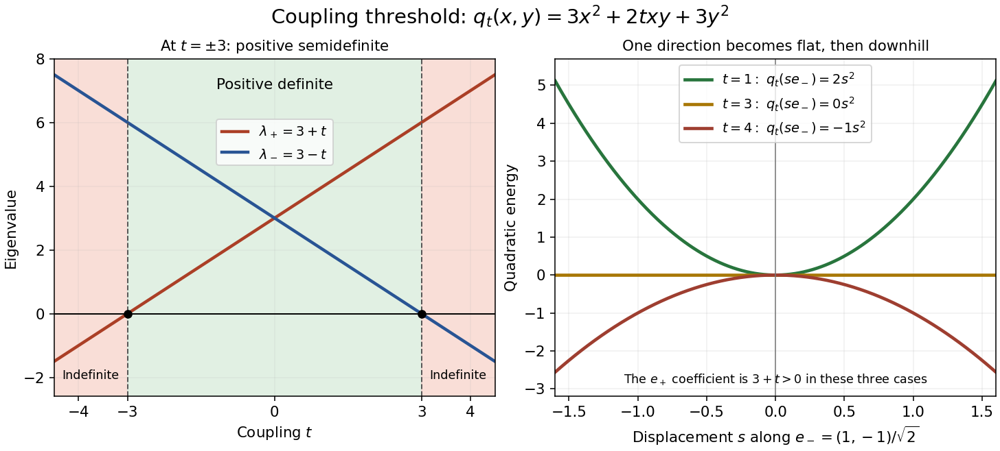
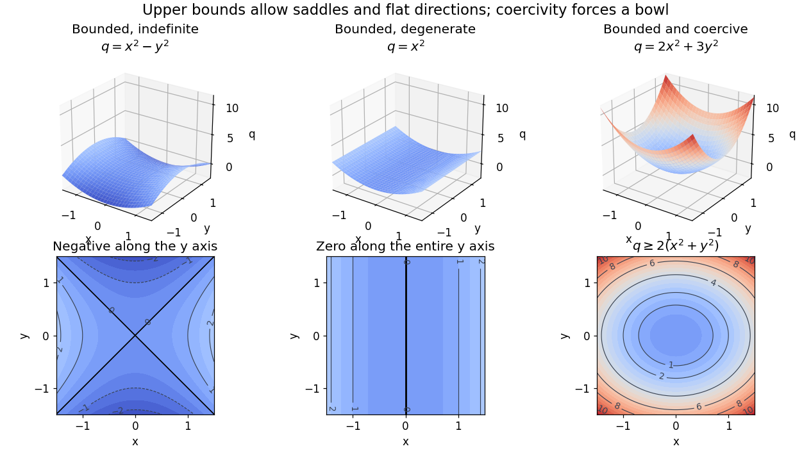
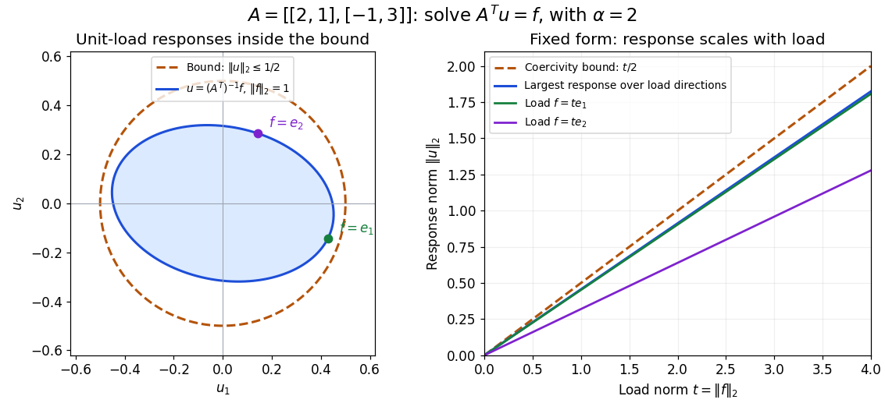
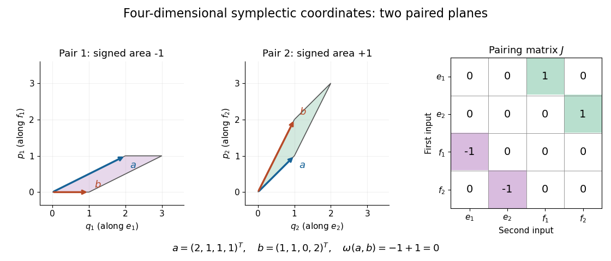

# Bilinear form

↑ **Parent:** [Linear algebra](linear-algebra.md)  
ⓦ [Wiki](https://en.wikipedia.org/wiki/Bilinear_form)

A [bilinear form](bilinear-form.md) takes two [vectors](vector-space.md#vector) in a [vector space](vector-space.md) $V$ over a [field](algebra.md#field) $F$ and returns a [scalar](vector-space.md#scalar) in $F$. Its defining property is separate [linearity](vector-space.md#linearity): holding either input fixed gives a [linear functional](dual-space.md#linear-functional) of the other. For [scalars](vector-space.md#scalar) $a,b$ and [vectors](vector-space.md#vector) $u,v,w$,

$$
\begin{aligned}
B(au+bv,w)&=aB(u,w)+bB(v,w),\\
B(u,av+bw)&=aB(u,v)+bB(u,w).
\end{aligned}
$$

This is a scalar-valued [bilinear map](multilinear-algebra.md#bilinear-map); the chosen [field](algebra.md#field) is part of the definition.[MIT Algebra I, Lecture 24, §24.2: bilinear forms](https://ocw.mit.edu/courses/res-18-011-algebra-i-student-notes-fall-2021/mit18_701f21_lect24.pdf)

Separate [linearity](vector-space.md#linearity) does not mean that $B$ is a [linear map](vector-space.md#linear-map) on the [vector space](vector-space.md) $V\times V$ with componentwise [vector addition](vector-space.md#vector-addition) and [scalar multiplication](vector-space.md#scalar-multiplication). Over the [real numbers](arithmetic.md#real-number), $B(2v,2w)=4B(v,w)$, whereas a [linear map](vector-space.md#linear-map) on the pair would give $2B(v,w)$. The simplest example is $B(x,y)=xy$ on the one-dimensional [vector space](vector-space.md) $\mathbb R$: fixing $y=3$ gives $x\mapsto3x$, but doubling both $x$ and $y$ quadruples their product.

A [bilinear form](bilinear-form.md) measures how two inputs interact. The [dot product](inner-product.md#dot-product) measures alignment; a [symmetric bilinear form](#symmetric-bilinear-form) can describe a [quadratic form](quadratic-form.md); an [alternating bilinear form](#alternating-bilinear-form) can measure signed [area](differential-geometry.md#surface-area). A [nondegenerate bilinear form](#nondegenerate-bilinear-form) turns each [vector](vector-space.md#vector) into a unique [linear functional](dual-space.md#linear-functional) and so connects geometry with the [dual space](dual-space.md). The same short definition therefore supports lengths, [bilinear orthogonal complements](#orthogonal-complement-for-a-bilinear-form), and [symplectic vector spaces](#symplectic-vector-space), depending on the additional properties imposed.

Over the [complex numbers](complex-analysis.md#complex-number), a [bilinear form](bilinear-form.md) is [linear](vector-space.md#linearity) in both inputs without conjugating either [scalar](vector-space.md#scalar). A [Hermitian form](linear-algebra.md#hermitian-form) instead is a [sesquilinear form](linear-algebra.md#sesquilinear-form) and conjugates when its inputs are exchanged. For complex [matrices](vector-space.md#matrix), the adjoint $A^*$ used with [Hermitian forms](linear-algebra.md#hermitian-form) and matrix [C-star algebras](banach-algebra.md#c-star-algebra) is the [conjugate transpose](linear-operator-theory.md#conjugate-transpose), whereas a [bilinear form](bilinear-form.md) uses the ordinary [transpose](vector-space.md#transpose) $A^T$. For example, $B(z,w)=zw$ has $B(i,i)=-1$, while the [Hermitian form](linear-algebra.md#hermitian-form) $H(z,w)=z\overline w$ has $H(i,i)=1$.[§1: examples and the Hermitian distinction](mathematics-bibliography.md#bilinear-forms-by-keith-conrad)

**Table of contents**

- [Matrix of a bilinear form](#matrix-of-a-bilinear-form)
- [Symmetric and alternating parts of a bilinear form](#symmetric-and-alternating-parts-of-a-bilinear-form)
- [Symmetric bilinear form](#symmetric-bilinear-form)
  - [Positive-definite bilinear form](#positive-definite-bilinear-form)
    - [Positive definiteness](#positive-definiteness)
      - [Two-by-two positive-definiteness test](#two-by-two-positive-definiteness-test)
      - [Positive-definiteness threshold in a two-by-two family](#positive-definiteness-threshold-in-a-two-by-two-family)
      - [Ellipsoid level sets of a positive-definite quadratic form](#ellipsoid-level-sets-of-a-positive-definite-quadratic-form)
      - [Unique minimizer of a positive-definite quadratic function](#unique-minimizer-of-a-positive-definite-quadratic-function)
  - [Modified trace form on real matrices](#modified-trace-form-on-real-matrices)
  - [Witt group of a field](#witt-group-of-a-field)
- [Alternating bilinear form](#alternating-bilinear-form)
- [Orthogonal complement for a bilinear form](#orthogonal-complement-for-a-bilinear-form)
- [Isometry of a space with a form](#isometry-of-a-space-with-a-form)
  - [Anisotropic vector for a form](#anisotropic-vector-for-a-form)
  - [Witt's theorem](#witt-s-theorem)
- [Bounded bilinear form](#bounded-bilinear-form)
  - [Grothendieck inequality](#grothendieck-inequality)
    - [Grothendieck theorem for L1 to Hilbert operators](#grothendieck-theorem-for-l1-to-hilbert-operators)
      - [Rademacher span is not complemented in L1](#rademacher-span-is-not-complemented-in-l1)
  - [Boundedness criterion for a bilinear form](#boundedness-criterion-for-a-bilinear-form)
- [Coercive bilinear form](#coercive-bilinear-form)
- [Degenerate bilinear form](#degenerate-bilinear-form)
  - [Radical of a bilinear form](#radical-of-a-bilinear-form)
    - [Left radical of a bilinear form](#left-radical-of-a-bilinear-form)
    - [Right radical of a bilinear form](#right-radical-of-a-bilinear-form)
- [Nondegenerate bilinear form](#nondegenerate-bilinear-form)
  - [Dual isomorphisms induced by a nondegenerate pairing](#dual-isomorphisms-induced-by-a-nondegenerate-pairing)
  - [Symplectic vector space](#symplectic-vector-space)
    - [Symplectic linear map](#symplectic-linear-map)
    - [Symplectic subspace](#symplectic-subspace)
      - [Orientation criterion for a graph of symplectic planes](#orientation-criterion-for-a-graph-of-symplectic-planes)
    - [Eigenspaces of a symplectic involution](#eigenspaces-of-a-symplectic-involution)
    - [Symplectic orthogonal complement](#symplectic-orthogonal-complement)
    - [Isotropic subspace of a symplectic vector space](#isotropic-subspace-of-a-symplectic-vector-space)
    - [Symplectic basis](#symplectic-basis)
      - [Paired coordinates of a symplectic basis](#paired-coordinates-of-a-symplectic-basis)
      - [Four-dimensional symplectic basis change](#four-dimensional-symplectic-basis-change)
      - [Symplectic Gram-Schmidt process](#symplectic-gram-schmidt-process)
  - [Representation of a bilinear form relative to a nondegenerate bilinear form](#representation-of-a-bilinear-form-relative-to-a-nondegenerate-bilinear-form)
- [Inertia of a bilinear form](#inertia-of-a-bilinear-form)
  - [Signature pair of a real symmetric bilinear form](#signature-pair-of-a-real-symmetric-bilinear-form)

## Matrix of a bilinear form

↑ **Parent:** [Bilinear form](bilinear-form.md)

Choose an [ordered basis](vector-space.md#ordered-basis) $(e_1,\ldots,e_n)$ of a [finite-dimensional vector space](vector-space.md#finite-dimensional-vector-space). The [matrix of a bilinear form](#matrix-of-a-bilinear-form) records all pairings of [basis vectors](vector-space.md#basis-vector), with $A_{ij}=B(e_i,e_j)$. Writing $v=\sum_i v_i e_i$ and $w=\sum_j w_j e_j$, separate [linearity](vector-space.md#linearity) gives

$$
B(v,w)=\sum_{i,j}v_iw_jB(e_i,e_j)=\sum_{i,j}v_iA_{ij}w_j=v^TAw,
$$

where the last expression uses the [coordinate vectors](vector-space.md#coordinate-vector) of $v,w$. Conversely, every [matrix](vector-space.md#matrix) $A$ defines a [bilinear form](bilinear-form.md) by this formula.[MIT Algebra I, Lecture 24, Proposition 24.5: basis coefficients](https://ocw.mit.edu/courses/res-18-011-algebra-i-student-notes-fall-2021/mit18_701f21_lect24.pdf)

For a concrete [bilinear form](bilinear-form.md) on $\mathbb R^2$, take

$$
A=\begin{pmatrix}1&2\\0&1\end{pmatrix},\qquad B(v,w)=v_1w_1+2v_1w_2+v_2w_2.
$$

Then $B((1,0),(0,1))=2$ but $B((0,1),(1,0))=0$: a [bilinear form](bilinear-form.md) need not be a [symmetric bilinear form](#symmetric-bilinear-form). For $v=(2,1)^T$ and $w=(-1,3)^T$, first compute $Aw=(5,3)^T$, then $v^TAw=2\cdot5+1\cdot3=13$. Reversing the inputs gives $Av=(4,1)^T$ and $w^TAv=-4+3=-1$.

**[Figure 1](#image-basis-coefficients-determine-each-pairing-but-self-pairings-lose-the-alternating-part). Basis coefficients determine each pairing, but self-pairings lose the alternating part**.

Under [change of basis](linear-algebra.md#change-of-basis), let the columns of an [invertible matrix](linear-algebra.md#invertible-matrix) $P$ be the new [basis vectors](vector-space.md#basis-vector) in old [coordinates](vector-space.md#coordinate-linear-algebra). Thus $v=Pv'$ and $w=Pw'$, so

$$
B(v,w)=(Pv')^TA(Pw')=(v')^T(P^TAP)w',\qquad A'=P^TAP.
$$

This is [matrix congruence](quadratic-form.md#matrix-congruence), rather than the [matrix similarity](linear-algebra.md#matrix-similarity) $P^{-1}AP$ for an [endomorphism](algebra.md#endomorphism). Both inputs have changed [coordinates](vector-space.md#coordinate-linear-algebra), which explains the two factors of $P$. For the displayed $A$ and $P=\begin{pmatrix}1&1\\0&1\end{pmatrix}$, direct multiplication gives $A'=\begin{pmatrix}1&3\\1&4\end{pmatrix}$; its $(1,2)$ entry is $B(e_1,e_1+e_2)=3$.[Theorem 2.8: change of basis](mathematics-bibliography.md#bilinear-forms-by-keith-conrad)

## Symmetric and alternating parts of a bilinear form

↑ **Parent:** [Bilinear form](bilinear-form.md)

Over a [field](algebra.md#field) whose [characteristic](algebra.md#characteristic-of-a-field) is not two, a [bilinear form](bilinear-form.md) has a unique decomposition into a [symmetric bilinear form](#symmetric-bilinear-form) $S$ and an [alternating bilinear form](#alternating-bilinear-form) $K$:

$$
S(v,w)=\frac{B(v,w)+B(w,v)}2,\qquad K(v,w)=\frac{B(v,w)-B(w,v)}2.
$$

Adding and subtracting the equations $B(v,w)=S(v,w)+K(v,w)$ and $B(w,v)=S(v,w)-K(v,w)$ both proves uniqueness and gives these formulas. In [matrix](vector-space.md#matrix) notation, $S$ has [matrix](vector-space.md#matrix) $(A+A^T)/2$ and $K$ has [skew-symmetric matrix](linear-algebra.md#skew-symmetric-matrix) $(A-A^T)/2$.[Theorem 1.7: symmetric and alternating decomposition](mathematics-bibliography.md#bilinear-forms-by-keith-conrad)

The diagonal values $q(v)=B(v,v)$ alone do not determine a general [bilinear form](bilinear-form.md), because $K(v,v)=0$ for every [vector](vector-space.md#vector). For the [matrix of a bilinear form](#matrix-of-a-bilinear-form) in the example above,

$$
A=\underbrace{\begin{pmatrix}1&1\\1&1\end{pmatrix}}_{\text{symmetric part}}+\underbrace{\begin{pmatrix}0&1\\-1&0\end{pmatrix}}_{\text{alternating part}},\qquad q(x,y)=(x+y)^2.
$$

Thus two different [bilinear forms](bilinear-form.md), represented by $A$ and its [symmetric matrix](linear-algebra.md#symmetric-matrix) part, have exactly the same [quadratic form](quadratic-form.md). To recover a [bilinear form](bilinear-form.md) from its diagonal, one needs extra information such as the hypothesis that it is a [symmetric bilinear form](#symmetric-bilinear-form).

## Symmetric bilinear form

↑ **Parent:** [Bilinear form](bilinear-form.md)  
ⓦ [Wiki](https://en.wikipedia.org/wiki/Symmetric_bilinear_form)

A [bilinear form](bilinear-form.md) $B$ is symmetric when $B(v,w)=B(w,v)$ for every pair of [vectors](vector-space.md#vector) $v,w$. Equivalently, its [matrix of a bilinear form](#matrix-of-a-bilinear-form) in any [basis](vector-space.md#basis) is a [symmetric matrix](linear-algebra.md#symmetric-matrix), since $A_{ij}=B(e_i,e_j)=B(e_j,e_i)=A_{ji}$. Symmetry makes the relation $B(v,w)=0$ reciprocal, giving the [bilinear orthogonal complement](#orthogonal-complement-for-a-bilinear-form) a geometric interpretation.

Over the [real numbers](arithmetic.md#real-number), set $q(v)=B(v,v)$. The [polarization identity](quadratic-form.md#polarization-identity)

$$
B(v,w)=\frac12\bigl(q(v+w)-q(v)-q(w)\bigr)
$$

recovers the [symmetric bilinear form](#symmetric-bilinear-form) from its [quadratic form](quadratic-form.md): expand $q(v+w)$ and use symmetry to combine the two cross terms. For $q(x,y)=x^2-y^2$, take $v=(2,1)$ and $w=(1,3)$. Then $q(v+w)=-7$, $q(v)=3$, and $q(w)=-8$, so $B(v,w)=(-7-3+8)/2=-1=2\cdot1-1\cdot3$. The same formula works whenever the [characteristic](algebra.md#characteristic-of-a-field) is not two.[Skorobogatov, Linear Algebra and Matrices, p. 12: recovering a symmetric form from the diagonal](https://www.ma.imperial.ac.uk/~anskor/LINEAR.PDF)

Three real [diagonal matrices](linear-algebra.md#diagonal-matrix) show how much variety symmetry allows. The [identity matrix](vector-space.md#identity-matrix) $\operatorname{diag}(1,1)$ gives the [positive-definite bilinear form](#positive-definite-bilinear-form) $q=x^2+y^2$. The [matrix](vector-space.md#matrix) $\operatorname{diag}(1,-1)$ gives $q=x^2-y^2$ and is [nondegenerate](#nondegenerate-bilinear-form) despite the [isotropic vector](quadratic-form.md#isotropic-vector) $(1,1)$. The [matrix](vector-space.md#matrix) $\operatorname{diag}(1,0)$ gives $q=x^2$ and is a [degenerate bilinear form](#degenerate-bilinear-form) with [radical of a bilinear form](#radical-of-a-bilinear-form) $\operatorname{span}\{(0,1)\}$. Their [level sets](topology.md#level-set) make the distinction visible: a [circle](topology.md#circle), two branches of a [hyperbola](euclidean-geometry.md#hyperbola), and two parallel lines for $q=1$.

**[Figure 2](#image-unit-and-zero-level-sets-distinguish-positive-indefinite-nondegenerate-and-degenerate-symmetric-forms). Unit and zero level sets distinguish positive, indefinite nondegenerate, and degenerate symmetric forms**.

The [inertia of a bilinear form](#inertia-of-a-bilinear-form) records the numbers of positive, negative, and zero directions after [matrix congruence](quadratic-form.md#matrix-congruence) diagonalization. By [Sylvester's law of inertia](quadratic-form.md#sylvester-s-law-of-inertia), these counts survive [change of basis](linear-algebra.md#change-of-basis); the three examples have [inertia of a bilinear form](#inertia-of-a-bilinear-form) $(2,0,0)$, $(1,1,0)$, and $(1,0,1)$. Historically, Sylvester stated this invariance in an 1852 paper on reducing real [quadratic forms](quadratic-form.md) to sums of positive and negative squares. Ghys and Ranicki reproduce his statement and distinguish it from his subsequent 1853 proof.[Étienne Ghys and Andrew Ranicki, Signatures in algebra, topology and dynamics, §1.2: Sylvester's statement and proof](https://arxiv.org/pdf/1512.09258)

### Positive-definite bilinear form

↑ **Parent:** [Symmetric bilinear form](#symmetric-bilinear-form)

A real [symmetric bilinear form](#symmetric-bilinear-form) is [positive-definite](#positive-definite-bilinear-form) when $B(v,v)>0$ for every nonzero [vector](vector-space.md#vector). It defines an [inner product](inner-product.md) and the associated [norm](normed-vector-space.md#norm) $\sqrt{B(v,v)}$. Symmetry is part of this definition: positive diagonal values by themselves do not imply symmetry.[Alexei Skorobogatov, Linear Algebra and Matrices, pp. 13–14: positive forms and inner products](https://www.ma.imperial.ac.uk/~anskor/LINEAR.PDF)

The [identity matrix](vector-space.md#identity-matrix) $A=\operatorname{diag}(1,1)$ gives $B(v,w)=v_1w_1+v_2w_2$ and $B(v,v)=v_1^2+v_2^2$. For $v=(3,4)$ this is $25$, giving [norm](normed-vector-space.md#norm) $5$. A weighted example, $A=\operatorname{diag}(4,1)$, gives [norm](normed-vector-space.md#norm) $\sqrt{4x^2+y^2}$: the first [coordinate](vector-space.md#coordinate-linear-algebra) costs twice as much in length. Such [inner products](inner-product.md) let geometry assign different weights to different directions.

Every [positive-definite bilinear form](#positive-definite-bilinear-form) is [nondegenerate](#nondegenerate-bilinear-form): a [vector](vector-space.md#vector) in its [radical of a bilinear form](#radical-of-a-bilinear-form) has $B(v,v)=0$, so positivity forces $v=0$. The converse fails, as $\operatorname{diag}(1,-1)$ shows. Even positivity of the associated [quadratic form](quadratic-form.md) does not force a general [bilinear form](bilinear-form.md) to be symmetric: $A=\begin{pmatrix}1&1\\-1&1\end{pmatrix}$ has $v^TAv=x^2+y^2$ but $B(e_1,e_2)=1$ and $B(e_2,e_1)=-1$.

The complex [Killing form](lie-algebra.md#killing-form) is not positive-definite on the entire complex [Cartan subalgebra](semisimple-lie-algebra.md#cartan-subalgebra); its restriction to the [Euclidean subspace of a Cartan subalgebra](semisimple-lie-algebra.md#euclidean-subspace-of-a-cartan-subalgebra) is a real positive-definite form.

#### Positive definiteness

↑ **Parent:** [Positive-definite bilinear form](#positive-definite-bilinear-form)

The strict positivity of a [quadratic form](quadratic-form.md) on every nonzero [vector](vector-space.md#vector). A real symmetric [matrix](vector-space.md#matrix) has positive definiteness exactly when its associated [quadratic form](quadratic-form.md) does, making it a [positive-definite matrix](quadratic-form.md#positive-definite-matrix). A [Hermitian form](linear-algebra.md#hermitian-form) is positive definite when its value on $(v,v)$ is real and strictly positive for every nonzero vector.

Think of a [positive-definite quadratic form](quadratic-form.md#positive-definite-quadratic-form) as an energy cost for a displacement: every direction costs something, and zero cost identifies the origin. For example, the real [symmetric matrix](linear-algebra.md#symmetric-matrix)

$$
A=\begin{pmatrix}3&1\\1&3\end{pmatrix},\qquad q(x,y)=3x^2+2xy+3y^2=3\left(x+\frac y3\right)^2+\frac83y^2
$$

is a [positive-definite matrix](quadratic-form.md#positive-definite-matrix) because the two squares can vanish together only at $(0,0)$. The mixed term couples the [coordinates](vector-space.md#coordinate-linear-algebra), but cannot overwhelm their positive contributions: $q(1,1)=8$ and $q(1,-1)=4$. The graph is a bowl, and its positive [level sets](topology.md#level-set) are [ellipses](euclidean-geometry.md#ellipse) with axes along the [eigenvectors](linear-operator-theory.md#eigenvector), rather than along the original [coordinates](vector-space.md#coordinate-linear-algebra).

**[Figure 3](#image-positive-quadratic-energy-bowl-and-elliptical-level-curves). Positive quadratic energy bowl and elliptical level curves**.

The real and complex settings require different symmetry assumptions. For a real [symmetric matrix](linear-algebra.md#symmetric-matrix) use $q(x)=x^TAx$ with $x\in\mathbb R^n$; for a complex [Hermitian matrix](hilbert-space.md#hermitian-operator) use $q(z)=z^*Az$ with $z\in\mathbb C^n$, where $z^*$ is the [conjugate transpose](linear-operator-theory.md#conjugate-transpose). The latter expression is real, so strict positivity is meaningful. A complex [quadratic form](quadratic-form.md) such as $z_1^2+z_2^2$ has no such positivity: it vanishes at $(1,i)$ and takes negative real values at $(i,0)$. A [Hermitian form](linear-algebra.md#hermitian-form) uses [complex conjugation](complex-analysis.md#complex-conjugation), which changes this example to $|z_1|^2+|z_2|^2$.

For a real [matrix](vector-space.md#matrix) $M$ without a symmetry hypothesis, its [quadratic form](quadratic-form.md) depends only on its [symmetric part of a matrix](linear-algebra.md#symmetric-part-of-a-matrix):

$$
x^TMx=x^T\frac{M+M^T}{2}x.
$$

Positive [eigenvalues](linear-operator-theory.md#eigenvalue) of $M$ alone do not establish [positive definiteness](#positive-definiteness) of this [quadratic form](quadratic-form.md). For example, $M=\begin{pmatrix}1&4\\0&1\end{pmatrix}$ has both [eigenvalues](linear-operator-theory.md#eigenvalue) equal to $1$, yet $q(1,-1)=1-4+1=-2$. The relevant test is positivity of the [symmetric part of a matrix](linear-algebra.md#symmetric-part-of-a-matrix), not the [spectrum](linear-operator-theory.md#spectrum-functional-analysis) of an arbitrary [matrix](vector-space.md#matrix).[Theorem 1.7, equation (1.3), p. 3: symmetric and alternating parts](mathematics-bibliography.md#bilinear-forms-by-keith-conrad)

##### Two-by-two positive-definiteness test

↑ **Parent:** [Positive definiteness](#positive-definiteness)

For a real [symmetric matrix](linear-algebra.md#symmetric-matrix) $A=\begin{pmatrix}a&b\\b&c\end{pmatrix}$, [completing the square](polynomial.md#completing-the-square) gives, when $a\ne0$,

$$
q(x,y)=ax^2+2bxy+cy^2=a\left(x+\frac ba y\right)^2+\frac{ac-b^2}{a}y^2.
$$

Thus $A$ is a [positive-definite matrix](quadratic-form.md#positive-definite-matrix) exactly when $a>0$ and $\det A=ac-b^2>0$. For necessity, test $(1,0)$ first, then $(-b/a,1)$; for sufficiency, the displayed two positive squares give the result. These are the first two leading [principal minors](vector-space.md#principal-minor) in [Sylvester's criterion](quadratic-form.md#sylvester-s-criterion). A positive [determinant](multilinear-algebra.md#determinant) alone is insufficient: $-I_2$ has [determinant](multilinear-algebra.md#determinant) $1$ but is a [negative-definite matrix](quadratic-form.md#negative-definite-matrix).

The [eigenvalues](linear-operator-theory.md#eigenvalue) provide an equivalent test under the same real-symmetric hypothesis:

$$
\lambda_\pm=\frac{a+c\pm\sqrt{(a-c)^2+4b^2}}2,\qquad A\text{ positive definite}\ \Longleftrightarrow\ \lambda_+>0\text{ and }\lambda_->0.
$$

The [spectral theorem for real symmetric matrices](linear-algebra.md#spectral-theorem-for-real-symmetric-matrices) supplies [coordinates](vector-space.md#coordinate-linear-algebra) in an [orthonormal basis](inner-product.md#orthonormal-basis) in which $q=\lambda_+u^2+\lambda_-v^2$. More generally, a complex [Hermitian matrix](hilbert-space.md#hermitian-operator) has an [orthonormal eigenbasis](linear-operator-theory.md#orthonormal-eigenbasis) and $q(z)=\sum_j\lambda_j|w_j|^2$, so it is a [Hermitian positive-definite matrix](quadratic-form.md#hermitian-positive-definite-matrix) exactly when every [eigenvalue](linear-operator-theory.md#eigenvalue) is positive. This is a short proof outline: test the [eigenvectors](linear-operator-theory.md#eigenvector) for necessity, and sum the positive squared [absolute values](real-analysis.md#absolute-value) for sufficiency.[Appendix A.5.2, pp. 646–647: symmetric eigenvalue decomposition and definiteness](mathematics-bibliography.md#convex-optimization-by-stephen-boyd-and-lieven-vandenberghe)

For a real [positive semidefinite matrix](quadratic-form.md#positive-semidefinite-matrix), the condition is instead $q(x,y)\geq0$ for all [vectors](vector-space.md#vector), equivalent here to $a\geq0$, $c\geq0$, and $ac-b^2\geq0$. If $a>0$, the same [completing the square](polynomial.md#completing-the-square) proves this; if $a=0$, nonnegativity forces $b=0$ and leaves $cy^2$ with $c\geq0$. Merely replacing the strict inequalities on the leading [principal minors](vector-space.md#principal-minor) by nonstrict ones fails: $\operatorname{diag}(0,-1)$ has both leading [principal minors](vector-space.md#principal-minor) zero yet gives $q(0,1)=-1$. An [indefinite quadratic form](quadratic-form.md#indefinite-quadratic-form) takes both positive and negative values; its real [symmetric matrix](linear-algebra.md#symmetric-matrix) has [eigenvalues](linear-operator-theory.md#eigenvalue) of both signs.

##### Positive-definiteness threshold in a two-by-two family

↑ **Parent:** [Positive definiteness](#positive-definiteness)

Vary the coupling in the opening example. The [eigenvectors](linear-operator-theory.md#eigenvector) $e_+=(1,1)^T/\sqrt2$ and $e_-=(1,-1)^T/\sqrt2$ form a fixed [orthonormal eigenbasis](linear-operator-theory.md#orthonormal-eigenbasis), with [eigenvalues](linear-operator-theory.md#eigenvalue) $3+t$ and $3-t$. Writing a [vector](vector-space.md#vector) as $ue_++ve_-$ gives

$$
q_t=3x^2+2txy+3y^2=(3+t)u^2+(3-t)v^2.
$$

For $|t|<3$, both directions cost energy and $A_t$ is a [positive-definite matrix](quadratic-form.md#positive-definite-matrix). At $t=3$, the [quadratic form](quadratic-form.md) is $6u^2$: the entire line spanned by $e_-$ has zero energy, and $A_t$ is a singular [positive semidefinite matrix](quadratic-form.md#positive-semidefinite-matrix). At $t=-3$, the flat line is instead spanned by $e_+$. For $|t|>3$, the [quadratic form](quadratic-form.md) is an [indefinite quadratic form](quadratic-form.md#indefinite-quadratic-form); one direction lowers the energy without bound as its displacement grows. At $t=4$, for instance, $q_t(e_+)=7$ while $q_t(e_-)=-1$.

**[Figure 4](#image-eigenvalues-and-directional-energies-across-the-positivity-threshold). Eigenvalues and directional energies across the positivity threshold**.

The geometric transition is precise. For $|t|<3$, $q_t=1$ is an [ellipse](euclidean-geometry.md#ellipse). At $t=3$, it consists of the two parallel lines $u=\pm1/\sqrt6$, extending freely in the zero-energy direction. For $t>3$, it is a [hyperbola](euclidean-geometry.md#hyperbola). The boundary case retains nonnegative energy but loses both the bounded positive [level sets](topology.md#level-set) and the unique zero-energy [vector](vector-space.md#vector).

##### Ellipsoid level sets of a positive-definite quadratic form

↑ **Parent:** [Positive definiteness](#positive-definiteness)

For a real [positive-definite matrix](quadratic-form.md#positive-definite-matrix) $A$ in finite [dimension](vector-space.md#dimension-vector-space), write $A=Q\Lambda Q^T$ by the [spectral theorem for real symmetric matrices](linear-algebra.md#spectral-theorem-for-real-symmetric-matrices). In the [coordinates](vector-space.md#coordinate-linear-algebra) in an [orthonormal basis](inner-product.md#orthonormal-basis) $w=Q^Tx$, the positive [level set](topology.md#level-set) $q(x)=k$ becomes

$$
\sum_{j=1}^n\lambda_jw_j^2=k,\qquad \sum_{j=1}^n\frac{w_j^2}{k/\lambda_j}=1.
$$

This is an [ellipsoid](euclidean-geometry.md#ellipsoid), with [semi-major and semi-minor axes](euclidean-geometry.md#semi-major-and-semi-minor-axes) in two [dimensions](vector-space.md#dimension-vector-space) forming an [ellipse](euclidean-geometry.md#ellipse); each semi-axis has length $r_j=\sqrt{k/\lambda_j}$ and direction given by the corresponding [eigenvector](linear-operator-theory.md#eigenvector). In the opening example, the shorter semi-axis is $\sqrt{k}/2$ along $e_+$, while the longer is $\sqrt{k/2}$ along $e_-$. A stiffer direction, meaning a larger [eigenvalue](linear-operator-theory.md#eigenvalue), reaches the same energy at a smaller displacement. The ratio of longest to shortest semi-axis is $\sqrt{\lambda_{\max}/\lambda_{\min}}$, the square root of the [spectral condition number of a positive-definite matrix](quadratic-form.md#spectral-condition-number-of-a-positive-definite-matrix).[§2.2.2, p. 30, equation (2.3): ellipsoids and semi-axis lengths; the book uses the inverse quadratic coefficient matrix](mathematics-bibliography.md#convex-optimization-by-stephen-boyd-and-lieven-vandenberghe)

Strict positivity matters because $\lambda_{\min}>0$ gives

$$
\lambda_{\min}\|x\|^2\leq q(x)\leq\lambda_{\max}\|x\|^2.
$$

Hence a fixed positive [level set](topology.md#level-set) cannot extend arbitrarily far. The [Cholesky decomposition](quadratic-form.md#cholesky-decomposition) $A=LL^T$ gives another view: $q(x)=\|L^Tx\|^2$, so the [ellipsoid](euclidean-geometry.md#ellipsoid) is the inverse image of a [sphere](euclidean-geometry.md#sphere) under an [invertible linear map](multivariable-calculus.md#invertible-linear-map). A singular [positive semidefinite matrix](quadratic-form.md#positive-semidefinite-matrix) has a nonzero [kernel](kernel-of-a-linear-map.md); adding a [kernel](kernel-of-a-linear-map.md) [vector](vector-space.md#vector) preserves its [quadratic form](quadratic-form.md), so any nonempty positive [level set](topology.md#level-set) is unbounded. These statements concern finite [dimension](vector-space.md#dimension-vector-space); the [positive definite symmetric operator](hilbert-space.md#positive-definite-symmetric-operator) entry explains why strict positivity alone need not give a uniform lower bound on an infinite-dimensional [Hilbert space](hilbert-space.md).

##### Unique minimizer of a positive-definite quadratic function

↑ **Parent:** [Positive definiteness](#positive-definiteness)

Let $A$ be a real [positive-definite matrix](quadratic-form.md#positive-definite-matrix) and minimize the displayed [quadratic function](polynomial.md#quadratic-function) over all of $\mathbb R^n$. Its [gradient](multivariable-calculus.md#gradient) is $Ax-b$, so its only [stationary point](calculus-of-variations.md#stationary-point) solves the [linear system](linear-algebra.md#system-of-linear-equations) $Ax_*=b$. The [matrix](vector-space.md#matrix) is an [invertible matrix](linear-algebra.md#invertible-matrix), making this solution exist and be unique. [Completing the square](polynomial.md#completing-the-square) around that solution proves the stronger global statement:

$$
f(x)=c-\frac12b^TA^{-1}b+\frac12(x-x_*)^TA(x-x_*),\qquad f(x)-f(x_*)>0\quad(x\ne x_*).
$$

The [quadratic function](polynomial.md#quadratic-function) is [strictly convex](real-analysis.md#strictly-convex-function), and its [level sets](topology.md#level-set) above the minimum are translated [ellipsoids](euclidean-geometry.md#ellipsoid). Positivity therefore turns solving a [linear system](linear-algebra.md#system-of-linear-equations) into locating the bottom of a bowl.[§3.1.4, Example 3.2, p. 71: a quadratic function is strictly convex exactly when its symmetric coefficient matrix is positive definite](mathematics-bibliography.md#convex-optimization-by-stephen-boyd-and-lieven-vandenberghe)

For the opening [matrix](vector-space.md#matrix) $A=\begin{pmatrix}3&1\\1&3\end{pmatrix}$, take $b=(1,1)^T$ and $c=0$. Then $A^{-1}=\frac18\begin{pmatrix}3&-1\\-1&3\end{pmatrix}$, $x_*=(1/4,1/4)^T$, and $f(x_*)=-1/4$. Every displacement $h$ raises the value by $\tfrac12h^TAh$; along the unit [eigenvectors](linear-operator-theory.md#eigenvector) $e_+$ and $e_-$ the increases are respectively $2s^2$ and $s^2$ for displacement $se_+$ or $se_-$.

For a singular [positive semidefinite matrix](quadratic-form.md#positive-semidefinite-matrix), a solution of $Ax=b$ is still a global minimizer, but adding any [kernel](kernel-of-a-linear-map.md) [vector](vector-space.md#vector) gives another. If $b$ is outside the [image of a linear map](vector-space.md#image-of-a-linear-map) defined by $A$, some [kernel](kernel-of-a-linear-map.md) [vector](vector-space.md#vector) $v$ has $b^Tv\ne0$, and $f(sv)=c-sb^Tv$ is unbounded below. For an [indefinite quadratic form](quadratic-form.md#indefinite-quadratic-form), a negative [eigenvalue](linear-operator-theory.md#eigenvalue) gives a direction along which the quadratic term tends to $-\infty$ regardless of $b$. Thus a [stationary point](calculus-of-variations.md#stationary-point) alone does not establish a minimum. The same energy-difference identity extends to the [quadratic variational principle for a symmetric positive operator](hilbert-space.md#quadratic-variational-principle-for-a-symmetric-positive-operator), with additional existence hypotheses in infinite [dimension](vector-space.md#dimension-vector-space).

### Modified trace form on real matrices

↑ **Parent:** [Symmetric bilinear form](#symmetric-bilinear-form)

On real $n$ by $n$ matrices with $n\geq2$, split into traceless symmetric matrices, skew-symmetric matrices and scalar matrices. These summands are orthogonal for the displayed [symmetric bilinear form](#symmetric-bilinear-form). The form is positive on the first summand, negative on the second and negative on the scalar identity direction. Its [inertia of a bilinear form](#inertia-of-a-bilinear-form) is $(n(n+1)/2-1,n(n-1)/2+1,0)$, its rank is $n^2$ and its [signature](quadratic-form.md#signature-of-a-quadratic-form) is $n-2$. Indeed $\operatorname{tr}(S^2)=\|S\|_F^2$, $\operatorname{tr}(K^2)=-\|K\|_F^2$ and $\phi(tI,tI)=-n(n-1)t^2$.

### Witt group of a field

↑ **Parent:** [Symmetric bilinear form](#symmetric-bilinear-form)

For a field $K$ of characteristic different from two, $W(K)$ is the group of nonsingular symmetric bilinear forms modulo metabolic forms, with orthogonal sum as addition. A metabolic form has a half-dimensional totally isotropic subspace. Such a form is equivalent to a sum of hyperbolic planes, hence represents zero.

## Alternating bilinear form

↑ **Parent:** [Bilinear form](bilinear-form.md)

A [bilinear form](bilinear-form.md) is alternating if $B(v,v)=0$ for every [vector](vector-space.md#vector) $v$. Expanding $B(v+w,v+w)=0$ gives $B(v,w)+B(w,v)=0$, hence $B(v,w)=-B(w,v)$. If the [characteristic](algebra.md#characteristic-of-a-field) is not two, the converse follows from $B(v,v)=-B(v,v)$ by dividing by two. In [characteristic](algebra.md#characteristic-of-a-field) two, the relation $B(v,w)=-B(w,v)$ is just symmetry and does not force zero self-pairings: $B(x,y)=xy$ on $\mathbb F_2$ has $B(1,1)=1$.[Peter J. Cameron, Notes on Linear Algebra, §§9.1–9.2: alternating forms in arbitrary characteristic](https://webspace.maths.qmul.ac.uk/p.j.cameron/notes/linalg.pdf)

The [matrix](vector-space.md#matrix)

$$
J=\begin{pmatrix}0&1\\-1&0\end{pmatrix},\qquad B(v,w)=v^TJw=v_1w_2-v_2w_1=\det\begin{pmatrix}v_1&w_1\\v_2&w_2\end{pmatrix}
$$

gives an [alternating bilinear form](#alternating-bilinear-form) over every [field](algebra.md#field). Over the [real numbers](arithmetic.md#real-number), its value is the signed [area](differential-geometry.md#surface-area) of the [parallelogram](euclidean-geometry.md#parallelogram) with sides $v,w$: $B((2,1),(1,3))=6-1=5$, and swapping the sides gives $-5$. Every self-pairing is zero, yet $\det J=1$, so this [bilinear form](bilinear-form.md) is [nondegenerate](#nondegenerate-bilinear-form). Directly, pairing $(x,y)$ with $(1,0)$ gives $-y$, and pairing it with $(0,1)$ gives $x$; both vanish only when $(x,y)=0$.

In [characteristic](algebra.md#characteristic-of-a-field) different from two, a [skew-symmetric matrix](linear-algebra.md#skew-symmetric-matrix) of [odd integer](integer.md#odd-integer) size has zero [determinant](multilinear-algebra.md#determinant), since $\det A=\det(-A^T)=(-1)^n\det A$. Thus an [alternating bilinear form](#alternating-bilinear-form) on a finite odd-dimensional [vector space](vector-space.md) is a [degenerate bilinear form](#degenerate-bilinear-form). The stronger statement that the [rank](quadratic-form.md#rank-one-quadratic-form) of an [alternating bilinear form](#alternating-bilinear-form) is even holds in all [characteristics](algebra.md#characteristic-of-a-field): splitting off a two-dimensional block with [matrix](vector-space.md#matrix) $J$ repeatedly proves it. A [nondegenerate](#nondegenerate-bilinear-form) [alternating bilinear form](#alternating-bilinear-form) defines a [symplectic vector space](#symplectic-vector-space), the linear setting for signed [area](differential-geometry.md#surface-area) rather than squared length.

## Orthogonal complement for a bilinear form

↑ **Parent:** [Bilinear form](bilinear-form.md)

For a [bilinear form](bilinear-form.md) on a finite-dimensional [vector space](vector-space.md), the displayed right [bilinear orthogonal complement](#orthogonal-complement-for-a-bilinear-form) is a subspace. Nondegeneracy identifies the ambient space with its dual and gives $\dim W^\perp=\dim V-\dim W$. If the form is symmetric or alternating, orthogonality is reciprocal and $(W^\perp)^\perp=W$. For a general nonsymmetric form, left and right complements must be distinguished. A restricted symmetric or alternating form has [radical of a bilinear form](#radical-of-a-bilinear-form) $W\cap W^\perp$; quotienting by that [radical of a bilinear form](#radical-of-a-bilinear-form) gives a [nondegenerate](#nondegenerate-bilinear-form) induced form.

## Isometry of a space with a form

↑ **Parent:** [Bilinear form](bilinear-form.md)

A linear bijection between spaces carrying compatible [bilinear forms](bilinear-form.md), [Hermitian forms](linear-algebra.md#hermitian-form) or [quadratic forms](quadratic-form.md) is an [isometry of a space with a form](#isometry-of-a-space-with-a-form) when it preserves the specified form. Preserving the polar form alone need not preserve a [quadratic form](quadratic-form.md) in characteristic two. Subspaces may have degenerate restricted forms even when the ambient form is nonsingular.

### Anisotropic vector for a form

↑ **Parent:** [Isometry of a space with a form](#isometry-of-a-space-with-a-form)

A vector is anisotropic for a [quadratic form](quadratic-form.md) if $Q(v)\ne0$, and for a [Hermitian form](linear-algebra.md#hermitian-form) if $h(v,v)\ne0$. The complementary zero-value condition is isotropy. For a [symmetric bilinear form](#symmetric-bilinear-form) in odd [characteristic of a field](algebra.md#characteristic-of-a-field), this agrees with the associated [quadratic form](quadratic-form.md). A [nondegenerate](#nondegenerate-bilinear-form) [alternating bilinear form](#alternating-bilinear-form) has all self-pairings zero, so nondegeneracy must not be confused with the existence of anisotropic vectors.

<h3 id="witt-s-theorem">Witt's theorem</h3>

↑ **Parent:** [Isometry of a space with a form](#isometry-of-a-space-with-a-form)  
ⓦ [Wiki](https://en.wikipedia.org/wiki/Witt's_theorem)

An [isometry of a space with a form](#isometry-of-a-space-with-a-form) between subspaces of a finite-dimensional nonsingular classical space extends to an ambient isometry. This includes [alternating bilinear forms](#alternating-bilinear-form) in all characteristics, [symmetric bilinear forms](#symmetric-bilinear-form) in characteristic different from two, [Hermitian forms](linear-algebra.md#hermitian-form) with nontrivial involution, and [quadratic forms](quadratic-form.md) with nonsingular polar form. No nonsingularity of the restricted subspace is required. Bare nonalternating symmetric bilinear forms in characteristic two require additional hypotheses and must not be confused with quadratic spaces.

## Bounded bilinear form

↑ **Parent:** [Bilinear form](bilinear-form.md)

A [bilinear form](bilinear-form.md) $B:X\times X\to\mathbb R$ on a real [normed vector space](normed-vector-space.md) is bounded when one constant $0\leq C<\infty$ satisfies

$$
|B(u,v)|\leq C\|u\|\|v\|\qquad(u,v\in X).
$$

This is an upper bound on the magnitude of every pairing. It says nothing about the sign of $B(v,v)$ and does not require a [symmetric bilinear form](#symmetric-bilinear-form). The chosen [norm](normed-vector-space.md#norm) is part of the hypothesis. Boundedness is equivalent to joint [continuity](calculus.md#continuous-function), as shown by the [boundedness criterion for a bilinear form](#boundedness-criterion-for-a-bilinear-form).[§2.2, Theorem 2.7(ii): continuity bound](mathematics-bibliography.md#introduction-to-finite-element-methods-by-christian-clason)

For example, on $\mathbb R^2$ with the [Euclidean norm](normed-vector-space.md#euclidean-norm), the [bilinear forms](bilinear-form.md)

$$
B_-(u,v)=u_1v_1-u_2v_2,\qquad B_0(u,v)=u_1v_1
$$

both satisfy the upper bound with $C=1$, by the [Cauchy-Schwarz inequality](probability-and-statistics.md#cauchy-schwarz-inequality). Yet their [quadratic forms](quadratic-form.md) are $B_-(v,v)=x^2-y^2$ and $B_0(v,v)=x^2$: the former takes negative values and the latter vanishes at the nonzero [vector](vector-space.md#vector) $(0,1)$. Thus neither is a [coercive bilinear form](#coercive-bilinear-form). The latter is also a [degenerate bilinear form](#degenerate-bilinear-form), whereas $B_-$ is [nondegenerate](#nondegenerate-bilinear-form). Boundedness controls size, not positivity or loss of directions.

Every [bilinear form](bilinear-form.md) on a real or complex [finite-dimensional vector space](vector-space.md#finite-dimensional-vector-space) equipped with any [norm](normed-vector-space.md#norm) is bounded. In [coordinates](vector-space.md#coordinate-linear-algebra), write $B(u,v)=u^TAv$ using its [matrix of a bilinear form](#matrix-of-a-bilinear-form). The [Cauchy-Schwarz inequality](probability-and-statistics.md#cauchy-schwarz-inequality) gives $|u^TAv|\leq\|A\|_2\|u\|_2\|v\|_2$, with $\|A\|_2$ the [spectral norm](continuous-dual-space.md#matrix-2-norm); [finite-dimensional equivalence of norms](normed-vector-space.md#finite-dimensional-equivalence-of-norms) transfers this to the chosen [norm](normed-vector-space.md#norm). The conclusion concerns each fixed [norm](normed-vector-space.md#norm) and fixed [bilinear form](bilinear-form.md): it does not supply a single constant for an arbitrary family of [matrices](vector-space.md#matrix) or changing dimensions.

On an [infinite-dimensional vector space](vector-space.md#infinite-dimensional-vector-space), the upper bound is an additional condition. Equip the [finitely supported sequences](banach-space.md#finitely-supported-sequence) $c_{00}$ with the [norm](normed-vector-space.md#norm) inherited from the [l2 sequence space](banach-space.md#l2-sequence-space) and set

$$
B(u,v)=\sum_{n\geq1}n u_n v_n.
$$

Each pairing is a finite sum, so this is a well-defined [bilinear form](bilinear-form.md). For the [basis vector](vector-space.md#basis-vector) $e_n$, however, $\|e_n\|_2=1$ and $B(e_n,e_n)=n$; no finite $C$ works. It is even a [coercive bilinear form](#coercive-bilinear-form) with $\alpha=1$, since $\sum n v_n^2\geq\sum v_n^2$. Consequently coercivity alone does not imply boundedness on a [normed vector space](normed-vector-space.md). This example uses $c_{00}$, which is not a [Hilbert space](hilbert-space.md); it does not define this pairing on all of the [l2 sequence space](banach-space.md#l2-sequence-space).

A [bounded bilinear form](#bounded-bilinear-form) defines a [bounded linear operator](topological-vector-space.md#continuous-linear-operator) $T:X\to X'$ by $(Tu)(v)=B(u,v)$, where $X'$ is the [continuous dual space](continuous-dual-space.md). Its [operator norm](continuous-dual-space.md#operator-norm) is the smallest admissible $C$:

$$
\|T\|=\sup_{u\ne0,\,v\ne0}\frac{|B(u,v)|}{\|u\|\|v\|}.
$$

This converts an upper bound for pairings into an upper bound for a [linear map](vector-space.md#linear-map) taking an unknown [vector](vector-space.md#vector) to a [linear functional](dual-space.md#linear-functional).

### Grothendieck inequality

↑ **Parent:** [Bounded bilinear form](#bounded-bilinear-form)

For a finite real scalar matrix $(a_{ij})$ and unit vectors $u_i,v_j$ in a real [Hilbert space](hilbert-space.md), $|\sum a_{ij}\langle u_i,v_j\rangle|\le K_G\max_{\varepsilon_i,\delta_j\in\{-1,1\}}|\sum a_{ij}\varepsilon_i\delta_j|$, with a universal constant. One valid bound is $K_G\le\pi/(2\log(1+\sqrt2))$. Expand $\sin(ct)$ using odd [tensor powers](multilinear-algebra.md#tensor-power) with coefficient magnitudes summing to $\sinh c=1$, then apply the Gaussian sign identity $\mathbb E[\operatorname{sgn}\langle G,u\rangle\operatorname{sgn}\langle G,v\rangle]=(2/\pi)\arcsin\langle u,v\rangle$. Taking $c=\log(1+\sqrt2)$ converts the expectation back to the original inner product. Complex scalars admit a universal bound twice this real bound by separating real and imaginary parts.

#### Grothendieck theorem for L1 to Hilbert operators

↑ **Parent:** [Grothendieck inequality](#grothendieck-inequality)

Every [bounded linear operator](topological-vector-space.md#continuous-linear-operator) $T:L^1(\mu)\to H$ into a [Hilbert space](hilbert-space.md) is an [absolutely summing operator](topological-vector-space.md#absolutely-summing-operator), with $\pi_1(T)\le K_G\|T\|$. For simple functions on a common disjoint partition, apply the [Grothendieck inequality](#grothendieck-inequality) to the vectors $T(1_A/\mu(A))$ and norming vectors of the images. The scalar sign or phase supremum is the weak 1-norm of the family. Approximation by simple functions proves the general result.

##### Rademacher span is not complemented in L1

↑ **Parent:** [Grothendieck theorem for L1 to Hilbert operators](#grothendieck-theorem-for-l1-to-hilbert-operators)

If the closed span of the [Rademacher functions](probability-distribution.md#rademacher-function) were a [complemented subspace](banach-space.md#complemented-subspace) of $L^1(0,1)$, compose a projection with the inverse of its [l2 sequence space](banach-space.md#l2-sequence-space) parametrization. The [Grothendieck theorem for L1 to Hilbert operators](#grothendieck-theorem-for-l1-to-hilbert-operators) would make this map an [absolutely summing operator](topological-vector-space.md#absolutely-summing-operator). Its composition with the parametrization would make the identity on the infinite-dimensional [l2 sequence space](banach-space.md#l2-sequence-space) absolutely summing, contradicting its coordinate-vector test.

### Boundedness criterion for a bilinear form

↑ **Parent:** [Bounded bilinear form](#bounded-bilinear-form)

A [bilinear form](bilinear-form.md) on a [normed vector space](normed-vector-space.md) is [continuous](calculus.md#continuous-function) exactly when it is bounded. For the nontrivial direction, continuity at $(0,0)$ gives $r,s>0$ such that $|B(x,y)|\leq1$ whenever $\lVert x\rVert<r$ and $\lVert y\rVert<s$; scaling nonzero $u,v$ into these balls gives $|B(u,v)|\leq4(rs)^{-1}\lVert u\rVert\lVert v\rVert$.

## Coercive bilinear form

↑ **Parent:** [Bilinear form](bilinear-form.md)

A real [bilinear form](bilinear-form.md) $B$ on a [normed vector space](normed-vector-space.md) $X$ is coercive when there is one constant $\alpha>0$ such that

$$
B(v,v)\geq\alpha\|v\|^2\qquad(v\in X).
$$

The lower bound uniformly controls every direction in the chosen [norm](normed-vector-space.md#norm). Unlike the upper bound defining a [bounded bilinear form](#bounded-bilinear-form), it forces positive diagonal values at every nonzero [vector](vector-space.md#vector). No symmetry is assumed. For complex [Hilbert spaces](hilbert-space.md), the usual analogue uses a [sesquilinear form](linear-algebra.md#sesquilinear-form) and $\operatorname{Re}B(v,v)\geq\alpha\|v\|^2$; it is not the same assertion for a complex [bilinear form](bilinear-form.md).

A concrete bounded and coercive example on $\mathbb R^2$, with the [Euclidean norm](normed-vector-space.md#euclidean-norm), is

$$
A=\begin{pmatrix}2&1\\-1&3\end{pmatrix},\qquad B(u,v)=u^TAv.
$$

Its [quadratic form](quadratic-form.md) is

$$
q(x,y)=B((x,y),(x,y))=2x^2+3y^2\geq2(x^2+y^2).
$$

The best lower constant is $\alpha=2$, attained at $(1,0)$. Nevertheless, $B(e_1,e_2)=1$ and $B(e_2,e_1)=-1$, so coercivity does not imply a [symmetric bilinear form](#symmetric-bilinear-form). The [symmetric part of a matrix](linear-algebra.md#symmetric-part-of-a-matrix) $S=(A+A^T)/2=\operatorname{diag}(2,3)$ determines $q$, while the [skew-symmetric matrix](linear-algebra.md#skew-symmetric-matrix) part changes mixed pairings without changing $q$. This is the [symmetric and alternating parts of a bilinear form](#symmetric-and-alternating-parts-of-a-bilinear-form) decomposition.[Theorem 1.7 and equation (1.3): symmetric and alternating parts](mathematics-bibliography.md#bilinear-forms-by-keith-conrad)

For the upper constant, direct multiplication gives $A^TA=\begin{pmatrix}5&-1\\-1&10\end{pmatrix}$. Its [eigenvalues](linear-operator-theory.md#eigenvalue) are $(15\pm\sqrt{29})/2$, so the optimal upper constant, the [spectral norm](continuous-dual-space.md#matrix-2-norm), is $C=\sqrt{(15+\sqrt{29})/2}$. The two constants answer different questions: how large a mixed pairing can be, and how small a self-pairing can be relative to squared [norm](normed-vector-space.md#norm).

**[Figure 5](#image-bounded-saddle-and-flat-direction-quadratic-forms-contrasted-with-a-uniformly-coercive-bowl). Bounded saddle and flat-direction quadratic forms contrasted with a uniformly coercive bowl**.

The plotted [quadratic forms](quadratic-form.md) show the mechanism: $x^2-y^2$ descends in one direction, $x^2$ leaves one direction uncontrolled, and $2x^2+3y^2$ controls both. These are self-pairings; their [level sets](topology.md#level-set) cannot reveal the [skew-symmetric matrix](linear-algebra.md#skew-symmetric-matrix) part. Calling $q$ a quadratic energy here refers to this diagnostic quantity, not to a claim that a nonsymmetric equation comes from minimizing an [energy functional](calculus-of-variations.md#energy-functional).

On a real [finite-dimensional vector space](vector-space.md#finite-dimensional-vector-space) with any [norm](normed-vector-space.md#norm), strict positivity $B(v,v)>0$ for every nonzero $v$ does imply coercivity. Indeed the [quadratic form](quadratic-form.md) is [continuous](calculus.md#continuous-function), and its positive minimum on the [compact](topology.md#compact-space) [unit sphere](topology.md#unit-sphere) supplies $\alpha$. If $B$ is also a [symmetric bilinear form](#symmetric-bilinear-form), this is [positive definiteness](#positive-definiteness). For general $B$, it is the [symmetric and alternating parts of a bilinear form](#symmetric-and-alternating-parts-of-a-bilinear-form) decomposition that isolates the positive part. Switching between [equivalent norms](normed-vector-space.md#equivalent-norms) preserves coercivity, but usually changes its constant.

The [infinite-dimensional vector space](vector-space.md#infinite-dimensional-vector-space) distinction is explicit on the real [l2 sequence space](banach-space.md#l2-sequence-space):

$$
B(u,v)=\sum_{n=1}^{\infty}\frac{u_nv_n}{n}.
$$

The [Cauchy-Schwarz inequality](probability-and-statistics.md#cauchy-schwarz-inequality) gives boundedness with $C=1$, and $B(v,v)>0$ for every nonzero [vector](vector-space.md#vector). But $B(e_n,e_n)=1/n$ with $\|e_n\|_2=1$, so no positive $\alpha$ works. On the [span](vector-space.md#linear-span) of $e_1,\ldots,e_N$, the best lower constant is $1/N$: each finite restriction is coercive, but the control disappears as $N$ grows. Strict positivity is therefore weaker than a uniform lower bound.

The practical payoff is a stability estimate for a [weak formulation](partial-differential-equation.md#weak-formulation). Assume $H$ is a real [Hilbert space](hilbert-space.md), $B:H\times H\to\mathbb R$ is both a [bounded bilinear form](#bounded-bilinear-form) and a [coercive bilinear form](#coercive-bilinear-form), and the load $\ell\in H'$ is a [bounded linear functional](topological-vector-space.md#continuous-linear-functional). The [Lax-Milgram theorem](functional-analysis.md#lax-milgram-theorem) gives a unique $u\in H$ satisfying $B(u,v)=\ell(v)$ for all $v\in H$, including nonsymmetric $B$.[§2.2, Theorem 2.7, pp. 20–21, equation (2.9): hypotheses, unique solvability and load bound](mathematics-bibliography.md#introduction-to-finite-element-methods-by-christian-clason) The [dual norm](normed-vector-space.md#dual-norm) $\|\ell\|_{H'}=\sup_{v\ne0}|\ell(v)|/\|v\|$ measures load size. Testing with $v=u$ gives the short [energy estimate](partial-differential-equation.md#energy-estimate)

$$
\alpha\|u\|^2\leq B(u,u)=\ell(u)\leq\|\ell\|_{H'}\|u\|,\qquad
\|u\|\leq\frac{\|\ell\|_{H'}}{\alpha}.
$$

For $u=0$ the bound holds directly; otherwise divide by $\|u\|$. Subtracting the equations for two loads and using the same argument gives $\|u_1-u_2\|\leq\|\ell_1-\ell_2\|_{H'}/\alpha$. Thus a positive lower constant limits the response to load errors. The upper bound and [completeness](topological-analysis.md#completeness) of the [Hilbert space](hilbert-space.md) enter the existence theorem; the estimate itself uses the lower bound and the load's [dual norm](normed-vector-space.md#dual-norm).

For the displayed [matrix](vector-space.md#matrix) $A$, take $\ell(v)=f^Tv$. Then $B(u,v)=\ell(v)$ for every $v$ means $A^Tu=f$, not $Au=f$, with this ordering of the [bilinear form](bilinear-form.md). Since $\det A=7$,

$$
u=\frac17\begin{pmatrix}3&1\\-1&2\end{pmatrix}f,\qquad
\|u\|_2\leq\frac12\|f\|_2.
$$

For $f=t(1,0)^T$, the exact response is $u=t(3,-1)^T/7$ and $\|u\|_2=\sqrt{10}|t|/7<|t|/2$. For $f=t(0,1)^T$, it is $u=t(1,2)^T/7$, with [norm](normed-vector-space.md#norm) $\sqrt5|t|/7$. The actual maximal amplification is the [operator norm](continuous-dual-space.md#operator-norm) $\|(A^T)^{-1}\|_2=\sqrt{2/(15-\sqrt{29})}<1/2$: the coercivity estimate is valid but need not be sharp for a nonsymmetric [bilinear form](bilinear-form.md).

**[Figure 6](#image-solutions-for-unit-loads-lie-inside-the-coercivity-bound-and-response-grows-at-most-linearly-with-load-norm). Solutions for unit loads lie inside the coercivity bound, and response grows at most linearly with load norm**.

## Degenerate bilinear form

↑ **Parent:** [Bilinear form](bilinear-form.md)

A [bilinear form](bilinear-form.md) is degenerate if some nonzero [vector](vector-space.md#vector) pairs to zero with every [vector](vector-space.md#vector) on at least one side. For a [symmetric bilinear form](#symmetric-bilinear-form) or an [alternating bilinear form](#alternating-bilinear-form), this says its [radical of a bilinear form](#radical-of-a-bilinear-form) contains a nonzero [vector](vector-space.md#vector). On a [finite-dimensional vector space](vector-space.md#finite-dimensional-vector-space), it is equivalent to a singular [matrix of a bilinear form](#matrix-of-a-bilinear-form), or $\det A=0$.

For $A=\operatorname{diag}(1,0)$, $B((x,y),(s,t))=xs$. The nonzero [vector](vector-space.md#vector) $(0,1)$ is invisible to every pairing, and changing $y$ never changes $B((x,y),w)$. The [quadratic form](quadratic-form.md) $q=x^2$ therefore has two parallel lines $x=\pm1$ as its unit [level set](topology.md#level-set). This is a lost direction, a stronger condition than being an [isotropic vector](quadratic-form.md#isotropic-vector): with $A=\operatorname{diag}(1,-1)$, $B((1,1),(1,1))=0$ but $B((1,1),(1,0))=1$.

### Radical of a bilinear form

↑ **Parent:** [Degenerate bilinear form](#degenerate-bilinear-form)

For a [symmetric bilinear form](#symmetric-bilinear-form) or an [alternating bilinear form](#alternating-bilinear-form), the radical is the [linear subspace](vector-space.md#vector-subspace)

$$
\operatorname{rad}B=\{v\in V:B(v,w)=0\text{ for every }w\in V\}.
$$

These [vectors](vector-space.md#vector) are invisible to all pairings, and the [bilinear form](bilinear-form.md) is [nondegenerate](#nondegenerate-bilinear-form) exactly when this [linear subspace](vector-space.md#vector-subspace) is $\{0\}$. In [coordinates](vector-space.md#coordinate-linear-algebra), $\operatorname{rad}B=\ker A$ for both kinds of [bilinear form](bilinear-form.md), since $A^T=A$ or $A^T=-A$. Thus $\operatorname{diag}(1,0)$ has [radical of a bilinear form](#radical-of-a-bilinear-form) $\operatorname{span}\{(0,1)\}$.

Passing to the [quotient vector space](vector-space.md#quotient-vector-space) $V/\operatorname{rad}B$ removes precisely the invisible directions. The rule $\overline B([v],[w])=B(v,w)$ is well-defined because adding a [vector](vector-space.md#vector) in the [radical of a bilinear form](#radical-of-a-bilinear-form) to either input changes no pairing, and the resulting [bilinear form](bilinear-form.md) is [nondegenerate](#nondegenerate-bilinear-form). For $B((x,y),(s,t))=xs$, this [quotient vector space](vector-space.md#quotient-vector-space) retains just the $x$ direction and its form is ordinary multiplication.[Elman, Karpenko and Merkurjev, The Algebraic and Geometric Theory of Quadratic Forms, §1: radical and nondegenerate quotient](https://www.math.ucla.edu/~rse/oldbook/Kniga.pdf)

For a general [bilinear form](bilinear-form.md), distinguish the [left radical of a bilinear form](#left-radical-of-a-bilinear-form) from the [right radical of a bilinear form](#right-radical-of-a-bilinear-form); they can be different [linear subspaces](vector-space.md#vector-subspace) even though their [dimensions](vector-space.md#dimension-vector-space) agree in finite dimensions.

#### Left radical of a bilinear form

↑ **Parent:** [Radical of a bilinear form](#radical-of-a-bilinear-form)

The [left radical](#left-radical-of-a-bilinear-form) is $\{v\in V:B(v,w)=0\text{ for every }w\in V\}$. If $A$ is the [matrix of a bilinear form](#matrix-of-a-bilinear-form), this condition is $v^TA=0$, so its [coordinate vectors](vector-space.md#coordinate-vector) form $\ker A^T$. For $A=\begin{pmatrix}0&1\\0&0\end{pmatrix}$, the [bilinear form](bilinear-form.md) $B(v,w)=v_1w_2$ has [left radical](#left-radical-of-a-bilinear-form) $\operatorname{span}\{(0,1)\}$.

#### Right radical of a bilinear form

↑ **Parent:** [Radical of a bilinear form](#radical-of-a-bilinear-form)

The [right radical](#right-radical-of-a-bilinear-form) is $\{w\in V:B(v,w)=0\text{ for every }v\in V\}$. If $A$ is the [matrix of a bilinear form](#matrix-of-a-bilinear-form), this condition is $Aw=0$. For $B(v,w)=v_1w_2$ from the [left radical](#left-radical-of-a-bilinear-form) example, the [right radical](#right-radical-of-a-bilinear-form) is $\operatorname{span}\{(1,0)\}$. The [left radical](#left-radical-of-a-bilinear-form) and [right radical](#right-radical-of-a-bilinear-form) differ here because the [bilinear form](bilinear-form.md) is neither symmetric nor alternating. For a [symmetric bilinear form](#symmetric-bilinear-form) or an [alternating bilinear form](#alternating-bilinear-form), reversing a zero pairing preserves zero and the two [linear subspaces](vector-space.md#vector-subspace) coincide.

## Nondegenerate bilinear form

↑ **Parent:** [Bilinear form](bilinear-form.md)

A [bilinear form](bilinear-form.md) $B$ is nondegenerate when its [left radical](#left-radical-of-a-bilinear-form) and [right radical](#right-radical-of-a-bilinear-form) are both zero: every nonzero [vector](vector-space.md#vector) can be detected by some pairing, whichever input slot it occupies. On a [finite-dimensional vector space](vector-space.md#finite-dimensional-vector-space), either condition implies the other, and the following tests are equivalent:

$$
\begin{aligned}
B(v,w)=0\text{ for every }v&\quad\Longrightarrow\quad w=0,\\
V\longrightarrow V^*,\quad w\longmapsto B(-,w)&\quad\text{is an isomorphism},\\
\det A&\ne0.
\end{aligned}
$$

Here $A$ is the [matrix of a bilinear form](#matrix-of-a-bilinear-form), and $V^*$ is the [dual space](dual-space.md). The [linear map](vector-space.md#linear-map) $w\mapsto B(-,w)$ has [matrix](vector-space.md#matrix) $A$ in the chosen [basis](vector-space.md#basis) and its [dual basis](dual-space.md#dual-basis), so its [kernel](kernel-of-a-linear-map.md) is the [right radical](#right-radical-of-a-bilinear-form). The map $v\mapsto B(v,-)$ has [matrix](vector-space.md#matrix) $A^T$. An [invertible matrix](linear-algebra.md#invertible-matrix) has zero [kernel](kernel-of-a-linear-map.md) on both sides, proving the finite-dimensional equivalence. In infinite dimensions, zero [left radical](#left-radical-of-a-bilinear-form) and [right radical](#right-radical-of-a-bilinear-form) imply these maps are [injective](algebra.md#injective-function), but do not generally make them [surjective](algebra.md#surjective-function).[§2: the two maps to the dual space](mathematics-bibliography.md#bilinear-forms-by-keith-conrad)

For the real [symmetric bilinear form](#symmetric-bilinear-form) $B((x,y),(s,t))=xs-yt$, the [determinant](multilinear-algebra.md#determinant) is $-1$. Its [isotropic vector](quadratic-form.md#isotropic-vector) $(1,1)$ has zero self-pairing but pairs to $1$ with $(1,0)$, so it is detected. The [alternating bilinear form](#alternating-bilinear-form) with [matrix](vector-space.md#matrix) $J$ has [determinant](multilinear-algebra.md#determinant) $1$ and detects every nonzero [vector](vector-space.md#vector) even though all self-pairings vanish. Neither zero self-pairings nor the absence of [positive definiteness](#positive-definiteness) implies degeneracy.

Nondegeneracy is useful because it turns a [linear functional](dual-space.md#linear-functional) into a unique [vector](vector-space.md#vector). For $A=\operatorname{diag}(1,-1)$, the [linear functional](dual-space.md#linear-functional) $\ell(s,t)=2s+3t$ is $B((2,-3),(s,t))$; solving for that representing [vector](vector-space.md#vector) amounts to solving an invertible [system of linear equations](linear-algebra.md#system-of-linear-equations). The analogous identification underlies [bilinear orthogonal complements](#orthogonal-complement-for-a-bilinear-form) and the [dual isomorphisms induced by a nondegenerate pairing](#dual-isomorphisms-induced-by-a-nondegenerate-pairing).

### Dual isomorphisms induced by a nondegenerate pairing

↑ **Parent:** [Nondegenerate bilinear form](#nondegenerate-bilinear-form)

A [bilinear form](bilinear-form.md) $b:U\times V\to K$ with zero left and right radicals induces injective [linear maps](vector-space.md#linear-map) $U\to V^*$ and $V\to U^*$. Finite dimensions force $\dim U=\dim V$, so both maps are isomorphisms. For any other bilinear form $c$, composing its maps to the [dual spaces](dual-space.md) with these inverse isomorphisms gives unique endomorphisms $S,T$ with $c(x,y)=b(Sx,y)=b(x,Ty)$. In bases with invertible pairing matrix $B$ and coefficient matrix $C$, $S=B^{-T}C^T$ and $T=B^{-1}C$.

### Symplectic vector space

↑ **Parent:** [Nondegenerate bilinear form](#nondegenerate-bilinear-form)  
ⓦ [Wiki](https://en.wikipedia.org/wiki/Symplectic_vector_space)

A [symplectic vector space](#symplectic-vector-space) is a [vector space](vector-space.md) equipped with a [nondegenerate bilinear form](#nondegenerate-bilinear-form) $\omega$ that is an [alternating bilinear form](#alternating-bilinear-form): $\omega(v,v)=0$ for every [vector](vector-space.md#vector) $v$. This implies $\omega(v,w)=-\omega(w,v)$. When the [characteristic](algebra.md#characteristic-of-a-field) is two, that latter equation alone does not imply the alternating condition. A [symplectic vector space](#symplectic-vector-space) of finite [dimension](vector-space.md#dimension-vector-space) has even [dimension](vector-space.md#dimension-vector-space): splitting off a [hyperbolic pair](linear-algebra.md#hyperbolic-pair) leaves a smaller [nondegenerate bilinear form](#nondegenerate-bilinear-form), and repeating gives a decomposition into two-dimensional planes.

#### Symplectic linear map

↑ **Parent:** [Symplectic vector space](#symplectic-vector-space)

A [linear map](vector-space.md#linear-map) $A:(V,\omega_V)\to(W,\omega_W)$ is symplectic when it pulls back the target [symplectic form](symplectic-geometry.md#symplectic-form) to the source form. [Nondegenerate bilinear form](#nondegenerate-bilinear-form) makes such a map [injective](algebra.md#injective-function). In equal finite dimensions it is an [isomorphism](algebra.md#isomorphism). The automorphisms form the [symplectic group](symplectic-geometry.md#symplectic-group) and preserve the [symplectic orientation](symplectic-geometry.md#symplectic-orientation) on the ambient space and on every [symplectic subspace](#symplectic-subspace).

#### Symplectic subspace

↑ **Parent:** [Symplectic vector space](#symplectic-vector-space)

A subspace of a [symplectic vector space](#symplectic-vector-space) is symplectic if the restricted [symplectic form](symplectic-geometry.md#symplectic-form) is [nondegenerate](#nondegenerate-bilinear-form). It has a [symplectic orthogonal complement](#symplectic-orthogonal-complement) and the ambient space is the direct sum of those two subspaces.

##### Orientation criterion for a graph of symplectic planes

↑ **Parent:** [Symplectic subspace](#symplectic-subspace)

Let $V=C\oplus D$ be a [symplectic orthogonal complement](#symplectic-orthogonal-complement) splitting into two [symplectic subspaces](#symplectic-subspace) of dimension two. In [symplectic bases](#symplectic-basis), the [graph of a function](function.md#graph-of-a-function) $A:D\to C$ pulls back the [symplectic form](symplectic-geometry.md#symplectic-form) to $\omega_D+A^*\omega_C=(1+\det A)\omega_D$. It is a [symplectic subspace](#symplectic-subspace) exactly when $\det A\ne-1$. Its [symplectic orientation](symplectic-geometry.md#symplectic-orientation) agrees with the orientation transported from $D$ exactly when $\det A>-1$. When $\det A<-1$, the transverse oriented pair $(C,\Gamma_A)$ has negative intersection sign, whereas two distinct complex lines in a compatible complex two-space have positive intersection sign.

#### Eigenspaces of a symplectic involution

↑ **Parent:** [Symplectic vector space](#symplectic-vector-space)

If $T$ preserves a [nondegenerate bilinear form](#nondegenerate-bilinear-form) $\omega$ that is alternating and satisfies $T^2=I$ on a finite-dimensional [vector space](vector-space.md) over a [field](algebra.md#field) of characteristic different from two, then

$$
V=\ker(T-I)\oplus\ker(T+I).
$$

The two [eigenspaces](linear-operator-theory.md#eigenspace) are orthogonal for $\omega$, since $\omega(v_+,v_-)=\omega(Tv_+,Tv_-)=-\omega(v_+,v_-)$. Each restricted form is nondegenerate: a vector annihilating its own eigenspace also annihilates the other and hence all of $V$. Both dimensions are even, say $2a$ and $2b$. Consequently $\operatorname{tr}T=2a-2b=\dim V-4b$ as an integer obtained from the eigenspace dimensions. Over the real numbers this gives the congruence $\operatorname{tr}T\equiv\dim V\pmod4$.

#### Symplectic orthogonal complement

↑ **Parent:** [Symplectic vector space](#symplectic-vector-space)

The symplectic orthogonal complement of a subspace $W$ is $W^\omega=\{v:\omega(v,w)=0\text{ for every }w\in W\}$. The [nondegenerate bilinear form](#nondegenerate-bilinear-form) gives $\dim W^\omega=\dim V-\dim W$. An [isotropic subspace of a symplectic vector space](#isotropic-subspace-of-a-symplectic-vector-space) satisfies $W\subset W^\omega$; a [Lagrangian subspace](symplectic-geometry.md#lagrangian-subspace) satisfies equality.

#### Isotropic subspace of a symplectic vector space

↑ **Parent:** [Symplectic vector space](#symplectic-vector-space)

A subspace $W$ of a [symplectic vector space](#symplectic-vector-space) $(V,\Omega)$ is isotropic when $\Omega|_{W\times W}=0$. It has at most half the dimension of $V$; equality makes it a [Lagrangian subspace](symplectic-geometry.md#lagrangian-subspace). This use of isotropic concerns an alternating [bilinear form](bilinear-form.md), rather than an [isotropic quadratic form](quadratic-form.md#isotropic-quadratic-form).

#### Symplectic basis

↑ **Parent:** [Symplectic vector space](#symplectic-vector-space)  
ⓦ [Wiki](https://en.wikipedia.org/wiki/Symplectic_basis)

A [symplectic basis](#symplectic-basis) organizes a [nondegenerate](#nondegenerate-bilinear-form) [alternating bilinear form](#alternating-bilinear-form) into independent pairs. Let $(V,\omega)$ be a [finite-dimensional vector space](vector-space.md#finite-dimensional-vector-space) over a [field](algebra.md#field) $K$, with $\omega$ a [nondegenerate bilinear form](#nondegenerate-bilinear-form) satisfying $\omega(v,v)=0$ for every [vector](vector-space.md#vector) $v$. Its [dimension](vector-space.md#dimension-vector-space) is even, say $2n$, and a [symplectic basis](#symplectic-basis) is an ordered [basis](vector-space.md#basis) $\mathcal B=(e_1,\ldots,e_n,f_1,\ldots,f_n)$ such that

$$
\omega(e_i,e_j)=\omega(f_i,f_j)=0,\qquad
\omega(e_i,f_j)=\delta_{ij},\qquad
\omega(f_i,e_j)=-\delta_{ij}.
$$

Here $\delta_{ij}$ is the [Kronecker delta](multilinear-algebra.md#kronecker-delta). Each $(e_i,f_i)$ is a [hyperbolic pair](linear-algebra.md#hyperbolic-pair); different pairs have zero mutual pairing. These conventions apply in every [characteristic](algebra.md#characteristic-of-a-field). In [characteristic](algebra.md#characteristic-of-a-field) two, $-1=1$, but the condition $\omega(v,v)=0$ is still essential: a [symmetric bilinear form](#symmetric-bilinear-form) need not be an [alternating bilinear form](#alternating-bilinear-form). The existence theorem and the [characteristic](algebra.md#characteristic-of-a-field) caveat are given in [Bilinear Forms by Keith Conrad](mathematics-bibliography.md#bilinear-forms-by-keith-conrad) (Keith Conrad, Bilinear Forms, §1, Theorem 1.6; §5, Theorems 5.1 and 5.4 and Definition 5.3).

The benefit is a common coordinate language for every [symplectic vector space](#symplectic-vector-space) of the same finite [dimension](vector-space.md#dimension-vector-space) over the same [field](algebra.md#field). The [span](vector-space.md#linear-span) of all $e_i$, and separately of all $f_i$, is a [Lagrangian subspace](symplectic-geometry.md#lagrangian-subspace); each paired [span](vector-space.md#linear-span) is a [symplectic subspace](#symplectic-subspace). In [Hamiltonian mechanics](hamiltonian-mechanics.md), the corresponding pairing of position and [momentum](momentum.md) coordinates describes [phase space](hamiltonian-mechanics.md#phase-space) and [canonical transformations](hamiltonian-mechanics.md#canonical-transformation). On a [symplectic manifold](symplectic-geometry.md#symplectic-manifold), a [symplectic basis](#symplectic-basis) describes one [tangent space](tangent-vector.md#tangent-space); [Darboux coordinates](symplectic-geometry.md#darboux-chart) additionally describe a whole local neighborhood.[§1.1, pp. 82–83: paired bases and Lagrangian spans; §1.5, pp. 90–91: Darboux coordinates](mathematics-bibliography.md#handbook-of-differential-geometry-volume-ii/symplectic-geometry)

##### Paired coordinates of a symplectic basis

↑ **Parent:** [Symplectic basis](#symplectic-basis)

Write [vectors](vector-space.md#vector) in a [symplectic basis](#symplectic-basis) as $v=\sum_i(q_i e_i+p_i f_i)$ and $w=\sum_i(Q_i e_i+P_i f_i)$. Their [coordinate vectors](vector-space.md#coordinate-vector) and the [matrix of a bilinear form](#matrix-of-a-bilinear-form) are

$$
[v]_{\mathcal B}=\begin{pmatrix}q\\p\end{pmatrix},\qquad
J=\begin{pmatrix}0&I_n\\-I_n&0\end{pmatrix},\qquad
\omega(v,w)=[v]_{\mathcal B}^{T}J[w]_{\mathcal B}
=\sum_{i=1}^n(q_iP_i-p_iQ_i).
$$

Here $I_n$ is the [identity matrix](vector-space.md#identity-matrix), and $T$ denotes [transpose](vector-space.md#transpose). The ordering matters: interleaving the [basis](vector-space.md#basis) as $(e_1,f_1,\ldots,e_n,f_n)$ instead gives a [block diagonal matrix](vector-space.md#block-diagonal-matrix) with $2\times2$ blocks $\begin{pmatrix}0&1\\-1&0\end{pmatrix}$. Some conventions reverse every $f_i$, giving $-J$ instead. Always check the displayed pairing convention.[§1.1, p. 83: e-then-f basis and its block matrix; the coordinate formula follows by bilinearity](mathematics-bibliography.md#handbook-of-differential-geometry-volume-ii/symplectic-geometry)

Over the [real numbers](arithmetic.md#real-number), each summand is the signed [area](differential-geometry.md#surface-area) of a [parallelogram](euclidean-geometry.md#parallelogram) in the $(q_i,p_i)$ coordinate plane. For $a=(2,1,1,1)^T$ and $b=(1,1,0,2)^T$, the two signed [areas](differential-geometry.md#surface-area) are $-1$ and $1$, so $\omega(a,b)=0$ although the [vectors](vector-space.md#vector) are [linearly independent](vector-space.md#linear-independence). The cancellation concerns the [symplectic form](symplectic-geometry.md#symplectic-form); it does not assert that their [dot product](inner-product.md#dot-product) vanishes. Over a general [field](algebra.md#field), the same [determinant](multilinear-algebra.md#determinant) formula is algebraic, without a signed geometric interpretation.

**[Figure 7](#image-paired-coordinate-planes-and-the-pairing-matrix-of-a-four-dimensional-symplectic-basis). Paired coordinate planes and the pairing matrix of a four-dimensional symplectic basis**. The two projected parallelograms have signed areas minus one and plus one, which cancel. The matrix uses the e-then-f ordering; all self-pairings are zero.

##### Four-dimensional symplectic basis change

↑ **Parent:** [Symplectic basis](#symplectic-basis)

On $K^4$, use the [standard basis](vector-space.md#standard-basis) $\mathcal U=(u_1,u_2,u_3,u_4)$ and the [alternating bilinear form](#alternating-bilinear-form) with [matrix](vector-space.md#matrix) $J$ above for $n=2$. A second [symplectic basis](#symplectic-basis) is

$$
e_1=u_1,\quad e_2=u_2,\quad
f_1=u_1+u_2+u_3,\quad f_2=u_1+u_4.
$$

For instance, $\omega(f_1,f_2)=1-1=0$, while $\omega(e_1,f_1)=\omega(e_2,f_2)=1$ and the cross-pairings vanish. The [change of basis](linear-algebra.md#change-of-basis) [matrix](vector-space.md#matrix), whose columns are these new [basis vectors](vector-space.md#basis-vector) in $\mathcal U$, is

$$
S=\begin{pmatrix}
1&0&1&1\\
0&1&1&0\\
0&0&1&0\\
0&0&0&1
\end{pmatrix}
=\begin{pmatrix}I_2&C\\0&I_2\end{pmatrix},\qquad
C=\begin{pmatrix}1&1\\1&0\end{pmatrix}.
$$

The [symmetric matrix](linear-algebra.md#symmetric-matrix) $C$ makes $S^TJS=J$, so $S$ is a [symplectic matrix](symplectic-geometry.md#symplectic-matrix). Explicitly, multiplying the blocks gives a lower-right block $C^T-C=0$; the other blocks agree with $J$. For a fixed [vector](vector-space.md#vector), [change of basis](linear-algebra.md#change-of-basis) means $[v]_{\mathcal U}=S[v]_{\mathcal B}$, hence

$$
[v]_{\mathcal U}=(3,2,1,1)^T\quad\Longleftrightarrow\quad
[v]_{\mathcal B}=(1,1,1,1)^T,\qquad
[w]_{\mathcal U}=(1,0,0,1)^T\quad\Longleftrightarrow\quad
[w]_{\mathcal B}=(0,0,0,1)^T.
$$

Their [symplectic form](symplectic-geometry.md#symplectic-form) gives $3\cdot0+2\cdot1-1\cdot1-1\cdot0=1$ in $\mathcal U$, and $1\cdot0+1\cdot1-1\cdot0-1\cdot0=1$ in $\mathcal B$. The separate coordinate-plane contributions change, but their sum does not.

The same [matrix](vector-space.md#matrix) also represents an active [symplectic linear map](#symplectic-linear-map): keeping one [basis](vector-space.md#basis) fixed, it sends $(q,p)$ to $(q+Cp,p)$. The following diagram shows this active interpretation over the [real numbers](arithmetic.md#real-number). Its preserved total pairing is precisely the test used for linear [canonical transformations](hamiltonian-mechanics.md#canonical-transformation).

**[Figure 8](#image-a-symplectic-shear-redistributes-projected-areas-while-preserving-their-sum). A symplectic shear redistributes projected areas while preserving their sum**. Before the map the two signed areas are zero and one; afterwards they are minus one and two. The block shear q maps to q plus Cp with symmetric C, so the total symplectic pairing remains one.

##### Symplectic Gram-Schmidt process

↑ **Parent:** [Symplectic basis](#symplectic-basis)

Construct a [symplectic basis](#symplectic-basis) two [vectors](vector-space.md#vector) at a time. Choose $e\ne0$; the [nondegenerate bilinear form](#nondegenerate-bilinear-form) supplies $g$ with $\omega(e,g)\ne0$, and set $f=g/\omega(e,g)$. For any [vector](vector-space.md#vector) $x$, remove its paired components by

$$
x'=x-\omega(x,f)e+\omega(x,e)f.
$$

Then $\omega(x',e)=\omega(x',f)=0$. Thus, for $U=\operatorname{span}\{e,f\}$, the [symplectic orthogonal complement](#symplectic-orthogonal-complement) gives a [direct sum](vector-space.md#direct-sum) $V=U\oplus U^\omega$; its restricted [bilinear form](bilinear-form.md) remains [nondegenerate](#nondegenerate-bilinear-form). Repeat there until no [vectors](vector-space.md#vector) remain, then put all $e_i$ before all $f_i$. This proves even [dimension](vector-space.md#dimension-vector-space) and existence together. Only the nonzero pairing is divided out, so the construction also works in [characteristic](algebra.md#characteristic-of-a-field) two. The pair-splitting argument is described in [Bilinear Forms by Keith Conrad](mathematics-bibliography.md#bilinear-forms-by-keith-conrad) (Keith Conrad, Bilinear Forms, §5, proof of Theorem 5.1 and Theorem 5.4).

### Representation of a bilinear form relative to a nondegenerate bilinear form

↑ **Parent:** [Nondegenerate bilinear form](#nondegenerate-bilinear-form)

If $B_1$ is a [nondegenerate bilinear form](#nondegenerate-bilinear-form) on a finite-dimensional vector space and $B_2$ is any bilinear form, there is a unique [linear map](vector-space.md#linear-map) $\alpha$ such that

$$
B_2(v,w)=B_1(v,\alpha w).
$$

The right radical of $B_2$ is $\ker\alpha$.

## Inertia of a bilinear form

↑ **Parent:** [Bilinear form](bilinear-form.md)

The inertia of a real symmetric bilinear form is the triple giving the numbers of positive, negative, and zero squares in a diagonalization. [Sylvester's law of inertia](quadratic-form.md#sylvester-s-law-of-inertia) makes it independent of the chosen basis.

### Signature pair of a real symmetric bilinear form

↑ **Parent:** [Inertia of a bilinear form](#inertia-of-a-bilinear-form)

For a real [symmetric bilinear form](#symmetric-bilinear-form), let $n_+$ and $n_-$ be the dimensions of its positive and negative diagonal subspaces. This pair gives the first two components of the [inertia of a bilinear form](#inertia-of-a-bilinear-form) and is independent of basis by the [Sylvester's law of inertia](quadratic-form.md#sylvester-s-law-of-inertia). For a nondegenerate form their sum is the full dimension; otherwise the nullity is an additional invariant. Another convention calls the difference $n_+-n_-$ the [signature of a quadratic form](quadratic-form.md#signature-of-a-quadratic-form). The pair convention describes the positive and negative harmonic spaces of the [real de Rham intersection form in dimension four](homology.md#real-de-rham-intersection-form-in-dimension-four).

## ↑ Ancestors (5)

1. [Linear algebra](linear-algebra.md)
2. [Algebra](algebra.md)
3. [Area of mathematics](mathematics.md#area-of-mathematics)
4. [Mathematics](mathematics.md)
5. [Codex Wiki](README.md)

## ← Incoming links (112)

- [Alternating bilinear form](#alternating-bilinear-form)
- [Bi-invariant pseudo-Riemannian metric](lie-theory.md#bi-invariant-pseudo-riemannian-metric)
- [Bilinear form](bilinear-form.md)
- [Bilinear map](multilinear-algebra.md#bilinear-map)
- [Bilinearity](multilinear-algebra.md#bilinearity)
- [Bounded bilinear form](#bounded-bilinear-form)
- [Boundedness criterion for a bilinear form](#boundedness-criterion-for-a-bilinear-form)
- [Cartan three-form](lie-theory.md#cartan-three-form)
- [Coercive bilinear form](#coercive-bilinear-form)
- [Constant-drift massive-Laplacian Dirichlet problem](functional-analysis.md#constant-drift-massive-laplacian-dirichlet-problem)
- [Defining representation of a matrix Lie algebra](lie-algebra.md#defining-representation-of-a-matrix-lie-algebra)
- [Degenerate bilinear form](#degenerate-bilinear-form)
- [Dirichlet form](analysis.md#dirichlet-form)
- [Dirichlet realization of an elliptic operator](elliptic-boundary-value-problem.md#dirichlet-realization-of-an-elliptic-operator)
- [Dual isomorphisms induced by a nondegenerate pairing](#dual-isomorphisms-induced-by-a-nondegenerate-pairing)
- [Galerkin orthogonality](finite-element-method.md#galerkin-orthogonality)
- [Geometric representation of a Coxeter group](lie-theory.md#geometric-representation-of-a-coxeter-group)
- [Integral quadratic lattice](quadratic-form.md#integral-quadratic-lattice)
- [Intersection pairing on an oriented surface](cohomology.md#intersection-pairing-on-an-oriented-surface)
- [Invariance of a bilinear form on a Lie algebra](lie-algebra.md#invariance-of-a-bilinear-form-on-a-lie-algebra)
- [Invariant gauge kinetic form](relativistic-quantum-field.md#invariant-gauge-kinetic-form)
- [Isometry of a space with a form](#isometry-of-a-space-with-a-form)
- [Isotropic subspace of a symplectic vector space](#isotropic-subspace-of-a-symplectic-vector-space)
- [Left radical of a bilinear form](#left-radical-of-a-bilinear-form)
- [Lie-invariant bilinear form](lie-algebra.md#lie-invariant-bilinear-form)
- [Matrix model of anti-de Sitter three-space](general-relativity.md#matrix-model-of-anti-de-sitter-three-space)
- [Matrix of a bilinear form](#matrix-of-a-bilinear-form)
- [Nondegenerate bilinear form](#nondegenerate-bilinear-form)
- [Orthogonal complement for a bilinear form](#orthogonal-complement-for-a-bilinear-form)
- [Solution](past-exam-of-the-mathematics-course-of-the-university-of-cambridge/2001/ib/paper-2.md#8b/solution)
- [Solution](past-exam-of-the-mathematics-course-of-the-university-of-cambridge/2001/iii/paper-5.md#2/a/solution)
- [Solution](past-exam-of-the-mathematics-course-of-the-university-of-cambridge/2002/iii/paper-74.md#1/solution)
- [Solution](past-exam-of-the-mathematics-course-of-the-university-of-cambridge/2003/iii/paper-17.md#2/solution)
- [Solution](past-exam-of-the-mathematics-course-of-the-university-of-cambridge/2003/iii/paper-17.md#5/solution)
- [Solution](past-exam-of-the-mathematics-course-of-the-university-of-cambridge/2003/iii/paper-36.md#1/solution)
- [Solution](past-exam-of-the-mathematics-course-of-the-university-of-cambridge/2003/iii/paper-4.md#1/solution)
- [Solution](past-exam-of-the-mathematics-course-of-the-university-of-cambridge/2003/iii/paper-57.md#6/a/iv/solution)
- [Solution](past-exam-of-the-mathematics-course-of-the-university-of-cambridge/2004/iii/paper-14.md#5/solution)
- [Solution](past-exam-of-the-mathematics-course-of-the-university-of-cambridge/2004/iii/paper-2.md#6/a/solution)
- [Solution](past-exam-of-the-mathematics-course-of-the-university-of-cambridge/2004/iii/paper-2.md#6/b/solution)
- [Solution](past-exam-of-the-mathematics-course-of-the-university-of-cambridge/2004/iii/paper-58.md#1/solution)
- [Solution](past-exam-of-the-mathematics-course-of-the-university-of-cambridge/2004/iii/paper-58.md#3/solution)
- [Solution](past-exam-of-the-mathematics-course-of-the-university-of-cambridge/2004/iii/paper-58.md#4/solution)
- [Solution](past-exam-of-the-mathematics-course-of-the-university-of-cambridge/2005/iii/paper-21.md#4/a/solution)
- [Solution](past-exam-of-the-mathematics-course-of-the-university-of-cambridge/2005/iii/paper-21.md#5/a/solution)
- [Solution](past-exam-of-the-mathematics-course-of-the-university-of-cambridge/2005/iii/paper-3.md#1/solution)
- [Solution](past-exam-of-the-mathematics-course-of-the-university-of-cambridge/2005/iii/paper-4.md#5/ii/solution)
- [Solution](past-exam-of-the-mathematics-course-of-the-university-of-cambridge/2007/iii/paper-27.md#3/a/solution)
- [Solution](past-exam-of-the-mathematics-course-of-the-university-of-cambridge/2007/iii/paper-4.md#2/ii/solution)
- [Solution](past-exam-of-the-mathematics-course-of-the-university-of-cambridge/2007/iii/paper-71.md#5/a/solution)
- [Solution](past-exam-of-the-mathematics-course-of-the-university-of-cambridge/2008/ib/paper-3.md#10e/solution)
- [Solution](past-exam-of-the-mathematics-course-of-the-university-of-cambridge/2008/ii/paper-1.md#19g/solution)
- [Solution](past-exam-of-the-mathematics-course-of-the-university-of-cambridge/2008/iii/paper-13.md#2/b/solution)
- [Solution](past-exam-of-the-mathematics-course-of-the-university-of-cambridge/2008/iii/paper-3.md#3/i/solution)
- [Solution](past-exam-of-the-mathematics-course-of-the-university-of-cambridge/2008/iii/paper-3.md#3/iv/solution)
- [Solution](past-exam-of-the-mathematics-course-of-the-university-of-cambridge/2008/iii/paper-49.md#1/solution)
- [Solution](past-exam-of-the-mathematics-course-of-the-university-of-cambridge/2008/iii/paper-80.md#5/a/solution)
- [Solution](past-exam-of-the-mathematics-course-of-the-university-of-cambridge/2009/ib/paper-4.md#10g/solution)
- [Solution](past-exam-of-the-mathematics-course-of-the-university-of-cambridge/2009/iii/paper-12.md#2/i/solution)
- [Solution](past-exam-of-the-mathematics-course-of-the-university-of-cambridge/2009/iii/paper-12.md#2/ii/solution)
- [Solution](past-exam-of-the-mathematics-course-of-the-university-of-cambridge/2009/iii/paper-12.md#2/iii/solution)
- [Solution](past-exam-of-the-mathematics-course-of-the-university-of-cambridge/2009/iii/paper-14.md#4/solution)
- [Solution](past-exam-of-the-mathematics-course-of-the-university-of-cambridge/2009/iii/paper-59.md#4/solution)
- [Solution](past-exam-of-the-mathematics-course-of-the-university-of-cambridge/2009/iii/paper-6.md#2/solution)
- [Solution](past-exam-of-the-mathematics-course-of-the-university-of-cambridge/2010/iii/paper-15.md#5/b/solution)
- [Solution](past-exam-of-the-mathematics-course-of-the-university-of-cambridge/2011/ii/paper-4.md#19i/ii/solution)
- [Solution](past-exam-of-the-mathematics-course-of-the-university-of-cambridge/2012/iii/paper-48.md#3/solution)
- [Solution](past-exam-of-the-mathematics-course-of-the-university-of-cambridge/2012/iii/paper-69.md#1/1/solution)
- [Solution](past-exam-of-the-mathematics-course-of-the-university-of-cambridge/2013/ib/paper-4.md#1e/solution)
- [Solution](past-exam-of-the-mathematics-course-of-the-university-of-cambridge/2013/iii/paper-1.md#3/solution)
- [Solution](past-exam-of-the-mathematics-course-of-the-university-of-cambridge/2013/iii/paper-7.md#1/solution)
- [Solution](past-exam-of-the-mathematics-course-of-the-university-of-cambridge/2014/ib/paper-4.md#1g/solution)
- [Solution](past-exam-of-the-mathematics-course-of-the-university-of-cambridge/2014/iii/paper-5.md#1/g/solution)
- [Solution](past-exam-of-the-mathematics-course-of-the-university-of-cambridge/2014/iii/paper-66.md#7/solution)
- [Solution](past-exam-of-the-mathematics-course-of-the-university-of-cambridge/2014/iii/paper-68.md#3/solution)
- [Solution](past-exam-of-the-mathematics-course-of-the-university-of-cambridge/2016/iii/paper-102.md#2/solution)
- [Solution](past-exam-of-the-mathematics-course-of-the-university-of-cambridge/2016/iii/paper-102.md#6/solution)
- [Solution](past-exam-of-the-mathematics-course-of-the-university-of-cambridge/2017/ib/paper-3.md#10f/solution)
- [Solution](past-exam-of-the-mathematics-course-of-the-university-of-cambridge/2017/iii/paper-125.md#4/solution)
- [Solution](past-exam-of-the-mathematics-course-of-the-university-of-cambridge/2017/iii/paper-302.md#4/solution)
- [Solution](past-exam-of-the-mathematics-course-of-the-university-of-cambridge/2017/iii/paper-341.md#5/i/solution)
- [Solution](past-exam-of-the-mathematics-course-of-the-university-of-cambridge/2018/ib/paper-4.md#1e/solution)
- [Solution](past-exam-of-the-mathematics-course-of-the-university-of-cambridge/2018/iii/paper-105.md#2/b/iii/solution)
- [Solution](past-exam-of-the-mathematics-course-of-the-university-of-cambridge/2018/iii/paper-105.md#3/a/solution)
- [Solution](past-exam-of-the-mathematics-course-of-the-university-of-cambridge/2018/iii/paper-140.md#2/b/solution)
- [Solution](past-exam-of-the-mathematics-course-of-the-university-of-cambridge/2023/ib/paper-4.md#1f/solution)
- [Solution](past-exam-of-the-mathematics-course-of-the-university-of-cambridge/2024/iii/paper-105.md#2/c/iv/solution)
- [Solution](past-exam-of-the-mathematics-course-of-the-university-of-cambridge/2026/iii/paper-102.md#1/iii/solution)
- [Solution](past-exam-of-the-mathematics-course-of-the-university-of-cambridge/2026/iii/paper-111.md#2/a/solution)
- [Solution](past-exam-of-the-mathematics-course-of-the-university-of-cambridge/2026/iii/paper-111.md#2/d/solution)
- [Petrov-Galerkin method](partial-differential-equation.md#petrov-galerkin-method)
- [Poincare duality pairing](cohomology.md#poincare-duality-pairing)
- [Polar bilinear form of a quadratic form](quadratic-form.md#polar-bilinear-form-of-a-quadratic-form)
- [Positive-definite bilinear form](#positive-definite-bilinear-form)
- [Pseudo-orthonormal frame](vector-bundle.md#pseudo-orthonormal-frame)
- [Quadratic form](quadratic-form.md)
- [Radical of a bilinear form](#radical-of-a-bilinear-form)
- [Reciprocal rescaling symmetry of two cross-coupled scalar fields](classical-field-theory.md#reciprocal-rescaling-symmetry-of-two-cross-coupled-scalar-fields)
- [Right radical of a bilinear form](#right-radical-of-a-bilinear-form)
- [Self-orthogonal binary subspace](coding-theory.md#self-orthogonal-binary-subspace)
- [Sesquilinear form](linear-algebra.md#sesquilinear-form)
- [Similarity and the coordinate metric](linear-algebra.md#similarity-and-the-coordinate-metric)
- [Sobolev domains of powers of an elliptic Dirichlet operator](distribution-theory.md#sobolev-domains-of-powers-of-an-elliptic-dirichlet-operator)
- [Stiffness matrix](finite-element-method.md#stiffness-matrix)
- [Symmetric and alternating parts of a bilinear form](#symmetric-and-alternating-parts-of-a-bilinear-form)
- [Symmetric bilinear form](#symmetric-bilinear-form)
- [Symplectic Gram-Schmidt process](#symplectic-gram-schmidt-process)
- [Tabloid bilinear form](representation-theory-of-the-symmetric-group.md#tabloid-bilinear-form)
- [Trace form on scalar-plus-skew-Hermitian two-by-two matrices](special-relativity.md#trace-form-on-scalar-plus-skew-hermitian-two-by-two-matrices)
- [Trace pairing](algebraic-number-theory.md#trace-pairing)
- [Weak formulation of a clamped fourth-order equation](sobolev-space.md#weak-formulation-of-a-clamped-fourth-order-equation)
- [Weak Robin problem for a uniformly elliptic operator](differential-equation.md#weak-robin-problem-for-a-uniformly-elliptic-operator)
