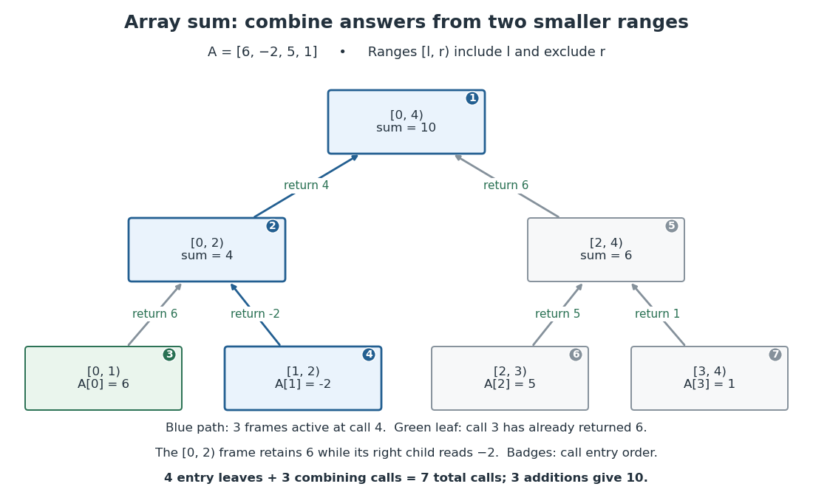

# Binary array sum by recursion

↑ **Parent:** [Recursion (computer science)](recursion-computer-science.md)

Keep an [array](array-data-structure.md) $A$ unchanged, and sum entries in the half-open [integer interval](integer-interval.md) of [array indices](array-index.md) $[l,r)$. The [precondition](precondition.md) requires [integers](integer-split.md) $0\leq l\leq r\leq\operatorname{length}(A)$ and exact, terminating [integer](integer-split.md) [addition](addition.md). An empty range returns the [empty sum](empty-sum.md) zero; a one-entry range returns that entry. Every longer range splits at its middle [array index](array-index.md):
```
S(A, l, r):
    require integer indices with 0 <= l <= r <= length(A)
    size = r - l
    if size == 0:
        return 0
    if size == 1:
        return A[l]
    middle = l + floor(size / 2)
    left_sum = S(A, l, middle)
    right_sum = S(A, middle, r)
    return left_sum + right_sum
```
For the original [array](array-data-structure.md) $A=[6,-2,5,1]$, call $S(A,0,4)$. The left half returns $6+(-2)=4$, the right half returns $5+1=6$, and the original invocation returns $4+6=10$. The right half's left endpoint increases from zero to two: what decreases is range length $r-l$, not every argument. Negative entries affect the answer but do not affect [algorithm termination](algorithm-termination.md).

<a id="image-seven-calls-compute-an-array-sum-with-only-three-frames-active-at-once"></a>


**[Figure 15](#image-seven-calls-compute-an-array-sum-with-only-three-frames-active-at-once). Seven calls compute an array sum with only three frames active at once**. Original [binary tree](binary-tree.md) of invocations for $A=[6,-2,5,1]$, with [integer intervals](integer-interval.md) labeling ranges and upward arrows labeling returned sums. Small numbers give the order in which invocations begin when the left child runs first. The highlighted [graph path](path-in-a-graph.md) contains the three active [stack frames](stack-frame.md) while the entry $-2$ is read; the result $6$ from the completed left sibling is retained by its parent.

For range length $n=r-l\geq2$, the children have lengths $\lfloor n/2\rfloor$ and $\lceil n/2\rceil$, both positive and strictly less than $n$. The [floor function](floor-function.md) chooses the split; the [ceiling function](ceiling-function.md) gives the other length. [Algorithm termination](algorithm-termination.md) follows by this [natural number](natural-number.md) measure. For [algorithm correctness](algorithm-correctness.md), apply [mathematical induction](mathematical-induction.md) on $n$: the two [base cases](base-case.md) return the specified [sum](sum.md); for a larger range, the two disjoint child ranges cover every original [array index](array-index.md) exactly once, so [addition](addition.md) of their correct [sums](sum.md) gives the required [sum](sum.md).

For $n\geq1$, the invocation [tree](tree-graph-theory-split.md) is a [full binary tree](full-binary-tree.md) with $n$ leaves, one per [array](array-data-structure.md) entry. If $I$ is its number of nonleaf [vertices](vertex-graph-theory.md), counting [edges](edge-of-a-graph.md) gives $2I=I+n-1$, so $I=n-1$. Thus the total invocation count is $2n-1$, and there are $n-1$ combining [additions](addition.md). Here $n=4$ gives seven calls and three combining [additions](addition.md). For $n=1$, there is one call and no combining [addition](addition.md); for $n=0$, there is also one call and no combining [addition](addition.md), but no entry leaf, so the $2n-1$ formula does not apply.

The [call stack](call-stack.md) holds the active branch, rather than the entire invocation [tree](tree-graph-theory-split.md). Execute the left child completely before the right child, retaining the left result in the parent [stack frame](stack-frame.md). The maximum number of active [stack frames](stack-frame.md) is $1+\lceil\log_2 n\rceil$ for $n\geq1$, and one for $n=0$. Balanced splitting therefore needs $O(\log n)$ frames for $n\geq2$, compared with the $O(n)$ frames of the [factorial](factorial.md) [recursive process](recursive-process.md). Assuming constant-cost [array](array-data-structure.md) access, index operations and [addition](addition.md), its [time complexity](time-complexity.md) is $O(n)$ and its auxiliary [space complexity](space-complexity.md) is $O(\log n)$ [machine words](machine-word.md) for $n\geq2$, excluding the stored [input](input-computer-science.md). Pass the same [array](array-data-structure.md) with different endpoints, rather than copying slices. These bounds require all stored indices and partial sums to fit in a constant number of [machine words](machine-word.md); exact unbounded [integer](integer-split.md) [addition](addition.md) and storage require a separate [bit](bit.md) cost analysis.

## ↑ Ancestors (4)

1. [Recursion (computer science)](recursion-computer-science.md)
2. [Algorithm](algorithm-split.md)
3. [Computer science](computer-science-split.md)
4. [Codex Wiki](split.md)
