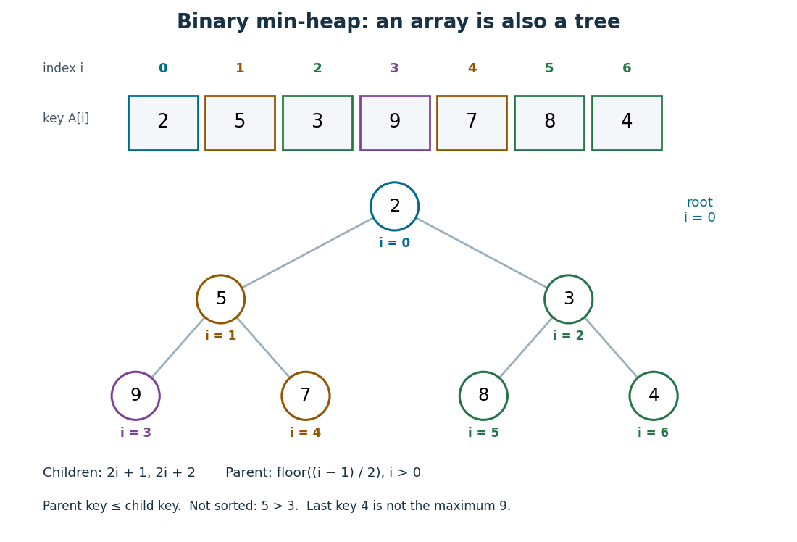
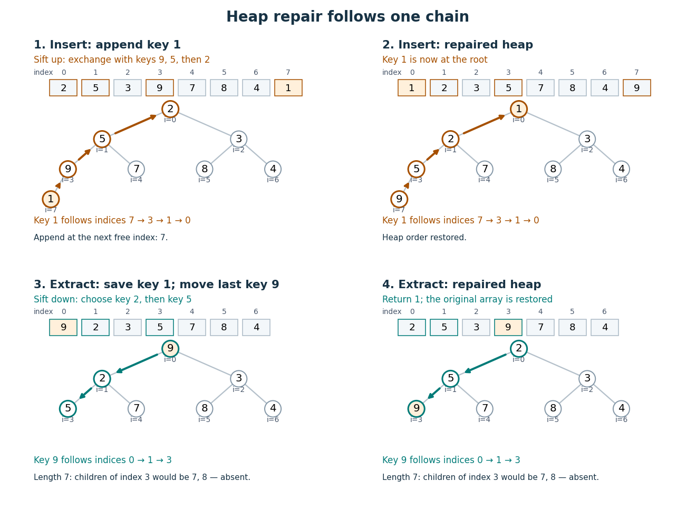

# Binary heap

↑ **Parent:** [Priority queue](priority-queue.md)  
ⓦ [Wiki](https://en.wikipedia.org/wiki/Binary_heap)

A [binary heap](binary-heap.md) represents a [priority queue](priority-queue.md) as a [complete binary tree](complete-binary-tree.md) obeying a [heap order](heap-order.md). We use the minimum convention: the priority of every [parent in a rooted tree](parent-in-a-rooted-tree.md) is no greater than the priorities of its [children in a rooted tree](child-in-a-rooted-tree.md). Equal priorities are allowed. Each stored entry may be a record carrying a priority key; the numerical example below displays only keys. Reversing the inequalities gives the maximum convention.

The [complete binary tree](complete-binary-tree.md) can be stored directly in a zero-indexed [array](array-data-structure.md) $A=(A_0,\ldots,A_{n-1})$: read its levels from top to bottom, left to right. The [root of a tree](root-of-a-tree.md) is at index $0$. The possible [children in a rooted tree](child-in-a-rooted-tree.md) of index $i$ are at $2i+1$ and $2i+2$, and an index denotes a present entry only when it is less than $n$. For $i>0$, its [parent in a rooted tree](parent-in-a-rooted-tree.md) is at $\lfloor(i-1)/2\rfloor$, using the [floor function](floor-function.md). Thus the links of the [complete binary tree](complete-binary-tree.md) are determined by arithmetic rather than separately stored pointers.

Consider

$$
A=(2,5,3,9,7,8,4).
$$

The [children in a rooted tree](child-in-a-rooted-tree.md) of index $0$ have keys $5,3$; those of index $1$ have keys $9,7$; those of index $2$ have keys $8,4$. The six comparisons $2\le5$, $2\le3$, $5\le9$, $5\le7$, $3\le8$, $3\le4$ establish the [heap order](heap-order.md). At index $4$, the [parent in a rooted tree](parent-in-a-rooted-tree.md) is index $\lfloor(4-1)/2\rfloor=1$, carrying key $5$.

**[Figure 51](#image-one-binary-heap-viewed-as-an-array-and-a-complete-binary-tree). One binary heap viewed as an array and a complete binary tree**. Matching indices identify the same entries in both representations. The [heap order](heap-order.md) compares each [parent in a rooted tree](parent-in-a-rooted-tree.md) with its [children in a rooted tree](child-in-a-rooted-tree.md); it does not make a [sorted array](sorted-array.md).

The [array](array-data-structure.md) is visibly not a [sorted array](sorted-array.md): $5$ precedes $3$, and $8$ precedes $4$. Nor is the last entry a [maximum](maximum-of-a-subset-of-a-total-order.md): it is $4$, whereas the [maximum](maximum-of-a-subset-of-a-total-order.md) is $9$ at index $3$. The [heap order](heap-order.md) compares ancestors and descendants, without imposing an order between separate branches. Nevertheless, following the [graph path](path-in-a-graph.md) from the [root of a tree](root-of-a-tree.md) to any entry gives a chain of nondecreasing priorities. This short argument proves that `peek` can return $A_0$, a [minimum](minimum-of-a-subset-of-a-total-order.md), without inspecting the other entries.

Insertion appends an entry to the [array](array-data-structure.md), preserving the shape of the [complete binary tree](complete-binary-tree.md), then uses [sift up](sift-up.md) to repair the [heap order](heap-order.md). Insert key $1$ into the displayed [binary heap](binary-heap.md). It is appended at index $7$, and exchanges with indices $3$, $1$, then $0$:

$$
\begin{aligned}
(2,5,3,9,7,8,4,1)&\longrightarrow(2,5,3,1,7,8,4,9)\\
&\longrightarrow(2,1,3,5,7,8,4,9)\\
&\longrightarrow(1,2,3,5,7,8,4,9).
\end{aligned}
$$

The moving key follows $7\to3\to1\to0$; the keys $9,5,2$ each move down one level. Only this chain needs repair.

Now apply `extract-min`. Save key $1$, move the last key $9$ to the [root of a tree](root-of-a-tree.md), and shorten the [array](array-data-structure.md) to length $7$. Use [sift down](sift-down.md), always choosing the smaller of the present [children in a rooted tree](child-in-a-rooted-tree.md):

$$
\begin{aligned}
(9,2,3,5,7,8,4)&\longrightarrow(2,9,3,5,7,8,4)\\
&\longrightarrow(2,5,3,9,7,8,4).
\end{aligned}
$$

First $9$ exchanges with key $2$ at index $1$, since $2<3$; then with key $5$ at index $3$, since $5<7$. At index $3$, the possible [children in a rooted tree](child-in-a-rooted-tree.md) would be indices $7,8$, both outside the shortened [array](array-data-structure.md), so the process stops. The returned key is $1$, and the remaining [binary heap](binary-heap.md) is exactly the original one.

**[Figure 52](#image-sift-up-inserts-1-then-sift-down-restores-the-original-binary-heap-after-removing-1). Sift up inserts 1, then sift down restores the original binary heap after removing 1**. The four panels show the start and end of each repair. Colored arrows mark the moving key's [graph path](path-in-a-graph.md). The extraction panels contain seven entries: index 3 has no [children in a rooted tree](child-in-a-rooted-tree.md).

For a nonempty [binary heap](binary-heap.md) with $n$ entries, the deepest level is $\lfloor\log_2 n\rfloor$, using the [floor function](floor-function.md) and [logarithm](logarithm.md). Each exchange moves one level and uses only a bounded number of comparisons. The resulting [time complexity](time-complexity.md) bounds, expressed in [Big O notation](big-o-notation.md), are:

| Operation | [Time complexity](time-complexity.md) | Reason |
| --- | --- | --- |
| `peek` | $O(1)$ | Read the [root of a tree](root-of-a-tree.md). |
| Insert | $O(\log n)$ for $n\ge2$ | Append, then [sift up](sift-up.md) through at most the levels of the [complete binary tree](complete-binary-tree.md). |
| `extract-min` | $O(\log n)$ for $n\ge2$ | Move the last entry, then [sift down](sift-down.md) through at most those levels. |
| Build from an arbitrary [array](array-data-structure.md) | $O(n)$ | Apply [sift down](sift-down.md) from the last index with [children in a rooted tree](child-in-a-rooted-tree.md) back to index $0$. |

These bounds assume constant-cost indexed access, key comparisons and exchanges, and available [array](array-data-structure.md) capacity for insertion. Allocating and copying a larger [array](array-data-structure.md) is a separate cost. Empty and one-entry cases take constant work.

To build a [binary heap](binary-heap.md), begin at index $\lfloor n/2\rfloor-1$ and work backwards. Entries without [children in a rooted tree](child-in-a-rooted-tree.md) already obey the [heap order](heap-order.md). Each [sift down](sift-down.md), also called [heapify down](sift-down.md), starts with every present smaller [rooted tree](rooted-tree.md) below it already repaired. Most entries are close to the bottom and can move very little; successively longer repair distances occur for geometrically fewer entries. Summing these distances gives $O(n)$ work, rather than charging $O(\log n)$ to every entry. MIT's notes give this bottom-up construction and contrast it with repeated insertion.[MIT 6.006, lecture 8: implicit indices, heap repair and linear build, pp. 3–6](https://ocw.mit.edu/courses/6-006-introduction-to-algorithms-spring-2020/40d4851e550507ca14dc778b9b2266cc_MIT6_006S20_lec8.pdf)

The [Dijkstra algorithm](dijkstra-algorithm.md) additionally needs to decrease the priority of an existing [vertex](vertex-graph-theory.md) when its [tentative distance](tentative-distance.md) improves. Given its current index, lowering the key followed by [sift up](sift-up.md) takes $O(\log n)$ time for $n\ge2$. An indexed [binary heap](binary-heap.md) maintains a separate map from item identity to its current index and updates that map after every exchange. For [vertices](vertex-graph-theory.md) numbered in a fixed range, the map can be another [array](array-data-structure.md), giving constant-time index lookup. An ordinary unindexed [binary heap](binary-heap.md) supplies no such guarantee: locating an arbitrary item can require scanning $n$ entries. Item identity and priority must remain distinct, especially when several [vertices](vertex-graph-theory.md) have equal [tentative distances](tentative-distance.md).

The attractive compromise is local organization with global usefulness. A [binary heap](binary-heap.md) maintains only the [heap order](heap-order.md), yet every `extract-min` gives the next smallest key. Repeated extraction of the original example gives $2,3,4,5,7,8,9$, so a [priority queue](priority-queue.md) also supplies a [sorting algorithm](sorting-algorithm.md) without storing a [sorted array](sorted-array.md) between extractions.

**Table of contents**

- [Heap order](heap-order.md)
- [Sift up](sift-up.md)
- [Sift down](sift-down.md)

## ↑ Ancestors (4)

1. [Priority queue](priority-queue.md)
2. [Data structure](data-structure.md)
3. [Computer science](computer-science-split.md)
4. [Codex Wiki](split.md)

## ← Incoming links (9)

- [Binary heap](binary-heap.md)
- [Binary tree](binary-tree.md)
- [Complete binary tree](complete-binary-tree.md)
- [Data structure](data-structure.md)
- [Dijkstra algorithm](dijkstra-algorithm.md)
- [Heap order](heap-order.md)
- [Priority queue](priority-queue.md)
- [Sift down](sift-down.md)
- [Sift up](sift-up.md)
