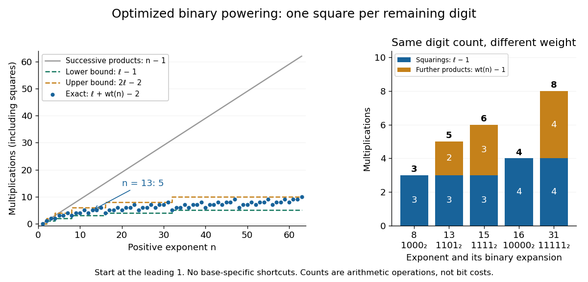

# Binary powering multiplication count

↑ **Parent:** [Exponentiation by squaring](exponentiation-by-squaring.md)

For the optimized left-to-right [exponentiation by squaring](exponentiation-by-squaring.md) [algorithm](algorithm.md), let $\ell=\lfloor\log_2 n\rfloor+1$ be the length of the [binary expansion](binary-expansion.md) of a positive [integer](integer.md) $n$, and let $w=\operatorname{wt}(n)$ be its [Hamming weight](hamming-weight.md), the number of digits equal to one. There are exactly $\ell-1$ digits after the leading one, and exactly $w-1$ remaining ones. Therefore the count is

$$
S(n)=\ell-1,\qquad T(n)=w-1,\qquad C(n)=S(n)+T(n)=\ell+w-2.
$$

Here $S$ counts squarings and $T$ counts further [multiplications](multiplication.md) by the base; **every squaring counts as one [multiplication](multiplication.md) in $C$**. Assignment, digit reading, and any inversion are outside this count. The formula includes $n=1$, which requires zero [multiplications](multiplication.md); define $C(0)=0$ separately.

For a fixed length $\ell$, the bounds are $\ell-1\leq C(n)\leq2\ell-2$. A [power of two](power-of-two.md) reaches the lower bound because its [Hamming weight](hamming-weight.md) is one; $n=2^\ell-1$ reaches the upper bound because all digits are one. For $n=13$, $\ell=4$ and $w=3$, giving $C(13)=5$. Thus the [arithmetic operation](arithmetic-operation.md) count is $O(\log(n+1))$ in [Big O notation](big-o-notation.md), but inputs of similar magnitude can have different counts.

**[Figure 24](#image-exact-multiplication-counts-for-optimized-exponentiation-by-squaring-depend-on-binary-length-and-hamming-weight). Exact multiplication counts for optimized exponentiation by squaring depend on binary length and Hamming weight**. For positive exponents through $63$, dots show $C(n)=\ell+\operatorname{wt}(n)-2$, including each squaring. The dashed curves bound all counts at each binary length. Successive multiplication needs $n-1$ operations. The second panel compares squarings and further [multiplications](multiplication.md) for exponents $8,13,15,16,31$. These are exact counts, not timing measurements.

This is a count for the specified [algorithm](algorithm.md), not a claim that it always minimizes [multiplications](multiplication.md) among all methods. For instance, at $n=15$ the count is six, but the powers with exponents $1,2,3,6,12,15$ can be built in five [multiplications](multiplication.md): square, multiply by $a$, square, square, then multiply by the already stored $a^3$. Saving operations this way uses a different schedule and stored intermediate powers.

## ↑ Ancestors (5)

1. [Exponentiation by squaring](exponentiation-by-squaring.md)
2. [Number theory](number-theory-split.md)
3. [Area of mathematics](area-of-mathematics.md)
4. [Mathematics](mathematics-split.md)
5. [Codex Wiki](split.md)

## ← Incoming links (2)

- [Bit cost of modular exponentiation](bit-cost-of-modular-exponentiation.md)
- [Modular exponentiation](modular-exponentiation.md)
