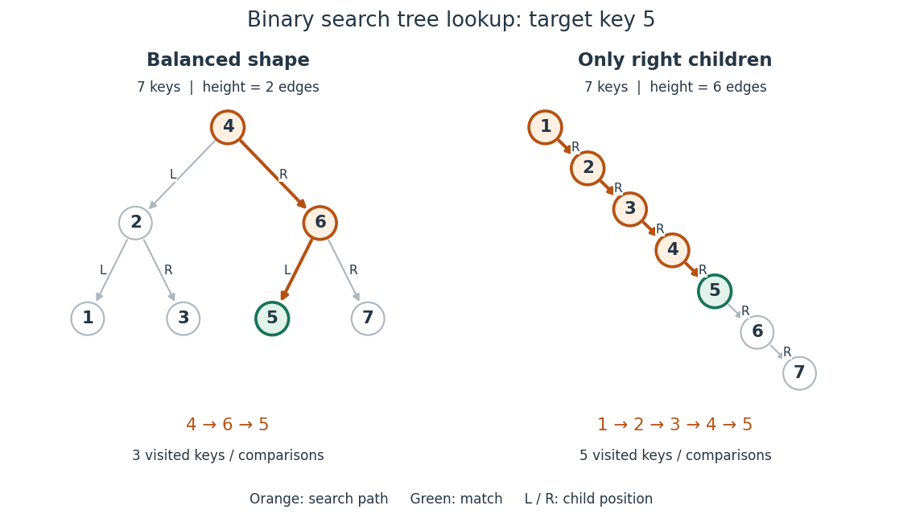
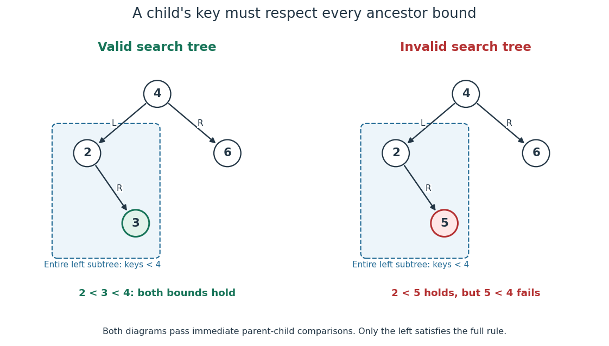

# Binary search tree

↑ **Parent:** [Binary tree](binary-tree.md)

A [binary search tree](binary-search-tree.md) stores key-value entries in a [binary tree](binary-tree.md), with distinct keys drawn from a [total order](total-order.md). At every [vertex](vertex-graph-theory.md), all keys in its left [subtree](subtree.md) must be smaller than its own key, and all keys in its right [subtree](subtree.md) must be larger. Thus the entries represent a [partial function](partial-function.md) from keys to values: a key has at most one associated value and may be absent. [Pat Morin, Open Data Structures, section 6.2: the binary search tree property](open-data-structures-an-introduction-by-pat-morin/6-binary-trees.md)

Lookup starts at the [root of a tree](root-of-a-tree.md). Compare the target with the current key: equality returns its value, a smaller target continues into the left [subtree](subtree.md), and a larger target continues into the right [subtree](subtree.md). Reaching an empty [subtree](subtree.md) reports absence. The ordering rule justifies discarding the other [subtree](subtree.md) at every step; this is the [algorithm correctness](algorithm-correctness.md) argument for lookup. It applies to the entire [subtree](subtree.md), even if that [subtree](subtree.md) contains many [vertices](vertex-graph-theory.md). [Pat Morin, Open Data Structures, section 6.2.1: exact-match searching](open-data-structures-an-introduction-by-pat-morin/6-binary-trees.md)

In the seven-key example, search for $5$. At $4$, the comparison $5>4$ selects the right [subtree](subtree.md); at $6$, $5<6$ selects the left [subtree](subtree.md); at $5$, equality ends the search. The visited keys are $4\to6\to5$, three key comparisons. The right-child chain stores exactly the same keys and satisfies the same [binary search tree](binary-search-tree.md) rule, but lookup of $5$ visits $1\to2\to3\to4\to5$, five comparisons. Searching for absent key $8$ visits $4,6,7$ in the first [binary search tree](binary-search-tree.md) and all seven keys in the chain before reaching an empty right [subtree](subtree.md).

**[Figure 15](#image-lookup-of-key-5-in-two-binary-search-trees-containing-the-same-seven-keys). Lookup of key $5$ in two binary search trees containing the same seven keys**. Orange highlights visited keys and [edges](edge-of-a-graph.md); green marks the match. The balanced shape has [height of a binary tree](height-of-a-binary-tree.md) $2$ and requires three visits, while the chain has [height of a binary tree](height-of-a-binary-tree.md) $6$ and requires five visits for this target.

For a nonempty [binary search tree](binary-search-tree.md) of [height of a binary tree](height-of-a-binary-tree.md) $h$, lookup inspects at most $h+1$ [vertices](vertex-graph-theory.md). Under constant-cost key comparisons and child-reference access, its [time complexity](time-complexity.md) is $O(h+1)$ in [Big O notation](big-o-notation.md), usually written $O(h)$ for $h\geq1$. With $n$ entries, $h\leq n-1$, giving $O(n)$ worst-case lookup. If the shape is kept balanced so that $h=O(\log n)$, lookup takes $O(\log n)$ for $n\geq2$. The empty and one-entry cases take constant work. The worst-case linear bound also appears in Sedgewick and Wayne's ordinary, unbalanced implementation. [Sedgewick and Wayne, Algorithms: BST implementation, complexity contract and get method](https://raw.githubusercontent.com/kevin-wayne/algs4/master/src/main/java/edu/princeton/cs/algs4/BST.java)

In a shape with every level full, there are $1+2+\cdots+2^h=2^{h+1}-1$ [vertices](vertex-graph-theory.md), a [geometric series](geometric-series.md). This explains how a small [height of a binary tree](height-of-a-binary-tree.md) can accommodate many entries. The [binary search tree](binary-search-tree.md) ordering rule alone does not guarantee this shape or logarithmic [time complexity](time-complexity.md). [Breadth-first search](breadth-first-search.md) also gains no logarithmic key-lookup guarantee merely from having a [binary tree](binary-tree.md): in the displayed balanced example, its left-to-right level order is $4,2,6,1,3,5,7$, so it inspects six keys before finding $5$, and an absent target requires all seven. Directed lookup uses the [total order](total-order.md) to choose one branch.

The ordering requirement includes every ancestor on the [graph path](path-in-a-graph.md) from the [root of a tree](root-of-a-tree.md). Consider the smaller [binary tree](binary-tree.md) with root key $4$, left child $2$, right child $6$, and right child $3$ under $2$. Key $3$ must satisfy both $2<3$, from its immediate [parent in a rooted tree](parent-in-a-rooted-tree.md), and $3<4$, from its position in the root's left [subtree](subtree.md). Replacing $3$ by $5$ preserves all immediate parent-child comparisons, including $2<5$, but violates $5<4$. Lookup for $5$ would incorrectly go from $4$ to $6$ and then to an empty left [subtree](subtree.md), overlooking the stored key.

**[Figure 16](#image-the-binary-search-tree-ordering-rule-constrains-an-entire-subtree). The binary search tree ordering rule constrains an entire subtree**. The valid example has $2<3<4$. The invalid example passes immediate parent-child comparisons, but key $5$ lies in the left [subtree](subtree.md) of key $4$ and violates its inherited upper bound.

An [inorder traversal](inorder-traversal.md) visits a left [subtree](subtree.md), then its own [vertex](vertex-graph-theory.md), then a right [subtree](subtree.md). On the valid small example its output is $2,3,4,6$; on the invalid example it is $2,5,4,6$, exposing the descent from $5$ to $4$. Both seven-key [binary search trees](binary-search-tree.md) yield $1,2,3,4,5,6,7$. The theorem is that an [inorder traversal](inorder-traversal.md) of a finite [binary search tree](binary-search-tree.md) with distinct keys lists every key once in strictly increasing [total order](total-order.md). For a short proof outline, use [mathematical induction](mathematical-induction.md) on the number of [vertices](vertex-graph-theory.md): each smaller [subtree](subtree.md) produces its own sorted list, and the full ordering rule places every left key before the current key and every right key after it. Concatenating these three parts preserves strict order. Sedgewick and Wayne's `keys` method uses this left-current-right order. [Sedgewick and Wayne, Algorithms: BST keys method and inherited-bound isBST check](https://raw.githubusercontent.com/kevin-wayne/algs4/master/src/main/java/edu/princeton/cs/algs4/BST.java)

This combination is useful and attractive: one [data structure](data-structure-split.md) supports directed lookup and ordered enumeration. An [inorder traversal](inorder-traversal.md) costs $O(n)$ [time complexity](time-complexity.md) for $n$ entries, since it visits every [vertex](vertex-graph-theory.md); balance accelerates lookup but cannot eliminate the work of outputting all keys.

// Destination: computer-science.bigb

**Table of contents**

- [Dictionary intersection](dictionary-intersection.md)

## ↑ Ancestors (4)

1. [Binary tree](binary-tree.md)
2. [Data structure](data-structure-split.md)
3. [Computer science](computer-science-split.md)
4. [Codex Wiki](split.md)

## ← Incoming links (8)

- [Binary search tree](binary-search-tree.md)
- [Binary tree](binary-tree.md)
- [Complete binary tree](complete-binary-tree.md)
- [Dictionary intersection](dictionary-intersection.md)
- [Height of a binary tree](height-of-a-binary-tree.md)
- [Inorder traversal](inorder-traversal.md)
- [Solution](past-exam-of-the-mathematics-course-of-the-university-of-cambridge/2006/ia/paper-5/6/b/solution.md)
- [Subtree](subtree.md)
