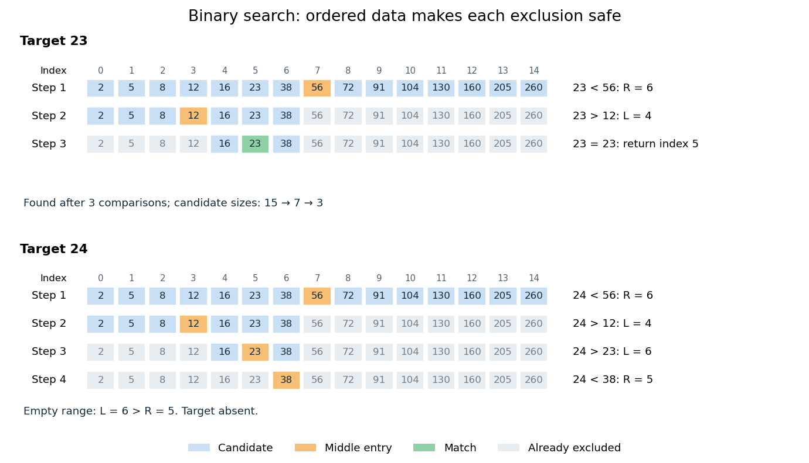

# Binary search

↑ **Parent:** [Algorithm](algorithm-split.md)  
ⓦ [Wiki](https://en.wikipedia.org/wiki/Binary_search)

[Binary search](binary-search.md) finds a target $x$ in a [sorted array](sorted-array.md) $A$ by inspecting the middle of the remaining candidate range. If the middle entry is smaller than $x$, every entry to its left is also too small; if larger, every entry to its right is too large. One comparison therefore rules out many entries. Equal entries are allowed; this version returns any matching index, without promising the first occurrence.

Use indices starting at zero and inclusive endpoints $L,R$. Initially $L=0$, $R=n-1$, where $n$ is the [array](array-data-structure.md) length. While $L\leq R$, choose

$$
m=L+\left\lfloor\frac{R-L}{2}\right\rfloor.
$$

The brackets denote the [floor function](floor-function.md). Compare $A_m$ with $x$: return $m$ on equality; set $L=m+1$ if $A_m<x$; otherwise set $R=m-1$. If $L>R$, report absence. The updates exclude the already inspected middle entry. This also handles an empty [array](array-data-structure.md), whose initial endpoints are $0,-1$. Sedgewick and Wayne specify a [sorted array](sorted-array.md) as [input](input-computer-science.md) and return a matching index or $-1$ for absence.[Sedgewick and Wayne: BinarySearch API](https://algs4.cs.princeton.edu/code/javadoc/edu/princeton/cs/algs4/BinarySearch.html)

For a fully worked example, take the [sorted array](sorted-array.md)

$$
A=(2,5,8,12,16,23,38,56,72,91,104,130,160,205,260).
$$

Search for $x=23$:

| Step | Candidate indices | Middle index and value | Consequence |
| --- | --- | --- | --- |
| 1 | $0\ldots14$ | $m=7$, $A_7=56$ | $23<56$: retain $0\ldots6$. |
| 2 | $0\ldots6$ | $m=3$, $A_3=12$ | $23>12$: retain $4\ldots6$. |
| 3 | $4\ldots6$ | $m=5$, $A_5=23$ | Return index $5$. |

For $x=24$, the first two steps agree. Next $24>23$ retains only index $6$; inspecting $A_6=38$ sets $R=5$. Now $L=6>5=R$, so the answer is "absent" after four comparisons.

**[Figure 26](#image-binary-search-retains-only-candidates-compatible-with-every-comparison). Binary search retains only candidates compatible with every comparison**. Blue cells are current candidates, orange marks the middle entry, and green marks a match. Both searches use the same fifteen-entry sorted array.

The [loop invariant](loop-invariant.md) is: the [array](array-data-structure.md) stays sorted, $0\leq L\leq R+1\leq n$, and every index containing $x$ lies between $L$ and $R$. It holds initially. The [sorted array](sorted-array.md) property justifies each exclusion. Returning on equality gives a match; an empty candidate range implies absence. Crucially, this [loop invariant](loop-invariant.md) allows $x$ to be absent from the beginning.

For a nonempty range of size $s=R-L+1$, an unsuccessful comparison leaves at most $\lfloor s/2\rfloor$ candidates. Thus sizes satisfy $s_k\leq\lfloor n/2^k\rfloor$ after $k$ unsuccessful comparisons. This proves termination and, for $n\geq1$, at most $\lfloor\log_2 n\rfloor+1$ middle-entry comparisons. The final singleton still needs inspection: $n=1$ requires one comparison, not zero. For $n=15$, the bound is four. This is the halving argument behind logarithmic [time complexity](time-complexity.md).[Princeton COS 126: binary search analysis](https://www.cs.princeton.edu/courses/archive/fall24/cos126/static/lectures/42Algorithms.pdf)

A [decision tree](decision-tree.md) with $q$ binary tests has at most $2^q$ leaves. Distinguishing $n$ possible matching positions therefore requires $q\geq\lceil\log_2 n\rceil$. This lower bound counts binary tests, whereas the bound above counts three-way comparisons.

## ↑ Ancestors (3)

1. [Algorithm](algorithm-split.md)
2. [Computer science](computer-science-split.md)
3. [Codex Wiki](split.md)

## ← Incoming links (17)

- [Adjacency list storage and query costs](adjacency-list-storage-and-query-costs.md)
- [Algorithm](algorithm-split.md)
- [Array (data structure)](array-data-structure.md)
- [Binary search](binary-search.md)
- [Computer science](computer-science-split.md)
- [Divide-and-conquer combination cost](divide-and-conquer-combination-cost.md)
- [Equality test](equality-test.md)
- [Integer cube root](integer-cube-root.md)
- [Linear search](linear-search.md)
- [Longest increasing subsequence](longest-increasing-subsequence.md)
- [Merge sort](merge-sort.md)
- [Solution](past-exam-of-the-mathematics-course-of-the-university-of-cambridge/2002/iii/paper-34/5/solution.md)
- [Solution](past-exam-of-the-mathematics-course-of-the-university-of-cambridge/2011/ii/paper-1/4g/solution.md)
- [Sorted array](sorted-array.md)
- [Sorting algorithm](sorting-algorithm.md)
- [Strictly increasing subsequence](strictly-increasing-subsequence.md)
- [Time complexity](time-complexity.md)
