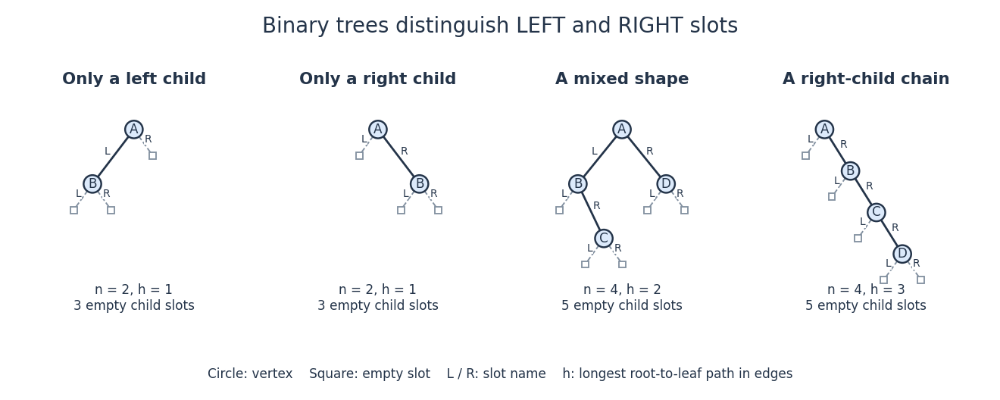

# Binary tree

↑ **Parent:** [Data structure](data-structure-split.md)  
ⓦ [Wiki](https://en.wikipedia.org/wiki/Binary_tree)

A [binary tree](binary-tree.md), in the [data structure](data-structure-split.md) convention used here, is a [rooted tree](rooted-tree.md) in which each [vertex](vertex-graph-theory.md) has zero, one or two [children in a rooted tree](child-in-a-rooted-tree.md), occupying distinct left and right positions. A single left child and a single right child give different [binary trees](binary-tree.md). A [vertex](vertex-graph-theory.md) with no [children in a rooted tree](child-in-a-rooted-tree.md) is called a leaf. An empty [binary tree](binary-tree.md) has no [root of a tree](root-of-a-tree.md) and is also allowed as a storage case. [Pat Morin, Open Data Structures, chapter 6: roots, left and right children](open-data-structures-an-introduction-by-pat-morin/6-binary-trees.md)

For example, give the [root of a tree](root-of-a-tree.md) label $4$, its left child label $2$ and its right child label $6$. Attach $1,3$ as the left and right [children in a rooted tree](child-in-a-rooted-tree.md) of $2$, and $5,7$ as those of $6$. This [binary tree](binary-tree.md) has seven [vertices](vertex-graph-theory.md), six [edges](edge-of-a-graph.md), and [height of a binary tree](height-of-a-binary-tree.md) $2$: a longest downward [graph path](path-in-a-graph.md) contains two [edges](edge-of-a-graph.md). The [binary search tree](binary-search-tree.md) lookup illustration below shows this shape alongside the [binary tree](binary-tree.md) consisting only of successive right children $1,2,\ldots,7$, whose [height of a binary tree](height-of-a-binary-tree.md) is $6$.

Left and right positions specify an ordered shape, not a numerical [total order](total-order.md) on stored labels. Swapping labels $1$ and $7$ in the first example still gives a [binary tree](binary-tree.md), but destroys the [binary search tree](binary-search-tree.md) property. Nor must a [binary tree](binary-tree.md) be balanced: the right-child chain is just as valid. The same shape convention supports a [binary heap](binary-heap.md), a [Huffman code](huffman-code.md), or a [binary search tree](binary-search-tree.md), each with its own additional rules. The useful idea is to describe two smaller [subtrees](subtree.md) at each [vertex](vertex-graph-theory.md), making [structural recursion](structural-recursion.md) natural.

For a precise recursive description, a finite [binary tree](binary-tree.md) is either empty or a [root of a tree](root-of-a-tree.md) carrying a value together with an [ordered pair](ordered-pair.md) $(L,R)$ of disjoint smaller [binary trees](binary-tree.md). The entries of this [ordered pair](ordered-pair.md) are its left and right [subtrees](subtree.md), each of which may be empty. Thus two [binary tree child slots](binary-tree-child-slot.md) exist even when fewer than two [children in a rooted tree](child-in-a-rooted-tree.md) exist; an empty slot does not denote an extra [vertex](vertex-graph-theory.md). This decomposition is the basis of [structural recursion](structural-recursion.md).[Introduction to Programming in Java, section 4.4, Binary search trees: recursive definition and node representation](introduction-to-programming-in-java-an-interdisciplinary-approach-by-robert-sedgewick-and-others/4-4-symbol-tables.md)

**[Figure 14](#image-left-and-right-binary-tree-child-slots-distinguish-shapes-even-with-just-one-child). Left and right binary tree child slots distinguish shapes even with just one child**. Solid circles are [vertices](vertex-graph-theory.md); outlined squares mark empty [binary tree child slots](binary-tree-child-slot.md). The first two [binary trees](binary-tree.md) differ only in the occupied slot at $A$. The last two have the same four labels but different [height of a binary tree](height-of-a-binary-tree.md).

In the four-[vertex](vertex-graph-theory.md) mixed example, $A$ has left child $B$ and right child $D$, while $B$ has only a right child $C$. Count its [vertices](vertex-graph-theory.md) by [structural recursion](structural-recursion.md): the empty [binary tree](binary-tree.md) contributes zero and each nonempty [binary tree](binary-tree.md) contributes one plus the counts of its left and right [subtrees](subtree.md). Thus $B$ contributes $1+0+1=2$, and $A$ contributes $1+2+1=4$. The same decomposition computes [height of a binary tree](height-of-a-binary-tree.md), supports [inorder traversal](inorder-traversal.md), and supplies short proofs by [structural induction](structural-induction.md). It separates shape from the values stored in a [data structure](data-structure-split.md).

Ignoring values, let $b_n$ count finite [binary tree](binary-tree.md) shapes with $n$ [vertices](vertex-graph-theory.md), retaining left and right slots and counting the empty shape once. Splitting at the [root of a tree](root-of-a-tree.md) gives the [recurrence relation](recurrence-relation.md)

$$
b_0=1,\qquad b_n=\sum_{i=0}^{n-1}b_i b_{n-1-i}\quad(n\geq1).
$$

For each left [subtree](subtree.md) size $i$, choose its shape and the right [subtree](subtree.md) shape independently. This yields the [Catalan numbers](catalan-number.md): $b_1=1$, $b_2=2$, and $b_3=2+1+2=5$. The two shapes at $n=2$ are exactly the left-only and right-only examples. Forgetting the slot distinction would change the counting problem.

**Table of contents**

- [Binary expression tree](binary-expression-tree.md)
- [Binary tree child slot](binary-tree-child-slot.md)
  - [Null child slot count](null-child-slot-count.md)
- [Subtree](subtree.md)
- [Height of a binary tree](height-of-a-binary-tree.md)
- [Inorder traversal](inorder-traversal.md)
- [Binary search tree](binary-search-tree.md)
  - [Dictionary intersection](dictionary-intersection.md)
- [Complete binary tree](complete-binary-tree.md)
- [Full binary tree](full-binary-tree.md)
- [Perfect binary tree](perfect-binary-tree.md)

## ↑ Ancestors (3)

1. [Data structure](data-structure-split.md)
2. [Computer science](computer-science-split.md)
3. [Codex Wiki](split.md)

## ← Incoming links (28)

- [Binary array sum by recursion](binary-array-sum-by-recursion.md)
- [Binary expression tree](binary-expression-tree.md)
- [Binary search tree](binary-search-tree.md)
- [Binary tree](binary-tree.md)
- [Binary tree child slot](binary-tree-child-slot.md)
- [Bounding volume hierarchy](bounding-volume-hierarchy.md)
- [Catalan number](catalan-number.md)
- [Comparison sorting lower bound](comparison-sorting-lower-bound.md)
- [Complete binary tree](complete-binary-tree.md)
- [Decision tree](decision-tree.md)
- [Full binary tree](full-binary-tree.md)
- [Height of a binary tree](height-of-a-binary-tree.md)
- [Huffman code](huffman-code.md)
- [Huffman coding](huffman-coding.md)
- [Inorder traversal](inorder-traversal.md)
- [Matrix-chain cost model](matrix-chain-cost-model.md)
- [Matrix-chain split reconstruction](matrix-chain-split-reconstruction.md)
- [Null child slot count](null-child-slot-count.md)
- [Solution](past-exam-of-the-mathematics-course-of-the-university-of-cambridge/2007/ia/paper-5/5/a/i/solution.md)
- [Solution](past-exam-of-the-mathematics-course-of-the-university-of-cambridge/2007/ia/paper-5/5/a/ii/solution.md)
- [Perfect binary tree](perfect-binary-tree.md)
- [Recursion (computer science)](recursion-computer-science.md)
- [Rooted tree](rooted-tree.md)
- [Segment tree](segment-tree.md)
- [Stern-Brocot tree](stern-brocot-tree.md)
- [Subtree](subtree.md)
- [Ultrametric space](ultrametric-space.md)
- [Well-founded progress in recursion](well-founded-progress-in-recursion.md)
