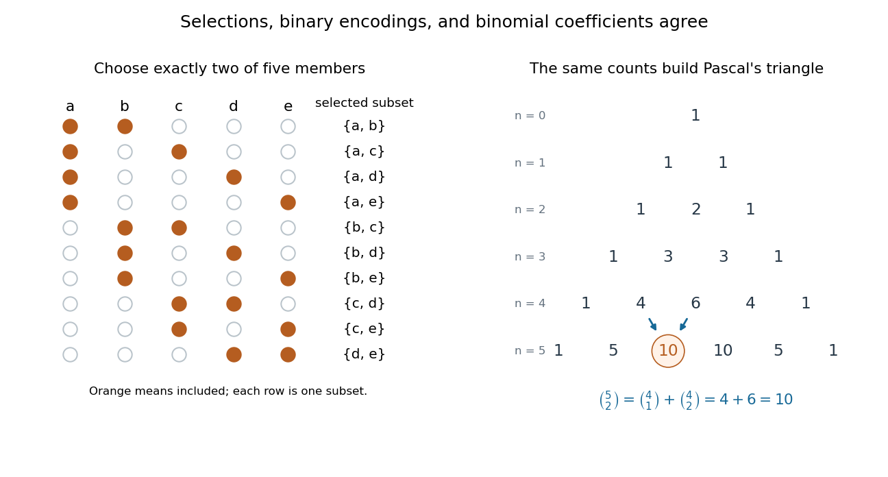

# Binomial coefficient

↑ **Parent:** [Combinatorics](combinatorics-split.md)  
ⓦ [Wiki](https://en.wikipedia.org/wiki/Binomial_coefficient)

For [nonnegative integers](natural-number.md) $n$ and $0\leq k\leq n$, the binomial coefficient

$$
\binom nk=\frac{n!}{k!(n-k)!}
$$

counts the $k$-element [subsets](subset.md) of an $n$-element [set](set-split.md). To obtain the formula, first choose an ordered list of $k$ different members in $n(n-1)\cdots(n-k+1)$ ways. Each [subset](subset.md) appears in exactly $k!$ orders, so divide by that [factorial](factorial.md). The cases $k=0$ and $k=n$ each have one selection, the [empty set](empty-set.md) and the whole [set](set-split.md). For integer $k$ outside $0\leq k\leq n$, the combinatorial convention is $\binom nk=0$.

For $n=5$, $k=2$, the calculation is $\binom52=5\cdot4/2=10$. The left-hand panel lists all ten [subsets](subset.md) of $\{a,b,c,d,e\}$. Marking an included member with one and an excluded member with zero gives a [bijection](bijection.md) with length-five [binary strings](binary-string.md) containing exactly two ones. More generally, this makes selection, binary encoding, and coefficients in a [binomial theorem](binomial-theorem.md) three descriptions of the same count.

**[Figure 17](#image-ten-two-element-subsets-of-a-five-element-set-match-the-corresponding-entry-of-pascal-s-triangle). Ten two-element subsets of a five-element set match the corresponding entry of Pascal's triangle**.

For a uniformly chosen two-person team, a specified person belongs to four of the ten teams, so the [probability](probability.md) of their inclusion is $4/10=2/5$. Uniform selection of a $k$-element [subset](subset.md) similarly gives inclusion [probability](probability.md) $k/n$ for each member when $n>0$, as the [double counting](double-counting-proof-technique.md) identity shows.

**Table of contents**

- [Vandermonde's identity](vandermonde-s-identity.md)
- [Nested-subset binomial identity](nested-subset-binomial-identity.md)
- [Prime-row binomial coefficient divisibility](prime-row-binomial-coefficient-divisibility.md)
  - [Binomial coefficient congruence across a prime row](binomial-coefficient-congruence-across-a-prime-row.md)
- [Gaussian binomial coefficient](gaussian-binomial-coefficient.md)
  - [Gaussian binomial coefficient recurrence](gaussian-binomial-coefficient-recurrence.md)
  - [Lattice-path interpretation of Gaussian binomial coefficients](lattice-path-interpretation-of-gaussian-binomial-coefficients.md)
  - [Partition interpretation of Gaussian binomial coefficients](partition-interpretation-of-gaussian-binomial-coefficients.md)
    - [Complement symmetry of Gaussian binomial coefficients](complement-symmetry-of-gaussian-binomial-coefficients.md)
  - [Gaussian binomial coefficient counts finite-field subspaces](gaussian-binomial-coefficient-counts-finite-field-subspaces.md)
  - [Unimodality of Gaussian binomial coefficients](unimodality-of-gaussian-binomial-coefficients.md)
  - [Symmetric quantum binomial coefficient](symmetric-quantum-binomial-coefficient.md)
- [Pascal's triangle](pascal-s-triangle.md)
- [Hockey-stick identity](hockey-stick-identity.md)
- [Lucas's theorem](lucas-s-theorem.md)
- [Prime-power binomial divisibility](prime-power-binomial-divisibility.md)
- [Binomial coefficients with even interior terms](binomial-coefficients-with-even-interior-terms.md)
- [Combinatorial number system](combinatorial-number-system.md)
- [Pascal's rule](pascal-s-rule.md)
- [Central binomial coefficient](central-binomial-coefficient.md)
  - [Normalized central binomial coefficients](normalized-central-binomial-coefficients.md)
- [Multinomial coefficient](multinomial-coefficient.md)
  - [Multinomial theorem](multinomial-theorem.md)
- [Binomial theorem](binomial-theorem.md)
  - [Binomial inversion](binomial-inversion.md)
  - [Alternating binomial moment](alternating-binomial-moment.md)
  - [Freshman's dream](freshman-s-dream.md)
  - [Binomial theorem for commuting matrices](binomial-theorem-for-commuting-matrices.md)
  - [Alternating binomial-square sum](alternating-binomial-square-sum.md)

## ↑ Ancestors (4)

1. [Combinatorics](combinatorics-split.md)
2. [Area of mathematics](area-of-mathematics.md)
3. [Mathematics](mathematics-split.md)
4. [Codex Wiki](split.md)

## ← Incoming links (122)

- [Alternating binomial moment](alternating-binomial-moment.md)
- [Base-p expansion](base-p-expansion.md)
- [Bernoulli number](bernoulli-number.md)
- [Bernoulli typical-set example](bernoulli-typical-set-example.md)
- [Bézier curve](bezier-curve.md)
- [Binomial coefficients with even interior terms](binomial-coefficients-with-even-interior-terms.md)
- [Binomial distribution](binomial-distribution.md)
- [Binomial polynomial](binomial-polynomial.md)
- [Boltzmann entropy of a two-box occupancy](boltzmann-entropy-of-a-two-box-occupancy.md)
- [Capture-recapture model](capture-recapture-model.md)
- [Central limit theorem](central-limit-theorem.md)
- [Chebyshev estimate from central binomial coefficients](chebyshev-estimate-from-central-binomial-coefficients.md)
- [Cohomological obstruction to separately odd sphere multiplication](cohomological-obstruction-to-separately-odd-sphere-multiplication.md)
- [Combinatorics](combinatorics-split.md)
- [Complete-intersection candidate family](complete-intersection-candidate-family.md)
- [Dicke state](dicke-state.md)
- [Dirichlet convolution](dirichlet-convolution.md)
- [Erdős theorem on k-Sperner families](erdos-theorem-on-k-sperner-families.md)
- [Even part of a polynomial](even-part-of-a-polynomial.md)
- [Exponential generating function](exponential-generating-function.md)
- [Factorial](factorial.md)
- [Fermionic state counting](fermionic-state-counting.md)
- [Finite Ramsey theorem](finite-ramsey-theorem.md)
- [Finite-size rounding](finite-size-rounding.md)
- [Gaussian binomial coefficient](gaussian-binomial-coefficient.md)
- [Hockey-stick identity](hockey-stick-identity.md)
- [Hypergeometric distribution](hypergeometric-distribution.md)
- [Inclusion-exclusion for exact block occupancy](inclusion-exclusion-for-exact-block-occupancy.md)
- [Invariant vector criterion for a Specht module](invariant-vector-criterion-for-a-specht-module.md)
- [Kravchuk polynomials](kravchuk-polynomials.md)
- [Lipschitz error bound for Bernstein approximation](lipschitz-error-bound-for-bernstein-approximation.md)
- [Lovász shadow bound](lovasz-shadow-bound.md)
- [Lucas's theorem](lucas-s-theorem.md)
- [Mahler expansion of continuous p-adic functions](mahler-expansion-of-continuous-p-adic-functions.md)
- [Maximum-support generator fibre](maximum-support-generator-fibre.md)
- [Mutual exclusion](mutual-exclusion.md)
- [Negative binomial distribution](negative-binomial-distribution.md)
- [Negative binomial stopping argument](negative-binomial-stopping-argument.md)
- [Nested-subset binomial identity](nested-subset-binomial-identity.md)
- [Pascal's triangle](pascal-s-triangle.md)
- [Solution](past-exam-of-the-mathematics-course-of-the-university-of-cambridge/2002/ia/paper-4/2c/solution.md)
- [Solution](past-exam-of-the-mathematics-course-of-the-university-of-cambridge/2003/iii/paper-13/2/solution.md)
- [Solution](past-exam-of-the-mathematics-course-of-the-university-of-cambridge/2003/iii/paper-22/1/solution.md)
- [Solution](past-exam-of-the-mathematics-course-of-the-university-of-cambridge/2003/iii/paper-34/4/solution.md)
- [Solution](past-exam-of-the-mathematics-course-of-the-university-of-cambridge/2003/iii/paper-69/1/b/solution.md)
- [Solution](past-exam-of-the-mathematics-course-of-the-university-of-cambridge/2005/ia/paper-4/2e/solution.md)
- [Solution](past-exam-of-the-mathematics-course-of-the-university-of-cambridge/2005/iii/paper-12/3/a/solution.md)
- [Solution](past-exam-of-the-mathematics-course-of-the-university-of-cambridge/2005/iii/paper-3/6/solution.md)
- [Solution](past-exam-of-the-mathematics-course-of-the-university-of-cambridge/2005/iii/paper-33/2/solution.md)
- [Solution](past-exam-of-the-mathematics-course-of-the-university-of-cambridge/2005/iii/paper-44/5/b/solution.md)
- [Solution](past-exam-of-the-mathematics-course-of-the-university-of-cambridge/2006/ia/paper-4/2e/solution.md)
- [Solution](past-exam-of-the-mathematics-course-of-the-university-of-cambridge/2006/iii/paper-12/1/i/solution.md)
- [Solution](past-exam-of-the-mathematics-course-of-the-university-of-cambridge/2006/iii/paper-12/4/solution.md)
- [Solution](past-exam-of-the-mathematics-course-of-the-university-of-cambridge/2006/iii/paper-14/3/solution.md)
- [Solution](past-exam-of-the-mathematics-course-of-the-university-of-cambridge/2006/iii/paper-28/1/solution.md)
- [Solution](past-exam-of-the-mathematics-course-of-the-university-of-cambridge/2006/iii/paper-34/4/solution.md)
- [Solution](past-exam-of-the-mathematics-course-of-the-university-of-cambridge/2006/iii/paper-45/3/c/solution.md)
- [Solution](past-exam-of-the-mathematics-course-of-the-university-of-cambridge/2007/ia/paper-4/2e/solution.md)
- [Solution](past-exam-of-the-mathematics-course-of-the-university-of-cambridge/2007/ia/paper-5/4/solution.md)
- [Solution](past-exam-of-the-mathematics-course-of-the-university-of-cambridge/2007/iii/paper-12/2/solution.md)
- [Solution](past-exam-of-the-mathematics-course-of-the-university-of-cambridge/2007/iii/paper-12/3/solution.md)
- [Solution](past-exam-of-the-mathematics-course-of-the-university-of-cambridge/2007/iii/paper-35/4/solution.md)
- [Solution](past-exam-of-the-mathematics-course-of-the-university-of-cambridge/2007/iii/paper-37/2/a/solution.md)
- [Solution](past-exam-of-the-mathematics-course-of-the-university-of-cambridge/2007/iii/paper-37/2/b/solution.md)
- [Solution](past-exam-of-the-mathematics-course-of-the-university-of-cambridge/2008/iii/paper-14/1/solution.md)
- [Solution](past-exam-of-the-mathematics-course-of-the-university-of-cambridge/2008/iii/paper-35/5/solution.md)
- [Solution](past-exam-of-the-mathematics-course-of-the-university-of-cambridge/2009/ia/paper-4/6e/b/solution.md)
- [Solution](past-exam-of-the-mathematics-course-of-the-university-of-cambridge/2009/ia/paper-4/7e/solution.md)
- [Solution](past-exam-of-the-mathematics-course-of-the-university-of-cambridge/2009/ii/paper-3/1g/solution.md)
- [Solution](past-exam-of-the-mathematics-course-of-the-university-of-cambridge/2009/iii/paper-30/5/solution.md)
- [Solution](past-exam-of-the-mathematics-course-of-the-university-of-cambridge/2010/iii/paper-10/2/solution.md)
- [Solution](past-exam-of-the-mathematics-course-of-the-university-of-cambridge/2010/iii/paper-10/4/solution.md)
- [Solution](past-exam-of-the-mathematics-course-of-the-university-of-cambridge/2010/iii/paper-24/5/a/solution.md)
- [Solution](past-exam-of-the-mathematics-course-of-the-university-of-cambridge/2010/iii/paper-50/3/e/solution.md)
- [Solution](past-exam-of-the-mathematics-course-of-the-university-of-cambridge/2011/ia/paper-4/7e/solution.md)
- [Solution](past-exam-of-the-mathematics-course-of-the-university-of-cambridge/2012/iii/paper-11/1/solution.md)
- [Solution](past-exam-of-the-mathematics-course-of-the-university-of-cambridge/2012/iii/paper-9/1/i/solution.md)
- [Solution](past-exam-of-the-mathematics-course-of-the-university-of-cambridge/2013/iii/paper-10/1/solution.md)
- [Solution](past-exam-of-the-mathematics-course-of-the-university-of-cambridge/2013/iii/paper-37/5/solution.md)
- [Solution](past-exam-of-the-mathematics-course-of-the-university-of-cambridge/2013/iii/paper-8/4/a/solution.md)
- [Solution](past-exam-of-the-mathematics-course-of-the-university-of-cambridge/2014/ia/paper-4/2e/solution.md)
- [Solution](past-exam-of-the-mathematics-course-of-the-university-of-cambridge/2015/ia/paper-4/6e/ii/solution.md)
- [Solution](past-exam-of-the-mathematics-course-of-the-university-of-cambridge/2015/iii/paper-11/2/solution.md)
- [Solution](past-exam-of-the-mathematics-course-of-the-university-of-cambridge/2015/iii/paper-11/3/solution.md)
- [Solution](past-exam-of-the-mathematics-course-of-the-university-of-cambridge/2015/iii/paper-12/1/ii/solution.md)
- [Solution](past-exam-of-the-mathematics-course-of-the-university-of-cambridge/2016/ia/paper-4/8e/a/solution.md)
- [Solution](past-exam-of-the-mathematics-course-of-the-university-of-cambridge/2016/iii/paper-110/3/solution.md)
- [Solution](past-exam-of-the-mathematics-course-of-the-university-of-cambridge/2016/iii/paper-213/5/solution.md)
- [Solution](past-exam-of-the-mathematics-course-of-the-university-of-cambridge/2017/ia/paper-2/11f/c/solution.md)
- [Solution](past-exam-of-the-mathematics-course-of-the-university-of-cambridge/2017/ia/paper-4/7d/a/solution.md)
- [Solution](past-exam-of-the-mathematics-course-of-the-university-of-cambridge/2017/ia/paper-4/7d/b/solution.md)
- [Solution](past-exam-of-the-mathematics-course-of-the-university-of-cambridge/2017/iii/paper-114/3/solution.md)
- [Solution](past-exam-of-the-mathematics-course-of-the-university-of-cambridge/2017/iii/paper-125/3/a/solution.md)
- [Solution](past-exam-of-the-mathematics-course-of-the-university-of-cambridge/2017/iii/paper-136/2/solution.md)
- [Solution](past-exam-of-the-mathematics-course-of-the-university-of-cambridge/2017/iii/paper-307/1/solution.md)
- [Solution](past-exam-of-the-mathematics-course-of-the-university-of-cambridge/2018/iii/paper-113/4/solution.md)
- [Solution](past-exam-of-the-mathematics-course-of-the-university-of-cambridge/2018/iii/paper-213/4/solution.md)
- [Solution](past-exam-of-the-mathematics-course-of-the-university-of-cambridge/2018/iii/paper-307/2/solution.md)
- [Solution](past-exam-of-the-mathematics-course-of-the-university-of-cambridge/2019/iii/paper-109/1/i/solution.md)
- [Solution](past-exam-of-the-mathematics-course-of-the-university-of-cambridge/2019/iii/paper-109/1/solution.md)
- [Solution](past-exam-of-the-mathematics-course-of-the-university-of-cambridge/2019/iii/paper-207/1/d/solution.md)
- [Solution](past-exam-of-the-mathematics-course-of-the-university-of-cambridge/2020/ii/paper-1/36a/solution.md)
- [Solution](past-exam-of-the-mathematics-course-of-the-university-of-cambridge/2021/ia/paper-4/5e/a/i/solution.md)
- [Solution](past-exam-of-the-mathematics-course-of-the-university-of-cambridge/2022/ia/paper-4/6d/a/solution.md)
- [Solution](past-exam-of-the-mathematics-course-of-the-university-of-cambridge/2023/ii/paper-2/37a/a/solution.md)
- [Solution](past-exam-of-the-mathematics-course-of-the-university-of-cambridge/2023/ii/paper-3/1g/a/solution.md)
- [Solution](past-exam-of-the-mathematics-course-of-the-university-of-cambridge/2024/iii/paper-124/4/iii/solution.md)
- [Periodic upwind finite volume advection](periodic-upwind-finite-volume-advection.md)
- [Point-count criterion for y squared equals x cubed plus k x](point-count-criterion-for-y-squared-equals-x-cubed-plus-k-x.md)
- [Polynomial identity](polynomial-identity.md)
- [Prime-power binomial divisibility](prime-power-binomial-divisibility.md)
- [Property B](property-b.md)
- [Sampling without replacement](sampling-without-replacement.md)
- [Simple random walk on the integer line](simple-random-walk-on-the-integer-line.md)
- [Size of a type class](size-of-a-type-class.md)
- [Stars and bars (combinatorics)](stars-and-bars-combinatorics.md)
- [Stationary law of a linear flow network](stationary-law-of-a-linear-flow-network.md)
- [Stationary law of a proportionally fair four-cycle](stationary-law-of-a-proportionally-fair-four-cycle.md)
- [Stirling numbers of the second kind](stirling-numbers-of-the-second-kind.md)
- [Triangular number pair-counting identity](triangular-number-pair-counting-identity.md)
- [Uniform layer of the Boolean cube](uniform-layer-of-the-boolean-cube.md)
- [Vandermonde's identity](vandermonde-s-identity.md)
