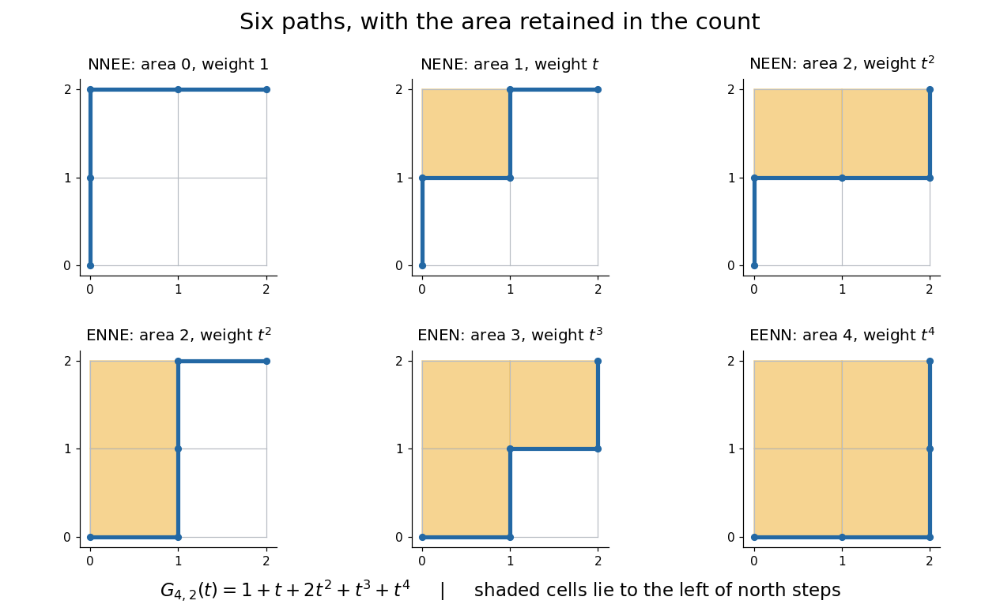
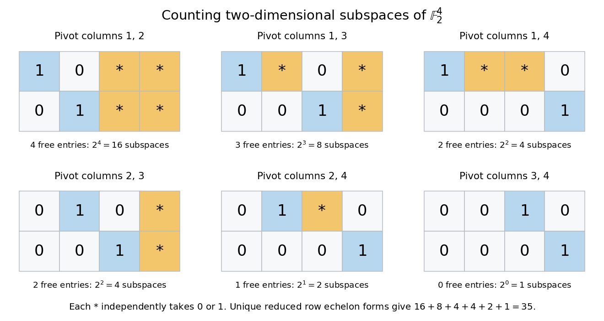
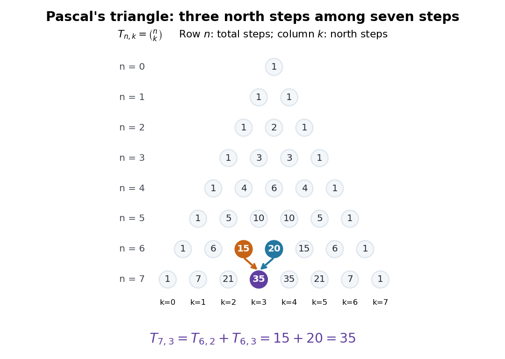

# Binomial coefficient

↑ **Parent:** [Combinatorics](combinatorics.md)  
ⓦ [Wiki](https://en.wikipedia.org/wiki/Binomial_coefficient)

For [nonnegative integers](arithmetic.md#natural-number) $n$ and $0\leq k\leq n$, the binomial coefficient

$$
\binom nk=\frac{n!}{k!(n-k)!}
$$

counts the $k$-element [subsets](set.md#subset) of an $n$-element [set](set.md). To obtain the formula, first choose an ordered list of $k$ different members in $n(n-1)\cdots(n-k+1)$ ways. Each [subset](set.md#subset) appears in exactly $k!$ orders, so divide by that [factorial](combinatorics.md#factorial). The cases $k=0$ and $k=n$ each have one selection, the [empty set](set.md#empty-set) and the whole [set](set.md). For integer $k$ outside $0\leq k\leq n$, the combinatorial convention is $\binom nk=0$.

For $n=5$, $k=2$, the calculation is $\binom52=5\cdot4/2=10$. The left-hand panel lists all ten [subsets](set.md#subset) of $\{a,b,c,d,e\}$. Marking an included member with one and an excluded member with zero gives a [bijection](function.md#bijection) with length-five [binary strings](theoretical-computer-science.md#binary-string) containing exactly two ones. More generally, this makes selection, binary encoding, and coefficients in a [binomial theorem](#binomial-theorem) three descriptions of the same count.

**[Figure 1](#image-ten-two-element-subsets-of-a-five-element-set-match-the-corresponding-entry-of-pascal-s-triangle). Ten two-element subsets of a five-element set match the corresponding entry of Pascal's triangle**.

For a uniformly chosen two-person team, a specified person belongs to four of the ten teams, so the [probability](probability-theory.md#probability) of their inclusion is $4/10=2/5$. Uniform selection of a $k$-element [subset](set.md#subset) similarly gives inclusion [probability](probability-theory.md#probability) $k/n$ for each member when $n>0$, as the [double counting](combinatorics.md#double-counting-proof-technique) identity shows.

**Table of contents**

- [Franel sum](#franel-sum)
- [Vandermonde's identity](#vandermonde-s-identity)
- [Nested-subset binomial identity](#nested-subset-binomial-identity)
- [Prime-row binomial coefficient divisibility](#prime-row-binomial-coefficient-divisibility)
  - [Binomial coefficient congruence across a prime row](#binomial-coefficient-congruence-across-a-prime-row)
- [Gaussian binomial coefficient](#gaussian-binomial-coefficient)
  - [Gaussian multinomial coefficient](#gaussian-multinomial-coefficient)
  - [Gaussian binomial coefficient recurrence](#gaussian-binomial-coefficient-recurrence)
  - [Lattice-path interpretation of Gaussian binomial coefficients](#lattice-path-interpretation-of-gaussian-binomial-coefficients)
  - [Partition interpretation of Gaussian binomial coefficients](#partition-interpretation-of-gaussian-binomial-coefficients)
    - [Complement symmetry of Gaussian binomial coefficients](#complement-symmetry-of-gaussian-binomial-coefficients)
  - [Gaussian binomial coefficient counts finite-field subspaces](#gaussian-binomial-coefficient-counts-finite-field-subspaces)
  - [Unimodality of Gaussian binomial coefficients](#unimodality-of-gaussian-binomial-coefficients)
  - [Symmetric quantum binomial coefficient](#symmetric-quantum-binomial-coefficient)
- [Pascal's triangle](#pascal-s-triangle)
- [Hockey-stick identity](#hockey-stick-identity)
- [Lucas's theorem](#lucas-s-theorem)
- [Prime-power binomial divisibility](#prime-power-binomial-divisibility)
- [Binomial coefficients with even interior terms](#binomial-coefficients-with-even-interior-terms)
- [Combinatorial number system](#combinatorial-number-system)
- [Pascal's rule](#pascal-s-rule)
- [Central binomial coefficient](#central-binomial-coefficient)
  - [Normalized central binomial coefficients](#normalized-central-binomial-coefficients)
- [Multinomial coefficient](#multinomial-coefficient)
  - [Multinomial theorem](#multinomial-theorem)
- [Binomial theorem](#binomial-theorem)
  - [Binomial expansion](#binomial-expansion)
  - [Binomial inversion](#binomial-inversion)
  - [Alternating binomial moment](#alternating-binomial-moment)
  - [Freshman's dream](#freshman-s-dream)
  - [Binomial theorem for commuting matrices](#binomial-theorem-for-commuting-matrices)
  - [Alternating binomial-square sum](#alternating-binomial-square-sum)

## Franel sum

↑ **Parent:** [Binomial coefficient](binomial-coefficient.md)

Franel sums are sums of fixed powers of [binomial coefficients](binomial-coefficient.md), such as $\sum_{k=0}^n\binom{n}{k}^3$.

<h2 id="vandermonde-s-identity">Vandermonde's identity</h2>

↑ **Parent:** [Binomial coefficient](binomial-coefficient.md)  
ⓦ [Wiki](https://en.wikipedia.org/wiki/Vandermonde's_identity)

Choose a $k$-element [subset](set.md#subset) of a disjoint union of sets of sizes $m$ and $n$. Partition the choices by the number $i$ of selected elements from the first set. The resulting count is the displayed convolution of [binomial coefficients](binomial-coefficient.md), where coefficients outside their admissible ranges are zero. This also proves the formula when $k>m+n$.

## Nested-subset binomial identity

↑ **Parent:** [Binomial coefficient](binomial-coefficient.md)

For $0\le\ell\le k\le n$, count pairs of [subsets](set.md#subset) $L\subseteq K\subseteq X$ with $|X|=n$, $|L|=\ell$ and $|K|=k$. Choosing $K$ before $L$ gives the left product of [binomial coefficients](binomial-coefficient.md). Choosing $L$ and then the $k-\ell$ additional elements of $K$ gives the right product. This [double counting](combinatorics.md#double-counting-proof-technique) proof explains the identity without division by factorials.

## Prime-row binomial coefficient divisibility

↑ **Parent:** [Binomial coefficient](binomial-coefficient.md)

For a [prime number](prime-number.md) $p$, the identity $r!\binom pr=p(p-1)\cdots(p-r+1)$ has right side divisible by $p$, while $r!$ is coprime to $p$. Cancellation in [modular arithmetic](modular-arithmetic.md) proves the divisibility.

// Target: combinatorics.bigb

### Binomial coefficient congruence across a prime row

↑ **Parent:** [Prime-row binomial coefficient divisibility](#prime-row-binomial-coefficient-divisibility)

In polynomial [modular arithmetic](modular-arithmetic.md), [prime-row binomial coefficient divisibility](#prime-row-binomial-coefficient-divisibility) gives $(1+X)^p\equiv1+X^p$. Multiply by $(1+X)^k$ and compare coefficients of $X^r$ for $r<p$; the $X^p$ term cannot contribute.

// Target: foundations-of-mathematics.bigb

## Gaussian binomial coefficient

↑ **Parent:** [Binomial coefficient](binomial-coefficient.md)  
ⓦ [Wiki](https://en.wikipedia.org/wiki/Gaussian_binomial_coefficient)

A [Gaussian binomial coefficient](#gaussian-binomial-coefficient) refines an ordinary [binomial coefficient](binomial-coefficient.md) into a [polynomial](polynomial.md) that remembers a size statistic. For [nonnegative integers](arithmetic.md#natural-number) $n$ and $0\leq k\leq n$, write

$$
G_{n,k}(t)=\binom nk_t=\prod_{j=1}^k\frac{1-t^{n-k+j}}{1-t^j}.
$$

The product represents a [polynomial](polynomial.md); it is not an instruction to divide by zero when $t=1$ or a denominator vanishes. The [Gaussian binomial coefficient recurrence](#gaussian-binomial-coefficient-recurrence) gives a way to compute it with only [addition](arithmetic.md#addition) and [multiplication](arithmetic.md#multiplication). The [empty product](arithmetic.md#empty-product) for $k=0$ is one, and $G_{n,n}(t)=1$ as well. Setting $t=1$ after obtaining the [polynomial](polynomial.md) recovers $\binom nk$.

For example,

$$
\boxed{G_{4,2}(t)=1+t+2t^2+t^3+t^4.}
$$

At $t=1$ this gives six objects, but its [coefficients](vector-space.md#coefficient) reveal how those six objects are distributed across sizes $0,1,2,3,4$: there are two of size two and one of each other size. The [lattice-path interpretation of Gaussian binomial coefficients](#lattice-path-interpretation-of-gaussian-binomial-coefficients) makes that information visible. Take unit steps north or east from $(0,0)$ to $(2,2)$. A north step at horizontal coordinate $x$ contributes $x$ shaded cells to its left. The six step words have total shaded [areas](differential-geometry.md#surface-area) $0,1,2,2,3,4$.

**[Figure 2](#image-the-six-lattice-paths-counted-by-g-4-2-t-weighted-by-the-number-of-shaded-cells). The six lattice paths counted by $G_{4,2}(t)$, weighted by the number of shaded cells**. Original exact enumeration of paths with two north and two east steps. Reading shaded row lengths from top to bottom gives a [partition in a rectangle](combinatorics.md#partition-in-a-rectangle). Equal-sized diagrams contribute to the same [coefficient](vector-space.md#coefficient).

This is useful because an aggregate count can hide the feature one actually wants. A [generating function](sequence-and-series.md#generating-function) retains the distribution of a statistic, so [coefficient extraction](polynomial.md#coefficient-extraction) answers questions such as “how many allowed diagrams contain exactly two cells?” The [partition interpretation of Gaussian binomial coefficients](#partition-interpretation-of-gaussian-binomial-coefficients) makes every [coefficient](vector-space.md#coefficient) a nonnegative [integer](integer.md) without relying on cancellation in the product formula.

An unexpected second use comes from [linear algebra](linear-algebra.md). If $q$ is a [prime power](prime-number.md#prime-power), the value $G_{n,k}(q)$ counts the $k$-dimensional [vector subspaces](vector-space.md#vector-subspace) of $\mathbb F_q^n$. Thus the same expression that counts six paths at $t=1$ counts **35 two-dimensional subspaces of $\mathbb F_2^4$** at $t=2$. The [Gaussian binomial coefficient counts finite-field subspaces](#gaussian-binomial-coefficient-counts-finite-field-subspaces) article explains why selecting a [vector subspace](vector-space.md#vector-subspace) differs from selecting a [subset](set.md#subset) of coordinates. [Enumerative Combinatorics, Volume 1 (second-edition draft) by Richard Stanley](mathematics-bibliography.md#enumerative-combinatorics-volume-1-second-edition-draft-by-richard-stanley)

This relationship illustrates a [q-analogue](combinatorics.md#q-analogue): the parameter can encode a statistic in one interpretation and the size of a [finite field](algebra.md#finite-field) in another. Here $t$ denotes the formal variable, while $q$ denotes a [finite field](algebra.md#finite-field)'s cardinality when we evaluate the [polynomial](polynomial.md). The interpretation using a [finite field](algebra.md#finite-field) requires $q$ to be a [prime power](prime-number.md#prime-power); evaluating the [polynomial](polynomial.md) at an arbitrary number does not construct a field of that size.

### Gaussian multinomial coefficient

↑ **Parent:** [Gaussian binomial coefficient](#gaussian-binomial-coefficient)

### Gaussian binomial coefficient recurrence

↑ **Parent:** [Gaussian binomial coefficient](#gaussian-binomial-coefficient)

For $n\geq1$ and $1\leq k\leq n$, the displayed [recurrence relation](sequence-and-series.md#recurrence-relation) uses $G_{n,0}(t)=1$ and $G_{n,k}(t)=0$ when $k<0$ or $k>n$. At $t=1$ it becomes [Pascal's identity](#pascal-s-rule).

An exact weighted-[subset](set.md#subset) formula is

$$
G_{n,k}(t)=\sum_{0\leq j_1<\cdots<j_k<n}t^{\sum_{i=1}^k(j_i-(i-1))}.
$$

The [exponent](arithmetic.md#exponent) measures how far the selected positions lie beyond the earliest possible choices $0,\ldots,k-1$. Split the [subsets](set.md#subset) according to whether they contain $n-1$. Those without it give $G_{n-1,k}(t)$; deleting it from those with it removes exactly $n-k$ from their [exponent](arithmetic.md#exponent). This gives the displayed [recurrence relation](sequence-and-series.md#recurrence-relation), explaining why it builds [polynomials](polynomial.md) with nonnegative [integer](integer.md) [coefficients](vector-space.md#coefficient).

### Lattice-path interpretation of Gaussian binomial coefficients

↑ **Parent:** [Gaussian binomial coefficient](#gaussian-binomial-coefficient)

Use [lattice paths](combinatorics.md#lattice-path) with $k$ north steps and $n-k$ east steps, beginning at $(0,0)$. Let $A(P)$ be the [sum](arithmetic.md#sum) of the horizontal coordinates of its north steps, equivalently the number of unit cells to their left inside the $k$-by-$(n-k)$ [rectangle](euclidean-geometry.md#rectangle). A north step in zero-based word position $j_i$ has $i-1$ earlier north steps, so its horizontal coordinate is $j_i-(i-1)$. The [Gaussian binomial coefficient recurrence](#gaussian-binomial-coefficient-recurrence) therefore counts these [lattice paths](combinatorics.md#lattice-path) with weight $t^{A(P)}$.

For $n=4,k=2$, the words `NNEE`, `NENE`, `NEEN`, `ENNE`, `ENEN`, `EENN` have respective [areas](differential-geometry.md#surface-area) $0,1,2,2,3,4$. The word `NEEN` contributes $t^2$ because the two north steps occur at horizontal coordinates zero and two. These paths never move south or west; allowing such extra steps would change the collection being counted.

### Partition interpretation of Gaussian binomial coefficients

↑ **Parent:** [Gaussian binomial coefficient](#gaussian-binomial-coefficient)

The [Young diagrams](representation-theory-of-the-symmetric-group.md#young-diagram) of [partitions in a rectangle](combinatorics.md#partition-in-a-rectangle) with at most $k$ rows and at most $n-k$ cells in each row correspond to the [lattice paths](combinatorics.md#lattice-path) in the [lattice-path interpretation of Gaussian binomial coefficients](#lattice-path-interpretation-of-gaussian-binomial-coefficients). Read the shaded row lengths from top to bottom; the result is a nonincreasing list of [nonnegative integers](arithmetic.md#natural-number). This [bijection](function.md#bijection) preserves the number $|\lambda|$ of cells.

In a two-by-two [rectangle](euclidean-geometry.md#rectangle), the possibilities are the empty [integer partition](combinatorics.md#integer-partition), $(1)$, $(2)$, $(1,1)$, $(2,1)$, and $(2,2)$. Their sizes are $0,1,2,2,3,4$, giving $G_{4,2}(t)$. In particular, **there are two allowed diagrams of size two**, explaining the middle [coefficient](vector-space.md#coefficient).[§1.7, Proposition 1.7.3, pp. 64–66](mathematics-bibliography.md#enumerative-combinatorics-volume-1-second-edition-draft-by-richard-stanley)

#### Complement symmetry of Gaussian binomial coefficients

↑ **Parent:** [Partition interpretation of Gaussian binomial coefficients](#partition-interpretation-of-gaussian-binomial-coefficients)

Pad a [partition in a rectangle](combinatorics.md#partition-in-a-rectangle) with zero rows until it has $k$ entries, and put $w=n-k$. The complementary rotated diagram has row lengths $\lambda'_i=w-\lambda_{k+1-i}$. This is again a [partition in a rectangle](combinatorics.md#partition-in-a-rectangle), and its size is $kw-|\lambda|$. Repeating the operation recovers the original [integer partition](combinatorics.md#integer-partition), so it gives a [bijection](function.md#bijection) between diagrams of size $a$ and diagrams of size $kw-a$. Consequently the [coefficients](vector-space.md#coefficient) of the [Gaussian polynomial](#gaussian-binomial-coefficient) read the same in either direction. The displayed identity can be interpreted as an identity of [Laurent polynomials](polynomial.md#laurent-polynomial); it does not require substituting $t^{-1}$ at $t=0$.

For the two-by-two [rectangle](euclidean-geometry.md#rectangle), the empty diagram pairs with $(2,2)$, and $(1)$ pairs with $(2,1)$; $(2)$ and $(1,1)$ each map to themselves. This establishes symmetry, while [unimodality of Gaussian binomial coefficients](#unimodality-of-gaussian-binomial-coefficients) is a stronger statement about the growth and decrease of successive [coefficients](vector-space.md#coefficient).

### Gaussian binomial coefficient counts finite-field subspaces

↑ **Parent:** [Gaussian binomial coefficient](#gaussian-binomial-coefficient)

For a [prime power](prime-number.md#prime-power) $q$ and $0\leq k\leq n$, count ordered lists of $k$ [linearly independent vectors](vector-space.md#linear-independence) in $\mathbb F_q^n$. The first has $q^n-1$ choices. After $i$ independent choices, their [linear span](vector-space.md#linear-span) contains $q^i$ [vectors](vector-space.md#vector), so the next has $q^n-q^i$ choices. Every $k$-dimensional [vector subspace](vector-space.md#vector-subspace) has exactly $\prod_{i=0}^{k-1}(q^k-q^i)$ [ordered bases](vector-space.md#ordered-basis). Dividing the list count by this common multiplicity gives

$$
\#\operatorname{Gr}(k,\mathbb F_q^n)=\frac{\prod_{i=0}^{k-1}(q^n-q^i)}{\prod_{i=0}^{k-1}(q^k-q^i)}=G_{n,k}(q).
$$

The notation $\operatorname{Gr}$ refers to the [Grassmannian](differential-geometry.md#grassmannian), here considered simply as the finite collection of these [vector subspaces](vector-space.md#vector-subspace).[§1.7, Proposition 1.7.2, pp. 63–64](mathematics-bibliography.md#enumerative-combinatorics-volume-1-second-edition-draft-by-richard-stanley)

For $n=4,k=2,q=2$, there are $15\cdot14=210$ ordered independent pairs. Each two-dimensional [vector subspace](vector-space.md#vector-subspace) has $3\cdot2=6$ [ordered bases](vector-space.md#ordered-basis), leaving $210/6=35$ [vector subspaces](vector-space.md#vector-subspace). There are only $\binom42=6$ coordinate-selected [vector subspaces](vector-space.md#vector-subspace); most of the 35 also contain [vectors](vector-space.md#vector) combining coordinates.

A unique [reduced row echelon form](numerical-linear-algebra.md#reduced-row-echelon-form) gives another count. Its six possible pivot-column patterns have $4,3,2,2,1,0$ freely chosen entries. Each free entry lies in $\mathbb F_2$, giving $16,8,4,4,2,1$ [vector subspaces](vector-space.md#vector-subspace), respectively. The diagram fixes the zero entries required to make each pivot the first nonzero entry in its row and the only nonzero entry in its column. Different choices describe different [row spaces](vector-space.md#row-space).

**[Figure 3](#image-the-six-reduced-row-echelon-form-pivot-patterns-give-35-two-dimensional-vector-subspaces-of-mathbb-f-2-4). The six reduced row echelon form pivot patterns give 35 two-dimensional vector subspaces of $\mathbb F_2^4$**. Original exact matrix-pattern enumeration. A star is a freely chosen [finite field](algebra.md#finite-field) entry, while every displayed zero or one is fixed. Pivot columns are numbered from one in this image.

### Unimodality of Gaussian binomial coefficients

↑ **Parent:** [Gaussian binomial coefficient](#gaussian-binomial-coefficient)

For $0\le k\le n$, let $V$ be the $n$-dimensional irreducible [sl2 Lie algebra](semisimple-lie-algebra.md#sl2-lie-algebra) representation. Its weights are $n-1,n-3,\ldots,1-n$. A wedge basis shows $\operatorname{ch}\Lambda^kV=q^{-k(n-k)}G_{n,k}(q^2)$, where $G_{n,k}(t)$ is the [Gaussian binomial coefficient](#gaussian-binomial-coefficient). By the [Weyl complete reducibility theorem](semisimple-lie-algebra.md#weyl-complete-reducibility-theorem), this character is a nonnegative sum of irreducible strings $q^m+q^{m-2}+\cdots+q^{-m}$. All its weights have parity $k(n-k)$, so their coefficients increase toward zero and decrease afterward. Consequently the coefficients of $G_{n,k}(t)$ are symmetric and unimodal. The [symmetric quantum binomial coefficient](#symmetric-quantum-binomial-coefficient) is this character, a [Laurent polynomial](polynomial.md#laurent-polynomial); its coefficients are unimodal on the occupied parity. The full integer-exponent sequence need not be unimodal, as $q+q^{-1}$ demonstrates.

### Symmetric quantum binomial coefficient

↑ **Parent:** [Gaussian binomial coefficient](#gaussian-binomial-coefficient)

The quotient $[n]_q[n-1]_q\cdots[n-k+1]_q/([k]_q\cdots[1]_q)$ is the displayed shifted [Gaussian binomial coefficient](#gaussian-binomial-coefficient). It is the [formal character](semisimple-lie-algebra.md#formal-character-of-a-weight-module) of $\Lambda^kL_{n-1}$, where $L_{n-1}$ is the $n$-dimensional irreducible [sl2 Lie algebra](semisimple-lie-algebra.md#sl2-lie-algebra) representation. Indeed its exterior-power weights are sums of $k$ distinct terms of $n-1,n-3,\ldots,1-n$. [Parity unimodality of an sl2 character](semisimple-lie-algebra.md#parity-unimodality-of-an-sl2-character) proves unimodality after removing the intervening zero coefficients; equivalently, the ordinary Gaussian polynomial has unimodal coefficients.

<h2 id="pascal-s-triangle">Pascal's triangle</h2>

↑ **Parent:** [Binomial coefficient](binomial-coefficient.md)  
ⓦ [Wiki](https://en.wikipedia.org/wiki/Pascal's_triangle)

Row $n$ of Pascal's triangle consists of the [binomial coefficients](binomial-coefficient.md) $\binom n0,\ldots,\binom nn$, beginning with row $0$. Boundary entries are one, and [Pascal's identity](#pascal-s-rule) says each interior entry is the sum of the two entries above it. The [hockey-stick identity](#hockey-stick-identity) evaluates sums along its diagonals.

The highlighted entry in the [binomial coefficient](binomial-coefficient.md) illustration is $\binom52=10$. Split two-person teams according to whether they contain the fifth person: six choose both members from the other four, and four contain the fifth person together with one of those four. Thus $10=6+4$. All entries can be generated by the same local rule, so a large table of counts needs no repeated enumeration of its [subsets](set.md#subset).

**Reading row seven.** Label the entries in each row from $k=0$ on the left through $k=n$ on the right. Rows zero through seven are shown below. The highlighted entry $T_{7,3}=35$ comes from $T_{6,2}=15$ and $T_{6,3}=20$. Starting with row zero $(1)$, the edges remain one and [Pascal's rule](#pascal-s-rule) determines every interior entry, so [mathematical induction](foundations-of-mathematics.md#mathematical-induction) uniquely determines the whole array.

**[Figure 4](#image-rows-zero-through-seven-of-pascal-s-triangle-with-t-7-3-t-6-2-plus-t-6-3-15-plus-20-35). Rows zero through seven of Pascal's triangle, with $T_{7,3}=T_{6,2}+T_{6,3}=15+20=35$**. The index $k$ increases from left to right in each row; it counts north steps in the [north-east lattice path](combinatorics.md#north-east-lattice-path) interpretation. Each row index $n$ counts all steps.

The triangular and rectangular layouts describe the same entries. For a [north-east lattice path](combinatorics.md#north-east-lattice-path) ending at $(a,b)$, set $n=a+b$ and $k=b$, so $P(a,b)=T_{n,k}$. The predecessor $(a-1,b)$ has indices $(n-1,k)$, while $(a,b-1)$ has indices $(n-1,k-1)$. Thus the grid's west and south arrivals are exactly the triangle's two parents. This change of indices explains why the [north-east lattice path recurrence](combinatorics.md#north-east-lattice-path-recurrence) and [Pascal's rule](#pascal-s-rule) agree.

There is also a global check on the local construction: row $n$ sums to $2^n$. Every [subset](set.md#subset) of an $n$-element [set](set.md) appears exactly once among the classes of sizes $0,\ldots,n$, and each element has two inclusion choices by the [rule of product](combinatorics.md#rule-of-product). In row seven, $1+7+21+35+35+21+7+1=128=2^7$. Replacing every [subset](set.md#subset) by its [complement](set.md#complement-of-a-set) reverses the row, explaining $T_{n,k}=T_{n,n-k}$. The [binomial theorem](#binomial-theorem) packages the whole row as the [coefficients](vector-space.md#coefficient) of $(1+x)^n$.

[Blaise Pascal](mathematics.md#blaise-pascal)'s Traité du triangle arithmétique, published in 1665, presents an arithmetic array and connects it to combinations, games of chance, and powers of binomial expressions. This makes the connection between a counting table and several applications visible in the original work. [Pascal, Traité du triangle arithmétique, 1665 edition](https://archive.org/details/bub_gb_UqgUAAAAQAAJ) The University of Cambridge's account of the treatise explains its 1654 composition and the organization of these applications. [Cambridge University Library, account of Pascal's treatise](https://api.repository.cam.ac.uk/server/api/core/bitstreams/9bfbc9c8-fa56-4694-b96d-fc18db0f562f/content)

## Hockey-stick identity

↑ **Parent:** [Binomial coefficient](binomial-coefficient.md)

For nonnegative [integers](integer.md) $n,m$, the [binomial coefficients](binomial-coefficient.md) satisfy

$$
\sum_{k=0}^m\binom{n+k}k=\binom{n+m+1}m.
$$

The identity follows by [mathematical induction](foundations-of-mathematics.md#mathematical-induction): adding the next term combines two adjacent [binomial coefficients](binomial-coefficient.md) through [Pascal's identity](#pascal-s-rule). An equivalent form is $\sum_{r=j}^N\binom rj=\binom{N+1}{j+1}$, a diagonal sum in [Pascal's triangle](#pascal-s-triangle). It provides closed forms for sums of [binomial coefficients](binomial-coefficient.md) without expanding individual [factorials](combinatorics.md#factorial).

<h2 id="lucas-s-theorem">Lucas's theorem</h2>

↑ **Parent:** [Binomial coefficient](binomial-coefficient.md)  
ⓦ [Wiki](https://en.wikipedia.org/wiki/Lucas's_theorem)

For a [prime number](prime-number.md) $p$, the [binomial coefficient](binomial-coefficient.md) modulo $p$ factors into the corresponding digit [binomial coefficients](binomial-coefficient.md) in the [base-p expansions](integer.md#base-p-expansion) of the nonnegative [integers](integer.md) $n,k$. Pad both expansions to the same length and use $\binom ab=0$ when $b>a$. The identity follows by factoring $(1+x)^n$ into digit powers and using the [Frobenius endomorphism](galois-theory.md#frobenius-endomorphism); digit uniqueness identifies each coefficient.

## Prime-power binomial divisibility

↑ **Parent:** [Binomial coefficient](binomial-coefficient.md)

For a [prime number](prime-number.md) $p$ and integer $r\ge1$, every interior [binomial coefficient](binomial-coefficient.md) in row $p^r$ is divisible by $p$. The polynomial identity $(1+x)^p\equiv1+x^p\pmod p$ iterates under the [Frobenius endomorphism](galois-theory.md#frobenius-endomorphism) to $(1+x)^{p^r}\equiv1+x^{p^r}\pmod p$. This concerns divisibility by $p$, not necessarily by $p^r$.

## Binomial coefficients with even interior terms

↑ **Parent:** [Binomial coefficient](binomial-coefficient.md)

For a positive integer $N$, all [binomial coefficients](binomial-coefficient.md) $\binom Nj$ with $0<j<N$ are even exactly when $N$ is a power of two. Write the binary expansion $N=\sum_{i\in I}2^i$. In the [polynomial ring](commutative-algebra.md#polynomial-ring) $\mathbb F_2[t]$, repeated squaring gives

$$
(1+t)^N=\prod_{i\in I}(1+t^{2^i}).
$$

If $I$ has one element, there are no interior terms. If it has more than one, the coefficient of $t^{2^{\min I}}$ is one and that exponent lies strictly between zero and $N$. This characterization gives a useful parity obstruction directly from the [binary expansion](arithmetic.md#binary-expansion).

## Combinatorial number system

↑ **Parent:** [Binomial coefficient](binomial-coefficient.md)  
ⓦ [Wiki](https://en.wikipedia.org/wiki/Combinatorial_number_system)

Every positive integer $m$ has a unique greedy representation

$$
m=\binom{a_r}{r}+\binom{a_{r-1}}{r-1}+\cdots+\binom{a_s}{s},
\qquad a_r>a_{r-1}>\cdots>a_s\geq s.
$$

This is also called the binomial representation of $m$ at level $r$.

<h2 id="pascal-s-rule">Pascal's rule</h2>

↑ **Parent:** [Binomial coefficient](binomial-coefficient.md)  
ⓦ [Wiki](https://en.wikipedia.org/wiki/Pascal's_rule)

Pascal's identity is

$$
\binom nk=\binom{n-1}k+\binom{n-1}{k-1}.
$$

For an [integer](integer.md) $n\geq1$ and any [integer](integer.md) $k$, [Pascal's rule](#pascal-s-rule) holds with the convention $\binom nk=0$ outside $0\leq k\leq n$. The boundary values are $\binom n0=\binom nn=1$, including $\binom00=1$. Initialize row zero separately: the [recurrence relation](sequence-and-series.md#recurrence-relation) does not require [binomial coefficients](binomial-coefficient.md) with top index $-1$.[§1.2, Recurrence relation for binomial coefficients and Pascal's Triangle: edge values and the two-parent rule](mathematics-bibliography.md#discrete-mathematics-an-open-introduction-3rd-edition-by-oscar-levin)

**Proof by a marked element.** Count the $k$-element [subsets](set.md#subset) of $\{1,\ldots,n\}$, marking the element $n$ as special. Those omitting $n$ are exactly the $k$-element [subsets](set.md#subset) of $\{1,\ldots,n-1\}$. From those containing $n$, delete $n$ to obtain the $(k-1)$-element [subsets](set.md#subset) of that same smaller [set](set.md); adjoining $n$ reverses this operation. The [rule of sum](combinatorics.md#addition-principle) adds these two disjoint counts. The proof includes $k=0$ and $k=n$ because the impossible class contributes zero.

For an original worked instance, choose three labels from $\{1,2,3,4,5,6,7\}$ and mark $7$. Omitting it gives $\binom63=20$ selections. Including it leaves two labels to choose from the other six, giving $\binom62=15$. Therefore $\binom73=20+15=35$. Under the [bijection](function.md#bijection) with [north-east lattice paths](combinatorics.md#north-east-lattice-path) to $(4,3)$, membership of position seven says whether the final step is north: the marked-element split becomes the last-step split.

This makes [Pascal's rule](#pascal-s-rule) useful beyond an algebraic identity. A counting problem may have an obvious yes-or-no decision even when its [factorial](combinatorics.md#factorial) formula is obscure; splitting at that decision exposes a [recurrence relation](sequence-and-series.md#recurrence-relation). When the smaller counts are shared between many cases, [dynamic programming](mathematical-optimization.md#dynamic-programming) reuses them. The beauty of [Pascal's triangle](#pascal-s-triangle) is that one local addition rule simultaneously organizes [subsets](set.md#subset), [binary strings](theoretical-computer-science.md#binary-string), [north-east lattice paths](combinatorics.md#north-east-lattice-path), and the [binomial theorem](#binomial-theorem).

## Central binomial coefficient

↑ **Parent:** [Binomial coefficient](binomial-coefficient.md)  
ⓦ [Wiki](https://en.wikipedia.org/wiki/Central_binomial_coefficient)

The central binomial coefficient is the largest coefficient in the expansion of $(1+1)^{2n}$:

$$
\binom{2n}{n}=\frac{(2n)!}{(n!)^2}.
$$

### Normalized central binomial coefficients

↑ **Parent:** [Central binomial coefficient](#central-binomial-coefficient)

Set $c_n=4^{-n}\binom{2n}{n}$, with $c_0=1$. Cancellation of factorials gives

$$
c_n=\prod_{j=1}^n\left(1-\frac1{2j}\right),\qquad
\frac{c_{n+1}}{c_n}=1-\frac1{2n+2}.
$$

Consequently $c_n$ decreases to zero: $\log c_n\leq-\frac12\sum_{j=1}^n1/j\leq-\frac12\log(n+1)$. The inequality uses $\log(1-x)\leq-x$ and comparison with $\int_1^{n+1}dt/t$. Conversely $c_n\geq1/(n+1)$ by induction, since its ratio is at least $(n+1)/(n+2)$. Thus $\sum c_n$ diverges while $\sum(-1)^nc_n$ has [conditional convergence](sequence-and-series.md#conditional-convergence) by the [alternating series test](sequence-and-series.md#alternating-series-test). These elementary bounds require no asymptotic formula for factorials.

## Multinomial coefficient

↑ **Parent:** [Binomial coefficient](binomial-coefficient.md)  
ⓦ [Wiki](https://en.wikipedia.org/wiki/Multinomial_coefficient)

For nonnegative integers with $n_1+\cdots+n_r=n$, the [multinomial coefficient](#multinomial-coefficient)

$$
\binom{n}{n_1,\ldots,n_r}
=\frac{n!}{n_1!\cdots n_r!}
$$

counts arrangements of a multiset containing $n_j$ copies of symbol $j$.

### Multinomial theorem

↑ **Parent:** [Multinomial coefficient](#multinomial-coefficient)  
ⓦ [Wiki](https://en.wikipedia.org/wiki/Multinomial_theorem)

For a nonnegative integer $n$,

$$
(x_1+\cdots+x_r)^n
=\sum_{\alpha_1+\cdots+\alpha_r=n}
\frac{n!}{\alpha_1!\cdots\alpha_r!}
x_1^{\alpha_1}\cdots x_r^{\alpha_r}.
$$

## Binomial theorem

↑ **Parent:** [Binomial coefficient](binomial-coefficient.md)  
ⓦ [Wiki](https://en.wikipedia.org/wiki/Binomial_theorem)

For a [nonnegative integer](arithmetic.md#natural-number) $n$ and [commuting](algebraic-operation.md#commuting-elements) quantities $x,y$,

$$
(x+y)^n=\sum_{k=0}^n\binom nkx^ky^{n-k}.
$$

In expanding the $n$ factors, obtain $x^ky^{n-k}$ by selecting the $k$ positions that contribute $x$. There are $\binom nk$ such choices. For example,

$$
(x+y)^5=x^5+5x^4y+10x^3y^2+10x^2y^3+5xy^4+y^5.
$$

The coefficients are row five of [Pascal's triangle](#pascal-s-triangle), in reverse order under the displayed $x^ky^{n-k}$ convention; the row is symmetric. Setting $x=y=1$ gives $1+5+10+10+5+1=32$, the number of [subsets](set.md#subset) of a five-element [set](set.md). Each member has two inclusion choices, agreeing with the [rule of product](combinatorics.md#rule-of-product) and the [cardinality](cardinal-number.md#cardinality) of the [power set](set.md#power-set).

### Binomial expansion

↑ **Parent:** [Binomial theorem](#binomial-theorem)

The binomial expansion expresses $(a+b)^n$ as $\sum_{k=0}^n\binom nk a^{n-k}b^k$ for a nonnegative integer $n$. The [binomial coefficients](binomial-coefficient.md) give the number of ways to choose which $k$ factors supply $b$.

### Binomial inversion

↑ **Parent:** [Binomial theorem](#binomial-theorem)

These two finite-sum transformations are inverses over any [commutative ring](commutative-algebra.md#commutative-ring). Substitute one sum into the other and use $\binom nk\binom kj=\binom nj\binom{n-j}{k-j}$. The inner alternating sum is $(1-1)^{n-j}$ by the [binomial theorem](#binomial-theorem), so only $j=n$ survives. In a [Mahler expansion](non-archimedean-analysis.md#mahler-s-theorem), $b_n$ is the nth [finite difference](finite-difference.md) of the sampled values $a_k$.

### Alternating binomial moment

↑ **Parent:** [Binomial theorem](#binomial-theorem)

For nonnegative integers $r,n$, the alternating binomial moment satisfies $S_r(n)=0$ when $r<n$ and $S_n(n)=(-1)^nn!$. Expand the [polynomial](polynomial.md) $X^r$ in [falling factorials](combinatorics.md#falling-factorial) and differentiate the [binomial theorem](#binomial-theorem) to prove these identities. Equivalently, alternating [binomial coefficients](binomial-coefficient.md) implement a finite difference that annihilates polynomials of degree less than $n$.

<h3 id="freshman-s-dream">Freshman's dream</h3>

↑ **Parent:** [Binomial theorem](#binomial-theorem)  
ⓦ [Wiki](https://en.wikipedia.org/wiki/Freshman's_dream)

In a commutative ring of characteristic $p$,

$$
(x+y)^p=x^p+y^p.
$$

Iteration gives $(x+y)^{p^n}=x^{p^n}+y^{p^n}$.

### Binomial theorem for commuting matrices

↑ **Parent:** [Binomial theorem](#binomial-theorem)

If square matrices $A$ and $B$ commute, then

$$
(A+B)^n=\sum_{k=0}^n\binom nkA^{n-k}B^k.
$$

The usual proof works because commutativity allows words with the same numbers of $A$ and $B$ factors to be collected.

### Alternating binomial-square sum

↑ **Parent:** [Binomial theorem](#binomial-theorem)

Coefficient extraction from $(1-x)^n(1+x)^n=(1-x^2)^n$ gives

$$
\sum_{r=0}^n(-1)^r\binom nr^2
=\begin{cases}0,&n\text{ odd},\\(-1)^{n/2}\binom n{n/2},&n\text{ even}.
\end{cases}
$$

## ↑ Ancestors (4)

1. [Combinatorics](combinatorics.md)
2. [Area of mathematics](mathematics.md#area-of-mathematics)
3. [Mathematics](mathematics.md)
4. [Codex Wiki](README.md)

## ← Incoming links (153)

- [Abelian plane subgroup of the Heisenberg group modulo four](lie-algebra.md#abelian-plane-subgroup-of-the-heisenberg-group-modulo-four)
- [Alternating binomial moment](#alternating-binomial-moment)
- [Base-p expansion](integer.md#base-p-expansion)
- [Bayes factor](bayesian-statistics.md#bayes-factor)
- [Bernoulli number](bernoulli-number.md)
- [Bernoulli typical-set example](information-theory.md#bernoulli-typical-set-example)
- [Beta integral](complex-analysis.md#beta-integral)
- [Bézier curve](computer-aided-geometric-design.md#bezier-curve)
- [Binomial coefficients with even interior terms](#binomial-coefficients-with-even-interior-terms)
- [Binomial distribution](discrete-probability-distribution.md#binomial-distribution)
- [Binomial expansion](#binomial-expansion)
- [Binomial polynomial](commutative-algebra.md#binomial-polynomial)
- [Binomial probability](discrete-probability-distribution.md#binomial-probability)
- [Boltzmann entropy of a two-box occupancy](entropy.md#boltzmann-entropy-of-a-two-box-occupancy)
- [Capture-recapture model](statistical-modelling.md#capture-recapture-model)
- [Central limit theorem](convergence-of-random-variables.md#central-limit-theorem)
- [Chebyshev estimate from central binomial coefficients](arithmetic-function.md#chebyshev-estimate-from-central-binomial-coefficients)
- [Cohomological obstruction to separately odd sphere multiplication](homology.md#cohomological-obstruction-to-separately-odd-sphere-multiplication)
- [Combination (combinatorics)](combinatorics.md#combination-combinatorics)
- [Combinatorics](combinatorics.md)
- [Complete-intersection candidate family](extremal-set-theory.md#complete-intersection-candidate-family)
- [Dicke state](quantum-system.md#dicke-state)
- [Dirichlet convolution](arithmetic-function.md#dirichlet-convolution)
- [Edge count of a complete graph](graph-theory.md#edge-count-of-a-complete-graph)
- [Erdős theorem on k-Sperner families](extremal-set-theory.md#erdos-theorem-on-k-sperner-families)
- [Even part of a polynomial](polynomial.md#even-part-of-a-polynomial)
- [Exponential generating function](sequence-and-series.md#exponential-generating-function)
- [Factorial](combinatorics.md#factorial)
- [Fermionic state counting](tensor-product-of-quantum-systems.md#fermionic-state-counting)
- [Finite Ramsey theorem](ramsey-theory.md#finite-ramsey-theorem)
- [Finite-size rounding](statistical-physics.md#finite-size-rounding)
- [Four-spin Ising ring](spin-model.md#four-spin-ising-ring)
- [Franel sum](#franel-sum)
- [Gaussian binomial coefficient](#gaussian-binomial-coefficient)
- [Generalized Leibniz rule](calculus.md#generalized-leibniz-rule)
- [Hockey-stick identity](#hockey-stick-identity)
- [Hypergeometric distribution](discrete-probability-distribution.md#hypergeometric-distribution)
- [Inclusion-exclusion for exact block occupancy](combinatorics.md#inclusion-exclusion-for-exact-block-occupancy)
- [Invariant vector criterion for a Specht module](representation-theory-of-the-symmetric-group.md#invariant-vector-criterion-for-a-specht-module)
- [Kravchuk polynomials](orthogonal-polynomial.md#kravchuk-polynomials)
- [Kummer's theorem](number-theory.md#kummer-s-theorem)
- [Lattice path](combinatorics.md#lattice-path)
- [Legendre's formula](number-theory.md#legendre-s-formula)
- [Lipschitz error bound for Bernstein approximation](functional-analysis.md#lipschitz-error-bound-for-bernstein-approximation)
- [Lovász shadow bound](extremal-set-theory.md#lovasz-shadow-bound)
- [Lucas's theorem](#lucas-s-theorem)
- [Mahler expansion of continuous p-adic functions](measure.md#mahler-expansion-of-continuous-p-adic-functions)
- [Match win probability with a fixed winning score](discrete-probability-distribution.md#match-win-probability-with-a-fixed-winning-score)
- [Maximum-support generator fibre](extremal-set-theory.md#maximum-support-generator-fibre)
- [Mutual exclusion](operating-system.md#mutual-exclusion)
- [Negative binomial distribution](discrete-probability-distribution.md#negative-binomial-distribution)
- [Negative binomial stopping argument](discrete-probability-distribution.md#negative-binomial-stopping-argument)
- [Nested-subset binomial identity](#nested-subset-binomial-identity)
- [Neutrino event classification model](particle-detection.md#neutrino-event-classification-model)
- [Newton series](finite-difference.md#newton-series)
- [North-east lattice path](combinatorics.md#north-east-lattice-path)
- [Pascal's rule](#pascal-s-rule)
- [Pascal's triangle](#pascal-s-triangle)
- [Solution](past-exam-of-the-mathematics-course-of-the-university-of-cambridge/2002/ia/paper-4.md#2c/solution)
- [Solution](past-exam-of-the-mathematics-course-of-the-university-of-cambridge/2003/iii/paper-13.md#2/solution)
- [Solution](past-exam-of-the-mathematics-course-of-the-university-of-cambridge/2003/iii/paper-22.md#1/solution)
- [Solution](past-exam-of-the-mathematics-course-of-the-university-of-cambridge/2003/iii/paper-34.md#4/solution)
- [Solution](past-exam-of-the-mathematics-course-of-the-university-of-cambridge/2003/iii/paper-69.md#1/b/solution)
- [Solution](past-exam-of-the-mathematics-course-of-the-university-of-cambridge/2005/ia/paper-4.md#2e/solution)
- [Solution](past-exam-of-the-mathematics-course-of-the-university-of-cambridge/2005/iii/paper-12.md#3/a/solution)
- [Solution](past-exam-of-the-mathematics-course-of-the-university-of-cambridge/2005/iii/paper-3.md#6/solution)
- [Solution](past-exam-of-the-mathematics-course-of-the-university-of-cambridge/2005/iii/paper-33.md#2/solution)
- [Solution](past-exam-of-the-mathematics-course-of-the-university-of-cambridge/2005/iii/paper-44.md#5/b/solution)
- [Solution](past-exam-of-the-mathematics-course-of-the-university-of-cambridge/2006/ia/paper-4.md#2e/solution)
- [Solution](past-exam-of-the-mathematics-course-of-the-university-of-cambridge/2006/iii/paper-12.md#1/i/solution)
- [Solution](past-exam-of-the-mathematics-course-of-the-university-of-cambridge/2006/iii/paper-12.md#4/solution)
- [Solution](past-exam-of-the-mathematics-course-of-the-university-of-cambridge/2006/iii/paper-14.md#3/solution)
- [Solution](past-exam-of-the-mathematics-course-of-the-university-of-cambridge/2006/iii/paper-28.md#1/solution)
- [Solution](past-exam-of-the-mathematics-course-of-the-university-of-cambridge/2006/iii/paper-34.md#4/solution)
- [Solution](past-exam-of-the-mathematics-course-of-the-university-of-cambridge/2006/iii/paper-45.md#3/c/solution)
- [Solution](past-exam-of-the-mathematics-course-of-the-university-of-cambridge/2007/ia/paper-4.md#2e/solution)
- [Solution](past-exam-of-the-mathematics-course-of-the-university-of-cambridge/2007/ia/paper-5.md#4/solution)
- [Solution](past-exam-of-the-mathematics-course-of-the-university-of-cambridge/2007/iii/paper-12.md#2/solution)
- [Solution](past-exam-of-the-mathematics-course-of-the-university-of-cambridge/2007/iii/paper-12.md#3/solution)
- [Solution](past-exam-of-the-mathematics-course-of-the-university-of-cambridge/2007/iii/paper-35.md#4/solution)
- [Solution](past-exam-of-the-mathematics-course-of-the-university-of-cambridge/2007/iii/paper-37.md#2/a/solution)
- [Solution](past-exam-of-the-mathematics-course-of-the-university-of-cambridge/2007/iii/paper-37.md#2/b/solution)
- [Solution](past-exam-of-the-mathematics-course-of-the-university-of-cambridge/2008/iii/paper-14.md#1/solution)
- [Solution](past-exam-of-the-mathematics-course-of-the-university-of-cambridge/2008/iii/paper-35.md#5/solution)
- [Solution](past-exam-of-the-mathematics-course-of-the-university-of-cambridge/2009/ia/paper-4.md#6e/b/solution)
- [Solution](past-exam-of-the-mathematics-course-of-the-university-of-cambridge/2009/ia/paper-4.md#7e/solution)
- [Solution](past-exam-of-the-mathematics-course-of-the-university-of-cambridge/2009/ii/paper-3.md#1g/solution)
- [Solution](past-exam-of-the-mathematics-course-of-the-university-of-cambridge/2009/iii/paper-30.md#5/solution)
- [Solution](past-exam-of-the-mathematics-course-of-the-university-of-cambridge/2010/iii/paper-10.md#2/solution)
- [Solution](past-exam-of-the-mathematics-course-of-the-university-of-cambridge/2010/iii/paper-10.md#4/solution)
- [Solution](past-exam-of-the-mathematics-course-of-the-university-of-cambridge/2010/iii/paper-24.md#5/a/solution)
- [Solution](past-exam-of-the-mathematics-course-of-the-university-of-cambridge/2010/iii/paper-50.md#3/e/solution)
- [Solution](past-exam-of-the-mathematics-course-of-the-university-of-cambridge/2011/ia/paper-4.md#7e/solution)
- [Solution](past-exam-of-the-mathematics-course-of-the-university-of-cambridge/2012/iii/paper-11.md#1/solution)
- [Solution](past-exam-of-the-mathematics-course-of-the-university-of-cambridge/2012/iii/paper-9.md#1/i/solution)
- [Solution](past-exam-of-the-mathematics-course-of-the-university-of-cambridge/2013/iii/paper-10.md#1/solution)
- [Solution](past-exam-of-the-mathematics-course-of-the-university-of-cambridge/2013/iii/paper-37.md#5/solution)
- [Solution](past-exam-of-the-mathematics-course-of-the-university-of-cambridge/2013/iii/paper-8.md#4/a/solution)
- [Solution](past-exam-of-the-mathematics-course-of-the-university-of-cambridge/2014/ia/paper-4.md#2e/solution)
- [Solution](past-exam-of-the-mathematics-course-of-the-university-of-cambridge/2015/ia/paper-4.md#6e/ii/solution)
- [Solution](past-exam-of-the-mathematics-course-of-the-university-of-cambridge/2015/iii/paper-11.md#2/solution)
- [Solution](past-exam-of-the-mathematics-course-of-the-university-of-cambridge/2015/iii/paper-11.md#3/solution)
- [Solution](past-exam-of-the-mathematics-course-of-the-university-of-cambridge/2015/iii/paper-12.md#1/ii/solution)
- [Solution](past-exam-of-the-mathematics-course-of-the-university-of-cambridge/2016/ia/paper-4.md#8e/a/solution)
- [Solution](past-exam-of-the-mathematics-course-of-the-university-of-cambridge/2016/iii/paper-110.md#3/solution)
- [Solution](past-exam-of-the-mathematics-course-of-the-university-of-cambridge/2016/iii/paper-213.md#5/solution)
- [Solution](past-exam-of-the-mathematics-course-of-the-university-of-cambridge/2017/ia/paper-2.md#11f/c/solution)
- [Solution](past-exam-of-the-mathematics-course-of-the-university-of-cambridge/2017/ia/paper-4.md#7d/a/solution)
- [Solution](past-exam-of-the-mathematics-course-of-the-university-of-cambridge/2017/ia/paper-4.md#7d/b/solution)
- [Solution](past-exam-of-the-mathematics-course-of-the-university-of-cambridge/2017/iii/paper-114.md#3/solution)
- [Solution](past-exam-of-the-mathematics-course-of-the-university-of-cambridge/2017/iii/paper-125.md#3/a/solution)
- [Solution](past-exam-of-the-mathematics-course-of-the-university-of-cambridge/2017/iii/paper-136.md#2/solution)
- [Solution](past-exam-of-the-mathematics-course-of-the-university-of-cambridge/2017/iii/paper-307.md#1/solution)
- [Solution](past-exam-of-the-mathematics-course-of-the-university-of-cambridge/2018/iii/paper-113.md#4/solution)
- [Solution](past-exam-of-the-mathematics-course-of-the-university-of-cambridge/2018/iii/paper-213.md#4/solution)
- [Solution](past-exam-of-the-mathematics-course-of-the-university-of-cambridge/2018/iii/paper-307.md#2/solution)
- [Solution](past-exam-of-the-mathematics-course-of-the-university-of-cambridge/2019/iii/paper-109.md#1/i/solution)
- [Solution](past-exam-of-the-mathematics-course-of-the-university-of-cambridge/2019/iii/paper-109.md#1/solution)
- [Solution](past-exam-of-the-mathematics-course-of-the-university-of-cambridge/2019/iii/paper-207.md#1/d/solution)
- [Solution](past-exam-of-the-mathematics-course-of-the-university-of-cambridge/2020/ii/paper-1.md#36a/solution)
- [Solution](past-exam-of-the-mathematics-course-of-the-university-of-cambridge/2021/ia/paper-4.md#5e/a/i/solution)
- [Solution](past-exam-of-the-mathematics-course-of-the-university-of-cambridge/2022/ia/paper-4.md#6d/a/solution)
- [Solution](past-exam-of-the-mathematics-course-of-the-university-of-cambridge/2023/ii/paper-2.md#37a/a/solution)
- [Solution](past-exam-of-the-mathematics-course-of-the-university-of-cambridge/2023/ii/paper-3.md#1g/a/solution)
- [Solution](past-exam-of-the-mathematics-course-of-the-university-of-cambridge/2024/iii/paper-124.md#4/iii/solution)
- [Solution](past-exam-of-the-mathematics-course-of-the-year-1-of-the-natural-sciences-course-of-the-university-of-cambridge/2002/paper-2.md#4/solution)
- [Solution](past-exam-of-the-mathematics-course-of-the-year-1-of-the-natural-sciences-course-of-the-university-of-cambridge/2006/paper-2.md#8/a/i/solution)
- [Solution](past-exam-of-the-mathematics-course-of-the-year-1-of-the-natural-sciences-course-of-the-university-of-cambridge/2009/paper-1.md#12/a/i/solution)
- [Solution](past-exam-of-the-mathematics-course-of-the-year-1-of-the-natural-sciences-course-of-the-university-of-cambridge/2009/paper-2.md#17/d/solution)
- [Solution](past-exam-of-the-mathematics-course-of-the-year-1-of-the-natural-sciences-course-of-the-university-of-cambridge/2012/paper-1.md#8/b/solution)
- [Solution](past-exam-of-the-mathematics-course-of-the-year-1-of-the-natural-sciences-course-of-the-university-of-cambridge/2017/paper-1.md#16/a/solution)
- [Solution](past-exam-of-the-mathematics-course-of-the-year-1-of-the-natural-sciences-course-of-the-university-of-cambridge/2023/paper-1.md#1/solution)
- [Solution](past-exam-of-the-mathematics-course-of-the-year-1-of-the-natural-sciences-course-of-the-university-of-cambridge/2023/paper-2.md#14/b/iii/solution)
- [Solution](past-exam-of-the-mathematics-course-of-the-year-1-of-the-natural-sciences-course-of-the-university-of-cambridge/2023/paper-2.md#14/b/v/solution)
- [Periodic upwind finite volume advection](finite-volume-method.md#periodic-upwind-finite-volume-advection)
- [Point-count criterion for y squared equals x cubed plus k x](normalization-of-an-algebraic-curve.md#point-count-criterion-for-y-squared-equals-x-cubed-plus-k-x)
- [Polynomial identity](polynomial.md#polynomial-identity)
- [Prime-power binomial divisibility](#prime-power-binomial-divisibility)
- [Property B](hypergraph.md#property-b)
- [Reflection count for Dyck paths](combinatorics.md#reflection-count-for-dyck-paths)
- [Sample mean of iid Bernoulli variables](random-variable.md#sample-mean-of-iid-bernoulli-variables)
- [Sampling without replacement](statistical-inference.md#sampling-without-replacement)
- [Scalar spin-spin coupling](nuclear-magnetic-resonance.md#scalar-spin-spin-coupling)
- [Simple random walk on the integer line](random-walk.md#simple-random-walk-on-the-integer-line)
- [Size of a type class](information-theory.md#size-of-a-type-class)
- [Stars and bars (combinatorics)](combinatorics.md#stars-and-bars-combinatorics)
- [Stationary law of a linear flow network](queueing-theory.md#stationary-law-of-a-linear-flow-network)
- [Stationary law of a proportionally fair four-cycle](queueing-theory.md#stationary-law-of-a-proportionally-fair-four-cycle)
- [Statistical data compression by a sufficient statistic](probability-and-statistics.md#statistical-data-compression-by-a-sufficient-statistic)
- [Stirling numbers of the second kind](combinatorics.md#stirling-numbers-of-the-second-kind)
- [Triangular number pair-counting identity](arithmetic.md#triangular-number-pair-counting-identity)
- [Uniform layer of the Boolean cube](extremal-set-theory.md#uniform-layer-of-the-boolean-cube)
- [Vandermonde's identity](#vandermonde-s-identity)
