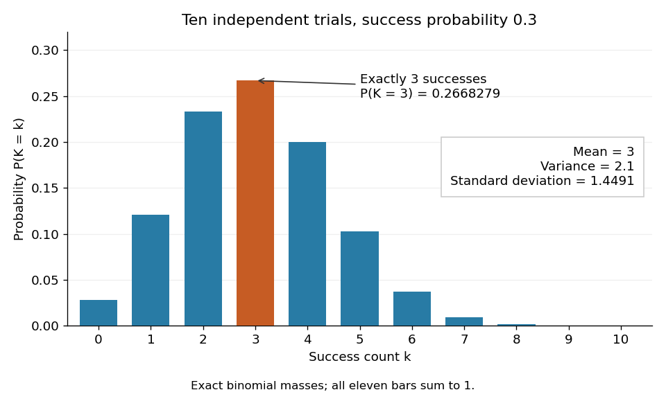

# Binomial distribution

↑ **Parent:** [Discrete probability distribution](discrete-probability-distribution-split.md)  
ⓦ [Wiki](https://en.wikipedia.org/wiki/Binomial_distribution)

The [binomial distribution](binomial-distribution.md) counts successes in a fixed number $n$ of [independent](independent-random-variables.md) [Bernoulli trials](bernoulli-trial.md) with common success [probability](probability.md) $p$. Equivalently,

$$
K=B_1+\cdots+B_n,\qquad B_i\sim\operatorname{Bernoulli}(p),\qquad
\mathbb P(K=k)=\binom nk p^k(1-p)^{n-k},\quad k=0,\ldots,n.
$$

Here $n$ is a nonnegative integer and $0\leq p\leq1$. The [binomial coefficient](binomial-coefficient.md) $\binom nk=n!/[k!(n-k)!]$ counts placements of the $k$ successes; each particular arrangement has [probability](probability.md) $p^k(1-p)^{n-k}$. The [binomial theorem](binomial-theorem.md) makes the masses sum to $[p+(1-p)]^n=1$. At $p=0$ all mass is at zero, and at $p=1$ all mass is at $n$; these endpoint laws can be read directly without interpreting $0^0$.

The [linearity of expectation](linearity-of-expectation.md) and addition of [variances](variance-split.md) for [independent random variables](independent-random-variables.md) give

$$
\mathbb E K=np,\qquad \operatorname{Var}(K)=np(1-p).
$$

The fixed trial count, common success [probability](probability.md), and joint [independence](independent-random-variables.md) are substantive model assumptions. Sampling uniformly without replacement from a finite population instead leads to a [hypergeometric distribution](hypergeometric-distribution.md). [Independent](independent-random-variables.md) trials with different success [probabilities](probability.md) generally give a [Poisson binomial distribution](poisson-binomial-distribution.md). Common marginal success [probabilities](probability.md) alone are insufficient: if all ten indicators equal the same [Bernoulli random variable](bernoulli-distribution.md) with $p=0.3$, their sum is zero with [probability](probability.md) $0.7$ or ten with [probability](probability.md) $0.3$. Its [mean](expected-value.md) is still three, but its [variance](variance-split.md) is $100(0.21)=21$. The standard construction is given in [Penn State STAT 504, binomial distribution](https://online.stat.psu.edu/stat504/Lesson01).

For an exact constructed example, let each of ten [independent](independent-random-variables.md) trials choose uniformly from ten labelled tokens, with replacement, and mark three tokens as successes. Then $p=3/10$ and $K\sim\operatorname{Bin}(10,0.3)$. Exactly three successes have [probability](probability.md)

$$
\mathbb P(K=3)=\binom{10}{3}(0.3)^3(0.7)^7
=120(0.027)(0.0823543)=0.266827932.
$$

The [mean](expected-value.md) is $10(0.3)=3$, the [variance](variance-split.md) is $10(0.3)(0.7)=2.1$, and the [standard deviation](standard-deviation.md) is $\sqrt{2.1}\approx1.4491$. Zero successes have [probability](probability.md) $0.7^{10}=0.0282475249$, so at least one success has [probability](probability.md) $1-0.7^{10}=0.9717524751$. A single count calculation replaces enumeration of all $10^{10}$ equally likely token sequences.

**[Figure 5](#image-exact-binomial-count-probabilities-for-ten-independent-trials-with-success-probability-0-3). Exact binomial count probabilities for ten independent trials with success probability 0.3**.

Each bar's height is one [probability](probability.md) mass. Three is the most likely count, but its mass is only about $26.7\%$: a most likely outcome need not occur most of the time.

**Table of contents**

- [Binomial proportion](binomial-proportion.md)
  - [Grouped Bernoulli failure counts](grouped-bernoulli-failure-counts.md)
- [Zero-event binomial upper confidence bound](zero-event-binomial-upper-confidence-bound.md)
- [Zero-truncated binomial distribution](zero-truncated-binomial-distribution.md)
- [Fourth centered moment of a binomial distribution](fourth-centered-moment-of-a-binomial-distribution.md)
- [Sample proportion](sample-proportion.md)
- [Binomial likelihood](binomial-likelihood.md)

## ↑ Ancestors (7)

1. [Discrete probability distribution](discrete-probability-distribution-split.md)
2. [Probability distribution](probability-distribution.md)
3. [Probability theory](probability-theory-split.md)
4. [Probability and statistics](probability-and-statistics-split.md)
5. [Area of mathematics](area-of-mathematics.md)
6. [Mathematics](mathematics-split.md)
7. [Codex Wiki](split.md)

## ← Incoming links (190)

- [Acceptance mass for an unnormalized rejection envelope](acceptance-mass-for-an-unnormalized-rejection-envelope.md)
- [Bayesian posterior](bayesian-posterior.md)
- [Bennett bounds for sparse binomial fluctuations](bennett-bounds-for-sparse-binomial-fluctuations.md)
- [Bernoulli distribution](bernoulli-distribution.md)
- [Bernoulli process](bernoulli-process.md)
- [Bernoulli trial](bernoulli-trial.md)
- [Bernoulli typical-set example](bernoulli-typical-set-example.md)
- [Bernstein polynomial](bernstein-polynomial.md)
- [Beta-binomial distribution](beta-binomial-distribution.md)
- [Biased-step entropy production model](biased-step-entropy-production-model.md)
- [Binomial branching process](binomial-branching-process.md)
- [Binomial distribution](binomial-distribution.md)
- [Binomial goodness-of-fit with an estimated parameter](binomial-goodness-of-fit-with-an-estimated-parameter.md)
- [Binomial likelihood-power annealing](binomial-likelihood-power-annealing.md)
- [Boltzmann entropy of a two-box occupancy](boltzmann-entropy-of-a-two-box-occupancy.md)
- [Central limit theorem](central-limit-theorem.md)
- [Chain-binomial epidemic model](chain-binomial-epidemic-model.md)
- [Chernoff information for complementary Bernoulli distributions](chernoff-information-for-complementary-bernoulli-distributions.md)
- [Compound binomial distribution](compound-binomial-distribution.md)
- [Concentration of discrete cubes at diameter scale](concentration-of-discrete-cubes-at-diameter-scale.md)
- [Conditional cure-weight equations for paired Poisson counts](conditional-cure-weight-equations-for-paired-poisson-counts.md)
- [Coverage probability](coverage-probability.md)
- [Discrete convolution](discrete-convolution.md)
- [Discrete probability distribution](discrete-probability-distribution-split.md)
- [EM for merged multinomial cells](em-for-merged-multinomial-cells.md)
- [Estimating a quantum expectation value](estimating-a-quantum-expectation-value.md)
- [Expected Fourier weight after a random restriction](expected-fourier-weight-after-a-random-restriction.md)
- [Expected value premium principle](expected-value-premium-principle.md)
- [Finite population correction](finite-population-correction.md)
- [Haldane prior](haldane-prior.md)
- [Hamming cube](hamming-cube.md)
- [Haploid selection recurrence](haploid-selection-recurrence.md)
- [Hoeffding sample size for Bernoulli frequencies](hoeffding-sample-size-for-bernoulli-frequencies.md)
- [Hospital mortality funnel plot](hospital-mortality-funnel-plot.md)
- [Hypergeometric distribution](hypergeometric-distribution.md)
- [Kravchuk polynomials](kravchuk-polynomials.md)
- [Lévy family of graphs](levy-family-of-graphs.md)
- [Likelihood function](likelihood-function.md)
- [Lipschitz error bound for Bernstein approximation](lipschitz-error-bound-for-bernstein-approximation.md)
- [Log odds ratio variance from a two-by-two table](log-odds-ratio-variance-from-a-two-by-two-table.md)
- [Logical failure of the three-qubit bit-flip repetition code](logical-failure-of-the-three-qubit-bit-flip-repetition-code.md)
- [Logistic-normal regression with autoregressive random effects](logistic-normal-regression-with-autoregressive-random-effects.md)
- [McNemar's test](mcnemar-s-test.md)
- [Mendelian IBD sharing of full siblings](mendelian-ibd-sharing-of-full-siblings.md)
- [Mendelian segregation](mendelian-segregation.md)
- [Multinomial aggregation](multinomial-aggregation.md)
- [Multinomial distribution](multinomial-distribution.md)
- [Negative binomial distribution](negative-binomial-distribution.md)
- [Negative binomial stopping argument](negative-binomial-stopping-argument.md)
- [Negative-binomial sum of exponential claims](negative-binomial-sum-of-exponential-claims.md)
- [Normal distribution](normal-distribution.md)
- [Order statistic](order-statistic.md)
- [Order-statistic confidence interval for a median](order-statistic-confidence-interval-for-a-median.md)
- [Paired Poisson conditional likelihood](paired-poisson-conditional-likelihood.md)
- [Panjer claim-count class](panjer-claim-count-class.md)
- [Parity construction of pairwise independent bits](parity-construction-of-pairwise-independent-bits.md)
- [Solution](past-exam-of-the-mathematics-course-of-the-university-of-cambridge/2001/ia/paper-2/11f/solution.md)
- [Solution](past-exam-of-the-mathematics-course-of-the-university-of-cambridge/2001/iii/paper-28/1/solution.md)
- [Solution](past-exam-of-the-mathematics-course-of-the-university-of-cambridge/2001/iii/paper-29/3/a/i/solution.md)
- [Solution](past-exam-of-the-mathematics-course-of-the-university-of-cambridge/2001/iii/paper-29/4/i/solution.md)
- [Solution](past-exam-of-the-mathematics-course-of-the-university-of-cambridge/2001/iii/paper-58/6/solution.md)
- [Solution](past-exam-of-the-mathematics-course-of-the-university-of-cambridge/2002/ia/paper-2/10f/a/solution.md)
- [Solution](past-exam-of-the-mathematics-course-of-the-university-of-cambridge/2002/ib/paper-4/3h/solution.md)
- [Solution](past-exam-of-the-mathematics-course-of-the-university-of-cambridge/2002/iii/paper-36/2/ii/solution.md)
- [Solution](past-exam-of-the-mathematics-course-of-the-university-of-cambridge/2002/iii/paper-37/3/i/solution.md)
- [Solution](past-exam-of-the-mathematics-course-of-the-university-of-cambridge/2002/iii/paper-37/3/iii/solution.md)
- [Solution](past-exam-of-the-mathematics-course-of-the-university-of-cambridge/2002/iii/paper-37/6/i/solution.md)
- [Solution](past-exam-of-the-mathematics-course-of-the-university-of-cambridge/2003/ia/paper-2/3f/a/solution.md)
- [Solution](past-exam-of-the-mathematics-course-of-the-university-of-cambridge/2003/ia/paper-2/3f/b/solution.md)
- [Solution](past-exam-of-the-mathematics-course-of-the-university-of-cambridge/2003/ib/paper-4/3h/solution.md)
- [Solution](past-exam-of-the-mathematics-course-of-the-university-of-cambridge/2003/iii/paper-40/3/i/solution.md)
- [Solution](past-exam-of-the-mathematics-course-of-the-university-of-cambridge/2003/iii/paper-43/1/b/iii/solution.md)
- [Solution](past-exam-of-the-mathematics-course-of-the-university-of-cambridge/2003/iii/paper-43/4/solution.md)
- [Solution](past-exam-of-the-mathematics-course-of-the-university-of-cambridge/2004/iii/paper-33/6/solution.md)
- [Solution](past-exam-of-the-mathematics-course-of-the-university-of-cambridge/2004/iii/paper-37/2/i/solution.md)
- [Solution](past-exam-of-the-mathematics-course-of-the-university-of-cambridge/2004/iii/paper-38/4/a/solution.md)
- [Solution](past-exam-of-the-mathematics-course-of-the-university-of-cambridge/2004/iii/paper-40/3/i/solution.md)
- [Solution](past-exam-of-the-mathematics-course-of-the-university-of-cambridge/2004/iii/paper-71/1/c/solution.md)
- [Solution](past-exam-of-the-mathematics-course-of-the-university-of-cambridge/2005/iii/paper-44/4/c/solution.md)
- [Solution](past-exam-of-the-mathematics-course-of-the-university-of-cambridge/2005/iii/paper-45/1/ii/solution.md)
- [Solution](past-exam-of-the-mathematics-course-of-the-university-of-cambridge/2005/iii/paper-58/3/ii/solution.md)
- [Solution](past-exam-of-the-mathematics-course-of-the-university-of-cambridge/2006/iii/paper-14/5/i/solution.md)
- [Solution](past-exam-of-the-mathematics-course-of-the-university-of-cambridge/2006/iii/paper-30/3/c/solution.md)
- [Solution](past-exam-of-the-mathematics-course-of-the-university-of-cambridge/2006/iii/paper-41/4/solution.md)
- [Solution](past-exam-of-the-mathematics-course-of-the-university-of-cambridge/2006/iii/paper-42/1/solution.md)
- [Solution](past-exam-of-the-mathematics-course-of-the-university-of-cambridge/2006/iii/paper-43/4/solution.md)
- [Solution](past-exam-of-the-mathematics-course-of-the-university-of-cambridge/2006/iii/paper-67/1/solution.md)
- [Solution](past-exam-of-the-mathematics-course-of-the-university-of-cambridge/2007/ib/paper-3/8c/solution.md)
- [Solution](past-exam-of-the-mathematics-course-of-the-university-of-cambridge/2007/ii/paper-1/5i/solution.md)
- [Solution](past-exam-of-the-mathematics-course-of-the-university-of-cambridge/2007/ii/paper-2/12f/i/solution.md)
- [Solution](past-exam-of-the-mathematics-course-of-the-university-of-cambridge/2007/iii/paper-35/3/solution.md)
- [Solution](past-exam-of-the-mathematics-course-of-the-university-of-cambridge/2007/iii/paper-46/2/c/solution.md)
- [Solution](past-exam-of-the-mathematics-course-of-the-university-of-cambridge/2007/iii/paper-49/3/solution.md)
- [Solution](past-exam-of-the-mathematics-course-of-the-university-of-cambridge/2008/iii/paper-41/4/b/solution.md)
- [Solution](past-exam-of-the-mathematics-course-of-the-university-of-cambridge/2008/iii/paper-42/1/solution.md)
- [Solution](past-exam-of-the-mathematics-course-of-the-university-of-cambridge/2008/iii/paper-43/4/solution.md)
- [Solution](past-exam-of-the-mathematics-course-of-the-university-of-cambridge/2008/iii/paper-47/6/b/ii/solution.md)
- [Solution](past-exam-of-the-mathematics-course-of-the-university-of-cambridge/2008/iii/paper-58/1/ii/solution.md)
- [Solution](past-exam-of-the-mathematics-course-of-the-university-of-cambridge/2009/ia/paper-2/10f/a/solution.md)
- [Solution](past-exam-of-the-mathematics-course-of-the-university-of-cambridge/2009/ia/paper-2/12f/solution.md)
- [Solution](past-exam-of-the-mathematics-course-of-the-university-of-cambridge/2009/ib/paper-3/8h/solution.md)
- [Solution](past-exam-of-the-mathematics-course-of-the-university-of-cambridge/2009/iii/paper-102/2/a/solution.md)
- [Solution](past-exam-of-the-mathematics-course-of-the-university-of-cambridge/2009/iii/paper-14/3/solution.md)
- [Solution](past-exam-of-the-mathematics-course-of-the-university-of-cambridge/2009/iii/paper-33/3/solution.md)
- [Solution](past-exam-of-the-mathematics-course-of-the-university-of-cambridge/2009/iii/paper-36/1/c/solution.md)
- [Solution](past-exam-of-the-mathematics-course-of-the-university-of-cambridge/2009/iii/paper-37/1/c/solution.md)
- [Solution](past-exam-of-the-mathematics-course-of-the-university-of-cambridge/2009/iii/paper-37/2/solution.md)
- [Solution](past-exam-of-the-mathematics-course-of-the-university-of-cambridge/2009/iii/paper-38/3/solution.md)
- [Solution](past-exam-of-the-mathematics-course-of-the-university-of-cambridge/2009/iii/paper-41/1/g/solution.md)
- [Solution](past-exam-of-the-mathematics-course-of-the-university-of-cambridge/2010/iii/paper-33/4/solution.md)
- [Solution](past-exam-of-the-mathematics-course-of-the-university-of-cambridge/2010/iii/paper-34/2/a/solution.md)
- [Solution](past-exam-of-the-mathematics-course-of-the-university-of-cambridge/2010/iii/paper-34/2/b/solution.md)
- [Solution](past-exam-of-the-mathematics-course-of-the-university-of-cambridge/2010/iii/paper-36/1/c/solution.md)
- [Solution](past-exam-of-the-mathematics-course-of-the-university-of-cambridge/2010/iii/paper-36/1/e/solution.md)
- [Solution](past-exam-of-the-mathematics-course-of-the-university-of-cambridge/2010/iii/paper-38/1/b/solution.md)
- [Solution](past-exam-of-the-mathematics-course-of-the-university-of-cambridge/2010/iii/paper-51/3/d/solution.md)
- [Solution](past-exam-of-the-mathematics-course-of-the-university-of-cambridge/2010/iii/paper-51/3/e/solution.md)
- [Solution](past-exam-of-the-mathematics-course-of-the-university-of-cambridge/2012/ia/paper-2/3f/solution.md)
- [Solution](past-exam-of-the-mathematics-course-of-the-university-of-cambridge/2012/iii/paper-32/3/solution.md)
- [Solution](past-exam-of-the-mathematics-course-of-the-university-of-cambridge/2012/iii/paper-41/2/a/solution.md)
- [Solution](past-exam-of-the-mathematics-course-of-the-university-of-cambridge/2012/iii/paper-70/2/c/solution.md)
- [Solution](past-exam-of-the-mathematics-course-of-the-university-of-cambridge/2012/iii/paper-82/6/solution.md)
- [Solution](past-exam-of-the-mathematics-course-of-the-university-of-cambridge/2012/iii/paper-9/1/ii/solution.md)
- [Solution](past-exam-of-the-mathematics-course-of-the-university-of-cambridge/2012/iii/paper-9/4/ii/solution.md)
- [Solution](past-exam-of-the-mathematics-course-of-the-university-of-cambridge/2013/ia/paper-2/12f/a/solution.md)
- [Solution](past-exam-of-the-mathematics-course-of-the-university-of-cambridge/2013/iii/paper-28/2/solution.md)
- [Solution](past-exam-of-the-mathematics-course-of-the-university-of-cambridge/2013/iii/paper-32/1/a/solution.md)
- [Solution](past-exam-of-the-mathematics-course-of-the-university-of-cambridge/2013/iii/paper-37/3/solution.md)
- [Solution](past-exam-of-the-mathematics-course-of-the-university-of-cambridge/2014/iii/paper-34/1/solution.md)
- [Solution](past-exam-of-the-mathematics-course-of-the-university-of-cambridge/2014/iii/paper-35/2/b/solution.md)
- [Solution](past-exam-of-the-mathematics-course-of-the-university-of-cambridge/2014/iii/paper-35/2/c/solution.md)
- [Solution](past-exam-of-the-mathematics-course-of-the-university-of-cambridge/2014/iii/paper-35/2/e/2/solution.md)
- [Solution](past-exam-of-the-mathematics-course-of-the-university-of-cambridge/2014/iii/paper-35/2/f/solution.md)
- [Solution](past-exam-of-the-mathematics-course-of-the-university-of-cambridge/2014/iii/paper-35/2/h/solution.md)
- [Solution](past-exam-of-the-mathematics-course-of-the-university-of-cambridge/2014/iii/paper-39/2/solution.md)
- [Solution](past-exam-of-the-mathematics-course-of-the-university-of-cambridge/2015/iii/paper-35/3/g/solution.md)
- [Solution](past-exam-of-the-mathematics-course-of-the-university-of-cambridge/2015/iii/paper-36/3/solution.md)
- [Solution](past-exam-of-the-mathematics-course-of-the-university-of-cambridge/2016/ia/paper-2/10f/b/solution.md)
- [Solution](past-exam-of-the-mathematics-course-of-the-university-of-cambridge/2016/iii/paper-210/1/a/solution.md)
- [Solution](past-exam-of-the-mathematics-course-of-the-university-of-cambridge/2017/ia/paper-2/9f/a/solution.md)
- [Solution](past-exam-of-the-mathematics-course-of-the-university-of-cambridge/2017/ia/paper-2/9f/c/solution.md)
- [Solution](past-exam-of-the-mathematics-course-of-the-university-of-cambridge/2017/ia/paper-4/7d/b/solution.md)
- [Solution](past-exam-of-the-mathematics-course-of-the-university-of-cambridge/2017/ib/paper-1/7h/b/solution.md)
- [Solution](past-exam-of-the-mathematics-course-of-the-university-of-cambridge/2017/ii/paper-1/12j/solution.md)
- [Solution](past-exam-of-the-mathematics-course-of-the-university-of-cambridge/2017/ii/paper-3/25k/b/solution.md)
- [Solution](past-exam-of-the-mathematics-course-of-the-university-of-cambridge/2017/ii/paper-4/5j/c/solution.md)
- [Solution](past-exam-of-the-mathematics-course-of-the-university-of-cambridge/2017/iii/paper-216/1/a/solution.md)
- [Solution](past-exam-of-the-mathematics-course-of-the-university-of-cambridge/2018/iii/paper-210/4/solution.md)
- [Solution](past-exam-of-the-mathematics-course-of-the-university-of-cambridge/2018/iii/paper-213/3/solution.md)
- [Solution](past-exam-of-the-mathematics-course-of-the-university-of-cambridge/2018/iii/paper-216/3/a/solution.md)
- [Solution](past-exam-of-the-mathematics-course-of-the-university-of-cambridge/2018/iii/paper-216/3/b/ii/solution.md)
- [Solution](past-exam-of-the-mathematics-course-of-the-university-of-cambridge/2018/iii/paper-339/3/a/ii/solution.md)
- [Solution](past-exam-of-the-mathematics-course-of-the-university-of-cambridge/2019/ib/paper-2/8h/c/solution.md)
- [Solution](past-exam-of-the-mathematics-course-of-the-university-of-cambridge/2019/ii/paper-4/29k/c/solution.md)
- [Solution](past-exam-of-the-mathematics-course-of-the-university-of-cambridge/2021/ia/paper-2/12f/i/solution.md)
- [Solution](past-exam-of-the-mathematics-course-of-the-university-of-cambridge/2021/ib/paper-4/17h/a/solution.md)
- [Solution](past-exam-of-the-mathematics-course-of-the-university-of-cambridge/2022/ia/paper-2/11f/a/solution.md)
- [Solution](past-exam-of-the-mathematics-course-of-the-university-of-cambridge/2022/ii/paper-4/29k/b/solution.md)
- [Solution](past-exam-of-the-mathematics-course-of-the-university-of-cambridge/2023/iii/paper-122/4/c/solution.md)
- [Solution](past-exam-of-the-mathematics-course-of-the-university-of-cambridge/2023/iii/paper-224/4/b/solution.md)
- [Solution](past-exam-of-the-mathematics-course-of-the-university-of-cambridge/2026/iii/paper-122/1/a/solution.md)
- [Solution](past-exam-of-the-mathematics-course-of-the-university-of-cambridge/2026/iii/paper-207/3/a/solution.md)
- [Poisson binomial distribution](poisson-binomial-distribution.md)
- [Poisson distribution](poisson-distribution.md)
- [Poisson thinning](poisson-thinning.md)
- [Power of a two-sample rare-event comparison](power-of-a-two-sample-rare-event-comparison.md)
- [Probability of a type class](probability-of-a-type-class.md)
- [Profile likelihood for a common Poisson rate ratio with unequal exposures](profile-likelihood-for-a-common-poisson-rate-ratio-with-unequal-exposures.md)
- [Quantal neurotransmitter release](quantal-neurotransmitter-release.md)
- [Random walk](random-walk.md)
- [Rank-order expected prize allocation](rank-order-expected-prize-allocation.md)
- [Repetition code](repetition-code.md)
- [Return period](return-period.md)
- [Scaled deviance](scaled-deviance.md)
- [Schmidt projection entanglement concentration](schmidt-projection-entanglement-concentration.md)
- [Second moment method](second-moment-method.md)
- [Simple random walk on the integer line](simple-random-walk-on-the-integer-line.md)
- [Stirling formula](stirling-formula.md)
- [Strong law of large numbers](strong-law-of-large-numbers.md)
- [Synaptic vesicle](synaptic-vesicle.md)
- [Threshold inference for a mixture proportion](threshold-inference-for-a-mixture-proportion.md)
- [Two-group Poisson ratio conditional likelihood](two-group-poisson-ratio-conditional-likelihood.md)
- [Typical-set concentration for a biased coin](typical-set-concentration-for-a-biased-coin.md)
- [Uniform-alternative binomial Bayes factor](uniform-alternative-binomial-bayes-factor.md)
- [Uniform balls-in-bins allocation](uniform-balls-in-bins-allocation.md)
- [Uniform labelled tree generation](uniform-labelled-tree-generation.md)
- [Uniform order statistic](uniform-order-statistic.md)
- [Uniform prior](uniform-prior.md)
- [Uniform random graph process](uniform-random-graph-process.md)
- [Weak law of large numbers](weak-law-of-large-numbers.md)
