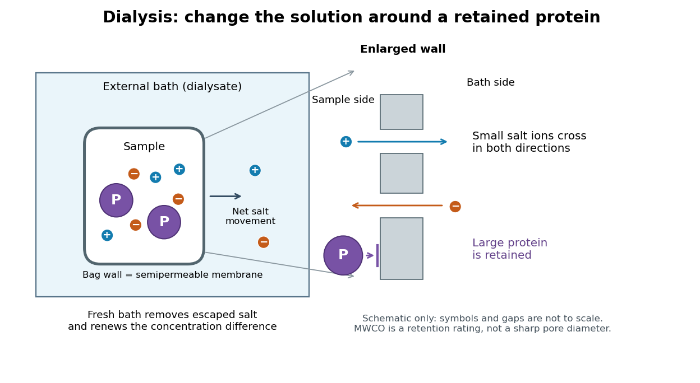
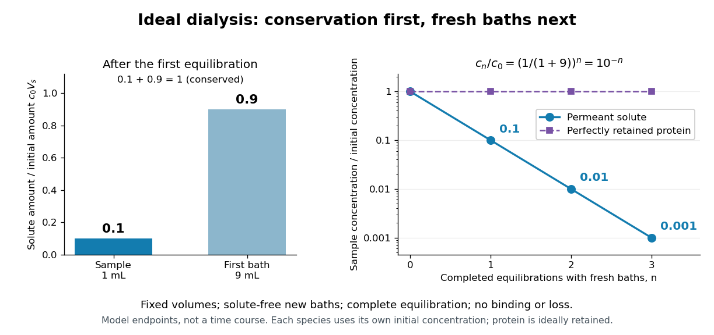
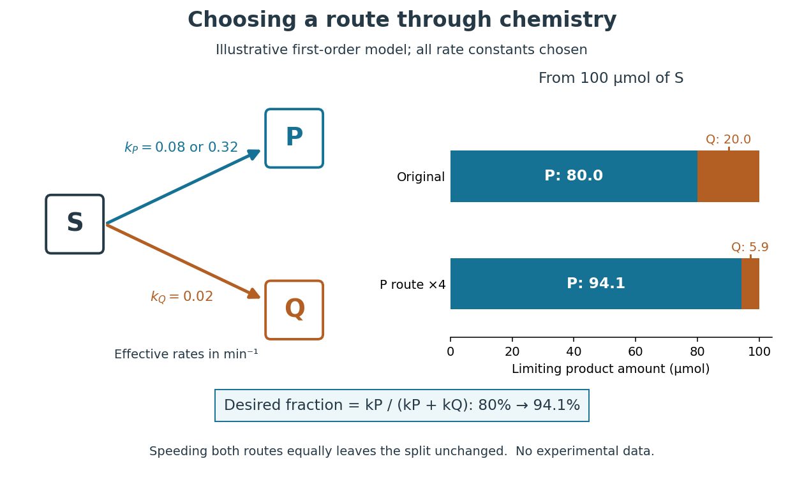
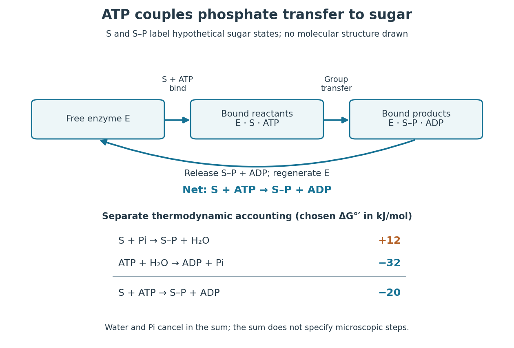
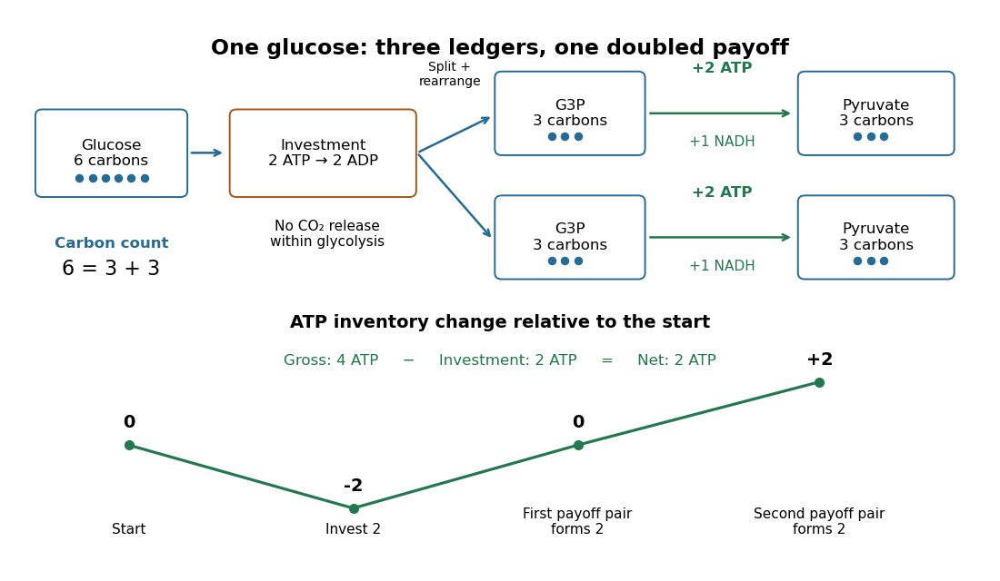
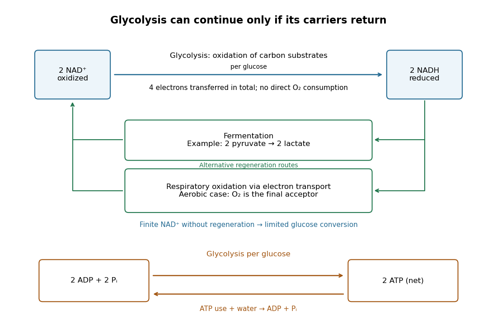
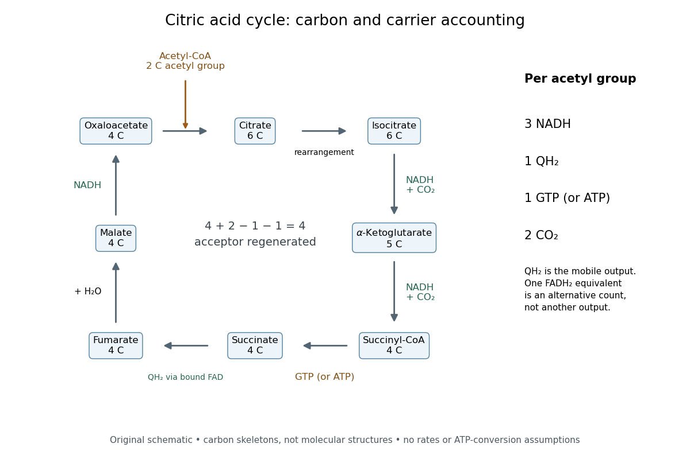
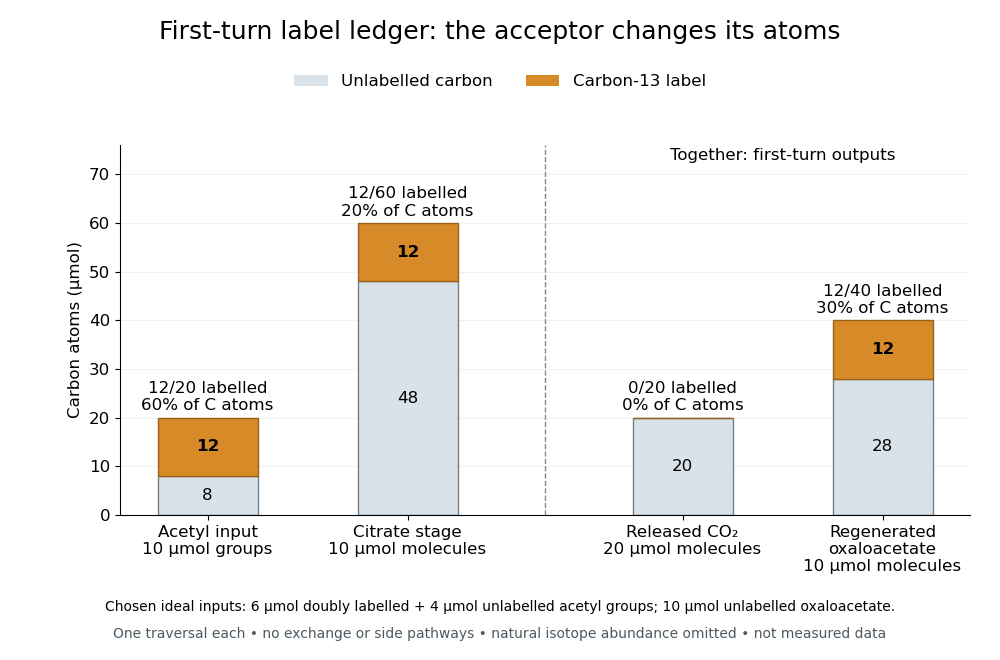
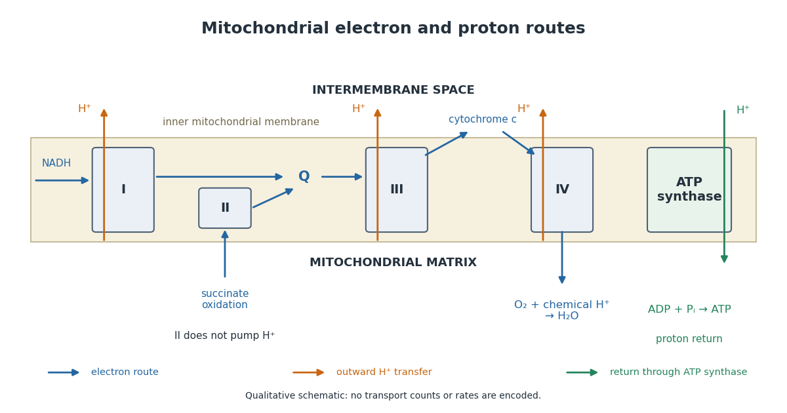

# Biochemistry

↑ **Parent:** [Chemistry](chemistry.md)  
ⓦ [Wiki](https://en.wikipedia.org/wiki/Biochemistry)

[Biochemistry](biochemistry.md) studies the [chemistry](chemistry.md) of living systems: what their [molecules](molecule.md) are, how they recognize one another, and how their [chemical reactions](chemical-reaction.md) support the organization of a [biological cell](biological-cell.md). It connects [biology](biology.md) to [chemical kinetics](chemical-kinetics.md), [stoichiometry](chemical-reaction.md#stoichiometry) and [thermodynamics](thermodynamics.md). A useful biochemical explanation follows both material and [energy](energy.md): which [substrate](enzyme.md#substrate-biochemistry) becomes which [reaction product](chemical-reaction.md#product-chemistry), what sets the [reaction rate](chemical-kinetics.md#reaction-rate), and how the transformation is driven.

Consider three connected examples. The [stereochemistry](stereochemistry.md) of a [sugar](chemical-substance.md#sugar) helps determine how it interacts with an [enzyme](enzyme.md)'s [active site](enzyme.md#active-site); the [molecular formula](chemical-substance.md#molecular-formula) alone cannot describe that recognition. Selective [enzymes](enzyme.md) then direct material through [metabolism](biology.md#metabolism), while [ATP](molecule.md#adenosine-triphosphate) can participate in [energy coupling](chemical-reaction.md#energy-coupling) that drives otherwise unfavourable transformations. These are different questions about the same working system, rather than three names for its [energy](energy.md) supply.[§12.7, Enzyme Structure and Function, Figure 12.25: substrate recognition and induced fit](chemistry-bibliography.md#chemistry-2e-by-paul-flowers-and-others)

This viewpoint is useful because it separates possible explanations for a stopped process. Missing [substrate](enzyme.md#substrate-biochemistry), inactive [enzyme](enzyme.md), depleted [ATP](molecule.md#adenosine-triphosphate) and accumulated [reaction product](chemical-reaction.md#product-chemistry) call for different interventions. Studying a [cell-free extract](#cell-free-extract) can isolate some of those causes while leaving a substantial [chemical reaction network](mathematical-biology.md#chemical-reaction-network) intact.

**Table of contents**

- [Metabolite](#metabolite)
  - [2-hydroxyglutarate](#2-hydroxyglutarate)
- [Haem biosynthesis](#haem-biosynthesis)
- [Metabolomics](#metabolomics)
  - [Pooled quality-control sample](#pooled-quality-control-sample)
- [Biomass pretreatment](#biomass-pretreatment)
- [Lipidomics](#lipidomics)
- [Proteomics](#proteomics)
  - [Spatial proteomics](#spatial-proteomics)
  - [Quantitative proteomics](#quantitative-proteomics)
    - [Label-free quantification](#label-free-quantification)
    - [Tandem mass tag](#tandem-mass-tag)
    - [Stable isotope labeling by amino acids in cell culture](#stable-isotope-labeling-by-amino-acids-in-cell-culture)
  - [Middle-down proteomics](#middle-down-proteomics)
  - [Top-down proteomics](#top-down-proteomics)
    - [Proteoform identification error](#proteoform-identification-error)
  - [Bottom-up proteomics](#bottom-up-proteomics)
  - [Proteoform](#proteoform)
- [Dialysis (biochemistry)](#dialysis-biochemistry)
  - [Dialysate](#dialysate)
  - [Molecular weight cut-off](#molecular-weight-cut-off)
  - [Buffer exchange](#buffer-exchange)
  - [Repeated-bath dialysis model](#repeated-bath-dialysis-model)
  - [Dialysis salt-removal and protein-retention experiments](#dialysis-salt-removal-and-protein-retention-experiments)
- [Selective biochemical reaction pathways](#selective-biochemical-reaction-pathways)
- [ATP-driven sugar phosphorylation](#atp-driven-sugar-phosphorylation)
- [Cell-free extract](#cell-free-extract)
  - [Cell-free fermentation as a biochemical experiment](#cell-free-fermentation-as-a-biochemical-experiment)
- [Metabolic pathway](#metabolic-pathway)
  - [Carbon-13 metabolic flux analysis](#carbon-13-metabolic-flux-analysis)
  - [Type II fatty acid synthesis](#type-ii-fatty-acid-synthesis)
  - [Isoprenoid precursor biosynthesis](#isoprenoid-precursor-biosynthesis)
  - [Acyl-CoA pool](#acyl-coa-pool)
  - [Metabolic flux](#metabolic-flux)
  - [Glycolysis](#glycolysis)
    - [Glycolysis carbon and ATP ledger](#glycolysis-carbon-and-atp-ledger)
    - [Glycolysis cofactor recycling](#glycolysis-cofactor-recycling)
    - [Coupled-enzyme readout of glycolytic ATP formation](#coupled-enzyme-readout-of-glycolytic-atp-formation)
  - [Citric acid cycle](#citric-acid-cycle)
    - [Glyoxylate shunt](#glyoxylate-shunt)
    - [Citric acid cycle carbon and carrier balance](#citric-acid-cycle-carbon-and-carrier-balance)
    - [Citric acid cycle first-turn carbon tracing](#citric-acid-cycle-first-turn-carbon-tracing)
    - [Pigeon breast muscle evidence for a metabolic cycle](#pigeon-breast-muscle-evidence-for-a-metabolic-cycle)
- [Energy metabolism](#energy-metabolism)
  - [Electron transport chain](#electron-transport-chain)
    - [Extracellular electron transfer](#extracellular-electron-transfer)
      - [Microbial nanowire](#microbial-nanowire)
      - [MtrCAB](#mtrcab)
    - [Plastocyanin](#plastocyanin)
    - [Plastoquinone](#plastoquinone)
    - [Cytochrome b6f complex](#cytochrome-b6f-complex)
    - [Mitochondrial respiratory chain](#mitochondrial-respiratory-chain)
      - [Respiratory complex I](#respiratory-complex-i)
      - [Succinate dehydrogenase](#succinate-dehydrogenase)
      - [Respiratory complex III](#respiratory-complex-iii)
      - [Cytochrome c oxidase](#cytochrome-c-oxidase)
    - [Electron carrier](#electron-carrier)
    - [Respiratory control](#respiratory-control)
      - [Mitochondrial oxygen electrode assay](#mitochondrial-oxygen-electrode-assay)
      - [Respiratory control ratio](#respiratory-control-ratio)
  - [Oxidative phosphorylation](#oxidative-phosphorylation)
    - [Proton leak](#proton-leak)
    - [Phosphorylation-to-oxidation ratio](#phosphorylation-to-oxidation-ratio)
    - [Chemiosmosis](#chemiosmosis)
    - [Respiratory uncoupling](#respiratory-uncoupling)
  - [Substrate-level phosphorylation](#substrate-level-phosphorylation)
- [Biochemist](#biochemist)
  - [List of biochemists](#list-of-biochemists)
    - [Annelise Sahin](#annelise-sahin)
      - [Work by Annelise Sahin](#work-by-annelise-sahin)
    - [Kathryn R. Ayscough](#kathryn-r-ayscough)
      - [Work by Kathryn R. Ayscough](#work-by-kathryn-r-ayscough)
    - [Julia Su Zhou Li](#julia-su-zhou-li)
      - [Work by Julia Su Zhou Li](#work-by-julia-su-zhou-li)
    - [Tina M. Avolio-Hunter](#tina-m-avolio-hunter)
      - [Work by Tina M. Avolio-Hunter](#work-by-tina-m-avolio-hunter)
    - [David S. Hong](#david-s-hong)
      - [Work by David S. Hong](#work-by-david-s-hong)
    - [Carla P. Concepcion](#carla-p-concepcion)
      - [Work by Carla P. Concepcion](#work-by-carla-p-concepcion)
    - [Lin He](#lin-he)
      - [Work by Lin He](#work-by-lin-he)
    - [Ulf Klein](#ulf-klein)
      - [Work by Ulf Klein](#work-by-ulf-klein)
    - [Manish S. Kumar](#manish-s-kumar)
      - [Work by Manish S. Kumar](#work-by-manish-s-kumar)
    - [Steven M. Johnson](#steven-m-johnson)
      - [Work by Steven M. Johnson](#work-by-steven-m-johnson)
    - [Justin L. Sparks](#justin-l-sparks)
      - [Work by Justin L. Sparks](#work-by-justin-l-sparks)
    - [Micheline Strand](#micheline-strand)
      - [Work by Micheline Strand](#work-by-micheline-strand)
    - [Nicoleta Constantin](#nicoleta-constantin)
      - [Work by Nicoleta Constantin](#work-by-nicoleta-constantin)
    - [Robert E. Goldsby](#robert-e-goldsby)
      - [Work by Robert E. Goldsby](#work-by-robert-e-goldsby)
    - [Uri Ben-David](#uri-ben-david)
      - [Work by Uri Ben-David](#work-by-uri-ben-david)
    - [Erica L. Jackson](#erica-l-jackson)
      - [Work by Erica L. Jackson](#work-by-erica-l-jackson)
    - [Lenny Dang](#lenny-dang)
      - [Work by Lenny Dang](#work-by-lenny-dang)
    - [Andrew J. Aguirre](#andrew-j-aguirre)
      - [Work by Andrew J. Aguirre](#work-by-andrew-j-aguirre)
    - [Stuart K. Archer](#stuart-k-archer)
      - [Work by Stuart K. Archer](#work-by-stuart-k-archer)
    - [Andrew C. Hsieh](#andrew-c-hsieh)
      - [Work by Andrew C. Hsieh](#work-by-andrew-c-hsieh)
    - [Sooncheol Lee](#sooncheol-lee)
      - [Work by Sooncheol Lee](#work-by-sooncheol-lee)
    - [Nicholas T. Ingolia](#nicholas-t-ingolia)
      - [Work by Nicholas T. Ingolia](#work-by-nicholas-t-ingolia)
    - [Bas van Steensel](#bas-van-steensel)
      - [Work by Bas van Steensel](#work-by-bas-van-steensel)
    - [Suhas S. P. Rao](#suhas-s-p-rao)
      - [Work by Suhas S. P. Rao](#work-by-suhas-s-p-rao)
    - [Horng D. Ou](#horng-d-ou)
      - [Work by Horng D. Ou](#work-by-horng-d-ou)
    - [Jason D. Buenrostro](#jason-d-buenrostro)
      - [Work by Jason D. Buenrostro](#work-by-jason-d-buenrostro)
    - [Karolin Luger](#karolin-luger)
      - [Work by Karolin Luger](#work-by-karolin-luger)
    - [Nancy Kedersha](#nancy-kedersha)
      - [Work by Nancy Kedersha](#work-by-nancy-kedersha)
    - [Daniel Mateju](#daniel-mateju)
      - [Work by Daniel Mateju](#work-by-daniel-mateju)
    - [Miriam Llorian](#miriam-llorian)
      - [Work by Miriam Llorian](#work-by-miriam-llorian)
    - [Rajan Lamichhane](#rajan-lamichhane)
      - [Work by Rajan Lamichhane](#work-by-rajan-lamichhane)
    - [Florian C. Oberstrass](#florian-c-oberstrass)
      - [Work by Florian C. Oberstrass](#work-by-florian-c-oberstrass)
    - [María José Lallena](#maria-jose-lallena)
      - [Work by María José Lallena](#work-by-maria-jose-lallena)
    - [Juan Valcárcel](#juan-valcarcel)
      - [Work by Juan Valcárcel](#work-by-juan-valcarcel)
    - [Thomas Dandekar](#thomas-dandekar)
      - [Work by Thomas Dandekar](#work-by-thomas-dandekar)
    - [Sergi Puig](#sergi-puig)
      - [Work by Sergi Puig](#work-by-sergi-puig)
    - [John L. Casey](#john-l-casey)
      - [Work by John L. Casey](#work-by-john-l-casey)
    - [Matthias W. Hentze](#matthias-w-hentze)
      - [Work by Matthias W. Hentze](#work-by-matthias-w-hentze)
    - [Ameen A. Salahudeen](#ameen-a-salahudeen)
      - [Work by Ameen A. Salahudeen](#work-by-ameen-a-salahudeen)
    - [David J. Haile](#david-j-haile)
      - [Work by David J. Haile](#work-by-david-j-haile)
    - [Orly L. Wapinski](#orly-l-wapinski)
      - [Work by Orly L. Wapinski](#work-by-orly-l-wapinski)
    - [Peter J. Skene](#peter-j-skene)
      - [Work by Peter J. Skene](#work-by-peter-j-skene)
    - [Thomas Vierbuchen](#thomas-vierbuchen)
      - [Work by Thomas Vierbuchen](#work-by-thomas-vierbuchen)
    - [Joerg E. Braun](#joerg-e-braun)
      - [Work by Joerg E. Braun](#work-by-joerg-e-braun)
    - [Jens Lykke-Andersen](#jens-lykke-andersen)
      - [Work by Jens Lykke-Andersen](#work-by-jens-lykke-andersen)
    - [Jeffery M. Coller](#jeffery-m-coller)
      - [Work by Jeffery M. Coller](#work-by-jeffery-m-coller)
    - [Athina Lymboussaki](#athina-lymboussaki)
      - [Work by Athina Lymboussaki](#work-by-athina-lymboussaki)
    - [Willem P. C. Stemmer](#willem-p-c-stemmer)
      - [Work by Willem P. C. Stemmer](#work-by-willem-p-c-stemmer)
    - [Bernhard Virnekas](#bernhard-virnekas)
      - [Work by Bernhard Virnekas](#work-by-bernhard-virnekas)
    - [R. Craig Cadwell](#r-craig-cadwell)
      - [Work by R. Craig Cadwell](#work-by-r-craig-cadwell)
    - [Gira Bhabha](#gira-bhabha)
      - [Work by Gira Bhabha](#work-by-gira-bhabha)
    - [Elan Z. Eisenmesser](#elan-z-eisenmesser)
      - [Work by Elan Z. Eisenmesser](#work-by-elan-z-eisenmesser)
    - [Loren B. Andreas](#loren-b-andreas)
      - [Work by Loren B. Andreas](#work-by-loren-b-andreas)
    - [Franz Hagn](#franz-hagn)
      - [Work by Franz Hagn](#work-by-franz-hagn)
    - [Konstantin Pervushin](#konstantin-pervushin)
      - [Work by Konstantin Pervushin](#work-by-konstantin-pervushin)
    - [Susanne Ude](#susanne-ude)
      - [Work by Susanne Ude](#work-by-susanne-ude)
    - [Lili K. Doerfel](#lili-k-doerfel)
      - [Work by Lili K. Doerfel](#work-by-lili-k-doerfel)
    - [John C. Tran](#john-c-tran)
      - [Work by John C. Tran](#work-by-john-c-tran)
    - [Pilong Li](#pilong-li)
      - [Work by Pilong Li](#work-by-pilong-li)
    - [Piers Nash](#piers-nash)
      - [Work by Piers Nash](#work-by-piers-nash)
    - [Alexander Gillis](#alexander-gillis)
      - [Work by Alexander Gillis](#work-by-alexander-gillis)
    - [Scott M. DeWire](#scott-m-dewire)
      - [Work by Scott M. DeWire](#work-by-scott-m-dewire)
    - [Jude Canon](#jude-canon)
      - [Work by Jude Canon](#work-by-jude-canon)
    - [Akiyuki Nishimura](#akiyuki-nishimura)
      - [Work by Akiyuki Nishimura](#work-by-akiyuki-nishimura)
    - [Gerald F. Joyce](#gerald-f-joyce)
      - [Work by Gerald F. Joyce](#work-by-gerald-f-joyce)
    - [Anders Omsland](#anders-omsland)
      - [Work by Anders Omsland](#work-by-anders-omsland)
    - [Shuji Shigenobu](#shuji-shigenobu)
      - [Work by Shuji Shigenobu](#work-by-shuji-shigenobu)
    - [Cat M. Haglund](#cat-m-haglund)
      - [Work by Cat M. Haglund](#work-by-cat-m-haglund)
    - [Siv G. E. Andersson](#siv-g-e-andersson)
      - [Work by Siv G. E. Andersson](#work-by-siv-g-e-andersson)
    - [Richard S. Stephens](#richard-s-stephens)
      - [Work by Richard S. Stephens](#work-by-richard-s-stephens)
    - [Yujue Wang](#yujue-wang)
      - [Work by Yujue Wang](#work-by-yujue-wang)
    - [Stephen K. Dolan](#stephen-k-dolan)
      - [Work by Stephen K. Dolan](#work-by-stephen-k-dolan)
    - [Audrey Crousilles](#audrey-crousilles)
      - [Work by Audrey Crousilles](#work-by-audrey-crousilles)
    - [Waldan K. Kwong](#waldan-k-kwong)
      - [Work by Waldan K. Kwong](#work-by-waldan-k-kwong)
    - [Mitchell S. Abrahamsen](#mitchell-s-abrahamsen)
      - [Work by Mitchell S. Abrahamsen](#work-by-mitchell-s-abrahamsen)
    - [Ellen Yeh](#ellen-yeh)
      - [Work by Ellen Yeh](#work-by-ellen-yeh)
    - [Robert B. Moore](#robert-b-moore)
      - [Work by Robert B. Moore](#work-by-robert-b-moore)
    - [Tomi K. Baikie](#tomi-k-baikie)
      - [Work by Tomi K. Baikie](#work-by-tomi-k-baikie)
    - [Laura T. Wey](#laura-t-wey)
      - [Work by Laura T. Wey](#work-by-laura-t-wey)
    - [Yaniv Shlosberg](#yaniv-shlosberg)
      - [Work by Yaniv Shlosberg](#work-by-yaniv-shlosberg)
    - [Shi-You Ding](#shi-you-ding)
      - [Work by Shi-You Ding](#work-by-shi-you-ding)
    - [Bastien Bissaro](#bastien-bissaro)
      - [Work by Bastien Bissaro](#work-by-bastien-bissaro)
    - [William T. Beeson](#william-t-beeson)
      - [Work by William T. Beeson](#work-by-william-t-beeson)
    - [Noemí Ruiz-López](#noemi-ruiz-lopez)
      - [Work by Noemí Ruiz-López](#work-by-noemi-ruiz-lopez)
    - [Amine Abbadi](#amine-abbadi)
      - [Work by Amine Abbadi](#work-by-amine-abbadi)
    - [Baoxiu Qi](#baoxiu-qi)
      - [Work by Baoxiu Qi](#work-by-baoxiu-qi)
    - [Jonathan R. Friedman](#jonathan-r-friedman)
      - [Work by Jonathan R. Friedman](#work-by-jonathan-r-friedman)
    - [Rieko Kojima](#rieko-kojima)
      - [Work by Rieko Kojima](#work-by-rieko-kojima)
    - [Benoît Kornmann](#benoit-kornmann)
      - [Work by Benoît Kornmann](#work-by-benoit-kornmann)
    - [Yusuke Hirabayashi](#yusuke-hirabayashi)
      - [Work by Yusuke Hirabayashi](#work-by-yusuke-hirabayashi)
    - [Rosario Rizzuto](#rosario-rizzuto)
      - [Work by Rosario Rizzuto](#work-by-rosario-rizzuto)
    - [Jacob L. W. Morgan](#jacob-l-w-morgan)
      - [Work by Jacob L. W. Morgan](#work-by-jacob-l-w-morgan)
    - [Hiroaki Segawa](#hiroaki-segawa)
      - [Work by Hiroaki Segawa](#work-by-hiroaki-segawa)
    - [Christian Lizak](#christian-lizak)
      - [Work by Christian Lizak](#work-by-christian-lizak)
    - [R. Caputto](#r-caputto)
      - [Work by R. Caputto](#work-by-r-caputto)
    - [Kota Saito](#kota-saito)
      - [Work by Kota Saito](#work-by-kota-saito)
    - [Elizabeth A. Miller](#elizabeth-a-miller)
      - [Work by Elizabeth A. Miller](#work-by-elizabeth-a-miller)
    - [Joshua Hutchings](#joshua-hutchings)
      - [Work by Joshua Hutchings](#work-by-joshua-hutchings)
    - [Marcus C. S. Lee](#marcus-c-s-lee)
      - [Work by Marcus C. S. Lee](#work-by-marcus-c-s-lee)
    - [Kandice R. Levental](#kandice-r-levental)
      - [Work by Kandice R. Levental](#work-by-kandice-r-levental)
    - [Sirio Dupont](#sirio-dupont)
      - [Work by Sirio Dupont](#work-by-sirio-dupont)
    - [Rowena McBeath](#rowena-mcbeath)
      - [Work by Rowena McBeath](#work-by-rowena-mcbeath)
    - [Armando del Rio](#armando-del-rio)
      - [Work by Armando del Rio](#work-by-armando-del-rio)
    - [Kangmin He](#kangmin-he)
      - [Work by Kangmin He](#work-by-kangmin-he)
    - [York Posor](#york-posor)
      - [Work by York Posor](#work-by-york-posor)
    - [Ottavio Cremona](#ottavio-cremona)
      - [Work by Ottavio Cremona](#work-by-ottavio-cremona)
    - [Roberto Zoncu](#roberto-zoncu)
      - [Work by Roberto Zoncu](#work-by-roberto-zoncu)
    - [Yasuko Murakami](#yasuko-murakami)
      - [Work by Yasuko Murakami](#work-by-yasuko-murakami)
    - [Ken Matsuoka](#ken-matsuoka)
      - [Work by Ken Matsuoka](#work-by-ken-matsuoka)
    - [Michael Sinensky](#michael-sinensky)
      - [Work by Michael Sinensky](#work-by-michael-sinensky)
    - [David D. Boehr](#david-d-boehr)
      - [Work by David D. Boehr](#work-by-david-d-boehr)
    - [Tess C. Branon](#tess-c-branon)
      - [Work by Tess C. Branon](#work-by-tess-c-branon)
    - [Marco Y. Hein](#marco-y-hein)
      - [Work by Marco Y. Hein](#work-by-marco-y-hein)
    - [M. J. Solomon](#m-j-solomon)
      - [Work by M. J. Solomon](#work-by-m-j-solomon)
    - [T. Lee](#t-lee)
      - [Work by T. Lee](#work-by-t-lee)
    - [P. C. Sternweis](#p-c-sternweis)
      - [Work by P. C. Sternweis](#work-by-p-c-sternweis)
    - [J. K. Northup](#j-k-northup)
      - [Work by J. K. Northup](#work-by-j-k-northup)
    - [M. D. Smigel](#m-d-smigel)
      - [Work by M. D. Smigel](#work-by-m-d-smigel)
    - [Alfred G. Gilman](#alfred-g-gilman)
      - [Work by Alfred G. Gilman](#work-by-alfred-g-gilman)
    - [Donal A. Walsh](#donal-a-walsh)
      - [Work by Donal A. Walsh](#work-by-donal-a-walsh)
    - [John P. Perkins](#john-p-perkins)
      - [Work by John P. Perkins](#work-by-john-p-perkins)
    - [Edwin G. Krebs](#edwin-g-krebs)
      - [Work by Edwin G. Krebs](#work-by-edwin-g-krebs)
    - [R. F. Irvine](#r-f-irvine)
      - [Work by R. F. Irvine](#work-by-r-f-irvine)
    - [Eduard Buchner](#eduard-buchner)
      - [Work by Eduard Buchner](#work-by-eduard-buchner)
    - [Kary Mullis](#kary-mullis)
      - [Work by Kary Mullis](#work-by-kary-mullis)
    - [Saurabh Upadhyay](#saurabh-upadhyay)
      - [Work by Saurabh Upadhyay](#work-by-saurabh-upadhyay)
    - [Rodney Robert Porter](#rodney-robert-porter)
      - [Work by Rodney Robert Porter](#work-by-rodney-robert-porter)
    - [Marshall Warren Nirenberg](#marshall-warren-nirenberg)
      - [Work by Marshall Warren Nirenberg](#work-by-marshall-warren-nirenberg)
    - [J. Heinrich Matthaei](#j-heinrich-matthaei)
      - [Work by J. Heinrich Matthaei](#work-by-j-heinrich-matthaei)
    - [Britton Chance](#britton-chance)
      - [Work by Britton Chance](#work-by-britton-chance)
    - [G. R. Williams](#g-r-williams)
      - [Work by G. R. Williams](#work-by-g-r-williams)
    - [Colin Dingwall](#colin-dingwall)
      - [Work by Colin Dingwall](#work-by-colin-dingwall)
    - [Frederick Sanger](#frederick-sanger)
      - [Work by Frederick Sanger](#work-by-frederick-sanger)
    - [Robin Hill (biochemist)](#robin-hill-biochemist)
      - [Work by Robin Hill](#work-by-robin-hill)
    - [Christian de Duve](#christian-de-duve)
      - [Work by Christian de Duve](#work-by-christian-de-duve)
    - [Jacques Berthet](#jacques-berthet)
      - [Work by Jacques Berthet](#work-by-jacques-berthet)
    - [Hans Adolf Krebs](#hans-adolf-krebs)
      - [Work by Hans Adolf Krebs](#work-by-hans-adolf-krebs)
    - [George Chaconas](#george-chaconas)
      - [Work by George Chaconas](#work-by-george-chaconas)
    - [Masasuke Yoshida](#masasuke-yoshida)
      - [Work by Masasuke Yoshida](#work-by-masasuke-yoshida)
    - [Toshiharu Suzuki](#toshiharu-suzuki)
      - [Work by Toshiharu Suzuki](#work-by-toshiharu-suzuki)
    - [Mizuki Sekiya](#mizuki-sekiya)
      - [Work by Mizuki Sekiya](#work-by-mizuki-sekiya)
    - [Mayumi Nakanishi-Matsui](#mayumi-nakanishi-matsui)
      - [Work by Mayumi Nakanishi-Matsui](#work-by-mayumi-nakanishi-matsui)
    - [Masamitsu Futai](#masamitsu-futai)
      - [Work by Masamitsu Futai](#work-by-masamitsu-futai)
- [Proteolysis](#proteolysis)
  - [Degron](#degron)
    - [Phosphodegron](#phosphodegron)
- [Peptide mapping](#peptide-mapping)
- [Glycosylation](#glycosylation)
  - [Protein glycosylation](#protein-glycosylation)
    - [O-linked glycosylation](#o-linked-glycosylation)
    - [N-linked glycosylation](#n-linked-glycosylation)

## Metabolite

↑ **Parent:** [Biochemistry](biochemistry.md)

### 2-hydroxyglutarate

↑ **Parent:** [Metabolite](#metabolite)

A hydroxyglutarate [metabolite](#metabolite) whose enantiomer and source matter. The R form accumulates after the neomorphic reaction of certain cancer-associated [IDH1](enzyme.md#idh1) mutants.

## Haem biosynthesis

↑ **Parent:** [Biochemistry](biochemistry.md)

## Metabolomics

↑ **Parent:** [Biochemistry](biochemistry.md)

### Pooled quality-control sample

↑ **Parent:** [Metabolomics](#metabolomics)

## Biomass pretreatment

↑ **Parent:** [Biochemistry](biochemistry.md)

[biomass pretreatment](#biomass-pretreatment) changes a feedstock before subsequent conversion, often to improve [enzyme](enzyme.md) access. Increased accessibility must be balanced against sugar loss, inhibitor formation, energy cost and altered [enzyme](enzyme.md) adsorption.

## Lipidomics

↑ **Parent:** [Biochemistry](biochemistry.md)

[lipidomics](#lipidomics) measures the identities and relative or absolute amounts of [lipids](chemical-substance.md#lipid) in a sample. Extraction, standards, response factors and isomer discrimination constrain inference; bulk composition alone does not determine leaflet distribution or local membrane properties.

## Proteomics

↑ **Parent:** [Biochemistry](biochemistry.md)

[proteomics](#proteomics) studies the identities, amounts, modifications and associations of [proteins](protein.md) in biological material. Measurements depend on extraction, detectability and reference condition; absence of a detected [peptide](protein.md#peptide) is not proof that its [protein](protein.md) is absent.

### Spatial proteomics

↑ **Parent:** [Proteomics](#proteomics)

Proteome-scale assignment of proteins to cellular locations using fractionation profiles, localization labeling and complementary imaging.

### Quantitative proteomics

↑ **Parent:** [Proteomics](#proteomics)

#### Label-free quantification

↑ **Parent:** [Quantitative proteomics](#quantitative-proteomics)

#### Tandem mass tag

↑ **Parent:** [Quantitative proteomics](#quantitative-proteomics)

#### Stable isotope labeling by amino acids in cell culture

↑ **Parent:** [Quantitative proteomics](#quantitative-proteomics)

### Middle-down proteomics

↑ **Parent:** [Proteomics](#proteomics)

Analysis of relatively large [protein](protein.md) fragments to preserve linkage between sequence changes or modifications that separate into different [peptides](protein.md#peptide) in [bottom-up proteomics](#bottom-up-proteomics). It generally preserves less complete linkage than intact-chain analysis.

### Top-down proteomics

↑ **Parent:** [Proteomics](#proteomics)

Analysis of intact [protein](protein.md) ions and their sequence fragments to characterize [proteoforms](#proteoform). Intact mass constrains composition, while informative fragmentation is needed to locate changes and resolve many isomeric forms.

#### Proteoform identification error

↑ **Parent:** [Top-down proteomics](#top-down-proteomics)

An error in assigning a complete molecular form. Controlling peptide-level identification error does not automatically control errors in intact-form identity or modification linkage.

### Bottom-up proteomics

↑ **Parent:** [Proteomics](#proteomics)

Analysis of [proteins](protein.md) after digestion into smaller [peptides](protein.md#peptide). It can provide broad sequence and modification coverage, but digestion commonly loses information about which distant variations occur together in an intact [proteoform](#proteoform).

### Proteoform

↑ **Parent:** [Proteomics](#proteomics)

A molecular form of a [protein](protein.md) defined by its [amino-acid](chemical-substance.md#amino-acid) sequence and covalent modifications, including processing. Different conformations and mass-spectrometric charge states do not by themselves define different [proteoforms](#proteoform).

## Dialysis (biochemistry)

↑ **Parent:** [Biochemistry](biochemistry.md)  
ⓦ [Wiki](https://en.wikipedia.org/wiki/Dialysis_(biochemistry))

[Dialysis](#dialysis-biochemistry) exchanges small [solutes](mixture.md#solute) between a sample and an external bath through a [semipermeable membrane](cell-membrane.md#semipermeable-membrane), while retaining suitably large [macromolecules](molecule.md#macromolecule), such as [proteins](protein.md). The transport is passive [diffusion](thermodynamics.md#diffusion): random motion carries permeant [molecules](molecule.md) both ways, with net transport down their [concentration](mathematical-physics.md#concentration) [gradient](multivariable-calculus.md#gradient). The bath is the [dialysate](#dialysate). At equal permeant [solute](mixture.md#solute) [concentrations](mathematical-physics.md#concentration), microscopic exchange continues but net exchange stops.[Dialysis: an overview, Tech Tip 20, p. 1, Dialysis is Diffusion Through a Semi-Permeable Membrane](biology-bibliography.md#dialysis-an-overview-pierce-biotechnology-technical-note)

For example, a [protein](protein.md) sample containing excess [sodium chloride](chemical-substance.md#sodium-chloride) can lose the small [ions](chemistry.md#ion) to a low-[salt](ionic-bonding.md#salt-chemistry) [dialysate](#dialysate) without deliberately transferring the [protein](protein.md). Conversely, components of a new [buffer solution](acid-base-chemistry.md#buffer-solution) can enter from the bath. This is useful before studying [enzyme kinetics](mathematical-biology.md#enzyme-kinetics): changing the surrounding [chemical solution](mixture.md#solution-chemistry) can remove an interfering small [solute](mixture.md#solute) while keeping the [enzyme](enzyme.md) available for the next experiment.

**[Figure 1](#image-small-salt-ions-exchange-across-a-semipermeable-membrane-while-a-protein-is-retained). Small salt ions exchange across a semipermeable membrane while a protein is retained**. Original schematic of a sample bag immersed in a [dialysate](#dialysate), with an enlarged membrane region. Arrows indicate exchange in both directions and an initially outward net [diffusive flux](mathematical-physics.md#diffusive-flux). Symbols and openings are not to scale; the drawn gap is not a literal [molecular weight cut-off](#molecular-weight-cut-off) measurement. Replacing the bath removes escaped [salt](ionic-bonding.md#salt-chemistry) and renews the [concentration](mathematical-physics.md#concentration) [gradient](multivariable-calculus.md#gradient).

The striking feature is that the retained [protein](protein.md) does not have to be captured and released again to change its surroundings. However, retention is conditional on the [semipermeable membrane](cell-membrane.md#semipermeable-membrane) and the particular [macromolecule](molecule.md#macromolecule), and [dialysis](#dialysis-biochemistry) is poorly suited to separating [proteins](protein.md) of nearly the same size. The [molecular weight cut-off](#molecular-weight-cut-off) is a nominal retention rating, not a sharp geometrical boundary.

### Dialysate

↑ **Parent:** [Dialysis (biochemistry)](#dialysis-biochemistry)

The external [chemical solution](mixture.md#solution-chemistry) on the other side of a [dialysis](#dialysis-biochemistry) [semipermeable membrane](cell-membrane.md#semipermeable-membrane). Its composition supplies the boundary condition for exchange: it can receive unwanted small [solutes](mixture.md#solute) or supply desired small [solutes](mixture.md#solute). A bath replacement discards the old [dialysate](#dialysate) and introduces a new reservoir with a specified composition.

### Molecular weight cut-off

↑ **Parent:** [Dialysis (biochemistry)](#dialysis-biochemistry)

The [molecular weight cut-off](#molecular-weight-cut-off) rates retention of reference [molecules](molecule.md). One manufacturer's definition uses the [mass](classical-mechanics.md#mass) at which approximately $90\%$ remains after seventeen-hour [dialysis](#dialysis-biochemistry), tested with globular [proteins](protein.md). A $10\,\mathrm{kDa}$ rating uses [dalton](chemical-substance.md#dalton-unit) units: a [mass](classical-mechanics.md#mass), not a length or an absolute passage threshold.[Tech Tip 20, p. 1, Factors Affecting Dialysis Rate: MWCO definition and globular reference molecules](biology-bibliography.md#dialysis-an-overview-pierce-biotechnology-technical-note)

A [semipermeable membrane](cell-membrane.md#semipermeable-membrane) has a distribution of passage sizes, and a [molecule](molecule.md)'s shape affects passage as well as its [mass](classical-mechanics.md#mass). Near the nominal [MWCO](#molecular-weight-cut-off), slow passage can make substantial retention compatible with eventual leakage. The [protein](protein.md)-retention experiment below makes retention an observable quantity rather than a universal yes-or-no property inferred from the label.

### Buffer exchange

↑ **Parent:** [Dialysis (biochemistry)](#dialysis-biochemistry)

[Buffer exchange](#buffer-exchange) changes the small components surrounding a retained [macromolecule](molecule.md#macromolecule) toward those of a desired [buffer solution](acid-base-chemistry.md#buffer-solution). Components absent from fresh [dialysate](#dialysate) tend to leave; supplied components can enter. Each permeant [solute](mixture.md#solute) has its own exchange problem.[Tech Tip 20, pp. 1-2, renewed gradients and Other Factors in Dialysis](biology-bibliography.md#dialysis-an-overview-pierce-biotechnology-technical-note)

For a dilute, nonbinding permeant [solute](mixture.md#solute), an ideal equilibrium calculation approaches the bath's specified [concentration](mathematical-physics.md#concentration). That approximation need not describe a [solute](mixture.md#solute) bound to a [protein](protein.md) or a charged mixture with additional electrical constraints. Retaining a [protein](protein.md) also does not by itself establish that its [protein structure](protein.md#protein-structure) or catalytic function survives the change of [buffer solution](acid-base-chemistry.md#buffer-solution).

### Repeated-bath dialysis model

↑ **Parent:** [Dialysis (biochemistry)](#dialysis-biochemistry)

Consider an original ideal model with sample [volume](thermodynamics.md#volume-thermodynamics) $V_s$, bath [volume](thermodynamics.md#volume-thermodynamics) $V_b$, and initial sample [solute](mixture.md#solute) [concentration](mathematical-physics.md#concentration) $c_0$. Assume each [volume](thermodynamics.md#volume-thermodynamics) is fixed, a freely permeant, nonbinding [solute](mixture.md#solute), no [chemical reactions](chemical-reaction.md), complete mixing on each side, and equal [concentrations](mathematical-physics.md#concentration) at equilibrium. Each fresh bath initially contains none of this [solute](mixture.md#solute). The [protein](protein.md) is perfectly retained in this model.

The first equilibration redistributes the initial [amount of substance](physics.md#amount-of-substance) $c_0V_s$ through both compartments. Conservation gives

$$
c_0V_s=c_1(V_s+V_b),\qquad
c_1=c_0\frac{V_s}{V_s+V_b}.
$$

This denominator includes the sample itself. For the chosen $V_s=1\,\mathrm{mL}$ and $V_b=9\,\mathrm{mL}$, $c_1/c_0=1/10$, rather than $1/9$. Nine-tenths of the initial [solute](mixture.md#solute) is in the bath and one-tenth remains in the sample; nothing has vanished during equilibration.

Discarding the equilibrated bath removes its [solute](mixture.md#solute). A second fresh bath starts with only $c_1V_s$ of [solute](mixture.md#solute) in the entire system, so the same argument applies again. Induction gives the [geometric progression](sequence-and-series.md#geometric-progression)

$$
q=\frac{V_s}{V_s+V_b},\qquad
c_n=q c_{n-1}=c_0q^n,\qquad
\frac{c_n}{c_0}=10^{-n}\quad(V_s=1,\ V_b=9).
$$

Here $n$ counts completed equilibrations with fresh baths: $n=1$ is the first bath, $n=2$ follows one replacement, and $n=3$ follows two replacements. The normalized sample [concentrations](mathematical-physics.md#concentration) are respectively $0.1$, $0.01$ and $0.001$. Leaving the first bath in place for longer cannot lower the ideal equilibrium value below $0.1$.

**[Figure 2](#image-repeated-fresh-baths-reduce-normalized-solute-concentration-geometrically). Repeated fresh baths reduce normalized solute concentration geometrically**. Original fixed-[volume](thermodynamics.md#volume-thermodynamics) model, not experimental data. The left panel normalizes the first bath's conserved [amount of substance](physics.md#amount-of-substance) by $c_0V_s$, distinguishing the sample's $0.1$ share from the bath's $0.9$ share. The right panel plots sample [solute](mixture.md#solute) [concentration](mathematical-physics.md#concentration) divided by $c_0$ after each completed fresh-bath equilibration on a logarithmic vertical axis. The [protein](protein.md) curve is normalized independently by its own initial [concentration](mathematical-physics.md#concentration). The perfectly retained [protein](protein.md) stays at normalized [concentration](mathematical-physics.md#concentration) one only because its [amount of substance](physics.md#amount-of-substance) and the sample [volume](thermodynamics.md#volume-thermodynamics) are fixed.

The same conservation argument handles a fresh bath already containing a permeant [solute](mixture.md#solute) at fixed [concentration](mathematical-physics.md#concentration) $b$:

$$
c_n=\frac{V_sc_{n-1}+V_bb}{V_s+V_b},\qquad
c_n-b=q(c_{n-1}-b),\qquad
c_n=b+(c_0-b)q^n.
$$

Thus the sample approaches $b$, not necessarily zero. For example, if a hypothetical new buffer component starts at zero in the sample and at $b$ in every bath, its sample [concentration](mathematical-physics.md#concentration) reaches $0.9b$, $0.99b$ and $0.999b$ in the three equilibrations. Outward removal and inward replacement follow the same mathematics.

Equilibrium fractions do not specify elapsed time. An illustrative well-mixed [linear ordinary differential equation](linear-ordinary-differential-equation.md) model within one bath is

$$
V_s\frac{dc_s}{dt}=-K(c_s-c_b),\qquad
V_b\frac{dc_b}{dt}=K(c_s-c_b),\qquad K>0.
$$

Here $K$ is an effective transfer coefficient with units of [volume](thermodynamics.md#volume-thermodynamics) per time. Adding the two equations conserves $V_sc_s+V_bc_b$; subtracting their normalized forms gives

$$
\frac{d(c_s-c_b)}{dt}=-K\left(\frac1{V_s}+\frac1{V_b}\right)(c_s-c_b).
$$

The difference undergoes [exponential decay](analysis.md#exponential-decay). A bath replacement resets $c_b$, renewing the driving difference without making $c_s$ jump instantly. The plotted points are equilibrium endpoints, not a measured time course or a timetable for an arbitrary [protein](protein.md).

Real sample [volume](thermodynamics.md#volume-thermodynamics) can change through [osmosis](cell-membrane.md#osmosis); [proteins](protein.md) can be lost through leakage or [adsorption](physical-chemistry.md#adsorption) to the [semipermeable membrane](cell-membrane.md#semipermeable-membrane). Consequently, a measured decrease in [protein](protein.md) [concentration](mathematical-physics.md#concentration) alone cannot distinguish dilution from loss of [protein](protein.md). Measuring recovered [volume](thermodynamics.md#volume-thermodynamics) as well as [protein](protein.md) [concentration](mathematical-physics.md#concentration) permits an estimate of recovered [protein](protein.md) [mass](classical-mechanics.md#mass).[Tech Tip 20, p. 2, Other Factors in Dialysis: water transport, volume change and nonspecific membrane binding](biology-bibliography.md#dialysis-an-overview-pierce-biotechnology-technical-note)

### Dialysis salt-removal and protein-retention experiments

↑ **Parent:** [Dialysis (biochemistry)](#dialysis-biochemistry)

The manufacturer-issued Protein Preparation Handbook reports a paired [dialysis](#dialysis-biochemistry) comparison: $2\,\mathrm{mL}$ of [bovine serum albumin](protein.md#bovine-serum-albumin), $0.25\,\mathrm{mg/mL}$ in $1\,\mathrm M$ [sodium chloride](chemical-substance.md#sodium-chloride), was held behind a $10\,\mathrm{kDa}$ [MWCO](#molecular-weight-cut-off) membrane against $45\,\mathrm{mL}$ of [water](chemical-substance.md#water) in a conical tube, shaken at room [temperature](temperature.md). The bath was replaced after two hours. A conventional stirred-beaker treatment against $2\,\mathrm L$ of [water](chemical-substance.md#water) supplied the comparison control. Residual [salt](ionic-bonding.md#salt-chemistry) was followed by sample [electrical conductivity](electric-charge.md#electrical-conductivity); results averaged two samples. This readout tests small-[ion](chemistry.md#ion) removal, not [protein](protein.md) retention.[Protein Preparation Handbook, printed p. 11, Figure 9A and caption: sample preparation, 10K membrane, baths, conductivity and conventional-dialysis reference](biology-bibliography.md#protein-preparation-handbook-thermo-fisher-scientific)

Its separate retention experiment used individual [proteins](protein.md) at $1\,\mathrm{mg/mL}$ in saline or carbonate-bicarbonate [buffer solution](acid-base-chemistry.md#buffer-solution), [pH](acid-base-chemistry.md#ph) $9.4$, with membranes rated $2$, $3.5$, $7$, $10$ and $20\,\mathrm{kDa}$. After seventeen hours at $4\,\mathrm{{}^{\circ}C}$, retained [protein](protein.md) was estimated by a [bicinchoninic acid assay](chemistry.md#bicinchoninic-acid-assay). The size series and membrane series compare retention; they do not isolate shape independently of [mass](classical-mechanics.md#mass). The figure caption supplies neither a no-membrane recovery control nor a complete uncertainty analysis. These are manufacturer comparisons, not proof of universal recovery or unchanged [enzyme](enzyme.md) function.[Protein Preparation Handbook, printed p. 11, Figure 8 and caption: membrane series, preparation, duration, temperature and protein assay; the separately plotted vitamin B12 uses a different optical readout](biology-bibliography.md#protein-preparation-handbook-thermo-fisher-scientific)

The two experiments answer complementary questions: did the small [solute](mixture.md#solute) leave, and did the desired [macromolecule](molecule.md#macromolecule) remain? In a new experiment, a bath blank and a starting [salt](ionic-bonding.md#salt-chemistry) standard would help interpret [electrical conductivity](electric-charge.md#electrical-conductivity), while a matched undialyzed [protein](protein.md) aliquot and recovered [volume](thermodynamics.md#volume-thermodynamics) would help distinguish handling loss from dilution. Those are proposed additional controls, not controls claimed for the published figures. Other [ions](chemistry.md#ion) also contribute to [electrical conductivity](electric-charge.md#electrical-conductivity), so the readout cannot generally identify [sodium chloride](chemical-substance.md#sodium-chloride) alone in an unfamiliar [buffer solution](acid-base-chemistry.md#buffer-solution).

## Selective biochemical reaction pathways

↑ **Parent:** [Biochemistry](biochemistry.md)

An [enzyme](enzyme.md) accelerates particular [chemical reactions](chemical-reaction.md), with [catalytic selectivity](chemical-kinetics.md#catalytic-selectivity) arising from recognition and from the relative ease of the subsequent chemistry. Strong binding alone does not guarantee fast conversion. Nor does [catalysis](chemical-kinetics.md#catalysis) change the [chemical equilibrium](chemical-potential.md#chemical-equilibrium) for an unchanged net [chemical reaction](chemical-reaction.md). These distinctions explain how [enzymes](enzyme.md) can direct the flow of material without creating an extra source of [free energy](thermodynamic-potential.md#thermodynamic-free-energy).[§12.7, opening paragraphs and Enzyme Structure and Function: alternative mechanisms, regeneration and specificity](chemistry-bibliography.md#chemistry-2e-by-paul-flowers-and-others)

For an original model of competing routes, let a [substrate](enzyme.md#substrate-biochemistry) $S$ become either a desired [reaction product](chemical-reaction.md#product-chemistry) $P$ or another [reaction product](chemical-reaction.md#product-chemistry) $Q$:

$$
S\xrightarrow{k_P}P,\qquad S\xrightarrow{k_Q}Q.
$$

The labels represent hypothetical [chemical species](mathematical-biology.md#chemical-species) with the same elemental composition, not molecular structures. Assume fixed volume, irreversible [first-order reactions](chemical-kinetics.md#first-order-reaction), constant effective [rate constants](chemical-kinetics.md#rate-constant), and initially $100\,\mathrm{\mu mol}$ of $S$ with neither [reaction product](chemical-reaction.md#product-chemistry) present. The model approximates a limited operating regime; real [enzyme kinetics](mathematical-biology.md#enzyme-kinetics) can include saturation and reverse reactions.

**[Figure 3](#image-selective-acceleration-changes-the-split-between-competing-biochemical-reaction-products). Selective acceleration changes the split between competing biochemical reaction products**. Original illustrative [chemical reaction network](mathematical-biology.md#chemical-reaction-network) and limiting product amounts from $100\,\mathrm{\mu mol}$ of hypothetical $S$. Chosen effective [rate constants](chemical-kinetics.md#rate-constant) are $k_P=0.08$ or $0.32\,\mathrm{min^{-1}}$ and $k_Q=0.02\,\mathrm{min^{-1}}$. The boxes label [chemical species](mathematical-biology.md#chemical-species); they are not molecular structures. The bars are model limits, not experimental data.

The [reaction-rate equations](mathematical-biology.md#rate-equation) give $dn_S/dt=-(k_P+k_Q)n_S$, $dn_P/dt=k_Pn_S$ and $dn_Q/dt=k_Qn_S$, where $n$ denotes [amount of substance](physics.md#amount-of-substance). Consequently,

$$
n_S=n_0e^{-(k_P+k_Q)t},\qquad
n_P=\frac{k_P}{k_P+k_Q}(n_0-n_S),\qquad
n_Q=\frac{k_Q}{k_P+k_Q}(n_0-n_S).
$$

With $k_P=0.08$ and $k_Q=0.02\,\mathrm{min^{-1}}$, the eventual split is $80\,\mathrm{\mu mol}$ of $P$ and $20\,\mathrm{\mu mol}$ of $Q$. At ten minutes, the calculated amounts are approximately $36.8$, $50.6$ and $12.6\,\mathrm{\mu mol}$ for $S$, $P$ and $Q$. Selectively increasing $k_P$ fourfold changes the eventual desired fraction to $0.32/0.34=16/17\approx94.1\%$. Increasing both [rate constants](chemical-kinetics.md#rate-constant) fourfold instead preserves the $80\%$ split and only shortens the conversion time. Speed and selectivity answer different questions.

The bookkeeping matters independently of that model. In ideal [alcoholic fermentation](biology.md#ethanol-fermentation), complete conversion of $3\,\mathrm{mmol}$ of [glucose](chemical-substance.md#glucose) yields $6\,\mathrm{mmol}$ each of [ethanol](biology.md#ethanol) and [carbon dioxide](chemical-substance.md#carbon-dioxide). Of the initial $18\,\mathrm{mmol}$ of [carbon](chemical-substance.md#carbon) [chemical atoms](physics.md#atom-physics), $12$ remain in [ethanol](biology.md#ethanol) and $6$ enter [carbon dioxide](chemical-substance.md#carbon-dioxide). This is a chosen material-balance example using the net [stoichiometry](chemical-reaction.md#stoichiometry) explained under [Saccharomyces cerevisiae](organism.md#saccharomyces-cerevisiae); it gives neither an observed yield nor the mechanism of the individual steps. Equal amounts of the two [reaction products](chemical-reaction.md#product-chemistry) also do not mean equal [masses](classical-mechanics.md#mass).

## ATP-driven sugar phosphorylation

↑ **Parent:** [Biochemistry](biochemistry.md)

[Hexokinase](enzyme.md#hexokinase) provides a concrete connection between [sugar](chemical-substance.md#sugar) chemistry and [energy coupling](chemical-reaction.md#energy-coupling): it transfers a terminal [phosphate](chemical-substance.md#phosphate) group from [ATP](molecule.md#adenosine-triphosphate) to [glucose](chemical-substance.md#glucose), forming a phosphorylated [sugar](chemical-substance.md#sugar) and [adenosine diphosphate](molecule.md#adenosine-diphosphate). The [enzyme](enzyme.md) accelerates the transfer, while consuming [ATP](molecule.md#adenosine-triphosphate) changes the net [chemical reaction](chemical-reaction.md) being carried out. The donated group reaches the [substrate](enzyme.md#substrate-biochemistry) through the catalytic route.[§7.2, First Half of Glycolysis, step 1: hexokinase and ATP-dependent glucose phosphorylation](biology-bibliography.md#biology-2e-by-mary-ann-clark-and-others)

For a symbolic teaching model, write $S$ for an unphosphorylated [sugar](chemical-substance.md#sugar), $S\text{-}P$ for its phosphorylated form, and $P_i$ for [inorganic phosphate](chemical-substance.md#inorganic-phosphate). These are labels for chemical states, not complete elemental formulas. Using one consistent reference convention at fixed [pH](acid-base-chemistry.md#ph) and [temperature](temperature.md), stipulate the following molar changes in [Gibbs free energy](thermodynamic-potential.md#gibbs-free-energy):

$$
\begin{aligned}
S+P_i&\longrightarrow S\text{-}P+\mathrm{H_2O},
&\Delta G_1^{\circ\prime}&=+12\,\mathrm{kJ\,mol^{-1}},\\
\mathrm{ATP}+\mathrm{H_2O}&\longrightarrow\mathrm{ADP}+P_i,
&\Delta G_2^{\circ\prime}&=-32\,\mathrm{kJ\,mol^{-1}},\\
S+\mathrm{ATP}&\longrightarrow S\text{-}P+\mathrm{ADP},
&\Delta G_{\mathrm{net}}^{\circ\prime}&=-20\,\mathrm{kJ\,mol^{-1}}.
\end{aligned}
$$

All three numbers are chosen illustrative values, not measured properties of [glucose](chemical-substance.md#glucose) or a particular [enzyme](enzyme.md). The prime marks a biochemical reference convention with [pH](acid-base-chemistry.md#ph) held fixed; explicit proton and metal-binding bookkeeping is suppressed consistently. The first two lines are a thermodynamic decomposition: cancelling [water](chemical-substance.md#water) and [inorganic phosphate](chemical-substance.md#inorganic-phosphate) gives the net transfer. They do not assert that the [reaction mechanism](chemical-kinetics.md#reaction-mechanism) first releases free [inorganic phosphate](chemical-substance.md#inorganic-phosphate) and then recaptures it.

**[Figure 4](#image-atp-driven-phosphorylation-connects-group-transfer-to-a-favourable-net-change-in-gibbs-free-energy). ATP-driven phosphorylation connects group transfer to a favourable net change in Gibbs free energy**. Original symbolic reaction diagram, with a schematic catalytic cycle and a separate thermodynamic sum. $S$ and $S\text{-}P$ label hypothetical [sugar](chemical-substance.md#sugar) states. The cycle groups many possible microscopic steps and draws no molecular structure. The chosen $+12-32=-20\,\mathrm{kJ\,mol^{-1}}$ refers to one consistent reference convention; it is not a measured energy profile or an [activation energy](chemical-kinetics.md#activation-energy) barrier.

Because [Gibbs free energy](thermodynamic-potential.md#gibbs-free-energy) is a [state function](thermodynamics.md#state-function), consistently defined reaction changes add. A working [reaction mechanism](chemical-kinetics.md#reaction-mechanism) must also connect the desired conversion to [ATP](molecule.md#adenosine-triphosphate) consumption; independently allowing [ATP](molecule.md#adenosine-triphosphate) [hydrolysis](chemical-reaction.md#hydrolysis) beside the [sugar](chemical-substance.md#sugar) does not establish [energy coupling](chemical-reaction.md#energy-coupling). The general distinction is developed under [energy coupling](chemical-reaction.md#energy-coupling). [ATP](molecule.md#adenosine-triphosphate)-dependent [phosphorylation](chemical-reaction.md#phosphorylation) of a membrane [protein](protein.md) can likewise connect a chemical change to [active transport](cell-membrane.md#active-transport).[§6.4, Energy Coupling, Figure 6.14: transfer to the sodium-potassium pump and its conformational cycle](biology-bibliography.md#biology-2e-by-mary-ann-clark-and-others)

Actual [Gibbs free energy](thermodynamic-potential.md#gibbs-free-energy) changes depend on [thermodynamic activities](chemical-potential.md#thermodynamic-activity). Even a favourable reference sum can be overcome by accumulation of [reaction products](chemical-reaction.md#product-chemistry) or depletion of [ATP](molecule.md#adenosine-triphosphate); it supplies no prediction of the [reaction rate](chemical-kinetics.md#reaction-rate). A living [biological cell](biological-cell.md) also regenerates [ATP](molecule.md#adenosine-triphosphate). Sustained operation therefore requires a connected [metabolism](biology.md#metabolism), not an inexhaustible stock of a special [molecule](molecule.md).

## Cell-free extract

↑ **Parent:** [Biochemistry](biochemistry.md)

A [cell-free extract](#cell-free-extract) is material obtained from disrupted [biological cells](biological-cell.md) after removing intact [biological cells](biological-cell.md). Its biochemical activity can be tested separately from the whole [organism](organism.md). It can contain many [enzymes](enzyme.md) and [substrates](enzyme.md#substrate-biochemistry), together with [cofactor](enzyme.md#cofactor-biochemistry) components; cell removal is different from purification of one component.

### Cell-free fermentation as a biochemical experiment

↑ **Parent:** [Cell-free extract](#cell-free-extract)

The [cell-free extract](#cell-free-extract) experiment under [yeast](organism.md#yeast) asks whether [fermentation](biology.md#fermentation) requires intact living [biological cells](biological-cell.md). In his 1907 lecture, [Eduard Buchner](#eduard-buchner) described grinding [yeast](organism.md#yeast) with [quartz](chemical-substance.md#quartz) sand and [diatomite](mixture.md#diatomaceous-earth) in a large mortar using a heavy pestle, wrapping the dough in canvas, then squeezing it in a hydraulic press. Adding concentrated [sugar](chemical-substance.md#sugar) syrup to the expressed liquid produced [carbon dioxide](chemical-substance.md#carbon-dioxide) bubbles and foam; separate investigations identified [ethanol](biology.md#ethanol).[Cell-free fermentation, Nobel lecture delivered 11 December 1907, printed pp. 110–112, Figures 2–4 and accompanying preparation/readout text](biology-bibliography.md#cell-free-fermentation-by-eduard-buchner)

Activity persisted after filtration through cell-removing porcelain candles. [Toluene](chemical-substance.md#toluene) inhibited live [yeast](organism.md#yeast) [fermentation](biology.md#fermentation) while the [cell-free extract](#cell-free-extract) retained activity, addressing a different objection from cell removal. These comparisons support extracted chemical machinery as the cause; bubbles alone would not identify [alcoholic fermentation](biology.md#ethanol-fermentation).[Printed pp. 112–114: residual-cell objection, biscuit-porcelain filtration, toluene comparison and extract activity](biology-bibliography.md#cell-free-fermentation-by-eduard-buchner)

The inference is activity outside intact living [biological cells](biological-cell.md), not that [biological cells](biological-cell.md) are unnecessary for making or maintaining the machinery. Nor was this a purified single-[enzyme](enzyme.md) mechanism: the lecture acknowledges unsuccessful purification and reports that two separated inactive fractions recovered [fermentation](biology.md#fermentation) when reunited. Such a reconstitution asks which components must work together, extending the initial separation of [organism](organism.md) from chemical activity.[Printed p. 115: unsuccessful zymase separation; pp. 117–118: gelatine-filter fractions and restored activity on reunion](biology-bibliography.md#cell-free-fermentation-by-eduard-buchner)

## Metabolic pathway

↑ **Parent:** [Biochemistry](biochemistry.md)  
ⓦ [Wiki](https://en.wikipedia.org/wiki/Metabolic_pathway)

A [metabolic pathway](#metabolic-pathway) is a connected sequence of [enzyme](enzyme.md)-catalyzed [chemical reactions](chemical-reaction.md) in [metabolism](biology.md#metabolism), with a [reaction product](chemical-reaction.md#product-chemistry) of one step serving as a [substrate](enzyme.md#substrate-biochemistry) for another. A pathway boundary is a choice about which transformations to count: [glycolysis](#glycolysis) ends at [pyruvate](chemical-substance.md#pyruvate), whereas subsequent [fermentation](biology.md#fermentation) or [cellular respiration](biology.md#cellular-respiration) changes the final material balance. Adding the individual [chemical equations](chemical-reaction.md#chemical-equation) cancels internal intermediates and exposes the net [stoichiometry](chemical-reaction.md#stoichiometry); it does not determine the [reaction rate](chemical-kinetics.md#reaction-rate).

### Carbon-13 metabolic flux analysis

↑ **Parent:** [Metabolic pathway](#metabolic-pathway)

[carbon-13 metabolic flux analysis](#carbon-13-metabolic-flux-analysis) infers pathway flows from isotope-labeling patterns and a specified metabolic model. A valid inference needs distinguishable routes, appropriate pool and growth assumptions, and uncertainty assessment.

### Type II fatty acid synthesis

↑ **Parent:** [Metabolic pathway](#metabolic-pathway)

[type II fatty acid synthesis](#type-ii-fatty-acid-synthesis) distributes successive biosynthetic steps among separate [enzyme](enzyme.md) components. Its requirement in a parasite depends on species and life-cycle stage, and should not be inferred solely from pathway retention.

### Isoprenoid precursor biosynthesis

↑ **Parent:** [Metabolic pathway](#metabolic-pathway)

[isoprenoid precursor biosynthesis](#isoprenoid-precursor-biosynthesis) supplies activated building blocks for diverse isoprenoid products. In blood-stage [Plasmodium falciparum](ecology.md#plasmodium-falciparum) culture, supplementation with IPP can bypass the essential output of the [apicoplast](biological-cell.md#apicoplast) under the tested conditions.

### Acyl-CoA pool

↑ **Parent:** [Metabolic pathway](#metabolic-pathway)

The [acyl-CoA pool](#acyl-coa-pool) is the set of acyl groups carried by coenzyme A in a specified compartment and condition. Carrier-bound intermediates must be distinguished from the same acyl chains esterified in membrane or storage lipids.

### Metabolic flux

↑ **Parent:** [Metabolic pathway](#metabolic-pathway)

A [metabolic flux](#metabolic-flux) is the rate of material flow through a specified reaction or pathway. Pool size, transcript abundance and maximal [enzyme](enzyme.md) activity do not individually determine it.

### Glycolysis

↑ **Parent:** [Metabolic pathway](#metabolic-pathway)  
🏷️ **Tags:** [Energy metabolism](#energy-metabolism)  
ⓦ [Wiki](https://en.wikipedia.org/wiki/Glycolysis)

[Glycolysis](#glycolysis) converts one [glucose](chemical-substance.md#glucose) into two [pyruvates](chemical-substance.md#pyruvate), yielding two net [ATP](molecule.md#adenosine-triphosphate) and reducing two [NAD+](chemical-substance.md#nad-plus) to two [NADH](chemical-substance.md#nadh) in the canonical pathway. It first spends two [ATP](molecule.md#adenosine-triphosphate), then produces four by [substrate-level phosphorylation](#substrate-level-phosphorylation). The pathway itself consumes no molecular [oxygen](chemical-substance.md#oxygen); sustained operation nevertheless requires regeneration of [NAD+](chemical-substance.md#nad-plus).[§7.2, First Half of Glycolysis, step 5; Second Half of Glycolysis, steps 6–10; Outcomes of Glycolysis](biology-bibliography.md#biology-2e-by-mary-ann-clark-and-others)

The useful organizing idea is three separate ledgers: [carbon](chemical-substance.md#carbon) [chemical atoms](physics.md#atom-physics), transfers between [ADP](molecule.md#adenosine-diphosphate) and [ATP](molecule.md#adenosine-triphosphate), and [redox](chemical-reaction.md#redox) transfers between [NAD+](chemical-substance.md#nad-plus) and [NADH](chemical-substance.md#nadh). Splitting the [carbon](chemical-substance.md#carbon) skeleton doubles the number of downstream conversions; recycling a [cofactor](enzyme.md#cofactor-biochemistry) permits repeated operation. These counts explain the yield without memorizing a drawing of every [enzyme](enzyme.md). The two net [ATP](molecule.md#adenosine-triphosphate) belong to [glycolysis](#glycolysis) alone, not to complete [cellular respiration](biology.md#cellular-respiration).

#### Glycolysis carbon and ATP ledger

↑ **Parent:** [Glycolysis](#glycolysis)

Follow one [glucose](chemical-substance.md#glucose) through canonical [glycolysis](#glycolysis), with no diversion of intermediates into other [metabolic pathways](#metabolic-pathway). The investment stage uses two [ATP](molecule.md#adenosine-triphosphate) to prepare the six-[carbon](chemical-substance.md#carbon) [substrate](enzyme.md#substrate-biochemistry). Cleavage and rearrangement provide two [glyceraldehyde 3-phosphate](chemical-substance.md#glyceraldehyde-3-phosphate) [molecules](molecule.md), each containing three [carbon](chemical-substance.md#carbon) [chemical atoms](physics.md#atom-physics). Each then yields one three-[carbon](chemical-substance.md#carbon) [pyruvate](chemical-substance.md#pyruvate), one [NADH](chemical-substance.md#nadh), and two [ATP](molecule.md#adenosine-triphosphate) in the payoff stage.[§7.2, steps 3–7 and 10; Figures 7.8–7.9 captions: investment, two glyceraldehyde 3-phosphate molecules and duplicated payoff](biology-bibliography.md#biology-2e-by-mary-ann-clark-and-others)

**[Figure 5](#image-glycolysis-preserves-six-carbon-chemical-atoms-while-four-gross-atp-repay-a-two-atp-investment). Glycolysis preserves six carbon chemical atoms while four gross ATP repay a two-ATP investment**. Original aggregate-stage schematic per [glucose](chemical-substance.md#glucose), not a complete [enzyme](enzyme.md) map or measured data. Dots count [carbon](chemical-substance.md#carbon) [chemical atoms](physics.md#atom-physics), without assigning their positions in the [molecules](molecule.md). Both three-[carbon](chemical-substance.md#carbon) routes perform the same payoff sequence. The running [ATP](molecule.md#adenosine-triphosphate) ledger starts at zero relative to the initial inventory; negative two means expenditure from an existing pool.

The material check is $6=2\times3$: all six [carbon](chemical-substance.md#carbon) [chemical atoms](physics.md#atom-physics) remain in the two [pyruvates](chemical-substance.md#pyruvate). No [carbon dioxide](chemical-substance.md#carbon-dioxide) has been released within this boundary. In the [ATP](molecule.md#adenosine-triphosphate) ledger, each three-[carbon](chemical-substance.md#carbon) route contains two [ATP](molecule.md#adenosine-triphosphate)-forming transfers, so

$$
\text{gross ATP}=2\times2=4,\qquad
\text{net ATP}=4-2=2.
$$

The first pair of payoff transfers only restores the initial [ATP](molecule.md#adenosine-triphosphate) inventory; the second pair creates the net gain. Four newly formed [ATP](molecule.md#adenosine-triphosphate) is therefore compatible with only two additional [ATP](molecule.md#adenosine-triphosphate) remaining.

For an original scaled example, stipulate complete conversion of $5\,\mathrm{\mu mol}$ of [glucose](chemical-substance.md#glucose). The initial $30\,\mathrm{\mu mol}$ of [carbon](chemical-substance.md#carbon) [chemical atoms](physics.md#atom-physics) becomes $10\,\mathrm{\mu mol}$ of [pyruvate](chemical-substance.md#pyruvate), still containing $30\,\mathrm{\mu mol}$ of [carbon](chemical-substance.md#carbon) [chemical atoms](physics.md#atom-physics). The pathway spends $10\,\mathrm{\mu mol}$ of [ATP](molecule.md#adenosine-triphosphate), forms $20\,\mathrm{\mu mol}$ of [ATP](molecule.md#adenosine-triphosphate), and adds $10\,\mathrm{\mu mol}$ to the [ATP](molecule.md#adenosine-triphosphate) inventory before any other [ATP](molecule.md#adenosine-triphosphate) use. It also reduces $10\,\mathrm{\mu mol}$ of [NAD+](chemical-substance.md#nad-plus). These are calculated ideal amounts, not observed yields; side routes or incomplete conversion change the outcome.

A common biochemical net [chemical equation](chemical-reaction.md#chemical-equation) is

$$
\begin{aligned}
\mathrm{glucose}+2\,\mathrm{ADP}+2\,\mathrm P_i+2\,\mathrm{NAD}^{+}
\longrightarrow {}&2\,\mathrm{pyruvate}+2\,\mathrm{ATP}\\
&+2\,\mathrm{NADH}+2\,\mathrm H^{+}+2\,\mathrm{H_2O}.
\end{aligned}
$$

Here $\mathrm P_i$ is [inorganic phosphate](chemical-substance.md#inorganic-phosphate). The names group biochemical [protonation](chemical-reaction.md#protonation) and metal-binding states; the displayed [proton](physics.md#proton) and [water](chemical-substance.md#water) terms use a common shorthand rather than a unique specification of every [chemical species](mathematical-biology.md#chemical-species). The robust ledger records two net [ADP](molecule.md#adenosine-diphosphate)-to-[ATP](molecule.md#adenosine-triphosphate) conversions and two [NAD+](chemical-substance.md#nad-plus)-to-[NADH](chemical-substance.md#nadh) conversions. Summing the individual [chemical equations](chemical-reaction.md#chemical-equation) cancels two invested [ATP](molecule.md#adenosine-triphosphate) against four formed [ATP](molecule.md#adenosine-triphosphate) and cancels the internal [substrates](enzyme.md#substrate-biochemistry), giving those coefficients.

#### Glycolysis cofactor recycling

↑ **Parent:** [Glycolysis](#glycolysis)

In the payoff stage of [glycolysis](#glycolysis), [oxidation](chemical-reaction.md#oxidation) of [glyceraldehyde 3-phosphate](chemical-substance.md#glyceraldehyde-3-phosphate) is coupled to [reduction](chemical-reaction.md#reduction-chemistry) of [NAD+](chemical-substance.md#nad-plus). Each [NADH](chemical-substance.md#nadh) carries a two-[electron](physics.md#electron) reducing equivalent. The formal half-[chemical equation](chemical-reaction.md#chemical-equation)

$$
\mathrm{NAD}^{+}+\mathrm H^{+}+2e^-\longrightarrow\mathrm{NADH}
$$

makes the [electron](physics.md#electron) count explicit: two [NADH](chemical-substance.md#nadh) per [glucose](chemical-substance.md#glucose) carry four [electrons](physics.md#electron). This is [redox](chemical-reaction.md#redox) bookkeeping, not a claim that free [electrons](physics.md#electron) travel through the [chemical solution](mixture.md#solution-chemistry) or that [NADH](chemical-substance.md#nadh) is itself [ATP](molecule.md#adenosine-triphosphate).

[Fermentation](biology.md#fermentation) can return [NADH](chemical-substance.md#nadh) to [NAD+](chemical-substance.md#nad-plus) by reducing an organic [substrate](enzyme.md#substrate-biochemistry); reduction of [pyruvate](chemical-substance.md#pyruvate) to [lactate](chemical-substance.md#lactate) is one example. In aerobic [cellular respiration](biology.md#cellular-respiration), reducing equivalents reach an [electron transport chain](#electron-transport-chain), reducing molecular [oxygen](chemical-substance.md#oxygen). Other forms of [cellular respiration](biology.md#cellular-respiration) use other [electron acceptors](chemical-reaction.md#electron-acceptor), so absence of [oxygen](chemical-substance.md#oxygen) does not uniquely imply [fermentation](biology.md#fermentation).[§7.2, step 6 and its NAD+ regeneration paragraph; §7.5, opening comparison of fermentation and anaerobic respiration, Lactic Acid Fermentation and Figure 7.16 caption](biology-bibliography.md#biology-2e-by-mary-ann-clark-and-others)

**[Figure 6](#image-sustained-glycolysis-needs-nad-plus-regeneration-and-continuing-adp-supply). Sustained glycolysis needs NAD+ regeneration and continuing ADP supply**. Original pool-and-process schematic, not an anatomical map. [Fermentation](biology.md#fermentation) and respiratory [oxidation](chemical-reaction.md#oxidation) are alternative routes for recycling reducing equivalents, not simultaneous obligatory reactions. The respiratory box groups transport and [electron transport chain](#electron-transport-chain) steps. The lower ledger shows two net [ATP](molecule.md#adenosine-triphosphate) per [glucose](chemical-substance.md#glucose); separate [ATP](molecule.md#adenosine-triphosphate) use can return [ADP](molecule.md#adenosine-diphosphate) and [inorganic phosphate](chemical-substance.md#inorganic-phosphate). Recycling material carriers does not supply an independent source of [energy](energy.md).

The need for [NAD+](chemical-substance.md#nad-plus) regeneration follows from a finite-pool argument. In a hypothetical closed preparation with $12\,\mathrm{\mu mol}$ of initially oxidized [NAD+](chemical-substance.md#nad-plus) and no regeneration, at most $6\,\mathrm{\mu mol}$ of [glucose](chemical-substance.md#glucose) can complete the two [NAD+](chemical-substance.md#nad-plus)-consuming conversions per [glucose](chemical-substance.md#glucose). This is an upper bound even with excess [glucose](chemical-substance.md#glucose), not a predicted stopping time: other limitations can stop the preparation earlier. With an intact fixed [nicotinamide adenine dinucleotide](chemical-substance.md#nicotinamide-adenine-dinucleotide) pool and no side reactions, converting [NAD+](chemical-substance.md#nad-plus) into [NADH](chemical-substance.md#nadh) preserves their sum but depletes the usable oxidized form.

[ATP](molecule.md#adenosine-triphosphate) recycling imposes a second condition. [Glycolysis](#glycolysis) needs some initial [ATP](molecule.md#adenosine-triphosphate) for investment and consumes two net [ADP](molecule.md#adenosine-diphosphate) and two [inorganic phosphate](chemical-substance.md#inorganic-phosphate) per completed [glucose](chemical-substance.md#glucose). In a closed ideal preparation with only $8\,\mathrm{\mu mol}$ of initial [ADP](molecule.md#adenosine-diphosphate), no other source of [ADP](molecule.md#adenosine-diphosphate), and enough initial [ATP](molecule.md#adenosine-triphosphate) and [inorganic phosphate](chemical-substance.md#inorganic-phosphate), at most $4\,\mathrm{\mu mol}$ of [glucose](chemical-substance.md#glucose) can finish. This bound follows from the net [ADP](molecule.md#adenosine-diphosphate) consumption, even though investment temporarily produces additional [ADP](molecule.md#adenosine-diphosphate). Initial investment also means that adequate final inventories alone cannot guarantee the route can start.

For continued operation at fixed carrier inventories, other [chemical reactions](chemical-reaction.md) must match the two net [ATP](molecule.md#adenosine-triphosphate) formed per [glucose](chemical-substance.md#glucose) with [ATP](molecule.md#adenosine-triphosphate) use that restores [ADP](molecule.md#adenosine-diphosphate) and [inorganic phosphate](chemical-substance.md#inorganic-phosphate), or exchange must supply those [reactants](chemical-reaction.md#reactant). [ATP](molecule.md#adenosine-triphosphate) [hydrolysis](chemical-reaction.md#hydrolysis) coupled to cellular work is one route. Thus [glycolysis](#glycolysis) can sustain useful [energy coupling](chemical-reaction.md#energy-coupling) while neither its [ATP](molecule.md#adenosine-triphosphate) inventory nor its [NADH](chemical-substance.md#nadh) inventory grows indefinitely; matter cycles while [glucose](chemical-substance.md#glucose) supplies fresh chemical [free energy](thermodynamic-potential.md#thermodynamic-free-energy).

#### Coupled-enzyme readout of glycolytic ATP formation

↑ **Parent:** [Glycolysis](#glycolysis)

The final [substrate-level phosphorylation](#substrate-level-phosphorylation) in [glycolysis](#glycolysis) provides a useful experimental handle: [pyruvate kinase](enzyme.md#pyruvate-kinase) transfers a [phosphate](chemical-substance.md#phosphate) group from [phosphoenolpyruvate](chemical-substance.md#phosphoenolpyruvate) to [ADP](molecule.md#adenosine-diphosphate), producing [pyruvate](chemical-substance.md#pyruvate) and [ATP](molecule.md#adenosine-triphosphate). Adding [lactate dehydrogenase](enzyme.md#lactate-dehydrogenase) couples each [pyruvate](chemical-substance.md#pyruvate) formed to consumption of one [NADH](chemical-substance.md#nadh):

$$
\begin{aligned}
\mathrm{phosphoenolpyruvate}+\mathrm{ADP}+\mathrm H^+
&\longrightarrow\mathrm{pyruvate}+\mathrm{ATP},\\
\mathrm{pyruvate}+\mathrm{NADH}+\mathrm H^+
&\longrightarrow\mathrm{lactate}+\mathrm{NAD}^{+}.
\end{aligned}
$$

These equations select free ionic forms consistently: [phosphoenolpyruvate](chemical-substance.md#phosphoenolpyruvate) has charge $-3$, [ADP](molecule.md#adenosine-diphosphate) $-3$, [ATP](molecule.md#adenosine-triphosphate) $-4$, and [pyruvate](chemical-substance.md#pyruvate) and [lactate](chemical-substance.md#lactate) each $-1$; [NAD+](chemical-substance.md#nad-plus) has one more positive charge than [NADH](chemical-substance.md#nadh). Each line conserves charge. Cancelling [pyruvate](chemical-substance.md#pyruvate) gives one [NADH](chemical-substance.md#nadh) consumed per [ATP](molecule.md#adenosine-triphosphate) formed in this coupled system. A whole-pathway [NADH](chemical-substance.md#nadh) measurement has a different meaning, because the earlier [glycolysis](#glycolysis) [redox](chemical-reaction.md#redox) step produces [NADH](chemical-substance.md#nadh).

The published An Optimized Enzyme-Coupled Spectrophotometric Method for Measuring Pyruvate Kinase Kinetics reports recombinant [pyruvate kinase](enzyme.md#pyruvate-kinase) prepared in [Escherichia coli](organism.md#escherichia-coli), purified by [chromatography](chromatography.md) and [size-exclusion chromatography](chromatography.md#size-exclusion-chromatography). UV-transparent microplate wells contained [ADP](molecule.md#adenosine-diphosphate), [phosphoenolpyruvate](chemical-substance.md#phosphoenolpyruvate), [NADH](chemical-substance.md#nadh), [lactate dehydrogenase](enzyme.md#lactate-dehydrogenase) and a [buffer solution](acid-base-chemistry.md#buffer-solution) with [magnesium](chemical-substance.md#magnesium) [ions](chemistry.md#ion). An Epoch plate reader used [spectrophotometry](optical-instrument.md#spectrophotometry) to follow [absorbance](physical-chemistry.md#absorbance) at $340\,\mathrm{nm}$ every five to ten seconds for one minute at $25\,{}^\circ\mathrm C$. Its Figure 2 presents $A_0-A_t$, increasing as [NADH](chemical-substance.md#nadh) is consumed. Heat-inactivated [pyruvate kinase](enzyme.md#pyruvate-kinase) gave minimal background; a validated active preparation was the positive control. These comparisons support an [enzyme](enzyme.md)-dependent readout in the prepared system, rather than a whole-[biological cell](biological-cell.md) [glycolysis](#glycolysis) measurement.[Procedure A.5–6 and B.2; Equipment item 1; Figure 2 and caption; Validation of protocol: preparation, optical readout and controls](biology-bibliography.md#an-optimized-enzyme-coupled-spectrophotometric-method-for-measuring-pyruvate-kinase-kinetics-by-saurabh-upadhyay)

The same report uses $0.5\,\mathrm{cm}$ for optical path length in Procedure B.2.i, but approximately $0.3\,\mathrm{cm}$ in Data analysis §3. An absolute conversion requires the actual path length and sufficient coupling [enzyme](enzyme.md) activity; no measured [ATP](molecule.md#adenosine-triphosphate) rate is inferred here.[Procedure B.2.i; Data analysis §3; General notes, items 4 and 6: path-length inconsistency and linear-range conditions](biology-bibliography.md#an-optimized-enzyme-coupled-spectrophotometric-method-for-measuring-pyruvate-kinase-kinetics-by-saurabh-upadhyay)

For an original dimensional example, stipulate a blank-corrected [absorbance](physical-chemistry.md#absorbance) decline $-dA_{340}/dt=0.024\,\mathrm{min^{-1}}$, a calibrated path length $\ell=0.40\,\mathrm{cm}$ and a chosen calibration coefficient $\varepsilon=6000\,\mathrm{L\,mol^{-1}\,cm^{-1}}$. These are invented teaching inputs, not the protocol's measurements or its quoted coefficient. The [Beer-Lambert law](physical-chemistry.md#beer-lambert-law) gives

$$
A_{340}=\varepsilon\ell c_{\mathrm{NADH}},\qquad
-\frac{dc_{\mathrm{NADH}}}{dt}
=\frac{0.024}{6000\times0.40}
=10^{-5}\,\mathrm{mol\,L^{-1}\,min^{-1}}.
$$

In a stipulated $0.20\,\mathrm{mL}$ reaction [volume](thermodynamics.md#volume-thermodynamics), this is $2\,\mathrm{nmol\,min^{-1}}$ of [NADH](chemical-substance.md#nadh) consumed and, conditionally, $2\,\mathrm{nmol\,min^{-1}}$ of [ATP](molecule.md#adenosine-triphosphate) formed. The conditional inference requires rapid [pyruvate](chemical-substance.md#pyruvate) consumption by the coupling [enzyme](enzyme.md), no other [NADH](chemical-substance.md#nadh)-consuming [chemical reactions](chemical-reaction.md), and a linear, correctly calibrated optical response. The readout measures this last [glycolysis](#glycolysis) step; it cannot establish the full two-net-[ATP](molecule.md#adenosine-triphosphate)-per-[glucose](chemical-substance.md#glucose) balance by itself.

### Citric acid cycle

↑ **Parent:** [Metabolic pathway](#metabolic-pathway)  
🏷️ **Tags:** [Energy metabolism](#energy-metabolism)  
ⓦ [Wiki](https://en.wikipedia.org/wiki/Citric_acid_cycle)

The [citric acid cycle](#citric-acid-cycle) is a [metabolic pathway](#metabolic-pathway) that accepts a two-[carbon](chemical-substance.md#carbon) [acetyl group](chemical-substance.md#acetyl-group) from [acetyl-CoA](chemical-substance.md#acetyl-coa), releases two [carbon dioxide](chemical-substance.md#carbon-dioxide) [molecules](molecule.md) per turn, and regenerates its four-[carbon](chemical-substance.md#carbon) acceptor, [oxaloacetate](chemical-substance.md#oxaloacetate). Its [oxidation](chemical-reaction.md#oxidation) steps load [electron carriers](#electron-carrier); [oxidative phosphorylation](#oxidative-phosphorylation) subsequently uses their [electrons](physics.md#electron) to support [ATP](molecule.md#adenosine-triphosphate) production. In [mitochondria](biological-cell.md#mitochondria), most steps occur in the [mitochondrial matrix](biological-cell.md#mitochondrial-matrix), while [succinate dehydrogenase](#succinate-dehydrogenase) lies in the [inner mitochondrial membrane](biological-cell.md#inner-mitochondrial-membrane).[Molecular Biology of the Cell, 4th edition by Bruce Alberts and others; Chapter 2, How Cells Obtain Energy from Food, The Citric Acid Cycle Generates NADH by Oxidizing Acetyl Groups to CO2; Figure 2-79 and Panel 2-9](biology-bibliography.md#molecular-biology-of-the-cell-4th-edition-by-bruce-alberts-and-others/how-cells-obtain-energy-from-food)

The economy is striking: the acceptor is rebuilt rather than supplied anew for every incoming [acetyl group](chemical-substance.md#acetyl-group). Regeneration does not create extra [oxaloacetate](chemical-substance.md#oxaloacetate). Withdrawal of intermediates for [amino acid](chemical-substance.md#amino-acid) synthesis must be balanced by replenishment if the available pool is to remain steady. Thus the [citric acid cycle](#citric-acid-cycle) connects [energy metabolism](#energy-metabolism) to synthesis as well as to breakdown.[Molecular Biology of the Cell, 4th edition by Bruce Alberts and others; Chapter 2, How Cells Obtain Energy from Food, final paragraph of The Citric Acid Cycle Generates NADH by Oxidizing Acetyl Groups to CO2: oxaloacetate and alpha-ketoglutarate as biosynthetic precursors](biology-bibliography.md#molecular-biology-of-the-cell-4th-edition-by-bruce-alberts-and-others/how-cells-obtain-energy-from-food)

#### Glyoxylate shunt

↑ **Parent:** [Citric acid cycle](#citric-acid-cycle)

The [glyoxylate shunt](#glyoxylate-shunt) bypasses oxidative decarboxylations using [isocitrate lyase](enzyme.md#isocitrate-lyase) and [malate synthase](enzyme.md#malate-synthase). It permits net conservation of acetyl-unit carbon in four-carbon precursors, at a different balance of reducing-equivalent production from the oxidative route.

#### Citric acid cycle carbon and carrier balance

↑ **Parent:** [Citric acid cycle](#citric-acid-cycle)

The [carbon](chemical-substance.md#carbon) sequence is [oxaloacetate](chemical-substance.md#oxaloacetate) $(4)$ plus an [acetyl group](chemical-substance.md#acetyl-group) $(2)$ to [citrate](chemical-substance.md#citrate) $(6)$, then [isocitrate](chemical-substance.md#isocitrate) $(6)$, [alpha-ketoglutarate](chemical-substance.md#alpha-ketoglutarate) $(5)$, [succinyl-CoA](chemical-substance.md#succinyl-coa) $(4)$, [succinate](chemical-substance.md#succinate) $(4)$, [fumarate](chemical-substance.md#fumarate) $(4)$, [malate](chemical-substance.md#malate) $(4)$ and back to [oxaloacetate](chemical-substance.md#oxaloacetate) $(4)$. The numbers count the cycling [carbon](chemical-substance.md#carbon) skeleton, excluding [coenzyme A](chemical-substance.md#coenzyme-a). Two [carbon dioxide](chemical-substance.md#carbon-dioxide) releases accompany the changes $6\to5\to4$.[§7.3, Steps in the Citric Acid Cycle, steps 1–8 and Figure 7.11](biology-bibliography.md#biology-2e-by-mary-ann-clark-and-others)

**[Figure 7](#image-carbon-counts-and-electron-carrier-outputs-around-the-citric-acid-cycle). Carbon counts and electron carrier outputs around the citric acid cycle**. Original schematic of one forward turn. The [carbon](chemical-substance.md#carbon) skeleton excludes [coenzyme A](chemical-substance.md#coenzyme-a). Labels show [NADH](chemical-substance.md#nadh), [carbon dioxide](chemical-substance.md#carbon-dioxide), [GTP](molecule.md#guanosine-triphosphate) and [ubiquinol](chemical-substance.md#ubiquinol) outputs. Positions and arrow lengths carry no structural or kinetic meaning.

Per [acetyl group](chemical-substance.md#acetyl-group): three [NADH](chemical-substance.md#nadh), one [FADH2](chemical-substance.md#fadh2) equivalent, one [GTP](molecule.md#guanosine-triphosphate) or [ATP](molecule.md#adenosine-triphosphate) by [substrate-level phosphorylation](#substrate-level-phosphorylation), and two [carbon dioxide](chemical-substance.md#carbon-dioxide). [Succinate dehydrogenase](#succinate-dehydrogenase) retains [FADH2](chemical-substance.md#fadh2) and transfers its [electrons](physics.md#electron) to [ubiquinone](chemical-substance.md#ubiquinone), forming [ubiquinol](chemical-substance.md#ubiquinol). The [FADH2](chemical-substance.md#fadh2) equivalent and [ubiquinol](chemical-substance.md#ubiquinol) count the same [electron](physics.md#electron) pair.[§7.3, Citric Acid Cycle and Steps in the Citric Acid Cycle, steps 3–8, especially step 6, enzyme-bound reduced carrier; §7.4, Q and Complex II: ubiquinone reduction to QH2](biology-bibliography.md#biology-2e-by-mary-ann-clark-and-others)

A useful check adds the stepwise changes. The [carbon](chemical-substance.md#carbon) count is $4+2-1-1=4$; the [NADH](chemical-substance.md#nadh) count is $1+1+1=3$. Each [NADH](chemical-substance.md#nadh) carries two [electrons](physics.md#electron), and the [succinate dehydrogenase](#succinate-dehydrogenase) route supplies another pair, so one turn exports $3\times2+2=8$ [electrons](physics.md#electron). This arithmetic is an accounting identity, not an [ATP](molecule.md#adenosine-triphosphate) yield calculation. Converting it to [ATP](molecule.md#adenosine-triphosphate) requires the separate [energy coupling](chemical-reaction.md#energy-coupling) and transport assumptions discussed under [oxidative phosphorylation](#oxidative-phosphorylation).

For a chosen ideal conversion of $5\,\mathrm{\mu mol}$ of [acetyl groups](chemical-substance.md#acetyl-group), multiplication gives $15\,\mathrm{\mu mol}$ of [NADH](chemical-substance.md#nadh), $5\,\mathrm{\mu mol}$ of [ubiquinol](chemical-substance.md#ubiquinol), $5\,\mathrm{\mu mol}$ of [GTP](molecule.md#guanosine-triphosphate) and $10\,\mathrm{\mu mol}$ of [carbon dioxide](chemical-substance.md#carbon-dioxide). The [electron](physics.md#electron) output is $40\,\mathrm{\mu mol}$. If all these [electrons](physics.md#electron) subsequently reach [oxygen](chemical-substance.md#oxygen) with no competing sinks, four [electrons](physics.md#electron) per [oxygen](chemical-substance.md#oxygen) [molecule](molecule.md) require $10\,\mathrm{\mu mol}$ of [oxygen](chemical-substance.md#oxygen). That is consumption by the connected [electron transport chain](#electron-transport-chain); it is not an [oxygen](chemical-substance.md#oxygen) term in the cycle's own [substrate](enzyme.md#substrate-biochemistry) ledger.

No cycle step directly consumes molecular [oxygen](chemical-substance.md#oxygen). In ordinary aerobic mitochondrial operation, however, the [mitochondrial respiratory chain](#mitochondrial-respiratory-chain) must reoxidize [NADH](chemical-substance.md#nadh) and [ubiquinol](chemical-substance.md#ubiquinol) to restore the oxidized [electron carriers](#electron-carrier). Without that outlet, a finite oxidized-carrier pool cannot sustain continued turnover. Other [electron acceptors](chemical-reaction.md#electron-acceptor) and other forms of [metabolism](biology.md#metabolism) require their own analysis.[Molecular Biology of the Cell, 4th edition by Bruce Alberts and others; Chapter 2, How Cells Obtain Energy from Food, The Citric Acid Cycle Generates NADH by Oxidizing Acetyl Groups to CO2: lack of direct O2 consumption and need to regenerate NAD+](biology-bibliography.md#molecular-biology-of-the-cell-4th-edition-by-bruce-alberts-and-others/how-cells-obtain-energy-from-food)

The [pyruvate dehydrogenase complex](enzyme.md#pyruvate-dehydrogenase-complex) acts upstream: one three-[carbon](chemical-substance.md#carbon) [pyruvate](chemical-substance.md#pyruvate) gives one two-[carbon](chemical-substance.md#carbon) [acetyl group](chemical-substance.md#acetyl-group), one [carbon dioxide](chemical-substance.md#carbon-dioxide) and one [NADH](chemical-substance.md#nadh). These are additional to the cycle ledger.[§7.3, Breakdown of Pyruvate, steps 1–3 and Figure 7.10](biology-bibliography.md#biology-2e-by-mary-ann-clark-and-others) Consequently, processing one [pyruvate](chemical-substance.md#pyruvate) through both stages gives three [carbon dioxide](chemical-substance.md#carbon-dioxide) and four [NADH](chemical-substance.md#nadh), while the [succinate dehydrogenase](#succinate-dehydrogenase) contribution and the [substrate-level phosphorylation](#substrate-level-phosphorylation) contribution each remain one. Counting the upstream step inside the cycle would obscure where the extra [carbon dioxide](chemical-substance.md#carbon-dioxide) and [NADH](chemical-substance.md#nadh) arise.

#### Citric acid cycle first-turn carbon tracing

↑ **Parent:** [Citric acid cycle](#citric-acid-cycle)

Net [stoichiometry](chemical-reaction.md#stoichiometry) does not identify individual [chemical atoms](physics.md#atom-physics). In the ordinary forward [citric acid cycle](#citric-acid-cycle), neither entering [acetyl group](chemical-substance.md#acetyl-group) [carbon](chemical-substance.md#carbon) is released in that same first turn: both released [carbon dioxide](chemical-substance.md#carbon-dioxide) [carbon](chemical-substance.md#carbon) [chemical atoms](physics.md#atom-physics) came from the starting [oxaloacetate](chemical-substance.md#oxaloacetate). The entering [carbon](chemical-substance.md#carbon) remains in regenerated intermediates.[The Citric Acid Cycle, slide numbered 4, Origin of C-Atoms in CO2: entering acetyl carbons retained and released carbons from starting oxaloacetate](biology-bibliography.md#the-citric-acid-cycle-boston-university-lecture-slides)

Consider a chosen ideal first-turn experiment, with negligible natural [carbon-13](chemical-substance.md#carbon-13) abundance and no exchange, side pathways, repeated turns or [isotope](chemical-substance.md#isotope) effects. Supply $10\,\mathrm{\mu mol}$ of initially unlabelled [oxaloacetate](chemical-substance.md#oxaloacetate) and $10\,\mathrm{\mu mol}$ of [acetyl-CoA](chemical-substance.md#acetyl-coa), of which $6\,\mathrm{\mu mol}$ has both [acetyl group](chemical-substance.md#acetyl-group) [carbon](chemical-substance.md#carbon) positions labelled with [carbon-13](chemical-substance.md#carbon-13). The other $4\,\mathrm{\mu mol}$ has neither position labelled. The label refers only to the [acetyl group](chemical-substance.md#acetyl-group), not to [coenzyme A](chemical-substance.md#coenzyme-a).

The input contains $2\times6=12\,\mathrm{\mu mol}$ of labelled [carbon](chemical-substance.md#carbon) [chemical atoms](physics.md#atom-physics). The $10\,\mathrm{\mu mol}$ of [citrate](chemical-substance.md#citrate) initially formed contains $60\,\mathrm{\mu mol}$ of [carbon](chemical-substance.md#carbon) [chemical atoms](physics.md#atom-physics), so its labelled-[carbon](chemical-substance.md#carbon) fraction is $12/60=20\%$. After exactly one forward traversal per starting [oxaloacetate](chemical-substance.md#oxaloacetate), the $20\,\mathrm{\mu mol}$ of released [carbon dioxide](chemical-substance.md#carbon-dioxide) has zero label, while the regenerated $10\,\mathrm{\mu mol}$ of [oxaloacetate](chemical-substance.md#oxaloacetate) contains all $12\,\mathrm{\mu mol}$ of labelled [carbon](chemical-substance.md#carbon) [chemical atoms](physics.md#atom-physics) among $40\,\mathrm{\mu mol}$ total: $30\%$.

**[Figure 8](#image-first-turn-carbon-13-accounting-distinguishes-net-stoichiometry-from-chemical-atom-identity). First-turn carbon-13 accounting distinguishes net stoichiometry from chemical atom identity**. Original ideal calculation, not historical or measured [isotope](chemical-substance.md#isotope) data. Stacked bars show the [amount of substance](physics.md#amount-of-substance) of [carbon](chemical-substance.md#carbon) [chemical atoms](physics.md#atom-physics), not amounts of whole [molecules](molecule.md). The first two bars are alternative stages; the last two are simultaneous outputs whose totals sum to the preceding [citrate](chemical-substance.md#citrate) bar. [Carbon-13](chemical-substance.md#carbon-13) is restricted initially to the incoming [acetyl groups](chemical-substance.md#acetyl-group); natural abundance and side pathways are excluded.

The conservation check is $60=20+40$ for total [carbon](chemical-substance.md#carbon) and $12=0+12$ for label. In this model, $60\%$ of regenerated [oxaloacetate](chemical-substance.md#oxaloacetate) [molecules](molecule.md) carry label, distinct from the $30\%$ labelled-[carbon](chemical-substance.md#carbon) fraction. The regenerated [oxaloacetate](chemical-substance.md#oxaloacetate) is the same [chemical species](mathematical-biology.md#chemical-species) and the same [amount of substance](physics.md#amount-of-substance) as the initial acceptor pool, but its [chemical atom](physics.md#atom-physics) identities have changed. Saying that the cycle oxidizes an [acetyl group](chemical-substance.md#acetyl-group) to two [carbon dioxide](chemical-substance.md#carbon-dioxide) is a net ledger, not a claim that those exact two incoming [chemical atoms](physics.md#atom-physics) immediately leave. Later-turn label release requires positional tracking and mixing assumptions; the first-turn balance alone does not determine it.

#### Pigeon breast muscle evidence for a metabolic cycle

↑ **Parent:** [Citric acid cycle](#citric-acid-cycle)

[Hans Adolf Krebs](#hans-adolf-krebs) described the experimental reasoning in his 1953 Nobel lecture. Pigeon breast [skeletal muscle](physiology.md#skeletal-muscle) retained strong oxidative activity after preparation in a Latapie mincing mill and suspension in aqueous medium. Small [fumarate](chemical-substance.md#fumarate) additions increased [oxygen](chemical-substance.md#oxygen) uptake by more than complete [oxidation](chemical-reaction.md#oxidation) of the added [fumarate](chemical-substance.md#fumarate) could explain; added four-[carbon](chemical-substance.md#carbon) acids could still be detected afterward. His Table 1 compares the increase in uptake with that calculated from complete consumption of the addition. These comparisons challenge the interpretation that the addition merely supplied extra fuel.[The citric acid cycle, Nobel Lecture, 11 December 1953, printed pp. 400–401 and Table 1: minced-muscle preparation, uptake comparison and retained acid; authored transcript also available at [https://studyres.com/doc/1333386/hans-a.-krebs---nobel-lecture](https://studyres.com/doc/1333386/hans-a.-krebs---nobel-lecture)](biology-bibliography.md#the-citric-acid-cycle-by-hans-adolf-krebs)

The lecture identifies the preparation apparatus but does not describe the gas-measuring instrument behind Table 1. The result supports regeneration, not a unique complete [reaction mechanism](chemical-kinetics.md#reaction-mechanism). Its later discussion combines [citrate](chemical-substance.md#citrate) formation from [oxaloacetate](chemical-substance.md#oxaloacetate) with breakdown back toward the four-[carbon](chemical-substance.md#carbon) intermediates to close the cycle. [Competitive inhibition](enzyme.md#competitive-inhibition) supplies another comparison: [malonate](chemical-substance.md#malonate) inhibits [succinate dehydrogenase](#succinate-dehydrogenase), and [succinate](chemical-substance.md#succinate) accumulates. Such evidence links a blocked step to the surrounding [metabolic pathway](#metabolic-pathway); damaged tissue and restricted inhibitor access can complicate interpretation.[The citric acid cycle, printed pp. 401–404, Figures 1–2 and malonate discussion: cyclic interpretation and inhibitor-access limitation; p. 399, preparation damage](biology-bibliography.md#the-citric-acid-cycle-by-hans-adolf-krebs)

An increase above the added fuel's own [oxygen](chemical-substance.md#oxygen) demand is a particularly revealing control on the explanation: it compares the proposed cause with the largest effect that simple consumption could produce. The modern [mitochondrial oxygen electrode assay](#mitochondrial-oxygen-electrode-assay) asks a different question about a prepared [mitochondrion](biological-cell.md#mitochondria), testing [respiratory control](#respiratory-control) through [ADP](molecule.md#adenosine-diphosphate) additions. Neither an [oxygen](chemical-substance.md#oxygen) uptake signal nor an accumulating intermediate is by itself a direct measurement of [ATP](molecule.md#adenosine-triphosphate) production.

## Energy metabolism

↑ **Parent:** [Biochemistry](biochemistry.md)  
🏷️ **Tags:** [Metabolism](biology.md#metabolism)

### Electron transport chain

↑ **Parent:** [Energy metabolism](#energy-metabolism)  
ⓦ [Wiki](https://en.wikipedia.org/wiki/Electron_transport_chain)

An [electron transport chain](#electron-transport-chain) transfers [electrons](physics.md#electron) from an [electron donor](chemical-reaction.md#electron-donor) through [electron carriers](#electron-carrier) to a terminal [electron acceptor](chemical-reaction.md#electron-acceptor). In the [mitochondrial respiratory chain](#mitochondrial-respiratory-chain), some transfers drive [protons](physics.md#proton) across the [inner mitochondrial membrane](biological-cell.md#inner-mitochondrial-membrane); their return through [ATP synthase](enzyme.md#atp-synthase) can drive [ATP](molecule.md#adenosine-triphosphate) formation.[Chapter 14, Electron-Transport Chains and Their Proton Pumps, Summary: carrier sequence, outward proton transport and ATP synthase](biology-bibliography.md#molecular-biology-of-the-cell-4th-edition-by-bruce-alberts-and-others)

The useful separation is between an [electron](physics.md#electron) route and a [proton](physics.md#proton) route. The former ends in a [redox](chemical-reaction.md#redox) [chemical reaction](chemical-reaction.md); the latter changes an [electrochemical gradient](chemical-potential.md#electrochemical-gradient) across a membrane. [Energy coupling](chemical-reaction.md#energy-coupling) connects them without making [electrons](physics.md#electron) and [protons](physics.md#proton) interchangeable. An [oxygen](chemical-substance.md#oxygen) readout consequently need not be an [ATP](molecule.md#adenosine-triphosphate) readout.

This article focuses on the [mitochondrial respiratory chain](#mitochondrial-respiratory-chain). [Bacteria](organism.md#bacteria) can use other terminal [electron acceptors](chemical-reaction.md#electron-acceptor) in [anaerobic respiration](biology.md#anaerobic-respiration). In [chloroplast](biological-cell.md#chloroplast) [light-dependent reactions](biology.md#light-dependent-reactions), light supplies [energy](energy.md) and linear [electron](physics.md#electron) transport connects [water](chemical-substance.md#water) [oxidation](chemical-reaction.md#oxidation) to [NADP+](chemical-substance.md#nadp-plus) [reduction](chemical-reaction.md#reduction-chemistry), releasing [oxygen](chemical-substance.md#oxygen). Thus neither [oxygen](chemical-substance.md#oxygen) consumption nor the mitochondrial arrangement defines every [electron transport chain](#electron-transport-chain).[§7.5, Anaerobic Cellular Respiration; §8.2, Generating an Energy Carrier: linear transport from water to NADP+](biology-bibliography.md#biology-2e-by-mary-ann-clark-and-others)

#### Extracellular electron transfer

↑ **Parent:** [Electron transport chain](#electron-transport-chain)

Transfer of reducing equivalents between a cell and an external acceptor or donor, by direct redox-protein contact, conductive structures or soluble mediators.

##### Microbial nanowire

↑ **Parent:** [Extracellular electron transfer](#extracellular-electron-transfer)

An extracellular conductive structure. Composition and conduction mechanisms vary; a filament or pilus image alone does not establish conductivity.

##### MtrCAB

↑ **Parent:** [Extracellular electron transfer](#extracellular-electron-transfer)

A porin–cytochrome assembly in Shewanella that couples a periplasm-facing multiheme component to an outward-facing cytochrome across the outer membrane.

#### Plastocyanin

↑ **Parent:** [Electron transport chain](#electron-transport-chain)

A copper-containing electron carrier delivering electrons from the cytochrome-b6f pathway to photosystem I in many oxygenic photosynthetic organisms.

#### Plastoquinone

↑ **Parent:** [Electron transport chain](#electron-transport-chain)

[Plastoquinone](#plastoquinone) is a mobile lipid-soluble electron carrier in photosynthetic membranes. Its reduction state helps communicate the balance of electron supply and demand between photosystems.

#### Cytochrome b6f complex

↑ **Parent:** [Electron transport chain](#electron-transport-chain)

The [cytochrome b6f complex](#cytochrome-b6f-complex) transfers electrons between the two photosystems in oxygenic photosynthesis and contributes to proton-gradient formation. Its regulated throughput links lumen conditions to intersystem electron flow.

#### Mitochondrial respiratory chain

↑ **Parent:** [Electron transport chain](#electron-transport-chain)

[NADH](chemical-substance.md#nadh) supplies two [electrons](physics.md#electron) to [respiratory complex I](#respiratory-complex-i), then [ubiquinone](chemical-substance.md#ubiquinone), [respiratory complex III](#respiratory-complex-iii), [cytochrome c](protein.md#cytochrome-c) and [cytochrome c oxidase](#cytochrome-c-oxidase); terminal [oxygen](chemical-substance.md#oxygen) [reduction](chemical-reaction.md#reduction-chemistry) forms [water](chemical-substance.md#water). [Succinate dehydrogenase](#succinate-dehydrogenase), or [respiratory complex II](#succinate-dehydrogenase), supplies another entry to [ubiquinone](chemical-substance.md#ubiquinone). [Respiratory complex I](#respiratory-complex-i), [respiratory complex III](#respiratory-complex-iii) and [cytochrome c oxidase](#cytochrome-c-oxidase) move [protons](physics.md#proton) outward; [respiratory complex II](#succinate-dehydrogenase) does not.[§7.3, Citric Acid Cycle, succinate oxidation; §7.4, Figure 7.12, Complex I, Q and Complex II, Complex III and Complex IV: routes and proton transport](biology-bibliography.md#biology-2e-by-mary-ann-clark-and-others)

**[Figure 9](#image-electron-and-proton-routes-in-the-mitochondrial-respiratory-chain). Electron and proton routes in the mitochondrial respiratory chain**. Original qualitative schematic. Blue arrows follow reducing equivalents; orange arrows denote outward [proton](physics.md#proton) transfer and green arrows denote return through [ATP synthase](enzyme.md#atp-synthase). The [inner mitochondrial membrane](biological-cell.md#inner-mitochondrial-membrane) separates the [mitochondrial matrix](biological-cell.md#mitochondrial-matrix) from the [intermembrane space](biological-cell.md#intermembrane-space). Arrow widths encode no [reaction rates](chemical-kinetics.md#reaction-rate) or [stoichiometry](chemical-reaction.md#stoichiometry). The chemical [protons](physics.md#proton) consumed in forming [water](chemical-substance.md#water) are distinct from pumped [protons](physics.md#proton); the sketch omits transport of [ADP](molecule.md#adenosine-diphosphate) and [inorganic phosphate](chemical-substance.md#inorganic-phosphate).

For an original [electron](physics.md#electron) balance, supply exactly $6\,\mathrm{\mu mol}$ of [NADH](chemical-substance.md#nadh) to an ideal preparation with no other [electron donor](chemical-reaction.md#electron-donor) or competing [electron acceptor](chemical-reaction.md#electron-acceptor). The donor supplies $12\,\mathrm{\mu mol}$ of [electrons](physics.md#electron). Complete [reduction](chemical-reaction.md#reduction-chemistry) of one [oxygen](chemical-substance.md#oxygen) [molecule](molecule.md) needs four [electrons](physics.md#electron), so the corresponding [oxygen](chemical-substance.md#oxygen) consumption is $3\,\mathrm{\mu mol}$. Adding the two formal [half-reactions](electrochemistry.md#half-reaction) makes the result explicit:

$$
\begin{aligned}
2\,\mathrm{NADH}&\longrightarrow2\,\mathrm{NAD}^{+}+2\,\mathrm H^{+}+4e^-,\\
\mathrm O_2+4\,\mathrm H^{+}+4e^-&\longrightarrow2\,\mathrm{H_2O},\\
2\,\mathrm{NADH}+\mathrm O_2+2\,\mathrm H^{+}&\longrightarrow2\,\mathrm{NAD}^{+}+2\,\mathrm{H_2O}.
\end{aligned}
$$

The cancelling [electrons](physics.md#electron) determine the donor-to-[oxygen](chemical-substance.md#oxygen) ratio. These chemical equations do not count transmembrane [protons](physics.md#proton) or determine an [ATP](molecule.md#adenosine-triphosphate) yield. Chemical [protons](physics.md#proton) consumed in [water](chemical-substance.md#water) formation and transported [protons](physics.md#proton) have different roles in the ledger.

##### Respiratory complex I

↑ **Parent:** [Mitochondrial respiratory chain](#mitochondrial-respiratory-chain)

##### Succinate dehydrogenase

↑ **Parent:** [Mitochondrial respiratory chain](#mitochondrial-respiratory-chain)  
ⓦ [Wiki](https://en.wikipedia.org/wiki/Succinate_dehydrogenase)

##### Respiratory complex III

↑ **Parent:** [Mitochondrial respiratory chain](#mitochondrial-respiratory-chain)

##### Cytochrome c oxidase

↑ **Parent:** [Mitochondrial respiratory chain](#mitochondrial-respiratory-chain)  
ⓦ [Wiki](https://en.wikipedia.org/wiki/Cytochrome_c_oxidase)

#### Electron carrier

↑ **Parent:** [Electron transport chain](#electron-transport-chain)

An [electron carrier](#electron-carrier) cycles between [oxidation](chemical-reaction.md#oxidation) and [reduction](chemical-reaction.md#reduction-chemistry). [Ubiquinone](chemical-substance.md#ubiquinone) carries two [electrons](physics.md#electron), while [cytochrome c](protein.md#cytochrome-c) carries one at a time.[§7.4, Q and Complex II; Complex III: mobile carriers and electron capacities](biology-bibliography.md#biology-2e-by-mary-ann-clark-and-others)

For example, transferring the two [electrons](physics.md#electron) supplied by one [NADH](chemical-substance.md#nadh) requires two one-[electron](physics.md#electron) deliveries by [cytochrome c](protein.md#cytochrome-c). It does not require two permanently consumed [cytochrome c](protein.md#cytochrome-c) [molecules](molecule.md): an available [electron carrier](#electron-carrier) can unload, return and reload. [Electron carriers](#electron-carrier) recycle material while the net [redox](chemical-reaction.md#redox) conversion supplies [free energy](thermodynamic-potential.md#thermodynamic-free-energy).

#### Respiratory control

↑ **Parent:** [Electron transport chain](#electron-transport-chain)

[Respiratory control](#respiratory-control) links mitochondrial [oxygen](chemical-substance.md#oxygen) consumption to demand for [ATP](molecule.md#adenosine-triphosphate). When [ADP](molecule.md#adenosine-diphosphate) permits faster [ATP synthase](enzyme.md#atp-synthase) turnover, [proton](physics.md#proton) return lowers the opposing [electrochemical gradient](chemical-potential.md#electrochemical-gradient), permitting faster [electron](physics.md#electron) transport.[Chapter 14, Electron-Transport Chains and Their Proton Pumps, Respiratory Control Normally Restrains Electron Flow Through the Chain](biology-bibliography.md#molecular-biology-of-the-cell-4th-edition-by-bruce-alberts-and-others)

The [mitochondrial oxygen electrode assay](#mitochondrial-oxygen-electrode-assay) tests this connection by changing [ADP](molecule.md#adenosine-diphosphate) availability while observing [oxygen](chemical-substance.md#oxygen). A slowed [reaction rate](chemical-kinetics.md#reaction-rate) alone cannot locate the cause: depleted [substrate](enzyme.md#substrate-biochemistry), scarce [oxygen](chemical-substance.md#oxygen), impaired [enzymes](enzyme.md) and a strong opposing [electrochemical gradient](chemical-potential.md#electrochemical-gradient) can all restrict turnover. A renewed response to [ADP](molecule.md#adenosine-diphosphate) helps distinguish these possibilities.

##### Mitochondrial oxygen electrode assay

↑ **Parent:** [Respiratory control](#respiratory-control)

In Respiratory enzymes in oxidative phosphorylation. I. Kinetics of oxygen utilization (1955), [Britton Chance](#britton-chance) and [G. R. Williams](#g-r-williams) examined isolated liver [mitochondria](biological-cell.md#mitochondria) in isotonic medium with [substrate](enzyme.md#substrate-biochemistry) and [inorganic phosphate](chemical-substance.md#inorganic-phosphate). A one-millilitre optical [cuvette](optical-instrument.md#cuvette) held the suspension. A vibrating [platinum](chemical-substance.md#platinum) [electrode](electrochemistry.md#electrode) lay outside the light path; calibrated [electric current](electric-charge.md#electric-current) followed dissolved [oxygen](chemical-substance.md#oxygen), with rapid changes recorded by a galvanometer oscillograph. Air-saturated and oxygen-depleted readings checked sensitivity. Their Figure 2 shows [ADP](molecule.md#adenosine-diphosphate) additions accelerating [oxygen](chemical-substance.md#oxygen) consumption, followed by return to slow respiration; repeated additions restored acceleration. Figure 4B compares delayed [substrate](enzyme.md#substrate-biochemistry) addition after [ADP](molecule.md#adenosine-diphosphate) incubation with the reverse order, supporting little unrelated [ADP](molecule.md#adenosine-diphosphate) loss in that preparation. These comparisons support coupling to [ADP](molecule.md#adenosine-diphosphate) utilization. The authors discuss dilution, sensitivity changes and atmospheric [oxygen](chemical-substance.md#oxygen) entry, which especially biases slow respiration. The readout did not directly measure the [membrane potential](membrane-potential.md) or prove the later [chemiosmosis](#chemiosmosis) mechanism.[pp. 383–386, Preparations and Method, Figures 1–2; pp. 387–389, Endogenous Substrate and Figure 4B; Figure 5: rapid recording](biology-bibliography.md#respiratory-enzymes-in-oxidative-phosphorylation-i-kinetics-of-oxygen-utilization-by-britton-chance-and-g-r-williams)

**[Figure 10](#image-an-oxygen-electrode-reveals-the-respiratory-response-to-adp). An oxygen electrode reveals the respiratory response to ADP**. Original schematic of an open [cuvette](optical-instrument.md#cuvette), vibrating [platinum](chemical-substance.md#platinum) [electrode](electrochemistry.md#electrode) outside the optical path, and repeated [ADP](molecule.md#adenosine-diphosphate)-dependent [oxygen](chemical-substance.md#oxygen) responses. Boxes encode no measured times, slopes or [concentrations](mathematical-physics.md#concentration).

A control can test either the instrument or the biology. Calibrating [electric current](electric-charge.md#electric-current) against [oxygen](chemical-substance.md#oxygen) checks the former; comparing responses before and after an [ADP](molecule.md#adenosine-diphosphate) addition checks the latter. A valid calibration cannot by itself establish [ATP](molecule.md#adenosine-triphosphate) formation, and a repeatable biological response cannot by itself fix an instrument's sensitivity.

##### Respiratory control ratio

↑ **Parent:** [Respiratory control](#respiratory-control)

The [respiratory control ratio](#respiratory-control-ratio) divides the [oxygen](chemical-substance.md#oxygen) consumption rate during [ADP](molecule.md#adenosine-diphosphate)-stimulated respiration by that after supplied [ADP](molecule.md#adenosine-diphosphate) has been used. It compares [reaction rates](chemical-kinetics.md#reaction-rate), not [ATP](molecule.md#adenosine-triphosphate) formed per [oxygen](chemical-substance.md#oxygen).[pp. 386–387, Figure 2 and discussion of the ratio of respiration rates with and without ADP](biology-bibliography.md#respiratory-enzymes-in-oxidative-phosphorylation-i-kinetics-of-oxygen-utilization-by-britton-chance-and-g-r-williams)

A large ratio means strong stimulation under the comparison's conditions; it is not a universal measure of all mitochondrial functions.

For a constructed example, choose constant suspension [volume](thermodynamics.md#volume-thermodynamics) $V=2\,\mathrm{mL}$ and [oxygen](chemical-substance.md#oxygen) [concentration](mathematical-physics.md#concentration) declines of $0.030$ and $0.006\,\mathrm{mmol\,L^{-1}\,min^{-1}}$ during the two comparison windows. Assume no gas exchange or dilution and a correctly calibrated readout. A [derivative](calculus.md#derivative) converts each [concentration](mathematical-physics.md#concentration) slope into an [amount of substance](physics.md#amount-of-substance) consumption rate:

$$
v=-V\frac{dc_{\mathrm O_2}}{dt},\qquad
v_{\rm ADP}=60\,\mathrm{nmol\,min^{-1}},\qquad
v_{\rm after}=12\,\mathrm{nmol\,min^{-1}},\qquad
\mathrm{RCR}=5.
$$

The common [volume](thermodynamics.md#volume-thermodynamics) cancels in the ratio, so dividing the positive slope magnitudes gives the same answer. These are chosen inputs, not the 1955 observations. If an uncorrected influx of $3\,\mathrm{nmol\,min^{-1}}$ of [oxygen](chemical-substance.md#oxygen) occurred in both windows, the apparent rates would instead be $57$ and $9$, giving $19/3\approx6.33$. The same absolute error can inflate a ratio because it removes a larger fraction of its smaller denominator.

### Oxidative phosphorylation

↑ **Parent:** [Energy metabolism](#energy-metabolism)  
ⓦ [Wiki](https://en.wikipedia.org/wiki/Oxidative_phosphorylation)

[Oxidative phosphorylation](#oxidative-phosphorylation) couples respiratory [redox](chemical-reaction.md#redox) conversion to [ATP](molecule.md#adenosine-triphosphate) formation through [chemiosmosis](#chemiosmosis). [ATP synthase](enzyme.md#atp-synthase) uses inward [proton](physics.md#proton) flow to join [ADP](molecule.md#adenosine-diphosphate) and [inorganic phosphate](chemical-substance.md#inorganic-phosphate).[Chapter 14, Electron-Transport Chains and Their Proton Pumps, Summary: ATP synthase and chemiosmotic coupling](biology-bibliography.md#molecular-biology-of-the-cell-4th-edition-by-bruce-alberts-and-others)

The intermediate [electrochemical gradient](chemical-potential.md#electrochemical-gradient) explains why [respiratory uncoupling](#respiratory-uncoupling) can preserve [oxygen](chemical-substance.md#oxygen) consumption while reducing [ATP](molecule.md#adenosine-triphosphate) formation. An [electron](physics.md#electron) ledger alone cannot determine the recovery of useful [free energy](thermodynamic-potential.md#thermodynamic-free-energy).

#### Proton leak

↑ **Parent:** [Oxidative phosphorylation](#oxidative-phosphorylation)

Proton return across a coupling membrane that is not coupled to productive [ATP synthase](enzyme.md#atp-synthase) turnover. Its absolute rate, fraction of total proton return and [flux control coefficient](biology.md#flux-control-coefficient) are different quantities.

#### Phosphorylation-to-oxidation ratio

↑ **Parent:** [Oxidative phosphorylation](#oxidative-phosphorylation)

The amount of [ATP](molecule.md#adenosine-triphosphate) formed per oxygen atom reduced during coupled respiration. Oxygen molecules contain two atoms, so the ATP:$\mathrm O_2$ ratio is twice the conventional [phosphorylation-to-oxidation ratio](#phosphorylation-to-oxidation-ratio) for the same measurements.

#### Chemiosmosis

↑ **Parent:** [Oxidative phosphorylation](#oxidative-phosphorylation)  
ⓦ [Wiki](https://en.wikipedia.org/wiki/Chemiosmosis)

[Chemiosmosis](#chemiosmosis) couples transmembrane [ion](chemistry.md#ion) movement down an [electrochemical gradient](chemical-potential.md#electrochemical-gradient) to a chemical transformation. For mitochondrial [ATP](molecule.md#adenosine-triphosphate) synthesis, [protons](physics.md#proton) return from the [intermembrane space](biological-cell.md#intermembrane-space) to the [mitochondrial matrix](biological-cell.md#mitochondrial-matrix) through [ATP synthase](enzyme.md#atp-synthase).[Chapter 14, Electron-Transport Chains and Their Proton Pumps, Summary: inward proton flow driving ATP synthesis](biology-bibliography.md#molecular-biology-of-the-cell-4th-edition-by-bruce-alberts-and-others)

An original thermodynamic example separates the electrical and chemical contributions. At fixed [temperature](temperature.md) $T$, use ideal dilute [thermodynamic activities](chemical-potential.md#thermodynamic-activity) $a$ and the [electric potential](electric-field.md#electric-potential) $\psi$ on each side. The molar [electrochemical potential](chemical-potential.md#electrochemical-potential) difference for inward transfer of a singly charged [proton](physics.md#proton) is

$$
\Delta\widetilde\mu_{\rm in}
=RT\ln\!\left(\frac{a_{\rm matrix}}{a_{\rm outside}}\right)
+F(\psi_{\rm matrix}-\psi_{\rm outside}).
$$

Here $R$ is the [molar gas constant](ideal-gas.md#molar-gas-constant), $F$ the [Faraday constant](physics.md#faraday-constant), and $\ln$ the [natural logarithm](calculus.md#natural-logarithm). The sign convention is destination minus origin: a negative difference makes inward transfer favourable. Both lower [proton](physics.md#proton) activity and a more negative [electric potential](electric-field.md#electric-potential) inside favour inward movement.

Stipulate $T=300\,\mathrm K$, $a_{\rm matrix}/a_{\rm outside}=0.1$, $\psi_{\rm matrix}-\psi_{\rm outside}=-0.12\,\mathrm V$, $R=8.314\,\mathrm{J\,mol^{-1}\,K^{-1}}$ and $F=96485\,\mathrm{C\,mol^{-1}}$. These illustrative inputs give approximately $-5.743$ and $-11.578\,\mathrm{kJ\,mol^{-1}}$ for the chemical and electrical terms, hence $-17.321\,\mathrm{kJ\,mol^{-1}}$ per transferred [proton](physics.md#proton). For a hypothetical device coupling three inward [protons](physics.md#proton) per [ATP](molecule.md#adenosine-triphosphate) to an [ATP](molecule.md#adenosine-triphosphate)-formation cost of $45\,\mathrm{kJ\,mol^{-1}}$,

$$
\Delta G_{\rm coupled}=45+3\Delta\widetilde\mu_{\rm in}
\approx-6.964\,\mathrm{kJ\,mol^{-1}}.
$$

The sign follows by adding changes in the [state function](thermodynamics.md#state-function) [Gibbs free energy](thermodynamic-potential.md#gibbs-free-energy). It establishes thermodynamic feasibility for this chosen model, not its [reaction rate](chemical-kinetics.md#reaction-rate). Three is a stipulated coupling count, not a universal [ATP synthase](enzyme.md#atp-synthase) [stoichiometry](chemical-reaction.md#stoichiometry); transport costs and leaks can also consume the available [free energy](thermodynamic-potential.md#thermodynamic-free-energy).

#### Respiratory uncoupling

↑ **Parent:** [Oxidative phosphorylation](#oxidative-phosphorylation)

[Respiratory uncoupling](#respiratory-uncoupling) allows [proton](physics.md#proton) return to bypass [ATP synthase](enzyme.md#atp-synthase), dissipating the [electrochemical gradient](chemical-potential.md#electrochemical-gradient). [Electron](physics.md#electron) transport and [oxygen](chemical-substance.md#oxygen) consumption can continue while less [ATP](molecule.md#adenosine-triphosphate) is recovered.[Chapter 14, Electron-Transport Chains and Their Proton Pumps, H+ Ionophores Uncouple Electron Transport from ATP Synthesis](biology-bibliography.md#molecular-biology-of-the-cell-4th-edition-by-bruce-alberts-and-others)

In the thermodynamic example under [chemiosmosis](#chemiosmosis), reducing both the activity ratio to one and the [electric potential](electric-field.md#electric-potential) difference to zero removes the driving contribution. The hypothetical [ATP](molecule.md#adenosine-triphosphate)-forming conversion then costs $+45\,\mathrm{kJ\,mol^{-1}}$. Continued donor [oxidation](chemical-reaction.md#oxidation) would not restore coupling unless it rebuilt a usable [electrochemical gradient](chemical-potential.md#electrochemical-gradient). This distinction makes [respiratory uncoupling](#respiratory-uncoupling) useful conceptually: abundant [oxygen](chemical-substance.md#oxygen) consumption can coexist with poor recovery of [ATP](molecule.md#adenosine-triphosphate).

### Substrate-level phosphorylation

↑ **Parent:** [Energy metabolism](#energy-metabolism)  
ⓦ [Wiki](https://en.wikipedia.org/wiki/Substrate-level_phosphorylation)

[Substrate-level phosphorylation](#substrate-level-phosphorylation) forms [ATP](molecule.md#adenosine-triphosphate) by [enzyme](enzyme.md)-catalyzed transfer of a [phosphate](chemical-substance.md#phosphate) group from a phosphorylated [substrate](enzyme.md#substrate-biochemistry) to [ADP](molecule.md#adenosine-diphosphate). In canonical [glycolysis](#glycolysis), two such transfers occur for each three-[carbon](chemical-substance.md#carbon) route, giving four gross [ATP](molecule.md#adenosine-triphosphate) per [glucose](chemical-substance.md#glucose). Unlike [oxidative phosphorylation](#oxidative-phosphorylation), these transfers do not require an [electron transport chain](#electron-transport-chain).[§7.2, steps 7 and 10: phosphate transfer to ADP; §7.5, opening comparison of fermentation with respiration](biology-bibliography.md#biology-2e-by-mary-ann-clark-and-others)

The [pyruvate kinase](enzyme.md#pyruvate-kinase) example under [Coupled-enzyme readout of glycolytic ATP formation](#coupled-enzyme-readout-of-glycolytic-atp-formation) separates the material transfer from its detection. A favourable coupled [chemical reaction](chemical-reaction.md) supplies the driving change in [Gibbs free energy](thermodynamic-potential.md#gibbs-free-energy); the [enzyme](enzyme.md) supplies a catalytic route. Counting [ATP](molecule.md#adenosine-triphosphate)-forming transfers gives a gross yield, while subtracting upstream [ATP](molecule.md#adenosine-triphosphate) use gives the net yield.

## Biochemist

↑ **Parent:** [Biochemistry](biochemistry.md)  
ⓦ [Wiki](https://en.wikipedia.org/wiki/Biochemist)

### List of biochemists

↑ **Parent:** [Biochemist](#biochemist)

#### Annelise Sahin

↑ **Parent:** [List of biochemists](#list-of-biochemists)

##### Work by Annelise Sahin

↑ **Parent:** [Annelise Sahin](#annelise-sahin)

#### Kathryn R. Ayscough

↑ **Parent:** [List of biochemists](#list-of-biochemists)

##### Work by Kathryn R. Ayscough

↑ **Parent:** [Kathryn R. Ayscough](#kathryn-r-ayscough)

#### Julia Su Zhou Li

↑ **Parent:** [List of biochemists](#list-of-biochemists)

##### Work by Julia Su Zhou Li

↑ **Parent:** [Julia Su Zhou Li](#julia-su-zhou-li)

#### Tina M. Avolio-Hunter

↑ **Parent:** [List of biochemists](#list-of-biochemists)

##### Work by Tina M. Avolio-Hunter

↑ **Parent:** [Tina M. Avolio-Hunter](#tina-m-avolio-hunter)

#### David S. Hong

↑ **Parent:** [List of biochemists](#list-of-biochemists)

##### Work by David S. Hong

↑ **Parent:** [David S. Hong](#david-s-hong)

#### Carla P. Concepcion

↑ **Parent:** [List of biochemists](#list-of-biochemists)

##### Work by Carla P. Concepcion

↑ **Parent:** [Carla P. Concepcion](#carla-p-concepcion)

#### Lin He

↑ **Parent:** [List of biochemists](#list-of-biochemists)

##### Work by Lin He

↑ **Parent:** [Lin He](#lin-he)

#### Ulf Klein

↑ **Parent:** [List of biochemists](#list-of-biochemists)

##### Work by Ulf Klein

↑ **Parent:** [Ulf Klein](#ulf-klein)

#### Manish S. Kumar

↑ **Parent:** [List of biochemists](#list-of-biochemists)

##### Work by Manish S. Kumar

↑ **Parent:** [Manish S. Kumar](#manish-s-kumar)

#### Steven M. Johnson

↑ **Parent:** [List of biochemists](#list-of-biochemists)

##### Work by Steven M. Johnson

↑ **Parent:** [Steven M. Johnson](#steven-m-johnson)

#### Justin L. Sparks

↑ **Parent:** [List of biochemists](#list-of-biochemists)

##### Work by Justin L. Sparks

↑ **Parent:** [Justin L. Sparks](#justin-l-sparks)

#### Micheline Strand

↑ **Parent:** [List of biochemists](#list-of-biochemists)

##### Work by Micheline Strand

↑ **Parent:** [Micheline Strand](#micheline-strand)

#### Nicoleta Constantin

↑ **Parent:** [List of biochemists](#list-of-biochemists)

##### Work by Nicoleta Constantin

↑ **Parent:** [Nicoleta Constantin](#nicoleta-constantin)

#### Robert E. Goldsby

↑ **Parent:** [List of biochemists](#list-of-biochemists)

##### Work by Robert E. Goldsby

↑ **Parent:** [Robert E. Goldsby](#robert-e-goldsby)

#### Uri Ben-David

↑ **Parent:** [List of biochemists](#list-of-biochemists)

##### Work by Uri Ben-David

↑ **Parent:** [Uri Ben-David](#uri-ben-david)

#### Erica L. Jackson

↑ **Parent:** [List of biochemists](#list-of-biochemists)

##### Work by Erica L. Jackson

↑ **Parent:** [Erica L. Jackson](#erica-l-jackson)

#### Lenny Dang

↑ **Parent:** [List of biochemists](#list-of-biochemists)

##### Work by Lenny Dang

↑ **Parent:** [Lenny Dang](#lenny-dang)

#### Andrew J. Aguirre

↑ **Parent:** [List of biochemists](#list-of-biochemists)

##### Work by Andrew J. Aguirre

↑ **Parent:** [Andrew J. Aguirre](#andrew-j-aguirre)

#### Stuart K. Archer

↑ **Parent:** [List of biochemists](#list-of-biochemists)

##### Work by Stuart K. Archer

↑ **Parent:** [Stuart K. Archer](#stuart-k-archer)

#### Andrew C. Hsieh

↑ **Parent:** [List of biochemists](#list-of-biochemists)

##### Work by Andrew C. Hsieh

↑ **Parent:** [Andrew C. Hsieh](#andrew-c-hsieh)

#### Sooncheol Lee

↑ **Parent:** [List of biochemists](#list-of-biochemists)

##### Work by Sooncheol Lee

↑ **Parent:** [Sooncheol Lee](#sooncheol-lee)

#### Nicholas T. Ingolia

↑ **Parent:** [List of biochemists](#list-of-biochemists)

##### Work by Nicholas T. Ingolia

↑ **Parent:** [Nicholas T. Ingolia](#nicholas-t-ingolia)

#### Bas van Steensel

↑ **Parent:** [List of biochemists](#list-of-biochemists)

##### Work by Bas van Steensel

↑ **Parent:** [Bas van Steensel](#bas-van-steensel)

#### Suhas S. P. Rao

↑ **Parent:** [List of biochemists](#list-of-biochemists)

##### Work by Suhas S. P. Rao

↑ **Parent:** [Suhas S. P. Rao](#suhas-s-p-rao)

#### Horng D. Ou

↑ **Parent:** [List of biochemists](#list-of-biochemists)

##### Work by Horng D. Ou

↑ **Parent:** [Horng D. Ou](#horng-d-ou)

#### Jason D. Buenrostro

↑ **Parent:** [List of biochemists](#list-of-biochemists)

##### Work by Jason D. Buenrostro

↑ **Parent:** [Jason D. Buenrostro](#jason-d-buenrostro)

#### Karolin Luger

↑ **Parent:** [List of biochemists](#list-of-biochemists)

##### Work by Karolin Luger

↑ **Parent:** [Karolin Luger](#karolin-luger)

#### Nancy Kedersha

↑ **Parent:** [List of biochemists](#list-of-biochemists)

##### Work by Nancy Kedersha

↑ **Parent:** [Nancy Kedersha](#nancy-kedersha)

#### Daniel Mateju

↑ **Parent:** [List of biochemists](#list-of-biochemists)

##### Work by Daniel Mateju

↑ **Parent:** [Daniel Mateju](#daniel-mateju)

#### Miriam Llorian

↑ **Parent:** [List of biochemists](#list-of-biochemists)

##### Work by Miriam Llorian

↑ **Parent:** [Miriam Llorian](#miriam-llorian)

#### Rajan Lamichhane

↑ **Parent:** [List of biochemists](#list-of-biochemists)

##### Work by Rajan Lamichhane

↑ **Parent:** [Rajan Lamichhane](#rajan-lamichhane)

#### Florian C. Oberstrass

↑ **Parent:** [List of biochemists](#list-of-biochemists)

##### Work by Florian C. Oberstrass

↑ **Parent:** [Florian C. Oberstrass](#florian-c-oberstrass)

<h4 id="maria-jose-lallena">María José Lallena</h4>

↑ **Parent:** [List of biochemists](#list-of-biochemists)

<h5 id="work-by-maria-jose-lallena">Work by María José Lallena</h5>

↑ **Parent:** [María José Lallena](#maria-jose-lallena)

<h4 id="juan-valcarcel">Juan Valcárcel</h4>

↑ **Parent:** [List of biochemists](#list-of-biochemists)

<h5 id="work-by-juan-valcarcel">Work by Juan Valcárcel</h5>

↑ **Parent:** [Juan Valcárcel](#juan-valcarcel)

#### Thomas Dandekar

↑ **Parent:** [List of biochemists](#list-of-biochemists)

##### Work by Thomas Dandekar

↑ **Parent:** [Thomas Dandekar](#thomas-dandekar)

#### Sergi Puig

↑ **Parent:** [List of biochemists](#list-of-biochemists)

##### Work by Sergi Puig

↑ **Parent:** [Sergi Puig](#sergi-puig)

#### John L. Casey

↑ **Parent:** [List of biochemists](#list-of-biochemists)

##### Work by John L. Casey

↑ **Parent:** [John L. Casey](#john-l-casey)

#### Matthias W. Hentze

↑ **Parent:** [List of biochemists](#list-of-biochemists)

##### Work by Matthias W. Hentze

↑ **Parent:** [Matthias W. Hentze](#matthias-w-hentze)

#### Ameen A. Salahudeen

↑ **Parent:** [List of biochemists](#list-of-biochemists)

##### Work by Ameen A. Salahudeen

↑ **Parent:** [Ameen A. Salahudeen](#ameen-a-salahudeen)

#### David J. Haile

↑ **Parent:** [List of biochemists](#list-of-biochemists)

##### Work by David J. Haile

↑ **Parent:** [David J. Haile](#david-j-haile)

#### Orly L. Wapinski

↑ **Parent:** [List of biochemists](#list-of-biochemists)

##### Work by Orly L. Wapinski

↑ **Parent:** [Orly L. Wapinski](#orly-l-wapinski)

#### Peter J. Skene

↑ **Parent:** [List of biochemists](#list-of-biochemists)

##### Work by Peter J. Skene

↑ **Parent:** [Peter J. Skene](#peter-j-skene)

#### Thomas Vierbuchen

↑ **Parent:** [List of biochemists](#list-of-biochemists)

##### Work by Thomas Vierbuchen

↑ **Parent:** [Thomas Vierbuchen](#thomas-vierbuchen)

#### Joerg E. Braun

↑ **Parent:** [List of biochemists](#list-of-biochemists)

##### Work by Joerg E. Braun

↑ **Parent:** [Joerg E. Braun](#joerg-e-braun)

#### Jens Lykke-Andersen

↑ **Parent:** [List of biochemists](#list-of-biochemists)

##### Work by Jens Lykke-Andersen

↑ **Parent:** [Jens Lykke-Andersen](#jens-lykke-andersen)

#### Jeffery M. Coller

↑ **Parent:** [List of biochemists](#list-of-biochemists)

##### Work by Jeffery M. Coller

↑ **Parent:** [Jeffery M. Coller](#jeffery-m-coller)

#### Athina Lymboussaki

↑ **Parent:** [List of biochemists](#list-of-biochemists)

##### Work by Athina Lymboussaki

↑ **Parent:** [Athina Lymboussaki](#athina-lymboussaki)

#### Willem P. C. Stemmer

↑ **Parent:** [List of biochemists](#list-of-biochemists)

##### Work by Willem P. C. Stemmer

↑ **Parent:** [Willem P. C. Stemmer](#willem-p-c-stemmer)

#### Bernhard Virnekas

↑ **Parent:** [List of biochemists](#list-of-biochemists)

##### Work by Bernhard Virnekas

↑ **Parent:** [Bernhard Virnekas](#bernhard-virnekas)

#### R. Craig Cadwell

↑ **Parent:** [List of biochemists](#list-of-biochemists)

##### Work by R. Craig Cadwell

↑ **Parent:** [R. Craig Cadwell](#r-craig-cadwell)

#### Gira Bhabha

↑ **Parent:** [List of biochemists](#list-of-biochemists)

##### Work by Gira Bhabha

↑ **Parent:** [Gira Bhabha](#gira-bhabha)

#### Elan Z. Eisenmesser

↑ **Parent:** [List of biochemists](#list-of-biochemists)

##### Work by Elan Z. Eisenmesser

↑ **Parent:** [Elan Z. Eisenmesser](#elan-z-eisenmesser)

#### Loren B. Andreas

↑ **Parent:** [List of biochemists](#list-of-biochemists)

##### Work by Loren B. Andreas

↑ **Parent:** [Loren B. Andreas](#loren-b-andreas)

#### Franz Hagn

↑ **Parent:** [List of biochemists](#list-of-biochemists)

##### Work by Franz Hagn

↑ **Parent:** [Franz Hagn](#franz-hagn)

#### Konstantin Pervushin

↑ **Parent:** [List of biochemists](#list-of-biochemists)

##### Work by Konstantin Pervushin

↑ **Parent:** [Konstantin Pervushin](#konstantin-pervushin)

#### Susanne Ude

↑ **Parent:** [List of biochemists](#list-of-biochemists)

##### Work by Susanne Ude

↑ **Parent:** [Susanne Ude](#susanne-ude)

#### Lili K. Doerfel

↑ **Parent:** [List of biochemists](#list-of-biochemists)

##### Work by Lili K. Doerfel

↑ **Parent:** [Lili K. Doerfel](#lili-k-doerfel)

#### John C. Tran

↑ **Parent:** [List of biochemists](#list-of-biochemists)

##### Work by John C. Tran

↑ **Parent:** [John C. Tran](#john-c-tran)

#### Pilong Li

↑ **Parent:** [List of biochemists](#list-of-biochemists)

##### Work by Pilong Li

↑ **Parent:** [Pilong Li](#pilong-li)

#### Piers Nash

↑ **Parent:** [List of biochemists](#list-of-biochemists)

##### Work by Piers Nash

↑ **Parent:** [Piers Nash](#piers-nash)

#### Alexander Gillis

↑ **Parent:** [List of biochemists](#list-of-biochemists)

##### Work by Alexander Gillis

↑ **Parent:** [Alexander Gillis](#alexander-gillis)

#### Scott M. DeWire

↑ **Parent:** [List of biochemists](#list-of-biochemists)

##### Work by Scott M. DeWire

↑ **Parent:** [Scott M. DeWire](#scott-m-dewire)

#### Jude Canon

↑ **Parent:** [List of biochemists](#list-of-biochemists)

##### Work by Jude Canon

↑ **Parent:** [Jude Canon](#jude-canon)

#### Akiyuki Nishimura

↑ **Parent:** [List of biochemists](#list-of-biochemists)

##### Work by Akiyuki Nishimura

↑ **Parent:** [Akiyuki Nishimura](#akiyuki-nishimura)

#### Gerald F. Joyce

↑ **Parent:** [List of biochemists](#list-of-biochemists)

##### Work by Gerald F. Joyce

↑ **Parent:** [Gerald F. Joyce](#gerald-f-joyce)

#### Anders Omsland

↑ **Parent:** [List of biochemists](#list-of-biochemists)

##### Work by Anders Omsland

↑ **Parent:** [Anders Omsland](#anders-omsland)

#### Shuji Shigenobu

↑ **Parent:** [List of biochemists](#list-of-biochemists)

##### Work by Shuji Shigenobu

↑ **Parent:** [Shuji Shigenobu](#shuji-shigenobu)

#### Cat M. Haglund

↑ **Parent:** [List of biochemists](#list-of-biochemists)

##### Work by Cat M. Haglund

↑ **Parent:** [Cat M. Haglund](#cat-m-haglund)

#### Siv G. E. Andersson

↑ **Parent:** [List of biochemists](#list-of-biochemists)

##### Work by Siv G. E. Andersson

↑ **Parent:** [Siv G. E. Andersson](#siv-g-e-andersson)

#### Richard S. Stephens

↑ **Parent:** [List of biochemists](#list-of-biochemists)

##### Work by Richard S. Stephens

↑ **Parent:** [Richard S. Stephens](#richard-s-stephens)

#### Yujue Wang

↑ **Parent:** [List of biochemists](#list-of-biochemists)

##### Work by Yujue Wang

↑ **Parent:** [Yujue Wang](#yujue-wang)

#### Stephen K. Dolan

↑ **Parent:** [List of biochemists](#list-of-biochemists)

##### Work by Stephen K. Dolan

↑ **Parent:** [Stephen K. Dolan](#stephen-k-dolan)

#### Audrey Crousilles

↑ **Parent:** [List of biochemists](#list-of-biochemists)

##### Work by Audrey Crousilles

↑ **Parent:** [Audrey Crousilles](#audrey-crousilles)

#### Waldan K. Kwong

↑ **Parent:** [List of biochemists](#list-of-biochemists)

##### Work by Waldan K. Kwong

↑ **Parent:** [Waldan K. Kwong](#waldan-k-kwong)

#### Mitchell S. Abrahamsen

↑ **Parent:** [List of biochemists](#list-of-biochemists)

##### Work by Mitchell S. Abrahamsen

↑ **Parent:** [Mitchell S. Abrahamsen](#mitchell-s-abrahamsen)

#### Ellen Yeh

↑ **Parent:** [List of biochemists](#list-of-biochemists)

##### Work by Ellen Yeh

↑ **Parent:** [Ellen Yeh](#ellen-yeh)

#### Robert B. Moore

↑ **Parent:** [List of biochemists](#list-of-biochemists)

##### Work by Robert B. Moore

↑ **Parent:** [Robert B. Moore](#robert-b-moore)

#### Tomi K. Baikie

↑ **Parent:** [List of biochemists](#list-of-biochemists)

##### Work by Tomi K. Baikie

↑ **Parent:** [Tomi K. Baikie](#tomi-k-baikie)

#### Laura T. Wey

↑ **Parent:** [List of biochemists](#list-of-biochemists)

##### Work by Laura T. Wey

↑ **Parent:** [Laura T. Wey](#laura-t-wey)

#### Yaniv Shlosberg

↑ **Parent:** [List of biochemists](#list-of-biochemists)

##### Work by Yaniv Shlosberg

↑ **Parent:** [Yaniv Shlosberg](#yaniv-shlosberg)

#### Shi-You Ding

↑ **Parent:** [List of biochemists](#list-of-biochemists)

##### Work by Shi-You Ding

↑ **Parent:** [Shi-You Ding](#shi-you-ding)

#### Bastien Bissaro

↑ **Parent:** [List of biochemists](#list-of-biochemists)

##### Work by Bastien Bissaro

↑ **Parent:** [Bastien Bissaro](#bastien-bissaro)

#### William T. Beeson

↑ **Parent:** [List of biochemists](#list-of-biochemists)

##### Work by William T. Beeson

↑ **Parent:** [William T. Beeson](#william-t-beeson)

<h4 id="noemi-ruiz-lopez">Noemí Ruiz-López</h4>

↑ **Parent:** [List of biochemists](#list-of-biochemists)

<h5 id="work-by-noemi-ruiz-lopez">Work by Noemí Ruiz-López</h5>

↑ **Parent:** [Noemí Ruiz-López](#noemi-ruiz-lopez)

#### Amine Abbadi

↑ **Parent:** [List of biochemists](#list-of-biochemists)

##### Work by Amine Abbadi

↑ **Parent:** [Amine Abbadi](#amine-abbadi)

#### Baoxiu Qi

↑ **Parent:** [List of biochemists](#list-of-biochemists)

##### Work by Baoxiu Qi

↑ **Parent:** [Baoxiu Qi](#baoxiu-qi)

#### Jonathan R. Friedman

↑ **Parent:** [List of biochemists](#list-of-biochemists)

##### Work by Jonathan R. Friedman

↑ **Parent:** [Jonathan R. Friedman](#jonathan-r-friedman)

#### Rieko Kojima

↑ **Parent:** [List of biochemists](#list-of-biochemists)

##### Work by Rieko Kojima

↑ **Parent:** [Rieko Kojima](#rieko-kojima)

<h4 id="benoit-kornmann">Benoît Kornmann</h4>

↑ **Parent:** [List of biochemists](#list-of-biochemists)

<h5 id="work-by-benoit-kornmann">Work by Benoît Kornmann</h5>

↑ **Parent:** [Benoît Kornmann](#benoit-kornmann)

#### Yusuke Hirabayashi

↑ **Parent:** [List of biochemists](#list-of-biochemists)

##### Work by Yusuke Hirabayashi

↑ **Parent:** [Yusuke Hirabayashi](#yusuke-hirabayashi)

#### Rosario Rizzuto

↑ **Parent:** [List of biochemists](#list-of-biochemists)

##### Work by Rosario Rizzuto

↑ **Parent:** [Rosario Rizzuto](#rosario-rizzuto)

#### Jacob L. W. Morgan

↑ **Parent:** [List of biochemists](#list-of-biochemists)

##### Work by Jacob L. W. Morgan

↑ **Parent:** [Jacob L. W. Morgan](#jacob-l-w-morgan)

#### Hiroaki Segawa

↑ **Parent:** [List of biochemists](#list-of-biochemists)

##### Work by Hiroaki Segawa

↑ **Parent:** [Hiroaki Segawa](#hiroaki-segawa)

#### Christian Lizak

↑ **Parent:** [List of biochemists](#list-of-biochemists)

##### Work by Christian Lizak

↑ **Parent:** [Christian Lizak](#christian-lizak)

#### R. Caputto

↑ **Parent:** [List of biochemists](#list-of-biochemists)

##### Work by R. Caputto

↑ **Parent:** [R. Caputto](#r-caputto)

#### Kota Saito

↑ **Parent:** [List of biochemists](#list-of-biochemists)

##### Work by Kota Saito

↑ **Parent:** [Kota Saito](#kota-saito)

#### Elizabeth A. Miller

↑ **Parent:** [List of biochemists](#list-of-biochemists)

##### Work by Elizabeth A. Miller

↑ **Parent:** [Elizabeth A. Miller](#elizabeth-a-miller)

#### Joshua Hutchings

↑ **Parent:** [List of biochemists](#list-of-biochemists)

##### Work by Joshua Hutchings

↑ **Parent:** [Joshua Hutchings](#joshua-hutchings)

#### Marcus C. S. Lee

↑ **Parent:** [List of biochemists](#list-of-biochemists)

##### Work by Marcus C. S. Lee

↑ **Parent:** [Marcus C. S. Lee](#marcus-c-s-lee)

#### Kandice R. Levental

↑ **Parent:** [List of biochemists](#list-of-biochemists)

##### Work by Kandice R. Levental

↑ **Parent:** [Kandice R. Levental](#kandice-r-levental)

#### Sirio Dupont

↑ **Parent:** [List of biochemists](#list-of-biochemists)

##### Work by Sirio Dupont

↑ **Parent:** [Sirio Dupont](#sirio-dupont)

#### Rowena McBeath

↑ **Parent:** [List of biochemists](#list-of-biochemists)

##### Work by Rowena McBeath

↑ **Parent:** [Rowena McBeath](#rowena-mcbeath)

#### Armando del Rio

↑ **Parent:** [List of biochemists](#list-of-biochemists)

##### Work by Armando del Rio

↑ **Parent:** [Armando del Rio](#armando-del-rio)

#### Kangmin He

↑ **Parent:** [List of biochemists](#list-of-biochemists)

##### Work by Kangmin He

↑ **Parent:** [Kangmin He](#kangmin-he)

#### York Posor

↑ **Parent:** [List of biochemists](#list-of-biochemists)

##### Work by York Posor

↑ **Parent:** [York Posor](#york-posor)

#### Ottavio Cremona

↑ **Parent:** [List of biochemists](#list-of-biochemists)

##### Work by Ottavio Cremona

↑ **Parent:** [Ottavio Cremona](#ottavio-cremona)

#### Roberto Zoncu

↑ **Parent:** [List of biochemists](#list-of-biochemists)

##### Work by Roberto Zoncu

↑ **Parent:** [Roberto Zoncu](#roberto-zoncu)

#### Yasuko Murakami

↑ **Parent:** [List of biochemists](#list-of-biochemists)

##### Work by Yasuko Murakami

↑ **Parent:** [Yasuko Murakami](#yasuko-murakami)

#### Ken Matsuoka

↑ **Parent:** [List of biochemists](#list-of-biochemists)

##### Work by Ken Matsuoka

↑ **Parent:** [Ken Matsuoka](#ken-matsuoka)

#### Michael Sinensky

↑ **Parent:** [List of biochemists](#list-of-biochemists)

##### Work by Michael Sinensky

↑ **Parent:** [Michael Sinensky](#michael-sinensky)

#### David D. Boehr

↑ **Parent:** [List of biochemists](#list-of-biochemists)

##### Work by David D. Boehr

↑ **Parent:** [David D. Boehr](#david-d-boehr)

#### Tess C. Branon

↑ **Parent:** [List of biochemists](#list-of-biochemists)

##### Work by Tess C. Branon

↑ **Parent:** [Tess C. Branon](#tess-c-branon)

#### Marco Y. Hein

↑ **Parent:** [List of biochemists](#list-of-biochemists)

##### Work by Marco Y. Hein

↑ **Parent:** [Marco Y. Hein](#marco-y-hein)

#### M. J. Solomon

↑ **Parent:** [List of biochemists](#list-of-biochemists)

Identity source: [https://pmc.ncbi.nlm.nih.gov/articles/PMC275499/](https://pmc.ncbi.nlm.nih.gov/articles/PMC275499/)

##### Work by M. J. Solomon

↑ **Parent:** [M. J. Solomon](#m-j-solomon)

#### T. Lee

↑ **Parent:** [List of biochemists](#list-of-biochemists)

Identity source: [https://pmc.ncbi.nlm.nih.gov/articles/PMC275499/](https://pmc.ncbi.nlm.nih.gov/articles/PMC275499/)

##### Work by T. Lee

↑ **Parent:** [T. Lee](#t-lee)

#### P. C. Sternweis

↑ **Parent:** [List of biochemists](#list-of-biochemists)

##### Work by P. C. Sternweis

↑ **Parent:** [P. C. Sternweis](#p-c-sternweis)

#### J. K. Northup

↑ **Parent:** [List of biochemists](#list-of-biochemists)

##### Work by J. K. Northup

↑ **Parent:** [J. K. Northup](#j-k-northup)

#### M. D. Smigel

↑ **Parent:** [List of biochemists](#list-of-biochemists)

##### Work by M. D. Smigel

↑ **Parent:** [M. D. Smigel](#m-d-smigel)

#### Alfred G. Gilman

↑ **Parent:** [List of biochemists](#list-of-biochemists)

##### Work by Alfred G. Gilman

↑ **Parent:** [Alfred G. Gilman](#alfred-g-gilman)

#### Donal A. Walsh

↑ **Parent:** [List of biochemists](#list-of-biochemists)

##### Work by Donal A. Walsh

↑ **Parent:** [Donal A. Walsh](#donal-a-walsh)

#### John P. Perkins

↑ **Parent:** [List of biochemists](#list-of-biochemists)

##### Work by John P. Perkins

↑ **Parent:** [John P. Perkins](#john-p-perkins)

#### Edwin G. Krebs

↑ **Parent:** [List of biochemists](#list-of-biochemists)

**[Figure 11](#image-portrait-of-edwin-g-krebs). Portrait of Edwin G. Krebs**. Photograph identified on the [named portrait page](https://medicine.washu.edu/research/nobel-prize-winners/).

##### Work by Edwin G. Krebs

↑ **Parent:** [Edwin G. Krebs](#edwin-g-krebs)

#### R. F. Irvine

↑ **Parent:** [List of biochemists](#list-of-biochemists)

Homepage: [https://www.phar.cam.ac.uk/research/Irvine](https://www.phar.cam.ac.uk/research/Irvine)

##### Work by R. F. Irvine

↑ **Parent:** [R. F. Irvine](#r-f-irvine)

#### Eduard Buchner

↑ **Parent:** [List of biochemists](#list-of-biochemists)

**[Figure 12](#image-portrait-of-eduard-buchner). Portrait of Eduard Buchner**. [Source](https://commons.wikimedia.org/wiki/File:E._Buchner.jpg). Photograph reproduced in Les Prix Nobel (1907), credited to the Nobel Foundation on [Wikimedia Commons](https://commons.wikimedia.org/wiki/File:E._Buchner.jpg), which identifies it as public domain.

##### Work by Eduard Buchner

↑ **Parent:** [Eduard Buchner](#eduard-buchner)

#### Kary Mullis

↑ **Parent:** [List of biochemists](#list-of-biochemists)  
ⓦ [Wiki](https://en.wikipedia.org/wiki/Kary_Mullis)

**[Figure 13](#image-portrait-of-kary-mullis). Portrait of Kary Mullis**. [Source](https://commons.wikimedia.org/wiki/File:Kary_Mullis.jpg). Photograph by [Dona Mapston](photography.md#dona-mapston), shown in the crop provided by [Wikimedia Commons](https://commons.wikimedia.org/wiki/File:Kary_Mullis.jpg), under [CC BY-SA 3.0](https://creativecommons.org/licenses/by-sa/3.0/).

##### Work by Kary Mullis

↑ **Parent:** [Kary Mullis](#kary-mullis)

#### Saurabh Upadhyay

↑ **Parent:** [List of biochemists](#list-of-biochemists)

Identity source: [https://pubmed.ncbi.nlm.nih.gov/40873479/](https://pubmed.ncbi.nlm.nih.gov/40873479/)

##### Work by Saurabh Upadhyay

↑ **Parent:** [Saurabh Upadhyay](#saurabh-upadhyay)

#### Rodney Robert Porter

↑ **Parent:** [List of biochemists](#list-of-biochemists)

Identity source: [https://www.bioc.cam.ac.uk/about-us/history/nobel-prizes/rodney-robert-porter](https://www.bioc.cam.ac.uk/about-us/history/nobel-prizes/rodney-robert-porter)

**[Figure 14](#image-portrait-of-rodney-robert-porter). Portrait of Rodney Robert Porter**. [Source](https://commons.wikimedia.org/wiki/File:Rodney_Robert_Porter.jpg).

##### Work by Rodney Robert Porter

↑ **Parent:** [Rodney Robert Porter](#rodney-robert-porter)

#### Marshall Warren Nirenberg

↑ **Parent:** [List of biochemists](#list-of-biochemists)

Identity and discipline: [https://findingaids.nlm.nih.gov/repositories/ammp/resources/nirenberg566](https://findingaids.nlm.nih.gov/repositories/ammp/resources/nirenberg566)

Additional identity: [https://www.history.nih.gov/illustrated-histories/nih-biographies-plus/nirenberg-marshall-w-1927-2010](https://www.history.nih.gov/illustrated-histories/nih-biographies-plus/nirenberg-marshall-w-1927-2010)

**[Figure 15](#image-portrait-of-marshall-warren-nirenberg). Portrait of Marshall Warren Nirenberg**. [Source](https://commons.wikimedia.org/wiki/File:Marshall_Nirenberg.jpg). Externally hosted portrait identified at [https://commons.wikimedia.org/wiki/File:Marshall_Nirenberg.jpg.](https://commons.wikimedia.org/wiki/File:Marshall_Nirenberg.jpg.)

##### Work by Marshall Warren Nirenberg

↑ **Parent:** [Marshall Warren Nirenberg](#marshall-warren-nirenberg)

#### J. Heinrich Matthaei

↑ **Parent:** [List of biochemists](#list-of-biochemists)

Identity and discipline: [https://njc.rockefeller.edu/pdf3/NirenbergMatthaeiPNAS1961.pdf](https://njc.rockefeller.edu/pdf3/NirenbergMatthaeiPNAS1961.pdf)

**[Figure 16](#image-portrait-of-j-heinrich-matthaei). Portrait of J. Heinrich Matthaei**. [Source](https://commons.wikimedia.org/wiki/File:J._Heinreich_Matthaei_and_Marshall_Nirenberg_%2829819142523%29_%28cropped%29.jpg). Externally hosted portrait identified at [https://commons.wikimedia.org/wiki/File:J._Heinreich_Matthaei_and_Marshall_Nirenberg_(29819142523)_(cropped).jpg.](https://commons.wikimedia.org/wiki/File:J._Heinreich_Matthaei_and_Marshall_Nirenberg_(29819142523)_(cropped).jpg.)

##### Work by J. Heinrich Matthaei

↑ **Parent:** [J. Heinrich Matthaei](#j-heinrich-matthaei)

#### Britton Chance

↑ **Parent:** [List of biochemists](#list-of-biochemists)

Identity and biography: [https://archives.upenn.edu/exhibits/penn-people/biography/britton-chance/](https://archives.upenn.edu/exhibits/penn-people/biography/britton-chance/)

##### Work by Britton Chance

↑ **Parent:** [Britton Chance](#britton-chance)

#### G. R. Williams

↑ **Parent:** [List of biochemists](#list-of-biochemists)

[G. R. Williams](#g-r-williams) coauthored research on [oxidative phosphorylation](#oxidative-phosphorylation) with [Britton Chance](#britton-chance).

Publication record: [https://pubmed.ncbi.nlm.nih.gov/13271402/](https://pubmed.ncbi.nlm.nih.gov/13271402/)

##### Work by G. R. Williams

↑ **Parent:** [G. R. Williams](#g-r-williams)

#### Colin Dingwall

↑ **Parent:** [List of biochemists](#list-of-biochemists)

A coauthor of the 1982 study of [nucleoplasmin](protein.md#nucleoplasmin) import through the [nuclear pore complex](biological-cell.md#nuclear-pore-complex).

[https://www.embl.org/about/info/alumni/current-board/](https://www.embl.org/about/info/alumni/current-board/)

##### Work by Colin Dingwall

↑ **Parent:** [Colin Dingwall](#colin-dingwall)

#### Frederick Sanger

↑ **Parent:** [List of biochemists](#list-of-biochemists)  
ⓦ [Wiki](https://en.wikipedia.org/wiki/Frederick_Sanger)

A [biochemist](#biochemist) known for [protein](protein.md) and [DNA sequencing](molecular-genetics.md#dna-sequencing), including [Sanger sequencing](molecular-genetics.md#sanger-sequencing).

Nobel Prize record: [https://www.nobelprize.org/nomination/archive/show_people.php?id=8092](https://www.nobelprize.org/nomination/archive/show_people.php?id=8092)

**[Figure 17](#image-frederick-sanger). Frederick Sanger**. [Source](https://commons.wikimedia.org/wiki/File:Frederick_Sanger2.jpg).

##### Work by Frederick Sanger

↑ **Parent:** [Frederick Sanger](#frederick-sanger)

#### Robin Hill (biochemist)

↑ **Parent:** [List of biochemists](#list-of-biochemists)  
ⓦ [Wiki](https://en.wikipedia.org/wiki/Robin_Hill_(biochemist))

[Biochemist](#biochemist).

Institutional biographical record: [https://specialcollections-blog.lib.cam.ac.uk/?p=27166](https://specialcollections-blog.lib.cam.ac.uk/?p=27166)

##### Work by Robin Hill

↑ **Parent:** [Robin Hill (biochemist)](#robin-hill-biochemist)

#### Christian de Duve

↑ **Parent:** [List of biochemists](#list-of-biochemists)

A [biochemist](#biochemist).[Rockefeller University, Nobel Prize in Physiology or Medicine: identifies Christian de Duve as a Belgian biochemist](https://www.rockefeller.edu/our-scientists/christian-de-duve/2448-nobel-prize/)

**[Figure 18](#image-christian-de-duve-in-2012-photograph-by-julien-doornaert-cropped-cc-by-4-0). Christian de Duve in 2012; photograph by Julien Doornaert, cropped, CC BY 4.0**. [Source](https://commons.wikimedia.org/wiki/File:Christian\_de\_Duve\_cropped.jpg).

##### Work by Christian de Duve

↑ **Parent:** [Christian de Duve](#christian-de-duve)

#### Jacques Berthet

↑ **Parent:** [List of biochemists](#list-of-biochemists)

A [biochemist](#biochemist).[UCLouvain Archives identity record: professor of biochemistry and clinical biology; inspected indexed institutional description](https://archives.uclouvain.be/atom/index.php/berthet-jacques)

##### Work by Jacques Berthet

↑ **Parent:** [Jacques Berthet](#jacques-berthet)

#### Hans Adolf Krebs

↑ **Parent:** [List of biochemists](#list-of-biochemists)  
ⓦ [Wiki](https://en.wikipedia.org/wiki/Hans_Adolf_Krebs)

A [biochemist](#biochemist).[Nomination archive, 1951, nominee: biochemistry professorship and life dates 1900–1981](https://www.nobelprize.org/nomination/archive/show.php?id=11165)

**[Figure 19](#image-hans-adolf-krebs). Hans Adolf Krebs**. [Source](https://commons.wikimedia.org/wiki/File:Hans\_Adolf\_Krebs.jpg).

##### Work by Hans Adolf Krebs

↑ **Parent:** [Hans Adolf Krebs](#hans-adolf-krebs)

#### George Chaconas

↑ **Parent:** [List of biochemists](#list-of-biochemists)

A [biochemist](#biochemist).[Institutional or professional-society biography, identity and research specialization](https://profiles.ucalgary.ca/george-chaconas)

##### Work by George Chaconas

↑ **Parent:** [George Chaconas](#george-chaconas)

#### Masasuke Yoshida

↑ **Parent:** [List of biochemists](#list-of-biochemists)

A [biochemist](#biochemist).[Independent biography: identity and specialization](https://www.jsps.go.jp/file/storage/grants/j-grantsinaid/12_kiban/ichiran_23/e-data/e77_yoshida.pdf)

**[Figure 20](#image-portrait-of-masasuke-yoshida). Portrait of Masasuke Yoshida**. [Source](https://www.jsps.go.jp/file/storage/grants/j-grantsinaid/12\_kiban/ichiran\_23/e-data/e77\_yoshida.pdf).

##### Work by Masasuke Yoshida

↑ **Parent:** [Masasuke Yoshida](#masasuke-yoshida)

#### Toshiharu Suzuki

↑ **Parent:** [List of biochemists](#list-of-biochemists)

A [biochemist](#biochemist).[Independent institutional or self-authored biography: identity and specialization](https://www.researchgate.net/profile/Toshiharu-Suzuki-3)

##### Work by Toshiharu Suzuki

↑ **Parent:** [Toshiharu Suzuki](#toshiharu-suzuki)

#### Mizuki Sekiya

↑ **Parent:** [List of biochemists](#list-of-biochemists)

A [biochemist](#biochemist).[Independent institutional or self-authored biography: identity and specialization](https://jglobal.jst.go.jp/detail?JGLOBAL_ID=201801009145465864)

##### Work by Mizuki Sekiya

↑ **Parent:** [Mizuki Sekiya](#mizuki-sekiya)

#### Mayumi Nakanishi-Matsui

↑ **Parent:** [List of biochemists](#list-of-biochemists)

A [biochemist](#biochemist).[Independent institutional or self-authored biography: identity and specialization](https://jglobal.jst.go.jp/detail?JGLOBAL_ID=201801002198267474)

##### Work by Mayumi Nakanishi-Matsui

↑ **Parent:** [Mayumi Nakanishi-Matsui](#mayumi-nakanishi-matsui)

#### Masamitsu Futai

↑ **Parent:** [List of biochemists](#list-of-biochemists)

A [biochemist](#biochemist).[Independent institutional or self-authored biography: identity and specialization](https://www.osaka-u.ac.jp/en/news/topics/2012/03/201203013_1)

##### Work by Masamitsu Futai

↑ **Parent:** [Masamitsu Futai](#masamitsu-futai)

## Proteolysis

↑ **Parent:** [Biochemistry](biochemistry.md)  
ⓦ [Wiki](https://en.wikipedia.org/wiki/Proteolysis)

[Proteolysis](#proteolysis) cleaves [peptide bonds](protein.md#peptide-bond) in [proteins](protein.md); it differs from [reduction](chemical-reaction.md#reduction-chemistry) of [protein disulfide bonds](protein.md#protein-disulfide-bond).

### Degron

↑ **Parent:** [Proteolysis](#proteolysis)

A recognition feature that helps target a [protein](protein.md) for degradation. It may depend on sequence, conformation or a regulated modification rather than being permanently exposed.

#### Phosphodegron

↑ **Parent:** [Degron](#degron)

A [degron](#degron) whose recognition depends on [phosphorylation](chemical-reaction.md#phosphorylation). Phosphorylation can thereby couple protein turnover to a regulatory signal; not every phosphorylated motif is a degradation signal.

## Peptide mapping

↑ **Parent:** [Biochemistry](biochemistry.md)

[Peptide mapping](#peptide-mapping) compares separated [peptides](protein.md#peptide) produced by cleavage of a [protein](protein.md). Matching patterns provide a chemical comparison beyond an intact [protein](protein.md)'s [gel electrophoresis](biology.md#gel-electrophoresis) position.

## Glycosylation

↑ **Parent:** [Biochemistry](biochemistry.md)  
ⓦ [Wiki](https://en.wikipedia.org/wiki/Glycosylation)

[Glycosylation](#glycosylation) attaches [carbohydrates](chemical-substance.md#carbohydrate) to other [molecules](molecule.md), including [proteins](protein.md) and [lipids](chemical-substance.md#lipid).[Molecular Biology of the Cell, 4th edition by Bruce Alberts and others; opening discussion and Oligosaccharide Chains Are Processed in the Golgi Apparatus](biology-bibliography.md#molecular-biology-of-the-cell-4th-edition-by-bruce-alberts-and-others/transport-from-the-er-through-the-golgi-apparatus)

### Protein glycosylation

↑ **Parent:** [Glycosylation](#glycosylation)

[protein glycosylation](#protein-glycosylation) attaches a carbohydrate group to a [protein](protein.md) directly or extends a protein-associated glycan. Donor supply, acceptor accessibility, [enzyme](enzyme.md) specificity and compartmentation jointly determine the product.

#### O-linked glycosylation

↑ **Parent:** [Protein glycosylation](#protein-glycosylation)

[O-linked glycosylation](#o-linked-glycosylation) attaches a sugar through an oxygen atom on the acceptor, often a [protein](protein.md) hydroxyl group. Several different pathways and donor specificities fall under this description.

#### N-linked glycosylation

↑ **Parent:** [Protein glycosylation](#protein-glycosylation)

[N-linked glycosylation](#n-linked-glycosylation) attaches a glycan through a nitrogen atom, commonly the side-chain amide nitrogen of asparagine. In the ER pathway, an assembled lipid-linked oligosaccharide is transferred to an appropriate [protein](protein.md) acceptor.

## ↑ Ancestors (2)

1. [Chemistry](chemistry.md)
2. [Codex Wiki](README.md)

## ← Incoming links (2)

- [Biochemistry](biochemistry.md)
- [Bovine serum albumin](protein.md#bovine-serum-albumin)
