# Biological cell

↑ **Parent:** [Biology](biology.md)  
ⓦ [Wiki](https://en.wikipedia.org/wiki/Cell_(biology))

A [biological cell](biological-cell.md) is a membrane-bounded basic unit of living organization. In a cell-level experiment it can be an [experimental unit](design-of-experiments.md#experimental-unit), provided that treatment assignment and relevant interactions are handled at that level.

The shared architecture of cellular life combines a selective [cell membrane](cell-membrane.md), internal [cytoplasm](#cytoplasm), inherited information in [DNA](polymer.md#deoxyribonucleic-acid), and [ribosomes](#ribosome) that assemble [proteins](protein.md). [Metabolism](biology.md#metabolism) supplies transformations of matter and [energy](energy.md) needed for maintenance and growth. These components form a coupled system: a boundary retains useful [molecules](molecule.md), [enzymes](enzyme.md) organize [chemical reactions](chemical-reaction.md), and inherited information supports rebuilding the machinery. See [Clark, Douglas and Choi, Biology 2e: prokaryotic cells](https://openstax.org/books/biology-2e/pages/4-2-prokaryotic-cells).

A worked structural comparison: in a typical [prokaryote](organism.md#prokaryote), [DNA](polymer.md#deoxyribonucleic-acid) occupies a region without a surrounding [cell nucleus](#cell-nucleus); in a typical nucleated [eukaryote](organism.md#eukaryote), much of the [DNA](polymer.md#deoxyribonucleic-acid) lies inside a membrane-bounded [cell nucleus](#cell-nucleus). Both still have a [cell membrane](cell-membrane.md), [cytoplasm](#cytoplasm) and [ribosomes](#ribosome). The extra boundary compartmentalizes processes; it does not create a different basic principle of living organization. See [Clark, Douglas and Choi, Biology 2e: eukaryotic cells](https://openstax.org/books/biology-2e/pages/4-3-eukaryotic-cells).

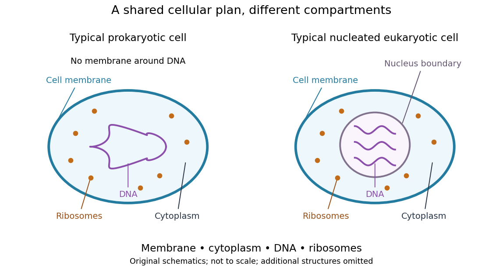

**[Figure 1](#image-shared-cellular-architecture-with-different-dna-compartmentalization). Shared cellular architecture with different DNA compartmentalization**. Original simplified schematics of a [prokaryote](organism.md#prokaryote) and a nucleated [eukaryote](organism.md#eukaryote). Colors identify corresponding components; sizes and component counts are illustrative, and additional structures are omitted.

Shared architecture describes cellular life and its developmental machinery, rather than requiring every specialized [biological cell](biological-cell.md) to retain every component. A mature mammalian [red blood cell](#red-blood-cell), for example, lacks a [cell nucleus](#cell-nucleus), although it develops from nucleated precursors. See [Clark, Douglas and Choi, Biology 2e: components of blood](https://openstax.org/books/biology-2e/pages/40-2-components-of-the-blood). This distinction makes cellular unity compatible with striking specialization.

**Table of contents**

- [Cell viability](#cell-viability)
- [B cell](#b-cell)
- [Cell death](#cell-death)
- [Cell division](#cell-division)
  - [Divisome](#divisome)
- [Somatic cell](#somatic-cell)
- [Stress response](#stress-response)
- [Natural killer cell](#natural-killer-cell)
- [Vesicle trafficking](#vesicle-trafficking)
  - [Polarized membrane trafficking](#polarized-membrane-trafficking)
- [Cardiomyocyte](#cardiomyocyte)
  - [Cardiomyocyte hypertrophy](#cardiomyocyte-hypertrophy)
- [Cell competition](#cell-competition)
- [Transit-amplifying cell](#transit-amplifying-cell)
- [Cell-autonomous](#cell-autonomous)
- [Bacteriocyte](#bacteriocyte)
- [Reticulate body](#reticulate-body)
- [Elementary body](#elementary-body)
- [Chlamydial inclusion](#chlamydial-inclusion)
- [Lipid droplet](#lipid-droplet)
- [Membrane contact site](#membrane-contact-site)
  - [Endoplasmic reticulum-mitochondrial contact site](#endoplasmic-reticulum-mitochondrial-contact-site)
- [Chinese hamster ovary cell](#chinese-hamster-ovary-cell)
- [HAT selection](#hat-selection)
- [Myeloma](#myeloma)
- [B lymphocyte](#b-lymphocyte)
- [Tumour-infiltrating lymphocyte](#tumour-infiltrating-lymphocyte)
- [Pancreatic stellate cell](#pancreatic-stellate-cell)
- [T cell](#t-cell)
  - [CD4](#cd4)
  - [CD28](#cd28)
  - [CD8](#cd8)
- [Dendritic cell](#dendritic-cell)
- [Myeloid-derived suppressor cell](#myeloid-derived-suppressor-cell)
- [Regulatory T cell](#regulatory-t-cell)
- [Endothelial cell](#endothelial-cell)
- [Tumour-associated macrophage](#tumour-associated-macrophage)
- [Macrophage](#macrophage)
- [Cancer-associated fibroblast](#cancer-associated-fibroblast)
- [Fibroblast](#fibroblast)
- [Cell growth](#cell-growth)
- [Epithelial cell](#epithelial-cell)
  - [MDCK cell](#mdck-cell)
  - [Keratinocyte](#keratinocyte)
    - [Basal keratinocyte](#basal-keratinocyte)
  - [Paneth cell](#paneth-cell)
  - [Tuft cell](#tuft-cell)
  - [Enteroendocrine cell](#enteroendocrine-cell)
  - [Goblet cell](#goblet-cell)
  - [Enterocyte](#enterocyte)
- [Biological cell division](#biological-cell-division)
  - [Binary fission (biology)](#binary-fission-biology)
- [Endomembrane system](#endomembrane-system)
  - [Topology of membrane compartments](#topology-of-membrane-compartments)
- [Leukocyte](#leukocyte)
- [Cell adhesion](#cell-adhesion)
  - [Adherens junction](#adherens-junction)
  - [Focal adhesion](#focal-adhesion)
- [Cell type](#cell-type)
- [Subcellular localization](#subcellular-localization)
- [Blastomere](#blastomere)
  - [Blastomere recombination experiment](#blastomere-recombination-experiment)
  - [P2 blastomere](#p2-blastomere)
  - [MS blastomere](#ms-blastomere)
  - [E blastomere](#e-blastomere)
  - [EMS blastomere](#ems-blastomere)
- [Cell polarity](#cell-polarity)
  - [Polarized cell growth](#polarized-cell-growth)
  - [Planar cell polarity](#planar-cell-polarity)
  - [PAR polarity complex](#par-polarity-complex)
  - [Apical-basal polarity](#apical-basal-polarity)
    - [Scribble polarity complex](#scribble-polarity-complex)
    - [Crumbs polarity complex](#crumbs-polarity-complex)
- [Apoptosis](#apoptosis)
  - [BAX](#bax)
  - [NOXA](#noxa)
  - [PUMA](#puma)
- [Cell intercalation](#cell-intercalation)
  - [Mediolateral intercalation](#mediolateral-intercalation)
  - [Radial intercalation](#radial-intercalation)
- [Cell proliferation](#cell-proliferation)
  - [Clonal lymphoproliferation](#clonal-lymphoproliferation)
  - [Contact inhibition](#contact-inhibition)
- [Cell migration](#cell-migration)
  - [Tissue advection](#tissue-advection)
  - [Contact guidance](#contact-guidance)
  - [Haptotaxis](#haptotaxis)
  - [Durotaxis](#durotaxis)
  - [Chemokinesis](#chemokinesis)
  - [Membrane bleb](#membrane-bleb)
  - [Lamellipodium](#lamellipodium)
  - [Collective cell migration](#collective-cell-migration)
    - [Velocity correlation in cell migration](#velocity-correlation-in-cell-migration)
    - [Contact inhibition of locomotion](#contact-inhibition-of-locomotion)
- [Cytoskeleton](#cytoskeleton)
  - [Spectrin](#spectrin)
  - [Actomyosin](#actomyosin)
  - [Sarcomere](#sarcomere)
  - [Actomyosin contractility](#actomyosin-contractility)
- [Cell culture](#cell-culture)
  - [3D cell culture](#3d-cell-culture)
    - [Organoid](#organoid)
      - [Intestinal organoid](#intestinal-organoid)
    - [Tumour spheroid](#tumour-spheroid)
  - [Primary cell culture](#primary-cell-culture)
  - [Cell culture medium](#cell-culture-medium)
    - [Fetal bovine serum](#fetal-bovine-serum)
  - [Autoclave](#autoclave)
- [Cell line](#cell-line)
  - [Caco-2](#caco-2)
  - [Immortalised cell line](#immortalised-cell-line)
  - [Subculture](#subculture)
    - [Cell culture passage accounting](#cell-culture-passage-accounting)
  - [Cell line population doublings](#cell-line-population-doublings)
  - [Cell counting](#cell-counting)
    - [Hemocytometer](#hemocytometer)
    - [Trypan blue exclusion test](#trypan-blue-exclusion-test)
  - [HeLa](#hela)
    - [HeLa culture viability experiment](#hela-culture-viability-experiment)
- [Cell state](#cell-state)
- [Stem cell](#stem-cell)
  - [Pluripotency](#pluripotency)
    - [Primed pluripotency](#primed-pluripotency)
    - [Formative pluripotency](#formative-pluripotency)
    - [Naive pluripotency](#naive-pluripotency)
  - [Population self-renewal](#population-self-renewal)
    - [Single-progenitor model](#single-progenitor-model)
  - [Stem-cell ablation](#stem-cell-ablation)
    - [Diphtheria toxin receptor ablation](#diphtheria-toxin-receptor-ablation)
  - [Germline stem cell](#germline-stem-cell)
    - [Spectrosome](#spectrosome)
  - [Stem-cell niche](#stem-cell-niche)
  - [Multipotency](#multipotency)
  - [Self-renewal](#self-renewal)
  - [Intestinal stem cell](#intestinal-stem-cell)
    - [Reserve intestinal stem cell](#reserve-intestinal-stem-cell)
    - [Crypt-base columnar cell](#crypt-base-columnar-cell)
  - [Embryonic stem cell](#embryonic-stem-cell)
- [Progenitor cell](#progenitor-cell)
  - [Primordial germ cell-like cell](#primordial-germ-cell-like-cell)
  - [Pole cell](#pole-cell)
  - [Primordial germ cell](#primordial-germ-cell)
  - [Neuromesodermal progenitor](#neuromesodermal-progenitor)
- [Secretory granule](#secretory-granule)
- [Cell cycle](cell-cycle.md)
  - [Quiescence](cell-cycle.md#quiescence)
  - [Mitotic exit network](cell-cycle.md#mitotic-exit-network)
  - [Centrosome orientation checkpoint](cell-cycle.md#centrosome-orientation-checkpoint)
  - [Spindle position checkpoint](cell-cycle.md#spindle-position-checkpoint)
    - [Bub2-Bfa1 complex](cell-cycle.md#bub2-bfa1-complex)
  - [cdc mutant](cell-cycle.md#cdc-mutant)
  - [Cdh1](cell-cycle.md#cdh1)
  - [RB](cell-cycle.md#rb)
  - [Cell-cycle arrest](cell-cycle.md#cell-cycle-arrest)
    - [Cellular senescence](cell-cycle.md#cellular-senescence)
    - [p21](cell-cycle.md#p21)
  - [Sic1](cell-cycle.md#sic1)
  - [Oriented cell division](cell-cycle.md#oriented-cell-division)
  - [SCF ubiquitin ligase](cell-cycle.md#scf-ubiquitin-ligase)
  - [Geminin](cell-cycle.md#geminin)
  - [Fucci](cell-cycle.md#fucci)
  - [Cytostatic factor](cell-cycle.md#cytostatic-factor)
  - [Anaphase-promoting complex](cell-cycle.md#anaphase-promoting-complex)
  - [Maturation-promoting factor](cell-cycle.md#maturation-promoting-factor)
  - [RB pathway](cell-cycle.md#rb-pathway)
  - [Cdc20](cell-cycle.md#cdc20)
  - [Replication checkpoint](cell-cycle.md#replication-checkpoint)
  - [DNA damage checkpoint](cell-cycle.md#dna-damage-checkpoint)
  - [Endoreduplication](cell-cycle.md#endoreduplication)
  - [Cleavage division](cell-cycle.md#cleavage-division)
  - [Interphase](cell-cycle.md#interphase)
    - [G1 phase](cell-cycle.md#g1-phase)
    - [S phase](cell-cycle.md#s-phase)
    - [G2 phase](cell-cycle.md#g2-phase)
  - [M phase](cell-cycle.md#m-phase)
    - [Mitosis](cell-cycle.md#mitosis)
      - [Prophase](cell-cycle.md#prophase)
      - [Prometaphase](cell-cycle.md#prometaphase)
      - [Metaphase](cell-cycle.md#metaphase)
      - [Anaphase](cell-cycle.md#anaphase)
      - [Telophase](cell-cycle.md#telophase)
      - [Mitotic daughter chromosome accounting](cell-cycle.md#mitotic-daughter-chromosome-accounting)
      - [Spindle checkpoint](cell-cycle.md#spindle-checkpoint)
        - [Bub3](cell-cycle.md#bub3)
        - [BubR1](cell-cycle.md#bubr1)
        - [Mad2](cell-cycle.md#mad2)
        - [Mitotic checkpoint complex](cell-cycle.md#mitotic-checkpoint-complex)
        - [Kinetochore ablation experiment](cell-cycle.md#kinetochore-ablation-experiment)
    - [Cytokinesis](cell-cycle.md#cytokinesis)
      - [Abscission](cell-cycle.md#abscission)
      - [Midbody](cell-cycle.md#midbody)
      - [Actomyosin ring](cell-cycle.md#actomyosin-ring)
      - [Cleavage furrow](cell-cycle.md#cleavage-furrow)
        - [Toroidal sand dollar egg experiment](cell-cycle.md#toroidal-sand-dollar-egg-experiment)
      - [Cell plate](cell-cycle.md#cell-plate)
  - [G0 phase](cell-cycle.md#g0-phase)
  - [Cell-cycle DNA content](cell-cycle.md#cell-cycle-dna-content)
  - [Cell cycle analysis](cell-cycle.md#cell-cycle-analysis)
    - [Double thymidine block](cell-cycle.md#double-thymidine-block)
    - [DNA pulse labeling](cell-cycle.md#dna-pulse-labeling)
      - [DNA synthesis labeling with EdU](cell-cycle.md#dna-synthesis-labeling-with-edu)
  - [Spindle apparatus](cell-cycle.md#spindle-apparatus)
    - [Spindle pole body](cell-cycle.md#spindle-pole-body)
    - [Central spindle](cell-cycle.md#central-spindle)
    - [Mitotic aster](cell-cycle.md#mitotic-aster)
- [Cell envelope](#cell-envelope)
  - [Bacterial outer membrane](#bacterial-outer-membrane)
    - [Periplasm](#periplasm)
- [Cell wall](#cell-wall)
  - [Cell-wall pulse labelling](#cell-wall-pulse-labelling)
  - [Plant cell wall](#plant-cell-wall)
  - [Fungal cell wall](#fungal-cell-wall)
    - [Chitin](#chitin)
    - [Glucan](#glucan)
  - [Turgor pressure](#turgor-pressure)
  - [Plasmolysis](#plasmolysis)
  - [Protoplast](#protoplast)
    - [Lysozyme wall-removal experiment](#lysozyme-wall-removal-experiment)
  - [Peptidoglycan](#peptidoglycan)
    - [Rod complex](#rod-complex)
- [Cell membrane](cell-membrane.md)
  - [GLUT1](cell-membrane.md#glut1)
  - [GLUT2](cell-membrane.md#glut2)
  - [Lipid divide](cell-membrane.md#lipid-divide)
  - [Membrane fission](cell-membrane.md#membrane-fission)
  - [Membrane fusion](cell-membrane.md#membrane-fusion)
    - [Vesicle docking](cell-membrane.md#vesicle-docking)
    - [Content mixing assay](cell-membrane.md#content-mixing-assay)
    - [Lipid mixing assay](cell-membrane.md#lipid-mixing-assay)
    - [Hemifusion](cell-membrane.md#hemifusion)
    - [SNARE protein](cell-membrane.md#snare-protein)
      - [Syntaxin-4](cell-membrane.md#syntaxin-4)
      - [SNARE complex](cell-membrane.md#snare-complex)
        - [Trans-SNARE complex](cell-membrane.md#trans-snare-complex)
      - [t-SNARE](cell-membrane.md#t-snare)
      - [v-SNARE](cell-membrane.md#v-snare)
      - [SNAP-25](cell-membrane.md#snap-25)
  - [Membrane curvature](cell-membrane.md#membrane-curvature)
  - [Homeoviscous adaptation](cell-membrane.md#homeoviscous-adaptation)
  - [Membrane nanodomain](cell-membrane.md#membrane-nanodomain)
  - [Selective permeability](cell-membrane.md#selective-permeability)
    - [Membrane permeability](cell-membrane.md#membrane-permeability)
    - [Semipermeable membrane](cell-membrane.md#semipermeable-membrane)
  - [Membrane protein](cell-membrane.md#membrane-protein)
    - [Ferroportin](cell-membrane.md#ferroportin)
    - [Transferrin receptor 1](cell-membrane.md#transferrin-receptor-1)
    - [OmpX](cell-membrane.md#ompx)
    - [Membrane mimic](cell-membrane.md#membrane-mimic)
    - [Nephrin](cell-membrane.md#nephrin)
    - [Cargo receptor](cell-membrane.md#cargo-receptor)
    - [Integrin](cell-membrane.md#integrin)
    - [Hydrophobic mismatch](cell-membrane.md#hydrophobic-mismatch)
    - [Integral membrane protein](cell-membrane.md#integral-membrane-protein)
      - [Transmembrane protein](cell-membrane.md#transmembrane-protein)
        - [Tail-anchored protein](cell-membrane.md#tail-anchored-protein)
    - [Peripheral membrane protein](cell-membrane.md#peripheral-membrane-protein)
    - [Lipid-anchored protein](cell-membrane.md#lipid-anchored-protein)
    - [Membrane topology](cell-membrane.md#membrane-topology)
    - [Lateral mobility of membrane proteins](cell-membrane.md#lateral-mobility-of-membrane-proteins)
      - [Mouse-human heterokaryon membrane-mixing experiment](cell-membrane.md#mouse-human-heterokaryon-membrane-mixing-experiment)
    - [Membrane transport protein](cell-membrane.md#membrane-transport-protein)
      - [Nucleotide-sugar transporter](cell-membrane.md#nucleotide-sugar-transporter)
      - [Scramblase](cell-membrane.md#scramblase)
      - [Flippase](cell-membrane.md#flippase)
      - [ATP-binding cassette transporter](cell-membrane.md#atp-binding-cassette-transporter)
      - [AcrB](cell-membrane.md#acrb)
      - [Multidrug efflux pump](cell-membrane.md#multidrug-efflux-pump)
      - [GLUT4](cell-membrane.md#glut4)
      - [Carrier protein](cell-membrane.md#carrier-protein)
  - [Gap junction](cell-membrane.md#gap-junction)
  - [Ion channel](cell-membrane.md#ion-channel)
    - [GORK](cell-membrane.md#gork)
    - [SLAC1](cell-membrane.md#slac1)
    - [Mechanosensitive ion channel](cell-membrane.md#mechanosensitive-ion-channel)
      - [MscL](cell-membrane.md#mscl)
      - [MscS](cell-membrane.md#mscs)
    - [Channel desensitization](cell-membrane.md#channel-desensitization)
    - [Ligand-gated ion channel](cell-membrane.md#ligand-gated-ion-channel)
    - [Selectivity filter](cell-membrane.md#selectivity-filter)
    - [ATP-sensitive potassium channel](cell-membrane.md#atp-sensitive-potassium-channel)
  - [Membrane transport](cell-membrane.md#membrane-transport)
    - [Membrane trafficking](cell-membrane.md#membrane-trafficking)
      - [Retromer](cell-membrane.md#retromer)
      - [Vesicle tethering](cell-membrane.md#vesicle-tethering)
    - [Bacterial flagellar motor](cell-membrane.md#bacterial-flagellar-motor)
      - [FliN](cell-membrane.md#flin)
      - [FliM](cell-membrane.md#flim)
      - [FliG](cell-membrane.md#flig)
      - [MotB](cell-membrane.md#motb)
      - [MotA](cell-membrane.md#mota)
    - [CFTR](cell-membrane.md#cftr)
    - [Protonophore](cell-membrane.md#protonophore)
    - [SGLT1](cell-membrane.md#sglt1)
    - [Phosphotransferase system](cell-membrane.md#phosphotransferase-system)
      - [EIIA glucose](cell-membrane.md#eiia-glucose)
    - [Lactose permease](cell-membrane.md#lactose-permease)
    - [Endosomal sorting complexes required for transport](cell-membrane.md#endosomal-sorting-complexes-required-for-transport)
    - [COPI](cell-membrane.md#copi)
      - [Coatomer](cell-membrane.md#coatomer)
    - [COPII](cell-membrane.md#copii)
      - [Sec13-Sec31 complex](cell-membrane.md#sec13-sec31-complex)
      - [Sec23-Sec24 complex](cell-membrane.md#sec23-sec24-complex)
    - [Adaptor protein complex](cell-membrane.md#adaptor-protein-complex)
      - [AP1 adaptor complex](cell-membrane.md#ap1-adaptor-complex)
      - [AP2 adaptor complex](cell-membrane.md#ap2-adaptor-complex)
    - [Alternating access](cell-membrane.md#alternating-access)
    - [Passive transport](cell-membrane.md#passive-transport)
      - [Facilitated diffusion](cell-membrane.md#facilitated-diffusion)
      - [Osmosis](cell-membrane.md#osmosis)
        - [Water potential](cell-membrane.md#water-potential)
          - [Solute potential](cell-membrane.md#solute-potential)
        - [Osmotic pressure](cell-membrane.md#osmotic-pressure)
          - [Osmometry](cell-membrane.md#osmometry)
            - [Reduced osmotic-pressure intercept](cell-membrane.md#reduced-osmotic-pressure-intercept)
          - [Osmosis concentration-pressure example](cell-membrane.md#osmosis-concentration-pressure-example)
        - [Membrane osmometer](cell-membrane.md#membrane-osmometer)
        - [Osmotic concentration](cell-membrane.md#osmotic-concentration)
        - [Tonicity](cell-membrane.md#tonicity)
          - [Permeating solute](cell-membrane.md#permeating-solute)
          - [Hypotonic solution](cell-membrane.md#hypotonic-solution)
          - [Hypertonic solution](cell-membrane.md#hypertonic-solution)
          - [Isotonic solution](cell-membrane.md#isotonic-solution)
        - [Cytolysis](cell-membrane.md#cytolysis)
    - [Active transport](cell-membrane.md#active-transport)
      - [Proton pump](cell-membrane.md#proton-pump)
        - [Vacuolar proton ATPase](cell-membrane.md#vacuolar-proton-atpase)
      - [Secondary active transport](cell-membrane.md#secondary-active-transport)
      - [Sodium-potassium ATPase](cell-membrane.md#sodium-potassium-atpase)
    - [Exocytosis](cell-membrane.md#exocytosis)
    - [Endocytosis](cell-membrane.md#endocytosis)
      - [Synaptic vesicle recycling](cell-membrane.md#synaptic-vesicle-recycling)
      - [Clathrin-mediated endocytosis](cell-membrane.md#clathrin-mediated-endocytosis)
      - [Phagocytosis](cell-membrane.md#phagocytosis)
  - [Fluid mosaic model](cell-membrane.md#fluid-mosaic-model)
- [Cytoplasm](#cytoplasm)
  - [Germ plasm](#germ-plasm)
  - [Cytosol](#cytosol)
- [Nucleoid](#nucleoid)
- [Organelle](#organelle)
  - [Peroxisome](#peroxisome)
  - [Organelle identity](#organelle-identity)
  - [Centrosome](#centrosome)
  - [Mitosome](#mitosome)
  - [Hydrogenosome](#hydrogenosome)
  - [Endoplasmic reticulum](#endoplasmic-reticulum)
    - [Endoplasmic reticulum stress](#endoplasmic-reticulum-stress)
    - [Endoplasmic reticulum lumen](#endoplasmic-reticulum-lumen)
    - [Endoplasmic reticulum exit site](#endoplasmic-reticulum-exit-site)
    - [ER lumen](#er-lumen)
    - [Rough endoplasmic reticulum](#rough-endoplasmic-reticulum)
      - [ER signal sequence](#er-signal-sequence)
    - [Smooth endoplasmic reticulum](#smooth-endoplasmic-reticulum)
    - [Secretory protein routing](#secretory-protein-routing)
      - [Pancreatic secretory-protein pulse-chase experiment](#pancreatic-secretory-protein-pulse-chase-experiment)
    - [Microsome](#microsome)
  - [Plastid](#plastid)
    - [Apicoplast](#apicoplast)
  - [Mitochondria](#mitochondria)
    - [Mitochondrial fission-fusion cycle](#mitochondrial-fission-fusion-cycle)
    - [Inner mitochondrial membrane](#inner-mitochondrial-membrane)
      - [Mitochondrial membrane potential](#mitochondrial-membrane-potential)
      - [Mitochondrial phosphate carrier](#mitochondrial-phosphate-carrier)
      - [Adenine nucleotide translocator](#adenine-nucleotide-translocator)
      - [Mitochondrial dicarboxylate carrier](#mitochondrial-dicarboxylate-carrier)
      - [Crista](#crista)
    - [Mitochondrial matrix](#mitochondrial-matrix)
    - [Intermembrane space](#intermembrane-space)
    - [Outer mitochondrial membrane](#outer-mitochondrial-membrane)
    - [Isolated mitochondria respiration experiment](#isolated-mitochondria-respiration-experiment)
      - [Modeled mitochondrial oxygen traces](#modeled-mitochondrial-oxygen-traces)
  - [Golgi apparatus](#golgi-apparatus)
    - [Golgi cisterna](#golgi-cisterna)
      - [Golgi lumen](#golgi-lumen)
    - [Golgi cargo processing](#golgi-cargo-processing)
    - [trans-Golgi network](#trans-golgi-network)
    - [Cisternal maturation](#cisternal-maturation)
    - [Golgi tracer interpretation](#golgi-tracer-interpretation)
  - [Transport vesicle](#transport-vesicle)
    - [Extracellular vesicle](#extracellular-vesicle)
  - [Lysosome](#lysosome)
    - [Lysosomal lumen](#lysosomal-lumen)
    - [Autophagy](#autophagy)
      - [Mitophagy](#mitophagy)
      - [Macroautophagy](#macroautophagy)
        - [Autophagosome](#autophagosome)
    - [Lysosomal enzyme latency](#lysosomal-enzyme-latency)
      - [Rat-liver acid-phosphatase latency experiment](#rat-liver-acid-phosphatase-latency-experiment)
  - [Endosome](#endosome)
    - [Endosome maturation](#endosome-maturation)
    - [Late endosome](#late-endosome)
    - [Early endosome](#early-endosome)
- [Chloroplast](#chloroplast)
  - [Chloroplast gene expression](#chloroplast-gene-expression)
    - [GUN1](#gun1)
    - [Retrograde signaling](#retrograde-signaling)
    - [Anterograde signaling](#anterograde-signaling)
    - [Nuclear-encoded plastid RNA polymerase](#nuclear-encoded-plastid-rna-polymerase)
    - [Plastid-encoded RNA polymerase](#plastid-encoded-rna-polymerase)
  - [Chloroplast envelope](#chloroplast-envelope)
    - [Outer chloroplast envelope membrane](#outer-chloroplast-envelope-membrane)
    - [Inner chloroplast envelope membrane](#inner-chloroplast-envelope-membrane)
    - [Chloroplast intermembrane space](#chloroplast-intermembrane-space)
  - [Chloroplast stroma](#chloroplast-stroma)
  - [Thylakoid](#thylakoid)
    - [Thylakoid membrane](#thylakoid-membrane)
    - [Thylakoid lumen](#thylakoid-lumen)
    - [Granum](#granum)
  - [Hill reaction](#hill-reaction)
    - [Chloroplast dye-reduction experiment](#chloroplast-dye-reduction-experiment)
- [Cell nucleus](#cell-nucleus)
  - [Nuclear retention](#nuclear-retention)
  - [Nuclear lamina](#nuclear-lamina)
    - [Lamina-associated domain](#lamina-associated-domain)
  - [Nuclear envelope](#nuclear-envelope)
    - [Nuclear pore complex](#nuclear-pore-complex)
      - [Nuclear localization sequence](#nuclear-localization-sequence)
      - [Nuclear pore localization experiment](#nuclear-pore-localization-experiment)
      - [Nuclear pore transport balance](#nuclear-pore-transport-balance)
  - [Nucleolus (biology)](#nucleolus-biology)
- [Ribosome](#ribosome)
  - [Ribosome stalling](#ribosome-stalling)
  - [Peptidyl transfer](#peptidyl-transfer)
  - [Translation elongation factor P](#translation-elongation-factor-p)
  - [Ribosomal protein](#ribosomal-protein)
  - [Polysome](#polysome)
  - [Ribosomal subunit](#ribosomal-subunit)
  - [Ribosome collision](#ribosome-collision)
- [Gliding bacterium](#gliding-bacterium)
- [Neutrophil](#neutrophil)
- [Red blood cell](#red-blood-cell)
- [Membrane potential](membrane-potential.md)
  - [Selective potassium equilibrium](membrane-potential.md#selective-potassium-equilibrium)
  - [Membrane charge separation](membrane-potential.md#membrane-charge-separation)
  - [Intracellular recording of membrane potential](membrane-potential.md#intracellular-recording-of-membrane-potential)
  - [Depolarization](membrane-potential.md#depolarization)
  - [Hyperpolarization](membrane-potential.md#hyperpolarization)
  - [Reversal potential](membrane-potential.md#reversal-potential)
    - [Nernst equilibrium potential](membrane-potential.md#nernst-equilibrium-potential)
  - [Voltage-gated ion channel](membrane-potential.md#voltage-gated-ion-channel)
    - [Voltage-gated sodium channel](membrane-potential.md#voltage-gated-sodium-channel)
    - [Voltage-sensing domain](membrane-potential.md#voltage-sensing-domain)
    - [Voltage-gated potassium channel](membrane-potential.md#voltage-gated-potassium-channel)
    - [Voltage-gated calcium channel](membrane-potential.md#voltage-gated-calcium-channel)
    - [Ion-channel inactivation](membrane-potential.md#ion-channel-inactivation)
    - [Two-state ion-channel gating](membrane-potential.md#two-state-ion-channel-gating)
      - [Independent permissive gates in an ion channel](membrane-potential.md#independent-permissive-gates-in-an-ion-channel)
- [Heterokaryon](#heterokaryon)
- [Cell fusion](#cell-fusion)
- [Cell cortex](#cell-cortex)
- [Cell lineage](#cell-lineage)
  - [Lineage restriction](#lineage-restriction)
  - [Cell of origin](#cell-of-origin)
  - [Lineage tracing](#lineage-tracing)
  - [Germline](#germline)
    - [Germline genome defence](#germline-genome-defence)
  - [Genetic lineage tracing](#genetic-lineage-tracing)
    - [Lineage-tracing dropout](#lineage-tracing-dropout)
    - [CRISPR lineage recording](#crispr-lineage-recording)
      - [scGESTALT](#scgestalt)
    - [Genetic barcode](#genetic-barcode)
      - [Barcode collision](#barcode-collision)
  - [Clonal lineage tracing](#clonal-lineage-tracing)
    - [Clone-size distribution](#clone-size-distribution)
    - [Sparse labelling](#sparse-labelling)
    - [Clonal multipotency](#clonal-multipotency)
    - [Neutral clonal competition](#neutral-clonal-competition)

## Cell viability

↑ **Parent:** [Biological cell](biological-cell.md)

## B cell

↑ **Parent:** [Biological cell](biological-cell.md)

An immune-cell lineage associated with antibody responses. Lineage-specific proliferation and clonal expansion should be distinguished from changes in a mixed sample.

## Cell death

↑ **Parent:** [Biological cell](biological-cell.md)

## Cell division

↑ **Parent:** [Biological cell](biological-cell.md)

### Divisome

↑ **Parent:** [Cell division](#cell-division)

The bacterial machinery assembling and remodeling the envelope at the division site.

## Somatic cell

↑ **Parent:** [Biological cell](biological-cell.md)

## Stress response

↑ **Parent:** [Biological cell](biological-cell.md)

## Natural killer cell

↑ **Parent:** [Biological cell](biological-cell.md)

An innate cytotoxic lymphocyte whose activation integrates inhibitory and activating signals. Reduced class-I display can remove inhibitory signalling, but is not by itself a universal guarantee of killing.

## Vesicle trafficking

↑ **Parent:** [Biological cell](biological-cell.md)

### Polarized membrane trafficking

↑ **Parent:** [Vesicle trafficking](#vesicle-trafficking)

Preferential delivery, recycling or removal of membrane components in different cellular domains. Domain-specific traffic converts positional information into unequal membrane growth and composition.

## Cardiomyocyte

↑ **Parent:** [Biological cell](biological-cell.md)

A cardiac muscle cell. Embryonic differentiation and contractile activity are compatible with continued proliferation; adult cell-cycle re-entry does not necessarily entail completed division.

### Cardiomyocyte hypertrophy

↑ **Parent:** [Cardiomyocyte](#cardiomyocyte)

Enlargement of individual cardiac muscle cells, distinct from an increase in cardiomyocyte number through completed division.

## Cell competition

↑ **Parent:** [Biological cell](biological-cell.md)

Neighbour-dependent selection among cell populations in which relatively less-fit cells are lost or displaced. Homogeneous toxicity or slower autonomous growth alone does not establish competitive elimination.

## Transit-amplifying cell

↑ **Parent:** [Biological cell](biological-cell.md)

A proliferative descendant population that expands cell output before differentiation. The number of divisions and capacity for reversal depend on tissue and context.

## Cell-autonomous

↑ **Parent:** [Biological cell](biological-cell.md)

A cellular phenotype attributable to the affected cell's own genotype or state under the tested conditions. Mosaic experiments distinguish this from effects transmitted through neighbouring cells or the environment.

## Bacteriocyte

↑ **Parent:** [Biological cell](biological-cell.md)

A [bacteriocyte](#bacteriocyte) is a specialized host cell containing bacterial symbionts. The intracellular environment and transmission route shape selection on both partners.

## Reticulate body

↑ **Parent:** [Biological cell](biological-cell.md)

A [reticulate body](#reticulate-body) is the growth-associated form in the chlamydial developmental cycle. [genome](molecular-genetics.md#genome) replication alone does not establish successful production of infectious elementary bodies.

## Elementary body

↑ **Parent:** [Biological cell](biological-cell.md)

An [elementary body](#elementary-body) is the infectious form in the chlamydial developmental cycle. Environmental persistence during transmission is distinct from productive extracellular replication.

## Chlamydial inclusion

↑ **Parent:** [Biological cell](biological-cell.md)

A [chlamydial inclusion](#chlamydial-inclusion) is the membrane-bound intracellular compartment supporting chlamydial development. Host trafficking interactions and nutrient access are regulated there.

## Lipid droplet

↑ **Parent:** [Biological cell](biological-cell.md)

A [lipid droplet](#lipid-droplet) is a cellular lipid-storage structure. Delivery of an engineered fatty acid into storage can be limited independently of the pathway that synthesizes it.

## Membrane contact site

↑ **Parent:** [Biological cell](biological-cell.md)

A [membrane contact site](#membrane-contact-site) closely apposes distinct membranes without fusing them. Demonstrating apposition establishes architecture, while transfer or signaling requires separate functional evidence.

### Endoplasmic reticulum-mitochondrial contact site

↑ **Parent:** [Membrane contact site](#membrane-contact-site)

An [endoplasmic reticulum-mitochondrial contact site](#endoplasmic-reticulum-mitochondrial-contact-site) brings ER and mitochondrial membranes close while preserving their separate compartments. Specific contacts can contribute to [calcium](chemical-substance.md#calcium) handling, lipid exchange and organelle organization.

## Chinese hamster ovary cell

↑ **Parent:** [Biological cell](biological-cell.md)

A [Chinese hamster ovary cell](#chinese-hamster-ovary-cell) is a mammalian cell type widely used in recombinant-protein production. Product glycosylation, assembly and quality depend on the engineered line and culture process.

## HAT selection

↑ **Parent:** [Biological cell](biological-cell.md)

[HAT selection](#hat-selection) uses hypoxanthine, aminopterin and thymidine to distinguish cells able to maintain nucleotide supply through salvage metabolism under de novo synthesis blockade. In a conventional hybridoma scheme it selects suitable fusion products, not antigen specificity.

## Myeloma

↑ **Parent:** [Biological cell](biological-cell.md)

A [myeloma](#myeloma) is a malignancy of the plasma-cell lineage. Selected cultured myeloma lines provide an immortal fusion partner in hybridoma production; their metabolic selection properties depend on the particular line.

## B lymphocyte

↑ **Parent:** [Biological cell](biological-cell.md)

A [B lymphocyte](#b-lymphocyte) belongs to the antibody-producing lineage of the adaptive immune system. Recovery of an antigen-binding clone does not alone establish a useful therapeutic antibody or an immortal production line.

## Tumour-infiltrating lymphocyte

↑ **Parent:** [Biological cell](biological-cell.md)

A lymphocyte recovered from within a [tumour](biology.md#tumour) specimen. Presence in a specimen does not alone establish effective recognition or killing of malignant cells.

## Pancreatic stellate cell

↑ **Parent:** [Biological cell](biological-cell.md)

A stromal cell of the pancreas that can adopt activated states and contribute to [extracellular matrix](biology.md#extracellular-matrix) and metabolic interactions in pancreatic disease.

## T cell

↑ **Parent:** [Biological cell](biological-cell.md)

A lymphocyte using a T-cell receptor for antigen recognition. Distinct populations have cytotoxic, helper, regulatory and memory functions.

### CD4

↑ **Parent:** [T cell](#t-cell)

A coreceptor usually associated with recognition of peptide–MHC-class-II complexes. CD4 T-cell populations coordinate and regulate immune responses in addition to other context-dependent activities.

### CD28

↑ **Parent:** [T cell](#t-cell)

A T-cell costimulatory receptor. Its interaction with B7 ligands on activated antigen-presenting cells contributes to naive-cell priming.

### CD8

↑ **Parent:** [T cell](#t-cell)

A coreceptor associated with recognition of peptide–MHC-class-I complexes by cytotoxic T cells. It contributes to binding and signalling without replacing T-cell-receptor specificity.

## Dendritic cell

↑ **Parent:** [Biological cell](biological-cell.md)

An antigen-presenting immune cell that can help initiate T-cell responses. Antigen uptake alone does not establish effective activating presentation.

## Myeloid-derived suppressor cell

↑ **Parent:** [Biological cell](biological-cell.md)

A myeloid population defined partly by its ability to suppress immune responses, particularly in disease-associated settings such as cancer.

## Regulatory T cell

↑ **Parent:** [Biological cell](biological-cell.md)

A T-cell population with immune-suppressive functions that can restrain both pathological inflammation and antitumour responses.

## Endothelial cell

↑ **Parent:** [Biological cell](biological-cell.md)

A cell lining a blood or lymphatic vessel. Endothelial state influences barrier function, perfusion and interactions with circulating cells.

## Tumour-associated macrophage

↑ **Parent:** [Biological cell](biological-cell.md)

A macrophage within or associated with a [tumour microenvironment](biology.md#tumour-microenvironment). Its contribution to invasion, vascular remodelling or immunity depends on the particular functional state.

## Macrophage

↑ **Parent:** [Biological cell](biological-cell.md)

An innate immune cell that can phagocytose material and regulate tissue and immune responses. Its behaviour varies with local signals and cellular history.

## Cancer-associated fibroblast

↑ **Parent:** [Biological cell](biological-cell.md)

A fibroblast in a tumour-associated state. Some functions support [tumour](biology.md#tumour) progression while other fibroblast populations or functions can restrain it; the label alone does not establish the causal effect.

## Fibroblast

↑ **Parent:** [Biological cell](biological-cell.md)

A connective-tissue cell with roles in [extracellular matrix](biology.md#extracellular-matrix) production and tissue organisation. Fibroblast populations and activation states are heterogeneous.

## Cell growth

↑ **Parent:** [Biological cell](biological-cell.md)

An increase in cellular biomass or size. It differs from [cell proliferation](#cell-proliferation), which increases the number of cells.

## Epithelial cell

↑ **Parent:** [Biological cell](biological-cell.md)

A cell participating in an organised epithelial layer, with context-dependent polarity, adhesion and barrier or transport functions.

### MDCK cell

↑ **Parent:** [Epithelial cell](#epithelial-cell)

Madin-Darby canine kidney cell, used in three-dimensional [epithelial cyst](biology.md#epithelial-cyst) and polarity assays.

### Keratinocyte

↑ **Parent:** [Epithelial cell](#epithelial-cell)

#### Basal keratinocyte

↑ **Parent:** [Keratinocyte](#keratinocyte)

A [keratinocyte](#keratinocyte) in the basement-membrane-associated compartment of a [stratified epithelium](biology.md#stratified-epithelium). Basal position does not establish that every such cell is actively dividing.

### Paneth cell

↑ **Parent:** [Epithelial cell](#epithelial-cell)

A specialized secretory cell normally found at the base of mammalian small-intestinal crypts. Its local antimicrobial and niche-support roles do not imply that all intestinal stem-cell systems require a Paneth-cell arrangement.

### Tuft cell

↑ **Parent:** [Epithelial cell](#epithelial-cell)

A specialized epithelial sensory cell population with characteristic apical morphology and context-dependent signalling roles.

### Enteroendocrine cell

↑ **Parent:** [Epithelial cell](#epithelial-cell)

A specialized intestinal epithelial cell that senses local conditions and releases signalling products, including hormones.

### Goblet cell

↑ **Parent:** [Epithelial cell](#epithelial-cell)

A specialized mucus-secreting epithelial cell, present in the intestinal lining and other mucosal tissues.

### Enterocyte

↑ **Parent:** [Epithelial cell](#epithelial-cell)

An absorptive epithelial cell of the intestinal lining. Enterocyte-lineage progenitors and terminally differentiated villus enterocytes need not have the same regenerative potential.

## Biological cell division

↑ **Parent:** [Biological cell](biological-cell.md)

Partition of one cell into descendant cells. Copying and allocating inherited material must be coordinated with physical separation, but nuclear division and [cytokinesis](cell-cycle.md#cytokinesis) are distinct events.

### Binary fission (biology)

↑ **Parent:** [Biological cell division](#biological-cell-division)

A [biological cell division](#biological-cell-division) that produces two daughter cells. It is an [asexual reproduction](biology.md#asexual-reproduction) mechanism in many unicellular organisms and is distinct from the exchange or recombination of genetic material during sexual processes.

## Endomembrane system

↑ **Parent:** [Biological cell](biological-cell.md)  
ⓦ [Wiki](https://en.wikipedia.org/wiki/Endomembrane_system)

The [endomembrane system](#endomembrane-system) comprises functionally connected internal membranes such as the [endoplasmic reticulum](#endoplasmic-reticulum), [Golgi apparatus](#golgi-apparatus), [endosomes](#endosome) and [lysosomes](#lysosome), together with their transport carriers. Connections through carrier traffic differ from direct continuity of the membrane sheets.

### Topology of membrane compartments

↑ **Parent:** [Endomembrane system](#endomembrane-system)

Ordinary vesicle budding and fusion preserve which side of a membrane a protein domain faces: a cytoplasmic domain remains cytoplasmic, and a luminal domain remains luminal. Invagination can enclose previously external space without transporting its contents through a bilayer. The [endoplasmic reticulum](#endoplasmic-reticulum) lumen is continuous with the space between the two [nuclear envelope](#nuclear-envelope) membranes; it is not the chromosome-containing nucleoplasm. Any proposed evolutionary remodelling must account for these distinct spaces and the membrane connections between them.

## Leukocyte

↑ **Parent:** [Biological cell](biological-cell.md)

## Cell adhesion

↑ **Parent:** [Biological cell](biological-cell.md)  
ⓦ [Wiki](https://en.wikipedia.org/wiki/Cell_adhesion)

[Cell adhesion](#cell-adhesion) is attachment of a [biological cell](biological-cell.md) to another cell or to its surroundings through molecular interactions. Adhesion strength and turnover help determine how cells transmit forces and rearrange.

### Adherens junction

↑ **Parent:** [Cell adhesion](#cell-adhesion)

A cell-cell junction coupling adhesion to the cytoskeleton. It can transmit mechanical load while being remodelled during epithelial movements.

### Focal adhesion

↑ **Parent:** [Cell adhesion](#cell-adhesion)  
ⓦ [Wiki](https://en.wikipedia.org/wiki/Focal_adhesion)

A [focal adhesion](#focal-adhesion) is a multiprotein connection between [integrins](cell-membrane.md#integrin) and the [actin](protein.md#actin) [cytoskeleton](#cytoskeleton). It can transmit traction and change its assembly in response to loading.

## Cell type

↑ **Parent:** [Biological cell](biological-cell.md)

A class of [biological cells](biological-cell.md) distinguished by characteristic structure, function or molecular state. Comparing mixed [biological tissues](biology.md#tissue-biology) can confound changes within a [cell type](#cell-type) with changes in the abundance of that class.

## Subcellular localization

↑ **Parent:** [Biological cell](biological-cell.md)

[subcellular localization](#subcellular-localization) is the distribution of a component among cellular regions or compartments. Changing localization can change a [protein](protein.md)'s partners even when its total abundance is constant.

## Blastomere

↑ **Parent:** [Biological cell](biological-cell.md)

A cell produced by the early [cleavage divisions](cell-cycle.md#cleavage-division) of an embryo.

### Blastomere recombination experiment

↑ **Parent:** [Blastomere](#blastomere)

Isolated [blastomeres](#blastomere) are reapposed in chosen combinations to test induction. Reciprocal wild-type and [mutant](genetics.md#mutant) combinations can separate a signalling-[cell](biological-cell.md) defect from a responding-[cell](biological-cell.md) defect.

### P2 blastomere

↑ **Parent:** [Blastomere](#blastomere)

An early posterior [Caenorhabditis elegans](organism.md#caenorhabditis-elegans) [blastomere](#blastomere) that contacts EMS and provides inductive information required for normal [endoderm](biology.md#endoderm) specification.

### MS blastomere

↑ **Parent:** [Blastomere](#blastomere)

The sister of the [E blastomere](#e-blastomere) in [Caenorhabditis elegans](organism.md#caenorhabditis-elegans). Its descendants include [muscle](biology.md#muscle) and part of the pharynx; it is not the normal intestinal founder.

### E blastomere

↑ **Parent:** [Blastomere](#blastomere)

The founder of the [Caenorhabditis elegans](organism.md#caenorhabditis-elegans) intestinal lineage. Following its descendants distinguishes failure of [endoderm](biology.md#endoderm) specification from a failure of [terminal differentiation](organism.md#terminal-differentiation).

### EMS blastomere

↑ **Parent:** [Blastomere](#blastomere)

The early [Caenorhabditis elegans](organism.md#caenorhabditis-elegans) [blastomere](#blastomere) that divides into MS and E. Its daughters normally produce predominantly mesodermal derivatives and the intestine, respectively.

## Cell polarity

↑ **Parent:** [Biological cell](biological-cell.md)

A spatial asymmetry of cellular organisation, including distinct apical and basal domains, that can influence division, signalling and lineage allocation.

### Polarized cell growth

↑ **Parent:** [Cell polarity](#cell-polarity)

Growth concentrated at a selected part of the [biological cell](biological-cell.md) surface. Spatial selection can be controlled at transport, [vesicle docking](cell-membrane.md#vesicle-docking) or fusion rather than only by directed vesicle motion.

### Planar cell polarity

↑ **Parent:** [Cell polarity](#cell-polarity)

Coordinated asymmetry within the plane of a tissue, distinct from the apical-basal axis. Not every case of planar polarization uses the same molecular pathway.

### PAR polarity complex

↑ **Parent:** [Cell polarity](#cell-polarity)

A group of interacting polarity regulators including PAR-3, PAR-6 and atypical protein kinase C. Its organization links cortical domains to junctional and morphogenetic behaviour.

### Apical-basal polarity

↑ **Parent:** [Cell polarity](#cell-polarity)

Organization of epithelial cells into distinct apical and basolateral domains. Individual apical identity and coordination of apical surfaces into a shared tissue lumen are related but distinct properties.

#### Scribble polarity complex

↑ **Parent:** [Apical-basal polarity](#apical-basal-polarity)

Basolateral polarity regulators including [Scribble](protein.md#scribble), Discs large and Lethal giant larvae. Their interactions oppose inappropriate apical-domain expansion while supporting other tissue-specific functions.

#### Crumbs polarity complex

↑ **Parent:** [Apical-basal polarity](#apical-basal-polarity)

Apical-domain regulators organized around Crumbs-family proteins and associated scaffolds. Tissue-specific interactions and dosage influence apical membrane organization.

## Apoptosis

↑ **Parent:** [Biological cell](biological-cell.md)

A regulated form of cell death. Measuring it helps distinguish failed [cell specification](organism.md#cell-specification) from selective loss of an already specified population.

### BAX

↑ **Parent:** [Apoptosis](#apoptosis)

A BCL-2-family effector promoting mitochondrial outer-membrane permeabilization during apoptosis. Its activation differs from merely increasing expression of an apoptotic gene.

### NOXA

↑ **Parent:** [Apoptosis](#apoptosis)

A proapoptotic BH3-only BCL-2-family protein that can be induced by p53. Its effects depend on the survival-protein context.

### PUMA

↑ **Parent:** [Apoptosis](#apoptosis)

A proapoptotic BH3-only BCL-2-family protein induced in some p53 responses, contributing to mitochondrial apoptosis.

## Cell intercalation

↑ **Parent:** [Biological cell](biological-cell.md)

A rearrangement in which cells insert between neighbours, altering tissue shape and adjacency without requiring cell division.

### Mediolateral intercalation

↑ **Parent:** [Cell intercalation](#cell-intercalation)

Rearrangement in which [cells](biological-cell.md) move between neighbours along the mediolateral axis, contributing to convergence and extension of a tissue.

### Radial intercalation

↑ **Parent:** [Cell intercalation](#cell-intercalation)

Movement between [cells](biological-cell.md) in different layers, tending to thin and spread a tissue.

## Cell proliferation

↑ **Parent:** [Biological cell](biological-cell.md)

An increase in the number of [biological cells](biological-cell.md) through cell division. Cell number and tissue volume are distinct measurements because cell size and packing can change.

### Clonal lymphoproliferation

↑ **Parent:** [Cell proliferation](#cell-proliferation)

Expansion of a lymphocyte lineage sharing clonal ancestry. Detection of a clone is not by itself proof of aggressive malignant disease.

### Contact inhibition

↑ **Parent:** [Cell proliferation](#cell-proliferation)

Reduced proliferation or movement in response to cellular contacts under a specified context. Tissue growth control involves additional signals beyond contact alone.

## Cell migration

↑ **Parent:** [Biological cell](biological-cell.md)

[Cell migration](#cell-migration) is movement of a [biological cell](biological-cell.md) relative to its surroundings. In crawling cells, contact forces with a substrate can propel the cell, while [chemotaxis](mathematical-biology.md#chemotaxis) can bias its direction in response to a chemical [gradient](multivariable-calculus.md#gradient).

### Tissue advection

↑ **Parent:** [Cell migration](#cell-migration)

Displacement of [cells](biological-cell.md) with bulk tissue motion. Subtracting the surrounding flow is needed to distinguish autonomous crawling from [passive transport](cell-membrane.md#passive-transport).

### Contact guidance

↑ **Parent:** [Cell migration](#cell-migration)

[Contact guidance](#contact-guidance) is a directional influence of physical structures, such as aligned fibres or grooves, on [cell migration](#cell-migration). It can organize trajectories without an imposed soluble [concentration gradient](mathematical-physics.md#concentration-gradient).

### Haptotaxis

↑ **Parent:** [Cell migration](#cell-migration)  
ⓦ [Wiki](https://en.wikipedia.org/wiki/Haptotaxis)

[Haptotaxis](#haptotaxis) is directed [cell migration](#cell-migration) along spatial variation of an immobilized adhesive or guidance cue. It differs from guidance by a soluble [chemoattractant](mathematical-biology.md#chemoattractant) field.

### Durotaxis

↑ **Parent:** [Cell migration](#cell-migration)  
ⓦ [Wiki](https://en.wikipedia.org/wiki/Durotaxis)

[Durotaxis](#durotaxis) is biased [cell migration](#cell-migration) associated with spatial variation in substrate stiffness. Distinguish a directional bias from changes in speed, attachment or survival on different substrates.

### Chemokinesis

↑ **Parent:** [Cell migration](#cell-migration)  
ⓦ [Wiki](https://en.wikipedia.org/wiki/Chemokinesis)

[Chemokinesis](#chemokinesis) is a change in motility associated with a chemical stimulus without a directional bias toward or away from its source. Measure speed and persistence separately from directional [chemotaxis](mathematical-biology.md#chemotaxis).

### Membrane bleb

↑ **Parent:** [Cell migration](#cell-migration)

A [membrane bleb](#membrane-bleb) is a rounded protrusion formed when the [cell membrane](cell-membrane.md) locally detaches from or loses support by the [cell cortex](#cell-cortex). Pressure expands the initially cortex-poor region; cortical reassembly can then stabilize or retract it.

### Lamellipodium

↑ **Parent:** [Cell migration](#cell-migration)  
ⓦ [Wiki](https://en.wikipedia.org/wiki/Lamellipodium)

A [lamellipodium](#lamellipodium) is a broad, thin, [actin](protein.md#actin)-rich protrusion at a cell edge. [Actin](protein.md#actin) polymerization pushes the [cell membrane](cell-membrane.md), but net advance also depends on mechanical coupling to the environment.

### Collective cell migration

↑ **Parent:** [Cell migration](#cell-migration)

In [collective cell migration](#collective-cell-migration), neighbouring [biological cells](biological-cell.md) move with coordinated trajectories while retaining interactions that influence their motion. Mechanical coupling, contact-dependent signals and soluble cues can each contribute. A coherent group need not consist of identically behaving cells: leaders and followers may perform different roles.

#### Velocity correlation in cell migration

↑ **Parent:** [Collective cell migration](#collective-cell-migration)

A quantitative measure of coordinated [cell](biological-cell.md) velocities. A common external force can create correlation without proving direct [cell](biological-cell.md)-to-[cell](biological-cell.md) transmission of guidance.

#### Contact inhibition of locomotion

↑ **Parent:** [Collective cell migration](#collective-cell-migration)

[Contact inhibition of locomotion](#contact-inhibition-of-locomotion) is a contact-triggered change of protrusions and movement direction. It is distinct from contact inhibition of proliferation. In [neural crest](biology.md#neural-crest) experiments, cell collisions caused protrusion collapse and repolarization; blocking noncanonical [Wnt signalling](signal-transduction.md#wnt-signalling) disrupted the response.[Collision and signalling-perturbation experiments](biology-bibliography.md#contact-inhibition-of-locomotion-in-vivo-controls-neural-crest-directional-migration-by-carlos-carmona-fontaine-and-others)

## Cytoskeleton

↑ **Parent:** [Biological cell](biological-cell.md)  
ⓦ [Wiki](https://en.wikipedia.org/wiki/Cytoskeleton)

A network of protein filaments within a [biological cell](biological-cell.md) that contributes to shape, mechanical support and motion. Its coupling to the [lipid bilayer](mathematical-biology.md#lipid-bilayer) adds mechanical responses, including shear elasticity, absent from an isolated fluid bilayer.

### Spectrin

↑ **Parent:** [Cytoskeleton](#cytoskeleton)

### Actomyosin

↑ **Parent:** [Cytoskeleton](#cytoskeleton)

An assembly of actin filaments and myosin motors. Network architecture, motor activity and attachments determine how contractile activity produces cellular or tissue deformation.

### Sarcomere

↑ **Parent:** [Cytoskeleton](#cytoskeleton)

A repeating contractile unit of striated muscle containing organized filament systems. Its maturation contributes to force production but does not alone establish a cell's proliferative state.

### Actomyosin contractility

↑ **Parent:** [Cytoskeleton](#cytoskeleton)

[actomyosin contractility](#actomyosin-contractility) generates force through interactions of [myosin](protein.md#myosin) motors with [actin](protein.md#actin) networks. The resulting load depends on network organization, attachments and resistance from the surroundings.

## Cell culture

↑ **Parent:** [Biological cell](biological-cell.md)  
ⓦ [Wiki](https://en.wikipedia.org/wiki/Cell_culture)

[Cell culture](#cell-culture) maintains [biological cells](biological-cell.md) outside their original [organism](organism.md).[Glossary, Cell culture](biology-bibliography.md#animal-cell-culture-guide-by-atcc)

### 3D cell culture

↑ **Parent:** [Cell culture](#cell-culture)

#### Organoid

↑ **Parent:** [3D cell culture](#3d-cell-culture)  
ⓦ [Wiki](https://en.wikipedia.org/wiki/Organoid)

An [organoid](#organoid) is a three-dimensional cellular model that reproduces selected organized features of a tissue or organ. Its relevance depends on which cell types, architecture and functions it actually preserves, rather than on three-dimensional shape alone.

##### Intestinal organoid

↑ **Parent:** [Organoid](#organoid)

A cultured three-dimensional intestinal epithelial structure reproducing selected stem-cell and differentiation behaviours. Exogenous growth factors and matrix replace important environmental inputs, so successful growth does not demonstrate signal-independent development.

#### Tumour spheroid

↑ **Parent:** [3D cell culture](#3d-cell-culture)

A [tumour spheroid](#tumour-spheroid) is a three-dimensional aggregate of tumour cells used to study growth, transport and interactions with surrounding material. It need not reproduce the organized cellular diversity of an [organoid](#organoid).

### Primary cell culture

↑ **Parent:** [Cell culture](#cell-culture)

A [primary cell culture](#primary-cell-culture) precedes the first successful [subculture](#subculture).[Glossary, Cell line and Primary culture](biology-bibliography.md#animal-cell-culture-guide-by-atcc)

### Cell culture medium

↑ **Parent:** [Cell culture](#cell-culture)

A [cell culture medium](#cell-culture-medium) supplies a [cell culture](#cell-culture)'s nutrients and chemical environment.[Culture media, Media formulations](biology-bibliography.md#animal-cell-culture-guide-by-atcc)

#### Fetal bovine serum

↑ **Parent:** [Cell culture medium](#cell-culture-medium)

### Autoclave

↑ **Parent:** [Cell culture](#cell-culture)

An [autoclave](#autoclave) uses heated, pressurized [water](chemical-substance.md#water) vapor to sterilize suitable materials, including equipment for [cell culture](#cell-culture).

## Cell line

↑ **Parent:** [Biological cell](biological-cell.md)

A [cell line](#cell-line) comprises descendants after a [primary cell culture](#primary-cell-culture)'s first [subculture](#subculture). Further division can be finite or continuous; one founder [biological cell](biological-cell.md) is not required.[Glossary, Cell line, Clone and Continuous cell culture](biology-bibliography.md#animal-cell-culture-guide-by-atcc)

The useful continuity is ancestry across successive [subcultures](#subculture): descendants supply the next experiment. Individual [biological cells](biological-cell.md) can divide or die while their [cell line](#cell-line) persists. A common origin helps compare experiments, but does not imply that every descendant has identical [DNA](polymer.md#deoxyribonucleic-acid), [gene expression](molecular-genetics.md#gene-expression) or [cell state](#cell-state).

### Caco-2

↑ **Parent:** [Cell line](#cell-line)

A human colorectal-carcinoma-derived epithelial cell line used in models including three-dimensional cyst organization. Its behaviour should not be assumed identical to that of a normal embryonic epithelium.

### Immortalised cell line

↑ **Parent:** [Cell line](#cell-line)  
ⓦ [Wiki](https://en.wikipedia.org/wiki/Immortalised_cell_line)

An [immortalised cell line](#immortalised-cell-line) can apparently sustain unlimited [cell line population doublings](#cell-line-population-doublings) under suitable conditions. Immortality describes lineage reproduction, not individual [biological cell](biological-cell.md) survival.[Glossary, Continuous cell culture and Immortalization](biology-bibliography.md#animal-cell-culture-guide-by-atcc)

### Subculture

↑ **Parent:** [Cell line](#cell-line)  
ⓦ [Wiki](https://en.wikipedia.org/wiki/Subculture_(biology))

A [subculture](#subculture) transfers part of a [cell culture](#cell-culture) into fresh [cell culture medium](#cell-culture-medium); each transfer adds one passage.[Cell growth and propagation, Passage number and population doubling level](biology-bibliography.md#animal-cell-culture-guide-by-atcc)

#### Cell culture passage accounting

↑ **Parent:** [Subculture](#subculture)

In an original constructed example, seed $300\,000$ [biological cells](biological-cell.md) in $6\,\mathrm{mL}$ of [cell culture medium](#cell-culture-medium). Suppose the recoverable count becomes $1\,200\,000$ before the next [subculture](#subculture). Transfer a well-mixed quarter of that harvest into a new vessel and bring its final [volume](thermodynamics.md#volume-thermodynamics) to $6\,\mathrm{mL}$. Assume complete recovery, no loss during transfer and no division during handling. The selected portion contains

$$
N_{\mathrm{seed}}=\frac14(1\,200\,000)=300\,000,\qquad c_{\mathrm{seed}}=\frac{300\,000}{6\,\mathrm{mL}}=50\,000\,\mathrm{mL}^{-1}.
$$

The other $900\,000$ [biological cells](biological-cell.md) remain outside the tracked vessel. The lower count after transfer is selection of a portion, not evidence of death. Adding fresh [cell culture medium](#cell-culture-medium) lowers the [number density](statistical-physics.md#number-density) further without changing the selected count.

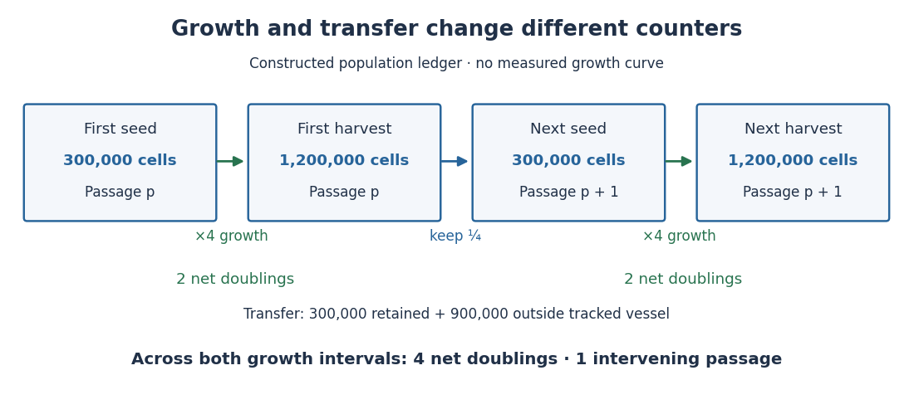

**[Figure 2](#image-one-subculture-transfer-can-follow-two-cell-line-population-doublings). One subculture transfer can follow two cell line population doublings**. Original constructed count ledger, not an observed [HeLa](#hela) growth curve. Each growth interval multiplies the recoverable count by four; each transfer retains one quarter. The tracked lineage gains four net [cell line population doublings](#cell-line-population-doublings) across two intervals although both seed counts are $300\,000$. Boxes describe whole cultured populations, not persistent individual [biological cells](biological-cell.md).

If the next interval again changes $300\,000$ to $1\,200\,000$, the two growth intervals contribute $2+2=4$ net [cell line population doublings](#cell-line-population-doublings). At the second harvest there has been just one intervening passage. Another quarter-transfer would add another passage without adding a growth interval. Thus neither passage number nor the [logarithm](calculus.md#logarithm) of the final count divided by the very first seed count records all growth when portions are removed.

### Cell line population doublings

↑ **Parent:** [Cell line](#cell-line)

For positive recoverable counts $N_0,N_1$ bracketing one growth interval, define its net [cell line population doublings](#cell-line-population-doublings) by

$$
d=\log_2\!\left(\frac{N_1}{N_0}\right)=\frac{\ln(N_1/N_0)}{\ln2}.
$$

The formula counts how many factors of two produce the observed net factor. For exactly two divisions per original [biological cell](biological-cell.md), with all daughters recovered, $N_1=2^2N_0$, giving $d=2$. Death or loss of [biological cells](biological-cell.md) makes this a net estimate of division.[Passage number and population doubling level, PDL equation and loss caveat](biology-bibliography.md#animal-cell-culture-guide-by-atcc)

Under constant-rate [exponential growth](calculus.md#exponential-growth), $N(t)=N_0e^{rt}$, a growth interval of duration $\Delta t$ gives

$$
r=\frac{\ln(N_1/N_0)}{\Delta t},\qquad t_2=\frac{\ln2}{r}=\frac{\Delta t}{d}.
$$

For the constructed fourfold increase over $48\,\mathrm{h}$, $d=2$ and the model [doubling time](calculus.md#doubling-time) is $24\,\mathrm{h}$. The proof follows by taking the [natural logarithm](calculus.md#natural-logarithm) and solving $e^{rt_2}=2$. This is a fitted property of that interval and model: it is not a universal [HeLa](#hela) [doubling time](calculus.md#doubling-time), nor the interval between two divisions of each individual [biological cell](biological-cell.md). Across successive growth intervals, add their $d$ values; keep transfer losses separate as in [cell culture passage accounting](#cell-culture-passage-accounting).

### Cell counting

↑ **Parent:** [Cell line](#cell-line)

[Cell counting](#cell-counting) estimates the number of [biological cells](biological-cell.md) in a preparation. A count per calibrated [volume](thermodynamics.md#volume-thermodynamics) gives [number density](statistical-physics.md#number-density); multiplying by the whole preparation's [volume](thermodynamics.md#volume-thermodynamics) estimates its total count. A [trypan blue exclusion test](#trypan-blue-exclusion-test) adds an operational distinction between dye-excluding and dye-stained [biological cells](biological-cell.md).

#### Hemocytometer

↑ **Parent:** [Cell counting](#cell-counting)  
ⓦ [Wiki](https://en.wikipedia.org/wiki/Hemocytometer)

A [hemocytometer](#hemocytometer) has a calibrated grid and depth. ATCC describes $1\,\mathrm{mm}^2$ squares $0.1\,\mathrm{mm}$ deep, each sampling $10^{-4}\,\mathrm{mL}$.[Cell counting, chamber geometry; Figure 2](biology-bibliography.md#animal-cell-culture-guide-by-atcc)

An original constructed [hemocytometer](#hemocytometer) count uses four such squares after mixing the [biological cell](biological-cell.md) preparation with the same [volume](thermodynamics.md#volume-thermodynamics) of stain. The dye-excluding counts are $36,44,40,40$; the dye-stained counts are $4,6,5,5$. The dilution factor is $D=2$. With $v$ the sampled [volume](thermodynamics.md#volume-thermodynamics) per square and $\bar n$ the [arithmetic mean](arithmetic.md#arithmetic-mean) count per square,

$$
v=(1\,\mathrm{mm}^2)(0.1\,\mathrm{mm})=10^{-4}\,\mathrm{mL},\qquad c=D\frac{\bar n}{v}.
$$

Hence the undiluted preparation has dye-excluding [number density](statistical-physics.md#number-density) $2(40)/10^{-4}=800\,000\,\mathrm{mL}^{-1}$ and total [number density](statistical-physics.md#number-density) $2(45)/10^{-4}=900\,000\,\mathrm{mL}^{-1}$. Its dye-excluding fraction is $160/180=8/9\approx88.9\%$. If the well-mixed preparation contains $3\,\mathrm{mL}$, it contains an estimated $2\,400\,000$ dye-excluding [biological cells](biological-cell.md). The chamber sample itself contains only $160$ counted dye-excluding [biological cells](biological-cell.md).

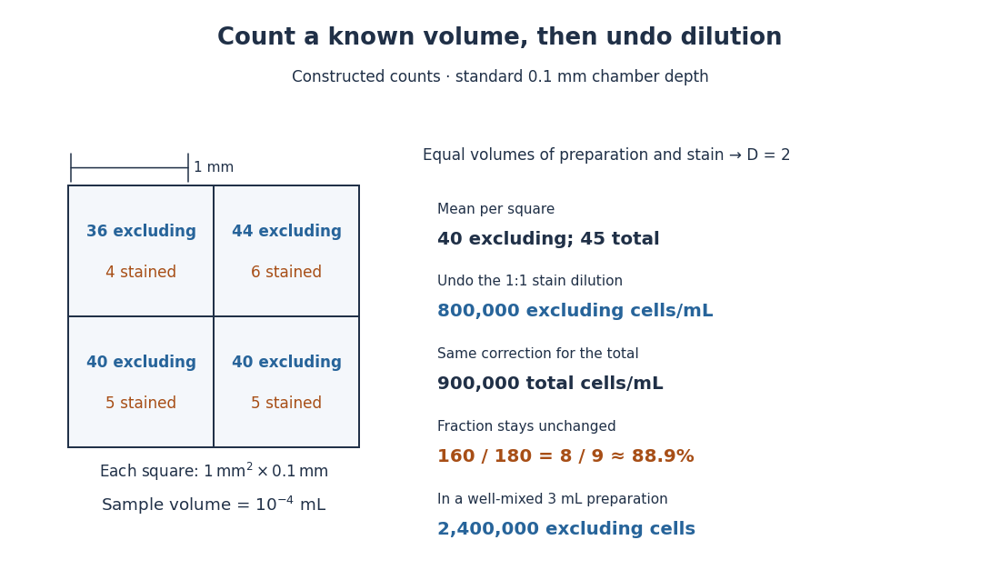

**[Figure 3](#image-a-sampled-count-becomes-a-whole-preparation-estimate-through-volume-thermodynamics-and-dilution). A sampled count becomes a whole-preparation estimate through volume and dilution**. Original constructed [hemocytometer](#hemocytometer) example: four $1\,\mathrm{mm}^2$ counting squares at $0.1\,\mathrm{mm}$ depth. Numbers report hypothetical counts, not recorded [HeLa](#hela) measurements. Correcting for the equal-volume stain mixture doubles both [number densities](statistical-physics.md#number-density) and leaves the dye-excluding fraction unchanged.

The relation $c=D\bar n/v$ follows from counting material in a known [volume](thermodynamics.md#volume-thermodynamics), then undoing dilution. It assumes a representative mixed sample and correctly identified single [biological cells](biological-cell.md). Clumps, inconsistent decisions at grid edges, wrong chamber depth and nonrepresentative sampling introduce [measurement error](probability-and-statistics.md#measurement-error). A fixed convention such as including top and left edges while excluding bottom and right edges assigns shared-edge centers to just one square. Adding ten times as much suspension to a correctly filled chamber does not make each square's calibrated [volume](thermodynamics.md#volume-thermodynamics) ten times larger.

#### Trypan blue exclusion test

↑ **Parent:** [Cell counting](#cell-counting)

The [trypan blue exclusion test](#trypan-blue-exclusion-test) reads [cell membrane](cell-membrane.md) integrity through [trypan blue](chemical-substance.md#trypan-blue) exclusion. Prolonged dye exposure can itself increase staining.[Cell viability, dye exclusion and trypan-blue counting window](biology-bibliography.md#animal-cell-culture-guide-by-atcc)

An unstained [biological cell](biological-cell.md) is dye-excluding at the time of this assay. That observation alone does not demonstrate future division, sustained [metabolism](biology.md#metabolism) or long-term renewal of a [cell line](#cell-line). Conversely, a smaller unstained count can reflect both staining and loss of [biological cells](biological-cell.md) from the recovered preparation. Report the denominator and recovery procedure alongside the fraction.

### HeLa

↑ **Parent:** [Cell line](#cell-line)  
ⓦ [Wiki](https://en.wikipedia.org/wiki/HeLa)

[HeLa](#hela) is a human [continuous cell line](#immortalised-cell-line) originating in [cervical cancer](biology.md#cervical-cancer) [biological cells](biological-cell.md) collected from [Henrietta Lacks](biology.md#henrietta-lacks) in 1951. Its name combines the beginning of her first and last names.[The Legacy of Henrietta Lacks, opening history and name explanation](biology-bibliography.md#the-legacy-of-henrietta-lacks-johns-hopkins-medicine)

ATCC's CCL-2 [HeLa](#hela) preparation grows attached to a surface. Its product sheet specifies a [cell culture medium](#cell-culture-medium) supplemented with [fetal bovine serum](#fetal-bovine-serum), at $37\,{}^\circ\mathrm{C}$ with $5\%$ [carbon dioxide](chemical-substance.md#carbon-dioxide) in air.[Characteristics, Growth properties; Handling information, Complete medium, Temperature and Atmosphere](biology-bibliography.md#hela-ccl-2-by-atcc) These are specified conditions for that preparation, rather than defining conditions for every [HeLa](#hela) derivative.

Continuing access to related [biological cells](biological-cell.md) makes [HeLa](#hela) useful for comparisons of [cell state](#cell-state) and responses to interventions. But a [continuous cell line](#immortalised-cell-line) is a laboratory model: its history and environment matter, and observations in it do not alone establish responses in an intact [organism](organism.md). [Cell counting](#cell-counting) measures abundance; a [trypan blue exclusion test](#trypan-blue-exclusion-test) measures a particular membrane-associated readout; neither proves [cell line](#cell-line) identity.

#### HeLa culture viability experiment

↑ **Parent:** [HeLa](#hela)

A published teaching experiment used ATCC CCL-2 [HeLa](#hela) to make the distinction between a [cell line](#cell-line) and the condition of individual [biological cells](biological-cell.md) visible. Cultures were expanded in treated flasks and supplied as adherent dishes. A wash with [phosphate-buffered saline](acid-base-chemistry.md#phosphate-buffered-saline) preceded [trypsin](enzyme.md#trypsin) treatment to detach them; added [fetal bovine serum](#fetal-bovine-serum) stopped the digestion. The dispersed preparation was mixed with an equal [volume](thermodynamics.md#volume-thermodynamics) of [trypan blue](chemical-substance.md#trypan-blue) and loaded into a counting chamber under an [optical microscope](optical-instrument.md#optical-microscope).[Procedure, Materials; HeLa cell washing and dissociation; HeLa cell counting](biology-bibliography.md#introducing-mammalian-cell-culture-and-cell-viability-techniques-in-the-undergraduate-biology-laboratory-by-kristen-bowey-dellinger-and-others)

For the [ethanol](biology.md#ethanol) comparison, treatment groups and an untreated control were brought to the same final [volume](thermodynamics.md#volume-thermodynamics); the control received [phosphate-buffered saline](acid-base-chemistry.md#phosphate-buffered-saline). Dye-excluding counts were compared across [replicates](design-of-experiments.md#replicate). The paper reports representative student measurements in Figure 3A and documents the untreated control in its discussion. Its alternative [temperature](temperature.md) comparison used three [replicates](design-of-experiments.md#replicate) per condition and a $30\,\mathrm{min}$ exposure.[HeLa cell viability—biology majors, volume-matched control; Figure 3A; Evidence of student learning—biology majors; HeLa cell viability—general biology education](biology-bibliography.md#introducing-mammalian-cell-culture-and-cell-viability-techniques-in-the-undergraduate-biology-laboratory-by-kristen-bowey-dellinger-and-others)

The paper's disposable chamber had a different count-to-[number density](statistical-physics.md#number-density) calibration from the [hemocytometer](#hemocytometer) above. Dye exclusion does not establish future division; recovery and mixing also affect counts. The constructed [hemocytometer](#hemocytometer) example is independent of those observations.[Sample data—general biology education, Glasstic Slide 10 calibration; Faculty instructions, chamber equations can differ](biology-bibliography.md#introducing-mammalian-cell-culture-and-cell-viability-techniques-in-the-undergraduate-biology-laboratory-by-kristen-bowey-dellinger-and-others)

## Cell state

↑ **Parent:** [Biological cell](biological-cell.md)

A [cell state](#cell-state) describes current properties of a [biological cell](biological-cell.md), including its [gene expression](molecular-genetics.md#gene-expression), structure and activity. A snapshot of [cell state](#cell-state) does not alone establish its future [cell fate](organism.md#cell-fate).

## Stem cell

↑ **Parent:** [Biological cell](biological-cell.md)  
ⓦ [Wiki](https://en.wikipedia.org/wiki/Stem_cell)

A [stem cell](#stem-cell) can produce both renewed [stem cells](#stem-cell) and differentiated descendants. Its developmental range depends on the type and setting; self-renewal does not imply unrestricted [cell fate](organism.md#cell-fate).

### Pluripotency

↑ **Parent:** [Stem cell](#stem-cell)

Capacity to generate the principal embryonic [cell lineages](#cell-lineage) under suitable conditions. Expression of one stem-[cell](biological-cell.md) marker alone does not establish this capacity.

#### Primed pluripotency

↑ **Parent:** [Pluripotency](#pluripotency)

A pluripotent state associated with later [epiblast](biology.md#epiblast) and readiness to respond to lineage-specifying signals. It is experimentally and molecularly distinct from [naive pluripotency](#naive-pluripotency).

#### Formative pluripotency

↑ **Parent:** [Pluripotency](#pluripotency)

A transitional pluripotent state in which naive circuitry has been dismantled while competence for later lineage induction is being acquired. This is a state transition, not an additional [germ layer](biology.md#germ-layer).

#### Naive pluripotency

↑ **Parent:** [Pluripotency](#pluripotency)

A pluripotent state associated with the preimplantation mouse [epiblast](biology.md#epiblast) and a characteristic regulatory network. Naive [cells](biological-cell.md) differ from the postimplantation [epiblast](biology.md#epiblast) in signalling requirements, [chromatin](molecular-genetics.md#chromatin) state and responsiveness to differentiation cues.

### Population self-renewal

↑ **Parent:** [Stem cell](#stem-cell)

Maintenance of a renewing population through balanced outcomes across cells, without requiring every division to produce exactly one renewing daughter.

#### Single-progenitor model

↑ **Parent:** [Population self-renewal](#population-self-renewal)

A model in which one functionally defined progenitor class can explain renewal through stochastic, balanced fates. Molecular uniformity and exact independence of neighbouring cells are stronger claims than the model requires.

### Stem-cell ablation

↑ **Parent:** [Stem cell](#stem-cell)

Experimental removal of a population defined by location or marker. The result depends on efficiency, duration, surviving cells, niche injury and the ability of other cells to replace the targeted state.

#### Diphtheria toxin receptor ablation

↑ **Parent:** [Stem-cell ablation](#stem-cell-ablation)

Ablation of engineered receptor-expressing cells using diphtheria toxin. Receptor-negative toxin controls, time-course verification and survival of untargeted compartments are essential.

### Germline stem cell

↑ **Parent:** [Stem cell](#stem-cell)

A self-renewing cell that supplies descendants to the germline. Division orientation relative to a [stem-cell niche](#stem-cell-niche) can help give daughters different developmental outcomes.

#### Spectrosome

↑ **Parent:** [Germline stem cell](#germline-stem-cell)

A specialized cytoplasmic structure in relevant fly germline cells associated with localization of cell-cycle regulators. Its organization must not be assumed identical in every stem-cell system.

### Stem-cell niche

↑ **Parent:** [Stem cell](#stem-cell)

The local cellular and extracellular environment regulating stem-cell persistence, renewal and differentiation. In culture, supplied matrix and growth factors may substitute for components normally provided by neighbouring cells.

### Multipotency

↑ **Parent:** [Stem cell](#stem-cell)

Capacity to generate several specified differentiated cell types. It does not imply ability to generate every cell type or a whole organism.

### Self-renewal

↑ **Parent:** [Stem cell](#stem-cell)

Production of descendants that retain the originating population's developmental capacity. For a stem-cell population, self-renewal must accompany suitable differentiated output; persistence of a label alone does not establish both properties.

### Intestinal stem cell

↑ **Parent:** [Stem cell](#stem-cell)

A [stem cell](#stem-cell) contributing sustained differentiated descendants to the intestinal lining. Marker expression is suggestive; long-term [lineage tracing](#lineage-tracing) tests renewal and lineage output.

#### Reserve intestinal stem cell

↑ **Parent:** [Intestinal stem cell](#intestinal-stem-cell)

A functional description for a cell that can restore intestinal stem-cell output after damage. It does not by itself establish a permanently distinct, uniquely marked quiescent lineage.

#### Crypt-base columnar cell

↑ **Parent:** [Intestinal stem cell](#intestinal-stem-cell)

A cell at the crypt base, including actively cycling Lgr5-expressing [stem cells](#stem-cell) interspersed with supporting cells in the mouse small intestine.

### Embryonic stem cell

↑ **Parent:** [Stem cell](#stem-cell)

A [stem cell](#stem-cell) derived from early embryonic tissue with capacity to generate many differentiated [cell types](#cell-type) under suitable conditions.

## Progenitor cell

↑ **Parent:** [Biological cell](biological-cell.md)  
ⓦ [Wiki](https://en.wikipedia.org/wiki/Progenitor_cell)

A [progenitor cell](#progenitor-cell) is a precursor with relatively restricted differentiation potential and, generally, more limited self-renewal than a [stem cell](#stem-cell). Usage depends on the lineage and assay; an expression marker alone does not establish renewal capacity.

### Primordial germ cell-like cell

↑ **Parent:** [Progenitor cell](#progenitor-cell)

An experimentally induced cell resembling an embryonic [primordial germ cell](#primordial-germ-cell) by molecular and developmental criteria. Similarity should be stated separately from demonstrated gamete-forming function.

### Pole cell

↑ **Parent:** [Progenitor cell](#progenitor-cell)

One of the early germline precursor cells formed at the embryonic poles in [Drosophila melanogaster](organism.md#drosophila-melanogaster), normally at the posterior where [germ plasm](#germ-plasm) is assembled.

### Primordial germ cell

↑ **Parent:** [Progenitor cell](#progenitor-cell)

An early embryonic [germline](#germline) precursor that will contribute to future [gametes](biology.md#gamete). Expression of one germ-cell-associated marker alone does not demonstrate full developmental function.

### Neuromesodermal progenitor

↑ **Parent:** [Progenitor cell](#progenitor-cell)

A [progenitor cell](#progenitor-cell) with competence for neural and mesodermal development, particularly [spinal cord](neuroscience.md#spinal-cord) and [paraxial mesoderm](biology.md#paraxial-mesoderm). Shared markers indicate [cell state](#cell-state); demonstrating realised bipotency requires [clonal lineage tracing](#clonal-lineage-tracing).

## Secretory granule

↑ **Parent:** [Biological cell](biological-cell.md)

A storage compartment that participates in regulated [exocytosis](cell-membrane.md#exocytosis); the [insulin](protein.md#insulin) example distinguishes storage of a [hormone](signal-transduction.md#hormone) from storage of [glycogen](biology.md#glycogen) fuel.

## Cell cycle

↑ **Parent:** [Biological cell](biological-cell.md)

[This section is present in another page, follow this link to view it.](cell-cycle.md)

## Cell envelope

↑ **Parent:** [Biological cell](biological-cell.md)  
ⓦ [Wiki](https://en.wikipedia.org/wiki/Cell_envelope)

The [cell envelope](#cell-envelope) comprises a [biological cell](biological-cell.md)'s surrounding boundary layers, including its [cell membrane](cell-membrane.md) and a [cell wall](#cell-wall) or additional outer structures when present. The term is especially useful when discussing [bacteria](organism.md#bacteria), where the layers must be distinguished.

### Bacterial outer membrane

↑ **Parent:** [Cell envelope](#cell-envelope)  
ⓦ [Wiki](https://en.wikipedia.org/wiki/Bacterial_outer_membrane)

A [bacterial outer membrane](#bacterial-outer-membrane) is an additional membrane outside the [peptidoglycan](#peptidoglycan) in typical [Gram-negative bacteria](organism.md#gram-negative-bacteria). It adds a barrier while the inner [cell membrane](cell-membrane.md) remains the boundary of the [cytoplasm](#cytoplasm).

#### Periplasm

↑ **Parent:** [Bacterial outer membrane](#bacterial-outer-membrane)

The [periplasm](#periplasm) is the compartment between the cytoplasmic and outer membranes in a typical Gram-negative bacterial envelope. Its components and the outer membrane can gate access of external electron acceptors.

## Cell wall

↑ **Parent:** [Biological cell](biological-cell.md)  
ⓦ [Wiki](https://en.wikipedia.org/wiki/Cell_wall)

A [cell wall](#cell-wall) is a supporting structure outside a [cell membrane](cell-membrane.md). It helps preserve shape and bears the load when [osmosis](cell-membrane.md#osmosis) raises internal [pressure](pressure.md). The [cell membrane](cell-membrane.md) supplies the [selective permeability](cell-membrane.md#selective-permeability) described in its own article; the [cell wall](#cell-wall) supplies mechanical reinforcement. These functions cooperate: a porous supporting layer can restrain expansion without being the boundary that retains dissolved [solutes](mixture.md#solute). [Turgor pressure](#turgor-pressure) makes this cooperation visible in a firm leaf; [plasmolysis](#plasmolysis) and a [lysozyme wall-removal experiment](#lysozyme-wall-removal-experiment) separate the two functions experimentally.[Biology 2e, §5.2, Tonicity in Living Systems, Figure 5.13: wall support and plasmolysis](biology-bibliography.md#biology-2e-by-mary-ann-clark-and-others/5-2-passive-transport)

The material is not universal. Most [bacteria](organism.md#bacteria) use [peptidoglycan](#peptidoglycan), whose linked [sugar](chemical-substance.md#sugar) chains and [amino acid](chemical-substance.md#amino-acid) cross-links are explained below. A [plant cell wall](#plant-cell-wall) uses [cellulose](chemical-substance.md#cellulose); a [fungal cell wall](#fungal-cell-wall) contains [chitin](#chitin) and [glucans](#glucan). [Animals](organism.md#animal) lack a [cell wall](#cell-wall), some [bacteria](organism.md#bacteria) are naturally wall-free, and [archaea](organism.md#archaea) have different wall chemistry. Thus a [cell wall](#cell-wall) is neither a universal cellular component nor one chemical recipe.[Biology 2e, §22.2, Figure 22.13 and The Cell Wall of Prokaryotes: wall-free bacteria and archaeal differences](biology-bibliography.md#biology-2e-by-mary-ann-clark-and-others/22-2-structure-of-prokaryotes-bacteria-and-archaea)[Biology 2e, §4.3, Animal Cells versus Plant Cells and The Cell Wall: cellulose and animal comparison](biology-bibliography.md#biology-2e-by-mary-ann-clark-and-others/4-3-eukaryotic-cells)[Biology 2e, §24.1, Cell Structure and Function: chitin and glucans](biology-bibliography.md#biology-2e-by-mary-ann-clark-and-others/24-1-characteristics-of-fungi)

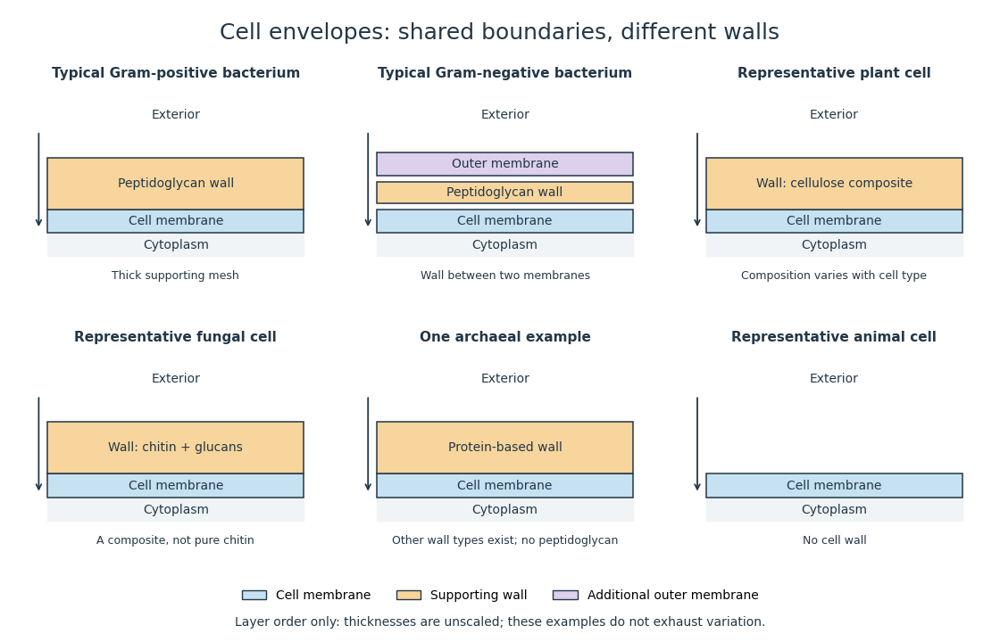

**[Figure 4](#image-representative-cell-envelopes-different-supporting-layers-outside-the-cell-membrane). Representative cell envelopes: different supporting layers outside the cell membrane**. Original layer-order schematic comparing [Gram-positive bacteria](organism.md#gram-positive-bacteria), [Gram-negative bacteria](organism.md#gram-negative-bacteria), a [plant cell wall](#plant-cell-wall), a [fungal cell wall](#fungal-cell-wall), a member of [archaea](organism.md#archaea) with a protein wall and an [animal](organism.md#animal) cell. Colors distinguish a [cell wall](#cell-wall) from a [cell membrane](cell-membrane.md) and a [bacterial outer membrane](#bacterial-outer-membrane). Thicknesses and spacing are illustrative, not measurements. These examples do not exhaust variation within any group.

The [bacterial outer membrane](#bacterial-outer-membrane) in typical [Gram-negative bacteria](organism.md#gram-negative-bacteria) is an additional membrane outside the [peptidoglycan](#peptidoglycan), not another name for that supporting mesh. The [cell envelope](#cell-envelope) includes the boundary layers together. An extra barrier can change access to the [peptidoglycan](#peptidoglycan), so response to [lysozyme](protein.md#lysozyme) cannot be inferred from the mere presence of a [cell wall](#cell-wall).[Biology 2e, §22.2, Figure 22.16: inner membrane, peptidoglycan and outer membrane](biology-bibliography.md#biology-2e-by-mary-ann-clark-and-others/22-2-structure-of-prokaryotes-bacteria-and-archaea)

### Cell-wall pulse labelling

↑ **Parent:** [Cell wall](#cell-wall)

Labelling of existing accessible wall followed by growth without the same free label. Comparing old label with new surface distinguishes inheritance of old wall from local deposition of new material.

### Plant cell wall

↑ **Parent:** [Cell wall](#cell-wall)

A [plant cell wall](#plant-cell-wall) provides reinforcement outside the [cell membrane](cell-membrane.md), with [cellulose](chemical-substance.md#cellulose) as a major structural component. It is a composite rather than a solid sheet of pure [cellulose](chemical-substance.md#cellulose). Wall construction varies with the kind and developmental state of the [biological cell](biological-cell.md).

### Fungal cell wall

↑ **Parent:** [Cell wall](#cell-wall)

A [fungal cell wall](#fungal-cell-wall) contains structural [polysaccharides](chemical-substance.md#polysaccharide) including [chitin](#chitin) and [glucans](#glucan). Its composition and organization vary among [fungi](organism.md#fungus); the diagram illustrates a composite rather than a pure [chitin](#chitin) shell. A [fungus](organism.md#fungus) sharing a [cell wall](#cell-wall) with a [plant](organism.md#plant) does not imply shared wall chemistry.[Biology 2e, §24.1, Cell Structure and Function: structural wall polysaccharides](biology-bibliography.md#biology-2e-by-mary-ann-clark-and-others/24-1-characteristics-of-fungi)

#### Chitin

↑ **Parent:** [Fungal cell wall](#fungal-cell-wall)  
🏷️ **Tags:** [Polysaccharide](chemical-substance.md#polysaccharide)  
ⓦ [Wiki](https://en.wikipedia.org/wiki/Chitin)

[Chitin](#chitin) is a structural [polysaccharide](chemical-substance.md#polysaccharide) built from modified [sugar](chemical-substance.md#sugar) units. It contributes reinforcement to a [fungal cell wall](#fungal-cell-wall).

#### Glucan

↑ **Parent:** [Fungal cell wall](#fungal-cell-wall)  
🏷️ **Tags:** [Polysaccharide](chemical-substance.md#polysaccharide)  
ⓦ [Wiki](https://en.wikipedia.org/wiki/Glucan)

A [glucan](#glucan) is a [polysaccharide](chemical-substance.md#polysaccharide) built from [glucose](chemical-substance.md#glucose) units. Different linkages produce different structures; some [glucans](#glucan) contribute to a [fungal cell wall](#fungal-cell-wall).

### Turgor pressure

↑ **Parent:** [Cell wall](#cell-wall)  
ⓦ [Wiki](https://en.wikipedia.org/wiki/Turgor_pressure)

[Turgor pressure](#turgor-pressure) is the internal [hydrostatic pressure](fluid-mechanics.md#hydrostatic-pressure) above the external [pressure](pressure.md) in a [biological cell](biological-cell.md). When [water](chemical-substance.md#water) enters a walled [biological cell](biological-cell.md) by [osmosis](cell-membrane.md#osmosis), expansion loads the [cell wall](#cell-wall). Rising [pressure](pressure.md) can oppose further net entry while the [cell membrane](cell-membrane.md) retains its [selective permeability](cell-membrane.md#selective-permeability). Mechanical support therefore does not require the [cell wall](#cell-wall) to block [water](chemical-substance.md#water).

As an original mechanical check, idealize a small flat patch of [cell wall](#cell-wall) of [surface area](differential-geometry.md#surface-area) $A$ under uniform [turgor pressure](#turgor-pressure) $\Delta P=P_{\mathrm{in}}-P_{\mathrm{out}}$. Its outward [force](force.md) is $F=\Delta P A$. Doubling $A$ at fixed [pressure](pressure.md) doubles the load; equal internal and external [pressures](pressure.md) give zero net pressure load. This is a force balance, not a measured wall strength or a complete model of a curved, growing [biological cell](biological-cell.md). It says nothing about which [solutes](mixture.md#solute) cross the [cell membrane](cell-membrane.md).

### Plasmolysis

↑ **Parent:** [Cell wall](#cell-wall)  
ⓦ [Wiki](https://en.wikipedia.org/wiki/Plasmolysis)

[Plasmolysis](#plasmolysis) is withdrawal of the membrane-bounded contents from parts of a [cell wall](#cell-wall) after [water](chemical-substance.md#water) loss. A sufficiently concentrated external [hypertonic solution](cell-membrane.md#hypertonic-solution), with [solutes](mixture.md#solute) effectively excluded by the [cell membrane](cell-membrane.md) over the observation time, can cause this. The [cell wall](#cell-wall) remains; the enclosed material contracts. [Plasmolysis](#plasmolysis) is therefore distinct from [osmotic lysis](cell-membrane.md#cytolysis), which breaks the cellular boundary during excessive swelling. A return to a less concentrated surrounding [chemical solution](mixture.md#solution-chemistry) can reverse [plasmolysis](#plasmolysis) if the [biological cell](biological-cell.md) remains functional.[Biology 2e, §5.2, Tonicity in Living Systems and Figure 5.13: membrane withdrawal under hypertonic conditions](biology-bibliography.md#biology-2e-by-mary-ann-clark-and-others/5-2-passive-transport)

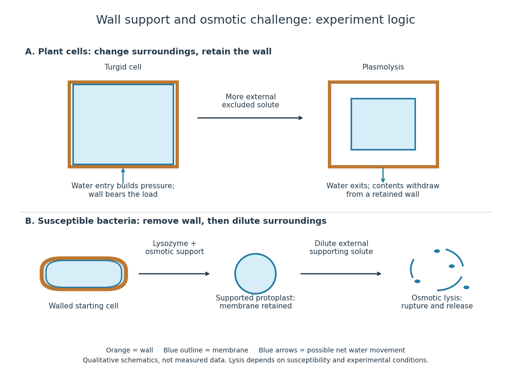

**[Figure 5](#image-plasmolysis-with-a-retained-cell-wall-and-osmotic-challenge-after-wall-removal). Plasmolysis with a retained cell wall, and osmotic challenge after wall removal**. Original qualitative experiment logic. The upper pair compares a turgid [plant](organism.md#plant) cell with [plasmolysis](#plasmolysis) in an external [hypertonic solution](cell-membrane.md#hypertonic-solution). The lower pair compares a supported [protoplast](#protoplast) with [osmotic lysis](cell-membrane.md#cytolysis) after dilution for a susceptible preparation. Arrows indicate interventions or possible net [water](chemical-substance.md#water) movement, not measured rates. The dilution comparison concerns [lysozyme](protein.md#lysozyme)-susceptible [bacteria](organism.md#bacteria); the upper comparison concerns [plant](organism.md#plant) cells. No measured dimensions, times or survival fractions are implied.

### Protoplast

↑ **Parent:** [Cell wall](#cell-wall)  
ⓦ [Wiki](https://en.wikipedia.org/wiki/Protoplast)

A [protoplast](#protoplast) is the living contents of a [biological cell](biological-cell.md) bounded by its [cell membrane](cell-membrane.md) after removal of the [cell wall](#cell-wall). Removing the [cell wall](#cell-wall) need not immediately destroy the [cell membrane](cell-membrane.md); stability depends on the preparation and surroundings. [Lysozyme](protein.md#lysozyme) acts on susceptible bacterial [peptidoglycan](#peptidoglycan), not on [cellulose](chemical-substance.md#cellulose) or [chitin](#chitin), so it is not a universal wall-removal [enzyme](enzyme.md).

#### Lysozyme wall-removal experiment

↑ **Parent:** [Protoplast](#protoplast)

The 1953 paper [The isolation of protoplasts from Bacillus megaterium by controlled treatment with lysozyme by Claes Weibull](biology-bibliography.md#the-isolation-of-protoplasts-from-bacillus-megaterium-by-controlled-treatment-with-lysozyme-by-claes-weibull) (pp. 688–690, Figures 2–3) tested [Bacillus megaterium](organism.md#bacillus-megaterium) strain KM. Apparatus included a Klett-Summerson colorimeter with a red filter and a Spencer no. 8 [phase-contrast microscope](optical-instrument.md#phase-contrast-microscope). [Lysozyme](protein.md#lysozyme) in phosphate buffer produced empty residual bodies; adding $0.2\,\mathrm{M}$ [sucrose](chemical-substance.md#sucrose) preserved granular spheres. Diluting their surroundings caused rapid [osmotic lysis](cell-membrane.md#cytolysis).

The same study compared untreated, boiled, [lysozyme](protein.md#lysozyme)-exposed and [sucrose](chemical-substance.md#sucrose)-protected samples. Filled, stoppered tubes reduced damage from air exposure. After [centrifugation](biology.md#centrifugation), a Beckman DU spectrophotometer measured ultraviolet [wave absorption](wave.md#wave-absorption) of the separated liquid. Protected samples resembled untreated controls in releasing little ultraviolet-absorbing material; boiled and unprotected samples released much more. Later-growth cultures reduced spontaneous breakdown as a confounder.[pp. 688–689, Materials and Methods; pp. 692–694, release comparison and Figure 6](biology-bibliography.md#the-isolation-of-protoplasts-from-bacillus-megaterium-by-controlled-treatment-with-lysozyme-by-claes-weibull)

Together, the shape and release readouts support removal of mechanical protection while a permeability barrier persists. They do not establish unchanged [selective permeability](cell-membrane.md#selective-permeability) to every [solute](mixture.md#solute), long-term viability, or universal susceptibility.

An instructive extension of this experimental logic is a matched comparison: [lysozyme](protein.md#lysozyme) present or absent, crossed with osmotic support present or absent. Keep starting material, buffer, observation interval and handling comparable; include a blank to distinguish optical effects of reagents from changes in the [biological cells](biological-cell.md). Then dilute already formed [protoplasts](#protoplast) as a separate intervention. This separates access and wall removal from failure after removal. These are proposed controls for interpreting the mechanism, not additional reported results from the historical paper. A fall in optical signal alone cannot establish rupture: shape changes also alter [scattering of light](optics.md#scattering-of-light).

### Peptidoglycan

↑ **Parent:** [Cell wall](#cell-wall)  
ⓦ [Wiki](https://en.wikipedia.org/wiki/Peptidoglycan)

[Peptidoglycan](#peptidoglycan) is a mesh of linked [sugar](chemical-substance.md#sugar) chains cross-linked by short chains of [amino acids](chemical-substance.md#amino-acid) in the [cell walls](#cell-wall) of most [bacteria](organism.md#bacteria). Its absence from the [cell walls](#cell-wall) of [archaea](organism.md#archaea) helps distinguish envelope chemistry without confusing either [cell wall](#cell-wall) with a [cell membrane](cell-membrane.md). See [OpenStax Microbiology, 3.3: cell walls and peptidoglycan](https://openstax.org/books/microbiology/pages/3-3-unique-characteristics-of-prokaryotic-cells).

## Cell membrane

↑ **Parent:** [Biological cell](biological-cell.md)

[This section is present in another page, follow this link to view it.](cell-membrane.md)

#### Rod complex

↑ **Parent:** [Peptidoglycan](#peptidoglycan)

A bacterial cell-envelope assembly involved in oriented lateral peptidoglycan synthesis in many rod-shaped species.

## Cytoplasm

↑ **Parent:** [Biological cell](biological-cell.md)  
ⓦ [Wiki](https://en.wikipedia.org/wiki/Cytoplasm)

The [cytoplasm](#cytoplasm) is the material inside a [cell membrane](cell-membrane.md) but outside the [cell nucleus](#cell-nucleus), when one is present. It includes the [cytosol](#cytosol), the [organelles](#organelle) suspended in it, and other structures; it is not just a name for the liquid. In a [prokaryote](organism.md#prokaryote), which has no [cell nucleus](#cell-nucleus), the [nucleoid](#nucleoid) and [ribosomes](#ribosome) are within the [cytoplasm](#cytoplasm). See [Clark, Douglas and Choi, Biology 2e, 4.3: cytoplasm and cytosol](https://openstax.org/books/biology-2e/pages/4-3-eukaryotic-cells) and [Clark, Douglas and Choi, Biology 2e, 4.2: prokaryotic organization](https://openstax.org/books/biology-2e/pages/4-2-prokaryotic-cells).

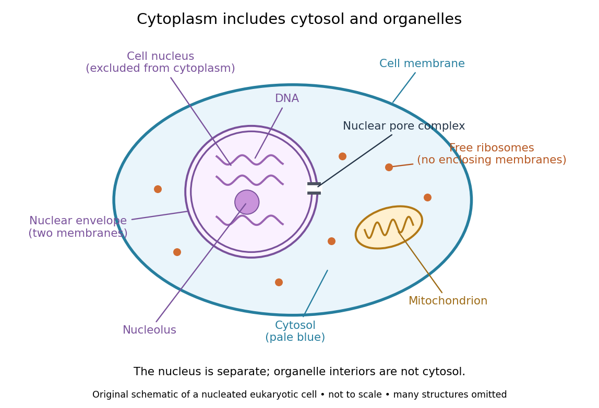

**[Figure 6](#image-cell-nucleus-cytosol-and-organelles-in-a-nucleated-eukaryotic-biological-cell). Cell nucleus, cytosol and organelles in a nucleated eukaryotic biological cell**. Original schematic: the pale blue region represents [cytosol](#cytosol), while the surrounding [cytoplasm](#cytoplasm) also includes the depicted [mitochondrion](#mitochondria) and [ribosomes](#ribosome). The [cell nucleus](#cell-nucleus) and [cell nucleolus](#nucleolus-biology) are excluded from the [cytoplasm](#cytoplasm). A [nuclear pore complex](#nuclear-pore-complex) provides a route across the double [nuclear envelope](#nuclear-envelope). Dimensions and component counts are illustrative; many structures are omitted.

Try classifying four positions in the diagram. A point in the pale blue region belongs to both [cytosol](#cytosol) and [cytoplasm](#cytoplasm). A point inside the [mitochondrion](#mitochondria) belongs to an [organelle](#organelle) included in the [cytoplasm](#cytoplasm), but not to the surrounding [cytosol](#cytosol). A point on a free [ribosome](#ribosome) belongs to the [cytoplasm](#cytoplasm), but the [ribosome](#ribosome) itself is not [cytosol](#cytosol). A point inside the [cell nucleus](#cell-nucleus) belongs to neither [cytoplasm](#cytoplasm) nor [cytosol](#cytosol). These distinctions prevent the misleading inference that everything outside the [cell nucleus](#cell-nucleus) shares one undivided liquid environment.

The usefulness of the [cytoplasm](#cytoplasm) is this combination of shared surroundings and specialized structures: [enzymes](enzyme.md) in the [cytosol](#cytosol) carry out many steps of [metabolism](biology.md#metabolism), while [organelles](#organelle) maintain their own internal conditions. A soluble [protein](protein.md) made by a free [ribosome](#ribosome) may work in the [cytosol](#cytosol) or be transported elsewhere, including into the [cell nucleus](#cell-nucleus). Cellular organization therefore combines separation with exchange, rather than assigning each [protein](protein.md) permanently to its place of synthesis. See [Alberts et al., Molecular Biology of the Cell (2002): traffic between nucleus and cytosol](https://www.ncbi.nlm.nih.gov/books/NBK26932/).

### Germ plasm

↑ **Parent:** [Cytoplasm](#cytoplasm)

Specialised cytoplasmic material containing components that promote [germline](#germline) development when inherited by selected embryonic cells.

### Cytosol

↑ **Parent:** [Cytoplasm](#cytoplasm)  
ⓦ [Wiki](https://en.wikipedia.org/wiki/Cytosol)

The [cytosol](#cytosol) is the aqueous part of the [cytoplasm](#cytoplasm) surrounding its structures, including [organelles](#organelle). It contains [water](chemical-substance.md#water), [ions](chemistry.md#ion) and dissolved [molecules](molecule.md), including many [proteins](protein.md); it is a crowded working environment rather than pure [water](chemical-substance.md#water). The liquid inside a [cell nucleus](#cell-nucleus) or a membrane-bounded [organelle](#organelle) is not the surrounding [cytosol](#cytosol).

## Nucleoid

↑ **Parent:** [Biological cell](biological-cell.md)  
ⓦ [Wiki](https://en.wikipedia.org/wiki/Nucleoid)

A [nucleoid](#nucleoid) is the region occupied by [chromosome](genetics.md#chromosome) [DNA](polymer.md#deoxyribonucleic-acid) in a [prokaryotic](organism.md#prokaryote) [biological cell](biological-cell.md). It has no surrounding [nuclear envelope](#nuclear-envelope), but its [DNA](polymer.md#deoxyribonucleic-acid) is organized rather than freely spread at random. See [OpenStax Biology 2e, 4.2: the nucleoid](https://openstax.org/books/biology-2e/pages/4-2-prokaryotic-cells).

## Organelle

↑ **Parent:** [Biological cell](biological-cell.md)  
ⓦ [Wiki](https://en.wikipedia.org/wiki/Organelle)

An [organelle](#organelle) is a specialized subcellular structure. Usage varies over whether non-membrane-bounded structures such as [ribosomes](#ribosome) count as [organelles](#organelle), so explicitly say membrane-bounded [organelles](#organelle) when comparing [eukaryotic](organism.md#eukaryote) compartmentalization with [prokaryotic](organism.md#prokaryote) organization. [Mitochondria](#mitochondria) and [chloroplasts](#chloroplast) are membrane-bounded examples. See [OpenStax Microbiology, 3.4: cellular compartments](https://openstax.org/books/microbiology/pages/3-4-unique-characteristics-of-eukaryotic-cells).

### Peroxisome

↑ **Parent:** [Organelle](#organelle)

A membrane-bounded organelle with pathways including oxidative metabolism. Many matrix proteins are imported after cytosolic synthesis, including folded substrates.

### Organelle identity

↑ **Parent:** [Organelle](#organelle)

The maintained combination of membrane composition, resident proteins, lumenal conditions, geometry and trafficking functions that distinguishes a compartment. Its molecules can turn over while this functional organization persists.

### Centrosome

↑ **Parent:** [Organelle](#organelle)

A microtubule-organizing structure in relevant animal cells. Positioning centrosomes relative to a niche can prepare the orientation of a later mitotic spindle. Budding yeast instead has a [spindle pole body](cell-cycle.md#spindle-pole-body).

### Mitosome

↑ **Parent:** [Organelle](#organelle)

A highly reduced mitochondrion-related [organelle](#organelle) retaining selected metabolic functions rather than oxidative [ATP](molecule.md#adenosine-triphosphate) production. Functions differ among lineages, including [iron-sulfur cluster](molecule.md#iron-sulfur-cluster) maturation in [Giardia](organism.md#giardia) and [sulfate activation](biology.md#sulfate-activation) in [Entamoeba histolytica](organism.md#entamoeba-histolytica).[Abstract](biology-bibliography.md#mitochondrial-remnant-organelles-of-giardia-function-in-iron-sulphur-protein-maturation-by-jorge-tovar-and-others)

### Hydrogenosome

↑ **Parent:** [Organelle](#organelle)

A mitochondrion-related [organelle](#organelle) class associated with anaerobic metabolism and, in typical examples, [hydrogen](chemical-substance.md#hydrogen) and [ATP](molecule.md#adenosine-triphosphate) production. [Substrate-level phosphorylation](biochemistry.md#substrate-level-phosphorylation) can supply energy without a conventional oxygen-terminated respiratory chain.[Abstract](biology-bibliography.md#hydrogenosome-a-cytoplasmic-organelle-of-the-anaerobic-flagellate-tritrichomonas-foetus-and-its-role-in-pyruvate-metabolism-by-donald-g-lindmark-and-miklos-muller)

### Endoplasmic reticulum

↑ **Parent:** [Organelle](#organelle)  
ⓦ [Wiki](https://en.wikipedia.org/wiki/Endoplasmic_reticulum)

The [endoplasmic reticulum](#endoplasmic-reticulum) is a membrane-enclosed network of tubules and flattened sacs in a typical [eukaryotic](organism.md#eukaryote) [biological cell](biological-cell.md). Its continuous boundary encloses the [ER lumen](#er-lumen), separate from the [cytosol](#cytosol), and connects with the outer [nuclear envelope](#nuclear-envelope). [Rough endoplasmic reticulum](#rough-endoplasmic-reticulum) and [smooth endoplasmic reticulum](#smooth-endoplasmic-reticulum) are regions of this network.[The Cell: A Molecular Approach, 2nd edition by Geoffrey M. Cooper; The Endoplasmic Reticulum, opening paragraph and Figure 9.1: continuous membrane and nuclear-envelope connection](biology-bibliography.md#the-cell-a-molecular-approach-2nd-edition-by-geoffrey-m-cooper/the-endoplasmic-reticulum)

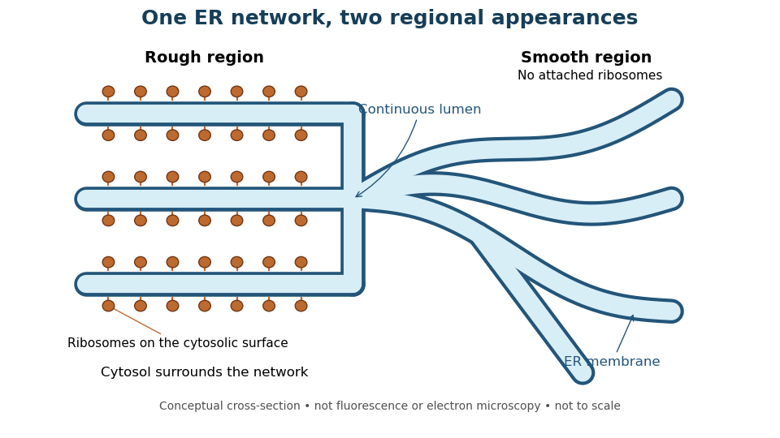

**[Figure 7](#image-one-endoplasmic-reticulum-network-with-rough-and-smooth-regions). One endoplasmic reticulum network with rough and smooth regions**. Original conceptual cross-section: blue interiors connect, while attached [ribosomes](#ribosome) distinguish rough regions. Shapes and dimensions are illustrative, not measured fluorescence or [electron microscopy](optics.md#electron-microscopy).

#### Endoplasmic reticulum stress

↑ **Parent:** [Endoplasmic reticulum](#endoplasmic-reticulum)

[endoplasmic reticulum stress](#endoplasmic-reticulum-stress) arises when ER demands exceed its processing or homeostatic capacity. It can alter folding, degradation and transport, confounding interpretation of a supposedly selective secretion defect.

#### Endoplasmic reticulum lumen

↑ **Parent:** [Endoplasmic reticulum](#endoplasmic-reticulum)

The [endoplasmic reticulum lumen](#endoplasmic-reticulum-lumen) is the aqueous space enclosed by the ER membrane. A soluble lumenal cargo cannot directly contact a cytoplasmic coat across an intact membrane.

#### Endoplasmic reticulum exit site

↑ **Parent:** [Endoplasmic reticulum](#endoplasmic-reticulum)

An [endoplasmic reticulum exit site](#endoplasmic-reticulum-exit-site) is a region organizing export machinery and cargo departure from the ER. Local coat assembly, cargo concentration and membrane supply can be coordinated there.

#### ER lumen

↑ **Parent:** [Endoplasmic reticulum](#endoplasmic-reticulum)

The [ER lumen](#er-lumen) is the internal aqueous compartment of the [endoplasmic reticulum](#endoplasmic-reticulum). A [ribosome](#ribosome) attached to its membrane sits on the [cytosol](#cytosol) side, not inside the [ER lumen](#er-lumen). This distinction separates the machinery making a [protein](protein.md) from the compartment receiving it.[Molecular Biology of the Cell, 4th edition by Bruce Alberts and others; Membrane-bound Ribosomes Define the Rough ER, Figure 12-36: cytosolic ribosomes and lumenal delivery](biology-bibliography.md#molecular-biology-of-the-cell-4th-edition-by-bruce-alberts-and-others/the-endoplasmic-reticulum)

#### Rough endoplasmic reticulum

↑ **Parent:** [Endoplasmic reticulum](#endoplasmic-reticulum)

[Rough endoplasmic reticulum](#rough-endoplasmic-reticulum) bears attached [ribosomes](#ribosome) on its [cytosol](#cytosol) surface. In a common mammalian route, [protein targeting](protein.md#protein-targeting) delivers a [nascent chain](protein.md#nascent-chain) into the [ER lumen](#er-lumen) during [biological translation](molecular-genetics.md#translation-biology). Other [proteins](protein.md) enter the membrane. Free and attached [ribosomes](#ribosome) share the same basic machinery; targeting depends on their cargo.[Molecular Biology of the Cell, 4th edition by Bruce Alberts and others; Membrane-bound Ribosomes Define the Rough ER, Figures 12-36 and 12-37; Translocation Across the ER Membrane Does Not Always Require Ongoing Polypeptide Chain Elongation](biology-bibliography.md#molecular-biology-of-the-cell-4th-edition-by-bruce-alberts-and-others/the-endoplasmic-reticulum)

##### ER signal sequence

↑ **Parent:** [Rough endoplasmic reticulum](#rough-endoplasmic-reticulum)

An [ER signal sequence](#er-signal-sequence) is [polypeptide chain](protein.md#polypeptide) targeting information recognized by machinery delivering a [protein](protein.md) to the [endoplasmic reticulum](#endoplasmic-reticulum). Many soluble cargoes have a removable [N-terminus](protein.md#n-terminus) signal; membrane insertion can use internal signals. An [ER signal sequence](#er-signal-sequence) alone does not specify the final destination.[Molecular Biology of the Cell, 4th edition by Bruce Alberts and others; The ER Signal Sequence Is Removed from Most Soluble Proteins After Translocation; In Single-Pass Transmembrane Proteins, a Single Internal ER Signal Sequence Remains in the Lipid Bilayer as a Membrane-spanning α Helix](biology-bibliography.md#molecular-biology-of-the-cell-4th-edition-by-bruce-alberts-and-others/the-endoplasmic-reticulum)

For an original counting example, stipulate an unbranched precursor [polypeptide chain](protein.md#polypeptide) of $180$ [amino acid residues](protein.md#amino-acid-residue) whose first $20$ [amino acid residues](protein.md#amino-acid-residue) form a cleaved [ER signal sequence](#er-signal-sequence). With no further processing, the remaining chain has $180-20=160$ [amino acid residues](protein.md#amino-acid-residue) and $159$ [peptide bonds](protein.md#peptide-bond). The initial chain had $179$ [peptide bonds](protein.md#peptide-bond); the detached signal has $19$, so $159+19=178$ remain after one bond is cut. The check counts adjacent positions: an unbranched chain of $n$ [amino acid residues](protein.md#amino-acid-residue) has $n-1$ [peptide bonds](protein.md#peptide-bond). These stipulated lengths are not a natural sequence, a measured size or evidence that a particular sequence functions as an [ER signal sequence](#er-signal-sequence).

#### Smooth endoplasmic reticulum

↑ **Parent:** [Endoplasmic reticulum](#endoplasmic-reticulum)

[Smooth endoplasmic reticulum](#smooth-endoplasmic-reticulum) lacks attached [ribosomes](#ribosome). Specialized regions support [lipid](chemical-substance.md#lipid) [metabolism](biology.md#metabolism) and processing of foreign compounds; the [endoplasmic reticulum](#endoplasmic-reticulum) also stores and releases [calcium](chemical-substance.md#calcium) [ions](chemistry.md#ion). Regional specialization does not split the network into two separate [organelles](#organelle), nor make every smooth region perform every function.[Molecular Biology of the Cell, 4th edition by Bruce Alberts and others; Smooth ER Is Abundant in Some Specialized Cells, Figures 12-38A and 12-38B and calcium-storage paragraphs](biology-bibliography.md#molecular-biology-of-the-cell-4th-edition-by-bruce-alberts-and-others/the-endoplasmic-reticulum)

#### Secretory protein routing

↑ **Parent:** [Endoplasmic reticulum](#endoplasmic-reticulum)

[Secretory protein routing](#secretory-protein-routing) connects entry into the [endoplasmic reticulum](#endoplasmic-reticulum), [protein folding](protein.md#protein-folding) and sorting, transfer to the [Golgi apparatus](#golgi-apparatus), and delivery onward. In the conventional soluble-cargo route, [transport vesicles](#transport-vesicle) carry lumenal contents between compartments; [exocytosis](cell-membrane.md#exocytosis) releases cargo outside the [cell membrane](cell-membrane.md). Resident [endoplasmic reticulum](#endoplasmic-reticulum) [proteins](protein.md) can be retained or retrieved, and defective cargo can be held back. Many [cytosol](#cytosol) [proteins](protein.md) never enter this route.[The Cell: A Molecular Approach, 2nd edition by Geoffrey M. Cooper; Protein Folding and Processing in the ER, Figure 9.14; Export of Proteins and Lipids from the ER, Figures 9.20 and 9.21](biology-bibliography.md#the-cell-a-molecular-approach-2nd-edition-by-geoffrey-m-cooper/the-endoplasmic-reticulum)

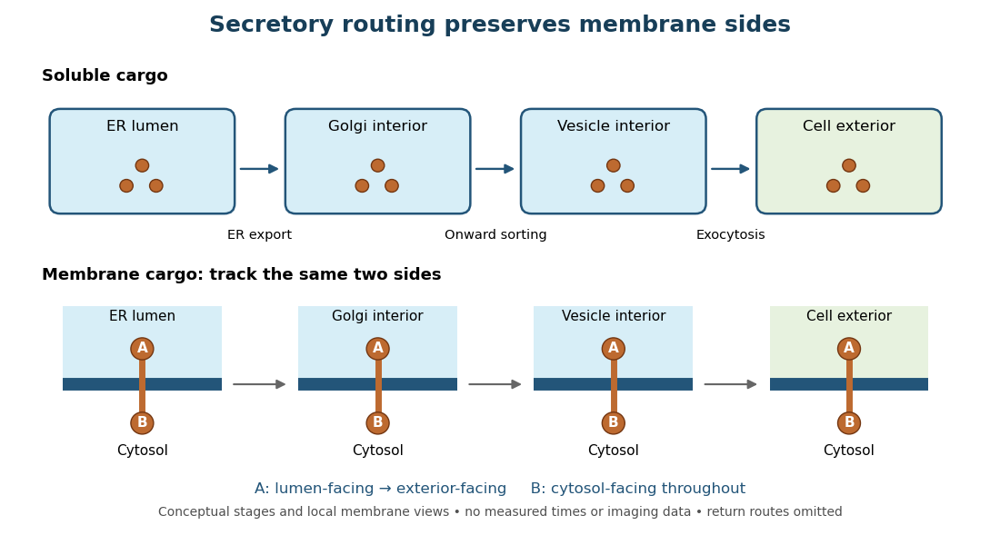

**[Figure 8](#image-secretory-protein-routing-preserves-membrane-sides). Secretory protein routing preserves membrane sides**. Original conceptual route for soluble cargo and a [membrane protein](cell-membrane.md#membrane-protein). Intermediate compartments and return routes are omitted. Arrows show connectivity, not measured timing, fluorescence or [electron microscopy](optics.md#electron-microscopy).

The useful geometric rule is preservation of membrane sides: during budding and fusion, a lumen-facing region of a [membrane protein](cell-membrane.md#membrane-protein) stays lumen-facing, then faces the exterior after [exocytosis](cell-membrane.md#exocytosis); its [cytosol](#cytosol)-facing region stays cytosolic.[The Cell: A Molecular Approach, 2nd edition by Geoffrey M. Cooper; Insertion of Proteins into the ER Membrane, Figure 9.10; Export of Proteins and Lipids from the ER: preservation of orientation](biology-bibliography.md#the-cell-a-molecular-approach-2nd-edition-by-geoffrey-m-cooper/the-endoplasmic-reticulum)

Work through the schematic using two distinguishable labels A and B on a stipulated [membrane protein](cell-membrane.md#membrane-protein). Start with A facing the [ER lumen](#er-lumen) and B facing the [cytosol](#cytosol). At each budding or fusion step, carry the surrounding membrane together with the labels; do not turn the [protein](protein.md) over. The resulting pair is A facing the [Golgi apparatus](#golgi-apparatus) interior and B facing the [cytosol](#cytosol), then A facing a [transport vesicle](#transport-vesicle) interior and B facing the [cytosol](#cytosol), and finally A facing the exterior and B facing the [cytosol](#cytosol). This is a stepwise argument about the depicted operations, not a claim that the compartments have identical chemical contents. Likewise, once soluble cargo is inside the [ER lumen](#er-lumen), this schematic reaches the exterior with zero further crossings through a [lipid bilayer](mathematical-biology.md#lipid-bilayer): enclosed spaces join when membranes fuse. Delivery therefore need not mean repeatedly pushing a folded [protein](protein.md) through a membrane.

##### Pancreatic secretory-protein pulse-chase experiment

↑ **Parent:** [Secretory protein routing](#secretory-protein-routing)

In 1967, [James D. Jamieson](biology.md#james-d-jamieson) and [George E. Palade](biology.md#george-e-palade) incubated guinea pig [pancreas](physiology.md#pancreas) slices, following a three-minute pulse of tritium-labeled [leucine](chemical-substance.md#leucine) with excess unlabeled [leucine](chemical-substance.md#leucine). This [pulse-chase analysis](biology.md#pulse-chase-analysis) marked newly made [proteins](protein.md) while reducing subsequent incorporation. Fixed, Epon-embedded thin sections were mounted on coated grids, covered with Ilford L-4 photographic emulsion, developed and stained for [electron microscopy](optics.md#electron-microscopy). [Autoradiography](biology.md#autoradiography) located photographic grains relative to [pancreatic acinar cell](physiology.md#pancreatic-acinar-cell) structures.[Jamieson and Palade, Intracellular Transport of Secretory Proteins in the Pancreatic Exocrine Cell. II. Transport to Condensing Vacuoles and Zymogen Granules (1967), p. 598 Methods; Figure 10: three-minute pulse](biology-bibliography.md#intracellular-transport-of-secretory-proteins-in-the-pancreatic-exocrine-cell-ii-transport-to-condensing-vacuoles-and-zymogen-granules-by-james-d-jamieson-and-george-e-palade)

Pulse-end samples provided a temporal reference: label lay mainly over [rough endoplasmic reticulum](#rough-endoplasmic-reticulum); later samples shifted toward peripheral [Golgi apparatus](#golgi-apparatus) elements, condensing vacuoles and [secretory granules](#secretory-granule). As a contamination check, isolated granule pellets were also examined by [autoradiography](biology.md#autoradiography): early pellet labeling chiefly marked condensing vacuoles. Grids from the compared pellet samples were coated together to control photographic processing. This supported transport of a previously labeled cohort rather than separate synthesis at each location. Fixed samples did not track individual [proteins](protein.md); localization was finite, and labeling was not absolutely exclusive to secretory cargo. The result concerns this preparation, not every [protein](protein.md) in every [biological cell](biological-cell.md).[pp. 603–606 and Figures 10–13: changing localization; pp. 610–611 and Figures 14–15, Table III: pellet check and matched emulsion processing; p. 611 General Premises: nonexportable-protein labeling](biology-bibliography.md#intracellular-transport-of-secretory-proteins-in-the-pancreatic-exocrine-cell-ii-transport-to-condensing-vacuoles-and-zymogen-granules-by-james-d-jamieson-and-george-e-palade)

#### Microsome

↑ **Parent:** [Endoplasmic reticulum](#endoplasmic-reticulum)

A [microsome](#microsome) is a closed [lipid bilayer](mathematical-biology.md#lipid-bilayer) compartment produced during disruption of a [biological tissue](biology.md#tissue-biology); [rough endoplasmic reticulum](#rough-endoplasmic-reticulum)-derived [microsomes](#microsome) provide a sealed compartment for [protein targeting](protein.md#protein-targeting) experiments.

### Plastid

↑ **Parent:** [Organelle](#organelle)  
ⓦ [Wiki](https://en.wikipedia.org/wiki/Plastid)

A [plastid](#plastid) is an [organelle](#organelle) of the lineage that includes [chloroplasts](#chloroplast). A [chloroplast](#chloroplast) is a photosynthetic [plastid](#plastid); the terms are not interchangeable because some [plastids](#plastid) are nonphotosynthetic. [Endosymbiotic theory](ecology.md#endosymbiotic-theory) connects [plastid](#plastid) origins to [cyanobacteria](organism.md#cyanobacteria), while [endosymbiotic gene transfer](ecology.md#endosymbiotic-gene-transfer) and [organelle protein import](protein.md#organelle-protein-import) explain genetic and functional integration with the host.

#### Apicoplast

↑ **Parent:** [Plastid](#plastid)

An [apicoplast](#apicoplast) is a reduced nonphotosynthetic plastid in many apicomplexan parasites. Retained biosynthetic outputs can make it essential after photosystems and photosynthetic carbon fixation are lost.

### Mitochondria

↑ **Parent:** [Organelle](#organelle)  
ⓦ [Wiki](https://en.wikipedia.org/wiki/Mitochondria)

A [mitochondrion](#mitochondria) is an [organelle](#organelle) with an [outer mitochondrial membrane](#outer-mitochondrial-membrane) and an [inner mitochondrial membrane](#inner-mitochondrial-membrane). The latter encloses the [mitochondrial matrix](#mitochondrial-matrix) and folds into [cristae](#crista); the [intermembrane space](#intermembrane-space) lies on its opposite side. This architecture separates a chemical workspace from a membrane that couples [electron](physics.md#electron) transport to [ATP](molecule.md#adenosine-triphosphate) formation.[Biology 2e by Mary Ann Clark and others; §4.3, Mitochondria and Figure 4.14: two membranes, matrix and cristae](biology-bibliography.md#biology-2e-by-mary-ann-clark-and-others/4-3-eukaryotic-cells)

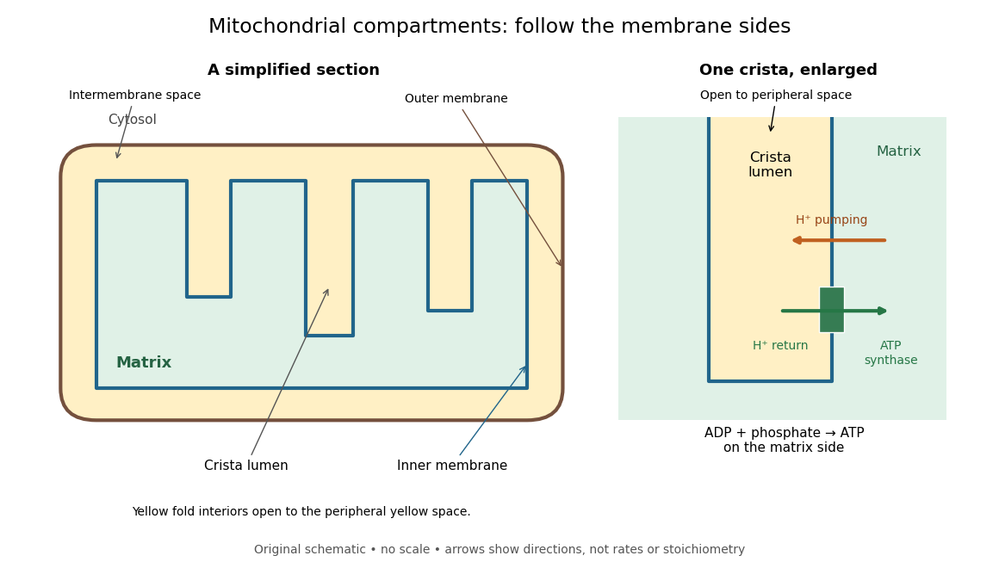

**[Figure 9](#image-compartments-of-a-mitochondrion-and-the-two-sides-of-a-crista). Compartments of a mitochondrion and the two sides of a crista**. Original simplified section and enlargement, not a micrograph or scale drawing. The yellow interior of each fold connects to the peripheral [intermembrane space](#intermembrane-space); green denotes [mitochondrial matrix](#mitochondrial-matrix). Arrows distinguish outward [proton](physics.md#proton) pumping from return through [ATP synthase](enzyme.md#atp-synthase). Shapes and arrows encode no measured dimensions, rates or [stoichiometry](chemical-reaction.md#stoichiometry).

For an original location exercise, place soluble label A in the [mitochondrial matrix](#mitochondrial-matrix) and soluble label B in the interior of a [crista](#crista). In the depicted geometry, B can reach the peripheral [intermembrane space](#intermembrane-space) through the fold's opening without crossing a [lipid bilayer](mathematical-biology.md#lipid-bilayer). A must cross the [inner mitochondrial membrane](#inner-mitochondrial-membrane) to reach either location. A fold projecting into the [mitochondrial matrix](#mitochondrial-matrix) therefore does not make its enclosed fluid part of the [mitochondrial matrix](#mitochondrial-matrix). Following a continuous path through the colored regions proves the distinction; merely asking whether a label is “inside the [mitochondrion](#mitochondria)” loses it.

The functional connection is equally spatial. The [mitochondrial respiratory chain](biochemistry.md#mitochondrial-respiratory-chain) pumps [protons](physics.md#proton) from the [mitochondrial matrix](#mitochondrial-matrix) side across the [inner mitochondrial membrane](#inner-mitochondrial-membrane). Their return through [ATP synthase](enzyme.md#atp-synthase) can drive [ATP](molecule.md#adenosine-triphosphate) formation. [Oxidative phosphorylation](biochemistry.md#oxidative-phosphorylation) develops the mechanism and [chemiosmosis](biochemistry.md#chemiosmosis) gives its [free energy](thermodynamic-potential.md#thermodynamic-free-energy) bookkeeping. Compartmentalization is useful because it lets a shared [electrochemical gradient](chemical-potential.md#electrochemical-gradient) couple different [proteins](protein.md) without direct transfer of a chemical intermediate between each pair.

Under aerobic conditions, [mitochondria](#mitochondria) supply much of the [ATP](molecule.md#adenosine-triphosphate) in many [eukaryotic](organism.md#eukaryote) [biological cells](biological-cell.md); the contribution varies with [biological tissue](biology.md#tissue-biology), demand and [oxygen](chemical-substance.md#oxygen) supply. [Glycolysis](biochemistry.md#glycolysis) also makes [ATP](molecule.md#adenosine-triphosphate) in the [cytosol](#cytosol). Mature mammalian [red blood cells](#red-blood-cell) lack [mitochondria](#mitochondria), and [bacteria](organism.md#bacteria) have no [mitochondria](#mitochondria) at all. Neither all [ATP](molecule.md#adenosine-triphosphate) production nor all [biological cells](biological-cell.md) fit the familiar mitochondrial picture.[§4.3, Mitochondria; §7.2, glycolysis; §40.2, Red Blood Cells: mature mammalian cells lack mitochondria](biology-bibliography.md#biology-2e-by-mary-ann-clark-and-others)

[Mitochondria](#mitochondria) descend from a bacterial [endosymbiosis](ecology.md#endosymbiosis) and retain a [genome](molecular-genetics.md#genome) and [ribosomes](#ribosome), although many required [proteins](protein.md) are encoded by nuclear [genes](genetics.md#gene). [Endosymbiotic theory](ecology.md#endosymbiotic-theory) develops the ancestry argument; [organelle protein import](protein.md#organelle-protein-import) explains delivery of nuclear-encoded [proteins](protein.md). A functioning isolated [mitochondrion](#mitochondria) demonstrates biochemical autonomy under supplied conditions, rather than independently establishing that ancestry.

#### Mitochondrial fission-fusion cycle

↑ **Parent:** [Mitochondria](#mitochondria)

Dynamic remodeling of a mitochondrial population through division and merger. Fusion permits content mixing, while fission supports distribution and can segregate portions for [mitophagy](#mitophagy).

#### Inner mitochondrial membrane

↑ **Parent:** [Mitochondria](#mitochondria)

The [inner mitochondrial membrane](#inner-mitochondrial-membrane) separates [mitochondrial matrix](#mitochondrial-matrix) from [intermembrane space](#intermembrane-space). Its [selective permeability](cell-membrane.md#selective-permeability) permits distinct chemical conditions, while embedded [mitochondrial respiratory chain](biochemistry.md#mitochondrial-respiratory-chain) [proteins](protein.md) and [ATP synthase](enzyme.md#atp-synthase) support [oxidative phosphorylation](biochemistry.md#oxidative-phosphorylation). [Cristae](#crista) increase its [surface area](differential-geometry.md#surface-area).[Chapter 14, The Mitochondrion Contains an Outer Membrane, an Inner Membrane, and Two Internal Compartments; Figure 14-8](biology-bibliography.md#molecular-biology-of-the-cell-4th-edition-by-bruce-alberts-and-others)

A selective boundary and a productive [enzyme](enzyme.md) have different jobs. Even active respiratory [enzymes](enzyme.md) cannot sustain a useful [electrochemical gradient](chemical-potential.md#electrochemical-gradient) if [protons](physics.md#proton) return freely across the boundary. Conversely, an intact boundary without an [electron donor](chemical-reaction.md#electron-donor) does not supply the [energy](energy.md) for continued pumping. The [isolated mitochondria respiration experiment](#isolated-mitochondria-respiration-experiment) separates some of these dependencies by additions to the same preparation.

##### Mitochondrial membrane potential

↑ **Parent:** [Inner mitochondrial membrane](#inner-mitochondrial-membrane)

The [electric potential](electric-field.md#electric-potential) difference across the [inner mitochondrial membrane](#inner-mitochondrial-membrane), contributing to the [proton-motive force](chemical-potential.md#proton-motive-force). A change in potential can alter both useful phosphorylation and leak behavior.

##### Mitochondrial phosphate carrier

↑ **Parent:** [Inner mitochondrial membrane](#inner-mitochondrial-membrane)

A transport [protein](protein.md) supplying [phosphate](chemical-substance.md#phosphate) across the [inner mitochondrial membrane](#inner-mitochondrial-membrane) for processes including [ATP](molecule.md#adenosine-triphosphate) synthesis.

##### Adenine nucleotide translocator

↑ **Parent:** [Inner mitochondrial membrane](#inner-mitochondrial-membrane)

A carrier exchanging adenine nucleotides across the [inner mitochondrial membrane](#inner-mitochondrial-membrane), supplying matrix [ADP](molecule.md#adenosine-diphosphate) and exporting synthesized [ATP](molecule.md#adenosine-triphosphate) during ordinary oxidative phosphorylation.

##### Mitochondrial dicarboxylate carrier

↑ **Parent:** [Inner mitochondrial membrane](#inner-mitochondrial-membrane)

A transport [protein](protein.md) exchanging suitable dicarboxylates, including [succinate](chemical-substance.md#succinate) and [malate](chemical-substance.md#malate), with counter-substrates such as [phosphate](chemical-substance.md#phosphate). Its relevance to respiration depends on the fuel and preparation.

##### Crista

↑ **Parent:** [Inner mitochondrial membrane](#inner-mitochondrial-membrane)  
ⓦ [Wiki](https://en.wikipedia.org/wiki/Crista)

A [crista](#crista) is a fold of the [inner mitochondrial membrane](#inner-mitochondrial-membrane) into the [mitochondrial matrix](#mitochondrial-matrix). Its membrane remains continuous with the surrounding [inner mitochondrial membrane](#inner-mitochondrial-membrane); it is not a separately inserted sac like a [thylakoid](#thylakoid).[Chapter 12, The Transport of Proteins into Mitochondria and Chloroplasts, Figure 12-22: continuity of cristae and contrast with thylakoids](biology-bibliography.md#molecular-biology-of-the-cell-4th-edition-by-bruce-alberts-and-others)

The diagram idealizes access through the fold's opening. Connectivity alone does not imply instant mixing or identical [concentrations](mathematical-physics.md#concentration) throughout the [intermembrane space](#intermembrane-space). Narrow geometry and molecular interactions can matter to transport. Increasing [surface area](differential-geometry.md#surface-area) also does not, by itself, prove a proportional increase in [ATP](molecule.md#adenosine-triphosphate) production: the supply of [substrates](enzyme.md#substrate-biochemistry), available [oxygen](chemical-substance.md#oxygen) and the state of the coupling machinery must also support the flux.

#### Mitochondrial matrix

↑ **Parent:** [Mitochondria](#mitochondria)

The [mitochondrial matrix](#mitochondrial-matrix) is the compartment enclosed by the [inner mitochondrial membrane](#inner-mitochondrial-membrane), containing mitochondrial [DNA](polymer.md#deoxyribonucleic-acid), [ribosomes](#ribosome) and many [enzymes](enzyme.md). Most [citric acid cycle](biochemistry.md#citric-acid-cycle) steps occur here; [succinate dehydrogenase](biochemistry.md#succinate-dehydrogenase) is membrane-associated. The [citric acid cycle](biochemistry.md#citric-acid-cycle) supplies [NADH](chemical-substance.md#nadh) for the [mitochondrial respiratory chain](biochemistry.md#mitochondrial-respiratory-chain).[Chapter 14, The Mitochondrion Contains an Outer Membrane, an Inner Membrane, and Two Internal Compartments; Figure 14-8, matrix enzymes and inner-membrane succinate dehydrogenase](biology-bibliography.md#molecular-biology-of-the-cell-4th-edition-by-bruce-alberts-and-others)

Distinguish the location of a [chemical reaction](chemical-reaction.md) from the location of its detection. An external [oxygen](chemical-substance.md#oxygen) [electrode](electrochemistry.md#electrode) can report consumption by an intact preparation without entering the [mitochondrial matrix](#mitochondrial-matrix). That signal does not locate every intermediate, establish [protein targeting](protein.md#protein-targeting) or directly count newly formed [ATP](molecule.md#adenosine-triphosphate).

#### Intermembrane space

↑ **Parent:** [Mitochondria](#mitochondria)

In a [mitochondrion](#mitochondria), the [intermembrane space](#intermembrane-space) lies between the [outer mitochondrial membrane](#outer-mitochondrial-membrane) and [inner mitochondrial membrane](#inner-mitochondrial-membrane), extending into the interiors of [cristae](#crista). It includes the side of the [inner mitochondrial membrane](#inner-mitochondrial-membrane) from which [protons](physics.md#proton) return through [ATP synthase](enzyme.md#atp-synthase) to the [mitochondrial matrix](#mitochondrial-matrix).

A useful sidedness check is to follow a single arrow: outward pumping goes from green to yellow in the diagram, while coupled return goes from yellow to green. These are opposing movements of [protons](physics.md#proton), not a circuit in which [electrons](physics.md#electron) return through [ATP synthase](enzyme.md#atp-synthase). The [mitochondrial respiratory chain](biochemistry.md#mitochondrial-respiratory-chain) and [chemiosmosis](biochemistry.md#chemiosmosis) articles distinguish the two ledgers.

#### Outer mitochondrial membrane

↑ **Parent:** [Mitochondria](#mitochondria)

The [outer mitochondrial membrane](#outer-mitochondrial-membrane) separates the surrounding [cytosol](#cytosol) from the [intermembrane space](#intermembrane-space). Channels permit passage of many small [molecules](molecule.md), while the [inner mitochondrial membrane](#inner-mitochondrial-membrane) supplies the main selective barrier between them and the [mitochondrial matrix](#mitochondrial-matrix).[Chapter 14, The Mitochondrion Contains an Outer Membrane, an Inner Membrane, and Two Internal Compartments: outer-membrane channels and inner-membrane selectivity](biology-bibliography.md#molecular-biology-of-the-cell-4th-edition-by-bruce-alberts-and-others)

Small-solute access does not imply unrestricted access for [proteins](protein.md). The [cytochrome c](protein.md#cytochrome-c) addition in the [isolated mitochondria respiration experiment](#isolated-mitochondria-respiration-experiment) tests a consequence of damage to this boundary. [Organelle protein import](protein.md#organelle-protein-import) describes purposeful delivery across mitochondrial boundaries.

#### Isolated mitochondria respiration experiment

↑ **Parent:** [Mitochondria](#mitochondria)

[Respiratory control](biochemistry.md#respiratory-control) can be investigated outside an intact [biological cell](biological-cell.md) by supplying isolated [mitochondria](#mitochondria) with [substrates](enzyme.md#substrate-biochemistry) and [ADP](molecule.md#adenosine-diphosphate). This makes the boundary between [oxygen](chemical-substance.md#oxygen) consumption and [ATP](molecule.md#adenosine-triphosphate) formation experimentally accessible. The historical [mitochondrial oxygen electrode assay](biochemistry.md#mitochondrial-oxygen-electrode-assay) describes the 1955 experiment; the following authored protocol adds modern preparation and inhibitor controls.

In Functional Assessment of Isolated Mitochondria In Vitro (2009), [Ian R. Lanza](physiology.md#ian-r-lanza) and [K. Sreekumaran Nair](physiology.md#k-sreekumaran-nair) describe human skeletal-muscle biopsy mincing, cold [protease](enzyme.md#protease) treatment, homogenization and [differential centrifugation](biology.md#differential-centrifugation). A low-speed spin removes coarse material; subsequent spins collect and wash [mitochondria](#mitochondria). A stirred, closed $2\,\mathrm{mL}$ Oxygraph-2k chamber at $37\,{}^\circ\mathrm{C}$ uses a calibrated polarographic [oxygen](chemical-substance.md#oxygen) [electrode](electrochemistry.md#electrode). Its signal gives dissolved [oxygen](chemical-substance.md#oxygen) [concentration](mathematical-physics.md#concentration); the negative time [derivative](calculus.md#derivative) gives consumption. Instrument corrections include electrode consumption and [oxygen](chemical-substance.md#oxygen) leakage.[Methods in Enzymology, volume 457: Mitochondrial Function, Part B; Tissue homogenization; Separation of mitochondria by differential centrifugation; Mitochondrial respiration, Overview; An oxygraph protocol for mitochondrial assessment, steps 1–2](biology-bibliography.md#methods-in-enzymology-volume-457-mitochondrial-function-part-b/functional-assessment-of-isolated-mitochondria-in-vitro)

Their additions include [glutamate](chemical-substance.md#glutamate) plus [malate](chemical-substance.md#malate), an [ADP](molecule.md#adenosine-diphosphate) pulse, then saturating [ADP](molecule.md#adenosine-diphosphate). Added [cytochrome c](protein.md#cytochrome-c) tests outer-membrane damage: stimulation suggests loss of endogenous [cytochrome c](protein.md#cytochrome-c). Later [oligomycin](chemical-substance.md#oligomycin) inhibits [ATP synthase](enzyme.md#atp-synthase); [FCCP](chemical-substance.md#fccp) produces [respiratory uncoupling](biochemistry.md#respiratory-uncoupling); [antimycin A](chemical-substance.md#antimycin-a) inhibits [respiratory complex III](biochemistry.md#respiratory-complex-iii) to estimate residual background. Figure 6 includes intervening [succinate dehydrogenase](biochemistry.md#succinate-dehydrogenase) and [respiratory complex I](biochemistry.md#respiratory-complex-i) interventions; the modeled traces below simplify that sequence. Isolation can damage or select [mitochondria](#mitochondria), and saturating assay conditions differ from those in living [biological tissue](biology.md#tissue-biology).[Methods in Enzymology, volume 457: Mitochondrial Function, Part B; Figure 3; An oxygraph protocol for mitochondrial assessment, steps 3–11 and Figure 6; Summary, nonphysiological assay conditions](biology-bibliography.md#methods-in-enzymology-volume-457-mitochondrial-function-part-b/functional-assessment-of-isolated-mitochondria-in-vitro)

The control logic matters more than a single steep slope. If [ADP](molecule.md#adenosine-diphosphate) accelerates consumption and a finite pulse is followed by slowing, demand is affecting respiratory flux. If [oligomycin](chemical-substance.md#oligomycin) slows consumption, but subsequent [FCCP](chemical-substance.md#fccp) accelerates it, the [electron transport chain](biochemistry.md#electron-transport-chain) can still turn over while [ATP synthase](enzyme.md#atp-synthase) remains inhibited. That contrast separates restricted coupled turnover from a completely inactive chain. Failure of [FCCP](chemical-substance.md#fccp) to restore a rate is less specific: [substrate](enzyme.md#substrate-biochemistry) limitation, damage, low [oxygen](chemical-substance.md#oxygen) or excessive uncoupler can also restrict respiration.

Neither the [cytochrome c](protein.md#cytochrome-c) test alone nor a large [respiratory control ratio](biochemistry.md#respiratory-control-ratio) establishes every aspect of mitochondrial integrity. Likewise, [oxygen](chemical-substance.md#oxygen) consumption is not a direct [ATP](molecule.md#adenosine-triphosphate) assay: [respiratory uncoupling](biochemistry.md#respiratory-uncoupling) provides a concrete counterexample. The preparation, additions and normalization denominator determine what comparison the experiment can support.

##### Modeled mitochondrial oxygen traces

↑ **Parent:** [Isolated mitochondria respiration experiment](#isolated-mitochondria-respiration-experiment)

The following original model chooses piecewise constant [oxygen](chemical-substance.md#oxygen) consumption rates in a closed, well-mixed $2\,\mathrm{mL}$ suspension. It assumes no gas exchange, negligible addition [volume](thermodynamics.md#volume-thermodynamics), a corrected sensor and sufficient [oxygen](chemical-substance.md#oxygen) throughout. The curves are invented teaching examples, not measured traces, fitted data or a reconstruction of Figure 6.

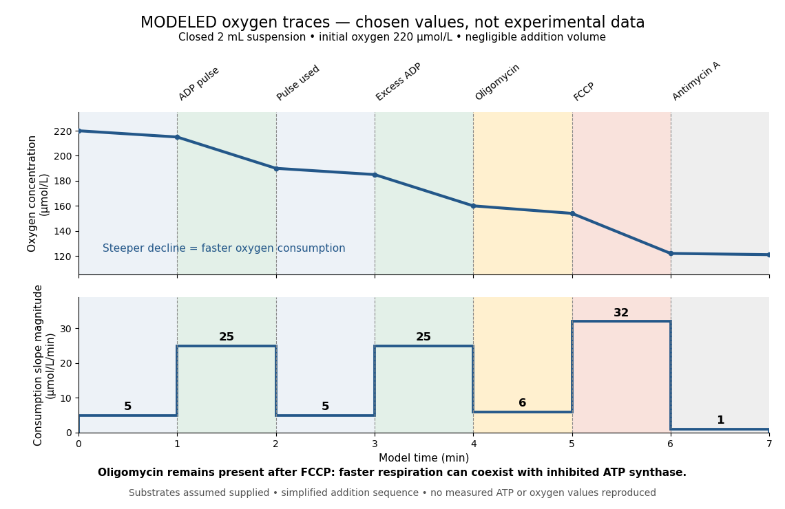

**[Figure 10](#image-modeled-oxygen-traces-a-faster-decline-need-not-mean-more-atp). MODELED oxygen traces: a faster decline need not mean more ATP**. Original piecewise linear [concentration](mathematical-physics.md#concentration) curve and corresponding consumption-rate plot. All rates and times are chosen. The finite first [ADP](molecule.md#adenosine-diphosphate) pulse is stipulated to be used by minute 2; the second supplies excess [ADP](molecule.md#adenosine-diphosphate). [Oligomycin](chemical-substance.md#oligomycin) remains present after [FCCP](chemical-substance.md#fccp). Substrate additions and intermediate chain interventions from the published protocol are omitted. The residual after [antimycin A](chemical-substance.md#antimycin-a) is shown as background, not [ATP](molecule.md#adenosine-triphosphate) production.

Start at $c(0)=220\,\mathrm{\mu mol\,L^{-1}}$. On successive one-minute intervals, choose positive slope magnitudes $5,25,5,25,6,32,1\,\mathrm{\mu mol\,L^{-1}\,min^{-1}}$. Integration gives the endpoint [concentrations](mathematical-physics.md#concentration) $220,215,190,185,160,154,122,121\,\mathrm{\mu mol\,L^{-1}}$. This is just the recurrence $c_{i+1}=c_i-r_i\Delta t$, with $\Delta t=1\,\mathrm{min}$; the step plot shows $r_i=-dc/dt$. The trace remains above zero by construction.

During the second [ADP](molecule.md#adenosine-diphosphate) interval, the total consumption rate is

$$
q=-V\frac{dc_{\mathrm{O}_2}}{dt}
=(0.002\,\mathrm L)(25\,\mathrm{\mu mol\,L^{-1}\,min^{-1}})
=50\,\mathrm{nmol\,min^{-1}}.
$$

With a stipulated mitochondrial [protein](protein.md) mass of $0.20\,\mathrm{mg}$, that is $250\,\mathrm{nmol\,min^{-1}\,mg^{-1}}$. Using a denominator twice as large would halve this reported rate without changing the raw [oxygen](chemical-substance.md#oxygen) trace. Comparisons therefore need both loading and the chosen denominator.

For a second bookkeeping check, the modeled post-[antimycin A](chemical-substance.md#antimycin-a) slope of $1\,\mathrm{\mu mol\,L^{-1}\,min^{-1}}$ corresponds to $2\,\mathrm{nmol\,min^{-1}}$ background. If that background is additive and unchanged in earlier windows, subtraction gives $48$, $10$ and $62\,\mathrm{nmol\,min^{-1}}$ for excess [ADP](molecule.md#adenosine-diphosphate), [oligomycin](chemical-substance.md#oligomycin) and [FCCP](chemical-substance.md#fccp), respectively. The [oligomycin](chemical-substance.md#oligomycin)-sensitive difference is $48-10=38\,\mathrm{nmol\,min^{-1}}$. It is a difference in [oxygen](chemical-substance.md#oxygen) consumption under the chosen interventions, not an [ATP](molecule.md#adenosine-triphosphate) production rate. Converting it into one requires additional coupling assumptions or an independent [ATP](molecule.md#adenosine-triphosphate) measurement; the [FCCP](chemical-substance.md#fccp) interval shows why slope alone cannot supply that conversion.

Across the whole seven-minute example, consumption is $V(c(0)-c(7))=198\,\mathrm{nmol}$, also the sum of the seven interval consumptions. This equality checks the rate-to-amount accounting independently of how the intervals are named. Actual records require attention to calibration, mixing transients, background stability and decreasing [oxygen](chemical-substance.md#oxygen) availability; a line that steepens or flattens alone does not identify the cause.

### Golgi apparatus

↑ **Parent:** [Organelle](#organelle)  
ⓦ [Wiki](https://en.wikipedia.org/wiki/Golgi_apparatus)

The [Golgi apparatus](#golgi-apparatus) modifies and sorts cargo arriving from the [endoplasmic reticulum](#endoplasmic-reticulum) for delivery to other cellular destinations. The eponym refers to [Camillo Golgi](biology.md#camillo-golgi).

Its usual stacked organization is polarized: cargo enters on the cis side, encounters medial processing regions, and leaves through the trans side and [trans-Golgi network](#trans-golgi-network). [Golgi cisternae](#golgi-cisterna) enclose a [Golgi lumen](#golgi-lumen) separated from the surrounding [cytosol](#cytosol). Processing changes cargo; sorting selects its destination.[The Cell: A Molecular Approach, 2nd edition by Geoffrey M. Cooper; Organization of the Golgi, Figures 9.22–9.23; Protein Sorting and Export from the Golgi Apparatus](biology-bibliography.md#the-cell-a-molecular-approach-2nd-edition-by-geoffrey-m-cooper/the-golgi-apparatus)

This division of labor explains why reaching the [Golgi apparatus](#golgi-apparatus) does not imply being secreted: cargo can take different onward routes, while resident [enzymes](enzyme.md) continue working there. The conventional route discussed here is part of [secretory protein routing](#secretory-protein-routing); many [cytosol](#cytosol) [proteins](protein.md) never enter it.

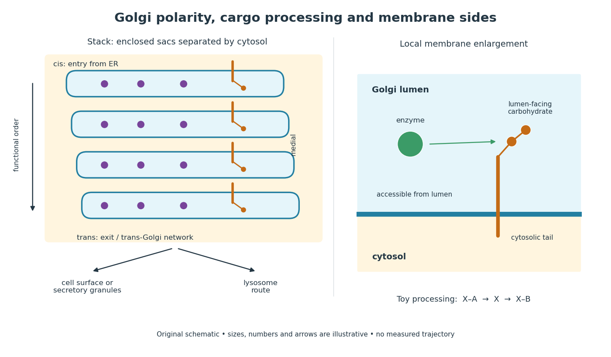

**[Figure 11](#image-golgi-apparatus-polarity-processing-and-membrane-sides). Golgi apparatus polarity, processing and membrane sides**. Original schematic of a stack and a local membrane enlargement. The spaces between [Golgi cisternae](#golgi-cisterna) contain [cytosol](#cytosol), while each enclosed sac contains [Golgi lumen](#golgi-lumen). Purple cargo is soluble; the orange [membrane protein](cell-membrane.md#membrane-protein) has a lumen-facing [carbohydrate](chemical-substance.md#carbohydrate) chain and a cytosolic tail. Arrows show functional ordering, not a measured trajectory or a universal carrier mechanism. The chain-processing symbols are a constructed example.

#### Golgi cisterna

↑ **Parent:** [Golgi apparatus](#golgi-apparatus)

A [Golgi cisterna](#golgi-cisterna) is a flattened membrane-enclosed sac. Stacking several sacs does not make their interiors one open space: membrane separates [Golgi lumen](#golgi-lumen) from intervening [cytosol](#cytosol).[The Cell: A Molecular Approach, 2nd edition by Geoffrey M. Cooper; Organization of the Golgi, Figure 9.22: membrane-enclosed cisternae](biology-bibliography.md#the-cell-a-molecular-approach-2nd-edition-by-geoffrey-m-cooper/the-golgi-apparatus)

##### Golgi lumen

↑ **Parent:** [Golgi cisterna](#golgi-cisterna)

The [Golgi lumen](#golgi-lumen) is the enclosed interior of a [Golgi cisterna](#golgi-cisterna), distinct from the surrounding [cytosol](#cytosol).

The membrane-sidedness rule in [secretory protein routing](#secretory-protein-routing) still applies within the [Golgi apparatus](#golgi-apparatus). For a local worked example, stipulate a [membrane protein](cell-membrane.md#membrane-protein) with a [carbohydrate](chemical-substance.md#carbohydrate) chain exposed to [Golgi lumen](#golgi-lumen) and a tail exposed to [cytosol](#cytosol). An [enzyme](enzyme.md) confined to [Golgi lumen](#golgi-lumen) can contact that chain, but cannot directly contact the cytosolic tail without a boundary-crossing step. A change in which [Golgi cisterna](#golgi-cisterna) contains the [protein](protein.md) need not turn the [protein](protein.md) over. Thus chemical accessibility and cargo location are different questions: moving cargo onward preserves its membrane sides under the budding and fusion operations described in [secretory protein routing](#secretory-protein-routing).

#### Golgi cargo processing

↑ **Parent:** [Golgi apparatus](#golgi-apparatus)

[Golgi cargo processing](#golgi-cargo-processing) includes [enzyme](enzyme.md)-mediated remodeling of attached [oligosaccharides](chemical-substance.md#oligosaccharide). [Glycosylation](biochemistry.md#glycosylation) can involve addition of [sugars](chemical-substance.md#sugar), while processing can also remove them. Different [Golgi apparatus](#golgi-apparatus) regions have different processing [enzymes](enzyme.md); their [substrate](enzyme.md#substrate-biochemistry) requirements constrain the order of possible [chemical reactions](chemical-reaction.md).[Molecular Biology of the Cell, 4th edition by Bruce Alberts and others; Oligosaccharide Chains Are Processed in the Golgi Apparatus; The Golgi Cisternae Are Organized as a Series of Processing Compartments, Figure 13-28](biology-bibliography.md#molecular-biology-of-the-cell-4th-edition-by-bruce-alberts-and-others/transport-from-the-er-through-the-golgi-apparatus)

An original model makes the importance of ordering explicit. Write a toy [carbohydrate](chemical-substance.md#carbohydrate) chain as $XA$, read with its terminal symbol on the right. Define a trimming [function](function.md) $T$ that removes a terminal $A$, and an extension [function](function.md) $E$ that adds $B$ only when the terminal symbol is $X$. In every other case the corresponding [function](function.md) leaves the chain unchanged. Then

$$
XA\xrightarrow{T}X\xrightarrow{E}XB,\qquad XA\xrightarrow{E}XA\xrightarrow{T}X.
$$

In particular, $E(T(XA))=XB$ but $T(E(XA))=X$: the two [functions](function.md) do not commute. Each result follows by inspecting the terminal symbol before applying the stipulated rule. These symbols are artificial labels, rather than a natural [oligosaccharide](chemical-substance.md#oligosaccharide) sequence or measured [enzyme](enzyme.md) pathway. The example explains why “two processing steps occurred” does not determine the product unless their order and [substrate](enzyme.md#substrate-biochemistry) conditions are also specified. In the [Golgi apparatus](#golgi-apparatus), spatial organization can help arrange successive opportunities for processing.

#### trans-Golgi network

↑ **Parent:** [Golgi apparatus](#golgi-apparatus)

The [trans-Golgi network](#trans-golgi-network) is the sorting and export region at the trans side of the [Golgi apparatus](#golgi-apparatus). Onward traffic can supply the [cell membrane](cell-membrane.md), [secretory granules](#secretory-granule), or the [lysosome](#lysosome) route.[The Cell: A Molecular Approach, 2nd edition by Geoffrey M. Cooper; Protein Sorting and Export from the Golgi Apparatus, Figure 9.27 and lysosomal targeting discussion](biology-bibliography.md#the-cell-a-molecular-approach-2nd-edition-by-geoffrey-m-cooper/the-golgi-apparatus)

Processing and sorting answer different questions. In a constructed example, two cargo [proteins](protein.md) could receive the same [carbohydrate](chemical-substance.md#carbohydrate) modification yet carry different targeting information and leave in different [transport vesicles](#transport-vesicle). Conversely, two chemically different cargo [proteins](protein.md) could share a destination. A processing readout alone therefore cannot establish the final address; an experiment must also identify cargo location or delivery. Return traffic and retention likewise matter: the [Golgi apparatus](#golgi-apparatus) is a working compartment, not merely a one-way queue that empties all of its [enzymes](enzyme.md) into outgoing carriers.

#### Cisternal maturation

↑ **Parent:** [Golgi apparatus](#golgi-apparatus)

In [cisternal maturation](#cisternal-maturation), a cargo-containing [Golgi cisterna](#golgi-cisterna) changes from early to later identity as its resident [proteins](protein.md) change; retrieval of resident [enzymes](enzyme.md) toward earlier compartments helps maintain [Golgi apparatus](#golgi-apparatus) polarity. In the contrasting stable-compartment model, cargo moves between persistent [Golgi cisternae](#golgi-cisterna) in [transport vesicles](#transport-vesicle). These mechanisms need not be mutually exclusive.[Molecular Biology of the Cell, 4th edition by Bruce Alberts and others; Transport Through the Golgi Apparatus May Occur by Vesicular Transport or Cisternal Maturation, Figure 13-30 and concluding comparison](biology-bibliography.md#molecular-biology-of-the-cell-4th-edition-by-bruce-alberts-and-others/transport-from-the-er-through-the-golgi-apparatus)

The distinction is between following cargo and following its container. A cargo label encountered first in an early processing environment and later in a late one is compatible with either changing containers or a container changing identity. Finding [transport vesicles](#transport-vesicle) nearby does not by itself establish which cargo they carry or their direction of travel. Testing [cisternal maturation](#cisternal-maturation) therefore requires evidence about compartment identity and continuity as well as cargo position; a single mechanism should not be assumed for every cargo and [biological cell](biological-cell.md).

#### Golgi tracer interpretation

↑ **Parent:** [Golgi apparatus](#golgi-apparatus)

The [pancreatic secretory-protein pulse-chase experiment](#pancreatic-secretory-protein-pulse-chase-experiment) of [James D. Jamieson](biology.md#james-d-jamieson) and [George E. Palade](biology.md#george-e-palade) used guinea pig [pancreas](physiology.md#pancreas) slices and a short pulse of tritium-labeled [leucine](chemical-substance.md#leucine) followed by a chase. Thin sections on coated grids received Ilford L-4 emulsion; developed grains were read against structures by [electron microscopy](optics.md#electron-microscopy). Their Table II localized label to peripheral [Golgi apparatus](#golgi-apparatus) vesicles and condensing vacuoles, without significant labeling of the piled flattened [Golgi cisternae](#golgi-cisterna).[p. 598 Methods; p. 609 Table II and its footnote](biology-bibliography.md#intracellular-transport-of-secretory-proteins-in-the-pancreatic-exocrine-cell-ii-transport-to-condensing-vacuoles-and-zymogen-granules-by-james-d-jamieson-and-george-e-palade)

An important comparison checked the isolated granule fraction by [autoradiography](biology.md#autoradiography) and [electron microscopy](optics.md#electron-microscopy): early labeling came substantially from contaminating condensing vacuoles, rather than mature [secretory granules](#secretory-granule). Thus a fraction's name did not uniquely identify the labeled structure. This supported transport into the [Golgi apparatus](#golgi-apparatus)'s condensing region and onward storage, while fixed samples and finite grain localization limited interpretation. It did not establish a resolved cis-to-trans itinerary across every [Golgi cisterna](#golgi-cisterna). The preparation's labeling also did not mark secretory cargo exclusively.[p. 609 Figure 14; p. 613, Transport of Labeled Proteins to Condensing Vacuoles, Zymogen Granules, and the Acinar Lumen: comparison of fraction labeling with microscopy; p. 611, General Premises](biology-bibliography.md#intracellular-transport-of-secretory-proteins-in-the-pancreatic-exocrine-cell-ii-transport-to-condensing-vacuoles-and-zymogen-granules-by-james-d-jamieson-and-george-e-palade)

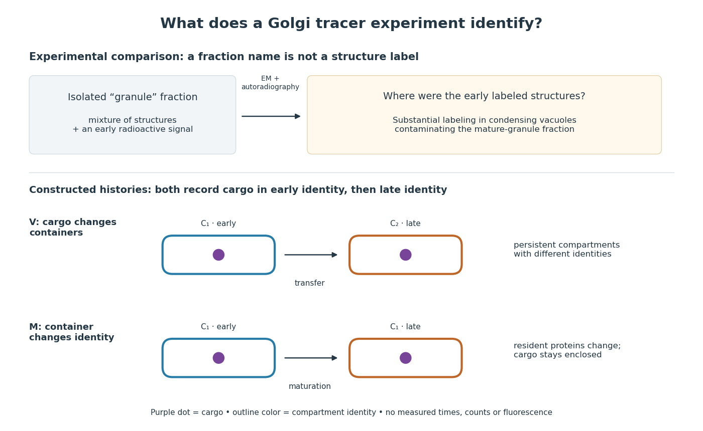

**[Figure 12](#image-golgi-tracer-interpretation-cargo-position-versus-compartment-identity). Golgi tracer interpretation: cargo position versus compartment identity**. Original interpretation diagram motivated by [pulse-chase analysis](biology.md#pulse-chase-analysis). The upper panel explains the granule-fraction comparison in the inspected experiment; it gives no counts or time course. The lower panels are constructed alternatives: the same cargo can encounter early and late identities by transfer between stable [Golgi cisternae](#golgi-cisterna) or by [cisternal maturation](#cisternal-maturation). The colored identities and cargo symbols are illustrative, not observed fluorescence or reconstructed micrographs.

For a minimal worked inference, record only two outcomes for one labeled cargo cohort: early identity first, late identity later. Model V transfers cargo from container $C_1$ to container $C_2$; model M keeps it in $C_1$ while $C_1$ changes identity. Both produce the same recorded outcomes, so those outcomes alone cannot distinguish V from M. The proof is constructive: exhibit both histories and discard container identity from each record. More informative tracking would retain both cargo and resident-compartment markers, while resolving whether the same compartment persists. This is why [pulse-chase analysis](biology.md#pulse-chase-analysis) and compartment tracking answer complementary questions about the [Golgi apparatus](#golgi-apparatus).

### Transport vesicle

↑ **Parent:** [Organelle](#organelle)

A [transport vesicle](#transport-vesicle) is a membrane-bounded carrier that moves cargo between cellular compartments. Budding and fusion preserve the distinction between lumen-facing and [cytosol](#cytosol)-facing membrane surfaces.

#### Extracellular vesicle

↑ **Parent:** [Transport vesicle](#transport-vesicle)

A membrane-enclosed particle released by a cell into the extracellular environment. Isolation methods and cargo characterisation determine what signalling or transfer claims can be made.

### Lysosome

↑ **Parent:** [Organelle](#organelle)  
ⓦ [Wiki](https://en.wikipedia.org/wiki/Lysosome)

A [lysosome](#lysosome) is an acidic digestive and recycling [organelle](#organelle): one surrounding [lipid bilayer](mathematical-biology.md#lipid-bilayer) encloses a [lysosomal lumen](#lysosomal-lumen) containing [acid hydrolases](enzyme.md#acid-hydrolase). These [enzymes](enzyme.md) break down [proteins](protein.md), [nucleic acids](polymer.md#nucleic-acid), [carbohydrates](chemical-substance.md#carbohydrate) and [lipids](chemical-substance.md#lipid) by [hydrolysis](chemical-reaction.md#hydrolysis). Cargo can originate outside the [biological cell](biological-cell.md), entering through [endocytosis](cell-membrane.md#endocytosis), or within its own [cytoplasm](#cytoplasm), delivered through [autophagy](#autophagy). Digestion therefore serves both disposal and reuse.[The Cell: A Molecular Approach, 2nd edition by Geoffrey M. Cooper; Cooper, The Cell, 2nd edition (2000), Lysosomes: opening paragraph; Lysosomal Acid Hydrolases; Phagocytosis and Autophagy, Figure 9.37](biology-bibliography.md#the-cell-a-molecular-approach-2nd-edition-by-geoffrey-m-cooper/lysosomes)

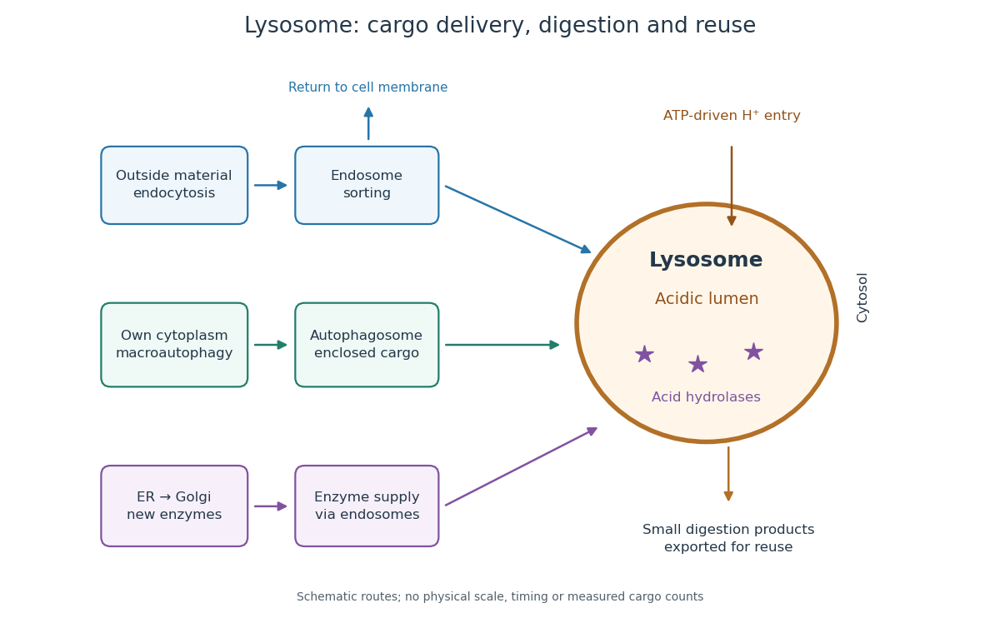

**[Figure 13](#image-lysosome-compartment-cargo-delivery-and-recycling). Lysosome compartment, cargo delivery and recycling**. Original schematic: [endocytosis](cell-membrane.md#endocytosis) and [macroautophagy](#macroautophagy) supply material for digestion, while [secretory protein routing](#secretory-protein-routing) supplies digestive [enzymes](enzyme.md). The enclosure at the right distinguishes [lysosomal lumen](#lysosomal-lumen) from [cytosol](#cytosol); arrows indicate routes, not measured rates. Shapes, sizes and cargo counts are illustrative.

An [endosome](#endosome) sorts endocytosed cargo: some returns to the [cell membrane](cell-membrane.md), while some proceeds toward [lysosomes](#lysosome). An [autophagosome](#autophagosome) instead encloses material already in the [cytoplasm](#cytoplasm). Both routes bring cargo into contact with digestive [enzymes](enzyme.md); neither implies that every internalized [molecule](molecule.md) is destroyed.[Alberts and others, Molecular Biology of the Cell, 4th edition (2002), Multiple Pathways Deliver Materials to Lysosomes, Figure 13-35](biology-bibliography.md#molecular-biology-of-the-cell-4th-edition-by-bruce-alberts-and-others/transport-from-the-trans-golgi-network-to-lysosomes)

Enzyme supply is a different itinerary from cargo disposal. [Secretory protein routing](#secretory-protein-routing) and [protein targeting](protein.md#protein-targeting) deliver newly made digestive [enzymes](enzyme.md) through the [endoplasmic reticulum](#endoplasmic-reticulum), [Golgi apparatus](#golgi-apparatus) and [trans-Golgi network](#trans-golgi-network) toward [lysosomes](#lysosome).[The Cell: A Molecular Approach, 2nd edition by Geoffrey M. Cooper; Protein Sorting and Export from the Golgi Apparatus, lysosomal enzyme targeting](biology-bibliography.md#the-cell-a-molecular-approach-2nd-edition-by-geoffrey-m-cooper/the-golgi-apparatus) The existing [membrane transport](cell-membrane.md#membrane-transport) and [differential centrifugation](biology.md#differential-centrifugation) articles explain the boundary-crossing and separation principles used below.

A [proteasome](protein.md#proteasome) is a different digestive machine: a [protein](protein.md) complex without a surrounding [lipid bilayer](mathematical-biology.md#lipid-bilayer), acting on individual [proteins](protein.md) in the [cytosol](#cytosol) and [cell nucleus](#cell-nucleus). Many targets carry [ubiquitin](protein.md#ubiquitin) chains. A [lysosome](#lysosome) accepts a much broader range of cargo, including material delivered inside an [autophagosome](#autophagosome). Thus an unwanted soluble [protein](protein.md) and an unwanted [mitochondrion](#mitochondria) pose different disposal problems; a [proteasome](protein.md#proteasome) does not swallow an intact [mitochondrion](#mitochondria).[The Cell: A Molecular Approach, 2nd edition by Geoffrey M. Cooper; Cooper, The Cell, 2nd edition (2000), The Ubiquitin-Proteasome Pathway, Figure 7.39; Lysosomal Proteolysis, Figure 7.41](biology-bibliography.md#the-cell-a-molecular-approach-2nd-edition-by-geoffrey-m-cooper/protein-degradation)

#### Lysosomal lumen

↑ **Parent:** [Lysosome](#lysosome)

The [lysosomal lumen](#lysosomal-lumen) is the aqueous interior of a [lysosome](#lysosome), separated from [cytosol](#cytosol) by its surrounding [lipid bilayer](mathematical-biology.md#lipid-bilayer). A membrane pump couples [ATP](molecule.md#adenosine-triphosphate) [hydrolysis](chemical-reaction.md#hydrolysis) to inward transport of [hydrogen ions](chemistry.md#hydrogen-ion), maintaining an acidic environment for [acid hydrolases](enzyme.md#acid-hydrolase). [Membrane transport proteins](cell-membrane.md#membrane-transport-protein) export digestion products, including [amino acids](chemical-substance.md#amino-acid) and [sugars](chemical-substance.md#sugar), for reuse in [metabolism](biology.md#metabolism). Compartmentalization combines restricted access with controlled exchange.[Molecular Biology of the Cell, 4th edition by Bruce Alberts and others; Lysosomes Are the Principal Sites of Intracellular Digestion, Figure 13-31: ATP-driven acidification and export of digestion products](biology-bibliography.md#molecular-biology-of-the-cell-4th-edition-by-bruce-alberts-and-others/transport-from-the-trans-golgi-network-to-lysosomes)

#### Autophagy

↑ **Parent:** [Lysosome](#lysosome)  
ⓦ [Wiki](https://en.wikipedia.org/wiki/Autophagy)

[Autophagy](#autophagy) delivers a [biological cell](biological-cell.md)'s own material for digestion and recycling in [lysosomes](#lysosome). [Macroautophagy](#macroautophagy) is the enclosing-carrier route illustrated here; other forms deliver cargo differently. The cargo's internal origin distinguishes this route from uptake by [endocytosis](cell-membrane.md#endocytosis).[The Cell: A Molecular Approach, 2nd edition by Geoffrey M. Cooper; Lysosomal Proteolysis, Figure 7.41 and subsequent selective-uptake paragraph: enclosed cargo and alternative uptake](biology-bibliography.md#the-cell-a-molecular-approach-2nd-edition-by-geoffrey-m-cooper/protein-degradation)

##### Mitophagy

↑ **Parent:** [Autophagy](#autophagy)

Selective turnover of [mitochondria](#mitochondria) or mitochondrial portions through [autophagy](#autophagy). Mitochondrial fragmentation alone is not proof of successful turnover.

##### Macroautophagy

↑ **Parent:** [Autophagy](#autophagy)

In [macroautophagy](#macroautophagy), a portion of [cytoplasm](#cytoplasm), potentially including an [organelle](#organelle), is enclosed in an [autophagosome](#autophagosome) before delivery to a [lysosome](#lysosome). Sequestration precedes digestion.[Molecular Biology of the Cell, 4th edition by Bruce Alberts and others; Multiple Pathways Deliver Materials to Lysosomes, autophagy paragraph and Figure 13-35](biology-bibliography.md#molecular-biology-of-the-cell-4th-edition-by-bruce-alberts-and-others/transport-from-the-trans-golgi-network-to-lysosomes)

###### Autophagosome

↑ **Parent:** [Macroautophagy](#macroautophagy)  
ⓦ [Wiki](https://en.wikipedia.org/wiki/Autophagosome)

An [autophagosome](#autophagosome) is the membrane-enclosed carrier formed around [macroautophagy](#macroautophagy) cargo. Enclosing a [mitochondrion](#mitochondria) does not immediately digest it: subsequent delivery must expose the cargo to digestive [enzymes](enzyme.md) in [lysosomes](#lysosome).[The Cell: A Molecular Approach, 2nd edition by Geoffrey M. Cooper; Phagocytosis and Autophagy, autophagosome fusion and digestion, Figure 9.37](biology-bibliography.md#the-cell-a-molecular-approach-2nd-edition-by-geoffrey-m-cooper/lysosomes)

#### Lysosomal enzyme latency

↑ **Parent:** [Lysosome](#lysosome)

[Lysosomal enzyme latency](#lysosomal-enzyme-latency) is the difference between the [enzyme](enzyme.md) activity accessible to an added [substrate](enzyme.md#substrate-biochemistry) before disruption of the surrounding membrane and the activity revealed after disruption. Low accessible activity can reflect separation of [enzyme](enzyme.md) from [substrate](enzyme.md#substrate-biochemistry), rather than absence of [enzyme](enzyme.md). This is an assay-accessibility statement, not a claim that the intact [lysosome](#lysosome) is inactive in the living [biological cell](biological-cell.md).[Christian de Duve, Exploring Cells with a Centrifuge (Nobel Lecture, 12 December 1974), printed pp. 157–159, enzyme-latency discussion and Figure 6](biology-bibliography.md#exploring-cells-with-a-centrifuge-by-christian-de-duve)

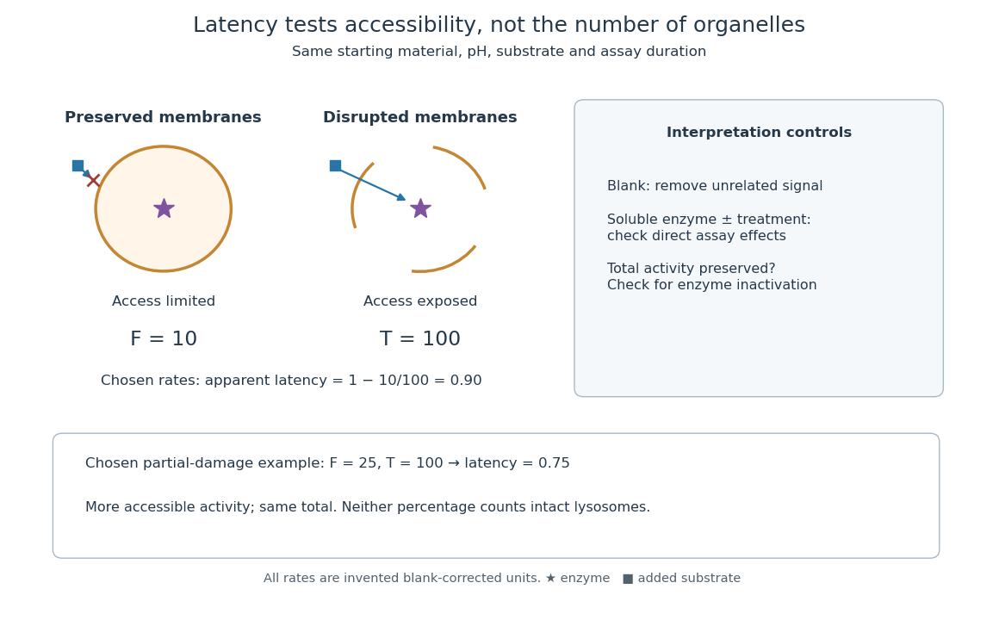

**[Figure 14](#image-lysosomal-enzyme-latency-matched-assay-conditions-and-disruption-controls). Lysosomal enzyme latency: matched assay conditions and disruption controls**. Original assay-logic diagram and explicitly chosen activity example. The values $10$, $100$ and $25$ are arbitrary blank-corrected rate units, not historical observations. The soluble-[enzyme](enzyme.md) comparison is an additional control proposed for the schematic, not an asserted measurement from the [rat-liver acid-phosphatase latency experiment](#rat-liver-acid-phosphatase-latency-experiment).

Let $F$ be the blank-corrected initial rate measured with a membrane-preserving preparation and $T>0$ the rate after a treatment that exposes all assayable [enzyme](enzyme.md). Use matched amounts of starting material, [pH](acid-base-chemistry.md#ph), [substrate](enzyme.md#substrate-biochemistry) and measurement time. Define the apparent latent fraction by

$$
\ell=1-\frac{F}{T}.
$$

This definition requires more than a large treated signal. Disruption must preserve [enzyme](enzyme.md) activity, and the treatment must not independently alter the readout. A soluble-[enzyme](enzyme.md) comparison with and without treatment helps test direct activation or inhibition; an appropriate blank tests signal unrelated to [enzyme](enzyme.md)-catalysed [hydrolysis](chemical-reaction.md#hydrolysis). These are controls for interpreting the constructed assay, rather than additional historical observations.

For a deliberately chosen example, take $F=10$ and $T=100$ arbitrary rate units. Then $\ell=0.90$: ninety percent of the assayable activity was initially inaccessible. After hypothetical partial damage, $F=25$ with unchanged $T=100$ gives $\ell=0.75$. The preparation has lost latency without gaining total assayable activity. These percentages describe activity accessibility; they do not count intact [lysosomes](#lysosome). Unequal [enzyme](enzyme.md) contents, partial leakage and mixed particle populations prevent that identification. If $F>T$, the formula is negative, flagging failure of this simple accessibility interpretation rather than a negative population of hidden [enzymes](enzyme.md).

To check the logic, divide the same uniformly mixed preparation into two equal portions. If dilution halves both measured rates, $(F/2)/(T/2)=F/T$, so $\ell$ is unchanged. In contrast, comparing an undiluted untreated portion with a diluted treated portion changes the ratio artificially. Normalization to the same amount of original material is therefore part of the definition, not an optional numerical correction.

##### Rat-liver acid-phosphatase latency experiment

↑ **Parent:** [Lysosomal enzyme latency](#lysosomal-enzyme-latency)

In the 1951 study by [Jacques Berthet](biochemistry.md#jacques-berthet) and [Christian de Duve](biochemistry.md#christian-de-duve), [liver](physiology.md#liver) from fasted rats was immediately chilled in an ice-cold isotonic [chemical solution](mixture.md#solution-chemistry). The tissue was generally pressed through wire mesh; the weighed pulp was homogenized in cold $0.25\,\mathrm{mol\,L^{-1}}$ [sucrose](chemical-substance.md#sucrose) using a glass [Potter-Elvehjem homogenizer](physics.md#potter-elvehjem-homogenizer). Their [acid phosphatase](enzyme.md#acid-phosphatase) test concerned activity toward added [glycerophosphate](chemical-substance.md#glycerophosphate) at [pH](acid-base-chemistry.md#ph) $5$: the readout was [substrate](enzyme.md#substrate-biochemistry) [hydrolysis](chemical-reaction.md#hydrolysis), rather than an image of a particle.[Berthet and de Duve (1951), Tissue fractionation studies. 1, printed p. 174, introduction and Methods: Fractionation of tissue constituents; inspected first-page text](biology-bibliography.md#tissue-fractionation-studies-1-the-existence-of-a-mitochondria-linked-enzymically-inactive-form-of-acid-phosphatase-in-rat-liver-tissue-by-jacques-berthet-and-christian-de-duve)

[Christian de Duve](biochemistry.md#christian-de-duve)'s retrospective describes successive [centrifugation](biology.md#centrifugation) steps, separating [centrifugation pellets](biology.md#centrifugation-pellet) and [supernatants](biology.md#supernatant), and comparing [enzyme](enzyme.md) distributions across the recovered fractions. Membrane disruption exposed previously inaccessible [acid phosphatase](enzyme.md#acid-phosphatase) activity, providing the crucial comparison with the membrane-preserving preparation. Joint fractionation patterns and release behavior of several [acid hydrolases](enzyme.md#acid-hydrolase) supported a shared population of digestive particles. By 1955, this evidence supported the [lysosome](#lysosome) concept.[Exploring Cells with a Centrifuge, printed pp. 152–153: preparation and differential fractionation; pp. 156–159, Figures 4–7: enzyme distributions, disruption and latency](biology-bibliography.md#exploring-cells-with-a-centrifuge-by-christian-de-duve)

The inference was biochemical: a barrier restricted access to active [enzymes](enzyme.md). Co-sedimentation could confuse distinct particles; a crude mitochondrial fraction did not establish residence inside [mitochondria](#mitochondria). [Lysosomal enzyme latency](#lysosomal-enzyme-latency) neither images an [organelle](#organelle) nor determines its shape. [Electron microscopy](optics.md#electron-microscopy) of enriched fractions supplied separate morphological evidence.[Printed pp. 153–157: mixed populations and distribution patterns; pp. 161–164: incomplete separation and subsequent electron microscopy of lysosome-rich fractions](biology-bibliography.md#exploring-cells-with-a-centrifuge-by-christian-de-duve)

### Endosome

↑ **Parent:** [Organelle](#organelle)  
ⓦ [Wiki](https://en.wikipedia.org/wiki/Endosome)

An [endosome](#endosome) is a membrane-enclosed sorting compartment in the [endocytosis](cell-membrane.md#endocytosis) pathway. Cargo may return to the [cell membrane](cell-membrane.md) or proceed toward [lysosomes](#lysosome); entry therefore does not by itself establish a digestive fate.[The Cell: A Molecular Approach, 2nd edition by Geoffrey M. Cooper; Figure 9.36: early endosomes, recycling and onward maturation](biology-bibliography.md#the-cell-a-molecular-approach-2nd-edition-by-geoffrey-m-cooper/lysosomes)

#### Endosome maturation

↑ **Parent:** [Endosome](#endosome)

Progressive changes in endosomal membrane identity and lumenal processing, accompanied by sorting and retrieval rather than uniform conversion of all endocytosed cargo into a degradative route.

#### Late endosome

↑ **Parent:** [Endosome](#endosome)

A maturing degradative compartment distinguished from early sorting endosomes by changes in proteins, lipids, lumenal conditions and fusion competence.

#### Early endosome

↑ **Parent:** [Endosome](#endosome)

An [early endosome](#early-endosome) is an early sorting compartment for internalized material. Delivery to it, recycling from it and onward trafficking are experimentally distinct from uptake across the [plasma membrane](cell-membrane.md).

## Chloroplast

↑ **Parent:** [Biological cell](biological-cell.md)  
ⓦ [Wiki](https://en.wikipedia.org/wiki/Chloroplast)

A [chloroplast](#chloroplast) is a photosynthetic [plastid](#plastid) in [plant](organism.md#plant) and [algae](organism.md#algae) [biological cells](biological-cell.md). The green-plant [chloroplast](#chloroplast) modeled here has a [chloroplast envelope](#chloroplast-envelope) surrounding [chloroplast stroma](#chloroplast-stroma) and internal [thylakoids](#thylakoid). [Light-dependent reactions](biology.md#light-dependent-reactions) occur at the [thylakoid membrane](#thylakoid-membrane); the [Calvin cycle](biology.md#calvin-cycle) operates in the [chloroplast stroma](#chloroplast-stroma).[Biology 2e, 8.1, Basic Photosynthetic Structures and The Two Parts of Photosynthesis](biology-bibliography.md#biology-2e-by-mary-ann-clark-and-others/8-1-overview-of-photosynthesis)

[Cyanobacteria](organism.md#cyanobacteria) perform [oxygenic photosynthesis](biology.md#oxygenic-photosynthesis) without [chloroplasts](#chloroplast): the [prokaryotic](organism.md#prokaryote) [biological cell](biological-cell.md) itself contains the photosynthetic machinery. Thus [chloroplast](#chloroplast) identifies an [organelle](#organelle), while [oxygenic photosynthesis](biology.md#oxygenic-photosynthesis) identifies a process. [Endosymbiotic theory](ecology.md#endosymbiotic-theory) explains their historical connection; [organelle protein import](protein.md#organelle-protein-import) explains how many nuclear-encoded [proteins](protein.md) reach the modern [organelle](#organelle).

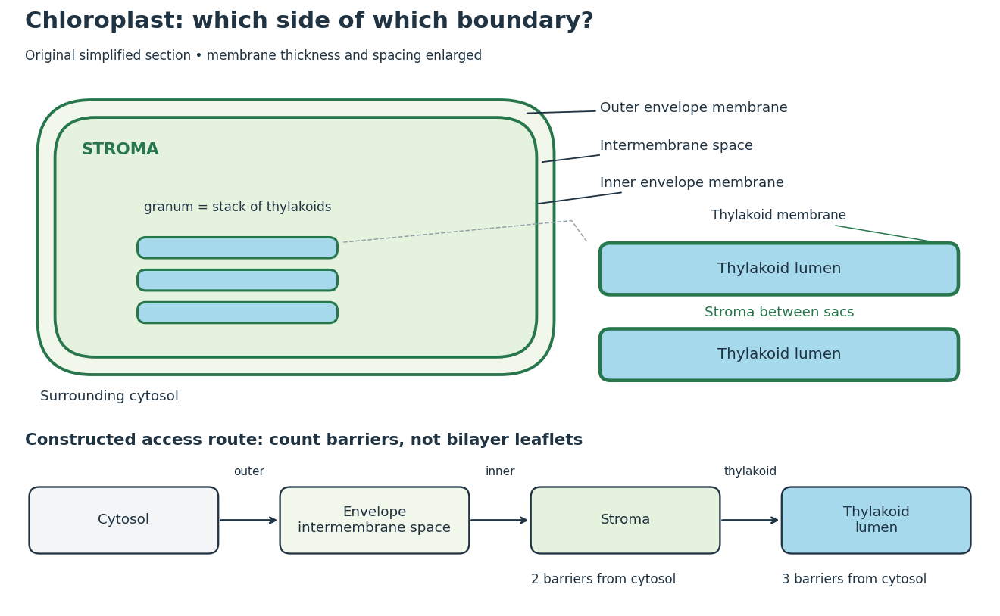

**[Figure 15](#image-chloroplast-compartments-and-boundary-counting). Chloroplast compartments and boundary counting**. Original simplified section and compartment-access model, not a micrograph or scale drawing. The enlargement separates [thylakoid lumen](#thylakoid-lumen) from the [chloroplast stroma](#chloroplast-stroma) between stacked sacs. The route counts crossings of membrane barriers, not molecular leaflets; actual permeability and transport mechanisms are omitted.

The useful feature is selective separation: [enzymes](enzyme.md) and [substrates](enzyme.md#substrate-biochemistry) can share an [organelle](#organelle) without sharing a compartment. For a constructed accessibility example, put a soluble [enzyme](enzyme.md) in [chloroplast stroma](#chloroplast-stroma) and its [substrate](enzyme.md#substrate-biochemistry) in [thylakoid lumen](#thylakoid-lumen). Sharing the same [chloroplast](#chloroplast) does not permit direct contact; contact requires a transport or boundary-disruption step. Placing the [substrate](enzyme.md#substrate-biochemistry) between adjacent [thylakoids](#thylakoid) instead puts it on the stromal side. The visual stack alone cannot establish chemical accessibility.

For the simplest boundary-counting model, represent surrounding [cytosol](#cytosol), [chloroplast intermembrane space](#chloroplast-intermembrane-space), [chloroplast stroma](#chloroplast-stroma) and [thylakoid lumen](#thylakoid-lumen) by four [vertices](graph.md#vertex-graph-theory) in a chain. Its three [edges](graph-theory.md#edge-of-a-graph) represent the outer envelope, inner envelope and [thylakoid membrane](#thylakoid-membrane), respectively. A route from [cytosol](#cytosol) to [chloroplast stroma](#chloroplast-stroma) crosses two barriers; extending it into [thylakoid lumen](#thylakoid-lumen) adds a third. This follows by listing the [edges](graph-theory.md#edge-of-a-graph) along the chain. Counting the two leaflets of each [lipid bilayer](mathematical-biology.md#lipid-bilayer) separately would answer a different question. These counts describe this idealized geometry, not the number of [protein targeting](protein.md#protein-targeting) signals or the transport itinerary of every [protein](protein.md).

The [light-dependent reactions](biology.md#light-dependent-reactions) article develops [ATP](molecule.md#adenosine-triphosphate), [NADPH](chemical-substance.md#nadph) and [electrochemical gradient](chemical-potential.md#electrochemical-gradient) coupling, and the [Calvin cycle](biology.md#calvin-cycle) article develops [carbon fixation](biology.md#carbon-fixation) bookkeeping. Their different locations make the [chloroplast](#chloroplast) interesting as an organized chemical workspace. Light-independent [chemical reactions](chemical-reaction.md) still depend on supplied carriers and regulation; the name does not prescribe nighttime operation.

### Chloroplast gene expression

↑ **Parent:** [Chloroplast](#chloroplast)

Production and regulation of functional [RNAs](polymer.md#ribonucleic-acid) and [proteins](protein.md) from the [chloroplast genome](molecular-genetics.md#chloroplast-genome). The location of the regulated process and the genomic origin of its regulator are different properties.

#### GUN1

↑ **Parent:** [Chloroplast gene expression](#chloroplast-gene-expression)

A nuclear-encoded plastid factor implicated in coordination of plastid state with nuclear [gene expression](molecular-genetics.md#gene-expression). It should not be identified with every exported plastid stress signal.[Abstract and Results](biology-bibliography.md#sigma-factor-mediated-plastid-retrograde-signals-control-nuclear-gene-expression-by-jesse-d-woodson-and-others)

#### Retrograde signaling

↑ **Parent:** [Chloroplast gene expression](#chloroplast-gene-expression)

Regulation of nuclear [gene expression](molecular-genetics.md#gene-expression) in response to the state of an [organelle](#organelle). The identity and route of a signal require experimental evidence beyond correlation of nuclear and organellar changes.

#### Anterograde signaling

↑ **Parent:** [Chloroplast gene expression](#chloroplast-gene-expression)

Regulation directed from the nuclear system toward an [organelle](#organelle), including control of imported regulators. It contrasts with [retrograde signaling](#retrograde-signaling) in direction, not necessarily in timescale.

#### Nuclear-encoded plastid RNA polymerase

↑ **Parent:** [Chloroplast gene expression](#chloroplast-gene-expression)

A nuclear-specified plastid [RNA polymerase](molecular-genetics.md#rna-polymerase) of the phage-type family, with promoter preferences distinct from [plastid-encoded RNA polymerase](#plastid-encoded-rna-polymerase).

#### Plastid-encoded RNA polymerase

↑ **Parent:** [Chloroplast gene expression](#chloroplast-gene-expression)

A bacterial-type plastid [RNA polymerase](molecular-genetics.md#rna-polymerase) with core subunits encoded by the plastid [genome](molecular-genetics.md#genome). Nuclear-encoded [sigma factors](molecular-genetics.md#sigma-factor) and associated components mean that its name does not imply autonomous regulation.

### Chloroplast envelope

↑ **Parent:** [Chloroplast](#chloroplast)

The double boundary formed by the [outer chloroplast envelope membrane](#outer-chloroplast-envelope-membrane) and [inner chloroplast envelope membrane](#inner-chloroplast-envelope-membrane).[Biology 2e, 8.1, Figure 8.6: double membrane envelope](biology-bibliography.md#biology-2e-by-mary-ann-clark-and-others/8-1-overview-of-photosynthesis)

#### Outer chloroplast envelope membrane

↑ **Parent:** [Chloroplast envelope](#chloroplast-envelope)

Separates surrounding [cytosol](#cytosol) from [chloroplast intermembrane space](#chloroplast-intermembrane-space).

#### Inner chloroplast envelope membrane

↑ **Parent:** [Chloroplast envelope](#chloroplast-envelope)

Separates [chloroplast intermembrane space](#chloroplast-intermembrane-space) from [chloroplast stroma](#chloroplast-stroma).

#### Chloroplast intermembrane space

↑ **Parent:** [Chloroplast envelope](#chloroplast-envelope)

The space between the two [chloroplast envelope](#chloroplast-envelope) membranes.

### Chloroplast stroma

↑ **Parent:** [Chloroplast](#chloroplast)

The [chloroplast stroma](#chloroplast-stroma) is the fluid compartment inside the [inner chloroplast envelope membrane](#inner-chloroplast-envelope-membrane) and outside [thylakoids](#thylakoid), containing [Calvin cycle](biology.md#calvin-cycle) [enzymes](enzyme.md).[Biology 2e, 8.1, Figures 8.6–8.7: stroma and Calvin cycle location](biology-bibliography.md#biology-2e-by-mary-ann-clark-and-others/8-1-overview-of-photosynthesis)

A [chloroplast stroma](#chloroplast-stroma) location is therefore more informative than an unspecified “inside the [chloroplast](#chloroplast)” location. In the boundary model above, entering [chloroplast stroma](#chloroplast-stroma) has not yet entered [thylakoid lumen](#thylakoid-lumen). [Protein targeting](protein.md#protein-targeting) must distinguish these destinations; a fraction containing [chloroplasts](#chloroplast) does not establish which internal compartment contains a detected [protein](protein.md).

### Thylakoid

↑ **Parent:** [Chloroplast](#chloroplast)  
ⓦ [Wiki](https://en.wikipedia.org/wiki/Thylakoid)

A [thylakoid](#thylakoid) is a membrane-enclosed sac; its [thylakoid membrane](#thylakoid-membrane) contains [chlorophyll](biology.md#chlorophyll) and [light-dependent reactions](biology.md#light-dependent-reactions) machinery. A stack is a [granum](#granum).[Biology 2e, 8.1, Basic Photosynthetic Structures, Figure 8.6](biology-bibliography.md#biology-2e-by-mary-ann-clark-and-others/8-1-overview-of-photosynthesis)

The membrane and its enclosed fluid answer different location questions. A soluble [protein](protein.md) in [thylakoid lumen](#thylakoid-lumen) is inside the sac; a [membrane protein](cell-membrane.md#membrane-protein) is embedded in its boundary and can expose different parts on the two sides. [Membrane topology](cell-membrane.md#membrane-topology) and [organelle protein import](protein.md#organelle-protein-import) provide the reusable language for those distinctions.

#### Thylakoid membrane

↑ **Parent:** [Thylakoid](#thylakoid)

Separates [thylakoid lumen](#thylakoid-lumen) from [chloroplast stroma](#chloroplast-stroma) in a [chloroplast](#chloroplast).

#### Thylakoid lumen

↑ **Parent:** [Thylakoid](#thylakoid)

The fluid interior enclosed by the [thylakoid membrane](#thylakoid-membrane).

#### Granum

↑ **Parent:** [Thylakoid](#thylakoid)

A stack of [thylakoids](#thylakoid).

### Hill reaction

↑ **Parent:** [Chloroplast](#chloroplast)  
ⓦ [Wiki](https://en.wikipedia.org/wiki/Hill_reaction)

The [Hill reaction](#hill-reaction) couples [light](optics.md#light)-driven [electron](physics.md#electron) transfer from [water](chemical-substance.md#water) to an added [electron acceptor](chemical-reaction.md#electron-acceptor) with [molecular oxygen](chemical-substance.md#molecular-oxygen) release in an isolated photosynthetic preparation. The [chloroplast dye-reduction experiment](#chloroplast-dye-reduction-experiment) uses [DCPIP](chemical-substance.md#dichlorophenolindophenol).[Investigating the light dependent reaction in photosynthesis, introductory and Teaching notes: artificial acceptor assay](biology-bibliography.md#investigating-the-light-dependent-reaction-in-photosynthesis-at-practical-biology)

In 1937, [Robin Hill](biochemistry.md#robin-hill-biochemist)'s Oxygen Evolved by Isolated Chloroplasts described a spectroscopic [molecular oxygen](chemical-substance.md#molecular-oxygen) measurement in illuminated isolated [chloroplasts](#chloroplast): oxygenation of muscle [hemoglobin](protein.md#hemoglobin) provided the indicator. This was an oxygen-binding readout. The publicly accessible first paragraph establishes that method; it does not specify enough preparation or control details to reconstruct the entire historical experiment here.[Hill, Nature 139, 881–882 (22 May 1937), public first-paragraph preview: hemoglobin oxygenation and spectroscopic saturation measurement](biology-bibliography.md#oxygen-evolved-by-isolated-chloroplasts-by-robin-hill)

The experimental idea is powerful because isolation asks how much of [photosynthesis](biology.md#photosynthesis) remains functional outside an intact [biological cell](biological-cell.md). Breaking a [chloroplast envelope](#chloroplast-envelope) does not logically imply destroying every internal [thylakoid membrane](#thylakoid-membrane). Conversely, finding an active preparation cannot establish that its [chloroplast envelope](#chloroplast-envelope) remains intact. Activity and structural integrity require different evidence.

#### Chloroplast dye-reduction experiment

↑ **Parent:** [Hill reaction](#hill-reaction)

The Practical Biology protocol uses cold [sucrose](chemical-substance.md#sucrose) in [buffer solution](acid-base-chemistry.md#buffer-solution), ground green leaves, muslin filtration, [centrifugation](biology.md#centrifugation) and cold pellet resuspension. A $100\,\mathrm{W}$ lamp illuminates extract plus [DCPIP](chemical-substance.md#dichlorophenolindophenol) from $12$–$15\,\mathrm{cm}$; a red-filter colorimeter monitors blue-color loss.[Apparatus and Chemicals; Technical note 2; Procedure a–k; Sample results, Using a bench centrifuge: EEL colorimeter with red filter](biology-bibliography.md#investigating-the-light-dependent-reaction-in-photosynthesis-at-practical-biology)

Compare extract plus dye in darkness, illuminated dye without extract, extract without dye, and [supernatant](biology.md#supernatant) plus dye: controls for [light](optics.md#light), extract dependence, background color and incomplete separation. Green [supernatant](biology.md#supernatant) can remain active; a [centrifugation pellet](biology.md#centrifugation-pellet) establishes neither purity nor intact [chloroplasts](#chloroplast).[Procedure i–k, five-tube table; Teaching notes; Questions 1–3 and answers: control interpretations and green-supernatant limitation](biology-bibliography.md#investigating-the-light-dependent-reaction-in-photosynthesis-at-practical-biology)

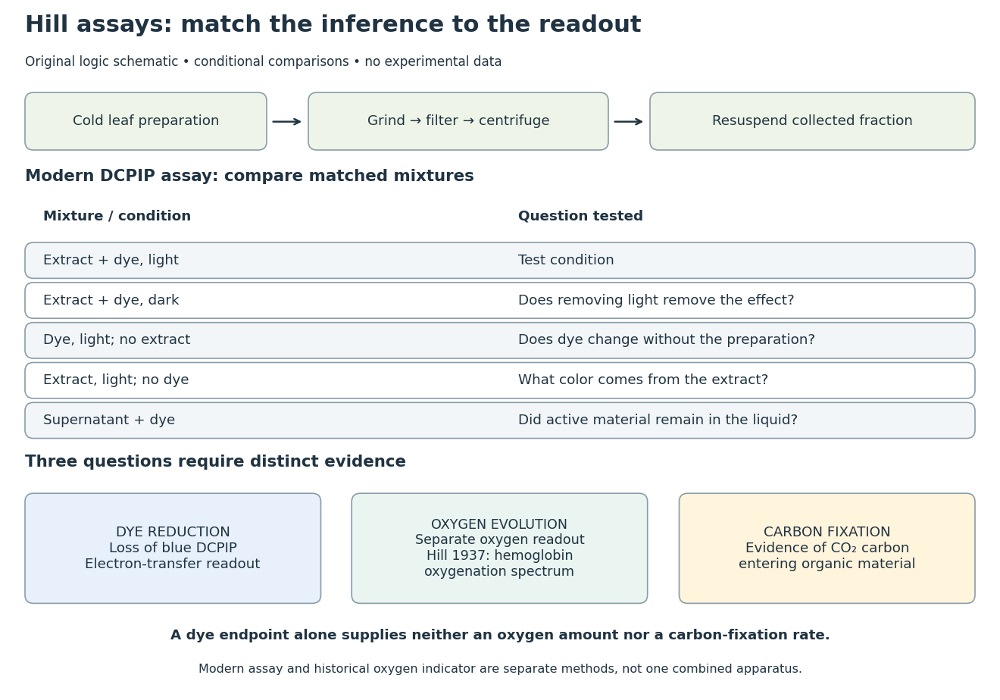

**[Figure 16](#image-hill-reaction-preparation-comparisons-and-distinct-readouts). Hill reaction: preparation, comparisons and distinct readouts**. Original experimental-logic schematic. Control outcomes are conditional interpretations, not invented observations. The modern dye assay follows the inspected Practical Biology protocol; the separate historical branch denotes [hemoglobin](protein.md#hemoglobin) oxygenation. No measured time course, apparatus photograph or published figure is reproduced.

Here is an original logical check of the controls. Suppose only the illuminated extract-plus-dye condition loses blue color, while the dark mixture and illuminated dye-only mixture retain it. Removing [light](optics.md#light) or removing extract each removes the effect in those comparisons. That supports a joint requirement under the tested conditions. If the dye-only mixture also loses blue color, the proposed attribution to extract has failed its control; a faster change in the extract mixture would require a quantitative comparison before attribution. These are conditional cases, not experimental results.

Even the favorable case leaves three distinct questions. Dye [reduction](chemical-reaction.md#reduction-chemistry) demonstrates delivery of [electrons](physics.md#electron) to an artificial [electron acceptor](chemical-reaction.md#electron-acceptor). An independently calibrated [molecular oxygen](chemical-substance.md#molecular-oxygen) readout is needed to measure [molecular oxygen](chemical-substance.md#molecular-oxygen) evolution. Demonstrating [carbon fixation](biology.md#carbon-fixation) additionally requires evidence that [carbon dioxide](chemical-substance.md#carbon-dioxide) becomes incorporated into organic material. None of the latter quantities is supplied by a blue-color endpoint alone. An [absorbance](physical-chemistry.md#absorbance) change also needs background and scattering controls before it can be treated as dye [concentration](mathematical-physics.md#concentration); [Beer-Lambert law](physical-chemistry.md#beer-lambert-law) states the relevant assumptions.

In particular, two hypothetical preparations can give the same dye endpoint while differing in whether their stromal [Calvin cycle](biology.md#calvin-cycle) is functional. Observing only the dye discards that distinction. The counterexample establishes why dye decolorization cannot alone prove complete [photosynthesis](biology.md#photosynthesis), [carbon fixation](biology.md#carbon-fixation), or an intact [chloroplast](#chloroplast). [Temperature](temperature.md), extract loading and illumination must also be matched when comparing rates: a lamp can alter both [light](optics.md#light) exposure and heating.

## Cell nucleus

↑ **Parent:** [Biological cell](biological-cell.md)  
ⓦ [Wiki](https://en.wikipedia.org/wiki/Cell_nucleus)

The [cell nucleus](#cell-nucleus) is a membrane-bounded compartment characteristic of [eukaryotic](organism.md#eukaryote) [biological cells](biological-cell.md), containing most of the cellular [DNA](polymer.md#deoxyribonucleic-acid) in a typical nucleated [biological cell](biological-cell.md). Its double [nuclear envelope](#nuclear-envelope) separates this [DNA](polymer.md#deoxyribonucleic-acid) from the surrounding [cytoplasm](#cytoplasm). Most does not mean all: [mitochondria](#mitochondria) and [chloroplasts](#chloroplast) retain their own [DNA](polymer.md#deoxyribonucleic-acid). Nor does every specialized [eukaryotic](organism.md#eukaryote) [biological cell](biological-cell.md) retain a [cell nucleus](#cell-nucleus): mature mammalian [red blood cells](#red-blood-cell) have lost theirs. [Prokaryotes](organism.md#prokaryote) organize their [DNA](polymer.md#deoxyribonucleic-acid) in a [nucleoid](#nucleoid) without a [nuclear envelope](#nuclear-envelope), and still have [ribosomes](#ribosome). See [NHGRI: nucleus](https://www.genome.gov/genetics-glossary/Nucleus), [Clark, Douglas and Choi, Biology 2e, 23.1: organelle DNA](https://openstax.org/books/biology-2e/pages/23-1-eukaryotic-origins) and [Clark, Douglas and Choi, Biology 2e, 40.2: mature mammalian red blood cells](https://openstax.org/books/biology-2e/pages/40-2-components-of-the-blood).

Follow one nuclear [protein](protein.md)-coding [gene](genetics.md#gene): its [DNA](polymer.md#deoxyribonucleic-acid) is used in [transcription](molecular-genetics.md#transcription-biology) to make [RNA](polymer.md#ribonucleic-acid); after the appropriate processing, [messenger RNA](polymer.md#messenger-rna) is exported through a [nuclear pore complex](#nuclear-pore-complex); a [ribosome](#ribosome) in the [cytoplasm](#cytoplasm) then uses it in [biological translation](molecular-genetics.md#translation-biology) to build an [amino acid](chemical-substance.md#amino-acid) chain. The [DNA](polymer.md#deoxyribonucleic-acid) remains in the [cell nucleus](#cell-nucleus). The [RNA](polymer.md#ribonucleic-acid) is a template, not the material converted into a [protein](protein.md). The [ribosome](#ribosome) diagram below follows this route; [gene expression](molecular-genetics.md#gene-expression) gives a complementary [nucleotide sequence](polymer.md#nucleic-acid-sequence) example. See [Alberts et al.: selective RNA export and protein import](https://www.ncbi.nlm.nih.gov/books/NBK26932/).

This architecture makes [gene expression](molecular-genetics.md#gene-expression) interesting in a spatial way: nuclear [transcription](molecular-genetics.md#transcription-biology) and cytoplasmic [biological translation](molecular-genetics.md#translation-biology) are separated by a selective boundary. A [messenger RNA](polymer.md#messenger-rna) can be processed before export and use, while [proteins](protein.md) needed for nuclear functions travel inward. Inside the [cell nucleus](#cell-nucleus), the [cell nucleolus](#nucleolus-biology) helps assemble [ribosome](#ribosome) subunits for export. Thus the compartment housing most [DNA](polymer.md#deoxyribonucleic-acid) also helps build the machinery that interprets its messages elsewhere.

Robert Brown described and named the [cell nucleus](#cell-nucleus) in his account of [plant](organism.md#plant) [biological cells](biological-cell.md), read to the Linnean Society in 1831 and published in its Transactions in 1833. This historical observation identified a recurring structure, without establishing its later-understood role in [DNA](polymer.md#deoxyribonucleic-acid) storage or [gene expression](molecular-genetics.md#gene-expression). See [Brown, On the Organs and Mode of Fecundation in Orchideæ and Asclepiadeæ, Transactions 16, 685–738 (1833)](https://doi.org/10.1111/j.1095-8339.1829.tb00158.x). This is a documented contribution rather than a claim that no one had observed the structure earlier.

### Nuclear retention

↑ **Parent:** [Cell nucleus](#cell-nucleus)

### Nuclear lamina

↑ **Parent:** [Cell nucleus](#cell-nucleus)

#### Lamina-associated domain

↑ **Parent:** [Nuclear lamina](#nuclear-lamina)

A genomic region with elevated association with the nuclear lamina under a specified measurement. [DamID](biology.md#damid) reports accumulated proximity rather than continuous attachment of every copy.

### Nuclear envelope

↑ **Parent:** [Cell nucleus](#cell-nucleus)  
ⓦ [Wiki](https://en.wikipedia.org/wiki/Nuclear_envelope)

The [nuclear envelope](#nuclear-envelope) is the double-membrane boundary around a [cell nucleus](#cell-nucleus). Regulated passage connects nuclear processes to the surrounding [cytoplasm](#cytoplasm): [transcription](molecular-genetics.md#transcription-biology) produces [RNA](polymer.md#ribonucleic-acid) in the [cell nucleus](#cell-nucleus), while exported [messenger RNA](polymer.md#messenger-rna) can undergo [biological translation](molecular-genetics.md#translation-biology) on [ribosomes](#ribosome) outside it. See [NHGRI: nuclear membrane](https://www.genome.gov/genetics-glossary/Nuclear-Membrane).

#### Nuclear pore complex

↑ **Parent:** [Nuclear envelope](#nuclear-envelope)  
ⓦ [Wiki](https://en.wikipedia.org/wiki/Nuclear_pore_complex)

A [nuclear pore complex](#nuclear-pore-complex) is an assembly of [proteins](protein.md) spanning the [nuclear envelope](#nuclear-envelope) and regulating passage between the [cell nucleus](#cell-nucleus) and [cytosol](#cytosol). It is a selective gateway, not simply an unregulated hole: [messenger RNA](polymer.md#messenger-rna) export and import of nuclear [proteins](protein.md) require appropriate transport machinery. See [Alberts et al.: nuclear pore complexes](https://www.ncbi.nlm.nih.gov/books/NBK26932/).

The [nuclear pore complex](#nuclear-pore-complex) occupies a junction of both [nuclear envelope](#nuclear-envelope) membranes. Its [protein](protein.md) scaffold surrounds an aqueous passage connecting [cytosol](#cytosol) to the [cell nucleus](#cell-nucleus), rather than the intermembrane space. [Diffusion](thermodynamics.md#diffusion) permits small soluble cargo to pass; selective receptors transport other cargo. [Molecular mass](molecule.md#molecular-mass) alone is not a universal cutoff.[Nuclear Pore Complexes Perforate the Nuclear Envelope, Figures 12-10–12-11; Nuclear Localization Signals Direct Nuclear Proteins to the Nucleus](biology-bibliography.md#molecular-biology-of-the-cell-4th-edition-by-bruce-alberts-and-others)

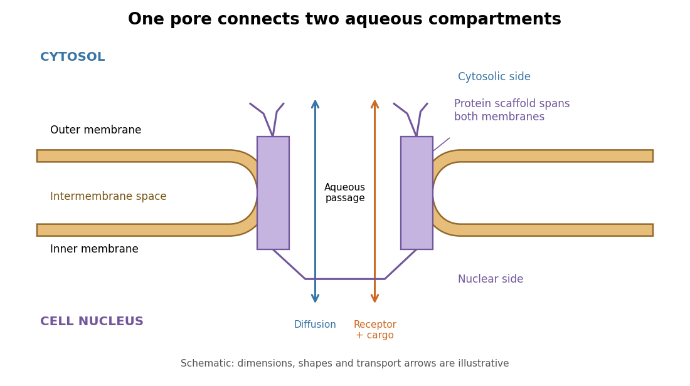

**[Figure 17](#image-the-nuclear-pore-complex-bridges-both-membranes-of-the-nuclear-envelope). The nuclear pore complex bridges both membranes of the nuclear envelope**. Original topology schematic, not a measured structure. The central passage connects [cytosol](#cytosol) and [cell nucleus](#cell-nucleus); cargo does not enter the intermembrane space. Shapes, distances and arrows are illustrative.

##### Nuclear localization sequence

↑ **Parent:** [Nuclear pore complex](#nuclear-pore-complex)  
ⓦ [Wiki](https://en.wikipedia.org/wiki/Nuclear_localization_sequence)

A [nuclear localization sequence](#nuclear-localization-sequence) is an ordered stretch of [amino acid residues](protein.md#amino-acid-residue) that can direct [protein](protein.md) import into a [cell nucleus](#cell-nucleus). In the classical pathway, [importin](protein.md#importin) α recognizes the [nuclear localization sequence](#nuclear-localization-sequence), and [importin](protein.md#importin) β mediates passage through the [nuclear pore complex](#nuclear-pore-complex). Other recognition pathways exist. An exposed [nuclear localization sequence](#nuclear-localization-sequence) is a targeting feature, not a guarantee of import under every condition.[Selective Transport of Proteins to and from the Nucleus, Figure 8.9; Regulation of Nuclear Protein Import](biology-bibliography.md#the-cell-a-molecular-approach-2nd-edition-by-geoffrey-m-cooper)

[RNA](polymer.md#ribonucleic-acid) export is a different cargo pathway: [RNA](polymer.md#ribonucleic-acid) travels associated with [proteins](protein.md), as a [ribonucleoprotein](protein.md#ribonucleoprotein), rather than being imported by its own [nuclear localization sequence](#nuclear-localization-sequence). Export of [messenger RNA](polymer.md#messenger-rna) connects nuclear [transcription](molecular-genetics.md#transcription-biology) to cytoplasmic [biological translation](molecular-genetics.md#translation-biology).[Transport of RNAs, opening paragraphs](biology-bibliography.md#the-cell-a-molecular-approach-2nd-edition-by-geoffrey-m-cooper)

##### Nuclear pore localization experiment

↑ **Parent:** [Nuclear pore complex](#nuclear-pore-complex)

In a 1982 experiment, purified [nucleoplasmin](protein.md#nucleoplasmin) was labeled with radioactive [iodine](chemical-substance.md#iodine) and cleaved by [proteolysis](biochemistry.md#proteolysis). [Microinjection](biology.md#microinjection) delivered cargo into [Xenopus laevis](organism.md#xenopus-laevis) [oocyte](biology.md#oocyte) [cytoplasm](#cytoplasm). Manually separated [cell nuclei](#cell-nucleus) and [cytoplasm](#cytoplasm) were compared by [gel electrophoresis](biology.md#gel-electrophoresis) and [autoradiography](biology.md#autoradiography); section [autoradiography](biology.md#autoradiography) checked internal localization. Tail-bearing cargo entered the [cell nucleus](#cell-nucleus); tailless cores did not. Direct nuclear [microinjection](biology.md#microinjection) retained the cores: the tails mattered for entry, but the assay did not identify a receptor.[Cell 30, 449–458: Figures 2–3, 5 and 7; The Trypsin-resistant Core Remains in the Nucleus after Nuclear Injection](biology-bibliography.md#a-polypeptide-domain-that-specifies-migration-of-nucleoplasmin-into-the-nucleus-by-colin-dingwall-and-others)

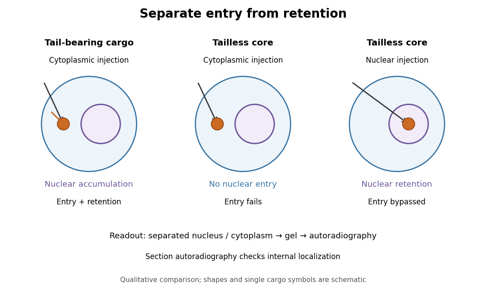

**[Figure 18](#image-changing-cargo-and-injection-site-separates-nuclear-entry-from-retention). Changing cargo and injection site separates nuclear entry from retention**. Original qualitative summary of the [nucleoplasmin](protein.md#nucleoplasmin) comparisons above. Symbols represent localization, not measured counts or copied source images.

Direct nuclear [microinjection](biology.md#microinjection) bypassed entry, distinguishing failure to enter from failure to remain inside a [cell nucleus](#cell-nucleus).

##### Nuclear pore transport balance

↑ **Parent:** [Nuclear pore complex](#nuclear-pore-complex)

Nuclear accumulation should compare [concentrations](mathematical-physics.md#concentration), not just total cargo. In an original constructed example, a [cell nucleus](#cell-nucleus) occupies one [volume](thermodynamics.md#volume-thermodynamics) unit and the accessible [cytosol](#cytosol) occupies nine. Of $130$ tracer units, $40$ are nuclear and $90$ are cytosolic. With $n_n,n_c$ the amounts and $V_n,V_c$ the accessible [volume](thermodynamics.md#volume-thermodynamics), the [concentration](mathematical-physics.md#concentration) ratio is

$$
C_n=\frac{n_n}{V_n}=40,\qquad C_c=\frac{n_c}{V_c}=10,\qquad R=\frac{C_n}{C_c}=4.
$$

Only $40/130=4/13\approx30.8\%$ of the cargo is nuclear, yet nuclear [concentration](mathematical-physics.md#concentration) is four times cytosolic [concentration](mathematical-physics.md#concentration). A majority outside the [cell nucleus](#cell-nucleus) does not rule out nuclear enrichment.

For comparison, freely exchanging nonbinding cargo at equal [concentrations](mathematical-physics.md#concentration) would have $n_n=13,n_c=117$: the nuclear fraction would equal the nuclear fraction of accessible [volume](thermodynamics.md#volume-thermodynamics), $1/10$. These are constructed amounts, not measurements from the [nuclear pore localization experiment](#nuclear-pore-localization-experiment). Binding, unequal recovery or cargo degradation would require additional accounting before interpreting an assay.

A minimal two-compartment [ordinary differential equation](differential-equation.md#ordinary-differential-equation) makes the distinction precise. Assume fixed accessible [volume](thermodynamics.md#volume-thermodynamics), no synthesis or degradation, and effective first-order exchange rates $a,b>0$:

$$
\frac{dn_n}{dt}=a n_c-b n_n,\qquad n_c=N-n_n,\qquad \frac{dn_c}{dt}=-\frac{dn_n}{dt}.
$$

Total cargo $N=n_n+n_c$ is conserved. Setting the [derivative](calculus.md#derivative) to zero gives

$$
n_n^*=\frac{aN}{a+b},\qquad \frac{C_n^*}{C_c^*}=\frac{aV_c}{bV_n}.
$$

For symmetric passive exchange with conductance $P$, $a=P/V_c$ and $b=P/V_n$, so the [concentration](mathematical-physics.md#concentration) ratio is one even when the amounts differ. Choosing instead $a=4/9$ and $b=1$ in reciprocal model-time units gives $n_n^*=40$ for $N=130,V_n=1,V_c=9$. The exact [ordinary differential equation](differential-equation.md#ordinary-differential-equation) solution is

$$
n_n(t)=n_n^*+\bigl(n_n(0)-n_n^*\bigr)e^{-(a+b)t}.
$$

Substitution verifies the solution, and $a+b>0$ makes departures decay. This effective model can describe an asymmetric exchange balance, but does not by itself identify a [nuclear localization sequence](#nuclear-localization-sequence), transport receptor or source of [energy](energy.md).

The usefulness of the [nuclear pore complex](#nuclear-pore-complex) is precisely this combination of separation and exchange: a [cell nucleus](#cell-nucleus) can maintain a distinctive [protein](protein.md) population while receiving new cargo and exporting [RNA](polymer.md#ribonucleic-acid). The [nuclear pore localization experiment](#nuclear-pore-localization-experiment) asks what feature controls entry; the [nuclear pore transport balance](#nuclear-pore-transport-balance) asks what an accumulation readout actually means.

### Nucleolus (biology)

↑ **Parent:** [Cell nucleus](#cell-nucleus)

The [cell nucleolus](#nucleolus-biology) is a region inside a [cell nucleus](#cell-nucleus) without a surrounding membrane, where much [ribosomal RNA](polymer.md#ribosomal-rna) is made and processed and [ribosome](#ribosome) subunits begin to assemble with [proteins](protein.md). The subunits are exported to the [cytoplasm](#cytoplasm); the [cell nucleolus](#nucleolus-biology) is not itself a translating [ribosome](#ribosome). See [Clark, Douglas and Choi, Biology 2e, 4.3: nucleolus and ribosomal subunits](https://openstax.org/books/biology-2e/pages/4-3-eukaryotic-cells).

## Ribosome

↑ **Parent:** [Biological cell](biological-cell.md)  
ⓦ [Wiki](https://en.wikipedia.org/wiki/Ribosome)

A [ribosome](#ribosome) is the molecular machinery for [biological translation](molecular-genetics.md#translation-biology): it reads [messenger RNA](polymer.md#messenger-rna) and joins [amino acids](chemical-substance.md#amino-acid) into a [polypeptide](protein.md#polypeptide) that can become a [protein](protein.md). Both [prokaryotes](organism.md#prokaryote) and [eukaryotes](organism.md#eukaryote) have [ribosomes](#ribosome). A [ribosome](#ribosome) consists of [ribosomal RNA](polymer.md#ribosomal-rna) and [proteins](protein.md) organized into small and large subunits, with no enclosing membrane. [Ribosomal RNA](polymer.md#ribosomal-rna) contributes to both structure and the [active site](enzyme.md#active-site) that forms [peptide bonds](protein.md#peptide-bond); a [ribosome](#ribosome) is therefore not merely a collection of [proteins](protein.md). See [Clark, Douglas and Choi, Biology 2e, 4.3: ribosome composition](https://openstax.org/books/biology-2e/pages/4-3-eukaryotic-cells) and [Nissen et al., The structural basis of ribosome activity in peptide bond synthesis, Science 289, 920–930 (2000)](https://pubmed.ncbi.nlm.nih.gov/10937990/).

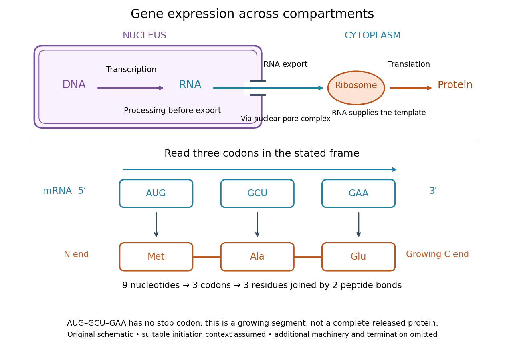

**[Figure 19](#image-nuclear-transcription-rna-export-and-ribosome-mediated-biological-translation). Nuclear transcription, RNA export and ribosome-mediated biological translation**. Original schematic of a nuclear [protein](protein.md)-coding [gene](genetics.md#gene) in a nucleated [eukaryotic](organism.md#eukaryote) [biological cell](biological-cell.md). The upper route tracks [DNA](polymer.md#deoxyribonucleic-acid) to [RNA](polymer.md#ribonucleic-acid) by [transcription](molecular-genetics.md#transcription-biology), [RNA](polymer.md#ribonucleic-acid) export, then [biological translation](molecular-genetics.md#translation-biology). The lower example reads three [messenger RNA](polymer.md#messenger-rna) [codons](molecular-genetics.md#codon) from $5'$ to $3'$ and shows a growing [polypeptide](protein.md#polypeptide) segment from its [N-terminus](protein.md#n-terminus) toward its [C-terminus](protein.md#c-terminus). Shapes and distances are illustrative; processing, flanking signals, additional machinery and termination are omitted.

For a computed decoding example, choose the [reading frame](molecular-genetics.md#reading-frame) starting at the first displayed [nucleotide](molecule.md#nucleotide) of $5'\text{-}\mathrm{AUG\ GCU\ GAA}\text{-}3'$. Under the standard [genetic code](molecular-genetics.md#genetic-code), AUG specifies [methionine](chemical-substance.md#methionine) (Met), GCU specifies [alanine](chemical-substance.md#alanine) (Ala), and GAA specifies a [glutamic acid residue](protein.md#glutamic-acid-residue) (Glu) in the growing [polypeptide](protein.md#polypeptide). Nine [nucleotides](molecule.md#nucleotide) divide into three [codons](molecular-genetics.md#codon), giving the ordered three-[amino acid residue](protein.md#amino-acid-residue) segment Met–Ala–Glu. The [ribosome](#ribosome) reads the [messenger RNA](polymer.md#messenger-rna) $5'\to3'$, and the chain grows from its [N-terminus](protein.md#n-terminus) toward its [C-terminus](protein.md#c-terminus). If synthesis begins at this AUG in an appropriate [eukaryotic](organism.md#eukaryote) initiation context, these are the first three [amino acid residues](protein.md#amino-acid-residue) before any subsequent processing. See [Clark, Douglas and Choi, Biology 2e, 15.1: standard codon assignments](https://openstax.org/books/biology-2e/pages/15-1-the-genetic-code).

For this three-[amino acid residue](protein.md#amino-acid-residue) segment, joining the three delivered [amino acids](chemical-substance.md#amino-acid) requires two [peptide bonds](protein.md#peptide-bond), one between Met and Ala and another between Ala and Glu. There is no [stop codon](molecular-genetics.md#stop-codon) in the displayed [nucleotide sequence](polymer.md#nucleic-acid-sequence), so this is a growing segment rather than a complete released [protein](protein.md). An isolated nine-[nucleotide](molecule.md#nucleotide) [RNA](polymer.md#ribonucleic-acid) is not claimed to supply all signals needed for initiation. This small calculation separates three jobs: the [messenger RNA](polymer.md#messenger-rna) specifies order, [transfer RNA](polymer.md#transfer-rna) delivers the [amino acids](chemical-substance.md#amino-acid), and the [ribosome](#ribosome) catalyzes their joining. Each new [amino acid residue](protein.md#amino-acid-residue) is added at the [C-terminus](protein.md#c-terminus). See [Clark, Douglas and Choi, Biology 2e, 15.5: initiation and chain elongation](https://openstax.org/books/biology-2e/pages/15-5-ribosomes-and-protein-synthesis).

The beauty of a [ribosome](#ribosome) is its reusable chemistry: the same machinery can assemble many different [proteins](protein.md) by following different [messenger RNA](polymer.md#messenger-rna) templates. The [genetic code](molecular-genetics.md#genetic-code) connects an alphabet of [nucleotides](molecule.md#nucleotide) to an alphabet of [amino acids](chemical-substance.md#amino-acid), while [transfer RNA](polymer.md#transfer-rna) links recognition of the message to delivery of building material. Changing the message can therefore change the product without building a different [ribosome](#ribosome) for every [protein](protein.md).

In 1955 George E. Palade described small particles in the [cytoplasm](#cytoplasm), both free and associated with membranes, in [A small particulate component of the cytoplasm, Journal of Biophysical and Biochemical Cytology 1, 59–68](https://pmc.ncbi.nlm.nih.gov/articles/PMC2223592/). The paper documents the structural observations, rather than the full modern decoding mechanism. Complementary biochemical work by Hoagland, Stephenson, Scott, Hecht and Zamecnik described a soluble [RNA](polymer.md#ribonucleic-acid) intermediate in [protein](protein.md) synthesis in 1958, helping establish the role now assigned to [transfer RNA](polymer.md#transfer-rna); see [A soluble ribonucleic acid intermediate in protein synthesis, Journal of Biological Chemistry 231, 241–257](https://pubmed.ncbi.nlm.nih.gov/13538965/). Together, structural observations and biochemical experiments connected visible cellular machinery with its working parts.

### Ribosome stalling

↑ **Parent:** [Ribosome](#ribosome)

Prolonged delay of a translating [ribosome](#ribosome) at a particular position. Stalls can reduce completed-chain output and cause [ribosome collisions](#ribosome-collision).

### Peptidyl transfer

↑ **Parent:** [Ribosome](#ribosome)

Formation of a [peptide](protein.md#peptide) bond by transfer of the growing [peptide](protein.md#peptide) to an incoming [aminoacyl-tRNA](polymer.md#aminoacyl-trna). [substrate](enzyme.md#substrate-biochemistry) sequence can affect the rate independently of decoding accuracy.

### Translation elongation factor P

↑ **Parent:** [Ribosome](#ribosome)

A bacterial factor that assists peptide-bond formation at susceptible sequences, including consecutive [prolines](chemical-substance.md#proline). Functional maturation of the factor and [substrate](enzyme.md#substrate-biochemistry) sequence affect its activity.[Mechanistic substrate tests](biology-bibliography.md#ef-p-is-essential-for-rapid-synthesis-of-proteins-containing-consecutive-proline-residues-by-lili-k-doerfel-and-others)

### Ribosomal protein

↑ **Parent:** [Ribosome](#ribosome)

A [protein](protein.md) component of a [ribosome](#ribosome). The machinery can combine products of different [genomes](molecular-genetics.md#genome), especially in an [organelle](#organelle).

### Polysome

↑ **Parent:** [Ribosome](#ribosome)

A group of [ribosomes](#ribosome) translating one [messenger RNA](polymer.md#messenger-rna). Occupancy can increase through faster initiation or slower elongation, so the amount of [polysomes](#polysome) is not by itself a synthesis-rate measurement.

### Ribosomal subunit

↑ **Parent:** [Ribosome](#ribosome)

One of the major assemblies forming a [ribosome](#ribosome). Small-subunit scanning and reinitiation can persist after release of the large subunit at a short [upstream open reading frame](molecular-genetics.md#upstream-open-reading-frame).

### Ribosome collision

↑ **Parent:** [Ribosome](#ribosome)

Contact between successive [ribosomes](#ribosome) when a following one reaches a stalled or slowly moving predecessor. Collisions can supply regulatory and quality-control signals rather than simply indicating high productive output.

## Gliding bacterium

↑ **Parent:** [Biological cell](biological-cell.md)

A [gliding bacterium](#gliding-bacterium) moves along a surface without swimming through the bulk fluid. In a thin-fluid-film model, its relative motion dissipates energy through [Couette flow](viscous-fluid-flow.md#couette-flow), although the actuation mechanism can involve additional dissipation.

## Neutrophil

↑ **Parent:** [Biological cell](biological-cell.md)

A [neutrophil](#neutrophil) is an immune [biological cell](biological-cell.md). Its adhesive rolling on a surface involves contact mechanics, fluid stresses, and binding and unbinding of adhesive bonds.

## Red blood cell

↑ **Parent:** [Biological cell](biological-cell.md)

A red blood cell is a specialized [biological cell](biological-cell.md) that transports [oxygen](chemical-substance.md#oxygen) in blood. Its deformability lets it pass through vessels narrower than its unstressed size. A compliant-body [lubrication](viscous-fluid-flow.md#lubrication-theory) model isolates the coupling between its deformation, the surrounding viscous film and a driving [pressure](pressure.md) difference; it is an idealization rather than a complete membrane or cytoplasm model.

## Membrane potential

↑ **Parent:** [Biological cell](biological-cell.md)

[This section is present in another page, follow this link to view it.](membrane-potential.md)

## Heterokaryon

↑ **Parent:** [Biological cell](biological-cell.md)  
ⓦ [Wiki](https://en.wikipedia.org/wiki/Heterokaryon)

A [heterokaryon](#heterokaryon) contains genetically different [cell nuclei](#cell-nucleus) in a shared [cytoplasm](#cytoplasm); [cell fusion](#cell-fusion) can create one.

## Cell fusion

↑ **Parent:** [Biological cell](biological-cell.md)  
ⓦ [Wiki](https://en.wikipedia.org/wiki/Cell_fusion)

[Cell fusion](#cell-fusion) combines [biological cells](biological-cell.md) into a shared [cytoplasm](#cytoplasm) bounded by a common [cell membrane](cell-membrane.md); it need not immediately fuse their [cell nuclei](#cell-nucleus).

## Cell cortex

↑ **Parent:** [Biological cell](biological-cell.md)

The [cell cortex](#cell-cortex) is a peripheral layer of [cytoplasm](#cytoplasm) beneath the [cell membrane](cell-membrane.md), containing the [actomyosin ring](cell-cycle.md#actomyosin-ring) during typical [animal](organism.md#animal) [cytokinesis](cell-cycle.md#cytokinesis).

## Cell lineage

↑ **Parent:** [Biological cell](biological-cell.md)

A [cell lineage](#cell-lineage) follows descent of [biological cells](biological-cell.md) through successive divisions. [DNA replication](molecular-genetics.md#dna-replication) can transmit a [mutation](genetics.md#mutation) to descendant [biological cells](biological-cell.md).

### Lineage restriction

↑ **Parent:** [Cell lineage](#cell-lineage)

A narrowing of the descendant [cell types](#cell-type) available to a progenitor. It should be distinguished from failure to sample rare outputs and from changing [developmental competence](biology.md#developmental-competence).

### Cell of origin

↑ **Parent:** [Cell lineage](#cell-lineage)

The normal or precursor cellular lineage in which a tumour-initiating evolutionary process occurs. It can differ from the phenotype of the established malignant cells.

### Lineage tracing

↑ **Parent:** [Cell lineage](#cell-lineage)

Following descendants of identified cells through development. Marker expression at one instant is a state measurement rather than a complete lineage history.

### Germline

↑ **Parent:** [Cell lineage](#cell-lineage)

The lineage that gives rise to reproductive cells transmitting genetic information between generations, distinguished from somatic body-cell lineages.

#### Germline genome defence

↑ **Parent:** [Germline](#germline)

Mechanisms protecting the inherited [genome](molecular-genetics.md#genome) from [transposable elements](genetics.md#transposable-element) and other threats. Suppression of transposon [RNA](polymer.md#ribonucleic-acid), [chromatin](molecular-genetics.md#chromatin) repression and removal of damaged [cells](biological-cell.md) are different protective strategies.

### Genetic lineage tracing

↑ **Parent:** [Cell lineage](#cell-lineage)

Tracking descendants through an inherited genetic label or sequence change. Labelling specificity, timing and independent activation determine what ancestry can be inferred.

#### Lineage-tracing dropout

↑ **Parent:** [Genetic lineage tracing](#genetic-lineage-tracing)

Failure to recover a lineage label from a sampled descendant. No recovered label is therefore not equivalent to proof of absent ancestry.

#### CRISPR lineage recording

↑ **Parent:** [Genetic lineage tracing](#genetic-lineage-tracing)

Using accumulated CRISPR-induced sequence changes as inherited records of ancestry. Nested scars support a lineage tree only after considering recurrent edits, deletion of earlier scars and missing observations.

##### scGESTALT

↑ **Parent:** [CRISPR lineage recording](#crispr-lineage-recording)

A lineage-recording approach coupling inherited CRISPR barcode edits with single-[cell](biological-cell.md) transcriptomes. It can relate [cell](biological-cell.md) identity to developmental ancestry while retaining the limitations of incomplete barcode recovery and edit [homoplasy](biology.md#homoplasy).[2018, Figures 1 and 3–6, recording pulses and lineage/cell-type recovery](biology-bibliography.md#simultaneous-single-cell-profiling-of-lineages-and-cell-types-in-the-vertebrate-brain-by-bushra-raj-and-others)

#### Genetic barcode

↑ **Parent:** [Genetic lineage tracing](#genetic-lineage-tracing)

An inherited sequence label used to distinguish [cell](biological-cell.md) ancestries. Independent acquisition of the same barcode, loss of the readout and nonuniform barcode frequencies can all confound a clonal inference.

##### Barcode collision

↑ **Parent:** [Genetic barcode](#genetic-barcode)

Independent [cells](biological-cell.md) receive the same apparent label. If barcode probabilities are $p_j$, two independent founders match with [probability](probability-theory.md#probability) $\sum_jp_j^2$, rather than necessarily the inverse of the nominal library size.

### Clonal lineage tracing

↑ **Parent:** [Cell lineage](#cell-lineage)

[Lineage tracing](#lineage-tracing) that identifies descendants of a single ancestor. A labelled group is informative about a clone only if labelling collisions and independent activation are excluded.

#### Clone-size distribution

↑ **Parent:** [Clonal lineage tracing](#clonal-lineage-tracing)

The distribution of descendant counts per clone. Differences can arise from proliferation, survival, migration or sampling rather than altered fate choice alone.

#### Sparse labelling

↑ **Parent:** [Clonal lineage tracing](#clonal-lineage-tracing)

Labelling few enough founder [cells](biological-cell.md) to resolve individual clones. The acceptable density depends on spatial mixing, label diversity and the chance of independent activation.

#### Clonal multipotency

↑ **Parent:** [Clonal lineage tracing](#clonal-lineage-tracing)

Production of more than one differentiated [cell type](#cell-type) from one confirmed progenitor. Several separately labelled unipotent [cells](biological-cell.md) can imitate this pattern if the label is not unique.

#### Neutral clonal competition

↑ **Parent:** [Clonal lineage tracing](#clonal-lineage-tracing)

Competition among labelled clones with equivalent average reproductive behaviour. Clone extinction can coexist with tissue maintenance, and surviving clones form a selected subset of all initial clones.

## ↑ Ancestors (2)

1. [Biology](biology.md)
2. [Codex Wiki](README.md)

## ← Incoming links (282)

- [A 3D map of the human genome at kilobase resolution reveals principles of chromatin looping by Suhas S. P. Rao and others](biology-bibliography.md#a-3d-map-of-the-human-genome-at-kilobase-resolution-reveals-principles-of-chromatin-looping-by-suhas-s-p-rao-and-others)
- [Adenosine triphosphate](molecule.md#adenosine-triphosphate)
- [Adrenaline](signal-transduction.md#adrenaline)
- [Adrenergic adipocyte assay](signal-transduction.md#adrenergic-adipocyte-assay)
- [Anaerobic respiration](biology.md#anaerobic-respiration)
- [Anaphase](cell-cycle.md#anaphase)
- [Angiosperm female gametophyte](organism.md#angiosperm-female-gametophyte)
- [Antibody-drug conjugate](protein.md#antibody-drug-conjugate)
- [Archaea](organism.md#archaea)
- [ATAC-seq](molecular-genetics.md#atac-seq)
- [ATP-driven sugar phosphorylation](biochemistry.md#atp-driven-sugar-phosphorylation)
- [Autophagy](#autophagy)
- [Biochemistry](biochemistry.md)
- [Biological cell](biological-cell.md)
- [Biology](biology.md)
- [Blood](physiology.md#blood)
- [Budding](biology.md#budding)
- [Budding yeast](organism.md#budding-yeast)
- [Cell adhesion](#cell-adhesion)
- [Cell counting](#cell-counting)
- [Cell culture](#cell-culture)
- [Cell culture passage accounting](#cell-culture-passage-accounting)
- [Cell cycle](cell-cycle.md)
- [Cell-cycle DNA content](cell-cycle.md#cell-cycle-dna-content)
- [Cell-cycle hysteresis experiment](signal-transduction.md#cell-cycle-hysteresis-experiment)
- [Cell envelope](#cell-envelope)
- [Cell fate](organism.md#cell-fate)
- [Cell-free extract](biochemistry.md#cell-free-extract)
- [Cell-free fermentation as a biochemical experiment](biochemistry.md#cell-free-fermentation-as-a-biochemical-experiment)
- [Cell-free translation](molecular-genetics.md#cell-free-translation)
- [Cell fusion](#cell-fusion)
- [Cell line](#cell-line)
- [Cell line population doublings](#cell-line-population-doublings)
- [Cell lineage](#cell-lineage)
- [Cell membrane](cell-membrane.md)
- [Cell migration](#cell-migration)
- [Cell nucleus](#cell-nucleus)
- [Cell proliferation](#cell-proliferation)
- [Cell state](#cell-state)
- [Cell type](#cell-type)
- [Cellular differentiation](organism.md#cellular-differentiation)
- [Cellular respiration](biology.md#cellular-respiration)
- [Centrifugation](biology.md#centrifugation)
- [Chelex extraction](molecular-genetics.md#chelex-extraction)
- [Chemical synapse](neuroscience.md#chemical-synapse)
- [Chemoattractant](mathematical-biology.md#chemoattractant)
- [Chloroplast](#chloroplast)
- [Chromatin loop](molecular-genetics.md#chromatin-loop)
- [ChromEMT](optics.md#chromemt)
- [Chromosome](genetics.md#chromosome)
- [Circulating tumour cell](biology.md#circulating-tumour-cell)
- [Cisternal maturation](#cisternal-maturation)
- [Clonal development](organism.md#clonal-development)
- [Cohesin loss eliminates all loop domains by Suhas S. P. Rao and others](biology-bibliography.md#cohesin-loss-eliminates-all-loop-domains-by-suhas-s-p-rao-and-others)
- [Collective cancer invasion](biology.md#collective-cancer-invasion)
- [Collective cell migration](#collective-cell-migration)
- [Colony (biology)](organism.md#colony-biology)
- [Concanavalin A](protein.md#concanavalin-a)
- [Coordinated remodeling of cellular metabolism during iron deficiency through targeted mRNA degradation by Sergi Puig and others](biology-bibliography.md#coordinated-remodeling-of-cellular-metabolism-during-iron-deficiency-through-targeted-mrna-degradation-by-sergi-puig-and-others)
- [Coupled-enzyme readout of glycolytic ATP formation](biochemistry.md#coupled-enzyme-readout-of-glycolytic-atp-formation)
- [Current clamp](neuroscience.md#current-clamp)
- [Cyclic adenosine monophosphate](signal-transduction.md#cyclic-adenosine-monophosphate)
- [Cytokinesis](cell-cycle.md#cytokinesis)
- [Cytolysis](cell-membrane.md#cytolysis)
- [Cytoplasm](#cytoplasm)
- [Cytoskeleton](#cytoskeleton)
- [Cytosol dialysis](neuroscience.md#cytosol-dialysis)
- [Density-gradient centrifugation](biology.md#density-gradient-centrifugation)
- [Deoxyribonucleic acid](polymer.md#deoxyribonucleic-acid)
- [Diploid](genetics.md#diploid)
- [Disc diffusion assay](biology.md#disc-diffusion-assay)
- [Disseminated tumour cell](biology.md#disseminated-tumour-cell)
- [DNA pulse labeling](cell-cycle.md#dna-pulse-labeling)
- [DNA replication](molecular-genetics.md#dna-replication)
- [DNA synthesis labeling with EdU](cell-cycle.md#dna-synthesis-labeling-with-edu)
- [Double fertilization](biology.md#double-fertilization)
- [Endocytosis](cell-membrane.md#endocytosis)
- [Endoplasmic reticulum](#endoplasmic-reticulum)
- [Endosymbiosis](ecology.md#endosymbiosis)
- [Endosymbiotic theory](ecology.md#endosymbiotic-theory)
- [Enzyme](enzyme.md)
- [Episome](molecular-genetics.md#episome)
- [Eukaryote](organism.md#eukaryote)
- [Experimental metastasis assay](biology.md#experimental-metastasis-assay)
- [Finite calcium-store release model](signal-transduction.md#finite-calcium-store-release-model)
- [Flow cytometric DNA-content assay](biology.md#flow-cytometric-dna-content-assay)
- [Flow cytometry](biology.md#flow-cytometry)
- [FRET proximity readout experiment](biology.md#fret-proximity-readout-experiment)
- [G0 phase](cell-cycle.md#g0-phase)
- [G3BP–Caprin1–USP10 complexes mediate stress granule condensation and associate with 40S subunits by Nancy Kedersha and others](biology-bibliography.md#g3bp-caprin1-usp10-complexes-mediate-stress-granule-condensation-and-associate-with-40s-subunits-by-nancy-kedersha-and-others)
- [Gamete](biology.md#gamete)
- [Gene dosage](genetics.md#gene-dosage)
- [Gene expression](molecular-genetics.md#gene-expression)
- [Genetic transformation](molecular-genetics.md#genetic-transformation)
- [GW182 proteins directly recruit cytoplasmic deadenylase complexes to miRNA targets by Joerg E. Braun and others](biology-bibliography.md#gw182-proteins-directly-recruit-cytoplasmic-deadenylase-complexes-to-mirna-targets-by-joerg-e-braun-and-others)
- [HeLa](#hela)
- [HeLa culture viability experiment](#hela-culture-viability-experiment)
- [Hemocytometer](#hemocytometer)
- [Hierarchical mechanisms for direct reprogramming of fibroblasts to neurons by Orly L. Wapinski and others](biology-bibliography.md#hierarchical-mechanisms-for-direct-reprogramming-of-fibroblasts-to-neurons-by-orly-l-wapinski-and-others)
- [High rates of actin filament turnover in budding yeast and roles for actin in establishment and maintenance of cell polarity revealed using the actin inhibitor latrunculin-A by Kathryn R. Ayscough and others](biology-bibliography.md#high-rates-of-actin-filament-turnover-in-budding-yeast-and-roles-for-actin-in-establishment-and-maintenance-of-cell-polarity-revealed-using-the-actin-inhibitor-latrunculin-a-by-kathryn-r-ayscough-and-others)
- [Hill reaction](#hill-reaction)
- [Histone H1 kinase assay](signal-transduction.md#histone-h1-kinase-assay)
- [Homeostasis](physiology.md#homeostasis)
- [Hormone](signal-transduction.md#hormone)
- [Human Upf proteins target an mRNA for nonsense-mediated decay when bound downstream of a termination codon by Jens Lykke-Andersen and others](biology-bibliography.md#human-upf-proteins-target-an-mrna-for-nonsense-mediated-decay-when-bound-downstream-of-a-termination-codon-by-jens-lykke-andersen-and-others)
- [Humanized mouse](biology.md#humanized-mouse)
- [Hypotonic solution](cell-membrane.md#hypotonic-solution)
- [Immortalised cell line](#immortalised-cell-line)
- [Insulin](protein.md#insulin)
- [Intracellular receptor](protein.md#intracellular-receptor)
- [Intracellular recording of membrane potential](membrane-potential.md#intracellular-recording-of-membrane-potential)
- [IP3-sensitive calcium store](signal-transduction.md#ip3-sensitive-calcium-store)
- [Isolated mitochondria respiration experiment](#isolated-mitochondria-respiration-experiment)
- [Isopycnic centrifugation](biology.md#isopycnic-centrifugation)
- [Karyotype](genetics.md#karyotype)
- [Kinetochore ablation experiment](cell-cycle.md#kinetochore-ablation-experiment)
- [Lateral mobility of membrane proteins](cell-membrane.md#lateral-mobility-of-membrane-proteins)
- [Ligand-dependent membrane phosphorylation experiment](protein.md#ligand-dependent-membrane-phosphorylation-experiment)
- [Live-cell imaging](fluorescence.md#live-cell-imaging)
- [Luria-Delbrück experiment](genetics.md#luria-delbruck-experiment)
- [Lysosomal enzyme latency](#lysosomal-enzyme-latency)
- [Lysosome](#lysosome)
- [Lysozyme wall-removal experiment](#lysozyme-wall-removal-experiment)
- [Meiotic DNA content](genetics.md#meiotic-dna-content)
- [Membrane charge separation](membrane-potential.md#membrane-charge-separation)
- [Membrane potential](membrane-potential.md)
- [Membrane topology](cell-membrane.md#membrane-topology)
- [Membrane transport](cell-membrane.md#membrane-transport)
- [Messenger RNA localization](molecular-genetics.md#messenger-rna-localization)
- [Metabolism](biology.md#metabolism)
- [Metastatic colonization](biology.md#metastatic-colonization)
- [Microcentrifuge](biology.md#microcentrifuge)
- [Microinjection](biology.md#microinjection)
- [Mitochondria](#mitochondria)
- [Mitosis](cell-cycle.md#mitosis)
- [Mitotic daughter chromosome accounting](cell-cycle.md#mitotic-daughter-chromosome-accounting)
- [Molecular cloning](molecular-genetics.md#molecular-cloning)
- [Monoclonal antibody](protein.md#monoclonal-antibody)
- [Morphogen](biology.md#morphogen)
- [Morphogen gradient](biology.md#morphogen-gradient)
- [Morphogen response threshold](biology.md#morphogen-response-threshold)
- [Mouse-human heterokaryon membrane-mixing experiment](cell-membrane.md#mouse-human-heterokaryon-membrane-mixing-experiment)
- [Multicellular organism](organism.md#multicellular-organism)
- [Mutant](genetics.md#mutant)
- [Mutation](genetics.md#mutation)
- [Negative feedback](signal-transduction.md#negative-feedback)
- [Neuron](neuroscience.md#neuron)
- [Neutrophil](#neutrophil)
- [Nuclear DNA content](genetics.md#nuclear-dna-content)
- [Nucleoid](#nucleoid)
- [Oocyte](biology.md#oocyte)
- [Optical microscope](optical-instrument.md#optical-microscope)
- [Optical tweezers](optics.md#optical-tweezers)
- [Organelle protein import](protein.md#organelle-protein-import)
- [Organism](organism.md)
- [Osmotic concentration](cell-membrane.md#osmotic-concentration)
- [Pancreatic IP3 store fractionation experiment](signal-transduction.md#pancreatic-ip3-store-fractionation-experiment)
- [Pancreatic secretory-protein pulse-chase experiment](#pancreatic-secretory-protein-pulse-chase-experiment)
- [Passive membrane response in current clamp](neuroscience.md#passive-membrane-response-in-current-clamp)
- [Solution](past-exam-of-the-biochemistry-and-molecular-biology-course-of-the-university-of-cambridge/2025/paper-2.md#section-a/5/solution)
- [Solution](past-exam-of-the-biochemistry-and-molecular-biology-course-of-the-university-of-cambridge/2025/paper-2.md#section-a/7/solution)
- [Solution](past-exam-of-the-biochemistry-and-molecular-biology-course-of-the-university-of-cambridge/2025/paper-2.md#section-a/8/solution)
- [Solution](past-exam-of-the-biochemistry-and-molecular-biology-course-of-the-university-of-cambridge/2025/paper-2.md#section-a/9/solution)
- [Solution](past-exam-of-the-biochemistry-and-molecular-biology-course-of-the-university-of-cambridge/2025/paper-2.md#section-c/14/m/solution)
- [Solution](past-exam-of-the-biochemistry-course-of-the-university-of-cambridge/2024/paper-2.md#section-i/2/solution)
- [Solution](past-exam-of-the-biochemistry-course-of-the-university-of-cambridge/2024/paper-2.md#section-ii/4/solution)
- [Solution](past-exam-of-the-biochemistry-course-of-the-university-of-cambridge/2024/paper-2.md#section-ii/5/solution)
- [Solution](past-exam-of-the-biochemistry-course-of-the-university-of-cambridge/2024/paper-2.md#section-ii/6/solution)
- [Solution](past-exam-of-the-biochemistry-course-of-the-university-of-cambridge/2024/paper-2.md#section-ii/7/solution)
- [Solution](past-exam-of-the-biochemistry-course-of-the-university-of-cambridge/2024/paper-3.md#section-i/1/solution)
- [Solution](past-exam-of-the-biochemistry-course-of-the-university-of-cambridge/2024/paper-3.md#section-i/2/solution)
- [Solution](past-exam-of-the-biochemistry-course-of-the-university-of-cambridge/2024/paper-3.md#section-ii/3/solution)
- [Solution](past-exam-of-the-biochemistry-course-of-the-university-of-cambridge/2024/paper-3.md#section-ii/4/solution)
- [Solution](past-exam-of-the-biochemistry-course-of-the-university-of-cambridge/2024/paper-3.md#section-ii/5/solution)
- [Solution](past-exam-of-the-biochemistry-course-of-the-university-of-cambridge/2024/paper-3.md#section-ii/7/solution)
- [Solution](past-exam-of-the-biochemistry-course-of-the-university-of-cambridge/2024/paper-5.md#section-1/a/solution)
- [Solution](past-exam-of-the-biochemistry-course-of-the-university-of-cambridge/2024/paper-5.md#section-1/i/solution)
- [Solution](past-exam-of-the-biochemistry-course-of-the-university-of-cambridge/2024/paper-5.md#section-1/j/solution)
- [Solution](past-exam-of-the-biochemistry-course-of-the-university-of-cambridge/2024/paper-5.md#section-1/l/solution)
- [Solution](past-exam-of-the-biochemistry-course-of-the-university-of-cambridge/2024/paper-5.md#section-1/m/solution)
- [Solution](past-exam-of-the-biochemistry-course-of-the-university-of-cambridge/2024/paper-5.md#section-1/o/solution)
- [Solution](past-exam-of-the-biochemistry-course-of-the-university-of-cambridge/2024/paper-5.md#section-1/p/solution)
- [Solution](past-exam-of-the-biochemistry-course-of-the-university-of-cambridge/2024/paper-5.md#section-2/a/solution)
- [Solution](past-exam-of-the-biochemistry-course-of-the-university-of-cambridge/2024/paper-5.md#section-2/b/solution)
- [Solution](past-exam-of-the-biochemistry-course-of-the-university-of-cambridge/2024/paper-5.md#section-2/c/solution)
- [Solution](past-exam-of-the-biochemistry-course-of-the-university-of-cambridge/2024/paper-5.md#section-2/d/solution)
- [Solution](past-exam-of-the-biochemistry-course-of-the-university-of-cambridge/2024/paper-5.md#section-2/e/solution)
- [Solution](past-exam-of-the-biochemistry-course-of-the-university-of-cambridge/2024/paper-5.md#section-2/k/solution)
- [Solution](past-exam-of-the-biochemistry-course-of-the-university-of-cambridge/2024/paper-5.md#section-2/l/solution)
- [Solution](past-exam-of-the-biochemistry-course-of-the-university-of-cambridge/2024/paper-5.md#section-2/o/solution)
- [Solution](past-exam-of-the-biochemistry-course-of-the-university-of-cambridge/2024/paper-5.md#section-2/p/solution)
- [Solution](past-exam-of-the-biochemistry-course-of-the-university-of-cambridge/2024/paper-5.md#section-2/q/solution)
- [Solution](past-exam-of-the-biochemistry-course-of-the-university-of-cambridge/2024/paper-5.md#section-2/r/solution)
- [Solution](past-exam-of-the-biochemistry-course-of-the-university-of-cambridge/2025/paper-1.md#section-i/1/solution)
- [Solution](past-exam-of-the-biochemistry-course-of-the-university-of-cambridge/2025/paper-1.md#section-ii/3/solution)
- [Solution](past-exam-of-the-biochemistry-course-of-the-university-of-cambridge/2025/paper-1.md#section-ii/5/solution)
- [Solution](past-exam-of-the-biochemistry-course-of-the-university-of-cambridge/2025/paper-1.md#section-ii/7/solution)
- [Solution](past-exam-of-the-biochemistry-course-of-the-university-of-cambridge/2025/paper-2.md#section-i/1/solution)
- [Solution](past-exam-of-the-biochemistry-course-of-the-university-of-cambridge/2025/paper-2.md#section-i/2/solution)
- [Solution](past-exam-of-the-biochemistry-course-of-the-university-of-cambridge/2025/paper-2.md#section-ii/4/solution)
- [Solution](past-exam-of-the-biochemistry-course-of-the-university-of-cambridge/2025/paper-2.md#section-ii/6/solution)
- [Solution](past-exam-of-the-biochemistry-course-of-the-university-of-cambridge/2025/paper-2.md#section-ii/7/solution)
- [Solution](past-exam-of-the-biochemistry-course-of-the-university-of-cambridge/2025/paper-3.md#section-i/1/solution)
- [Solution](past-exam-of-the-biochemistry-course-of-the-university-of-cambridge/2025/paper-3.md#section-i/2/solution)
- [Solution](past-exam-of-the-biochemistry-course-of-the-university-of-cambridge/2025/paper-3.md#section-ii/3/solution)
- [Solution](past-exam-of-the-biochemistry-course-of-the-university-of-cambridge/2025/paper-3.md#section-ii/5/solution)
- [Solution](past-exam-of-the-biochemistry-course-of-the-university-of-cambridge/2025/paper-3.md#section-ii/6/solution)
- [Solution](past-exam-of-the-biochemistry-course-of-the-university-of-cambridge/2025/paper-3.md#section-ii/7/solution)
- [Solution](past-exam-of-the-biochemistry-course-of-the-university-of-cambridge/2025/paper-4.md#section-i/1/solution)
- [Solution](past-exam-of-the-biochemistry-course-of-the-university-of-cambridge/2025/paper-4.md#section-i/2/solution)
- [Solution](past-exam-of-the-genetics-course-of-the-university-of-cambridge/2025/paper-2.md#1/solution)
- [Solution](past-exam-of-the-genetics-course-of-the-university-of-cambridge/2025/paper-2.md#2/solution)
- [Solution](past-exam-of-the-genetics-course-of-the-university-of-cambridge/2025/paper-2.md#3/solution)
- [Solution](past-exam-of-the-genetics-course-of-the-university-of-cambridge/2025/paper-2.md#4/solution)
- [Solution](past-exam-of-the-genetics-course-of-the-university-of-cambridge/2025/paper-2.md#5/solution)
- [Solution](past-exam-of-the-genetics-course-of-the-university-of-cambridge/2025/paper-2.md#6/solution)
- [Solution](past-exam-of-the-genetics-course-of-the-university-of-cambridge/2025/paper-2.md#7/solution)
- [Solution](past-exam-of-the-genetics-course-of-the-university-of-cambridge/2025/paper-4.md#7/solution)
- [Solution](past-exam-of-the-mathematical-and-computational-biology-course-of-the-university-of-cambridge/2025/paper-2.md#7/a/solution)
- [Solution](past-exam-of-the-mathematics-course-of-the-university-of-cambridge/2013/iii/paper-35.md#1/c/i/solution)
- [Solution](past-exam-of-the-mathematics-course-of-the-university-of-cambridge/2013/iii/paper-35.md#1/c/ii/solution)
- [Solution](past-exam-of-the-zoology-course-of-the-university-of-cambridge/2025/paper-zm6.md#1/solution)
- [Patch-clamp series resistance](neuroscience.md#patch-clamp-series-resistance)
- [Permeating solute](cell-membrane.md#permeating-solute)
- [Phase-contrast microscopy](optical-instrument.md#phase-contrast-microscopy)
- [Phospholipid](chemical-substance.md#phospholipid)
- [Photosynthesis](biology.md#photosynthesis)
- [Physiological integrator](physiology.md#physiological-integrator)
- [Plant cell wall](#plant-cell-wall)
- [Plant tissue](organism.md#plant-tissue)
- [Plasmolysis](#plasmolysis)
- [Polarized cell growth](#polarized-cell-growth)
- [Pollen](biology.md#pollen)
- [Polymerase chain reaction](molecular-genetics.md#polymerase-chain-reaction)
- [Population heterogeneity](biology.md#population-heterogeneity)
- [Prokaryote](organism.md#prokaryote)
- [Protein](protein.md)
- [Protoplast](#protoplast)
- [Pseudotime](molecular-genetics.md#pseudotime)
- [PV92 teaching experiment](molecular-genetics.md#pv92-teaching-experiment)
- [RAS is regulated by the let-7 microRNA family by Steven M. Johnson and others](biology-bibliography.md#ras-is-regulated-by-the-let-7-microrna-family-by-steven-m-johnson-and-others)
- [Reading frame](molecular-genetics.md#reading-frame)
- [Red blood cell](#red-blood-cell)
- [Replica plating](molecular-genetics.md#replica-plating)
- [Replica plating controls](molecular-genetics.md#replica-plating-controls)
- [Replica plating spatial correspondence](molecular-genetics.md#replica-plating-spatial-correspondence)
- [Respiration and ATP coupling](biology.md#respiration-and-atp-coupling)
- [Ribonuclease A refolding experiment](protein.md#ribonuclease-a-refolding-experiment)
- [Ribosome](#ribosome)
- [Ribosome profiling of mouse embryonic stem cells reveals the complexity and dynamics of mammalian proteomes by Nicholas T. Ingolia and others](biology-bibliography.md#ribosome-profiling-of-mouse-embryonic-stem-cells-reveals-the-complexity-and-dynamics-of-mammalian-proteomes-by-nicholas-t-ingolia-and-others)
- [Ribozyme](enzyme.md#ribozyme)
- [RNA half-life](molecular-genetics.md#rna-half-life)
- [RNase H2-initiated ribonucleotide excision repair by Justin L. Sparks and others](biology-bibliography.md#rnase-h2-initiated-ribonucleotide-excision-repair-by-justin-l-sparks-and-others)
- [Saccharomyces cerevisiae](organism.md#saccharomyces-cerevisiae)
- [Seal leak current](neuroscience.md#seal-leak-current)
- [Second messenger](signal-transduction.md#second-messenger)
- [Signal transduction](signal-transduction.md)
- [Signaling adaptation](signal-transduction.md#signaling-adaptation)
- [Single-Molecule Imaging Reveals Translation of mRNAs Localized to Stress Granules by Daniel Mateju and others](biology-bibliography.md#single-molecule-imaging-reveals-translation-of-mrnas-localized-to-stress-granules-by-daniel-mateju-and-others)
- [Snowflake yeast](organism.md#snowflake-yeast)
- [Somatic mutation](genetics.md#somatic-mutation)
- [Space clamp](neuroscience.md#space-clamp)
- [Spindle checkpoint](cell-cycle.md#spindle-checkpoint)
- [Splicing regulation at the second catalytic step by Sex-lethal involves 3′ splice site recognition by SPF45 by María José Lallena and others](biology-bibliography.md#splicing-regulation-at-the-second-catalytic-step-by-sex-lethal-involves-3′-splice-site-recognition-by-spf45-by-maria-jose-lallena-and-others)
- [Synapse](neuroscience.md#synapse)
- [Syngeneic tumour model](biology.md#syngeneic-tumour-model)
- [The DLEU2/miR-15a/16-1 cluster controls B cell proliferation and its deletion leads to chronic lymphocytic leukemia by Ulf Klein and others](biology-bibliography.md#the-dleu2-mir-15a-16-1-cluster-controls-b-cell-proliferation-and-its-deletion-leads-to-chronic-lymphocytic-leukemia-by-ulf-klein-and-others)
- [Tonicity](cell-membrane.md#tonicity)
- [Topologically associating domain](molecular-genetics.md#topologically-associating-domain)
- [Toroidal sand dollar egg experiment](cell-cycle.md#toroidal-sand-dollar-egg-experiment)
- [Trypan blue exclusion test](#trypan-blue-exclusion-test)
- [Trypsin](enzyme.md#trypsin)
- [Tumour purity](biology.md#tumour-purity)
- [Turgor pressure](#turgor-pressure)
- [Unicellular organism](organism.md#unicellular-organism)
- [Variant allele fraction](molecular-genetics.md#variant-allele-fraction)
- [Western blot normalization](protein.md#western-blot-normalization)
- [Western blot response saturation](protein.md#western-blot-response-saturation)
- [Whole-cell recording](neuroscience.md#whole-cell-recording)
- [Xenopus laevis egg extract](signal-transduction.md#xenopus-laevis-egg-extract)
- [Yeast](organism.md#yeast)
- [Zygote](biology.md#zygote)
