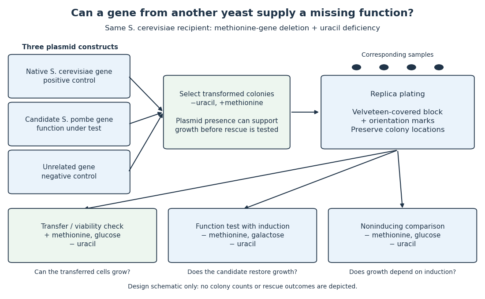
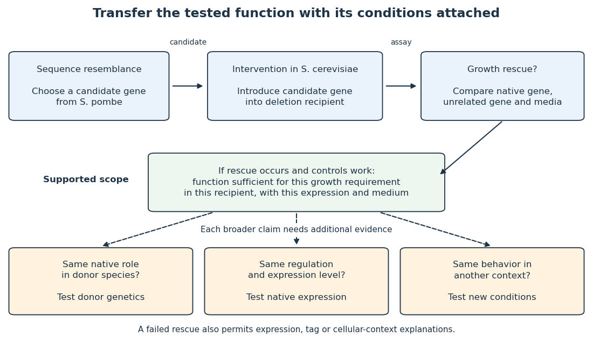
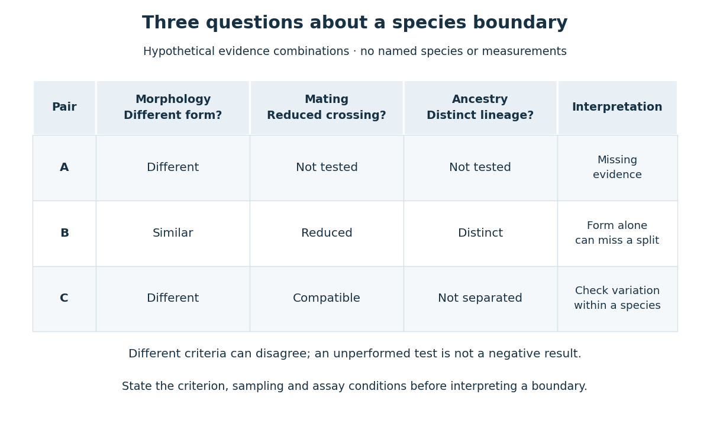
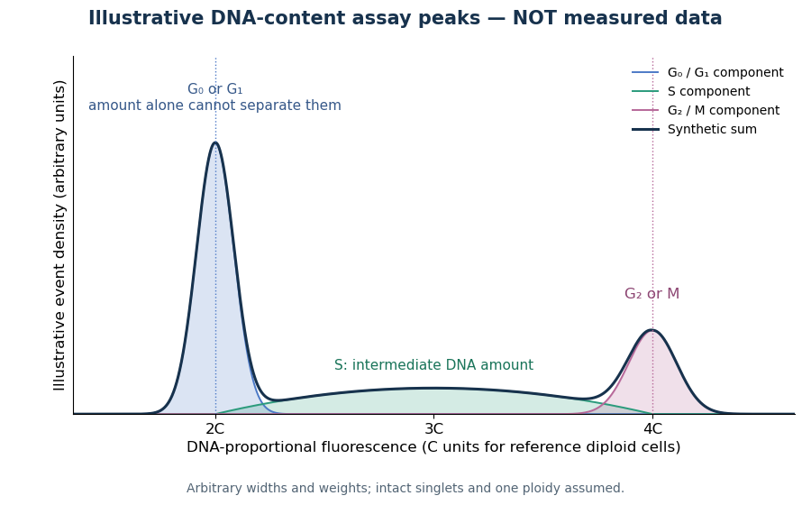
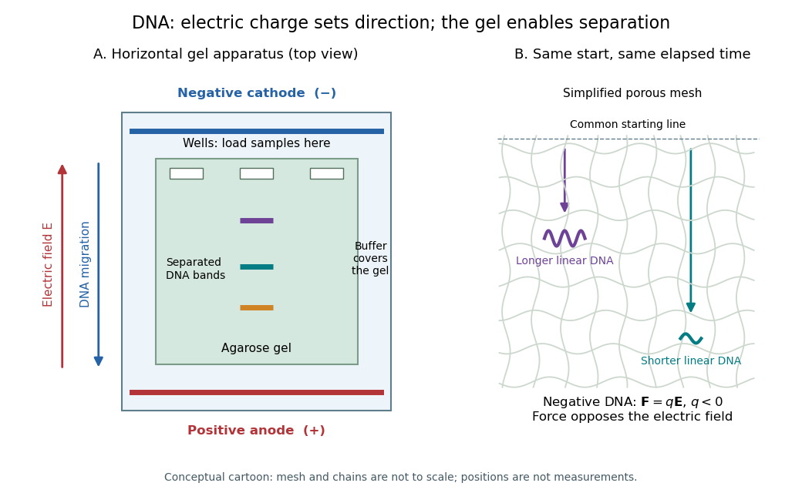
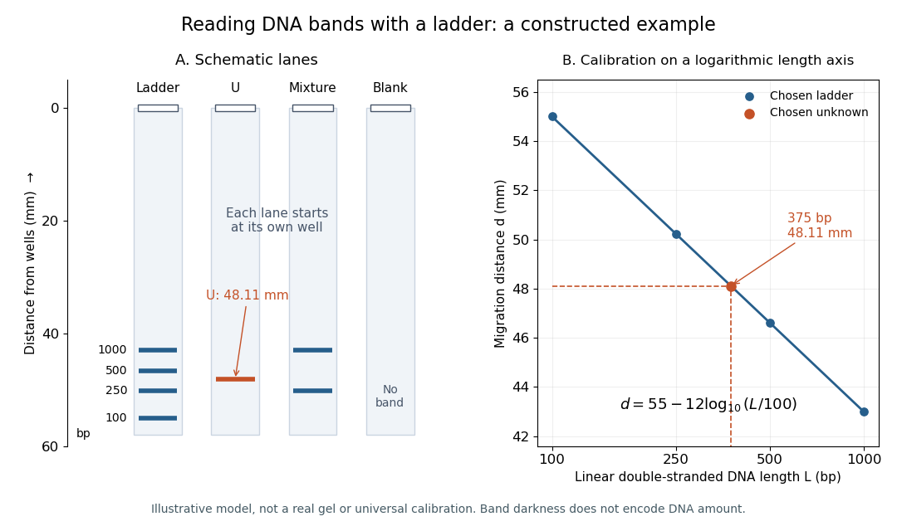

# Biology

↑ **Parent:** [Codex Wiki](README.md)  
ⓦ [Wiki](https://en.wikipedia.org/wiki/Biology)

[Biology](biology.md) studies living systems: how [biological cells](biological-cell.md) maintain themselves, how [organisms](organism.md) develop and reproduce, and how [evolution](evolution.md) generates diversity. Its scales connect [molecules](molecule.md), [genes](genetics.md#gene), [biological cells](biological-cell.md), [organisms](organism.md) and the interactions studied by [ecology](ecology.md). These are complementary viewpoints: a [protein](protein.md)'s chemistry can explain a cellular mechanism, while [evolution](evolution.md) explains why inherited variants of that mechanism persist. See [Clark, Douglas and Choi, Biology 2e: the science of biology](https://openstax.org/books/biology-2e/pages/1-1-the-science-of-biology).

Two organizing ideas make this immense subject navigable: shared cellular organization and descent with inherited modification. A [neuron](neuron.md) and a [gliding bacterium](biological-cell.md#gliding-bacterium) differ dramatically in shape and behavior, yet both depend on a [cell membrane](cell-membrane.md) and [metabolism](metabolism.md). Their differences become intelligible through specialization and [evolution](evolution.md).

Keep observations separate from the [mathematical models](mathematics.md#mathematical-model) used to explain them. A measured [membrane potential](membrane-potential.md) is evidence; an idealized [two-state ion-channel gating](membrane-potential.md#two-state-ion-channel-gating) equation proposes a mechanism. A [mathematical model](mathematics.md#mathematical-model) earns trust through predictions and comparisons with measurements. Its assumptions delimit its usefulness, and disagreement can reveal missing biology rather than a faulty measurement.

**Table of contents**

- [Biology author](biology-author.md)
- [Biology bibliography](biology-bibliography.md)
- [Life](#life)
- [Central dogma of molecular biology](#central-dogma-of-molecular-biology)
- [Toxicology](#toxicology)
- [Agronomy](#agronomy)
- [Natural history](#natural-history)
- [Nutrient](#nutrient)
- [Intracellular transport](#intracellular-transport)
- [Population heterogeneity](#population-heterogeneity)
- [Biotechnology](#biotechnology)
- [Structural biology](#structural-biology)
- [Systems biology](#systems-biology)
- [Tissue polarity](#tissue-polarity)
- [Iron homeostasis](#iron-homeostasis)
- [Microbiology](#microbiology)
- [Animal behaviour](animal-behaviour.md)
- [Mass photometry](#mass-photometry)
- [Bioinformatics](#bioinformatics)
- [Biomineralization](#biomineralization)
- [Biological anthropology](#biological-anthropology)
- [Hypoxia](#hypoxia)
- [Senescence](#senescence)
- [Botany](botany.md)
- [Biologist](biologist.md)
- [Catecholamine](#catecholamine)
- [Signal transduction](signal-transduction.md)
- [Centrifugation](centrifugation.md)
- [Biophysics](#biophysics)
- [Biophysical measurement](biophysical-measurement.md)
- [Model organism](#model-organism)
- [Organism](organism.md)
- [Taxonomy (biology)](#taxonomy-biology)
- [Morphology (biology)](#morphology-biology)
- [Developmental biology](developmental-biology.md)
- [Paleontology](paleontology.md)
- [Ecology](ecology.md)
- [Protein](protein.md)
- [Morphogen](morphogen.md)
- [Twin](#twin)
- [Biosignature](#biosignature)
- [Mortality](#mortality)
- [Neuroscience](neuroscience.md)
- [Enzyme](enzyme.md)
- [Flow cytometry](#flow-cytometry)
- [Biological cell](biological-cell.md)
- [Metabolism](metabolism.md)
- [Evolution](evolution.md)
- [Calcium in biology](#calcium-in-biology)
- [Reproduction](reproduction.md)
- [Genetics](genetics.md)
- [Pathogen](#pathogen)
- [RNA splicing](#rna-splicing)
- [Guanosine](#guanosine)
- [Gel electrophoresis](#gel-electrophoresis)
- [ELISA](#elisa)
- [Physiology](physiology.md)
- [Medicine](#medicine)
- [Biology laboratory technique](#biology-laboratory-technique)
- [Virus](#virus)
- [Entomology](#entomology)
- [Microinjection](#microinjection)
- [Anatomy](anatomy.md)
- [Antibiotic](#antibiotic)

## Biology author

↑ **Parent:** [Biology](biology.md)

[This section is present in another page, follow this link to view it.](biology-author.md)

## Biology bibliography

↑ **Parent:** [Biology](biology.md)

[This section is present in another page, follow this link to view it.](biology-bibliography.md)

## Life

↑ **Parent:** [Biology](biology.md)

Systems capable of sustained self-maintenance and heritable [evolution](evolution.md); definitions differ at boundary cases.

### Abiogenesis

↑ **Parent:** [Life](#life)

Origin of [life](#life) from nonliving chemical systems.

#### Spontaneous generation

↑ **Parent:** [Abiogenesis](#abiogenesis)

Historical hypothesis that familiar organisms arise anew in organic preparations without pre-existing organisms of their kind; experiments on contaminated infusions must be distinguished from modern questions about the remote origin of life.

## Central dogma of molecular biology

↑ **Parent:** [Biology](biology.md)  
ⓦ [Wiki](https://en.wikipedia.org/wiki/Central_dogma_of_molecular_biology)

Sequence information may pass among [DNA](polymer.md#deoxyribonucleic-acid) and [RNA](polymer.md#ribonucleic-acid) and from [RNA](polymer.md#ribonucleic-acid) to [protein](protein.md); the dogma excludes a general transfer from protein sequence back into nucleic-acid sequence. [Reverse transcription](molecular-genetics.md#reverse-transcription) does not contradict it.

## Toxicology

↑ **Parent:** [Biology](biology.md)  
ⓦ [Wiki](https://en.wikipedia.org/wiki/Toxicology)

### Chelation therapy

↑ **Parent:** [Toxicology](#toxicology)

### Arsenic poisoning

↑ **Parent:** [Toxicology](#toxicology)

### Antidote

↑ **Parent:** [Toxicology](#toxicology)

### Toxicologist

↑ **Parent:** [Toxicology](#toxicology)

### Oxalic acid poisoning

↑ **Parent:** [Toxicology](#toxicology)

Toxic effects of [oxalic acid](chemical-substance.md#oxalic-acid), including local corrosive injury, disturbed [calcium](chemical-substance.md#calcium) balance and possible [acute kidney injury](#acute-kidney-injury) with [calcium oxalate](#calcium-oxalate) deposition.[Short-term effects](pharmacology-and-toxicology-bibliography.md#oxalic-acid-international-chemical-safety-card-0529)[Renal biopsy](pharmacology-and-toxicology-bibliography.md#acute-renal-failure-following-oxalic-acid-poisoning-a-case-report)

### Antimuscarinic poisoning

↑ **Parent:** [Toxicology](#toxicology)

Poisoning involving [muscarinic receptor](protein.md#muscarinic-acetylcholine-receptor) blockade, with manifestations including [delirium](neurology.md#delirium), dryness and [mydriasis](anatomy.md#mydriasis).[Background and characteristic signs](pharmacology-and-toxicology-bibliography.md#anticholinergic-syndrome-by-the-royal-children’s-hospital-melbourne)

### Alcohol intoxication

↑ **Parent:** [Toxicology](#toxicology)

### Lead poisoning

↑ **Parent:** [Toxicology](#toxicology)

### Carbon dioxide poisoning

↑ **Parent:** [Toxicology](#toxicology)

### Phosphorus poisoning

↑ **Parent:** [Toxicology](#toxicology)

The acute toxic syndrome caused especially by [white phosphorus](chemical-substance.md#white-phosphorus), distinguished from ordinary dietary [phosphate](chemical-substance.md#phosphate).

### Gastric lavage

↑ **Parent:** [Toxicology](#toxicology)

#### Stomach pump

↑ **Parent:** [Gastric lavage](#gastric-lavage)

### Antimony poisoning

↑ **Parent:** [Toxicology](#toxicology)

### Opioid poisoning

↑ **Parent:** [Toxicology](#toxicology)

Toxic effects of [opioids](pharmacology.md#opioid), especially [respiratory depression](#respiratory-depression); severe poisoning can require [artificial respiration](physiology.md#artificial-respiration) and [naloxone](pharmacology.md#naloxone).

#### Opium poisoning

↑ **Parent:** [Opioid poisoning](#opioid-poisoning)

Poisoning by [opium](pharmacology.md#opium), distinguished historically from other causes of [coma](geometrical-optics.md#coma-optics).

### Toxicological analysis

↑ **Parent:** [Toxicology](#toxicology)

#### Arsenic detection

↑ **Parent:** [Toxicological analysis](#toxicological-analysis)

##### Reinsch test

↑ **Parent:** [Arsenic detection](#arsenic-detection)

A historical deposition test using [copper](chemical-substance.md#copper) in an acidified sample. Deposits require further characterization because substances other than [arsenic](chemical-substance.md#arsenic) can interfere.[1844, pp.3–5](pharmacology-and-toxicology-bibliography.md#on-arsenic-as-a-poison-its-tests-and-antidote-by-e-j-shearman)

##### Marsh test

↑ **Parent:** [Arsenic detection](#arsenic-detection)

A historical arsenic-separation and recognition procedure associated with [James Marsh](chemistry.md#james-marsh). Volatile [arsine](chemical-substance.md#arsine) carries arsenic away from a sample matrix and yields a deposit; [stibine](chemical-substance.md#stibine) can interfere.

### Strychnine

↑ **Parent:** [Toxicology](#toxicology)

A toxic substance associated with [strychnine poisoning](#strychnine-poisoning).

#### Liquor Strychniae

↑ **Parent:** [Strychnine](#strychnine)

Historical pharmaceutical preparation; its composition and clinical use must be identified by edition. [corresponding monograph and British preparation](pharmacology-and-toxicology-bibliography.md#the-essentials-of-materia-medica-and-therapeutics-by-alfred-baring-garrod-1865)

### Poison

↑ **Parent:** [Toxicology](#toxicology)

### Cyanide poisoning

↑ **Parent:** [Toxicology](#toxicology)

### Carbon monoxide poisoning

↑ **Parent:** [Toxicology](#toxicology)

### Strychnine poisoning

↑ **Parent:** [Toxicology](#toxicology)  
ⓦ [Wiki](https://en.wikipedia.org/wiki/Strychnine_poisoning)

### Toxicity

↑ **Parent:** [Toxicology](#toxicology)  
ⓦ [Wiki](https://en.wikipedia.org/wiki/Toxicity)

## Agronomy

↑ **Parent:** [Biology](biology.md)  
ⓦ [Wiki](https://en.wikipedia.org/wiki/Agronomy)

Study of crops and their interaction with soils, climate and agricultural management. Field performance depends on these conditions as well as on the inherited characteristics examined in [plant breeding](botany.md#plant-breeding).

### Lodging (agriculture)

↑ **Parent:** [Agronomy](#agronomy)  
ⓦ [Wiki](https://en.wikipedia.org/wiki/Lodging_(agriculture))

Bending or displacement of crop stems from their upright position. Plant architecture, weather and growth conditions affect its occurrence and the resulting harvest losses.

### Agronomist

↑ **Parent:** [Agronomy](#agronomy)

#### List of agronomists

↑ **Parent:** [Agronomist](#agronomist)

##### Norman Borlaug

↑ **Parent:** [List of agronomists](#list-of-agronomists)  
ⓦ [Wiki](https://en.wikipedia.org/wiki/Norman_Borlaug)

**[Figure 1](#image-portrait-of-norman-borlaug). Portrait of Norman Borlaug**. [Source](https://commons.wikimedia.org/wiki/File:Norman\_Borlaug.jpg). USDA Foreign Agricultural Service; individual photographer unspecified in the File record. Public domain in the United States: federal employee work made in official duties (PD-USGov). [Source usage terms](https://commons.wikimedia.org/wiki/Template:PD-USGov), via Wikimedia Commons.

###### Work by Norman Borlaug

↑ **Parent:** [Norman Borlaug](#norman-borlaug)

## Natural history

↑ **Parent:** [Biology](biology.md)  
ⓦ [Wiki](https://en.wikipedia.org/wiki/Natural_history)

Study of [organisms](organism.md) and other natural objects through observation, collection and description; historically it included subjects now separated among several sciences.

### Linnean Society

↑ **Parent:** [Natural history](#natural-history)  
ⓦ [Wiki](https://en.wikipedia.org/wiki/Linnean_Society_of_London)

The learned society to which materials by [Charles Darwin](evolution.md#charles-darwin) and [Alfred Russel Wallace](evolution.md#alfred-russel-wallace) were communicated together on 1 July 1858.

### Naturalist

↑ **Parent:** [Natural history](#natural-history)

A practitioner who observes, collects, describes or classifies [organisms](organism.md) and other natural objects. The historical role predates modern disciplinary divisions among [biology](biology.md), [geology](planetary-science.md#geology) and related subjects.

#### List of naturalists

↑ **Parent:** [Naturalist](#naturalist)

<h5 id="felix-archimede-pouchet">Félix Archimède Pouchet</h5>

↑ **Parent:** [List of naturalists](#list-of-naturalists)

Naturalist who defended heterogenesis in the nineteenth-century spontaneous-generation controversy.

Verified external portrait record: [https://wellcomecollection.org/works/ctma9gk7](https://wellcomecollection.org/works/ctma9gk7)

##### Robert Chambers (publisher, born 1802)

↑ **Parent:** [List of naturalists](#list-of-naturalists)  
ⓦ [Wiki](https://en.wikipedia.org/wiki/Robert_Chambers_(publisher,_born_1802))

The [naturalist](#naturalist) and publisher who wrote [Vestiges of the Natural History of Creation by Robert Chambers](history-of-science.md#vestiges-of-the-natural-history-of-creation-by-robert-chambers).

**[Figure 2](#image-portrait-of-robert-chambers). Portrait of Robert Chambers**. [Source](https://commons.wikimedia.org/wiki/File:Robert\_Chambers,\_engraved\_portrait\_Wellcome\_L0012623.jpg). Anonymous engraving made before 1864; Wellcome Collection / Wellcome Library, London, L0012623. Creative Commons Attribution 4.0 International, [https://creativecommons.org/licenses/by/4.0/](https://creativecommons.org/licenses/by/4.0/) . No alteration other than display scaling.

## Nutrient

↑ **Parent:** [Biology](biology.md)  
ⓦ [Wiki](https://en.wikipedia.org/wiki/Nutrient)

A [nutrient](#nutrient) supplies material or energy used by an organism. In [mathematical biology](mathematical-biology.md), a [nutrient](#nutrient) [concentration](mathematical-physics.md#concentration) can be transported, produced and consumed, and can influence [population dynamics](mathematical-biology.md#population-dynamics) or act as a [chemoattractant](mathematical-biology.md#chemoattractant).

### Vitamin

↑ **Parent:** [Nutrient](#nutrient)

#### Vitamin C

↑ **Parent:** [Vitamin](#vitamin)

An essential dietary [vitamin](#vitamin) required for normal [collagen](protein.md#collagen) synthesis. [Introduction](clinical-medicine-bibliography.md#vitamin-c-fact-sheet-for-health-professionals-by-nih)

#### Thiamine

↑ **Parent:** [Vitamin](#vitamin)

#### Fat-soluble vitamin

↑ **Parent:** [Vitamin](#vitamin)

## Intracellular transport

↑ **Parent:** [Biology](biology.md)

### Diffusion and capture

↑ **Parent:** [Intracellular transport](#intracellular-transport)

A localization mechanism in which nondirected movement brings material to a selectively retaining destination. Localization does not by itself establish motor-driven transport along the entire route.

#### Facilitated target search

↑ **Parent:** [Diffusion and capture](#diffusion-and-capture)

A facilitated target search combines bulk [diffusion](thermodynamics.md#diffusion) with lower-dimensional motion on a substrate, such as sliding on [DNA](polymer.md#deoxyribonucleic-acid). In the scaling model $\tau=A/\lambda+B\lambda$, positive constants $A,B$ balance relocation and local exploration. Differentiation gives $\lambda_*=\sqrt{A/B}$ and $\tau_{\min}=2\sqrt{AB}$. These expressions require an accessible optimum within the physically allowed range of sliding lengths.

##### Sliding diffusivity with per-step dissociation

↑ **Parent:** [Facilitated target search](#facilitated-target-search)

For an unbiased one-dimensional walk with step size $a$, [diffusion coefficient](brownian-motion.md#diffusion-coefficient) $D$ fixes step interval $a^2/(2D)$. A small dissociation probability $P$ per step gives about $1/P$ steps before release. Thus lifetime depends on $D$, while the root-mean-square net displacement before release is $a/\sqrt P$. Net displacement is not the cumulative distance along all backtracking steps. Physically impossible printed diffusivities should not be silently replaced by a guessed exponent.

#### Smoluchowski association rate

↑ **Parent:** [Diffusion and capture](#diffusion-and-capture)

For an absorbing spherical target of radius $a$ in an infinite uniform reservoir, steady [diffusion](thermodynamics.md#diffusion) gives $c(r)=c_\infty(1-a/r)$. Integrating the inward flux yields $k=4\pi D_{\rm rel}a$, where $D_{\rm rel}=D_A+D_B$ if both partners diffuse. Here $k$ multiplies [number densities](statistical-physics.md#number-density); its units are volume per time. Molecular orientation, finite-domain transients and imperfect capture require corrections.

##### Earliest diffusive target encounter among independent searchers

↑ **Parent:** [Smoluchowski association rate](#smoluchowski-association-rate)

If $N$ independent well-mixed searchers each encounter a small absorbing target with approximate exponential hazard $k_a/V$, their minimum waiting time has hazard $Nk_a/V$. The [Smoluchowski association rate](#smoluchowski-association-rate) is $k_a=4\pi D_{\rm rel}r_0$. Cell geometry, orientational capture and nonequilibrium spatial distributions can change this idealized estimate; an arbitrary nonexponential first-passage mean does not in general divide by $N$ exactly.

### Vesicle transport

↑ **Parent:** [Intracellular transport](#intracellular-transport)

#### Vesicle fusion

↑ **Parent:** [Vesicle transport](#vesicle-transport)

#### Secretory vesicle

↑ **Parent:** [Vesicle transport](#vesicle-transport)

## Population heterogeneity

↑ **Parent:** [Biology](biology.md)

Variation among [biological cells](biological-cell.md) in states such as cell-cycle stage, expression level and responsiveness. Population averages can agree even when individual-cell histories differ.

## Biotechnology

↑ **Parent:** [Biology](biology.md)

Application of biological systems or their components to produce useful materials, measurements or processes.

### Photosynthetic bioproduction

↑ **Parent:** [Biotechnology](#biotechnology)

Production of useful molecules in a photosynthetic host by directing fixed carbon, light-derived energy and reducing equivalents into biosynthetic pathways.

#### Biophotovoltaic cell

↑ **Parent:** [Photosynthetic bioproduction](#photosynthetic-bioproduction)

A device harvesting electrical current from reducing equivalents generated or processed by photosynthetic organisms.

## Structural biology

↑ **Parent:** [Biology](biology.md)

### Protein Data Bank

↑ **Parent:** [Structural biology](#structural-biology)

## Systems biology

↑ **Parent:** [Biology](biology.md)

A field studying how interactions among biological components generate system-level behavior, using quantitative measurements, perturbations and [mathematical models](mathematics.md#mathematical-model).

### Whole-organism modeling

↑ **Parent:** [Systems biology](#systems-biology)

Computational integration of an organism’s interacting physiological and developmental processes at a stated resolution and for a stated range of conditions.

#### OpenWorm

↑ **Parent:** [Whole-organism modeling](#whole-organism-modeling)

### Whole-cell modeling

↑ **Parent:** [Systems biology](#systems-biology)

Integration of multiple cellular processes into a computational model of a cell. The label describes the intended scope; it does not mean that every molecular event is known or individually simulated.

### Multiscale modeling

↑ **Parent:** [Systems biology](#systems-biology)

Coupling models at different spatial or temporal resolutions while making their interfaces, units and conservation requirements explicit.

## Tissue polarity

↑ **Parent:** [Biology](biology.md)

## Iron homeostasis

↑ **Parent:** [Biology](biology.md)

Control of [iron](chemical-substance.md#iron) uptake, storage, utilization and release. [post-transcriptional regulation](molecular-genetics.md#post-transcriptional-regulation) can coordinate these processes without requiring all regulated transcripts to change in the same direction.

### Iron regulatory protein

↑ **Parent:** [Iron homeostasis](#iron-homeostasis)

A [protein](protein.md) that binds appropriate [iron-responsive elements](polymer.md#iron-responsive-element) depending on cellular state. The distinct sensing mechanisms of [IRP1](#irp1) and [IRP2](#irp2) should not be conflated.

#### IRP2

↑ **Parent:** [Iron regulatory protein](#iron-regulatory-protein)

An iron-responsive [RNA-binding protein](protein.md#rna-binding-protein) whose abundance is controlled through regulated degradation, including by [FBXL5](protein.md#fbxl5). It does not use the [aconitase](enzyme.md#aconitase) switch of [IRP1](#irp1).

#### IRP1

↑ **Parent:** [Iron regulatory protein](#iron-regulatory-protein)

A bifunctional [protein](protein.md) that acts as cytosolic [aconitase](enzyme.md#aconitase) with an appropriate iron–sulfur cluster and as an iron-responsive [RNA-binding protein](protein.md#rna-binding-protein) when converted to its RNA-binding state.[Biochemical cluster disassembly](molecular-biology-and-genetics-bibliography.md#cellular-regulation-of-the-iron-responsive-element-binding-protein-disassembly-of-the-cubane-iron-sulfur-cluster-results-in-high-affinity-rna-binding-by-david-j-haile-and-others)

## Microbiology

↑ **Parent:** [Biology](biology.md)

### Bacterial culture

↑ **Parent:** [Microbiology](#microbiology)

### Clinical microbiology

↑ **Parent:** [Microbiology](#microbiology)

#### Fungal culture

↑ **Parent:** [Clinical microbiology](#clinical-microbiology)

#### Microbiological culture

↑ **Parent:** [Clinical microbiology](#clinical-microbiology)

### Nitrification

↑ **Parent:** [Microbiology](#microbiology)

Biological oxidation of reduced nitrogen, commonly from [Ammonia](chemical-substance.md#ammonia) through [nitrite](chemical-substance.md#nitrite) to [nitrate](chemistry.md#nitrate).

### Germ theory of disease

↑ **Parent:** [Microbiology](#microbiology)

An account in which microbial agents explain infectious [disease](#disease). Understanding that account requires more than recognizing the word germ, and it does not imply that all illness has the same cause.

### Siderophore

↑ **Parent:** [Microbiology](#microbiology)

A molecule involved in iron acquisition. Secreted forms can generate social effects when other cells can use the bound iron.

### Lipopolysaccharide

↑ **Parent:** [Microbiology](#microbiology)

A component of the outer membrane of Gram-negative bacteria used in experimental [immune challenges](#immune-challenge). It induces host responses without constituting a replicating [infection](#infection).

### Gnotobiotic experiment

↑ **Parent:** [Microbiology](#microbiology)

An experiment using hosts with a defined microbial status. Sterility or known community composition must be verified rather than assumed after treatment.

### Microbial inoculation

↑ **Parent:** [Microbiology](#microbiology)

Introduction of a specified microbial preparation into a recipient or environment. Dose, viability and medium controls affect interpretation.

### Vertical transmission of microorganisms

↑ **Parent:** [Microbiology](#microbiology)

Transfer of microorganisms between parent and offspring. Evidence of transfer does not by itself demonstrate host benefit or genetic determination of the transfer.

### Microbiota

↑ **Parent:** [Microbiology](#microbiology)

The microorganisms occurring in a defined site or environment.

### Microbiome

↑ **Parent:** [Microbiology](#microbiology)

The microbial community and associated genetic or functional information in a specified environment; the exact operational definition should be stated.

## Animal behaviour

↑ **Parent:** [Biology](biology.md)

[This section is present in another page, follow this link to view it.](animal-behaviour.md)

## Mass photometry

↑ **Parent:** [Biology](biology.md)

Measurement of single-particle mass through its contribution to an optical scattering signal. Unlike [size-exclusion chromatography](chromatography.md#size-exclusion-chromatography), its principal size readout is mass rather than [hydrodynamic size](mixture.md#hydrodynamic-size).

## Bioinformatics

↑ **Parent:** [Biology](biology.md)

### National Center for Biotechnology Information

↑ **Parent:** [Bioinformatics](#bioinformatics)  
ⓦ [Wiki](https://en.wikipedia.org/wiki/National_Center_for_Biotechnology_Information)

#### Work by National Center for Biotechnology Information

↑ **Parent:** [National Center for Biotechnology Information](#national-center-for-biotechnology-information)

### FASTA format

↑ **Parent:** [Bioinformatics](#bioinformatics)  
ⓦ [Wiki](https://en.wikipedia.org/wiki/FASTA_format)

### Genome browser

↑ **Parent:** [Bioinformatics](#bioinformatics)

### European Bioinformatics Institute

↑ **Parent:** [Bioinformatics](#bioinformatics)

#### Work by EMBL-EBI

↑ **Parent:** [European Bioinformatics Institute](#european-bioinformatics-institute)

### Structural bioinformatics

↑ **Parent:** [Bioinformatics](#bioinformatics)

#### Protein structure prediction

↑ **Parent:** [Structural bioinformatics](#structural-bioinformatics)

##### Predicted local distance difference test

↑ **Parent:** [Protein structure prediction](#protein-structure-prediction)

An [AlphaFold](#alphafold) confidence score for local structural accuracy, usually reported on a 0–100 scale. It is not a [probability](probability-theory.md#probability) that a complete structure is correct.

##### AlphaFold

↑ **Parent:** [Protein structure prediction](#protein-structure-prediction)  
ⓦ [Wiki](https://en.wikipedia.org/wiki/AlphaFold)

###### AlphaFold 2

↑ **Parent:** [AlphaFold](#alphafold)

###### Predicted aligned error

↑ **Parent:** [AlphaFold](#alphafold)

Expected positional error at one residue after predicted and true structures are aligned on another residue. Low within-domain values with high between-domain values support more confident internal geometry than relative domain placement. PAE is not a physical residue–residue distance and need not be symmetric.[Formal definition and interpretation of inter-domain confidence](biochemistry-and-biophysics-bibliography.md#pae-a-measure-of-global-confidence-in-alphafold2-predictions-by-embl-ebi)

## Biomineralization

↑ **Parent:** [Biology](biology.md)

Biologically controlled or influenced production of mineral material. Its evolutionary distribution affects mechanical function and the probability that a body part enters the [fossil record](paleontology.md#fossil-record).

## Biological anthropology

↑ **Parent:** [Biology](biology.md)

### Biological anthropologist

↑ **Parent:** [Biological anthropology](#biological-anthropology)

#### List of biological anthropologists

↑ **Parent:** [Biological anthropologist](#biological-anthropologist)

##### Kevin E. Langergraber

↑ **Parent:** [List of biological anthropologists](#list-of-biological-anthropologists)

##### Tim D. White

↑ **Parent:** [List of biological anthropologists](#list-of-biological-anthropologists)

##### Tracy L. Kivell

↑ **Parent:** [List of biological anthropologists](#list-of-biological-anthropologists)

##### Brian G. Richmond

↑ **Parent:** [List of biological anthropologists](#list-of-biological-anthropologists)

##### Katerina Harvati

↑ **Parent:** [List of biological anthropologists](#list-of-biological-anthropologists)

##### Israel Hershkovitz

↑ **Parent:** [List of biological anthropologists](#list-of-biological-anthropologists)

## Hypoxia

↑ **Parent:** [Biology](biology.md)

Oxygen availability low relative to cellular or tissue requirements. It can alter metabolism, signalling and treatment responses.

### Cyanosis

↑ **Parent:** [Hypoxia](#hypoxia)

## Senescence

↑ **Parent:** [Biology](biology.md)

Age-associated deterioration in survival or reproductive performance. [antagonistic pleiotropy](genetics.md#antagonistic-pleiotropy) can favor an [allele](genetics.md#allele) with an early reproductive benefit despite a later cost; this does not require deterioration itself to be beneficial.

## Botany

↑ **Parent:** [Biology](biology.md)

[This section is present in another page, follow this link to view it.](botany.md)

## Biologist

↑ **Parent:** [Biology](biology.md)

[This section is present in another page, follow this link to view it.](biologist.md)

## Catecholamine

↑ **Parent:** [Biology](biology.md)  
ⓦ [Wiki](https://en.wikipedia.org/wiki/Catecholamine)

## Signal transduction

↑ **Parent:** [Biology](biology.md)

[This section is present in another page, follow this link to view it.](signal-transduction.md)

## Centrifugation

↑ **Parent:** [Biology](biology.md)

[This section is present in another page, follow this link to view it.](centrifugation.md)

## Biophysics

↑ **Parent:** [Biology](biology.md)

### Force-extension relation

↑ **Parent:** [Biophysics](#biophysics)

The dependence of stretching [force](force.md) on extension of a molecule or polymer. Measurements with [optical tweezers](optics.md#optical-tweezers) probe conformational entropy, stiffness and structural transitions.

### Electrocardiography

↑ **Parent:** [Biophysics](#biophysics)  
ⓦ [Wiki](https://en.wikipedia.org/wiki/Electrocardiography)

Measurement and interpretation of cardiac electrical activity using body-surface electrodes. The resulting trace is an [electrocardiogram](#electrocardiogram); waveform timing reflects the coordinated activation and recovery of cardiac tissue.

#### Electrocardiogram

↑ **Parent:** [Electrocardiography](#electrocardiography)

A recording of time-varying electrical potential differences at the body surface due to cardiac electrical activity. Its QT interval spans ventricular depolarization and repolarization; a prolonged QT interval need not specify a unique underlying channel defect.

### Ion-channel disease

↑ **Parent:** [Biophysics](#biophysics)

A disease in which altered [ion channel](cell-membrane.md#ion-channel) number, transport or gating contributes to abnormal cell function. A causal account connects measured channel behavior to cellular activity, rather than inferring mechanism from a sequence variant alone.

#### Myotonia congenita

↑ **Parent:** [Ion-channel disease](#ion-channel-disease)  
ⓦ [Wiki](https://en.wikipedia.org/wiki/Myotonia_congenita)

A skeletal-muscle excitability disorder associated with variants of CLCN1, encoding the ClC-1 [chloride channel](cell-membrane.md#chloride-channel). Reduced stabilizing resting conductance can permit repetitive [action potentials](neuron.md#action-potential) and delayed relaxation after contraction.

#### Long QT syndrome

↑ **Parent:** [Ion-channel disease](#ion-channel-disease)  
ⓦ [Wiki](https://en.wikipedia.org/wiki/Long_QT_syndrome)

A disorder characterized by delayed ventricular repolarization and susceptibility to dangerous cardiac rhythms. Different molecular subtypes affect different [ion channels](cell-membrane.md#ion-channel); type 3 can involve persistent inward sodium current caused by impaired fast [ion-channel inactivation](membrane-potential.md#ion-channel-inactivation).

### Biomolecular condensate

↑ **Parent:** [Biophysics](#biophysics)

A compositionally enriched biomolecular assembly. Calling an assembly a condensate does not alone establish equilibrium liquid–liquid phase separation or a particular biological function.

#### Stress granule

↑ **Parent:** [Biomolecular condensate](#biomolecular-condensate)

A stress-associated RNA–protein assembly whose formation and composition depend on context. [RNA](polymer.md#ribonucleic-acid) enrichment does not establish obligatory translational silence.[Translation of granule-associated mRNAs](molecular-biology-and-genetics-bibliography.md#single-molecule-imaging-reveals-translation-of-mrnas-localized-to-stress-granules-by-daniel-mateju-and-others)

### Biophysicist

↑ **Parent:** [Biophysics](#biophysics)  
🏷️ **Tags:** [Physicist](physicist.md)

#### Elio A. Abbondanzieri

↑ **Parent:** [Biophysicist](#biophysicist)

[Biophysicist](#biophysicist) and first author of the single-molecule [RNA polymerase](molecular-genetics.md#rna-polymerase) stepping study cited below.

#### List of biophysicists

↑ **Parent:** [Biophysicist](#biophysicist)

##### Thorsten Hugel

↑ **Parent:** [List of biophysicists](#list-of-biophysicists)  
🏷️ **Tags:** [Physicist](physicist.md)

A researcher associated with single-molecule studies of biological [molecular motors](#molecular-motor).

###### Work by Thorsten Hugel

↑ **Parent:** [Thorsten Hugel](#thorsten-hugel)

##### Stanislas Leibler

↑ **Parent:** [List of biophysicists](#list-of-biophysicists)  
🏷️ **Tags:** [Physicist](physicist.md)  
ⓦ [Wiki](https://en.wikipedia.org/wiki/Stanislas_Leibler)

A researcher associated with statistical and biological physics, including [robust perfect adaptation](signal-transduction.md#robust-perfect-adaptation).

###### Work by Stanislas Leibler

↑ **Parent:** [Stanislas Leibler](#stanislas-leibler)

##### Naama Barkai

↑ **Parent:** [List of biophysicists](#list-of-biophysicists)  
🏷️ **Tags:** [Physicist](physicist.md)  
ⓦ [Wiki](https://en.wikipedia.org/wiki/Naama_Barkai)

A researcher associated with quantitative studies of [robust perfect adaptation](signal-transduction.md#robust-perfect-adaptation) in biochemical networks.

###### Work by Naama Barkai

↑ **Parent:** [Naama Barkai](#naama-barkai)

##### Maxime Dahan

↑ **Parent:** [List of biophysicists](#list-of-biophysicists)  
🏷️ **Tags:** [Physicist](physicist.md)

A physicist whose publications include the [cold-atom Bloch oscillation experiment](bloch-s-theorem.md#cold-atom-bloch-oscillation-experiment). His own publication list identifies the 1996 paper whose published byline uses Maxime Ben Dahan.

Publication list: [https://www.phys.ens.fr/~dahan/Publications.html](https://www.phys.ens.fr/~dahan/Publications.html)

###### Work by Maxime Dahan

↑ **Parent:** [Maxime Dahan](#maxime-dahan)

##### Maximilian H. Ulbrich

↑ **Parent:** [List of biophysicists](#list-of-biophysicists)

[Biophysicist](#biophysicist) whose research includes imaging of a [membrane protein](cell-membrane.md#membrane-protein).[Primary identity record](https://www.bioss.uni-freiburg.de/wp-content/uploads/CV_Ulbrich_2022.pdf)

###### Work by Maximilian H. Ulbrich

↑ **Parent:** [Maximilian H. Ulbrich](#maximilian-h-ulbrich)

##### Daniel Axelrod

↑ **Parent:** [List of biophysicists](#list-of-biophysicists)

[Biophysicist](#biophysicist) whose research includes [total internal reflection fluorescence microscopy](fluorescence.md#total-internal-reflection-fluorescence-microscopy).[Primary identity record](https://lsa.umich.edu/biophysics/people/emeritus/daniel-axelrod.html)

###### Work by Daniel Axelrod

↑ **Parent:** [Daniel Axelrod](#daniel-axelrod)

##### Ralf Jungmann

↑ **Parent:** [List of biophysicists](#list-of-biophysicists)  
ⓦ [Wiki](https://en.wikipedia.org/wiki/Ralf_Jungmann)

###### Work by Ralf Jungmann

↑ **Parent:** [Ralf Jungmann](#ralf-jungmann)

##### Suliana Manley

↑ **Parent:** [List of biophysicists](#list-of-biophysicists)  
ⓦ [Wiki](https://en.wikipedia.org/wiki/Suliana_Manley)

**[Figure 3](#image-portrait-of-suliana-manley). Portrait of Suliana Manley**. [Source](https://commons.wikimedia.org/wiki/File:20200917\_EPFL\_Suliana\_Manley\_Portrait.jpg). EPFL; [CC BY 4.0](https://creativecommons.org/licenses/by/4.0/), via Wikimedia Commons.

###### Work by Suliana Manley

↑ **Parent:** [Suliana Manley](#suliana-manley)

##### Triantafyllos Stylianopoulos

↑ **Parent:** [List of biophysicists](#list-of-biophysicists)

###### Work by Triantafyllos Stylianopoulos

↑ **Parent:** [Triantafyllos Stylianopoulos](#triantafyllos-stylianopoulos)

##### Alessandro Mongera

↑ **Parent:** [List of biophysicists](#list-of-biophysicists)

###### Work by Alessandro Mongera

↑ **Parent:** [Alessandro Mongera](#alessandro-mongera)

##### Roshanak Irannejad

↑ **Parent:** [List of biophysicists](#list-of-biophysicists)

###### Work by Roshanak Irannejad

↑ **Parent:** [Roshanak Irannejad](#roshanak-irannejad)

##### Joseph H. Lorent

↑ **Parent:** [List of biophysicists](#list-of-biophysicists)

###### Work by Joseph H. Lorent

↑ **Parent:** [Joseph H. Lorent](#joseph-h-lorent)

##### Sarah L. Keller

↑ **Parent:** [List of biophysicists](#list-of-biophysicists)

###### Work by Sarah L. Keller

↑ **Parent:** [Sarah L. Keller](#sarah-l-keller)

##### Sarah L. Veatch

↑ **Parent:** [List of biophysicists](#list-of-biophysicists)

###### Work by Sarah L. Veatch

↑ **Parent:** [Sarah L. Veatch](#sarah-l-veatch)

##### Thomas Eicher

↑ **Parent:** [List of biophysicists](#list-of-biophysicists)

###### Work by Thomas Eicher

↑ **Parent:** [Thomas Eicher](#thomas-eicher)

##### Satoshi Murakami

↑ **Parent:** [List of biophysicists](#list-of-biophysicists)

###### Work by Satoshi Murakami

↑ **Parent:** [Satoshi Murakami](#satoshi-murakami)

##### Deepak Kumar Saini

↑ **Parent:** [List of biophysicists](#list-of-biophysicists)

###### Work by Deepak Kumar Saini

↑ **Parent:** [Deepak Kumar Saini](#deepak-kumar-saini)

##### Hsin-Yung Yen

↑ **Parent:** [List of biophysicists](#list-of-biophysicists)

###### Work by Hsin-Yung Yen

↑ **Parent:** [Hsin-Yung Yen](#hsin-yung-yen)

##### Mohammad T. Mazhab-Jafari

↑ **Parent:** [List of biophysicists](#list-of-biophysicists)

###### Work by Mohammad T. Mazhab-Jafari

↑ **Parent:** [Mohammad T. Mazhab-Jafari](#mohammad-t-mazhab-jafari)

##### Sjors H. W. Scheres

↑ **Parent:** [List of biophysicists](#list-of-biophysicists)

###### Work by Sjors H. W. Scheres

↑ **Parent:** [Sjors H. W. Scheres](#sjors-h-w-scheres)

##### Ka Man Yip

↑ **Parent:** [List of biophysicists](#list-of-biophysicists)

###### Work by Ka Man Yip

↑ **Parent:** [Ka Man Yip](#ka-man-yip)

##### Takanori Nakane

↑ **Parent:** [List of biophysicists](#list-of-biophysicists)

###### Work by Takanori Nakane

↑ **Parent:** [Takanori Nakane](#takanori-nakane)

##### Shawn Q. Zheng

↑ **Parent:** [List of biophysicists](#list-of-biophysicists)

###### Work by Shawn Q. Zheng

↑ **Parent:** [Shawn Q. Zheng](#shawn-q-zheng)

##### Haijuan Yang

↑ **Parent:** [List of biophysicists](#list-of-biophysicists)

###### Work by Haijuan Yang

↑ **Parent:** [Haijuan Yang](#haijuan-yang)

##### Jingfei Xu

↑ **Parent:** [List of biophysicists](#list-of-biophysicists)

###### Work by Jingfei Xu

↑ **Parent:** [Jingfei Xu](#jingfei-xu)

##### Zhucheng Chen

↑ **Parent:** [List of biophysicists](#list-of-biophysicists)

###### Work by Zhucheng Chen

↑ **Parent:** [Zhucheng Chen](#zhucheng-chen)

##### Aashish Manglik

↑ **Parent:** [List of biophysicists](#list-of-biophysicists)

###### Work by Aashish Manglik

↑ **Parent:** [Aashish Manglik](#aashish-manglik)

##### W. Haase

↑ **Parent:** [List of biophysicists](#list-of-biophysicists)

Publication record: [https://pubmed.ncbi.nlm.nih.gov/6334162/](https://pubmed.ncbi.nlm.nih.gov/6334162/)

###### Work by W. Haase

↑ **Parent:** [W. Haase](#w-haase)

<h5 id="max-delbruck">Max Delbrück</h5>

↑ **Parent:** [List of biophysicists](#list-of-biophysicists)  
ⓦ [Wiki](https://en.wikipedia.org/wiki/Max_Delbrück)

Biography: [https://digital.archives.caltech.edu/collections/OralHistories/OH_Delbruck_M/](https://digital.archives.caltech.edu/collections/OralHistories/OH_Delbruck_M/)

**[Figure 4](#image-portrait-of-max-delbruck). Portrait of Max Delbrück**. [Source](https://commons.wikimedia.org/wiki/File:Max\_Delbruck.jpg). Jonathan Delbruck, source and rights-releasing party named in the File; original photographer not separately established. [Public-domain release by the party identified on Commons as author/copyright holder; worldwide fallback permission for any purpose; VRT ticket 2008120310001036.](https://commons.wikimedia.org/wiki/Template:PD-author), via Wikimedia Commons.

<h6 id="work-by-max-delbruck">Work by Max Delbrück</h6>

↑ **Parent:** [Max Delbrück](#max-delbruck)

##### Hiroyuki Noji

↑ **Parent:** [List of biophysicists](#list-of-biophysicists)

A [biophysicist](#biophysicist).[Independent biography: identity and specialization](https://www.u-tokyo.ac.jp/focus/en/people/people000547.html)

###### Work by Hiroyuki Noji

↑ **Parent:** [Hiroyuki Noji](#hiroyuki-noji)

##### Kazuhiko Kinosita Jr.

↑ **Parent:** [List of biophysicists](#list-of-biophysicists)

A [biophysicist](#biophysicist).[Independent biography: identity and specialization](https://www.phys.waseda.ac.jp/staff/kinoshita_kazuhiko/)

###### Work by Kazuhiko Kinosita Jr.

↑ **Parent:** [Kazuhiko Kinosita Jr.](#kazuhiko-kinosita-jr)

##### Hui Guo

↑ **Parent:** [List of biophysicists](#list-of-biophysicists)

A [biophysicist](#biophysicist).[Independent institutional or self-authored biography: identity and specialization](https://www.rubinsteinlab.org/lab-members)

###### Work by Hui Guo

↑ **Parent:** [Hui Guo](#hui-guo)

##### John L. Rubinstein

↑ **Parent:** [List of biophysicists](#list-of-biophysicists)

A [biophysicist](#biophysicist).[Independent institutional or self-authored biography: identity and specialization](https://www.rubinsteinlab.org/lab-members)

###### Work by John L. Rubinstein

↑ **Parent:** [John L. Rubinstein](#john-l-rubinstein)

##### Rikiya Watanabe

↑ **Parent:** [List of biophysicists](#list-of-biophysicists)

A [biophysicist](#biophysicist).[Independent institutional or self-authored biography: identity and specialization](https://www.riken.jp/en/research/labs/chief/mol_physiol/)

**[Figure 5](#image-rikiya-watanabe-portrait-from-the-institutional-profile). Rikiya Watanabe. Portrait from the institutional profile.**

###### Work by Rikiya Watanabe

↑ **Parent:** [Rikiya Watanabe](#rikiya-watanabe)

##### Robert K. Nakamoto

↑ **Parent:** [List of biophysicists](#list-of-biophysicists)

A [biophysicist](#biophysicist).[Independent institutional or self-authored biography: identity and specialization](https://med.virginia.edu/biophysics-program/biophysics-faculty/?facbio=1&id=1735735)

###### Work by Robert K. Nakamoto

↑ **Parent:** [Robert K. Nakamoto](#robert-k-nakamoto)

### Molecular motor

↑ **Parent:** [Biophysics](#biophysics)  
ⓦ [Wiki](https://en.wikipedia.org/wiki/Molecular_motor)

A [molecular motor](#molecular-motor) couples an [energy](energy.md) supply to directed mechanical motion. [ATP synthase](enzyme.md#atp-synthase) provides a rotary example.

#### Inchworm motion of a two-headed motor

↑ **Parent:** [Molecular motor](#molecular-motor)

In inchworm motion the same head remains in front as the two heads advance without exchanging order. Ideal fixed label positions then advance by one centre-of-mass step per cycle, contrasting with the unequal alternating displacements possible in [hand-over-hand motion of a two-headed motor](#hand-over-hand-motion-of-a-two-headed-motor).

#### Hand-over-hand motion of a two-headed motor

↑ **Parent:** [Molecular motor](#molecular-motor)

In hand-over-hand motion, two attached heads exchange their leading and trailing roles. For a centre-of-mass advance $d$, one head can move about $2d$ while the other remains fixed. The motion of a fluorescent label also depends on its position on the motor.[Alternating light-chain label displacements support head exchange](cell-biology-bibliography.md#myosin-v-walks-hand-over-hand-single-fluorophore-imaging-with-1-5-nm-localization-by-ahmet-yildiz-and-others)

#### Dynein

↑ **Parent:** [Molecular motor](#molecular-motor)

A [microtubule](mathematical-biology.md#microtubule)-associated [molecular motor](#molecular-motor) that generally transports cargo toward minus ends.

#### Kinesin

↑ **Parent:** [Molecular motor](#molecular-motor)

A [microtubule](mathematical-biology.md#microtubule)-associated [molecular motor](#molecular-motor) family. Many transport cargos toward plus ends, although direction and function vary among family members.

## Biophysical measurement

↑ **Parent:** [Biology](biology.md)

[This section is present in another page, follow this link to view it.](biophysical-measurement.md)

## Model organism

↑ **Parent:** [Biology](biology.md)  
ⓦ [Wiki](https://en.wikipedia.org/wiki/Model_organism)

A [model organism](#model-organism) is an [organism](organism.md) used to investigate biological processes through accessible, repeatable experiments. Its value combines [experimental tractability](#experimental-tractability) with a carefully delimited relationship to other [organisms](organism.md). For example, a [gene deletion](genetics.md#gene-deletion) in [Saccharomyces cerevisiae](organism.md#saccharomyces-cerevisiae) can test whether a [gene](genetics.md#gene) is required for growth under specified conditions; adding another [gene](genetics.md#gene) can test [functional complementation](genetics.md#functional-complementation). Such interventions support [causal inference](causal-inference.md) more directly than merely noticing that a [gene](genetics.md#gene) and a [phenotype](genetics.md#phenotype) occur together. [Duina, Miller and Keeney (2014), introduction and Experimental Toolkit and Related Resources: manipulation of genes and phenotypic effects](molecular-biology-and-genetics-bibliography.md#budding-yeast-for-budding-geneticists-a-primer-on-the-saccharomyces-cerevisiae-model-system-by-andrea-a-duina-and-others)

The striking opportunity is to ask two experimentally separate questions: what does this component do here, and which part of that function survives a change of [species](#species) or conditions? The [yeast cross-species complementation experiment](#yeast-cross-species-complementation-experiment) makes both questions concrete. [Model organism evidence transfer](#model-organism-evidence-transfer) requires specifying the function being compared; a useful [model organism](#model-organism) need not reproduce every feature of another [organism](organism.md).

### Arabidopsis thaliana

↑ **Parent:** [Model organism](#model-organism)

A flowering plant used to investigate [genetics](genetics.md), [chloroplast](biological-cell.md#chloroplast) function and development.

### Experimental tractability

↑ **Parent:** [Model organism](#model-organism)

[Experimental tractability](#experimental-tractability) is the practical ability to cultivate a system, manipulate the variables of interest, and obtain an interpretable readout with appropriate [scientific controls](statistical-modelling.md#scientific-control). In [Saccharomyces cerevisiae](organism.md#saccharomyces-cerevisiae), inexpensive cultivation, accessible [haploid](genetics.md#haploid) and [diploid](genetics.md#diploid) states, and tools for introducing [DNA](polymer.md#deoxyribonucleic-acid) make controlled changes of [genotype](genetics.md#genotype) feasible. A [haploid](genetics.md#haploid) [biological strain](genetics.md#strain-biology) exposes a changed [allele](genetics.md#allele) without a second copy at that [genetic locus](genetics.md#genetic-locus), while crosses and [meiosis](genetics.md#meiosis) permit tests of inheritance. [Duina, Miller and Keeney (2014), introduction, Figure 2 and Experimental Toolkit and Related Resources](molecular-biology-and-genetics-bibliography.md#budding-yeast-for-budding-geneticists-a-primer-on-the-saccharomyces-cerevisiae-model-system-by-andrea-a-duina-and-others)

An accessible readout is not necessarily a direct measurement of the mechanism. Growth of a [biological colony](organism.md#colony-biology) integrates many cellular functions. Failure to grow could reflect the intended [gene deletion](genetics.md#gene-deletion), unsuitable conditions, failed [genetic transformation](molecular-genetics.md#genetic-transformation), or another [mutation](genetics.md#mutation). Matching the [genetic background](genetics.md#genetic-background) and using [scientific controls](statistical-modelling.md#scientific-control) narrows these alternatives. Ease of doing an experiment and strength of its inference are distinct advantages.

### Yeast cross-species complementation experiment

↑ **Parent:** [Model organism](#model-organism)

Can a [gene](genetics.md#gene) from [Schizosaccharomyces pombe](organism.md#schizosaccharomyces-pombe) replace a missing function in [Saccharomyces cerevisiae](organism.md#saccharomyces-cerevisiae)? A modern laboratory project tested [functional complementation](genetics.md#functional-complementation) of [methionine](chemical-substance.md#methionine) synthesis. For each tested [gene deletion](genetics.md#gene-deletion), the investigators compared [plasmids](molecular-genetics.md#plasmid) carrying the corresponding [Saccharomyces cerevisiae](organism.md#saccharomyces-cerevisiae) [gene](genetics.md#gene), a candidate [Schizosaccharomyces pombe](organism.md#schizosaccharomyces-pombe) [gene](genetics.md#gene), and an unrelated [gene](genetics.md#gene). The first was a positive [scientific control](statistical-modelling.md#scientific-control); the last was a negative [scientific control](statistical-modelling.md#scientific-control). The paper describes this design rather than publishing a complete set of individual growth measurements. [Reeves, Warner, Ludlow and O’Connor (2018), Course Activities, pp. 5–6 and Table 1: three plasmids, replica plating and protein-expression checks](molecular-biology-and-genetics-bibliography.md#pathways-over-time-functional-genomics-research-in-an-introductory-laboratory-course-by-todd-d-reeves-and-others)

The recipient [biological strains](genetics.md#strain-biology) also lacked the ability to make [uracil](molecule.md#uracil). The pYES2.1/V5-His [plasmids](molecular-genetics.md#plasmid) carried URA3, a [gene](genetics.md#gene) restoring that ability, and used the GAL1 [gene promoter](molecular-genetics.md#promoter-genetics) to control the inserted [gene](genetics.md#gene). Initial plates lacked [uracil](molecule.md#uracil) but supplied [methionine](chemical-substance.md#methionine): this selected [biological colonies](organism.md#colony-biology) containing [plasmids](molecular-genetics.md#plasmid) without requiring successful [methionine](chemical-substance.md#methionine) synthesis. Subsequent plates lacking [methionine](chemical-substance.md#methionine) tested the missing function, comparing [galactose induction](molecular-genetics.md#galactose-induction) with [glucose](chemical-substance.md#glucose) conditions. Thus selecting for a [plasmid](molecular-genetics.md#plasmid) and testing its functional contribution were separate operations. [O’Connor (2018), Plasmid features enable multiple student experiments and Complementation reveals conservation of function](molecular-biology-and-genetics-bibliography.md#pathways-over-time-plasmids-engage-students-in-functional-genomics-research-by-clare-o’connor)

The apparatus can be simple and informative. In the associated protocol, [replica plating](molecular-genetics.md#replica-plating) uses a block covered with velveteen to transfer small samples of [biological colonies](organism.md#colony-biology) from a master plate onto plates with different nutrient conditions. Orientation marks preserve correspondence between locations; gentle contact limits the transferred material. The specified replicas omit [uracil](molecule.md#uracil) and [methionine](chemical-substance.md#methionine) with either inducing [sugar](chemical-substance.md#sugar) or [glucose](chemical-substance.md#glucose), and include a fresh [glucose](chemical-substance.md#glucose) plate supplying [methionine](chemical-substance.md#methionine). The readout is growth at corresponding locations, not a direct measurement of [enzyme](enzyme.md) activity. [O’Connor, Investigations in Molecular Cell Biology, §12.6, introductory paragraphs and steps 1–3: velveteen block, orientation marks and three replica media](molecular-biology-and-genetics-bibliography.md#investigations-in-molecular-cell-biology-by-clare-m-o’connor/12-6-exercise-2-replica-plating-and-complementation)

**[Figure 6](#image-separating-plasmid-selection-from-a-yeast-functional-complementation-test). Separating plasmid selection from a yeast functional complementation test**. Original schematic of the reported experimental design, not copied growth data. All three constructs enter the same [Saccharomyces cerevisiae](organism.md#saccharomyces-cerevisiae) [gene deletion](genetics.md#gene-deletion) background. Plate labels identify distinct comparisons; arrows show sample transfer, not observed rescue. The candidate [Schizosaccharomyces pombe](organism.md#schizosaccharomyces-pombe) outcome must be measured.

The [scientific controls](statistical-modelling.md#scientific-control) answer different objections. Growth on the [methionine](chemical-substance.md#methionine)-supplied replica checks survival and transfer. Rescue by the native [gene](genetics.md#gene) checks that this [biological strain](genetics.md#strain-biology) and assay can reveal [functional complementation](genetics.md#functional-complementation). The unrelated [gene](genetics.md#gene) tests whether carrying a [plasmid](molecular-genetics.md#plasmid) alone is sufficient. Comparing induction conditions checks dependence on [gene expression](molecular-genetics.md#gene-expression), although changing the [sugar](chemical-substance.md#sugar) also changes [metabolism](metabolism.md): it is not an isolated change of [gene expression](molecular-genetics.md#gene-expression) in every other respect.

If the candidate [gene](genetics.md#gene) restores growth while those comparisons behave as intended, it supplies a function sufficient for the tested growth requirement in this recipient. Failure to rescue is less decisive: the candidate [protein](protein.md) might not be produced, might be altered by its attached tag, or might not work in this cellular context. The investigators therefore also used [Western blots](protein.md#western-blot) to examine [protein](protein.md) production. A detected [protein](protein.md) still does not establish correct [protein folding](protein.md#protein-folding) or catalytic activity. [Reeves et al. (2018), Course Activities, pp. 5–6: functional conservation, tag interference and Western-blot follow-up](molecular-biology-and-genetics-bibliography.md#pathways-over-time-functional-genomics-research-in-an-introductory-laboratory-course-by-todd-d-reeves-and-others)

### Model organism evidence transfer

↑ **Parent:** [Model organism](#model-organism)

Evidence transfers at a stated level. [Sequence alignment](molecular-genetics.md#sequence-alignment) can suggest a candidate relationship between [genes](genetics.md#gene); [functional complementation](genetics.md#functional-complementation) tests whether a candidate can supply a particular function in a chosen recipient. Neither alone establishes identical native [gene expression](molecular-genetics.md#gene-expression), identical [signal transduction](signal-transduction.md), or identical consequences in every [species](#species). The [yeast cross-species complementation experiment](#yeast-cross-species-complementation-experiment) is especially useful because it tests a conserved function by intervention rather than assuming it from resemblance. [Reeves et al. (2018), project design, pp. 3–4, and Course Activities, pp. 5–6](molecular-biology-and-genetics-bibliography.md#pathways-over-time-functional-genomics-research-in-an-introductory-laboratory-course-by-todd-d-reeves-and-others)

**[Figure 7](#image-what-a-model-organism-experiment-establishes-and-what-needs-another-test). What a model organism experiment establishes, and what needs another test**. Original evidence map using the [yeast cross-species complementation experiment](#yeast-cross-species-complementation-experiment). Solid arrows indicate an experimental question that can be addressed in the recipient; dashed arrows mark additional claims requiring evidence. This is a schematic of inference boundaries, not a [phylogenetic tree](evolution.md#phylogenetic-tree), a measured pathway, or a claim about medical outcomes.

Even successful [functional complementation](genetics.md#functional-complementation) occurs within a specific [genetic background](genetics.md#genetic-background), nutrient supply and imposed [gene expression](molecular-genetics.md#gene-expression). The [enzyme](enzyme.md) may work with the recipient’s available [substrates](enzyme.md#substrate-biochemistry) and partner [proteins](protein.md) at an experimentally imposed abundance. Establishing the same role in the donor [species](#species) calls for experiments there; establishing behavior under another condition calls for experiments under that condition. A conserved component can therefore coexist with context-dependent behavior of an entire pathway. This separation makes [model organisms](#model-organism) powerful: an accessible experiment supplies a precise mechanistic foothold and a better question for the next system.

## Organism

↑ **Parent:** [Biology](biology.md)

[This section is present in another page, follow this link to view it.](organism.md)

## Taxonomy (biology)

↑ **Parent:** [Biology](biology.md)  
ⓦ [Wiki](https://en.wikipedia.org/wiki/Taxonomy_(biology))

[Taxonomy](#taxonomy-biology) names and classifies [organisms](organism.md). Classification can organize known diversity and make comparisons useful, but ranks and names are not themselves evidence of ancestry. [Phylogenetics](evolution.md#phylogenetics) infers that ancestry; a [clade](evolution.md#clade) includes an ancestor and all its descendants. A shared feature such as lacking a [cell nucleus](biological-cell.md#cell-nucleus) need not identify an exclusive [clade](evolution.md#clade). The [organism](organism.md) branch here organizes cell types for reading and is not a proposed [phylogenetic tree](evolution.md#phylogenetic-tree). See [OpenStax Biology 2e, 20.1: classification and evolutionary history](https://openstax.org/books/biology-2e/pages/20-1-organizing-life-on-earth).

### Genus (biology)

↑ **Parent:** [Taxonomy (biology)](#taxonomy-biology)

A rank in [taxonomy](#taxonomy-biology) grouping closely related [species](#species).

### Domain (biology)

↑ **Parent:** [Taxonomy (biology)](#taxonomy-biology)  
ⓦ [Wiki](https://en.wikipedia.org/wiki/Domain_(biology))

A biological [domain](#domain-biology) is a high-level rank used to classify [organisms](organism.md) in the [three-domain system](#three-domain-system). Distinguish a taxonomic rank from a primary branch in an inferred [phylogenetic tree](evolution.md#phylogenetic-tree): retaining familiar names does not settle the branching relationships.

#### Three-domain system

↑ **Parent:** [Domain (biology)](#domain-biology)  
ⓦ [Wiki](https://en.wikipedia.org/wiki/Three-domain_system)

The [three-domain system](#three-domain-system) recognizes [bacteria](organism.md#bacteria), [archaea](organism.md#archaea) and [eukaryotes](organism.md#eukaryote) as three domains. In 1990, Woese, Kandler and Wheelis proposed the domain rank and the names Bacteria, Archaea and Eucarya, using molecular comparisons to argue that the older [prokaryote](organism.md#prokaryote)/[eukaryote](organism.md#eukaryote) division hid important differences. See [Woese, Kandler and Wheelis, 1990: Towards a natural system of organisms](https://pubmed.ncbi.nlm.nih.gov/2112744/).

The associated three-domain ancestry model places the nuclear lineage of [eukaryotes](organism.md#eukaryote) alongside [archaea](organism.md#archaea), rather than within them. This historically influential interpretation should be distinguished from the [two-domain system](#two-domain-system); listing three familiar groups does not establish three independent primary branches.

#### Two-domain system

↑ **Parent:** [Domain (biology)](#domain-biology)  
ⓦ [Wiki](https://en.wikipedia.org/wiki/Two-domain_system)

The [two-domain system](#two-domain-system) recognizes [bacteria](organism.md#bacteria) and [archaea](organism.md#archaea) as the two primary lineages, placing the nuclear ancestry of [eukaryotes](organism.md#eukaryote) within [archaea](organism.md#archaea). In this model, [archaea](organism.md#archaea) as a complete [clade](evolution.md#clade) includes that [eukaryotic](organism.md#eukaryote) lineage; restricting the name to [prokaryotic](organism.md#prokaryote) members describes a different grouping. Williams and colleagues' study, published online in 2019 and in a 2020 journal issue, found support for this model and a close relationship to [Asgard archaea](organism.md#asgard-archaea). See [Williams et al., 2020: Phylogenomics provides robust support for a two-domains tree of life](https://doi.org/10.1038/s41559-019-1040-x).

This updates the interpretation of the 1977 and 1990 classifications rather than undoing their discovery of deep differences between [bacteria](organism.md#bacteria) and [archaea](organism.md#archaea). Deep [phylogenetic trees](evolution.md#phylogenetic-tree) depend on the sampled [genes](genetics.md#gene), [organisms](organism.md) and inference model; the precise closest archaeal relatives and early sequence of events require further evidence. Bacterial ancestry of [mitochondria](biological-cell.md#mitochondria) through [endosymbiosis](ecology.md#endosymbiosis) is a separate part of [eukaryotic](organism.md#eukaryote) history.

### Species

↑ **Parent:** [Taxonomy (biology)](#taxonomy-biology)  
ⓦ [Wiki](https://en.wikipedia.org/wiki/Species)

A [species](#species) is a named unit of biological classification. The useful criteria vary among groups: reproductive compatibility can inform classification in many [animals](organism.md#animal), while microbial comparisons also use [genomes](molecular-genetics.md#genome) and other characters. [Escherichia coli](organism.md#escherichia-coli) is a [species](#species); K-12 MG1655 identifies a particular strain within it. See [OpenStax Biology 2e, 18.2: species concepts](https://openstax.org/books/biology-2e/pages/18-2-formation-of-new-species).

#### Species concept

↑ **Parent:** [Species](#species)

A [species concept](#species-concept) states what should make [organisms](organism.md) members of the same [species](#species); an operational criterion states what observations will test that claim. [Reproductive isolation](evolution.md#reproductive-isolation), distinguishable [morphology](#morphology-biology) and ancestry inferred through [phylogenetics](evolution.md#phylogenetics) answer different questions. In a lineage-based interpretation, they are evidence for separation of evolving [biological populations](ecology.md#population-biology), and need not appear together. [pp. 880–883, Table 1, Figure 1 and “Conceptualization versus Delimitation”: distinguish defining properties from operational evidence](ecology-and-evolution-bibliography.md#species-concepts-and-species-delimitation-by-kevin-de-queiroz)

##### Phenetic species concept

↑ **Parent:** [Species concept](#species-concept)

A [species concept](#species-concept) based on overall measured similarity among organisms, with explicit or implicit choices of characters, weights and grouping thresholds. A [morphological species concept](#morphological-species-concept) emphasizes anatomical similarity, while phenetic comparisons can use a wider range of [phenotypic traits](genetics.md#phenotypic-trait). [Cryptic species](#cryptic-species), [phenotypic plasticity](genetics.md#phenotypic-plasticity), [sexual dimorphism](genetics.md#sexual-dimorphism) and [convergent evolution](evolution.md#convergent-evolution) explain why similarity need not coincide with [reproductive isolation](evolution.md#reproductive-isolation) or a unique evolutionary lineage.

##### Biological species concept

↑ **Parent:** [Species concept](#species-concept)

The [biological species concept](#biological-species-concept) groups naturally interbreeding [biological populations](ecology.md#population-biology) with viable, fertile offspring, distinguished from other such groups by [reproductive isolation](evolution.md#reproductive-isolation). An operational test examines mating, [fertilization](reproduction.md#fertilization), offspring survival and offspring [reproduction](reproduction.md), rather than only whether two adults can be paired. [Sexual reproduction](reproduction.md#sexual-reproduction) is its scope: [fossils](paleontology.md#fossil) and [organisms](organism.md) studied only through [asexual reproduction](reproduction.md#asexual-reproduction) cannot supply the same mating evidence. [§18.2, “Species and the Ability to Reproduce”, “Speciation” and “Reproductive Isolation”](biology-bibliography.md#biology-2e-by-mary-ann-clark-and-others)

For an original hypothetical example, imagine two separated [biological populations](ecology.md#population-biology) that reproduce successfully after contact. The separation alone did not demonstrate [reproductive isolation](evolution.md#reproductive-isolation). Conversely, failure to mate in one unfamiliar chamber could reflect the assay conditions. Field observations of [gene flow](evolution.md#gene-flow) and tests under suitable conditions address the biological question more directly. A successful laboratory pairing does not establish frequent interbreeding in nature.

##### Morphological species concept

↑ **Parent:** [Species concept](#species-concept)

A [morphological species concept](#morphological-species-concept) distinguishes [species](#species) using [morphology](#morphology-biology): measurable differences in form or structure. It can be applied to preserved specimens and [fossils](paleontology.md#fossil) when mating cannot be observed. Similar appearance need not imply the same [species](#species), and different appearance need not imply different [species](#species). [§18.2, “Species and the Ability to Reproduce”, paragraphs accompanying Figures 18.9–18.10: appearance can mislead](biology-bibliography.md#biology-2e-by-mary-ann-clark-and-others)

An original operational example is to compare a chosen structure in specimens of comparable age, sex and rearing conditions. Suppose two apparent groups differ in size, but one group contains only juveniles. The observed difference does not yet diagnose two [species](#species). Specify the measured [phenotype](genetics.md#phenotype), variation within each sample, and whether the distinction persists across comparable specimens. A single striking specimen is a poor substitute for that comparison.

##### Phylogenetic species concept

↑ **Parent:** [Species concept](#species-concept)

[Phylogenetic species concepts](#phylogenetic-species-concept) use ancestry and diagnostic inherited differences; versions differ over requiring a [clade](evolution.md#clade), an exclusive ancestry pattern at [genetic loci](genetics.md#genetic-locus), or a distinguishable character combination. State which criterion is intended. [p. 880, Table 1: distinct monophyletic, genealogical and diagnosable versions of phylogenetic criteria](ecology-and-evolution-bibliography.md#species-concepts-and-species-delimitation-by-kevin-de-queiroz)

For an original operational example, suppose a [phylogenetic tree](evolution.md#phylogenetic-tree) inferred from one [genetic locus](genetics.md#genetic-locus) separates two sampled [biological populations](ecology.md#population-biology). Compare further [genetic loci](genetics.md#genetic-locus) and additional local samples before interpreting that branch as a [species](#species) boundary. Otherwise the test may merely identify the particular ancestry of the sampled [alleles](genetics.md#allele). Adding more sites from the same [genetic locus](genetics.md#genetic-locus) improves that locus's evidence without creating an independent ancestry test.

#### Species delimitation

↑ **Parent:** [Species](#species)

[Species delimitation](#species-delimitation) infers the boundaries and number of [species](#species) from evidence. No single arbitrary percentage of [nucleotide sequence](polymer.md#nucleic-acid-sequence) difference is a universal boundary. Divergence within an old, widespread [species](#species) can exceed divergence between recently separated [species](#species); geography and multiple kinds of evidence matter. [pp. 884–885, “Alternatives to the Traditional Properties”: divergence cutoffs and geographic differentiation](ecology-and-evolution-bibliography.md#species-concepts-and-species-delimitation-by-kevin-de-queiroz)

An original counterexample to a universal percentage rule: an assay could examine a strongly conserved [gene](genetics.md#gene) in one comparison and a rapidly changing [nucleotide sequence](polymer.md#nucleic-acid-sequence) in another. Equal percentages then answer different historical questions. Even the denominator needs specifying: all sites, aligned sites, or only a filtered region? A threshold is an operational rule for a stated assay and group of [organisms](organism.md), whose errors need evaluating. It is not a definition that automatically transfers to every [species](#species).

**[Figure 8](#image-contrasting-operational-evidence-for-species-delimitation). Contrasting operational evidence for species delimitation**. Original hypothetical comparison of [morphology](#morphology-biology), mating and ancestry evidence. Each observation tests a different claim; the combinations are thought experiments, not a dataset or verdicts about named [species](#species). “Not tested” does not mean absent.

The diagram's hypothetical pair B has similar [morphology](#morphology-biology) but reduced mating and distinct ancestry evidence. A [morphological species concept](#morphological-species-concept) could miss that distinction. Pair C instead has different [morphology](#morphology-biology) but compatible mating and ancestry that fails to separate the samples. That combination calls for checking variation in [phenotype](genetics.md#phenotype) within a [species](#species). Pair A has only a structural difference observed: the other criteria remain untested. These examples show why missing evidence, disagreeing evidence and agreeing evidence require different interpretations.

##### Cryptic species

↑ **Parent:** [Species delimitation](#species-delimitation)

Distinct evolutionary lineages or reproductively isolated [species](#species) that are difficult to distinguish using the morphological characters traditionally examined. Similar appearance can therefore conceal [species](#species) boundaries. Genetic evidence alone also requires interpretation, because population structure need not imply complete [reproductive isolation](evolution.md#reproductive-isolation).

#### Species, populations and strains

↑ **Parent:** [Species](#species)

A [species](#species) can encompass many [biological populations](ecology.md#population-biology). A [biological population](ecology.md#population-biology) specifies a set of [organisms](organism.md) in a place and time; a [biological strain](genetics.md#strain-biology) identifies a maintained variant or lineage, often in a laboratory. A [species](#species) name, a local census and a [biological strain](genetics.md#strain-biology) designation therefore describe different things. Multiple independently maintained cultures can also share the same [biological strain](genetics.md#strain-biology) designation.

For example, a culture identified as [Escherichia coli](organism.md#escherichia-coli) K-12 MG1655 specifies more than the [species](#species) alone. Two flasks inoculated from that culture are separate experimental [biological populations](ecology.md#population-biology); the separate containers do not establish two [species](#species) or two different [biological strains](genetics.md#strain-biology). This is an original experimental bookkeeping example, not a claim that every [biological strain](genetics.md#strain-biology) name encodes a complete [genotype](genetics.md#genotype).

## Morphology (biology)

↑ **Parent:** [Biology](biology.md)  
ⓦ [Wiki](https://en.wikipedia.org/wiki/Morphology_(biology))

[Morphology](#morphology-biology) concerns biological form and structure; a structural difference is one aspect of [phenotype](genetics.md#phenotype), not automatically a [species](#species) boundary.

### Allometry

↑ **Parent:** [Morphology (biology)](#morphology-biology)

Scaling of a measured trait with body size or another dimension. Size correction can change apparent ecological differences.

### Morphospace

↑ **Parent:** [Morphology (biology)](#morphology-biology)

A space defined by measured or theoretical shape variables. Distance in this space is not automatically ecological niche distance.

### Functional morphology

↑ **Parent:** [Morphology (biology)](#morphology-biology)

Study of relationships between anatomical construction and mechanical or physiological function.

### Ecomorphology

↑ **Parent:** [Morphology (biology)](#morphology-biology)

Study of relationships between organismal form and ecological performance or resource use.

### Body size

↑ **Parent:** [Morphology (biology)](#morphology-biology)

The size of an organism, operationalized through a measure such as mass or a specified linear dimension. Comparative measurements require consistent definitions and allowance for growth.

#### Body mass

↑ **Parent:** [Body size](#body-size)

## Developmental biology

↑ **Parent:** [Biology](biology.md)

[This section is present in another page, follow this link to view it.](developmental-biology.md)

## Paleontology

↑ **Parent:** [Biology](biology.md)

[This section is present in another page, follow this link to view it.](paleontology.md)

## Ecology

↑ **Parent:** [Biology](biology.md)

[This section is present in another page, follow this link to view it.](ecology.md)

## Protein

↑ **Parent:** [Biology](biology.md)

[This section is present in another page, follow this link to view it.](protein.md)

## Morphogen

↑ **Parent:** [Biology](biology.md)

[This section is present in another page, follow this link to view it.](morphogen.md)

## Twin

↑ **Parent:** [Biology](biology.md)  
ⓦ [Wiki](https://en.wikipedia.org/wiki/Twin)

Twins are two offspring from the same gestation. [Monozygotic twins](genetics.md#monozygotic-twin) arise from one fertilized egg, while [dizygotic twins](genetics.md#dizygotic-twin) arise from two. The distinction supplies the biological premise for [twin studies](genetics.md#twin-study).

## Biosignature

↑ **Parent:** [Biology](biology.md)  
ⓦ [Wiki](https://en.wikipedia.org/wiki/Biosignature)

A [biosignature](#biosignature) is observable chemical, morphological or other evidence attributable to biological activity after assessing plausible abiotic explanations. It can concern present or past life on Earth or elsewhere. An [exoplanet biosignature](exoplanet.md#exoplanet-biosignature) is the remote planetary specialization, requiring atmospheric and environmental context.

### Biosignature preservation

↑ **Parent:** [Biosignature](#biosignature)

Retention of potential biological evidence through deposition, burial, alteration and exposure. [Organic molecules](chemistry.md#organic-molecule), microscopic textures and [isotope fractionation](chemical-substance.md#isotope-fractionation) have different sensitivities to heating, oxidation and [ionizing radiation](physics.md#ionizing-radiation). A former habitable environment can lack a recoverable [biosignature](#biosignature) if its record was destroyed; a preserved feature still requires tests against nonbiological origins and contamination.

## Mortality

↑ **Parent:** [Biology](biology.md)

Mortality describes deaths in a defined population during a specified observation window. A cumulative death [probability](probability-theory.md#probability) is distinct from a death rate per person-time. Comparing treatments requires the same endpoint definition, time origin and ascertainment in both arms.

## Neuroscience

↑ **Parent:** [Biology](biology.md)

[This section is present in another page, follow this link to view it.](neuroscience.md)

## Enzyme

↑ **Parent:** [Biology](biology.md)

[This section is present in another page, follow this link to view it.](enzyme.md)

## Flow cytometry

↑ **Parent:** [Biology](biology.md)  
ⓦ [Wiki](https://en.wikipedia.org/wiki/Flow_cytometry)

[Flow cytometry](#flow-cytometry) records signals from suspended particles passing an illuminated interrogation region. For a [flow cytometric DNA-content assay](#flow-cytometric-dna-content-assay), a [laser](laser.md) excites a [DNA](polymer.md#deoxyribonucleic-acid)-binding dye and a detector records its [fluorescence](fluorescence.md). An event is a recorded passage, not a guarantee that exactly one intact [biological cell](biological-cell.md) was measured.

### Flow cytometric DNA-content assay

↑ **Parent:** [Flow cytometry](#flow-cytometry)

Under controlled staining and detector settings, integrated [fluorescence](fluorescence.md) can be approximately proportional to nuclear [DNA](polymer.md#deoxyribonucleic-acid) amount. A [histogram](probability-and-statistics.md#histogram) of accepted single-cell events then separates a $2C$ region, an intermediate region and a $4C$ region. These are ordinarily assigned to [G0 phase](cell-cycle.md#g0-phase)/[G1 phase](cell-cycle.md#g1-phase), [S phase](cell-cycle.md#s-phase), and [G2 phase](cell-cycle.md#g2-phase)/[M phase](cell-cycle.md#m-phase) respectively in the stated [diploid](genetics.md#diploid) model.

**[Figure 9](#image-illustrative-dna-content-assay-peaks-equal-amount-need-not-mean-equal-cell-cycle-stage). Illustrative DNA-content assay peaks: equal amount need not mean equal cell cycle stage**. Original synthetic curves, not measured data or a fit to an experiment. The horizontal axis is a proportional [fluorescence](fluorescence.md) scale expressed in $C$ units for a reference [diploid](genetics.md#diploid) population. Component shapes and weights are arbitrary. The $2C$ peak combines [G0 phase](cell-cycle.md#g0-phase) and [G1 phase](cell-cycle.md#g1-phase); the $4C$ peak combines [G2 phase](cell-cycle.md#g2-phase) and [M phase](cell-cycle.md#m-phase). The plotted curve cannot itself distinguish these paired states.

A Cornell protocol fixes a single-cell suspension by adding cold 70% [ethanol](metabolism.md#ethanol) dropwise while mixing, reducing clumping. After washing, its staining solution contains propidium iodide at $50\,\mathrm{\mu g/ml}$; [ribonuclease A](protein.md#ribonuclease-a) removes interfering [RNA](polymer.md#ribonucleic-acid). It specifies excitation at $488\,\mathrm{nm}$ and emission around $600\,\mathrm{nm}$. The resulting readout is [fluorescence](fluorescence.md) per event, not a direct count of [chromosomes](genetics.md#chromosome). [DNA Cell Cycle Analysis with PI, p. 1: dye properties, staining steps 1–7 and reagent recipe](cell-biology-bibliography.md#dna-cell-cycle-analysis-with-pi)

Useful controls include an unstained sample for background and a reference population with known nuclear [DNA](polymer.md#deoxyribonucleic-acid) amount, processed with identical settings. Two attached $2C$ [biological cells](biological-cell.md) can mimic one $4C$ event. Comparing signal integral with pulse height or width helps exclude such doublets; a gate selecting intact single particles also limits debris. These are proposed assay checks, not measurements underlying the illustration.

A $4C$ peak cannot distinguish [G2 phase](cell-cycle.md#g2-phase) from [mitosis](cell-cycle.md#mitosis); a $2C$ peak cannot distinguish [G1 phase](cell-cycle.md#g1-phase) from [G0 phase](cell-cycle.md#g0-phase). Mixed [ploidy](genetics.md#ploidy), uneven staining and aggregates can invalidate phase assignments. Peak areas describe the accepted sample at collection, and do not by themselves establish phase durations, division rates or a particular arrest mechanism. A treatment comparison needs matched handling and another readout appropriate to the claimed mechanism.

## Biological cell

↑ **Parent:** [Biology](biology.md)

[This section is present in another page, follow this link to view it.](biological-cell.md)

## Metabolism

↑ **Parent:** [Biology](biology.md)

[This section is present in another page, follow this link to view it.](metabolism.md)

## Evolution

↑ **Parent:** [Biology](biology.md)

[This section is present in another page, follow this link to view it.](evolution.md)

## Calcium in biology

↑ **Parent:** [Biology](biology.md)  
ⓦ [Wiki](https://en.wikipedia.org/wiki/Calcium_in_biology)

Calcium has roles in cell signalling and skeletal structure. Dietary [calcium intake](#calcium-intake) and [serum calcium](#serum-calcium) are distinct quantities: physiological regulation means a change in one need not correspond to an equivalent change in the other.

### Calcium wave

↑ **Parent:** [Calcium in biology](#calcium-in-biology)

A propagating spatial variation in cellular calcium concentration. Coupling local release and recovery to transport can produce pulses with rapid fronts and slower return to a resting state.

#### Fast-slow matching for a calcium pulse

↑ **Parent:** [Calcium wave](#calcium-wave)

In a two-variable calcium-wave model, the fast front scale can reduce to the displayed [dynamical system](dynamical-systems.md#dynamical-system). Its equilibria are intersections of the kinetic [nullcline](dynamical-systems.md#nullcline) $V=g(U)$ and a line of slope $-1/\gamma$. At a simple intersection with $f_V<0$, the [Jacobian determinant](multivariable-calculus.md#jacobian-determinant) is $f_V(1+\gamma g')$; a negative determinant identifies a [saddle point](analysis.md#saddle-point). Matching a rising front requires a [heteroclinic orbit](dynamical-systems.md#heteroclinic-orbit) from one saddle to another, selected by a [shooting method](numerical-analysis.md#shooting-method) in the speed $s$. A falling connection must use the same speed. Between fronts the slow equation is $s(1+\gamma g')U'=\mu-U$. Recovery on the two outer rising branches requires the resting value $\mu$ to lie between the low landing value and the high takeoff value. The nullcline shape supplies this geometry but does not by itself prove existence of both connections.

### Serum calcium

↑ **Parent:** [Calcium in biology](#calcium-in-biology)

Serum calcium is the concentration of calcium in blood serum. It can be an [exposure](causal-inference.md#exposure) in an [observational study](causal-inference.md#observational-study) or [Mendelian randomization](causal-inference.md#mendelian-randomization), but genetically changing it need not reproduce the effect of changing dietary [calcium intake](#calcium-intake).

#### Hypercalcaemia

↑ **Parent:** [Serum calcium](#serum-calcium)  
ⓦ [Wiki](https://en.wikipedia.org/wiki/Hypercalcaemia)

Hypercalcaemia is an abnormally elevated [serum calcium](#serum-calcium) concentration. A diagnosis in medical records depends on testing and diagnostic practice, which can introduce [selection bias](causal-inference.md#selection-bias) into an [observational study](causal-inference.md#observational-study).

### Calcium intake

↑ **Parent:** [Calcium in biology](#calcium-in-biology)

Calcium intake is the amount of calcium consumed, including food and supplements. It is an [exposure](causal-inference.md#exposure) that can be changed by an intervention, and should not be identified automatically with [serum calcium](#serum-calcium) in a [causal inference](causal-inference.md) analysis.

## Reproduction

↑ **Parent:** [Biology](biology.md)

[This section is present in another page, follow this link to view it.](reproduction.md)

## Genetics

↑ **Parent:** [Biology](biology.md)

[This section is present in another page, follow this link to view it.](genetics.md)

## Pathogen

↑ **Parent:** [Biology](biology.md)  
ⓦ [Wiki](https://en.wikipedia.org/wiki/Pathogen)

## RNA splicing

↑ **Parent:** [Biology](biology.md)  
ⓦ [Wiki](https://en.wikipedia.org/wiki/RNA_splicing)

Processing of a precursor [RNA](polymer.md#ribonucleic-acid) that removes an [intron](#intron) and joins the flanking [exons](#exon). The [ribozyme](enzyme.md#ribozyme) experiments show one self-splicing mechanism; [RNA splicing](#rna-splicing) need not always be autonomous.

### Splicing intermediate

↑ **Parent:** [RNA splicing](#rna-splicing)

A molecular species produced during a partially completed splicing reaction. Time-dependent accumulation can help distinguish an assembly defect from a later catalytic block.

### Exon definition

↑ **Parent:** [RNA splicing](#rna-splicing)

Coordinated recognition of the boundaries of an [exon](#exon), helping specify splice-site pairing. Disrupting communication can repress [exon](#exon) use without directly occupying one essential site.

### Spliceosome

↑ **Parent:** [RNA splicing](#rna-splicing)

The dynamic RNA–protein machinery carrying out spliceosomal [intron](#intron) removal. Regulatory interference can occur during early assembly or later catalytic transitions.

### SPF45

↑ **Parent:** [RNA splicing](#rna-splicing)

A spliceosomal factor involved in substrate-specific 3′ splice-site recognition and progression through the second catalytic step. Interaction with [Sex-lethal](protein.md#sex-lethal) provides a mechanism of late splicing control.[Autoregulatory substrate experiments](molecular-biology-and-genetics-bibliography.md#splicing-regulation-at-the-second-catalytic-step-by-sex-lethal-involves-3′-splice-site-recognition-by-spf45-by-maria-jose-lallena-and-others)

### U1 snRNP

↑ **Parent:** [RNA splicing](#rna-splicing)

A small nuclear ribonucleoprotein involved in 5′ splice-site recognition. Its association and productive communication with other sites are distinct steps.

### U2AF

↑ **Parent:** [RNA splicing](#rna-splicing)

An auxiliary splicing factor system involved in recognition of the [polypyrimidine tract](#polypyrimidine-tract) and 3′ splice-site region. Competition with its recruitment can alter use of alternative acceptors.

### Exon junction complex

↑ **Parent:** [RNA splicing](#rna-splicing)

A multiprotein assembly associated with spliced [RNA](polymer.md#ribonucleic-acid) that can communicate processing history to later [RNA](polymer.md#ribonucleic-acid) regulation. A downstream complex can contribute to termination surveillance; it is not required for every form of [nonsense-mediated decay](molecular-genetics.md#nonsense-mediated-decay).

### Polypyrimidine tract

↑ **Parent:** [RNA splicing](#rna-splicing)

A pyrimidine-rich precursor-[RNA](polymer.md#ribonucleic-acid) segment involved in recognition near many spliceosomal $3'$ [splice sites](#splice-site).

### RNA splicing branch point

↑ **Parent:** [RNA splicing](#rna-splicing)

The precursor-[RNA](polymer.md#ribonucleic-acid) branch-site position whose reactive group initiates the first transesterification in spliceosomal [RNA splicing](#rna-splicing).

### Splice site

↑ **Parent:** [RNA splicing](#rna-splicing)

A precursor-[RNA](polymer.md#ribonucleic-acid) position used as a boundary in [RNA splicing](#rna-splicing). Selecting different donor or acceptor sites changes which sequences remain in the mature product.

### Splice junction

↑ **Parent:** [RNA splicing](#rna-splicing)

The junction between segments joined during [RNA splicing](#rna-splicing). A read crossing an [exon](#exon)–[exon](#exon) junction can distinguish a processed transcript from the corresponding unspliced precursor.

### Alternative splicing

↑ **Parent:** [RNA splicing](#rna-splicing)

Production of different mature [RNA](polymer.md#ribonucleic-acid) sequences from the same precursor by changing which [splice sites](#splice-site) or [exons](#exon) are used. A cassette [exon](#exon) can be included in one [transcript isoform](molecular-genetics.md#transcript-isoform) and skipped in another.

#### Intron retention

↑ **Parent:** [Alternative splicing](#alternative-splicing)

Persistence of an intronic sequence in a transcript that would otherwise have been removed by [RNA splicing](#rna-splicing). It can change coding potential, localization or transcript survival.

#### Percent spliced in

↑ **Parent:** [Alternative splicing](#alternative-splicing)

The inclusion fraction of an alternative [exon](#exon) or event. With effective included and skipped molecule abundances $I$ and $S$, $\psi=I/(I+S)$; expressing this fraction as a percentage gives $100\psi$. Raw junction counts can require opportunity or length correction before substitution.

#### Splicing code

↑ **Parent:** [Alternative splicing](#alternative-splicing)

A predictive set of rules connecting [RNA](polymer.md#ribonucleic-acid) sequence features and cellular regulators to [alternative splicing](#alternative-splicing) outcomes. A useful code predicts the extent of [exon](#exon) inclusion in a specified [cell type](biological-cell.md#cell-type), rather than merely listing enriched motifs.

### Intron

↑ **Parent:** [RNA splicing](#rna-splicing)  
ⓦ [Wiki](https://en.wikipedia.org/wiki/Intron)

A segment represented in a precursor [RNA](polymer.md#ribonucleic-acid) that is removed by [RNA splicing](#rna-splicing); the corresponding segment of a [gene](genetics.md#gene) is also called an [intron](#intron). An [intron](#intron) can interrupt [ribosomal RNA](polymer.md#ribosomal-rna) as well as [messenger RNA](polymer.md#messenger-rna).

#### Self-splicing intron

↑ **Parent:** [Intron](#intron)

An intron capable of catalysing its removal through RNA-mediated reactions, although proteins can assist folding and activity in cells.

##### Group II intron

↑ **Parent:** [Self-splicing intron](#self-splicing-intron)

A class of self-splicing introns with mechanistic and structural relationships to spliceosomal splicing. Some have mobile forms; this does not imply that an ordinary spliceosomal intron retains an autonomous mobile system.

#### Exon shuffling

↑ **Parent:** [Intron](#intron)

Evolutionary reassortment of exon-associated coding segments. Introns can provide boundaries permitting changes in protein-domain arrangement, but the role of a particular intron requires historical evidence.

#### Group I catalytic intron

↑ **Parent:** [Intron](#intron)  
ⓦ [Wiki](https://en.wikipedia.org/wiki/Group_I_catalytic_intron)

A class of [introns](#intron) with a conserved [RNA](polymer.md#ribonucleic-acid) catalytic core and a two-step [RNA splicing](#rna-splicing) mechanism initiated by external [guanosine](#guanosine). Some [group I introns](#group-i-catalytic-intron) self-splice under suitable conditions; others require [protein](protein.md) assistance. The [ribozyme](enzyme.md#ribozyme) body explains the Tetrahymena example.

### Exon

↑ **Parent:** [RNA splicing](#rna-splicing)  
ⓦ [Wiki](https://en.wikipedia.org/wiki/Exon)

A segment retained in the mature [RNA](polymer.md#ribonucleic-acid) after [RNA splicing](#rna-splicing), or the corresponding segment of a [gene](genetics.md#gene). An [exon](#exon) need not encode a [protein](protein.md): the [ribosomal RNA](polymer.md#ribosomal-rna) [exons](#exon) in the Tetrahymena [ribozyme](enzyme.md#ribozyme) experiment are an example.

#### Microexon

↑ **Parent:** [Exon](#exon)

A very short [exon](#exon). Specialized alignment and junction validation can be needed to detect its inclusion; the exact length cutoff should be stated for a given analysis.

## Guanosine

↑ **Parent:** [Biology](biology.md)  
ⓦ [Wiki](https://en.wikipedia.org/wiki/Guanosine)

A [nucleoside](molecule.md#nucleoside) comprising [guanine](molecule.md#guanine) attached to [ribose](chemical-substance.md#ribose). Its free $3'$ [hydroxyl group](chemistry.md#hydroxy-group) initiates [group I intron](#group-i-catalytic-intron) [RNA splicing](#rna-splicing); [guanosine](#guanosine) is incorporated into the excised [intron](#intron), rather than acting as a regenerated [catalyst](chemical-kinetics.md#catalyst).

## Gel electrophoresis

↑ **Parent:** [Biology](biology.md)  
ⓦ [Wiki](https://en.wikipedia.org/wiki/Gel_electrophoresis)

Separation of charged [molecules](molecule.md) through a gel in an [electric field](electric-field.md). Denaturing conditions suppress folded structures, helping compare [RNA](polymer.md#ribonucleic-acid) lengths; matching migration alone does not establish an identical [nucleotide sequence](polymer.md#nucleic-acid-sequence) or identical [covalent bonds](covalent-bond.md). In the [ribozyme](enzyme.md#ribozyme) experiments, labelled [RNA](polymer.md#ribonucleic-acid) was detected after separation by exposing photographic film.

In [DNA](polymer.md#deoxyribonucleic-acid) [agarose gel electrophoresis](#agarose-gel-electrophoresis), the backbone [phosphate](chemical-substance.md#phosphate) groups carry negative [electric charge](electric-charge.md) under the usual mildly alkaline [buffer solution](acid-base-chemistry.md#buffer-solution) conditions. [DNA](polymer.md#deoxyribonucleic-acid) therefore moves toward the positive [anode](electrochemistry.md#anode), away from the negative [cathode](electrochemistry.md#cathode).[Introduction; Loading Samples and Running an Agarose Gel, step 6: DNA migration toward the positive electrode](molecular-biology-and-genetics-bibliography.md#agarose-gel-electrophoresis-by-addgene)

The [electric field](electric-field.md) points the other way: the [electric force](electric-field.md#electric-force) $\mathbf F=q\mathbf E$ reverses direction when $q<0$. The apparatus is driven by an external source of [electric potential difference](electric-field.md#electric-potential-difference); the positive [anode](electrochemistry.md#anode) convention here belongs to that operating mode. Direction follows [electric charge](electric-charge.md), so it is not a rule that all [molecules](molecule.md) move toward the same [electrode](electrochemistry.md#electrode).

The useful result is a spatial comparison: a mixture becomes separated [gel bands](#gel-band), which can be compared with a [DNA ladder](#dna-ladder) or recovered for subsequent analysis. [Agarose gel electrophoresis](#agarose-gel-electrophoresis) of linear double-stranded [DNA](polymer.md#deoxyribonucleic-acid), [gel electrophoresis](#gel-electrophoresis) of denatured [RNA](polymer.md#ribonucleic-acid), and [SDS-PAGE](#sds-page) of [proteins](protein.md) use different conditions to make migration informative about chain size. An [electric field](electric-field.md) supplies motion; the gel supplies a porous obstacle course.

**[Figure 10](#image-dna-migrates-toward-the-positive-anode-opposite-to-the-electric-field-the-agarose-mesh-separates-linear-dna-fragments-conceptual-apparatus-and-mesh-not-measured-trajectories-or-a-drawing-to-scale). DNA migrates toward the positive anode, opposite to the electric field; the agarose mesh separates linear DNA fragments. Conceptual apparatus and mesh, not measured trajectories or a drawing to scale**.

### Polyacrylamide gel electrophoresis

↑ **Parent:** [Gel electrophoresis](#gel-electrophoresis)

Electrophoretic separation in a polyacrylamide matrix. Native conditions can preserve molecular complexes, whereas denaturing conditions address different separation goals.

### Electrophoretic mobility shift assay

↑ **Parent:** [Gel electrophoresis](#gel-electrophoresis)

A binding assay that detects a change in electrophoretic mobility when a ligand associates with a labelled target, such as an [RNA](polymer.md#ribonucleic-acid)–[protein](protein.md) complex. A concentration series and competition controls help distinguish specific binding from aggregation or non-specific retention.

### Gel band

↑ **Parent:** [Gel electrophoresis](#gel-electrophoresis)

A [gel band](#gel-band) is a localized population of stained or otherwise detected [molecules](molecule.md) with sufficiently similar migration in one sample lane. One visible [gel band](#gel-band) need not contain only one [nucleotide sequence](polymer.md#nucleic-acid-sequence). Two different linear [DNA](polymer.md#deoxyribonucleic-acid) fragments of 375 [base pairs](polymer.md#base-pair) can occupy the same unresolved [gel band](#gel-band); equal migration supplies size evidence under suitable conditions, not a sequence determination.

[Fluorescence](fluorescence.md) from a bound stain can support an estimate of [DNA](polymer.md#deoxyribonucleic-acid) quantity, but suitable staining and detector response matter.[Step 4, Sample visualization, Fluorescent dyes: relation between fluorescence and bound nucleic acid](molecular-biology-and-genetics-bibliography.md#five-main-nucleic-acid-gel-electrophoresis-steps-by-thermo-fisher-scientific)

For a quantitative model with equal staining response per unit [mass](classical-mechanics.md#mass), background-subtracted, integrated [fluorescence](fluorescence.md) $I$ satisfies $I=km$. This requires an unsaturated detector and a common proportionality constant $k$; visual peak brightness alone does not supply $I$.

The [amount of substance](physics.md#amount-of-substance) is $n=m/M$, where $M$ is [molar mass](chemistry.md#molar-mass). For double-stranded [DNA](polymer.md#deoxyribonucleic-acid) with approximately equal average [mass](classical-mechanics.md#mass) per [base pair](polymer.md#base-pair), $M$ is proportional to length $L$, so $n$ is proportional to $I/L$. In a constructed example, equal integrated signals from 250-[base pair](polymer.md#base-pair) and 1000-[base pair](polymer.md#base-pair) [gel bands](#gel-band) imply approximately equal [masses](classical-mechanics.md#mass) but four times as many short [DNA](polymer.md#deoxyribonucleic-acid) [molecules](molecule.md). Conversely, equal numbers of those [DNA](polymer.md#deoxyribonucleic-acid) [molecules](molecule.md) would give about four times the signal for the longer fragments in this model. Neither conclusion follows from darkness in a schematic drawing.

### Agarose gel electrophoresis

↑ **Parent:** [Gel electrophoresis](#gel-electrophoresis)

[Agarose gel electrophoresis](#agarose-gel-electrophoresis) uses a porous [agarose](chemical-substance.md#agarose) [polymer](polymer.md) network. For linear double-stranded [DNA](polymer.md#deoxyribonucleic-acid) within a suitable separation range, shorter fragments generally move farther in a fixed run. Raising the [agarose](chemical-substance.md#agarose) concentration changes the mesh and the range of sizes that can be resolved.[Step 1, Selection and gel preparation; Recommended percentage of agarose gels for separation of DNA fragments](molecular-biology-and-genetics-bibliography.md#five-main-nucleic-acid-gel-electrophoresis-steps-by-thermo-fisher-scientific) A compact circular [DNA](polymer.md#deoxyribonucleic-acid) [molecule](molecule.md) need not migrate like linear [DNA](polymer.md#deoxyribonucleic-acid) of the same length: geometry affects passage through the mesh.[Effects of conformation, Figure 1: nicked circular, linear and supercoiled forms of the same DNA](molecular-biology-and-genetics-bibliography.md#five-considerations-for-the-nucleic-acid-gel-electrophoresis-process-by-thermo-fisher-scientific)

A concrete laboratory example is Addgene's documented [DNA](polymer.md#deoxyribonucleic-acid) separation protocol. Its standard 1% gel contains 1 g of [agarose](chemical-substance.md#agarose) in 100 mL of [TAE buffer](acid-base-chemistry.md#tae-buffer). Dissolved [agarose](chemical-substance.md#agarose) sets in a casting tray around a comb; removing the comb leaves sample wells. The gel is covered with the same [buffer solution](acid-base-chemistry.md#buffer-solution) in a box connected to a voltage source. Loading buffer contains [glycerol](chemical-substance.md#glycerol) to increase sample [density](fluid-mechanics.md#density) and a tracking dye to show run progress. A [DNA ladder](#dna-ladder) occupies a separate lane beside the samples. With wells near the negative [cathode](electrochemistry.md#cathode), [DNA](polymer.md#deoxyribonucleic-acid) migrates toward the positive [anode](electrochemistry.md#anode). After separation, bound stain makes the [DNA](polymer.md#deoxyribonucleic-acid) visible by [fluorescence](fluorescence.md) under a [UV transilluminator](#uv-transilluminator). The [DNA ladder](#dna-ladder) supplies the size reference; the tracking dye monitors migration but does not identify sample [DNA](polymer.md#deoxyribonucleic-acid).[Equipment; Pouring a Standard 1% Agarose Gel, steps 1–7; Loading Samples and Running an Agarose Gel, steps 1–9; Analyzing Your Gel](molecular-biology-and-genetics-bibliography.md#agarose-gel-electrophoresis-by-addgene)

In the manufacturer's controlled comparison, the same [DNA ladder](#dna-ladder) runs in 1%, 2%, and 3% [agarose](chemical-substance.md#agarose) gels with the same run time and other stated conditions. The changed [gel band](#gel-band) spacing shows why a calibration belongs to its particular gel conditions, rather than establishing a universal distance law.[Step 1, Figure 3 and caption: same DNA ladder at three agarose percentages under the same conditions, including run time](molecular-biology-and-genetics-bibliography.md#five-main-nucleic-acid-gel-electrophoresis-steps-by-thermo-fisher-scientific)

In interpreting an unknown sample, a blank lane tests for detectable background or carryover in that blank, while the [DNA ladder](#dna-ladder) checks migration and detection of its known fragments. An empty sample lane cannot by itself distinguish absent [DNA](polymer.md#deoxyribonucleic-acid) from unsuccessful loading or insufficient detection. These controls answer different questions; neither makes matching migration a proof of matching [nucleotide sequence](polymer.md#nucleic-acid-sequence).

#### DNA ladder

↑ **Parent:** [Agarose gel electrophoresis](#agarose-gel-electrophoresis)

A [DNA ladder](#dna-ladder) contains [DNA](polymer.md#deoxyribonucleic-acid) fragments of known lengths in [base pairs](polymer.md#base-pair). Its [gel bands](#gel-band) supply size references. Match the sample's strandedness and shape, and use the specified lengths for that [DNA ladder](#dna-ladder). A size reference need not provide a quantitative [mass](classical-mechanics.md#mass) standard.[Step 2, Nucleic acid ladder selection guidelines: fragment structure, conformation, intended use and manufacturer-specific composition](molecular-biology-and-genetics-bibliography.md#five-main-nucleic-acid-gel-electrophoresis-steps-by-thermo-fisher-scientific)

#### Gel electrophoresis size calibration

↑ **Parent:** [Agarose gel electrophoresis](#agarose-gel-electrophoresis)

A [gel electrophoresis size calibration](#gel-electrophoresis-size-calibration) relates migration distance to known fragment lengths on the same gel. Here is an explicitly chosen model for linear double-stranded [DNA](polymer.md#deoxyribonucleic-acid), not measured data or a universal law. Let $L$ be the numerical length in [base pairs](polymer.md#base-pair) and $d$ the numerical migration distance in millimetres from the wells:

$$
d=55-12\log_{10}(L/100).
$$

The [logarithm](calculus.md#logarithm) has a dimensionless argument: $L/100$ is the length divided by 100 [base pairs](polymer.md#base-pair). The chosen [DNA ladder](#dna-ladder) fragments $L=100,250,500,1000$ give $d=55.00,50.22,46.61,43.00$, respectively. The [gel bands](#gel-band) therefore appear in the reverse order of length along the direction of migration.

**[Figure 11](#image-constructed-dna-ladder-unknown-mixture-and-blank-lanes-with-a-logarithm-calibration-all-positions-follow-the-chosen-model-the-unknown-is-375-base-pairs-at-48-11-mm-and-darkness-does-not-represent-dna-quantity). Constructed DNA ladder, unknown, mixture and blank lanes with a logarithm calibration. All positions follow the chosen model; the unknown is 375 base pairs at 48.11 mm, and darkness does not represent DNA quantity**.

To invert the calibration, rearrange the [logarithm](calculus.md#logarithm):

$$
L=100\,10^{(55-d)/12}.
$$

Our chosen unknown $L=375$ gives $d=48.1116248\ldots$, between the 250-[base pair](polymer.md#base-pair) and 500-[base pair](polymer.md#base-pair) references. Inserting that distance into the inverse recovers 375; retaining only $d=48.11$ gives about $375.12$ [base pairs](polymer.md#base-pair). The extra digits reflect rounding in this model, not the resolving power of a real gel.

For [linear interpolation](function.md#linear-interpolation) between those two reference [gel bands](#gel-band), use the [logarithm](calculus.md#logarithm) of length. Here the fraction of the distance from the 500-[base pair](polymer.md#base-pair) reference toward the 250-[base pair](polymer.md#base-pair) reference is $t=\log_{10}(500/375)/\log_{10}2\approx0.4150$, giving $L=500(250/500)^t=375$. Direct [linear interpolation](function.md#linear-interpolation) of lengths instead gives approximately $396.24$ [base pairs](polymer.md#base-pair). This difference explains why the choice of calibration coordinates matters. A real calibration must be checked over its usable range; folded [RNA](polymer.md#ribonucleic-acid) or circular [DNA](polymer.md#deoxyribonucleic-acid) does not automatically share the linear double-stranded [DNA](polymer.md#deoxyribonucleic-acid) calibration.

### UV transilluminator

↑ **Parent:** [Gel electrophoresis](#gel-electrophoresis)

A [UV transilluminator](#uv-transilluminator) supplies [ultraviolet](optics.md#ultraviolet) illumination for viewing stained [DNA](polymer.md#deoxyribonucleic-acid) by [fluorescence](fluorescence.md) after [gel electrophoresis](#gel-electrophoresis).

### SDS-PAGE

↑ **Parent:** [Gel electrophoresis](#gel-electrophoresis)  
ⓦ [Wiki](https://en.wikipedia.org/wiki/SDS-PAGE)

An analytical form of [gel electrophoresis](#gel-electrophoresis) using an anionic [surfactant](surface-tension.md#surfactant) and a [polymer](polymer.md) gel to separate [proteins](protein.md) predominantly by chain size under denaturing conditions. [Western blot separation](protein.md#western-blot-separation) often uses [SDS-PAGE](#sds-page); the resulting apparent [mass](classical-mechanics.md#mass) and subsequent [antibody](protein.md#antibody) binding provide complementary, incomplete evidence about identity.

### Starch gel electrophoresis

↑ **Parent:** [Gel electrophoresis](#gel-electrophoresis)

[Starch gel electrophoresis](#starch-gel-electrophoresis) uses a starch-based gel to separate material in an [electric field](electric-field.md). The [IgG chain reduction experiment](protein.md#igg-chain-reduction-experiment) uses it to compare [polypeptide chains](protein.md#polypeptide).

### Denaturing polyacrylamide gel electrophoresis

↑ **Parent:** [Gel electrophoresis](#gel-electrophoresis)

[Gel electrophoresis](#gel-electrophoresis) through polyacrylamide under conditions that suppress [nucleic acid](polymer.md#nucleic-acid) folding; suitable sequencing conditions resolve adjacent [nucleotide](molecule.md#nucleotide) lengths.

## ELISA

↑ **Parent:** [Biology](biology.md)  
ⓦ [Wiki](https://en.wikipedia.org/wiki/ELISA)

## Physiology

↑ **Parent:** [Biology](biology.md)

[This section is present in another page, follow this link to view it.](physiology.md)

## Medicine

↑ **Parent:** [Biology](biology.md)  
ⓦ [Wiki](https://en.wikipedia.org/wiki/Medicine)

### Cardiopulmonary resuscitation

↑ **Parent:** [Medicine](#medicine)

### Physical restraint

↑ **Parent:** [Medicine](#medicine)

Restriction of bodily movement by physical means. Its clinical indication and legal justification must be distinguished from authority for institutional admission.

### Medical device

↑ **Parent:** [Medicine](#medicine)

An instrument or apparatus intended for medical investigation or treatment.

#### Speculum

↑ **Parent:** [Medical device](#medical-device)

#### Atomiser

↑ **Parent:** [Medical device](#medical-device)

Device that disperses a liquid into droplets. Reservoir concentration, emitted quantity and absorbed dose are different quantities.

### Laboratory medicine

↑ **Parent:** [Medicine](#medicine)

#### Urine culture

↑ **Parent:** [Laboratory medicine](#laboratory-medicine)

#### Blood culture

↑ **Parent:** [Laboratory medicine](#laboratory-medicine)

#### Serology

↑ **Parent:** [Laboratory medicine](#laboratory-medicine)

Laboratory investigation of serum reactions, including antibody-based diagnostic tests.

### Burn

↑ **Parent:** [Medicine](#medicine)

Tissue injury caused by heat or other damaging exposures.

#### Scald

↑ **Parent:** [Burn](#burn)

A thermal injury caused by hot liquid or steam.

### Diuretic therapy

↑ **Parent:** [Medicine](#medicine)

Treatment intended to increase urine output. Current guidance uses monitored [diuretic therapy](#diuretic-therapy) for [acute heart failure](#acute-heart-failure); it is distinct from loss of [blood](physiology.md#blood) through [venesection](#venesection). [CG187 §§1.3.3–1.3.5](clinical-medicine-bibliography.md#acute-heart-failure-by-nice)

### Enema

↑ **Parent:** [Medicine](#medicine)

Introduction of fluid into the lower [intestine](physiology.md#intestine). A selected case of [faecal impaction](#faecal-impaction) is a possible modern indication; this does not support routine evacuation in a weak febrile patient. [Complications of long-term constipation](clinical-medicine-bibliography.md#constipation-by-the-nhs)

### Otolaryngology

↑ **Parent:** [Medicine](#medicine)

#### Stridor

↑ **Parent:** [Otolaryngology](#otolaryngology)

Noisy breathing associated with narrowing of the upper [airway](physiology.md#airway).

#### Laryngitis

↑ **Parent:** [Otolaryngology](#otolaryngology)

Inflammation of the [larynx](anatomy.md#larynx).

#### Pharyngitis

↑ **Parent:** [Otolaryngology](#otolaryngology)

Inflammation of the [pharynx](anatomy.md#pharynx).

#### Hearing loss

↑ **Parent:** [Otolaryngology](#otolaryngology)

##### Sensorineural hearing loss

↑ **Parent:** [Hearing loss](#hearing-loss)

### Hypocalcaemia

↑ **Parent:** [Medicine](#medicine)

### Gynaecology

↑ **Parent:** [Medicine](#medicine)

#### Heavy menstrual bleeding

↑ **Parent:** [Gynaecology](#gynaecology)

#### Hysteroscopy

↑ **Parent:** [Gynaecology](#gynaecology)

#### Endometrial cancer

↑ **Parent:** [Gynaecology](#gynaecology)

#### Adenomyosis

↑ **Parent:** [Gynaecology](#gynaecology)

#### Endometrial polyp

↑ **Parent:** [Gynaecology](#gynaecology)

#### Uterine fibroid

↑ **Parent:** [Gynaecology](#gynaecology)

##### Pedunculated uterine fibroid

↑ **Parent:** [Uterine fibroid](#uterine-fibroid)

##### Subserosal uterine fibroid

↑ **Parent:** [Uterine fibroid](#uterine-fibroid)

##### Submucosal uterine fibroid

↑ **Parent:** [Uterine fibroid](#uterine-fibroid)

##### Intramural uterine fibroid

↑ **Parent:** [Uterine fibroid](#uterine-fibroid)

#### Ovulatory dysfunction

↑ **Parent:** [Gynaecology](#gynaecology)

#### Cervicitis

↑ **Parent:** [Gynaecology](#gynaecology)

#### Ovarian cystectomy

↑ **Parent:** [Gynaecology](#gynaecology)

#### Imperforate hymen

↑ **Parent:** [Gynaecology](#gynaecology)

#### Vaginal pessary

↑ **Parent:** [Gynaecology](#gynaecology)

#### Uterine retroflexion

↑ **Parent:** [Gynaecology](#gynaecology)

#### Uterine retroversion

↑ **Parent:** [Gynaecology](#gynaecology)

#### Endometriosis

↑ **Parent:** [Gynaecology](#gynaecology)

#### Primary ovarian insufficiency

↑ **Parent:** [Gynaecology](#gynaecology)

#### Anovulation

↑ **Parent:** [Gynaecology](#gynaecology)

#### Amenorrhoea

↑ **Parent:** [Gynaecology](#gynaecology)

Absence of [menstruation](reproduction.md#menstruation); it describes a sign with physiological, endocrine and anatomical explanations, rather than one disease.

##### Secondary amenorrhoea

↑ **Parent:** [Amenorrhoea](#amenorrhoea)

##### Primary amenorrhoea

↑ **Parent:** [Amenorrhoea](#amenorrhoea)

### Faintness

↑ **Parent:** [Medicine](#medicine)

A feeling of impending loss of consciousness. The word should not automatically be substituted for a demonstrated episode of [syncope](#syncope).

### Biopsy

↑ **Parent:** [Medicine](#medicine)

#### Skin biopsy

↑ **Parent:** [Biopsy](#biopsy)

### Rheumatology

↑ **Parent:** [Medicine](#medicine)

#### Rheumatism

↑ **Parent:** [Rheumatology](#rheumatology)

Historical umbrella for painful musculoskeletal disorders, including conditions now separated as [acute rheumatic fever](#acute-rheumatic-fever), [rheumatoid arthritis](#rheumatoid-arthritis) and [osteoarthritis](#osteoarthritis). It is not a single modern pathological diagnosis.

#### Gout

↑ **Parent:** [Rheumatology](#rheumatology)

An inflammatory [arthritis](#arthritis) associated with deposition of [urate crystals](#urate-crystal) in [anatomical joints](anatomy.md#anatomical-joint). Historical descriptions of [podagra](#podagra) require interpretation rather than automatic assignment of every ancient patient to this modern category. [Symptoms, causes and diagnosis](clinical-medicine-bibliography.md#gout-by-the-nhs)

##### Urate crystal

↑ **Parent:** [Gout](#gout)

A crystalline urate deposit involved in the inflammatory mechanism of [gout](#gout). A historical description of [pain](neuroscience.md#pain) does not by itself demonstrate such deposits. [Causes and diagnostic testing](clinical-medicine-bibliography.md#gout-by-the-nhs)

##### Podagra

↑ **Parent:** [Gout](#gout)

[Gout](#gout) affecting the [foot](anatomy.md#foot), particularly its big toe. The ancient word is retained in historical accounts of [gout](#gout).

##### Tophus

↑ **Parent:** [Gout](#gout)

##### Chronic tophaceous gout

↑ **Parent:** [Gout](#gout)

##### Acute gout

↑ **Parent:** [Gout](#gout)

#### Osteoarthritis

↑ **Parent:** [Rheumatology](#rheumatology)

#### Rheumatoid arthritis

↑ **Parent:** [Rheumatology](#rheumatology)

##### Pannus

↑ **Parent:** [Rheumatoid arthritis](#rheumatoid-arthritis)

### Complete blood count

↑ **Parent:** [Medicine](#medicine)

### Fluid therapy

↑ **Parent:** [Medicine](#medicine)

#### Intravenous fluid

↑ **Parent:** [Fluid therapy](#fluid-therapy)

#### Intravenous access

↑ **Parent:** [Fluid therapy](#fluid-therapy)

### Cardiology

↑ **Parent:** [Medicine](#medicine)

#### Endocarditis

↑ **Parent:** [Cardiology](#cardiology)

##### Infective endocarditis

↑ **Parent:** [Endocarditis](#endocarditis)

#### Cardiac rupture

↑ **Parent:** [Cardiology](#cardiology)

A breach in a wall of the [heart](physiology.md#heart). Free-wall rupture can allow [blood](physiology.md#blood) to enter the [pericardium](physiology.md#pericardium), causing [haemopericardium](#haemopericardium) and potentially [cardiac tamponade](#cardiac-tamponade). [Free wall rupture](clinical-medicine-bibliography.md#mechanical-complications-of-acute-myocardial-infarction-by-the-american-heart-association)

#### Valvulitis

↑ **Parent:** [Cardiology](#cardiology)

Inflammation of a cardiac valve.

#### Sinus rhythm

↑ **Parent:** [Cardiology](#cardiology)

#### Heart sound

↑ **Parent:** [Cardiology](#cardiology)

#### Myocarditis

↑ **Parent:** [Cardiology](#cardiology)

#### Pericarditis

↑ **Parent:** [Cardiology](#cardiology)

[Inflammation](#inflammation) of the [pericardium](physiology.md#pericardium); its cause and haemodynamic complications determine management.

##### Pericardial friction rub

↑ **Parent:** [Pericarditis](#pericarditis)

An auscultatory sign produced by movement of inflamed pericardial surfaces.

##### Pericardial effusion

↑ **Parent:** [Pericarditis](#pericarditis)

Accumulation of fluid in the [pericardium](physiology.md#pericardium). Its size and effect on the circulation are distinct questions.

###### Haemopericardium

↑ **Parent:** [Pericardial effusion](#pericardial-effusion)

[Blood](physiology.md#blood) within the [pericardium](physiology.md#pericardium); a sufficiently rapid collection can cause [cardiac tamponade](#cardiac-tamponade). [Free wall rupture](clinical-medicine-bibliography.md#mechanical-complications-of-acute-myocardial-infarction-by-the-american-heart-association)

##### Acute pericarditis

↑ **Parent:** [Pericarditis](#pericarditis)

#### Carditis

↑ **Parent:** [Cardiology](#cardiology)

### Respiratory medicine

↑ **Parent:** [Medicine](#medicine)

#### Oxygen therapy

↑ **Parent:** [Respiratory medicine](#respiratory-medicine)

#### Tonsillitis

↑ **Parent:** [Respiratory medicine](#respiratory-medicine)

#### Coryza

↑ **Parent:** [Respiratory medicine](#respiratory-medicine)

#### Bacterial tracheitis

↑ **Parent:** [Respiratory medicine](#respiratory-medicine)

#### Epiglottitis

↑ **Parent:** [Respiratory medicine](#respiratory-medicine)

#### Laryngotracheitis

↑ **Parent:** [Respiratory medicine](#respiratory-medicine)

#### Croup

↑ **Parent:** [Respiratory medicine](#respiratory-medicine)

In current usage, usually viral upper-airway inflammation with a barking [cough](#cough) and [stridor](#stridor). Historical membranous croup could overlap with laryngeal [diphtheria](#diphtheria).

#### Hypercapnia

↑ **Parent:** [Respiratory medicine](#respiratory-medicine)

Excess [carbon dioxide](chemical-substance.md#carbon-dioxide) in the [blood](physiology.md#blood); it must not be equated simply with lack of [oxygen](chemical-substance.md#oxygen).

#### Respiratory depression

↑ **Parent:** [Respiratory medicine](#respiratory-medicine)

#### Pleural infection

↑ **Parent:** [Respiratory medicine](#respiratory-medicine)

##### Empyema

↑ **Parent:** [Pleural infection](#pleural-infection)

Accumulation of [pus](#pus) in a pre-existing cavity; in this paper the intended site is the pleural cavity.

#### Computed tomography angiography

↑ **Parent:** [Respiratory medicine](#respiratory-medicine)

#### Bronchial artery embolisation

↑ **Parent:** [Respiratory medicine](#respiratory-medicine)

#### Bronchoscopy

↑ **Parent:** [Respiratory medicine](#respiratory-medicine)

#### Thoracic ultrasonography

↑ **Parent:** [Respiratory medicine](#respiratory-medicine)

#### Re-expansion pulmonary oedema

↑ **Parent:** [Respiratory medicine](#respiratory-medicine)

#### Pleural fluid

↑ **Parent:** [Respiratory medicine](#respiratory-medicine)

#### Cough

↑ **Parent:** [Respiratory medicine](#respiratory-medicine)

#### Dyspnoea

↑ **Parent:** [Respiratory medicine](#respiratory-medicine)

#### Respiratory distress

↑ **Parent:** [Respiratory medicine](#respiratory-medicine)

### Dermatology

↑ **Parent:** [Medicine](#medicine)

#### Urticaria

↑ **Parent:** [Dermatology](#dermatology)

#### Rash

↑ **Parent:** [Dermatology](#dermatology)

#### Pityriasis rubra pilaris

↑ **Parent:** [Dermatology](#dermatology)

A follicular disorder with keratotic papules and scaling plaques; distinct from the broad historical label [pityriasis rubra](#pityriasis-rubra).

#### Seborrhoeic dermatitis

↑ **Parent:** [Dermatology](#dermatology)

#### Dandruff

↑ **Parent:** [Dermatology](#dermatology)

Fine scalp scaling, commonly the relatively uninflamed scalp form of [seborrhoeic dermatitis](#seborrhoeic-dermatitis).

#### Desquamation

↑ **Parent:** [Dermatology](#dermatology)

Shedding of the surface layers of the [epidermis](physiology.md#epidermis).

#### Pityriasis

↑ **Parent:** [Dermatology](#dermatology)

A historical descriptive group of [skin](physiology.md#skin) disorders with fine bran-like [desquamation](#desquamation). Its former varieties do not constitute one modern disease.

##### Pityriasis nigra

↑ **Parent:** [Pityriasis](#pityriasis)

An unstable historical category for dark eruptions or pigmentation, sometimes described as dark [pityriasis versicolor](#pityriasis-versicolor). It cannot be assigned one modern pathogen from the name alone.

##### Pityriasis rubra

↑ **Parent:** [Pityriasis](#pityriasis)

Historical name for a red, scaling eruption. It is not automatically equivalent to [pityriasis rubra pilaris](#pityriasis-rubra-pilaris).

##### Pityriasis capitis

↑ **Parent:** [Pityriasis](#pityriasis)

Historical description of fine scalp scaling; many cases correspond to [dandruff](#dandruff). The name alone does not establish a cause.

#### Psoriasis

↑ **Parent:** [Dermatology](#dermatology)

#### Eczema

↑ **Parent:** [Dermatology](#dermatology)

#### Sycosis

↑ **Parent:** [Dermatology](#dermatology)

#### Hair loss

↑ **Parent:** [Dermatology](#dermatology)

#### Skin pigmentation

↑ **Parent:** [Dermatology](#dermatology)

### Haematology

↑ **Parent:** [Medicine](#medicine)

#### Bleeding

↑ **Parent:** [Haematology](#haematology)

#### Blood loss

↑ **Parent:** [Haematology](#haematology)

#### Blood transfusion

↑ **Parent:** [Haematology](#haematology)

##### Blood product

↑ **Parent:** [Blood transfusion](#blood-transfusion)

#### Coagulopathy

↑ **Parent:** [Haematology](#haematology)

#### Coagulation

↑ **Parent:** [Haematology](#haematology)

Formation of a [blood clot](#blood-clot) through interacting cellular and molecular processes.

##### Blood clot

↑ **Parent:** [Coagulation](#coagulation)

### Gastrointestinal obstruction

↑ **Parent:** [Medicine](#medicine)

#### Bowel obstruction

↑ **Parent:** [Gastrointestinal obstruction](#gastrointestinal-obstruction)

#### Paralytic ileus

↑ **Parent:** [Gastrointestinal obstruction](#gastrointestinal-obstruction)

### Pulmonary tuberculosis

↑ **Parent:** [Medicine](#medicine)

[Tuberculosis](#tuberculosis) affecting the [lung](anatomy.md#lung).

#### Phthisis

↑ **Parent:** [Pulmonary tuberculosis](#pulmonary-tuberculosis)

### Haemoptysis

↑ **Parent:** [Medicine](#medicine)

Expectoration of [blood](physiology.md#blood) from the lower respiratory tract, distinguished from [haematemesis](#haematemesis). The immediate danger can be [airway](physiology.md#airway) obstruction.

### Thoracentesis

↑ **Parent:** [Medicine](#medicine)

### Tinea capitis

↑ **Parent:** [Medicine](#medicine)

[Ringworm](#ringworm) of the scalp, requiring treatment that reaches the infected hair-bearing site.

#### Ectothrix

↑ **Parent:** [Tinea capitis](#tinea-capitis)

#### Endothrix

↑ **Parent:** [Tinea capitis](#tinea-capitis)

#### Favus

↑ **Parent:** [Tinea capitis](#tinea-capitis)

##### Scutulum

↑ **Parent:** [Favus](#favus)

### Alopecia areata

↑ **Parent:** [Medicine](#medicine)

An immune-mediated cause of patchy [hair loss](#hair-loss). Historical “tinea decalvans” cannot be assumed to denote a proven [fungal infection](#fungal-infection).

### Pityriasis versicolor

↑ **Parent:** [Medicine](#medicine)

A superficial [skin](physiology.md#skin) condition associated with [Malassezia](organism.md#malassezia) overgrowth. It differs in transmission from dermatophyte [ringworm](#ringworm).

### Acute rheumatic fever

↑ **Parent:** [Medicine](#medicine)

#### Rheumatic carditis

↑ **Parent:** [Acute rheumatic fever](#acute-rheumatic-fever)

Cardiac involvement in [acute rheumatic fever](#acute-rheumatic-fever), particularly valvular inflammation. Pain relief in arthritis does not establish absence of cardiac disease.

### Hypovolaemic shock

↑ **Parent:** [Medicine](#medicine)

### Gastroenterology

↑ **Parent:** [Medicine](#medicine)

#### Cirrhosis

↑ **Parent:** [Gastroenterology](#gastroenterology)

#### Intestinal ischaemia

↑ **Parent:** [Gastroenterology](#gastroenterology)

#### Ascites

↑ **Parent:** [Gastroenterology](#gastroenterology)

#### Acute pancreatitis

↑ **Parent:** [Gastroenterology](#gastroenterology)

#### Acute cholangitis

↑ **Parent:** [Gastroenterology](#gastroenterology)

#### Gallstone

↑ **Parent:** [Gastroenterology](#gastroenterology)

A stone formed in the biliary system. Symptoms and complications depend on its location and whether it obstructs flow.

##### Acute cholecystitis

↑ **Parent:** [Gallstone](#gallstone)

#### Intestinal perforation

↑ **Parent:** [Gastroenterology](#gastroenterology)

#### Bilious vomiting

↑ **Parent:** [Gastroenterology](#gastroenterology)

#### Haematemesis

↑ **Parent:** [Gastroenterology](#gastroenterology)

#### Gastrointestinal bleeding

↑ **Parent:** [Gastroenterology](#gastroenterology)

#### Gastric ulcer

↑ **Parent:** [Gastroenterology](#gastroenterology)

#### Peptic ulcer

↑ **Parent:** [Gastroenterology](#gastroenterology)

#### Gastric emptying scintigraphy

↑ **Parent:** [Gastroenterology](#gastroenterology)

#### Gastric emptying

↑ **Parent:** [Gastroenterology](#gastroenterology)

#### Gastroparesis

↑ **Parent:** [Gastroenterology](#gastroenterology)

#### Rumination syndrome

↑ **Parent:** [Gastroenterology](#gastroenterology)

#### Nausea

↑ **Parent:** [Gastroenterology](#gastroenterology)

#### Inflammatory bowel disease

↑ **Parent:** [Gastroenterology](#gastroenterology)

#### Rectal varices

↑ **Parent:** [Gastroenterology](#gastroenterology)

#### Portal hypertension

↑ **Parent:** [Gastroenterology](#gastroenterology)

#### Constipation

↑ **Parent:** [Gastroenterology](#gastroenterology)

##### Faecal impaction

↑ **Parent:** [Constipation](#constipation)

Retention of a mass of [faeces](physiology.md#faeces), commonly in the [rectum](physiology.md#rectum). An [enema](#enema) is one possible treatment following assessment. [Complications of long-term constipation](clinical-medicine-bibliography.md#constipation-by-the-nhs)

### Molecular diagnostics

↑ **Parent:** [Medicine](#medicine)

### Resuscitation

↑ **Parent:** [Medicine](#medicine)

### Physiotherapy

↑ **Parent:** [Medicine](#medicine)

### Anaesthesia

↑ **Parent:** [Medicine](#medicine)

#### Anaesthetic

↑ **Parent:** [Anaesthesia](#anaesthesia)

#### Local anaesthesia

↑ **Parent:** [Anaesthesia](#anaesthesia)

<h5 id="richardson-s-ether-spray">Richardson's ether spray</h5>

↑ **Parent:** [Local anaesthesia](#local-anaesthesia)

A historical [local anaesthesia](#local-anaesthesia) method described by [Benjamin Ward Richardson](physician.md#benjamin-ward-richardson) in 1866: an atomizer distributes [diethyl ether](chemical-substance.md#diethyl-ether), whose rapid [vaporization](critical-phenomenon.md#vaporization) cools the surface. The physical cooling mechanism and the author's historical account of [nerve](neuroscience.md#nerve) signalling should be distinguished.[1866, apparatus and mechanism](pharmacology-and-toxicology-bibliography.md#on-a-new-and-ready-mode-of-producing-local-anaesthesia-by-benjamin-ward-richardson)

#### Sedation

↑ **Parent:** [Anaesthesia](#anaesthesia)

### Neonatal respiratory distress syndrome

↑ **Parent:** [Medicine](#medicine)

### Hypertension

↑ **Parent:** [Medicine](#medicine)

### Aortic stenosis

↑ **Parent:** [Medicine](#medicine)

### Pulmonary embolism

↑ **Parent:** [Medicine](#medicine)

### Cardiac tamponade

↑ **Parent:** [Medicine](#medicine)

### Cardiac arrhythmia

↑ **Parent:** [Medicine](#medicine)

#### Atrioventricular block

↑ **Parent:** [Cardiac arrhythmia](#cardiac-arrhythmia)

#### Tachycardia

↑ **Parent:** [Cardiac arrhythmia](#cardiac-arrhythmia)

#### Bradycardia

↑ **Parent:** [Cardiac arrhythmia](#cardiac-arrhythmia)

#### Atrial fibrillation

↑ **Parent:** [Cardiac arrhythmia](#cardiac-arrhythmia)

#### Cardiac ion channel disorder

↑ **Parent:** [Cardiac arrhythmia](#cardiac-arrhythmia)

#### Bradyarrhythmia

↑ **Parent:** [Cardiac arrhythmia](#cardiac-arrhythmia)

#### Ventricular tachycardia

↑ **Parent:** [Cardiac arrhythmia](#cardiac-arrhythmia)

#### Ventricular fibrillation

↑ **Parent:** [Cardiac arrhythmia](#cardiac-arrhythmia)

### Cardiomyopathy

↑ **Parent:** [Medicine](#medicine)

### Coronary artery disease

↑ **Parent:** [Medicine](#medicine)

#### Coronary microvascular disease

↑ **Parent:** [Coronary artery disease](#coronary-artery-disease)

#### Coronary artery spasm

↑ **Parent:** [Coronary artery disease](#coronary-artery-disease)

#### Angina pectoris

↑ **Parent:** [Coronary artery disease](#coronary-artery-disease)

Chest discomfort associated with transient inadequate [oxygen](chemical-substance.md#oxygen) supply to the [myocardium](developmental-biology.md#myocardium) relative to its requirements. Several mechanisms can produce the syndrome.

### Syncope

↑ **Parent:** [Medicine](#medicine)

### Urinalysis

↑ **Parent:** [Medicine](#medicine)

#### Urine reagent strip

↑ **Parent:** [Urinalysis](#urinalysis)

A reagent-bearing strip used for selected chemical tests of [urine](physiology.md#urine). Its assay selectivity and reading conditions differ from those of historical wet-chemical tests.

#### Urinary crystal

↑ **Parent:** [Urinalysis](#urinalysis)

A crystalline particle in [urine](physiology.md#urine). Its presence can depend on concentration, acidity, temperature and storage and does not alone establish a urinary stone.

#### Urine microscopy

↑ **Parent:** [Urinalysis](#urinalysis)

Examination of particles in [urine](physiology.md#urine) with a [microscope](physics.md#microscope), including cells, casts and crystals.

##### Pyuria

↑ **Parent:** [Urine microscopy](#urine-microscopy)

Excess [leukocytes](biological-cell.md#leukocyte) in [urine](physiology.md#urine); this finding does not by itself prove bacterial infection or localise all lesions.

#### Glycosuria

↑ **Parent:** [Urinalysis](#urinalysis)

##### Renal glycosuria

↑ **Parent:** [Glycosuria](#glycosuria)

#### Haematuria

↑ **Parent:** [Urinalysis](#urinalysis)

#### Urine albumin-to-creatinine ratio

↑ **Parent:** [Urinalysis](#urinalysis)

#### Urinary cast

↑ **Parent:** [Urinalysis](#urinalysis)

##### White blood cell cast

↑ **Parent:** [Urinary cast](#urinary-cast)

A renal tubular cast containing white blood cells; a sign of intrarenal inflammation, not a diagnosis of one specific cause.

##### Red blood cell cast

↑ **Parent:** [Urinary cast](#urinary-cast)

### Pre-eclampsia

↑ **Parent:** [Medicine](#medicine)

#### Eclampsia

↑ **Parent:** [Pre-eclampsia](#pre-eclampsia)

### Heart failure

↑ **Parent:** [Medicine](#medicine)

#### Acute heart failure

↑ **Parent:** [Heart failure](#heart-failure)

### Forensic medicine

↑ **Parent:** [Medicine](#medicine)  
ⓦ [Wiki](https://en.wikipedia.org/wiki/Forensic_medicine)

#### Forensic examination of newborns

↑ **Parent:** [Forensic medicine](#forensic-medicine)

##### Lung flotation test

↑ **Parent:** [Forensic examination of newborns](#forensic-examination-of-newborns)

A historical test of gas in the [lungs](anatomy.md#lung), interpreted alongside decomposition, resuscitation and the whole examination. Flotation is not an infallible demonstration of [live birth](reproduction.md#live-birth) or drowning.

#### Skeletal identification

↑ **Parent:** [Forensic medicine](#forensic-medicine)

#### Historical rape examination

↑ **Parent:** [Forensic medicine](#forensic-medicine)

Historical medico-legal assessment of reported sexual violence. Medical observations do not independently determine consent; older resistance and virginity assumptions must be distinguished from current evidence.

#### Putrefaction

↑ **Parent:** [Forensic medicine](#forensic-medicine)

Decomposition of organic material, including changes to a body after death that can complicate assessment of [wound vitality](#wound-vitality).

#### Livor mortis

↑ **Parent:** [Forensic medicine](#forensic-medicine)

Post-mortem pooling of [blood](physiology.md#blood) in dependent body regions. Its appearance must be distinguished from a living response to injury.

#### DNA profiling

↑ **Parent:** [Forensic medicine](#forensic-medicine)

Comparison of variable regions of [DNA](polymer.md#deoxyribonucleic-acid) for identity or relatedness investigations.

#### Wound vitality

↑ **Parent:** [Forensic medicine](#forensic-medicine)

#### Bloodstain identification

↑ **Parent:** [Forensic medicine](#forensic-medicine)

##### Precipitin test

↑ **Parent:** [Bloodstain identification](#bloodstain-identification)

An [antibody](protein.md#antibody)-based precipitation assay used, among other applications, to investigate the species of origin of a [bloodstain](#bloodstain).

##### Haemin crystal test

↑ **Parent:** [Bloodstain identification](#bloodstain-identification)

A historical chemical test producing characteristic crystals from a [hemoglobin](protein.md#hemoglobin) derivative. It establishes neither human origin nor the donor's identity.

##### Bloodstain

↑ **Parent:** [Bloodstain identification](#bloodstain-identification)

A deposit of [blood](physiology.md#blood), whose identification and source attribution are distinct forensic questions.

### Medical writer

↑ **Parent:** [Medicine](#medicine)

#### List of medical writers

↑ **Parent:** [Medical writer](#medical-writer)

### Clinical observation

↑ **Parent:** [Medicine](#medicine)

### Jaundice

↑ **Parent:** [Medicine](#medicine)

Yellow discoloration associated with accumulation of [bilirubin](physiology.md#bilirubin).

### Oedema

↑ **Parent:** [Medicine](#medicine)

Accumulation of excess fluid in [tissues](anatomy.md#tissue-biology).

#### Lymphoedema

↑ **Parent:** [Oedema](#oedema)

#### Anasarca

↑ **Parent:** [Oedema](#oedema)

Extensive generalised interstitial fluid accumulation, commonly through combined circulatory, renal and protein-balance disturbances.

#### Cerebral oedema

↑ **Parent:** [Oedema](#oedema)

#### Laryngeal oedema

↑ **Parent:** [Oedema](#oedema)

#### Pulmonary oedema

↑ **Parent:** [Oedema](#oedema)

### History of medicine

↑ **Parent:** [Medicine](#medicine)

Historical study of [medicine](#medicine) ideas, practices and evidence. A historical indication for [treatment](causal-inference.md#treatment) must be distinguished from a present-day indication.

#### Senile dotage

↑ **Parent:** [History of medicine](#history-of-medicine)

Historical description of cognitive decline attributed to old age. It is not one precise modern [dementia](neurology.md#dementia) diagnosis.

#### Mania in ancient Greek medicine

↑ **Parent:** [History of medicine](#history-of-medicine)

Historical disease category, including in [Aretaeus of Cappadocia](physician.md#aretaeus-of-cappadocia), with an extent different from present-day [mania](psychiatry.md#manic-episode). In I.6, persistent disturbance is distinguished from transient intoxication and [senile dotage](#senile-dotage). [I.6](biology-bibliography.md#on-the-causes-and-signs-of-chronic-diseases-by-aretaeus-of-cappadocia)

#### Fatty degeneration of the heart

↑ **Parent:** [History of medicine](#history-of-medicine)

Historical pathological account of fatty change within damaged muscular fibres, distinguished from [adipose tissue](physiology.md#adipose-tissue) surrounding or extending between fibres. It is not a sufficient retrospective diagnosis of the cause of every [cardiac rupture](#cardiac-rupture). [1852 reproduction, pp. 120–126](clinical-medicine-bibliography.md#on-fatty-diseases-of-the-heart-by-richard-quain)

#### Laryngismus stridulus

↑ **Parent:** [History of medicine](#history-of-medicine)

A historical name for episodic spasmodic laryngeal obstruction, distinguished from sustained inflammatory or membranous [croup](#croup).

#### Pathological wind in ancient medicine

↑ **Parent:** [History of medicine](#history-of-medicine)

Historical category used in explanations of bodily disturbance. In the [Celsus](physician.md#aulus-cornelius-celsus) cupping passage, wind and corrupted material should not be silently translated into a proven modern [infection](#infection) or a measured gas compartment. [II.11](biology-bibliography.md#on-medicine-by-aulus-cornelius-celsus)

#### Cardiac affections of Aretaeus

↑ **Parent:** [History of medicine](#history-of-medicine)

Historical category in [Aretaeus of Cappadocia](physician.md#aretaeus-of-cappadocia) involving dangerous febrile illness and impending collapse. It should not be equated automatically with one present-day [heart](physiology.md#heart) disorder or with modern [syncope](#syncope). [II.3, opening paragraphs](biology-bibliography.md#on-the-treatment-of-acute-diseases-by-aretaeus-of-cappadocia)

#### Critical days in ancient medicine

↑ **Parent:** [History of medicine](#history-of-medicine)

Days on which an ancient prognostic framework expected decisive changes in a [disease](#disease). Their use by [Aretaeus of Cappadocia](physician.md#aretaeus-of-cappadocia) does not supply a fixed modern schedule for collapse, recovery or intervention. [II.3](biology-bibliography.md#on-the-treatment-of-acute-diseases-by-aretaeus-of-cappadocia)

#### Poultice

↑ **Parent:** [History of medicine](#history-of-medicine)

A material applied locally to the body, often with warmth. In the assigned [Aretaeus of Cappadocia](physician.md#aretaeus-of-cappadocia) passage it prepares the site for [wet cupping](#wet-cupping); that historical purpose must be distinguished from a palliative application for comfort. [II.3](biology-bibliography.md#on-the-treatment-of-acute-diseases-by-aretaeus-of-cappadocia)

##### Cataplasma Fermenti

↑ **Parent:** [Poultice](#poultice)

Historical formulation name; composition is identified by pharmacopoeial edition.

##### Cataplasma Carbonis

↑ **Parent:** [Poultice](#poultice)

Historical formulation name; composition is identified by pharmacopoeial edition.

##### Cataplasma Lini

↑ **Parent:** [Poultice](#poultice)

Historical formulation name; composition is identified by pharmacopoeial edition.

#### Cupping

↑ **Parent:** [History of medicine](#history-of-medicine)

Application of a [cupping vessel](#cupping-vessel) to produce local suction. [Dry cupping](#dry-cupping) uses intact [skin](physiology.md#skin); [wet cupping](#wet-cupping) includes incisions and removal of [blood](physiology.md#blood). This procedural distinction does not itself establish therapeutic efficacy. [II.11.1–6](biology-bibliography.md#on-medicine-by-aulus-cornelius-celsus)

##### Cupping vessel

↑ **Parent:** [Cupping](#cupping)

A cup applied to the [skin](physiology.md#skin) with reduced internal [pressure](pressure.md). Ancient bronze and horn versions are described by [Celsus](physician.md#aulus-cornelius-celsus). [II.11.1–3](biology-bibliography.md#on-medicine-by-aulus-cornelius-celsus)

#### Ovariotomy

↑ **Parent:** [History of medicine](#history-of-medicine)

Historical abdominal removal of an ovarian tumour. The indication, handling of a cyst and management of its pedicle differ from modern risk-stratified ovarian surgery.

#### Emmenagogue

↑ **Parent:** [History of medicine](#history-of-medicine)

A historical category of agents intended to provoke [menstruation](reproduction.md#menstruation). The label neither establishes efficacy nor identifies the cause of [amenorrhoea](#amenorrhoea).

#### Dropsy

↑ **Parent:** [History of medicine](#history-of-medicine)

A historical term for abnormal accumulation of bodily fluid, overlapping with [oedema](#oedema). It describes an appearance or syndrome, not a single specific modern [disease](#disease).

#### Blistering agent

↑ **Parent:** [History of medicine](#history-of-medicine)

A substance used historically to raise a blister as counterirritation. Historical use does not establish benefit or safety.

#### Pythogenic theory of typhoid

↑ **Parent:** [History of medicine](#history-of-medicine)

A historical claim that [typhoid fever](#typhoid-fever) could originate from decomposing organic material, as opposed to transmission from an existing source of the specific [infection](#infection).

#### Miasma theory

↑ **Parent:** [History of medicine](#history-of-medicine)

A historical theory attributing disease to harmful emanations. It must be distinguished from specific infectious and chemical causes.

#### Serous drainage

↑ **Parent:** [History of medicine](#history-of-medicine)

Historical therapeutic removal of serous fluid from an artificially raised [blister](physiology.md#blister) or maintained superficial wound; loss of fluid alone does not establish clinical benefit.

#### Counterirritation

↑ **Parent:** [History of medicine](#history-of-medicine)

Application of an irritant to one part in the expectation of relieving symptoms elsewhere. Historical claims of remote cure require evidence beyond the demonstrated irritation.

##### Rubefacient

↑ **Parent:** [Counterirritation](#counterirritation)

A preparation causing redness of the skin, historically used for counterirritation.

#### Materia medica

↑ **Parent:** [History of medicine](#history-of-medicine)

Historical study of medicinal substances, their origins, preparation and effects; a predecessor and continuing descriptive component of [pharmacology](pharmacology.md) and [pharmacognosy](pharmacology.md#pharmacognosy).

#### Historical legitimacy and prolonged gestation

↑ **Parent:** [History of medicine](#history-of-medicine)

#### Historical English asylum admission

↑ **Parent:** [History of medicine](#history-of-medicine)

#### Medical historian

↑ **Parent:** [History of medicine](#history-of-medicine)

##### List of medical historians

↑ **Parent:** [Medical historian](#medical-historian)

###### Neil Pemberton

↑ **Parent:** [List of medical historians](#list-of-medical-historians)

Research on the [history of medicine](#history-of-medicine). Institutional profile: [https://research.manchester.ac.uk/en/persons/neil.pemberton](https://research.manchester.ac.uk/en/persons/neil.pemberton)

###### Robert G. W. Kirk

↑ **Parent:** [List of medical historians](#list-of-medical-historians)

Research on the [history of medicine](#history-of-medicine). Institutional profile: [https://research.manchester.ac.uk/en/persons/robert.g.kirk](https://research.manchester.ac.uk/en/persons/robert.g.kirk)

#### Hippocratic Corpus

↑ **Parent:** [History of medicine](#history-of-medicine)

Collection of ancient medical writings traditionally associated with [Hippocrates](physician.md#hippocrates). Association does not establish his personal authorship of every work.

#### Numerical method in medicine

↑ **Parent:** [History of medicine](#history-of-medicine)

Use of systematically recorded groups of cases and numerical comparisons to evaluate [treatment](causal-inference.md#treatment), associated especially with [Pierre Charles Alexandre Louis](physician.md#pierre-charles-alexandre-louis). Such comparisons need not be [randomized controlled trials](causal-inference.md#randomized-controlled-trial) and remain vulnerable to [confounding](causal-inference.md#confounding). [1835, pp. 70–76](biology-bibliography.md#research-on-the-effects-of-bloodletting-by-pierre-charles-alexandre-louis)

#### Dry cupping

↑ **Parent:** [History of medicine](#history-of-medicine)

Application of suction cups to intact [skin](physiology.md#skin), without the incisions used in [wet cupping](#wet-cupping). It therefore does not itself constitute removal of [blood](physiology.md#blood). [II.11.3](biology-bibliography.md#on-medicine-by-aulus-cornelius-celsus)

#### Buffy coat of historical bloodletting

↑ **Parent:** [History of medicine](#history-of-medicine)

#### Change-of-type theory of disease

↑ **Parent:** [History of medicine](#history-of-medicine)

A nineteenth-century explanation of changing therapeutic practice: inflammatory [diseases](#disease) were said to have become less vigorous or more debilitating, requiring less depletion. It competed with explanations based on improved [pathology](#pathology) and better evaluation of [treatment](causal-inference.md#treatment). This is a historical theory, not a general modern law. [pp. 1–3](biology-bibliography.md#the-bloodletting-controversy-1858-review)

#### Coeliac affection of Aretaeus

↑ **Parent:** [History of medicine](#history-of-medicine)

The historical [chronic disease](#chronic-disease) described by [Aretaeus of Cappadocia](physician.md#aretaeus-of-cappadocia) through wasting, [diarrhoea](#diarrhoea) and incomplete [digestion](physiology.md#digestion). This symptomatic category is not automatically coextensive with modern [coeliac disease](#coeliac-disease). [II.7](biology-bibliography.md#on-the-causes-and-signs-of-chronic-diseases-by-aretaeus-of-cappadocia)

#### Digestive heat

↑ **Parent:** [History of medicine](#history-of-medicine)

Historical explanatory power thought to transform [food](physiology.md#food) into bodily nourishment by [digestion](physiology.md#digestion). In [Aretaeus of Cappadocia](physician.md#aretaeus-of-cappadocia), weakness of this power explains the [coeliac affection of Aretaeus](#coeliac-affection-of-aretaeus); this is not the modern mechanism of [coeliac disease](#coeliac-disease). [II.7, opening paragraph](biology-bibliography.md#on-the-causes-and-signs-of-chronic-diseases-by-aretaeus-of-cappadocia)

#### Humorism

↑ **Parent:** [History of medicine](#history-of-medicine)

A historical explanatory system in which health and [disease](#disease) depend on the mixture and balance of bodily fluids. The four-fluid scheme includes [blood](physiology.md#blood), [humoral phlegm](#humoral-phlegm), yellow [bile](physiology.md#bile) and [black bile](#black-bile). These categories are not a modern analysis of [blood](physiology.md#blood) composition. [Selection 1, four distinct fluids](biology-bibliography.md#on-the-nature-of-man-in-the-hippocratic-corpus)

##### Humoral fluid

↑ **Parent:** [Humorism](#humorism)

A bodily fluid considered within [humorism](#humorism); historical claims about its balance must be distinguished from current [physiology](physiology.md).

##### Black bile

↑ **Parent:** [Humorism](#humorism)

One of the four fluids in classical [humorism](#humorism), distinct within that theory from yellow [bile](physiology.md#bile). Its historical category should not be treated as a demonstrated normal modern bodily fluid.

##### Humoral phlegm

↑ **Parent:** [Humorism](#humorism)

The cold fluid category called phlegm in historical [humorism](#humorism). It should not be equated without qualification with a present-day specimen of respiratory [mucus](physiology.md#mucus).

##### Plethora in historical medicine

↑ **Parent:** [Humorism](#humorism)

#### Bloodletting

↑ **Parent:** [History of medicine](#history-of-medicine)

Deliberate removal of [blood](physiology.md#blood) for a therapeutic purpose. Historical practices include [venesection](#venesection), [wet cupping](#wet-cupping) and [medicinal leeches](#medicinal-leech); their historical rationale must be separated from present-day indications for [venesection](#venesection).

##### Medicinal leech

↑ **Parent:** [Bloodletting](#bloodletting)

A [leech](organism.md#leech) used in [medicine](#medicine), historically to remove [blood](physiology.md#blood) locally. The category is functional and does not identify one particular species.

##### Wet cupping

↑ **Parent:** [Bloodletting](#bloodletting)

Use of suction cups on incised [skin](physiology.md#skin) to remove [blood](physiology.md#blood). [Celsus](physician.md#aulus-cornelius-celsus) describes bronze and horn cups and distinguishes this from [dry cupping](#dry-cupping). [II.11.1–6](biology-bibliography.md#on-medicine-by-aulus-cornelius-celsus)

##### Venesection

↑ **Parent:** [Bloodletting](#bloodletting)

Removal of [blood](physiology.md#blood) through a [vein](physiology.md#vein). The term can describe a historical intervention or a current [treatment](causal-inference.md#treatment) for a specific condition; the procedure alone does not establish its indication.

###### Antecubital venesection

↑ **Parent:** [Venesection](#venesection)

[Venesection](#venesection) at the [elbow](organism.md#elbow). The ancient instruction to open a hollow [vein](physiology.md#vein) here does not mean opening the [vena cava](physiology.md#vena-cava).

### Thrombosis

↑ **Parent:** [Medicine](#medicine)

#### Embolus

↑ **Parent:** [Thrombosis](#thrombosis)

Material carried in the circulation that can lodge and obstruct a vessel; a detached portion of a thrombus is one example.

#### Thrombolysis

↑ **Parent:** [Thrombosis](#thrombosis)

#### Anticoagulation

↑ **Parent:** [Thrombosis](#thrombosis)

##### Low-molecular-weight heparin

↑ **Parent:** [Anticoagulation](#anticoagulation)

#### Thrombophilia

↑ **Parent:** [Thrombosis](#thrombosis)

#### Hypercoagulability

↑ **Parent:** [Thrombosis](#thrombosis)

#### Thrombus

↑ **Parent:** [Thrombosis](#thrombosis)

#### Venous thrombosis

↑ **Parent:** [Thrombosis](#thrombosis)

##### Post-thrombotic syndrome

↑ **Parent:** [Venous thrombosis](#venous-thrombosis)

##### Venous thromboembolism

↑ **Parent:** [Venous thrombosis](#venous-thrombosis)

##### Deep vein thrombosis

↑ **Parent:** [Venous thrombosis](#venous-thrombosis)

###### Phlegmasia cerulea dolens

↑ **Parent:** [Deep vein thrombosis](#deep-vein-thrombosis)

Severe venous outflow obstruction producing a painful, swollen, blue limb and potentially threatening [perfusion](physiology.md#perfusion).

###### Phlegmasia alba dolens

↑ **Parent:** [Deep vein thrombosis](#deep-vein-thrombosis)

A historical clinical term for a pale, painful, swollen limb, especially after childbirth, associated with extensive [deep vein thrombosis](#deep-vein-thrombosis). It is distinct from blue, severely congested [phlegmasia cerulea dolens](#phlegmasia-cerulea-dolens).

### Obstetrics

↑ **Parent:** [Medicine](#medicine)

#### Uterine rupture

↑ **Parent:** [Obstetrics](#obstetrics)

#### Caesarean section

↑ **Parent:** [Obstetrics](#obstetrics)

#### Speculum examination

↑ **Parent:** [Obstetrics](#obstetrics)

#### Caesarean birth

↑ **Parent:** [Obstetrics](#obstetrics)

#### Controlled cord traction

↑ **Parent:** [Obstetrics](#obstetrics)

A trained technique for placental delivery using traction on the [umbilical cord](#umbilical-cord) with counterpressure supporting the [uterus](anatomy.md#uterus), under appropriate third-stage conditions.

#### Third stage of labour

↑ **Parent:** [Obstetrics](#obstetrics)

#### Pregnancy

↑ **Parent:** [Obstetrics](#obstetrics)

##### Fetal movement

↑ **Parent:** [Pregnancy](#pregnancy)

##### Quickening

↑ **Parent:** [Pregnancy](#pregnancy)

The mother's first perception of [fetal movement](#fetal-movement); a symptom rather than an independent examiner's demonstration.

##### Ballottement

↑ **Parent:** [Pregnancy](#pregnancy)

Rebound felt after displacement of a mobile object in fluid. In a suitable obstetric setting it is a probable sign of [pregnancy](#pregnancy), not by itself proof of a living [fetus](#fetus).

##### Hydatidiform mole

↑ **Parent:** [Pregnancy](#pregnancy)

##### Ectopic pregnancy

↑ **Parent:** [Pregnancy](#pregnancy)

A [pregnancy](#pregnancy) implanted outside the normal endometrial cavity; tubal rupture can cause severe internal [haemorrhage](#haemorrhage).

##### Miscarriage

↑ **Parent:** [Pregnancy](#pregnancy)

##### Gestational age

↑ **Parent:** [Pregnancy](#pregnancy)

A dating measure conventionally reckoned from the first day of the last [menstruation](reproduction.md#menstruation), rather than directly from observed [fertilization](reproduction.md#fertilization).

##### Decidua

↑ **Parent:** [Pregnancy](#pregnancy)

##### Placenta

↑ **Parent:** [Pregnancy](#pregnancy)

###### Placental tissue

↑ **Parent:** [Placenta](#placenta)

###### Umbilical cord

↑ **Parent:** [Placenta](#placenta)

<h6 id="wharton-s-jelly">Wharton's jelly</h6>

↑ **Parent:** [Umbilical cord](#umbilical-cord)

###### Umbilical vein

↑ **Parent:** [Umbilical cord](#umbilical-cord)

###### Umbilical artery

↑ **Parent:** [Umbilical cord](#umbilical-cord)

###### Succenturiate placental lobe

↑ **Parent:** [Placenta](#placenta)

##### Fetus

↑ **Parent:** [Pregnancy](#pregnancy)

###### Vernix caseosa

↑ **Parent:** [Fetus](#fetus)

#### Postpartum haemorrhage

↑ **Parent:** [Obstetrics](#obstetrics)

#### Placenta accreta spectrum

↑ **Parent:** [Obstetrics](#obstetrics)

Abnormal adherence of the [placenta](#placenta) to, or invasion into, the [myometrium](anatomy.md#myometrium), associated with deficiency of the normal intervening [decidua](#decidua). Attempted forced separation may cause severe [haemorrhage](#haemorrhage).

#### Retained placenta

↑ **Parent:** [Obstetrics](#obstetrics)

Failure to deliver the [placenta](#placenta) after childbirth, through failure of separation, entrapment after separation, or abnormal attachment. Treatment depends on the mechanism and on [haemorrhage](#haemorrhage).

#### Antepartum haemorrhage

↑ **Parent:** [Obstetrics](#obstetrics)

##### Vasa praevia

↑ **Parent:** [Antepartum haemorrhage](#antepartum-haemorrhage)

Fetal vessels in the membranes pass near or across the internal cervical opening without normal protection; rupture can rapidly cause fetal blood loss.

##### Placental abruption

↑ **Parent:** [Antepartum haemorrhage](#antepartum-haemorrhage)

##### Placenta praevia

↑ **Parent:** [Antepartum haemorrhage](#antepartum-haemorrhage)

### Ophthalmology

↑ **Parent:** [Medicine](#medicine)

#### Conjunctivitis

↑ **Parent:** [Ophthalmology](#ophthalmology)

#### Interstitial keratitis

↑ **Parent:** [Ophthalmology](#ophthalmology)

#### Refractive surgery

↑ **Parent:** [Ophthalmology](#ophthalmology)

#### Refraction examination

↑ **Parent:** [Ophthalmology](#ophthalmology)

##### Crossed-cylinder test

↑ **Parent:** [Refraction examination](#refraction-examination)

A subjective [refraction examination](#refraction-examination) using equal positive and negative cylindrical powers at perpendicular axes to compare choices of correcting axis or power.

##### Corneal topography

↑ **Parent:** [Refraction examination](#refraction-examination)

##### Keratometry

↑ **Parent:** [Refraction examination](#refraction-examination)

##### Retinoscopy

↑ **Parent:** [Refraction examination](#refraction-examination)

##### Stenopaic slit

↑ **Parent:** [Refraction examination](#refraction-examination)

#### Refractive error

↑ **Parent:** [Ophthalmology](#ophthalmology)

##### Spectacles

↑ **Parent:** [Refractive error](#refractive-error)

##### Astigmatism (eye)

↑ **Parent:** [Refractive error](#refractive-error)  
ⓦ [Wiki](https://en.wikipedia.org/wiki/Astigmatism)

An ocular [refractive error](#refractive-error) in which a point object cannot be brought to one sharp retinal focus by a single spherical correction. [Regular ocular astigmatism](#regular-ocular-astigmatism) has perpendicular principal meridians of unequal power; irregular departures require a more general description.[Overview and correction](neuroscience-bibliography.md#astigmatism-by-the-national-eye-institute)

###### Irregular ocular astigmatism

↑ **Parent:** [Astigmatism (eye)](#astigmatism-eye)

###### Regular ocular astigmatism

↑ **Parent:** [Astigmatism (eye)](#astigmatism-eye)

The two principal meridians have different powers and are perpendicular. A paraxial pencil forms two perpendicular line foci at distinct depths. A [cylindrical lens](geometrical-optics.md#cylindrical-lens) or [toric lens](geometrical-optics.md#toric-lens) can supply the required meridional correction.[Regular astigmatism](neuroscience-bibliography.md#physiology-of-astigmatism-by-the-american-academy-of-ophthalmology)

### Urology

↑ **Parent:** [Medicine](#medicine)

#### Suprapubic catheterisation

↑ **Parent:** [Urology](#urology)

#### Urethral trauma

↑ **Parent:** [Urology](#urology)

#### Urethral stricture

↑ **Parent:** [Urology](#urology)

##### Spasmodic urethral stricture

↑ **Parent:** [Urethral stricture](#urethral-stricture)

Historical description of transient functional obstruction attributed to muscular [spasm](anatomy.md#spasm). It must be distinguished from a fixed fibrotic [urethral stricture](#urethral-stricture) and from other causes of [urinary retention](#urinary-retention).

#### Bladder stone

↑ **Parent:** [Urology](#urology)

#### Lithotrity

↑ **Parent:** [Urology](#urology)

Historical mechanical crushing of a [bladder stone](#bladder-stone) with an instrument introduced through the [urethra](physiology.md#urethra). It must not be equated with later external shock-wave treatment.

#### Lithotomy

↑ **Parent:** [Urology](#urology)

Operative extraction of a stone through an incision; the present historical discussion concerns a [bladder stone](#bladder-stone).

#### Urinary stone

↑ **Parent:** [Urology](#urology)

A stone formed in the urinary tract; symptoms and treatment depend on its composition, location, obstruction and associated infection.

##### Calcium oxalate

↑ **Parent:** [Urinary stone](#urinary-stone)

#### Tubular injury

↑ **Parent:** [Urology](#urology)

Injury affecting renal tubular cells, assessed with the clinical course, renal function and other findings.

#### Interstitial nephritis

↑ **Parent:** [Urology](#urology)

Inflammation involving the renal interstitium.

#### Urinary tract infection

↑ **Parent:** [Urology](#urology)

Infection involving the urinary tract; a contaminated sample or asymptomatic bacteriuria is not automatically symptomatic infection.

#### Urinary retention

↑ **Parent:** [Urology](#urology)

#### Hydrocele

↑ **Parent:** [Urology](#urology)

### Surgery

↑ **Parent:** [Medicine](#medicine)

#### Debridement

↑ **Parent:** [Surgery](#surgery)

#### Antisepsis

↑ **Parent:** [Surgery](#surgery)

Measures directed against microorganisms on living tissue, distinct from merely covering a wound or deodorising a discharge.

#### Catheter

↑ **Parent:** [Surgery](#surgery)

#### Cannula

↑ **Parent:** [Surgery](#surgery)

A hollow tube introduced into the body; a historical tapping instrument leaves it in place after the [trocar](#trocar) is withdrawn.

#### Trocar

↑ **Parent:** [Surgery](#surgery)

A pointed instrument used with a surrounding [cannula](#cannula) to enter a fluid-containing cavity.

#### Abdominal paracentesis

↑ **Parent:** [Surgery](#surgery)

Withdrawal of fluid from the [peritoneum](anatomy.md#peritoneum) with a needle or [catheter](#catheter), for diagnosis or relief of [ascites](#ascites).

#### Mastectomy

↑ **Parent:** [Surgery](#surgery)

#### Asepsis

↑ **Parent:** [Surgery](#surgery)

#### Trocar and cannula

↑ **Parent:** [Surgery](#surgery)

A penetrating instrument and associated tube used historically to enter and drain a cavity. Its historical use does not establish safety for modern ovarian-mass management.

#### Laparoscopic cholecystectomy

↑ **Parent:** [Surgery](#surgery)

#### Ligature

↑ **Parent:** [Surgery](#surgery)

#### Colorectal surgery

↑ **Parent:** [Surgery](#surgery)

##### Rectal bleeding

↑ **Parent:** [Colorectal surgery](#colorectal-surgery)

##### Anal stenosis

↑ **Parent:** [Colorectal surgery](#colorectal-surgery)

##### Haemorrhoidectomy

↑ **Parent:** [Colorectal surgery](#colorectal-surgery)

##### Haemorrhoid

↑ **Parent:** [Colorectal surgery](#colorectal-surgery)

A vascular cushion of the [anal canal](anatomy.md#anal-canal); symptomatic bleeding, enlargement or prolapse constitutes haemorrhoidal disease.

###### Infrared coagulation

↑ **Parent:** [Haemorrhoid](#haemorrhoid)

###### Sclerotherapy

↑ **Parent:** [Haemorrhoid](#haemorrhoid)

###### Rubber band ligation

↑ **Parent:** [Haemorrhoid](#haemorrhoid)

#### Hernia

↑ **Parent:** [Surgery](#surgery)

##### Internal hernia

↑ **Parent:** [Hernia](#hernia)

Protrusion through an aperture within the abdominal cavity, rather than through its external wall.

##### Diaphragmatic hernia

↑ **Parent:** [Hernia](#hernia)

##### Perineal hernia

↑ **Parent:** [Hernia](#hernia)

##### Sciatic hernia

↑ **Parent:** [Hernia](#hernia)

##### Obturator hernia

↑ **Parent:** [Hernia](#hernia)

##### Lumbar hernia

↑ **Parent:** [Hernia](#hernia)

##### Lateral ventral hernia

↑ **Parent:** [Hernia](#hernia)

A lateral anterior-wall [hernia](#hernia), including the defect through the semilunar region lateral to the rectus sheath.

##### Incisional hernia

↑ **Parent:** [Hernia](#hernia)

##### Epigastric hernia

↑ **Parent:** [Hernia](#hernia)

##### Umbilical hernia

↑ **Parent:** [Hernia](#hernia)

##### Femoral hernia

↑ **Parent:** [Hernia](#hernia)

##### Reduction en masse

↑ **Parent:** [Hernia](#hernia)

Displacement of a hernia and its sac while a constriction remains, so apparent disappearance of the external swelling need not mean safe reduction.

##### Richter hernia

↑ **Parent:** [Hernia](#hernia)

A hernia trapping only part of the bowel wall; severe vascular compromise may occur without complete obstruction of the lumen.

##### Strangulated hernia

↑ **Parent:** [Hernia](#hernia)

##### Inguinal hernia

↑ **Parent:** [Hernia](#hernia)

###### Indirect inguinal hernia

↑ **Parent:** [Inguinal hernia](#inguinal-hernia)

###### Direct inguinal hernia

↑ **Parent:** [Inguinal hernia](#inguinal-hernia)

###### Scrotal hernia

↑ **Parent:** [Inguinal hernia](#inguinal-hernia)

#### Orthopaedic surgery

↑ **Parent:** [Surgery](#surgery)

##### Sling

↑ **Parent:** [Orthopaedic surgery](#orthopaedic-surgery)

##### Fracture

↑ **Parent:** [Orthopaedic surgery](#orthopaedic-surgery)

###### Crack in a solid

↑ **Parent:** [Fracture](#fracture)

A crack is an internal separation surface, or a curve in a two-dimensional reduction, across which a displacement can have distinct traces. In the ideal traction-free model its two faces carry zero imposed traction. A crack tip or front terminates this separation and can produce a singular stress field. The [stress intensity factor](elasticity-physics.md#stress-intensity-factor) measures the leading singular amplitude, while the [energy release rate](elasticity-physics.md#energy-release-rate) measures the reduction in equilibrium potential energy per increment of crack extent.

##### Joint dislocation

↑ **Parent:** [Orthopaedic surgery](#orthopaedic-surgery)

###### Joint reduction

↑ **Parent:** [Joint dislocation](#joint-dislocation)

###### Shoulder dislocation

↑ **Parent:** [Joint dislocation](#joint-dislocation)

###### Luxatio erecta

↑ **Parent:** [Shoulder dislocation](#shoulder-dislocation)

### Pathology

↑ **Parent:** [Medicine](#medicine)

#### Embolism

↑ **Parent:** [Pathology](#pathology)

##### Septic embolism

↑ **Parent:** [Embolism](#embolism)

#### Electrolyte imbalance

↑ **Parent:** [Pathology](#pathology)

##### Hypokalaemia

↑ **Parent:** [Electrolyte imbalance](#electrolyte-imbalance)

#### Postmortem change

↑ **Parent:** [Pathology](#pathology)

##### Rigor mortis

↑ **Parent:** [Postmortem change](#postmortem-change)

Postmortem muscular stiffening associated with loss of sufficient [ATP](molecule.md#adenosine-triphosphate) to maintain normal detachment of actin–myosin cross-bridges. It is distinct from freezing and heat coagulation.

#### Fibroplastic growth

↑ **Parent:** [Pathology](#pathology)

A historical morphological category of cellular, often spindle-celled growths suggesting fibrous differentiation. It does not map uniquely to one modern diagnosis or prove benign behaviour.

#### Ulcer

↑ **Parent:** [Pathology](#pathology)

#### Aphthous ulcer

↑ **Parent:** [Pathology](#pathology)

#### Polyp

↑ **Parent:** [Pathology](#pathology)

#### Neuropathology

↑ **Parent:** [Pathology](#pathology)

##### Myelomalacia

↑ **Parent:** [Neuropathology](#neuropathology)

Destructive softening of [spinal cord](neuroscience.md#spinal-cord) tissue following injury such as [ischemia](#ischemia), compression or [inflammation](#inflammation).

##### Encephalomalacia

↑ **Parent:** [Neuropathology](#neuropathology)

Destructive softening of [brain](neuroscience.md#brain) tissue, often following [cerebral infarction](neurology.md#cerebral-infarction). Gross consistency does not establish its cause.

#### Periostitis

↑ **Parent:** [Pathology](#pathology)

#### Osteochondritis

↑ **Parent:** [Pathology](#pathology)

#### Hepatosplenomegaly

↑ **Parent:** [Pathology](#pathology)

#### Pathological anatomy

↑ **Parent:** [Pathology](#pathology)

Correlation of anatomical changes with [disease](#disease) and [clinical observation](#clinical-observation). Gross findings and clinical symptoms do not, on their own, necessarily identify a modern microscopic mechanism.

#### Scirrhous hardening

↑ **Parent:** [Pathology](#pathology)

A descriptive historical finding of hard, indurated tissue. Gross hardness by itself does not establish the modern microscopic diagnosis [scirrhous carcinoma](#scirrhous-carcinoma).

#### Insomnia

↑ **Parent:** [Pathology](#pathology)

#### Loss of appetite

↑ **Parent:** [Pathology](#pathology)

#### Arthritis

↑ **Parent:** [Pathology](#pathology)

Inflammation of an [anatomical joint](anatomy.md#anatomical-joint). Different causes need not share the same diagnostic evidence; historical arthritic categories do not automatically equal modern [gout](#gout).

#### Stricture

↑ **Parent:** [Pathology](#pathology)

#### Cellular pathology

↑ **Parent:** [Pathology](#pathology)

#### Scrofulous diathesis

↑ **Parent:** [Pathology](#pathology)

Historical constitutional predisposition invoked to explain scrofulous illness. It should be distinguished from the modern infectious cause and host risk factors of [tuberculosis](#tuberculosis).

#### Necrosis

↑ **Parent:** [Pathology](#pathology)

##### Liquefactive necrosis

↑ **Parent:** [Necrosis](#necrosis)

##### Gangrene

↑ **Parent:** [Necrosis](#necrosis)

##### Caseous necrosis

↑ **Parent:** [Necrosis](#necrosis)

A cheese-like pattern of [necrosis](#necrosis), often associated with [tuberculous granulomas](#tuberculous-granuloma) but not uniquely diagnostic of [tuberculosis](#tuberculosis). Architecture, microbiology and the surrounding viable [tissue](anatomy.md#tissue-biology) help establish the cause.

#### Symmetrical disease

↑ **Parent:** [Pathology](#pathology)

A [disease](#disease) whose lesions occur at corresponding sites on the two sides of the body, with similarity of form or extent. It is a distributional description rather than one causal diagnosis.

#### Scrofulous material

↑ **Parent:** [Pathology](#pathology)

Historical description of pathological products associated with scrofulous or tuberculous illness, often including caseous debris. It does not identify one chemical substance or prove deposition of a preformed material from [blood](physiology.md#blood).

#### Cardiovascular disease

↑ **Parent:** [Pathology](#pathology)

##### Saphena varix

↑ **Parent:** [Cardiovascular disease](#cardiovascular-disease)

A venous swelling near the termination of the great saphenous vein that can resemble a groin [hernia](#hernia).

#### Respiratory disease

↑ **Parent:** [Pathology](#pathology)

##### Asthma

↑ **Parent:** [Respiratory disease](#respiratory-disease)

##### Respiratory failure

↑ **Parent:** [Respiratory disease](#respiratory-disease)

###### Hypoventilation

↑ **Parent:** [Respiratory failure](#respiratory-failure)

#### Acute kidney injury

↑ **Parent:** [Pathology](#pathology)

#### Rhabdomyolysis

↑ **Parent:** [Pathology](#pathology)

Breakdown of skeletal [muscle](anatomy.md#muscle) that can complicate intense generalized [muscle spasms](#muscle-spasm).

#### Acidosis

↑ **Parent:** [Pathology](#pathology)

#### Hyperthermia

↑ **Parent:** [Pathology](#pathology)

##### Heatstroke

↑ **Parent:** [Hyperthermia](#hyperthermia)

A severe heat illness with neurological dysfunction, requiring rapid cooling and emergency treatment.

#### Muscle spasm

↑ **Parent:** [Pathology](#pathology)

##### Risus sardonicus

↑ **Parent:** [Muscle spasm](#muscle-spasm)

A characteristic fixed facial expression produced by contraction of facial [muscles](anatomy.md#muscle).

##### Trismus

↑ **Parent:** [Muscle spasm](#muscle-spasm)

Restricted jaw opening, including restriction caused by [muscle spasms](#muscle-spasm).

##### Opisthotonus

↑ **Parent:** [Muscle spasm](#muscle-spasm)

Marked backward arching caused by contraction of the back and neck [muscles](anatomy.md#muscle).

#### Hemorrhage

↑ **Parent:** [Pathology](#pathology)

Escape of [blood](physiology.md#blood) from [blood vessels](physiology.md#blood-vessel).

#### Wound

↑ **Parent:** [Pathology](#pathology)

#### Cytology

↑ **Parent:** [Pathology](#pathology)

#### Pus

↑ **Parent:** [Pathology](#pathology)

#### Cellular adaptation

↑ **Parent:** [Pathology](#pathology)

#### Renal pathology

↑ **Parent:** [Pathology](#pathology)

##### Renal disease

↑ **Parent:** [Renal pathology](#renal-pathology)

##### Serum creatinine

↑ **Parent:** [Renal pathology](#renal-pathology)

##### Glomerular filtration rate

↑ **Parent:** [Renal pathology](#renal-pathology)

##### Chronic kidney disease

↑ **Parent:** [Renal pathology](#renal-pathology)

##### Fanconi syndrome

↑ **Parent:** [Renal pathology](#renal-pathology)

##### Kidney failure

↑ **Parent:** [Renal pathology](#renal-pathology)

##### Nephritis

↑ **Parent:** [Renal pathology](#renal-pathology)

###### Tubulointerstitial nephritis

↑ **Parent:** [Nephritis](#nephritis)

<h6 id="bright-s-disease">Bright's disease</h6>

↑ **Parent:** [Nephritis](#nephritis)

Historical category of [kidney](anatomy.md#kidney) disease associated with [albuminuria](#albuminuria) and often [oedema](#oedema), named after [Richard Bright](physician.md#richard-bright). It should not be equated with one modern microscopic diagnosis.[History](reproductive-and-urinary-medicine-bibliography.md#bright-s-disease-by-the-university-of-leeds-library)

##### Glomerular disease

↑ **Parent:** [Renal pathology](#renal-pathology)

###### Hypertensive kidney disease

↑ **Parent:** [Glomerular disease](#glomerular-disease)

###### Diabetic kidney disease

↑ **Parent:** [Glomerular disease](#glomerular-disease)

#### Pneumothorax

↑ **Parent:** [Pathology](#pathology)

#### Pleural effusion

↑ **Parent:** [Pathology](#pathology)

#### Pseudohypertrophy

↑ **Parent:** [Pathology](#pathology)

Apparent enlargement in which increased fat or [connective tissue](anatomy.md#connective-tissue) can conceal loss of functioning [muscle](anatomy.md#muscle). Distinguish it from enlargement of working [muscle](anatomy.md#muscle) fibres by [hypertrophy](#hypertrophy).

#### Asphyxia

↑ **Parent:** [Pathology](#pathology)

#### Raised intracranial pressure

↑ **Parent:** [Pathology](#pathology)

#### Peritonitis

↑ **Parent:** [Pathology](#pathology)

#### Congestion

↑ **Parent:** [Pathology](#pathology)

#### Gliosis

↑ **Parent:** [Pathology](#pathology)

#### Autopsy

↑ **Parent:** [Pathology](#pathology)

#### Haemorrhage

↑ **Parent:** [Pathology](#pathology)

##### Petechiae

↑ **Parent:** [Haemorrhage](#haemorrhage)

##### Pulmonary haemorrhage

↑ **Parent:** [Haemorrhage](#haemorrhage)

##### Intracranial haemorrhage

↑ **Parent:** [Haemorrhage](#haemorrhage)

#### Atelectasis

↑ **Parent:** [Pathology](#pathology)

Incomplete expansion or collapse of [lung](anatomy.md#lung) air spaces, usually with loss of volume. It can coexist with [pneumonia](#pneumonia) but is not itself synonymous with inflammatory consolidation.[Definition](clinical-medicine-bibliography.md#atelectasis-by-merck-manual-professional-edition)

#### Hyperplasia

↑ **Parent:** [Pathology](#pathology)

An increase in the number of [biological cells](biological-cell.md) in a [tissue](anatomy.md#tissue-biology), distinct from enlargement of existing [biological cells](biological-cell.md) by [hypertrophy](#hypertrophy).[Hyperplasia](cell-biology-bibliography.md#cellular-pathology-in-pathology-the-big-picture)

#### Hypertrophy

↑ **Parent:** [Pathology](#pathology)

Enlargement of individual [biological cells](biological-cell.md), distinct from increased cell number through [hyperplasia](#hyperplasia). Historical numerical hypertrophy referred to what is now called [hyperplasia](#hyperplasia).[Lecture III, pp. 93–95](biology-bibliography.md#cellular-pathology-by-rudolf-virchow-1860)

##### Left ventricular hypertrophy

↑ **Parent:** [Hypertrophy](#hypertrophy)

#### Cardiac arrest

↑ **Parent:** [Pathology](#pathology)

##### Asystole

↑ **Parent:** [Cardiac arrest](#cardiac-arrest)

#### Sudden death

↑ **Parent:** [Pathology](#pathology)

#### Amyloidosis

↑ **Parent:** [Pathology](#pathology)

A group of disorders involving deposition of misfolded [protein](protein.md) fibrils in [tissue](anatomy.md#tissue-biology). The name does not mean that the deposit is [starch](chemical-substance.md#starch).[Introduction and Etiology](clinical-medicine-bibliography.md#amyloidosis-by-merck-manual-professional-edition)

##### Transthyretin amyloidosis

↑ **Parent:** [Amyloidosis](#amyloidosis)

##### AL amyloidosis

↑ **Parent:** [Amyloidosis](#amyloidosis)

##### AA amyloidosis

↑ **Parent:** [Amyloidosis](#amyloidosis)

##### Sago spleen

↑ **Parent:** [Amyloidosis](#amyloidosis)

A gross pattern of [amyloidosis](#amyloidosis) of the [spleen](physiology.md#spleen) in which translucent deposits in the [splenic white pulp](physiology.md#splenic-white-pulp) resemble sago grains. The pattern can accompany different forms of [amyloidosis](#amyloidosis).[Abstract, sago pattern and limits of anatomical typing](clinical-medicine-bibliography.md#hepatic-amyloidosis-morphologic-differences-between-systemic-al-and-aa-types)

##### Renal amyloidosis

↑ **Parent:** [Amyloidosis](#amyloidosis)

#### Nephrotic syndrome

↑ **Parent:** [Pathology](#pathology)

#### Glomerulonephritis

↑ **Parent:** [Pathology](#pathology)

##### Post-streptococcal glomerulonephritis

↑ **Parent:** [Glomerulonephritis](#glomerulonephritis)

An immune-mediated renal complication following group A [streptococcal infection](#streptococcal-infection); it is distinct from direct bacterial invasion of the [kidney](anatomy.md#kidney).

#### Proteinuria

↑ **Parent:** [Pathology](#pathology)

Excess [protein](protein.md) in [urine](physiology.md#urine). [Glomerular disease](#glomerular-disease), impaired [renal tubule](anatomy.md#renal-tubule) recovery and excess circulating small [proteins](protein.md) produce different patterns; [albuminuria](#albuminuria) names the albumin component.[Basic Science](reproductive-and-urinary-medicine-bibliography.md#proteinuria-in-clinical-methods)

##### Orthostatic proteinuria

↑ **Parent:** [Proteinuria](#proteinuria)

#### Albuminuria

↑ **Parent:** [Pathology](#pathology)

Excess [serum albumin](protein.md#serum-albumin) excretion in [urine](physiology.md#urine), distinguished from [proteinuria](#proteinuria) due mainly to other [proteins](protein.md).[What is albuminuria?](reproductive-and-urinary-medicine-bibliography.md#albuminuria-albumin-in-the-urine-by-niddk)

### Nursing

↑ **Parent:** [Medicine](#medicine)

#### Nurse

↑ **Parent:** [Nursing](#nursing)

##### List of nurses

↑ **Parent:** [Nurse](#nurse)

###### Florence Nightingale

↑ **Parent:** [List of nurses](#list-of-nurses)

A nurse and reformer whose [Notes on Hospitals by Florence Nightingale](biology-bibliography.md#notes-on-hospitals-by-florence-nightingale) and [Notes on Nursing by Florence Nightingale](biology-bibliography.md#notes-on-nursing-by-florence-nightingale) addressed the environment of care. External portrait: [National Portrait Gallery, NPG x16139](https://www.npg.org.uk/collections/search/portrait/mw56738/Florence-Nightingale).

###### Work by Florence Nightingale

↑ **Parent:** [Florence Nightingale](#florence-nightingale)

###### Lucy Bray

↑ **Parent:** [List of nurses](#list-of-nurses)

Researcher whose work includes [Children's health literacy relating to a global pandemic (COVID-19): an international cross-sectional study by Lucy Bray and others](psychology-bibliography.md#children-s-health-literacy-relating-to-a-global-pandemic-covid-19-an-international-cross-sectional-study-by-lucy-bray-and-others).

**[Figure 12](#image-portrait-of-lucy-bray). Portrait of Lucy Bray**. [Source](https://research.edgehill.ac.uk/en/persons/lucy-bray/). Photograph hosted by Edge Hill University; credits and usage information are on the linked source page.

###### Work by Lucy Bray

↑ **Parent:** [Lucy Bray](#lucy-bray)

### Ischemia

↑ **Parent:** [Medicine](#medicine)

Insufficient blood supply for tissue needs. Its effects can change neural function and the relationship between activity and an observed imaging response.

#### Myocardial ischaemia

↑ **Parent:** [Ischemia](#ischemia)

Inadequate [oxygen](chemical-substance.md#oxygen) delivery to the [myocardium](developmental-biology.md#myocardium) relative to its metabolic requirements.

#### Myocardial infarction

↑ **Parent:** [Ischemia](#ischemia)

### Atrophy

↑ **Parent:** [Medicine](#medicine)

Loss or reduction of tissue in an organ or region. Regional [brain](neuroscience.md#brain) [atrophy](#atrophy) can accompany dysfunction but does not uniquely determine the affected computation or the direction of a functional-network change.

### Physician

↑ **Parent:** [Medicine](#medicine)

[This section is present in another page, follow this link to view it.](physician.md)

### Medical researcher

↑ **Parent:** [Medicine](#medicine)

#### List of medical researchers

↑ **Parent:** [Medical researcher](#medical-researcher)

##### Ted Kaptchuk

↑ **Parent:** [List of medical researchers](#list-of-medical-researchers)  
ⓦ [Wiki](https://en.wikipedia.org/wiki/Ted_Kaptchuk)

Medical researcher studying [placebo effects](psychology.md#placebo-effect) and the therapeutic encounter.

**[Figure 13](#image-ted-kaptchuk). Ted Kaptchuk**.

[Source: Wikimedia Commons](https://commons.wikimedia.org/wiki/File:Ted_Kaptchuk_in_NCCIH_interview.png).

###### Work by Ted Kaptchuk

↑ **Parent:** [Ted Kaptchuk](#ted-kaptchuk)

##### Antonello Silvestri

↑ **Parent:** [List of medical researchers](#list-of-medical-researchers)

Medical researcher and first author of a clinical study of information-dependent side-effect reporting.

###### Work by Antonello Silvestri

↑ **Parent:** [Antonello Silvestri](#antonello-silvestri)

### Adherence

↑ **Parent:** [Medicine](#medicine)

The extent to which a person follows an agreed [treatment](causal-inference.md#treatment) plan. Understanding, tolerability, access and expectations can all affect [adherence](#adherence), so nonadherence is not a diagnosis of irrationality.

### National Institute for Health and Care Excellence

↑ **Parent:** [Medicine](#medicine)

A UK guidance-producing organization. The historical [OCD](psychiatry.md#obsessive-compulsive-disorder) treatment recommendations are cited as a clinical framework alongside primary trial evidence.

#### Work by National Institute for Health and Care Excellence

↑ **Parent:** [National Institute for Health and Care Excellence](#national-institute-for-health-and-care-excellence)

### Public health

↑ **Parent:** [Medicine](#medicine)

Study and action concerning health at the population level. Prevention research evaluates benefits, harms, reach and distribution of outcomes as well as efficacy among those who receive an intervention.

#### Food safety

↑ **Parent:** [Public health](#public-health)

##### Meat inspection

↑ **Parent:** [Food safety](#food-safety)

###### Whole-carcass condemnation

↑ **Parent:** [Meat inspection](#meat-inspection)

Exclusion of the entire carcass from food use. This differs from condemnation of an isolated diseased organ; the nature and distribution of disease, and the applicable jurisdiction and date, matter.[§§311.2 and 311.16, present comparative criteria](public-health-and-forensic-medicine-bibliography.md#current-united-states-meat-inspection-regulations-9-cfr-part-311)

#### World Health Organization

↑ **Parent:** [Public health](#public-health)

[https://www.who.int](https://www.who.int)

#### Environmental health

↑ **Parent:** [Public health](#public-health)  
ⓦ [Wiki](https://en.wikipedia.org/wiki/Environmental_health)

##### Hospital bed space

↑ **Parent:** [Environmental health](#environmental-health)

##### Historical bread adulteration

↑ **Parent:** [Environmental health](#environmental-health)

##### Building ventilation

↑ **Parent:** [Environmental health](#environmental-health)

###### Air change rate

↑ **Parent:** [Building ventilation](#building-ventilation)

###### Hospital ward ventilation

↑ **Parent:** [Building ventilation](#building-ventilation)

##### Air pollution

↑ **Parent:** [Environmental health](#environmental-health)  
ⓦ [Wiki](https://en.wikipedia.org/wiki/Air_pollution)

###### Particulate matter

↑ **Parent:** [Air pollution](#air-pollution)

###### Air pollutant

↑ **Parent:** [Air pollution](#air-pollution)

##### Sanitation

↑ **Parent:** [Environmental health](#environmental-health)  
ⓦ [Wiki](https://en.wikipedia.org/wiki/Sanitation)

###### Disinfection

↑ **Parent:** [Sanitation](#sanitation)

###### Heat disinfection

↑ **Parent:** [Disinfection](#disinfection)

###### Sewage irrigation

↑ **Parent:** [Sanitation](#sanitation)

Application of [sewage](#sewage) to land; hydraulic suitability alone does not establish microbiological safety.

###### Sewage

↑ **Parent:** [Sanitation](#sanitation)

###### Dry-earth sanitation

↑ **Parent:** [Sanitation](#sanitation)

A historical excreta-management approach using dry earth in receptacles, together with organized removal.

###### Water-carriage sewerage

↑ **Parent:** [Sanitation](#sanitation)

Removal of excreta and wastewater through drains and sewers using [water](chemical-substance.md#water) as the carrying medium. Conveyance and safe final treatment are different requirements.

#### Water quality

↑ **Parent:** [Public health](#public-health)

Assessment of the chemical, physical and biological properties of [water](chemical-substance.md#water) in relation to its intended use.

##### Water hardness

↑ **Parent:** [Water quality](#water-quality)

The capacity of [water](chemical-substance.md#water) to consume [soap](surface-tension.md#soap), chiefly because of dissolved [calcium](chemical-substance.md#calcium) and [magnesium](chemical-substance.md#magnesium) ions. Quantitative results are commonly expressed as a [calcium carbonate](ionic-bonding.md#calcium-carbonate) equivalent; this does not mean all the hardness originally existed as dissolved [calcium carbonate](ionic-bonding.md#calcium-carbonate).

###### Soap titration of water hardness

↑ **Parent:** [Water hardness](#water-hardness)

A historical quantitative test in which a standardized [soap](surface-tension.md#soap) solution is added to a measured water sample until a specified persistent lather appears. A reagent blank accounts for the amount needed to form the lather itself.

##### Albuminoid ammonia

↑ **Parent:** [Water quality](#water-quality)

The historical operational fraction of [Ammonia](chemical-substance.md#ammonia) released by alkaline [permanganate](chemistry.md#permanganate) after preliminary removal of free [Ammonia](chemical-substance.md#ammonia). It is neither a specific albumen measurement nor necessarily all organic nitrogen.

##### Sanitary survey

↑ **Parent:** [Water quality](#water-quality)

Investigation of a water supply and its surroundings to identify plausible contamination routes and failures of protective barriers.

##### Microbiological water testing

↑ **Parent:** [Water quality](#water-quality)

Examination of [water](chemical-substance.md#water) for specified [microorganisms](organism.md#microorganism) or microbial indicators using validated procedures. Chemical clarity alone cannot establish microbiological safety.

##### Drinking water

↑ **Parent:** [Water quality](#water-quality)

[Water](chemical-substance.md#water) intended for human consumption.

###### Plumbosolvency

↑ **Parent:** [Drinking water](#drinking-water)

The capacity of [water](chemical-substance.md#water) to dissolve [lead](chemical-substance.md#lead) from materials it contacts; dissolved release should be distinguished from carriage of particles containing [lead](chemical-substance.md#lead).[Sources and factors affecting concentration](public-health-and-forensic-medicine-bibliography.md#lead-in-drinking-water-by-the-drinking-water-inspectorate)

#### Prevention of mental disorders

↑ **Parent:** [Public health](#public-health)

Intervention intended to reduce new cases or relevant risks before the target disorder develops. A change in knowledge or symptoms is not automatically evidence of fewer first onsets; research must specify baseline diagnostic status and follow-up outcomes.

##### Indicated prevention

↑ **Parent:** [Prevention of mental disorders](#prevention-of-mental-disorders)

Prevention targeting people showing early signs or markers without currently meeting the relevant diagnostic threshold. A study enrolling both previously affected and never-affected participants should distinguish recurrence from first onset.

##### Selective prevention

↑ **Parent:** [Prevention of mental disorders](#prevention-of-mental-disorders)

Prevention targeting a group with elevated risk because of shared characteristics or experiences, without requiring each recipient to show early symptoms. Parental bereavement is one example of a selection criterion, not itself a diagnosis.

###### Family Bereavement Program

↑ **Parent:** [Selective prevention](#selective-prevention)

A preventive program involving caregiver and youth groups after parental death, targeting parenting, [coping](psychology.md#coping) and adjustment. Trials distinguish changes in symptoms and functioning from uniform prevention of every diagnosis.

##### Universal prevention

↑ **Parent:** [Prevention of mental disorders](#prevention-of-mental-disorders)

Prevention offered to a whole specified population regardless of individually assessed risk. Universal delivery can produce different effects across subgroups and does not imply that every participant has equal risk.

###### Penn Resiliency Program

↑ **Parent:** [Universal prevention](#universal-prevention)

A cognitive-behavioral prevention program studied in school and other settings. A trial with a nonspecific-program comparison found heterogeneous school results and no overall average depressive-symptom benefit in the full sample; program identity alone does not guarantee prevention of disorder.[2007, three-arm trial and school variation](psychology-bibliography.md#school-based-prevention-of-depressive-symptoms-by-jane-e-gillham-and-others)

###### Good Behavior Game

↑ **Parent:** [Universal prevention](#universal-prevention)

A classroom behavior-management approach using rules, teams and contingent rewards. Preventive field trials test whether changing early classroom behavior affects later outcomes; results depend on population, implementation and follow-up, not only on the program's name.

#### Epidemiology

↑ **Parent:** [Public health](#public-health)

Study of the distribution and determinants of health-related outcomes in populations. [Incidence](mathematical-biology.md#incidence-epidemiology), recurrence and [prevalence](mathematical-biology.md#prevalence) answer different questions and should not be exchanged when evaluating prevention.

##### Pandemic

↑ **Parent:** [Epidemiology](#epidemiology)

An epidemic extending over a large geographic area or across countries. The term describes distribution and does not by itself specify the risk or severity for one individual.

##### Psychiatric epidemiology

↑ **Parent:** [Epidemiology](#epidemiology)

Study of the distribution, determinants and course of psychiatric outcomes in populations. Differences in symptom burden, first-onset incidence, recurrence and service-record diagnoses require different interpretations.

###### Psychiatric epidemiologist

↑ **Parent:** [Psychiatric epidemiology](#psychiatric-epidemiology)

###### List of psychiatric epidemiologists

↑ **Parent:** [Psychiatric epidemiologist](#psychiatric-epidemiologist)

###### E. Jane Costello

↑ **Parent:** [List of psychiatric epidemiologists](#list-of-psychiatric-epidemiologists)

A [psychiatric epidemiologist](#psychiatric-epidemiologist) who used an externally generated income change to investigate childhood psychiatric outcomes.[2003, author and original research](psychology-bibliography.md#relationships-between-poverty-and-psychopathology-by-e-jane-costello-and-others)

###### Work by E. Jane Costello

↑ **Parent:** [E. Jane Costello](#e-jane-costello)

##### Protective factor

↑ **Parent:** [Epidemiology](#epidemiology)

A characteristic associated with lower risk or a weaker effect of a risk exposure under specified conditions. Causal protection requires stronger evidence than an unadjusted association.

###### Stress-buffering interaction

↑ **Parent:** [Protective factor](#protective-factor)

A pattern in which a resource modifies the relationship between [adversity](psychology.md#adversity) and an adverse outcome. In the model $\mathbb E[D\mid S,P]=\beta_0+\beta_1S+\beta_2P+\beta_3SP$, a negative $\beta_3$ attenuates the [adversity](psychology.md#adversity) slope as the resource increases. Its interpretation is scale dependent, and an observational interaction is not automatically a causal buffering effect.

##### Risk factor

↑ **Parent:** [Epidemiology](#epidemiology)

A characteristic associated with increased probability of an outcome. Association can arise from causal influence, [confounding](causal-inference.md#confounding) or selection; being predictive does not automatically make a factor a modifiable causal target.

##### Risk difference

↑ **Parent:** [Epidemiology](#epidemiology)

The difference between two outcome [probabilities](probability-theory.md#probability) over specified populations and follow-up periods. With intervention risk $p_1$ and comparison risk $p_0$, a beneficial reduction in an adverse outcome has $RD<0$ and absolute risk reduction $p_0-p_1$. A causal interpretation requires a suitable design or identification assumptions; a simple difference between selected observational groups is not automatically a treatment effect.

### Psychiatry

↑ **Parent:** [Medicine](#medicine)

[This section is present in another page, follow this link to view it.](psychiatry.md)

### Infectious disease

↑ **Parent:** [Medicine](#medicine)

Disease caused by an infectious agent. Infection, detectable exposure and clinically damaging disease are distinct outcomes.

#### Gonorrhoea

↑ **Parent:** [Infectious disease](#infectious-disease)

#### Bacteraemia

↑ **Parent:** [Infectious disease](#infectious-disease)

Presence of [bacteria](organism.md#bacteria) in the [blood](physiology.md#blood); it is not synonymous with every systemic inflammatory illness or with all forms of [sepsis](#sepsis).

#### Metastatic infection

↑ **Parent:** [Infectious disease](#infectious-disease)

Infection established at a site distant from its primary focus through spread of microorganisms, commonly through the [blood](physiology.md#blood).

#### Trichinellosis

↑ **Parent:** [Infectious disease](#infectious-disease)

A parasitic infection acquired through ingestion of infected meat containing [Trichinella](ecology.md#trichinella) larvae.[Life cycle](microbiology-and-infectious-disease-bibliography.md#dpdx-trichinellosis)

#### Septicaemia

↑ **Parent:** [Infectious disease](#infectious-disease)

A historical and clinical term associated with systemic infection involving the bloodstream; its use should not be treated as identical to every modern definition of [sepsis](#sepsis).

#### Pyemia

↑ **Parent:** [Infectious disease](#infectious-disease)

A historical clinical designation for disseminated suppurative infection with multiple secondary foci; distinguish the term from a modern universal definition of [sepsis](#sepsis).

#### Anthrax

↑ **Parent:** [Infectious disease](#infectious-disease)

#### Chancroid

↑ **Parent:** [Infectious disease](#infectious-disease)

A genital ulcer disease distinct from [syphilis](#syphilis).

#### Chickenpox

↑ **Parent:** [Infectious disease](#infectious-disease)

The primary infection caused by varicella-zoster virus; distinct from [smallpox](#smallpox).

#### Smallpox

↑ **Parent:** [Infectious disease](#infectious-disease)

The infection caused by variola virus. [Varioloid](#varioloid) describes modified disease, rather than a distinct infection.

##### Varioloid

↑ **Parent:** [Smallpox](#smallpox)

Historical name for modified [smallpox](#smallpox), especially following [vaccination](#vaccination); distinct from [chickenpox](#chickenpox).

#### Dracunculiasis

↑ **Parent:** [Infectious disease](#infectious-disease)

#### Waterborne disease

↑ **Parent:** [Infectious disease](#infectious-disease)

#### Echinococcosis

↑ **Parent:** [Infectious disease](#infectious-disease)

#### Syphilis

↑ **Parent:** [Infectious disease](#infectious-disease)

An infectious disease caused by [Treponema pallidum](organism.md#treponema-pallidum).

##### Neurosyphilis

↑ **Parent:** [Syphilis](#syphilis)

Involvement of the nervous system by [syphilis](#syphilis); it is not confined to a single chronological stage.

###### Tabes dorsalis

↑ **Parent:** [Neurosyphilis](#neurosyphilis)

###### General paresis

↑ **Parent:** [Neurosyphilis](#neurosyphilis)

A progressive neuropsychiatric syndrome historically described before its cause was securely established.

##### Gummatous syphilis

↑ **Parent:** [Syphilis](#syphilis)

A late manifestation involving destructive inflammatory lesions called gummas.

##### Chancre

↑ **Parent:** [Syphilis](#syphilis)

Primary lesion classically associated with acquired [syphilis](#syphilis); appearance alone does not establish the diagnosis.

##### Congenital syphilis

↑ **Parent:** [Syphilis](#syphilis)

Infection acquired before birth; an infant may initially lack visible signs. Historical “hereditary” terminology does not imply Mendelian inheritance.

#### Encephalitis

↑ **Parent:** [Infectious disease](#infectious-disease)

#### Meningitis

↑ **Parent:** [Infectious disease](#infectious-disease)

#### Poliomyelitis

↑ **Parent:** [Infectious disease](#infectious-disease)

A disease caused by [poliovirus](#poliovirus); paralytic disease is one possible consequence, not the result of every infection.

#### Dysentery

↑ **Parent:** [Infectious disease](#infectious-disease)

#### Otitis media

↑ **Parent:** [Infectious disease](#infectious-disease)

#### Lymphadenitis

↑ **Parent:** [Infectious disease](#infectious-disease)

#### Septic arthritis

↑ **Parent:** [Infectious disease](#infectious-disease)

<h4 id="faecal-oral-transmission">Faecal–oral transmission</h4>

↑ **Parent:** [Infectious disease](#infectious-disease)

Transmission in which infectious material from excreta reaches another person's mouth through such routes as food, [water](chemical-substance.md#water) or hands.

#### Malaria

↑ **Parent:** [Infectious disease](#infectious-disease)

#### Cholera

↑ **Parent:** [Infectious disease](#infectious-disease)

#### Tetanus

↑ **Parent:** [Infectious disease](#infectious-disease)

##### Tetanus immune globulin

↑ **Parent:** [Tetanus](#tetanus)

##### Tetanospasmin

↑ **Parent:** [Tetanus](#tetanus)

The neurotoxin associated with [tetanus](#tetanus). Neutralizing unbound toxin differs from reversing toxin already acting at neural targets.

#### Intestinal parasite

↑ **Parent:** [Infectious disease](#infectious-disease)

#### Tuberculosis

↑ **Parent:** [Infectious disease](#infectious-disease)

##### Urinary tuberculosis

↑ **Parent:** [Tuberculosis](#tuberculosis)

##### Tubercle

↑ **Parent:** [Tuberculosis](#tuberculosis)

A historical pathological name for a small nodular lesion. Chemical examination can characterize the material in a lesion without establishing its infectious cause. The word does not name one pure [chemical compound](chemical-substance.md#chemical-compound).

##### Intestinal tuberculosis

↑ **Parent:** [Tuberculosis](#tuberculosis)

##### Tuberculous granuloma

↑ **Parent:** [Tuberculosis](#tuberculosis)

#### Typhus

↑ **Parent:** [Infectious disease](#infectious-disease)

#### Streptococcal infection

↑ **Parent:** [Infectious disease](#infectious-disease)

##### Group A streptococcal infection

↑ **Parent:** [Streptococcal infection](#streptococcal-infection)

#### Fungal infection

↑ **Parent:** [Infectious disease](#infectious-disease)

##### Candidiasis

↑ **Parent:** [Fungal infection](#fungal-infection)

An [infection](#infection) caused by members of [Candida](organism.md#candida).

###### Oral candidiasis

↑ **Parent:** [Candidiasis](#candidiasis)

An opportunistic fungal [infection](#infection) of the oral mucosa, historically called [Muguet](#oral-candidiasis). White plaques are distinct from an [aphthous ulcer](#aphthous-ulcer).

##### Ringworm

↑ **Parent:** [Fungal infection](#fungal-infection)

A dermatophyte [fungal infection](#fungal-infection) affecting keratin-containing tissue; the name does not imply a worm.

###### Tinea barbae

↑ **Parent:** [Ringworm](#ringworm)

###### Tinea corporis

↑ **Parent:** [Ringworm](#ringworm)

[Ringworm](#ringworm) of the body skin.

#### Sepsis

↑ **Parent:** [Infectious disease](#infectious-disease)

#### Gastroenteritis

↑ **Parent:** [Infectious disease](#infectious-disease)

#### Scarlet fever

↑ **Parent:** [Infectious disease](#infectious-disease)

#### Typhoid fever

↑ **Parent:** [Infectious disease](#infectious-disease)  
ⓦ [Wiki](https://en.wikipedia.org/wiki/Typhoid_fever)

##### Typhoid diarrhoea

↑ **Parent:** [Typhoid fever](#typhoid-fever)

Diarrhoea occurring during [typhoid fever](#typhoid-fever). The stool symptom does not measure the severity of systemic infection or exclude intestinal complications.

##### Typhoid intestinal ulcer

↑ **Parent:** [Typhoid fever](#typhoid-fever)

An ulcer arising with destruction of intestinal lymphoid [tissue](anatomy.md#tissue-biology) in [typhoid fever](#typhoid-fever). The classical larger lesion follows the longitudinal shape of a [Peyer's patch](physiology.md#peyer-s-patch).

#### Taeniasis

↑ **Parent:** [Infectious disease](#infectious-disease)

Intestinal infection with an adult [Taenia](organism.md#taenia).

#### Cysticercosis

↑ **Parent:** [Infectious disease](#infectious-disease)

Infection by tissue [cysticerci](organism.md#cysticercus) of [Taenia solium](organism.md#taenia-solium), acquired by ingestion of eggs.

#### Pneumonia

↑ **Parent:** [Infectious disease](#infectious-disease)

An inflammatory [disease](#disease) of the [lung](anatomy.md#lung). Nineteenth-century series concern historical clinical diagnoses; they should not be assigned a particular modern causative [pathogen](#pathogen) without evidence.

##### Hepatization

↑ **Parent:** [Pneumonia](#pneumonia)

The liver-like firmness of consolidated [lung](anatomy.md#lung) in classical descriptions of [pneumonia](#pneumonia). It is an appearance, not conversion into [liver](physiology.md#liver) tissue.[Histopathology](microbiology-and-infectious-disease-bibliography.md#pneumonia-pathology-in-statpearls)

##### Lobar pneumonia

↑ **Parent:** [Pneumonia](#pneumonia)

##### Bronchopneumonia

↑ **Parent:** [Pneumonia](#pneumonia)

### Immune-related adverse event

↑ **Parent:** [Medicine](#medicine)

Damage to normal tissues associated with therapeutic immune activation, including inflammatory complications of [immune checkpoint blockade](#immune-checkpoint-blockade).

### Lymphodepletion

↑ **Parent:** [Medicine](#medicine)

Reduction of a patient's lymphocyte populations, sometimes used to prepare for adoptive cell therapy. Its effects and toxicities are part of the full treatment regimen.

### Progression-free survival

↑ **Parent:** [Medicine](#medicine)

Time from a defined starting point until disease progression or death under a specified clinical-trial definition. It differs from overall survival and response rate.

### Extravasation

↑ **Parent:** [Medicine](#medicine)

Exit of circulating [tumour](#tumour) cells through a vascular boundary into tissue, one step in a multistage metastatic process.

### Intravasation

↑ **Parent:** [Medicine](#medicine)

Entry of [tumour](#tumour) cells from tissue into a blood or lymphatic vessel, distinct from later survival or growth at a distant site.

### Premetastatic niche

↑ **Parent:** [Medicine](#medicine)

A tissue environment altered before arrival of malignant cells in a way that can favour subsequent metastatic establishment. Conditioning must be distinguished from effects of [tumour](#tumour) cells already present.

### Tumour microenvironment

↑ **Parent:** [Medicine](#medicine)

The non-malignant cells, extracellular material, signals and physical conditions surrounding and interacting with a [tumour](#tumour). Its components can support or restrain progression depending on their state and context.

### Metastasis

↑ **Parent:** [Medicine](#medicine)

The establishment of malignant growth at a site distant from the original [tumour](#tumour), requiring successful dissemination, survival and expansion. Circulating [tumour](#tumour) cells alone do not establish that a [metastasis](#metastasis) has formed.

#### Experimental metastasis assay

↑ **Parent:** [Metastasis](#metastasis)

An assay introducing [tumour](#tumour) [biological cells](biological-cell.md) at a selected point of dissemination, for example by vascular injection. Its interpretation must state which preceding barriers were bypassed.

#### Metastatic cascade

↑ **Parent:** [Metastasis](#metastasis)

A sequence of conditional transitions from a primary [tumour](#tumour) to a distant growing lesion. A bypass assay tests only selected transitions, and failure at one stage need not identify the slowest step in every setting.

#### Tumour dormancy

↑ **Parent:** [Metastasis](#metastasis)

Persistence without substantial net expansion under specified conditions. Cellular quiescence and a balance between proliferation and death are different possible mechanisms.

#### Circulating tumour cell

↑ **Parent:** [Metastasis](#metastasis)

A [cancer](#cancer) [biological cell](biological-cell.md) detected in circulation. Detection measures one part of dissemination rather than total metastatic success.

#### Disseminated tumour cell

↑ **Parent:** [Metastasis](#metastasis)

A [cancer](#cancer) [biological cell](biological-cell.md) found away from the primary site. Its presence does not prove that it will generate a clinically significant distant colony.

#### Metastatic colonization

↑ **Parent:** [Metastasis](#metastasis)

Establishment and sustained expansion at a distant site. A disseminated [biological cell](biological-cell.md) can survive or remain dormant without completing this stage.

### Carcinoma

↑ **Parent:** [Medicine](#medicine)

A malignant [tumour](#tumour) of epithelial origin. Its cells can change phenotype without ceasing to belong to their original malignant lineage.

#### Colorectal cancer

↑ **Parent:** [Carcinoma](#carcinoma)

#### Basal cell carcinoma

↑ **Parent:** [Carcinoma](#carcinoma)

##### Rodent ulcer

↑ **Parent:** [Basal cell carcinoma](#basal-cell-carcinoma)

Historical name particularly associated with locally destructive [basal cell carcinoma](#basal-cell-carcinoma).

#### Squamous cell carcinoma

↑ **Parent:** [Carcinoma](#carcinoma)

#### Epithelioma

↑ **Parent:** [Carcinoma](#carcinoma)

#### Mucinous carcinoma

↑ **Parent:** [Carcinoma](#carcinoma)

#### Scirrhous carcinoma

↑ **Parent:** [Carcinoma](#carcinoma)

### Tumour

↑ **Parent:** [Medicine](#medicine)

An abnormal tissue mass. The term includes benign as well as malignant growths, so [tumour](#tumour) and [cancer](#cancer) are not always interchangeable.

#### Leiomyoma

↑ **Parent:** [Tumour](#tumour)

A benign [smooth muscle](physiology.md#smooth-muscle) tumour; a [uterine fibroid](#uterine-fibroid) is the familiar uterine form.

#### Testicular tumour

↑ **Parent:** [Tumour](#tumour)

#### Lipoma

↑ **Parent:** [Tumour](#tumour)

#### Fibroma

↑ **Parent:** [Tumour](#tumour)

#### Brain tumour

↑ **Parent:** [Tumour](#tumour)

#### Recurrent fibroid tumour

↑ **Parent:** [Tumour](#tumour)

A nineteenth-century descriptive category of recurrent fibrous or fibroplastic growths, some showing destructive behaviour or [metastasis](#metastasis). It is not equivalent to a benign uterine fibroid.

### Oncology

↑ **Parent:** [Medicine](#medicine)  
ⓦ [Wiki](https://en.wikipedia.org/wiki/Oncology)

#### Cancer

↑ **Parent:** [Oncology](#oncology)  
ⓦ [Wiki](https://en.wikipedia.org/wiki/Cancer)

##### Endocrine therapy

↑ **Parent:** [Cancer](#cancer)

##### Breast cancer

↑ **Parent:** [Cancer](#cancer)

###### Breast cancer recurrence

↑ **Parent:** [Breast cancer](#breast-cancer)

Return of [breast cancer](#breast-cancer) after treatment, distinguished as local, regional or distant disease.

##### Ovarian cancer

↑ **Parent:** [Cancer](#cancer)

##### Lung cancer

↑ **Parent:** [Cancer](#cancer)

##### Melanotic tumour

↑ **Parent:** [Cancer](#cancer)

A historical gross category for a pigmented [tumour](#tumour); it is not automatically synonymous with [melanoma](#melanoma).

##### Tumour stage

↑ **Parent:** [Cancer](#cancer)

##### Tumour grade

↑ **Parent:** [Cancer](#cancer)

##### Germ cell tumour

↑ **Parent:** [Cancer](#cancer)

##### Leukaemia

↑ **Parent:** [Cancer](#cancer)

###### Leucocythaemia

↑ **Parent:** [Leukaemia](#leukaemia)

Historical term for an excess of white blood corpuscles, especially the persistent organ-associated disorders subsequently classified as [leukaemia](#leukaemia). The old term does not make every raised white count malignant.

##### Lymphoma

↑ **Parent:** [Cancer](#cancer)

##### Melanoma

↑ **Parent:** [Cancer](#cancer)

##### Multiple myeloma

↑ **Parent:** [Cancer](#cancer)

##### Sarcoma

↑ **Parent:** [Cancer](#cancer)

###### Fibrosarcoma

↑ **Parent:** [Sarcoma](#sarcoma)

##### Colloid cancer

↑ **Parent:** [Cancer](#cancer)

Historical designation for gelatinous malignant tissue, often associated with [mucin](biochemistry.md#mucin). It is not a complete modern classification.

##### Encephaloid cancer

↑ **Parent:** [Cancer](#cancer)

Historical soft, brain-like malignant growth. The gross appearance does not specify one modern diagnosis in [histology](anatomy.md#histology).

##### Chronic lymphocytic leukaemia

↑ **Parent:** [Cancer](#cancer)

A mature B-cell malignancy characterized by accumulation of a clonal population. Its initiation, indolent expansion and progression are distinct biological endpoints.

##### Tumour latency

↑ **Parent:** [Cancer](#cancer)

The interval between a defined starting event and detection of [tumour](#tumour) development under a specified assay. Detection threshold and competing causes of death affect interpretation.

##### Tumour maintenance

↑ **Parent:** [Cancer](#cancer)

Continued survival or growth of established malignant disease. A [gene](genetics.md#gene) required before initiation need not remain necessary after additional alterations accumulate.

##### Autochthonous tumour model

↑ **Parent:** [Cancer](#cancer)

A model in which [tumours](#tumour) arise within the relevant host tissue rather than being introduced as an established graft. Defined engineered initiation still differs from a full human exposure history.

##### Humanized mouse

↑ **Parent:** [Cancer](#cancer)

A mouse modified to contain selected human biological components, such as immune [biological cells](biological-cell.md). Humanization is partial and does not automatically reproduce all human immune interactions.

##### Syngeneic tumour model

↑ **Parent:** [Cancer](#cancer)

A tumour-graft model using a genetically compatible host and donor, enabling investigation in an immune-competent setting. It generally uses mouse rather than human [tumour](#tumour) [biological cells](biological-cell.md).

##### Genetically engineered mouse model

↑ **Parent:** [Cancer](#cancer)

A mouse model in which defined genetic changes are introduced to test disease mechanisms. Tissue, timing, expression level and [genetic background](genetics.md#genetic-background) constrain its relationship to human [cancer](#cancer).

##### Immune evasion

↑ **Parent:** [Cancer](#cancer)

Avoidance or suppression of immune-mediated elimination. Normal immune-regulatory mechanisms can be repurposed in a [tumour](#tumour) context.

##### Tumour clonality

↑ **Parent:** [Cancer](#cancer)

The organization of a [tumour](#tumour) into related lineages sharing inherited changes. A clonal alteration need not be a causal driver because passengers can hitchhike during expansion.

##### Tumour purity

↑ **Parent:** [Cancer](#cancer)

The proportion of a sampled [tumour](#tumour) preparation contributed by malignant [biological cells](biological-cell.md). It affects interpretation of copy number, variant fractions and expression measurements.

##### Cancer dependency

↑ **Parent:** [Cancer](#cancer)

A requirement for a particular activity in maintenance of a [cancer](#cancer) under specified conditions. A dependency is not automatically an initiating driver or a selective therapeutic target.

###### Oncogene addiction

↑ **Parent:** [Cancer dependency](#cancer-dependency)

Strong dependence of an established [tumour](#tumour) on an oncogenic activity. Dependence can change as the [tumour](#tumour) acquires cooperating or bypass alterations.

##### Chronic myeloid leukaemia

↑ **Parent:** [Cancer](#cancer)

A myeloid malignancy classically associated with the BCR-ABL fusion. Dependence on a defined kinase driver provides a mechanistic basis for targeted inhibition.

##### Cancer invasion

↑ **Parent:** [Cancer](#cancer)

[Cancer invasion](#cancer-invasion) is penetration of cancer cells into surrounding tissue across the normal boundaries of their compartment. It is distinct from [cell proliferation](biological-cell.md#cell-proliferation) and from completion of distant metastatic colonization.

###### Collective cancer invasion

↑ **Parent:** [Cancer invasion](#cancer-invasion)

Invasion by connected or coordinated groups of [cancer](#cancer) [biological cells](biological-cell.md) rather than only isolated migrants. Leader and follower [biological cells](biological-cell.md) can perform different tasks.[Functional leader-cell experiments](oncology-bibliography.md#collective-invasion-in-breast-cancer-requires-a-conserved-basal-epithelial-program-by-kevin-j-cheung-and-others)

###### Invadopodium

↑ **Parent:** [Cancer invasion](#cancer-invasion)

An actin-rich cellular protrusion associated with localized [extracellular matrix](anatomy.md#extracellular-matrix) degradation during invasion. Formation, matrix digestion and whole-cell invasion are related but distinct experimental endpoints.

### Pharmacology

↑ **Parent:** [Medicine](#medicine)

[This section is present in another page, follow this link to view it.](pharmacology.md)

### Infection

↑ **Parent:** [Medicine](#medicine)  
ⓦ [Wiki](https://en.wikipedia.org/wiki/Infection)

#### Infection case

↑ **Parent:** [Infection](#infection)

An [infection case](#infection-case) is one affected individual counted in an outbreak model. A count of eventual cases can include exposures that have occurred but whose delayed transfer into the infective compartment is still pending.

#### Bacterial infection

↑ **Parent:** [Infection](#infection)

An [infection](#infection) caused by [bacteria](organism.md#bacteria).

An [infection](#infection) involves invasion and multiplication of an infectious agent in a [host](ecology.md#host-biology). [Bacteria](organism.md#bacteria) are one possible cause; an agent capable of causing [disease](#disease) is a [pathogen](#pathogen). The National Cancer Institute defines infection through invasion and growth in the body. [NCI Dictionary: infection](https://www.cancer.gov/publications/dictionaries/cancer-terms/def/infection).

In a [SIR model](mathematical-biology.md#sir-model), acquiring [infection](#infection) moves a member of the [susceptible compartment](mathematical-biology.md#susceptible-compartment) into the [infectious compartment](mathematical-biology.md#infectious-compartment). That immediate transition is a model assumption: the [SEIR model](mathematical-biology.md#seir-model) instead includes an exposed stage before infectiousness. Specify these states when translating a biological process into [compartmental models](mathematical-biology.md#compartmental-models-epidemiology).

##### Diphtheria

↑ **Parent:** [Bacterial infection](#bacterial-infection)

##### Carbuncle

↑ **Parent:** [Bacterial infection](#bacterial-infection)

A deep, coalescent infection of adjacent hair follicles, distinguished from a single superficial pustule. The label alone does not identify the organism or establish an actual patient’s findings.

##### Cellulitis

↑ **Parent:** [Bacterial infection](#bacterial-infection)

### Immunity (medical)

↑ **Parent:** [Medicine](#medicine)

In infection modelling, [immunity](#immunity-medical) is protection against infection or disease, with its strength and duration represented by the chosen [host](ecology.md#host-biology) states. A [SIR model](mathematical-biology.md#sir-model) has a permanently protected recovered state, whereas a [SIS model](mathematical-biology.md#sis-model) has no lasting post-recovery protection.

#### Complement system

↑ **Parent:** [Immunity (medical)](#immunity-medical)  
ⓦ [Wiki](https://en.wikipedia.org/wiki/Complement_system)

The [complement system](#complement-system) comprises immune [proteins](protein.md); its components provide an interaction partner for [Fc fragments](protein.md#fragment-crystallizable-region).

### Isolation (health care)

↑ **Parent:** [Medicine](#medicine)  
ⓦ [Wiki](https://en.wikipedia.org/wiki/Isolation_(health_care))

[Isolation](#isolation-health-care) separates recognized infected or ill individuals from susceptible contacts to limit transmission. [Quarantine](mathematical-biology.md#quarantine) instead concerns exposed individuals who may or may not be infected.

### Psychoactive drug

↑ **Parent:** [Medicine](#medicine)  
ⓦ [Wiki](https://en.wikipedia.org/wiki/Psychoactive_drug)

A psychoactive drug is a substance that changes mental activity, mood or perception. In population [causal inference](causal-inference.md), its per-user adverse-event risk and its total population harm are distinct: the latter also depends on how many people use it, for how long, and on substitution between substances.

#### Mephedrone

↑ **Parent:** [Psychoactive drug](#psychoactive-drug)  
ⓦ [Wiki](https://en.wikipedia.org/wiki/Mephedrone)

Mephedrone is 4-methylmethcathinone, a synthetic stimulant [psychoactive drug](#psychoactive-drug). The chemical identity is described in [the EUDA synthetic-cathinone profile](https://www.euda.europa.eu/publications/drug-profiles/synthetic-cathinones_en). In [causal inference](causal-inference.md), an association between increased use and fewer deaths involving another drug does not itself establish substitution: changes in use, population composition and ascertainment must be distinguished.

#### MDMA

↑ **Parent:** [Psychoactive drug](#psychoactive-drug)  
ⓦ [Wiki](https://en.wikipedia.org/wiki/MDMA)

MDMA is 3,4-methylenedioxymethamphetamine, a [psychoactive drug](#psychoactive-drug) commonly called ecstasy. A product's street label does not establish its measured chemical contents. Epidemiological comparisons should distinguish single-substance outcomes from outcomes attributed to several drugs.

#### Cocaine

↑ **Parent:** [Psychoactive drug](#psychoactive-drug)  
ⓦ [Wiki](https://en.wikipedia.org/wiki/Cocaine)

Cocaine is a stimulant [psychoactive drug](#psychoactive-drug). Comparisons of its population harm require exposure denominators and consistent definitions of drug-related outcomes, rather than death counts alone.

### Informed consent

↑ **Parent:** [Medicine](#medicine)  
ⓦ [Wiki](https://en.wikipedia.org/wiki/Informed_consent)

Informed consent is voluntary agreement after receiving and understanding relevant information about an intervention or participation in research. In a [clinical trial](probability-and-statistics.md#clinical-trial), the participant is informed about the study procedures, potential benefits and risks, alternatives and the option to decline or withdraw. Consent precedes [randomization](causal-inference.md#randomization).

#### Risk communication

↑ **Parent:** [Informed consent](#informed-consent)

Communicating the nature, [probability](probability-theory.md#probability) and uncertainty of benefits and harms in a form suitable for the decision. Absolute frequencies with explicit denominators, balanced framing and plans for responding to symptoms support comprehension without suppressing material information.

### Hematopoietic stem cell transplantation

↑ **Parent:** [Medicine](#medicine)  
ⓦ [Wiki](https://en.wikipedia.org/wiki/Hematopoietic_stem_cell_transplantation)

### Neurology

↑ **Parent:** [Medicine](#medicine)

[This section is present in another page, follow this link to view it.](neurology.md)

### Disease

↑ **Parent:** [Medicine](#medicine)  
ⓦ [Wiki](https://en.wikipedia.org/wiki/Disease)

#### Liver disease

↑ **Parent:** [Disease](#disease)

##### Cholestasis

↑ **Parent:** [Liver disease](#liver-disease)

Impaired flow or secretion of [bile](physiology.md#bile); it can arise within the [liver](physiology.md#liver) or from extrahepatic obstruction.

##### Hepatitis

↑ **Parent:** [Liver disease](#liver-disease)

#### Obesity

↑ **Parent:** [Disease](#disease)

#### Uraemia

↑ **Parent:** [Disease](#disease)

#### Polycythaemia vera

↑ **Parent:** [Disease](#disease)

A [disease](#disease) involving excessive production of [red blood cells](biological-cell.md#red-blood-cell), for which [venesection](#venesection) is one established [treatment](causal-inference.md#treatment). [Treatment, Venesection](clinical-medicine-bibliography.md#erythrocytosis-by-the-nhs)

#### Haemochromatosis

↑ **Parent:** [Disease](#disease)

A condition involving excessive accumulation of [iron](chemical-substance.md#iron). [Venesection](#venesection) removes [iron](chemical-substance.md#iron) within [red blood cells](biological-cell.md#red-blood-cell) and stimulates use of further [iron](chemical-substance.md#iron) in their replacement. [Venesection](clinical-medicine-bibliography.md#haemochromatosis-treatment-by-the-nhs)

#### Anaemia

↑ **Parent:** [Disease](#disease)

#### Nosebleed

↑ **Parent:** [Disease](#disease)

Loss of [blood](physiology.md#blood) through the nose; a descriptive event, not by itself identification of a [disease](#disease).

#### Diarrhoea

↑ **Parent:** [Disease](#disease)

Passage of loose or watery material from the [intestine](physiology.md#intestine); a description of a symptom rather than identification of its cause.

#### Malabsorption

↑ **Parent:** [Disease](#disease)

#### Coeliac disease

↑ **Parent:** [Disease](#disease)

A [chronic disease](#chronic-disease) in which an [immune response](#immune-response) triggered by [gluten](protein.md#gluten) damages the [small intestine](physiology.md#small-intestine). The modern definition must not simply be read back into the [coeliac affection of Aretaeus](#coeliac-affection-of-aretaeus). [Definition and Facts](clinical-medicine-bibliography.md#celiac-disease-by-the-national-institute-of-diabetes-and-digestive-and-kidney-diseases)

#### Acute disease

↑ **Parent:** [Disease](#disease)

A [disease](#disease) with a relatively rapid onset or short course, in contrast to a [chronic disease](#chronic-disease). Ancient authors used their own classifications; their boundaries need not match modern ones.

#### COVID-19

↑ **Parent:** [Disease](#disease)

An infectious [disease](#disease) caused by [SARS-CoV-2](#sars-cov-2) and central to the [pandemic](#pandemic) discussed in this examination. A study of children's explanations of [COVID-19](#covid-19) measures their understanding rather than the biological risk of a particular activity.

#### Hepatic steatosis

↑ **Parent:** [Disease](#disease)

#### American foulbrood

↑ **Parent:** [Disease](#disease)

A bacterial [disease](#disease) of honeybee brood caused by [Paenibacillus larvae](organism.md#paenibacillus-larvae). Colony-level [disease](#disease) outcomes are distinct from an individual worker’s immune activity.

#### Rasopathy

↑ **Parent:** [Disease](#disease)

A developmental syndrome associated with dysregulation of [Ras](protein.md#ras)-controlled signaling. A broad phosphoprotein pattern alone does not establish diagnosis or identify a causal mutation.

#### Diabetes

↑ **Parent:** [Disease](#disease)  
ⓦ [Wiki](https://en.wikipedia.org/wiki/Diabetes)

##### Diabetic ketoacidosis

↑ **Parent:** [Diabetes](#diabetes)

A metabolic complication involving excessive [ketogenesis](metabolism.md#ketogenesis) and [acidosis](#acidosis), generally in the setting of severe inadequate [insulin](protein.md#insulin) action.

##### Type 1 diabetes

↑ **Parent:** [Diabetes](#diabetes)  
ⓦ [Wiki](https://en.wikipedia.org/wiki/Type_1_diabetes)

##### Type 2 diabetes

↑ **Parent:** [Diabetes](#diabetes)  
ⓦ [Wiki](https://en.wikipedia.org/wiki/Type_2_diabetes)

##### Insulin resistance

↑ **Parent:** [Diabetes](#diabetes)  
ⓦ [Wiki](https://en.wikipedia.org/wiki/Insulin_resistance)

A reduced biological response to [insulin](protein.md#insulin); it is a property of response, not simply a low [insulin](protein.md#insulin) [concentration](mathematical-physics.md#concentration). The [glucose clamp technique](protein.md#glucose-clamp-technique) helps separate these quantities.

#### Prion disease

↑ **Parent:** [Disease](#disease)

A prion disease is associated with self-propagating abnormal folding of a [protein](protein.md). Its epidemiological interpretation requires distinguishing exposure, infection, clinical onset and diagnostic detection.

##### Variant Creutzfeldt-Jakob disease

↑ **Parent:** [Prion disease](#prion-disease)

A human [prion disease](#prion-disease) associated with exposure to the [BSE](#bovine-spongiform-encephalopathy) agent. Exposure totals and clinical-onset totals measure different stages of the disease process; [incubation periods](mathematical-biology.md#incubation-period) and ascertainment affect their relationship.

##### Scrapie

↑ **Parent:** [Prion disease](#prion-disease)

A [prion disease](#prion-disease) of sheep and goats. A [scrapie](#scrapie) test result and a [BSE](#bovine-spongiform-encephalopathy) diagnosis are distinct outcomes, even when the clinical appearances overlap.

##### Bovine spongiform encephalopathy

↑ **Parent:** [Prion disease](#prion-disease)

A [prion disease](#prion-disease) of cattle. A positive surveillance test is an observed diagnostic outcome, whose frequency need not equal true infection [prevalence](mathematical-biology.md#prevalence) unless test performance and sampling are accounted for.

#### Myelodysplastic syndrome

↑ **Parent:** [Disease](#disease)  
ⓦ [Wiki](https://en.wikipedia.org/wiki/Myelodysplastic_syndrome)

#### Chronic disease

↑ **Parent:** [Disease](#disease)

A chronic disease persists over an extended period. A [continuous-time multi-state model](survival-analysis.md#continuous-time-multi-state-model) can represent its progression through severity states, but long duration alone does not imply irreversible progression or justify ignoring state misclassification.

### Immunology

↑ **Parent:** [Medicine](#medicine)  
ⓦ [Wiki](https://en.wikipedia.org/wiki/Immunology)

#### Immune system

↑ **Parent:** [Immunology](#immunology)

#### Vaccine

↑ **Parent:** [Immunology](#immunology)  
ⓦ [Wiki](https://en.wikipedia.org/wiki/Vaccine)

##### Vaccination

↑ **Parent:** [Vaccine](#vaccine)  
ⓦ [Wiki](https://en.wikipedia.org/wiki/Vaccination)

The administration of a [vaccine](#vaccine).

###### Vaccination intention

↑ **Parent:** [Vaccination](#vaccination)

A person's reported intention or willingness to receive a vaccine under the conditions of a question. It is distinct from actual [vaccination status](#vaccination-status). The response depends on the question, time and circumstances; an intention score does not directly measure later receipt or a medical effect.

###### Vaccination status

↑ **Parent:** [Vaccination](#vaccination)

A record of which [vaccinations](#vaccination) a person has received at a specified time. A binary [categorical variable](statistical-modelling.md#categorical-variable) may collapse this into two recorded categories; the categories alone do not specify number of doses, timing, protective [immunity](#immunity-medical) or willingness to receive a [vaccine](#vaccine).

#### Immune-competent host

↑ **Parent:** [Immunology](#immunology)

#### Immune response

↑ **Parent:** [Immunology](#immunology)

Cellular and molecular changes following recognition of a challenge. Increased activation can reflect increased exposure or damage, so its magnitude is not interchangeable with protective capacity.

#### Innate immunity

↑ **Parent:** [Immunology](#immunology)

#### Adaptive immunity

↑ **Parent:** [Immunology](#immunology)

#### Inflammation

↑ **Parent:** [Immunology](#immunology)

##### Myelitis

↑ **Parent:** [Inflammation](#inflammation)

##### Pleurisy

↑ **Parent:** [Inflammation](#inflammation)

Inflammation of the pleura.

##### Synovitis

↑ **Parent:** [Inflammation](#inflammation)

##### Abscess

↑ **Parent:** [Inflammation](#inflammation)

A localized collection of [pus](#pus).

###### Retropharyngeal abscess

↑ **Parent:** [Abscess](#abscess)

###### Peritonsillar abscess

↑ **Parent:** [Abscess](#abscess)

##### Granuloma

↑ **Parent:** [Inflammation](#inflammation)

##### Exudate

↑ **Parent:** [Inflammation](#inflammation)

##### Inflammatory exudate

↑ **Parent:** [Inflammation](#inflammation)

Material that leaves the [blood vessels](physiology.md#blood-vessel) during [inflammation](#inflammation). Historical theories of its formation and removal should be distinguished from current [pathology](#pathology).

###### Fibrinous exudate

↑ **Parent:** [Inflammatory exudate](#inflammatory-exudate)

An [inflammatory exudate](#inflammatory-exudate) rich in [fibrin](protein.md#fibrin).

#### Immune challenge

↑ **Parent:** [Immunology](#immunology)

Experimental manipulation intended to stimulate an [immune response](#immune-response). A nonreplicating inflammatory stimulus separates some host responses from effects of a live [pathogen](#pathogen), but need not reproduce natural [infection](#infection).

#### Disease tolerance

↑ **Parent:** [Immunology](#immunology)

Reduction of health or fitness damage for a given [pathogen](#pathogen) burden. Low symptoms alone cannot distinguish tolerance from successful [disease resistance](#disease-resistance).

#### Disease resistance

↑ **Parent:** [Immunology](#immunology)

Reduction of [pathogen](#pathogen) burden through prevention or control of [infection](#infection). It differs from [disease tolerance](#disease-tolerance), which reduces damage at a given burden.

#### Psychoneuroimmunology

↑ **Parent:** [Immunology](#immunology)

Study of interactions among [animal behaviour](animal-behaviour.md), the [nervous system](neuroscience.md#nervous-system) and [immunity](#immunity-medical). Bidirectional mechanisms require interventions or temporal evidence beyond a cross-sectional association.

#### Social immunity

↑ **Parent:** [Immunology](#immunology)

Collective protection against [pathogens](#pathogen) arising through interactions among individuals, including [hygienic behaviour](animal-behaviour.md#hygienic-behaviour). A colony-level reduction in [infection](#infection) need not be increased cellular [immunity](#immunity-medical) in every worker.

#### MHC class II

↑ **Parent:** [Immunology](#immunology)

An antigen-presentation system displaying peptides to appropriate CD4 T cells. Its usual source and processing route differ from the intracellular-protein sampling pathway of MHC class I.

#### MHC class I

↑ **Parent:** [Immunology](#immunology)

A major histocompatibility complex presentation system displaying intracellularly derived peptides to appropriate [T cells](biological-cell.md#t-cell). Presentation and direct CAR recognition have different requirements.

#### T-cell exhaustion

↑ **Parent:** [Immunology](#immunology)

An altered T-cell functional and regulatory state associated with persistent stimulation. Blocking one inhibitory receptor need not reverse every component of the state.

#### HLA

↑ **Parent:** [Immunology](#immunology)

Human leukocyte antigen, the human MHC system. Particular [HLA](#hla) molecules restrict which peptides a conventional T-cell receptor can recognise.

#### Cancer vaccine

↑ **Parent:** [Immunology](#immunology)

An intervention intended to generate or strengthen immune recognition of tumour-associated targets. Successful priming does not guarantee entry or function within a [tumour](#tumour).

#### Adoptive T-cell therapy

↑ **Parent:** [Immunology](#immunology)

Transfer of prepared [T cells](biological-cell.md#t-cell) to a patient to supply or amplify a therapeutic immune response, including expanded tumour-derived or genetically engineered populations.

#### Immune checkpoint blockade

↑ **Parent:** [Immunology](#immunology)

Treatment that interferes with inhibitory immune regulatory interactions, such as [PD-1](protein.md#pd-1)/[PD-L1](protein.md#pd-l1) or CTLA-4-associated restraint. It requires a usable antitumour recognition and effector system.

#### Antigen presentation

↑ **Parent:** [Immunology](#immunology)

Display of antigen-derived material for immune recognition, including peptide display by MHC molecules to [T-cell receptors](protein.md#t-cell-receptor). Processing, expression and recognition are distinct requirements.

##### Cross-presentation

↑ **Parent:** [Antigen presentation](#antigen-presentation)

Presentation of externally acquired antigen on MHC class I. Dendritic cells can thereby prime antiviral CD8 responses without themselves being productively infected.

##### MHC restriction

↑ **Parent:** [Antigen presentation](#antigen-presentation)

Dependence of a T-cell response on both a recognized peptide and a compatible presenting MHC molecule. Infected matched and mismatched targets distinguish it from recognition of viral infection alone.

##### Tapasin

↑ **Parent:** [Antigen presentation](#antigen-presentation)

A component of the MHC-class-I peptide-loading machinery. It helps connect peptide supply and selection to stable class-I display.

##### TAP

↑ **Parent:** [Antigen presentation](#antigen-presentation)

Transporter associated with antigen processing, supplying peptides to the endoplasmic reticulum for MHC-class-I loading. Peptide-pulsing experiments can bypass this transport step.

#### Immunologist

↑ **Parent:** [Immunology](#immunology)

##### List of immunologists

↑ **Parent:** [Immunologist](#immunologist)

###### Anthony J. Filiano

↑ **Parent:** [List of immunologists](#list-of-immunologists)

<h6 id="tim-lammermann">Tim Lämmermann</h6>

↑ **Parent:** [List of immunologists](#list-of-immunologists)

<h6 id="work-by-tim-lammermann">Work by Tim Lämmermann</h6>

↑ **Parent:** [Tim Lämmermann](#tim-lammermann)

###### Gerald Edelman

↑ **Parent:** [List of immunologists](#list-of-immunologists)  
ⓦ [Wiki](https://en.wikipedia.org/wiki/Gerald_Edelman)

Identity source: [https://digitalcommons.rockefeller.edu/faculty-members/29/](https://digitalcommons.rockefeller.edu/faculty-members/29/)

Full-name memorial: [https://pmc.ncbi.nlm.nih.gov/articles/PMC4132271/](https://pmc.ncbi.nlm.nih.gov/articles/PMC4132271/)

**[Figure 14](#image-portrait-of-gerald-edelman). Portrait of Gerald Edelman**. [Source](https://commons.wikimedia.org/wiki/File:Professor\_Gerald\_M.\_Edelman.jpg). Anders Långberg (Anders Zakrisson), Flickr photograph, 30 September 2010. [Creative Commons Attribution-Share Alike 2.0 Generic.](https://creativecommons.org/licenses/by-sa/2.0/), via Wikimedia Commons.

###### Work by Gerald Maurice Edelman

↑ **Parent:** [Gerald Edelman](#gerald-edelman)

### Cervical cancer

↑ **Parent:** [Medicine](#medicine)

### Patient

↑ **Parent:** [Medicine](#medicine)

#### Henrietta Lacks

↑ **Parent:** [Patient](#patient)

[https://www.hopkinsmedicine.org/henrietta-lacks](https://www.hopkinsmedicine.org/henrietta-lacks)

**[Figure 15](#image-portrait-of-henrietta-lacks). Portrait of Henrietta Lacks**. [Source](https://commons.wikimedia.org/wiki/File:Henrietta_Lacks_%28cropped%29.jpg).

Source and image attribution: [https://commons.wikimedia.org/wiki/File:Henrietta_Lacks_(cropped).jpg](https://commons.wikimedia.org/wiki/File:Henrietta_Lacks_(cropped).jpg)

## Biology laboratory technique

↑ **Parent:** [Biology](biology.md)

### Immunophenotyping

↑ **Parent:** [Biology laboratory technique](#biology-laboratory-technique)

### Staining

↑ **Parent:** [Biology laboratory technique](#biology-laboratory-technique)  
ⓦ [Wiki](https://en.wikipedia.org/wiki/Staining)

Use of dyes or related reagents to distinguish structures in biological material. Selective staining can reveal structures difficult to see directly, but preparation and reagent effects must be assessed.

#### Periodic acid-Schiff staining

↑ **Parent:** [Staining](#staining)

#### Acid-fast staining

↑ **Parent:** [Staining](#staining)

#### Congo red

↑ **Parent:** [Staining](#staining)

### Cell ablation

↑ **Parent:** [Biology laboratory technique](#biology-laboratory-technique)

Selective destruction of [cells](biological-cell.md) to test their necessity or the response of surrounding tissues. Compensation and collateral injury complicate interpretation; ablation alone is not a record of ancestry.

### Molecular marker

↑ **Parent:** [Biology laboratory technique](#biology-laboratory-technique)

A measured molecular feature used to identify a [cell state](biological-cell.md#cell-state), tissue or experimental condition. Marker loss can reflect altered expression without loss of the [cells](biological-cell.md) themselves.

### Protein staining

↑ **Parent:** [Biology laboratory technique](#biology-laboratory-technique)

#### Coomassie staining

↑ **Parent:** [Protein staining](#protein-staining)

### Densitometry

↑ **Parent:** [Biology laboratory technique](#biology-laboratory-technique)

### Southern blot

↑ **Parent:** [Biology laboratory technique](#biology-laboratory-technique)

Detection of selected [DNA](polymer.md#deoxyribonucleic-acid) fragments after separation and transfer to a [cell membrane](cell-membrane.md), using a complementary probe. A virus-specific probe distinguishes viral from abundant host [DNA](polymer.md#deoxyribonucleic-acid) in a mixed sample.

### In situ hybridization

↑ **Parent:** [Biology laboratory technique](#biology-laboratory-technique)

Localization of a nucleic acid sequence through hybridization of a labelled complementary probe. Controls for probe specificity, background and tissue preservation are required.

### Pulse-chase experiment

↑ **Parent:** [Biology laboratory technique](#biology-laboratory-technique)

Labeling a cohort briefly and following its fate during an unlabeled chase; useful for separating transport kinetics from steady-state localization.

### Orthotopic transplantation

↑ **Parent:** [Biology laboratory technique](#biology-laboratory-technique)

Placement of a graft in the corresponding anatomical organ or site. It preserves more relevant local context than some ectopic grafts but still bypasses natural [tumour](#tumour) initiation.

### Tn5 transposase

↑ **Parent:** [Biology laboratory technique](#biology-laboratory-technique)

A bacterial DNA-transposition enzyme adapted for adapter insertion in [ATAC-seq](molecular-genetics.md#atac-seq). Accessibility and sequence-dependent insertion bias both influence recovered fragments.

### Nascent RNA measurement

↑ **Parent:** [Biology laboratory technique](#biology-laboratory-technique)

Measurement of newly synthesized [RNA](polymer.md#ribonucleic-acid) to distinguish early transcriptional changes from accumulated [RNA](polymer.md#ribonucleic-acid) abundance. Short-interval perturbations help prioritize direct regulatory responses.

### Reporter assay

↑ **Parent:** [Biology laboratory technique](#biology-laboratory-technique)

An assay in which a measurable output is linked to a chosen regulatory sequence or activity. Reporter [RNA](polymer.md#ribonucleic-acid) abundance, [biological translation](molecular-genetics.md#translation-biology) and [protein](protein.md) stability can affect the same endpoint differently.

### Oligonucleotide probe

↑ **Parent:** [Biology laboratory technique](#biology-laboratory-technique)

### Fluorescence in situ hybridization

↑ **Parent:** [Biology laboratory technique](#biology-laboratory-technique)

### Biosensor

↑ **Parent:** [Biology laboratory technique](#biology-laboratory-technique)

A measurement system that converts a biological or biochemical interaction into an observable signal.

#### Redox biosensor

↑ **Parent:** [Biosensor](#biosensor)

A sensor designed to report an oxidation-reduction-sensitive variable. Localization, calibration, dynamic range and sensitivity to other conditions determine what its signal can establish.

### Chromatin immunoprecipitation

↑ **Parent:** [Biology laboratory technique](#biology-laboratory-technique)

Enrichment of chromatin associated with a selected [protein](protein.md), followed by measurement of the recovered [DNA](polymer.md#deoxyribonucleic-acid). Association with a fragment need not mean direct base-specific binding; sequential enrichment can test co-association while retaining those resolution limits.

#### Chromatin immunoprecipitation sequencing

↑ **Parent:** [Chromatin immunoprecipitation](#chromatin-immunoprecipitation)

Sequencing recovered [DNA](polymer.md#deoxyribonucleic-acid) to map [chromatin](molecular-genetics.md#chromatin) associated with a [protein](protein.md) or modification. [antibody](protein.md#antibody) specificity, fragment resolution and normalization constrain interpretation.

### Bradford assay

↑ **Parent:** [Biology laboratory technique](#biology-laboratory-technique)

A dye-binding estimate of [protein](protein.md) concentration using a calibration series and absorbance near $595\,\mathrm{nm}$. Protein-dependent dye response, buffer interference and blank treatment limit how directly a [bovine serum albumin](protein.md#bovine-serum-albumin) standard estimates another [protein](protein.md).

### Intravital microscopy

↑ **Parent:** [Biology laboratory technique](#biology-laboratory-technique)

Microscopy of cells and tissues within a living organism, allowing direct observation of behaviour in a physiological setting subject to preparation and imaging constraints.

### Xenograft

↑ **Parent:** [Biology laboratory technique](#biology-laboratory-technique)

A graft transferred between species. Tumour xenografts test behaviour in the recipient setting, which may lack immune interactions present in the original host.

#### Patient-derived xenograft

↑ **Parent:** [Xenograft](#xenograft)

A graft derived from a patient [tumour](#tumour) and propagated in another species. Engraftment and serial passage can select lineages and alter the representation of the original sample.

### Immunoprecipitation

↑ **Parent:** [Biology laboratory technique](#biology-laboratory-technique)

### Single-molecule fluorescence in situ hybridization

↑ **Parent:** [Biology laboratory technique](#biology-laboratory-technique)

Detection of individual [RNA](polymer.md#ribonucleic-acid) molecules by multiple sequence-complementary fluorescent probes. Probe specificity, molecule detection and compartment boundaries require validation before interpreting subcellular enrichment.

#### Sequential fluorescence in situ hybridization

↑ **Parent:** [Single-molecule fluorescence in situ hybridization](#single-molecule-fluorescence-in-situ-hybridization)

<h5 id="seqfish-plus">seqFISH+</h5>

↑ **Parent:** [Sequential fluorescence in situ hybridization](#sequential-fluorescence-in-situ-hybridization)

#### Multiplexed error-robust fluorescence in situ hybridization

↑ **Parent:** [Single-molecule fluorescence in situ hybridization](#single-molecule-fluorescence-in-situ-hybridization)

### Ribosome profiling

↑ **Parent:** [Biology laboratory technique](#biology-laboratory-technique)

Sequencing of [RNA](polymer.md#ribonucleic-acid) fragments protected by [ribosomes](biological-cell.md#ribosome) to measure their positions on transcripts. Occupancy measures a combination of entry, passage and dwell time; more footprints can reflect slower elongation rather than more completed [protein](protein.md).

#### Initiation-site profiling

↑ **Parent:** [Ribosome profiling](#ribosome-profiling)

Methods that preferentially capture [ribosomes](biological-cell.md#ribosome) near [biological translation](molecular-genetics.md#translation-biology) starts, often using short inhibitor treatments. Candidate peaks require calibration and independent validation.

#### Three-nucleotide periodicity

↑ **Parent:** [Ribosome profiling](#ribosome-profiling)

Frame-related enrichment at a three-base interval in correctly positioned translating-ribosome reads. It supports [biological translation](molecular-genetics.md#translation-biology) but is difficult to establish for very short or low-count [reading frames](molecular-genetics.md#reading-frame).

#### Ribosome-protected fragment

↑ **Parent:** [Ribosome profiling](#ribosome-profiling)

An [RNA](polymer.md#ribonucleic-acid) fragment protected from digestion by a [ribosome](biological-cell.md#ribosome) in the assayed preparation. Length, genomic position and frame periodicity help distinguish productive [biological translation](molecular-genetics.md#translation-biology) from other protected [RNA](polymer.md#ribonucleic-acid).

#### Translation complex profiling

↑ **Parent:** [Ribosome profiling](#ribosome-profiling)

Profiling of preserved ribosomal and small-subunit-associated complexes to distinguish stages including scanning and recycling. Captured distributions remain subject to crosslinking and fragment-selection biases.

### Metabolic RNA labelling

↑ **Parent:** [Biology laboratory technique](#biology-laboratory-technique)

Incorporation of a traceable precursor into newly synthesized [RNA](polymer.md#ribonucleic-acid). A pulse and chase separates labelled-cohort survival from continuing synthesis, provided incorporation, chase efficiency, toxicity and reutilization are controlled.

### RNA structure probing

↑ **Parent:** [Biology laboratory technique](#biology-laboratory-technique)

Experimental inference of [RNA secondary structure](polymer.md#rna-secondary-structure) or accessibility from chemical or enzymatic reactivity. Changes in reactivity can also reflect [protein](protein.md) shielding, so comparisons and orthogonal controls are necessary.

### RNA immunoprecipitation

↑ **Parent:** [Biology laboratory technique](#biology-laboratory-technique)

Recovery of an [RNA](polymer.md#ribonucleic-acid)-associated complex using an [antibody](protein.md#antibody) against a chosen [protein](protein.md). The associated [RNA](polymer.md#ribonucleic-acid) need not contact that [protein](protein.md) directly, especially when partners remain intact during isolation.

#### RIP-seq

↑ **Parent:** [RNA immunoprecipitation](#rna-immunoprecipitation)

### Minigene splicing reporter

↑ **Parent:** [Biology laboratory technique](#biology-laboratory-technique)

An engineered transcript containing a selected [RNA splicing](#rna-splicing) region in a controlled expression context. Mutating a candidate [cis-regulatory element](molecular-genetics.md#cis-regulatory-element) tests local function, but an isolated construct can omit distant regulation or native [chromatin](molecular-genetics.md#chromatin) context.

### Crosslinking and immunoprecipitation

↑ **Parent:** [Biology laboratory technique](#biology-laboratory-technique)

Mapping close [RNA](polymer.md#ribonucleic-acid)–[protein](protein.md) contacts by crosslinking, [immunoprecipitation](#immunoprecipitation) of a selected [protein](protein.md) and analysis of attached [RNA](polymer.md#ribonucleic-acid) fragments. Input abundance, [antibody](protein.md#antibody) specificity and crosslinking bias constrain the interpretation of an apparent binding peak.

#### CLIP-seq

↑ **Parent:** [Crosslinking and immunoprecipitation](#crosslinking-and-immunoprecipitation)

##### PAR-CLIP

↑ **Parent:** [CLIP-seq](#clip-seq)

##### eCLIP

↑ **Parent:** [CLIP-seq](#clip-seq)

##### iCLIP

↑ **Parent:** [CLIP-seq](#clip-seq)

### Cell transplantation

↑ **Parent:** [Biology laboratory technique](#biology-laboratory-technique)

Transfer of identified cells into a recipient environment to test survival, developmental potential and interactions. Appropriate graft controls distinguish environmental influence from injury.

### Pulse-chase analysis

↑ **Parent:** [Biology laboratory technique](#biology-laboratory-technique)  
ⓦ [Wiki](https://en.wikipedia.org/wiki/Pulse-chase_analysis)

[Pulse-chase analysis](#pulse-chase-analysis) marks a cohort during a short pulse, then follows it while unlabeled precursor reduces subsequent labeling during the chase. Label specificity and effective suppression of new incorporation constrain interpretation.

#### Label-retaining cell

↑ **Parent:** [Pulse-chase analysis](#pulse-chase-analysis)

A cell retaining a dilution-sensitive label after a chase. Retention can reflect slow division, [terminal differentiation](organism.md#terminal-differentiation) or assay properties; it is not by itself a functional stem-cell test.

### Autoradiography

↑ **Parent:** [Biology laboratory technique](#biology-laboratory-technique)  
ⓦ [Wiki](https://en.wikipedia.org/wiki/Autoradiography)

[Autoradiography](#autoradiography) localizes a radioactive label through its effect on a recording medium. In [electron microscopy](optics.md#electron-microscopy), developed photographic grains are compared with specimen structures; their positions have finite localization precision.

## Virus

↑ **Parent:** [Biology](biology.md)  
ⓦ [Wiki](https://en.wikipedia.org/wiki/Virus)

### Poliovirus

↑ **Parent:** [Virus](#virus)

### SARS-CoV-2

↑ **Parent:** [Virus](#virus)

### Viral infection

↑ **Parent:** [Virus](#virus)

#### Rubella

↑ **Parent:** [Viral infection](#viral-infection)

#### Measles

↑ **Parent:** [Viral infection](#viral-infection)

#### Viral hepatitis

↑ **Parent:** [Viral infection](#viral-infection)

##### Hepatitis A

↑ **Parent:** [Viral hepatitis](#viral-hepatitis)

#### Viral latency

↑ **Parent:** [Viral infection](#viral-infection)

Persistence of a [virus](#virus) in a restricted programme distinct from productive particle formation. Latency does not mean complete molecular inactivity.

### Viral capsid

↑ **Parent:** [Virus](#virus)

A [protein](protein.md) shell enclosing a viral [genome](molecular-genetics.md#genome). Protection from [nuclease](enzyme.md#nuclease) is consistent with enclosure but does not alone demonstrate infectivity.

### Squirrelpox

↑ **Parent:** [Virus](#virus)

A poxviral disease important in some [red squirrel](organism.md#red-squirrel) declines. Differential susceptibility and field exposure both matter when attributing population change. [Proceedings of the Royal Society B 269, pp. 529–533; contrasting experimental susceptibility of red and grey squirrels](ecology-and-evolution-bibliography.md#parapoxvirus-causes-a-deleterious-disease-in-red-squirrels-associated-with-uk-population-declines-by-daniel-m-tompkins-and-others)

### Provirus

↑ **Parent:** [Virus](#virus)

A [provirus](#provirus) is a viral DNA form integrated into a cellular genome. Its location and regulatory sequences can influence both viral expression and neighbouring cellular genes.

### Retroviral life cycle

↑ **Parent:** [Virus](#virus)

The [retroviral life cycle](#retroviral-life-cycle) includes entry, RNA-to-DNA copying by reverse transcriptase, a DNA intermediate and gene expression followed by particle production. Integration as a provirus can make the genetic change persistent across cell divisions.

### Rous sarcoma virus

↑ **Parent:** [Virus](#virus)

[Rous sarcoma virus](#rous-sarcoma-virus) is a transforming avian retrovirus used to dissect the relationship between viral replication, src-dependent transformation and cellular growth-control genes.

### Retrovirus

↑ **Parent:** [Virus](#virus)

A [retrovirus](#retrovirus) replicates through reverse transcription of its RNA into DNA, followed by a DNA stage that can integrate into the host genome. Viral gene expression can then use cellular transcription machinery.

### Dengue virus

↑ **Parent:** [Virus](#virus)

[Dengue virus](#dengue-virus) exposure can be investigated through [antibodies](protein.md#antibody) in serum, but antibody detection must be distinguished from identification of current infection. Cross-reactivity with antibodies to other related viruses can limit interpretation.[IgG Tests](microbiology-and-infectious-disease-bibliography.md#serologic-tests-for-dengue-virus-by-the-centers-for-disease-control-and-prevention)

### Sendai virus

↑ **Parent:** [Virus](#virus)  
ⓦ [Wiki](https://en.wikipedia.org/wiki/Sendai_virus)

### Bacteriophage

↑ **Parent:** [Virus](#virus)  
ⓦ [Wiki](https://en.wikipedia.org/wiki/Bacteriophage)

A [bacteriophage](#bacteriophage) is a [virus](#virus) that infects [bacteria](organism.md#bacteria). The [Luria-Delbrück experiment](genetics.md#luria-delbruck-experiment) uses a [bacteriophage](#bacteriophage) challenge to reveal resistant [biological colonies](organism.md#colony-biology).

#### Bacillus virus phi29

↑ **Parent:** [Bacteriophage](#bacteriophage)  
ⓦ [Wiki](https://en.wikipedia.org/wiki/Bacillus_virus_phi29)

A double-stranded [DNA](polymer.md#deoxyribonucleic-acid) [bacteriophage](#bacteriophage) of [Bacillus subtilis](organism.md#bacillus-subtilis), widely discussed as a model of active genome packaging. A portal-associated [molecular motor](#molecular-motor) uses [ATP hydrolysis](chemical-reaction.md#atp-hydrolysis) to oppose the physical costs of dense [DNA](polymer.md#deoxyribonucleic-acid) confinement.[Introduction identifies the host and the packaging motor](biochemistry-and-biophysics-bibliography.md#experimental-test-of-connector-rotation-during-dna-packaging-into-bacteriophage-phi29-capsids-by-thorsten-hugel-and-others)

#### Phi X 174

↑ **Parent:** [Bacteriophage](#bacteriophage)

## Entomology

↑ **Parent:** [Biology](biology.md)  
ⓦ [Wiki](https://en.wikipedia.org/wiki/Entomology)

[Entomology](#entomology) studies [insects](organism.md#insect).

### Entomologist

↑ **Parent:** [Entomology](#entomology)

An [entomologist](#entomologist) studies [entomology](#entomology).

#### List of entomologists

↑ **Parent:** [Entomologist](#entomologist)

##### Mir Subhan Mulla

↑ **Parent:** [List of entomologists](#list-of-entomologists)

Identity and discipline: [https://entomology.ucr.edu/news/2023/02/09/entomologists-remember-distinguished-professor-emeritus-dr-mir-s-mulla](https://entomology.ucr.edu/news/2023/02/09/entomologists-remember-distinguished-professor-emeritus-dr-mir-s-mulla)

**[Figure 16](#image-portrait-of-mir-subhan-mulla). Portrait of Mir Subhan Mulla**. Externally hosted portrait identified at [https://news.ucr.edu/articles/2025/03/01/carrying-on-a-scientific-legacy.](https://news.ucr.edu/articles/2025/03/01/carrying-on-a-scientific-legacy.)

###### Work by Mir Subhan Mulla

↑ **Parent:** [Mir Subhan Mulla](#mir-subhan-mulla)

## Microinjection

↑ **Parent:** [Biology](biology.md)

[Microinjection](#microinjection) introduces material through a fine needle into a [biological cell](biological-cell.md) or one of its compartments.

## Anatomy

↑ **Parent:** [Biology](biology.md)

[This section is present in another page, follow this link to view it.](anatomy.md)

## Antibiotic

↑ **Parent:** [Biology](biology.md)

An [antibiotic](#antibiotic) inhibits susceptible [microorganisms](organism.md#microorganism).

### Ceftriaxone

↑ **Parent:** [Antibiotic](#antibiotic)

### Doxycycline

↑ **Parent:** [Antibiotic](#antibiotic)

### Penicillin

↑ **Parent:** [Antibiotic](#antibiotic)

#### Amoxicillin

↑ **Parent:** [Penicillin](#penicillin)

### Antibiotic tolerance

↑ **Parent:** [Antibiotic](#antibiotic)

Reduced killing under antibiotic exposure without a corresponding increase in the concentration inhibiting growth. It differs from growth-based [antibiotic resistance](#antibiotic-resistance).

#### Bacterial persistence

↑ **Parent:** [Antibiotic tolerance](#antibiotic-tolerance)

Survival of a subpopulation during bactericidal exposure while the broader population remains susceptible. Regrown survivors can recover the original susceptibility; persistence is not synonymous with every persistent infection.

##### Persister cell

↑ **Parent:** [Bacterial persistence](#bacterial-persistence)

### Minimum inhibitory concentration

↑ **Parent:** [Antibiotic](#antibiotic)

The lowest tested antimicrobial concentration preventing defined visible growth under specified conditions. It measures an organism-level response, not just the catalytic efficiency of an isolated resistance [enzyme](enzyme.md).

### Ceftazidime

↑ **Parent:** [Antibiotic](#antibiotic)

A [beta-lactam](chemical-substance.md#beta-lactam) antibiotic with bulky substituents whose susceptibility to hydrolysis depends on the particular [beta-lactamase](enzyme.md#beta-lactamase).

### Penicillin G

↑ **Parent:** [Antibiotic](#antibiotic)

A [beta-lactam](chemical-substance.md#beta-lactam) antibiotic used as a substrate in comparisons of [beta-lactamase](enzyme.md#beta-lactamase) kinetics.

### Antibiotic resistance

↑ **Parent:** [Antibiotic](#antibiotic)

[Antibiotic resistance](#antibiotic-resistance) is the ability of a [microorganism](organism.md#microorganism) to grow or survive under specified [antibiotic](#antibiotic) exposure that inhibits a susceptible comparison.

### Kanamycin

↑ **Parent:** [Antibiotic](#antibiotic)

An [antibiotic](#antibiotic) used as a selection agent in the [1973 plasmid construction experiment](molecular-genetics.md#1973-plasmid-construction-experiment).

### Tetracycline

↑ **Parent:** [Antibiotic](#antibiotic)

An [antibiotic](#antibiotic) used as a selection agent in the [1973 plasmid construction experiment](molecular-genetics.md#1973-plasmid-construction-experiment).

## ↑ Ancestors (1)

1. [Codex Wiki](README.md)

## ← Incoming links (9)

- [Biochemistry](biochemistry.md)
- [Biology](biology.md)
- [Conway Game of Life](computer-science.md#conway-game-of-life)
- [Naturalist](#naturalist)
- [Solution](past-exam-of-the-history-of-science-supplementary-subject-of-the-university-of-oxford/2022.md#2/solution)
- [Solution](past-exam-of-the-systems-biology-course-of-the-university-of-cambridge/2024/paper-1.md#section-i/1-1/solution)
- [Solution](past-exam-of-the-systems-biology-course-of-the-university-of-cambridge/2024/paper-1.md#section-i/1-2/solution)
- [Solution](past-exam-of-the-systems-biology-course-of-the-university-of-cambridge/2024/paper-1.md#section-ii/2-3/solution)
- [University of Oxford](university-of-oxford.md)
