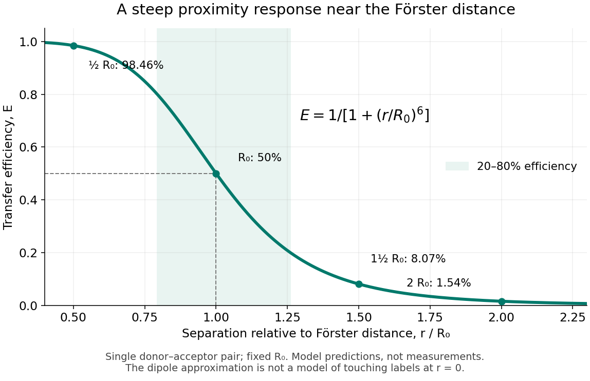
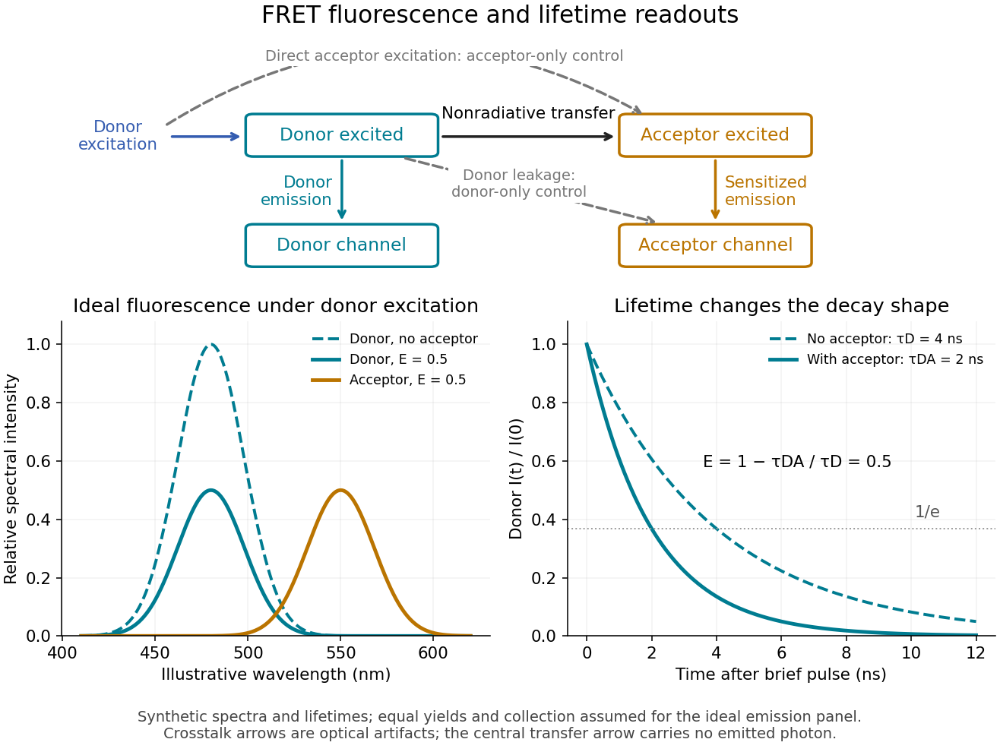

# Biophysical measurement

↑ **Parent:** [Biology](biology.md)

**Table of contents**

- [DNA fluorescence in situ hybridization](#dna-fluorescence-in-situ-hybridization)
- [DamID](#damid)
- [CUT&RUN](#cut-and-run)
- [SunTag](#suntag)
- [Isotope labelling](#isotope-labelling)
  - [Selective methyl labelling](#selective-methyl-labelling)
  - [Deuteration](#deuteration)
- [Traction force microscopy](#traction-force-microscopy)
- [Electron cryotomography](#electron-cryotomography)
- [Selection assay](#selection-assay)
- [Screening assay](#screening-assay)
- [Surface plasmon resonance](#surface-plasmon-resonance)
  - [Localized surface plasmon resonance](#localized-surface-plasmon-resonance)
- [Isothermal titration calorimetry](#isothermal-titration-calorimetry)
- [Dynamic light scattering](#dynamic-light-scattering)
- [Toeprinting](#toeprinting)
- [Radiation damage](#radiation-damage)
  - [Knock-on displacement](#knock-on-displacement)
  - [Radiolysis](#radiolysis)
    - [Water radiolysis](#water-radiolysis)
- [Double electron-electron resonance](#double-electron-electron-resonance)
- [Colocalization](#colocalization)
- [Single-particle tracking](#single-particle-tracking)
- [TurboID](#turboid)
- [Proximity labeling](#proximity-labeling)
- [Co-immunoprecipitation](#co-immunoprecipitation)
- [Affinity purification-mass spectrometry](#affinity-purification-mass-spectrometry)
- [Förster resonance energy transfer](#forster-resonance-energy-transfer)
  - [Single-molecule Förster resonance energy transfer](#single-molecule-forster-resonance-energy-transfer)
  - [FRET donor](#fret-donor)
  - [FRET acceptor](#fret-acceptor)
  - [FRET efficiency](#fret-efficiency)
    - [Multiple-acceptor FRET efficiency](#multiple-acceptor-fret-efficiency)
    - [Optimal Förster distance for two-state contrast](#optimal-forster-distance-for-two-state-contrast)
    - [Förster distance](#forster-distance)
      - [FRET spectral overlap](#fret-spectral-overlap)
      - [FRET dipole orientation factor](#fret-dipole-orientation-factor)
      - [FRET donor quantum yield](#fret-donor-quantum-yield)
    - [FRET donor lifetime](#fret-donor-lifetime)
  - [FRET sensitized emission](#fret-sensitized-emission)
    - [FRET optical crosstalk](#fret-optical-crosstalk)
  - [FRET photobleaching controls](#fret-photobleaching-controls)
  - [FRET proximity readout experiment](#fret-proximity-readout-experiment)

## DNA fluorescence in situ hybridization

↑ **Parent:** [Biophysical measurement](biophysical-measurement.md)

Detection of selected genomic regions with complementary fluorescent probes, supporting spatial-distance and nuclear-position measurements. Fixation, denaturation and probe design can affect the measurement.

## DamID

↑ **Parent:** [Biophysical measurement](biophysical-measurement.md)

Mapping [DNA](polymer.md#deoxyribonucleic-acid) near a [protein](protein.md) by tethering a [DNA](polymer.md#deoxyribonucleic-acid) adenine methyltransferase and detecting its deposited mark. Expression level and exposure duration affect spatial and temporal interpretation.

<h2 id="cut-and-run">CUT&amp;RUN</h2>

↑ **Parent:** [Biophysical measurement](biophysical-measurement.md)

Antibody-targeted nuclease cleavage and release of [DNA](polymer.md#deoxyribonucleic-acid) near a chosen chromatin-associated [protein](protein.md) or mark. Background, [antibody](protein.md#antibody) specificity and cleavage conditions still need controls.

## SunTag

↑ **Parent:** [Biophysical measurement](biophysical-measurement.md)

A repeated peptide-epitope system detectable by fluorescent binders. Placing tags on nascent chains can make a [biological translation](molecular-genetics.md#translation-biology) site visible separately from completed [proteins](protein.md).

## Isotope labelling

↑ **Parent:** [Biophysical measurement](biophysical-measurement.md)

Introducing selected [isotopes](chemical-substance.md#isotope) into molecules to support detection or assignment. In [nuclear magnetic resonance](nuclear-magnetic-resonance.md), labelling can add observable spins or suppress unwanted relaxation pathways.

### Selective methyl labelling

↑ **Parent:** [Isotope labelling](#isotope-labelling)

Isotopic labelling of selected methyl groups to provide sensitive [NMR](nuclear-magnetic-resonance.md) probes in a relatively sparse spin network.

### Deuteration

↑ **Parent:** [Isotope labelling](#isotope-labelling)

Replacement of hydrogen with deuterium. In [protein](protein.md) [NMR](nuclear-magnetic-resonance.md), suitable [deuteration](#deuteration) reduces proton dipolar relaxation but also removes directly observable proton signals unless selected sites are retained or reintroduced.

## Traction force microscopy

↑ **Parent:** [Biophysical measurement](biophysical-measurement.md)

[traction force microscopy](#traction-force-microscopy) estimates forces that cells exert on a deformable substrate from measured substrate displacement and a mechanical model. Calibration, boundary conditions and material properties affect the inferred forces.

## Electron cryotomography

↑ **Parent:** [Biophysical measurement](biophysical-measurement.md)

[Electron cryotomography](#electron-cryotomography) reconstructs three-dimensional electron-scattering density from a tilt series of a vitrified specimen. It can reveal native cellular assemblies such as receptor arrays, subject to dose, sampling and resolution limits.

## Selection assay

↑ **Parent:** [Biophysical measurement](biophysical-measurement.md)

A [selection assay](#selection-assay) preferentially retains, amplifies or permits survival of candidates satisfying a criterion. It differs from directly measuring every candidate and can fail if the selectable phenotype becomes detached from the intended biochemical function.

## Screening assay

↑ **Parent:** [Biophysical measurement](biophysical-measurement.md)

A [screening assay](#screening-assay) measures candidate variants individually or in distinguishable compartments. In protein engineering, expression, stability and intrinsic activity must be separated when interpreting an increased signal.

## Surface plasmon resonance

↑ **Parent:** [Biophysical measurement](biophysical-measurement.md)

[Surface plasmon resonance](#surface-plasmon-resonance) can monitor binding near an optical sensor surface in real time through refractive-index changes. Concentration-dependent association and dissociation can constrain kinetics, subject to controls for nonspecific binding, transport limitation and multivalency.

### Localized surface plasmon resonance

↑ **Parent:** [Surface plasmon resonance](#surface-plasmon-resonance)

A resonant collective electronic response confined to a finite conducting nanostructure. Its near field depends on geometry, environment and loss.

## Isothermal titration calorimetry

↑ **Parent:** [Biophysical measurement](biophysical-measurement.md)

[Isothermal titration calorimetry](#isothermal-titration-calorimetry) measures heat accompanying additions of one binding partner to another at controlled temperature. With suitable concentration ranges, stoichiometry and a binding model, it can estimate affinity and binding enthalpy; dilution and buffer effects need controls.

## Dynamic light scattering

↑ **Parent:** [Biophysical measurement](biophysical-measurement.md)

[Dynamic light scattering](#dynamic-light-scattering) analyses fluctuations in scattered light to infer diffusion and hydrodynamic size under a suitable model. Large particles can dominate the intensity, making it sensitive to aggregation but limiting simple interpretation as a number distribution.

## Toeprinting

↑ **Parent:** [Biophysical measurement](biophysical-measurement.md)

[Toeprinting](#toeprinting) maps a reverse-transcription stop caused by an assembled ribosome or initiation complex on RNA. It can report occupancy near a translation start site, but controls are needed for stops caused by RNA structure or other bound proteins.

## Radiation damage

↑ **Parent:** [Biophysical measurement](biophysical-measurement.md)

[radiation damage](#radiation-damage) is a radiation-induced change in a specimen. In biological [electron microscopy](optics.md#electron-microscopy), accumulated exposure can alter chemical groups and remove high-resolution information, so recording more electrons has competing signal and damage effects.

### Knock-on displacement

↑ **Parent:** [Radiation damage](#radiation-damage)

Displacement of an atom when a collision transfers enough momentum to exceed its displacement threshold. Its energy dependence differs from [radiolysis](#radiolysis).

### Radiolysis

↑ **Parent:** [Radiation damage](#radiation-damage)

Chemical damage initiated by ionization and electronic excitation from radiation. It is distinct from direct momentum-transfer [knock-on displacement](#knock-on-displacement); the useful image information per damaging event depends on beam energy and specimen.

#### Water radiolysis

↑ **Parent:** [Radiolysis](#radiolysis)

Chemical transformation of water initiated by ionizing radiation. Both reducing and oxidizing products occur; observed net redox chemistry depends on the solution and reactions of primary products.

## Double electron-electron resonance

↑ **Parent:** [Biophysical measurement](biophysical-measurement.md)

[double electron-electron resonance](#double-electron-electron-resonance) is a pulsed [electron paramagnetic resonance](physics.md#electron-paramagnetic-resonance) method that uses spin–spin coupling to constrain distances between labels. Label conformation, distance distributions and background correction affect the structural interpretation.

## Colocalization

↑ **Parent:** [Biophysical measurement](biophysical-measurement.md)

[colocalization](#colocalization) is spatial coincidence of measured distributions within the resolution of an imaging method. Shared pixels can suggest a common compartment without demonstrating direct molecular contact.

## Single-particle tracking

↑ **Parent:** [Biophysical measurement](biophysical-measurement.md)

[single-particle tracking](#single-particle-tracking) estimates successive positions of individual labeled objects. Displacements can constrain [diffusion](thermodynamics.md#diffusion), confinement or directed movement, provided localization error, missed detections and label effects are accounted for.

## TurboID

↑ **Parent:** [Biophysical measurement](biophysical-measurement.md)

[TurboID](#turboid) is an engineered promiscuous [biotin](chemical-substance.md#biotin) ligase used for [proximity labeling](#proximity-labeling). A fusion can label nearby [proteins](protein.md) during a short pulse, while localization-matched and no-added-biotin controls help distinguish the intended neighbourhood from background.[Fig. 2, short-pulse compartment labeling and specificity comparisons](biochemistry-and-biophysics-bibliography.md#efficient-proximity-labeling-in-living-cells-and-organisms-with-turboid-by-tess-c-branon-and-others)

## Proximity labeling

↑ **Parent:** [Biophysical measurement](biophysical-measurement.md)

[proximity labeling](#proximity-labeling) uses a localized reactive system to mark nearby [molecules](molecule.md) before extraction. The recovered label integrates access, distance, labeling rate and residence time; proximity alone does not demonstrate a direct [protein-protein interaction](protein.md#protein-protein-interaction).

## Co-immunoprecipitation

↑ **Parent:** [Biophysical measurement](biophysical-measurement.md)

[co-immunoprecipitation](#co-immunoprecipitation) captures a [protein](protein.md) using an [antibody](protein.md#antibody) and tests which other components remain associated. Reciprocal capture, input abundance and negative controls help interpret the result; coprecipitation need not imply direct contact.

## Affinity purification-mass spectrometry

↑ **Parent:** [Biophysical measurement](biophysical-measurement.md)

In [affinity purification-mass spectrometry](#affinity-purification-mass-spectrometry), a bait [protein](protein.md) is isolated with associated material, and [mass spectrometry](chemistry.md#mass-spectrometry) identifies candidate partners. Enrichment relative to matched controls supports association; it does not alone establish a direct [protein-protein interaction](protein.md#protein-protein-interaction) or the number of copies per assembly.

<h2 id="forster-resonance-energy-transfer">Förster resonance energy transfer</h2>

↑ **Parent:** [Biophysical measurement](biophysical-measurement.md)

[Förster resonance energy transfer](#forster-resonance-energy-transfer) is a nonradiative transfer of [energy](energy.md) from an [excited state](energy-eigenvalue.md#excited-state) of a [FRET donor](#fret-donor) to a nearby [FRET acceptor](#fret-acceptor), through coupling of their [electric dipoles](electrostatics.md#electric-dipole). The transfer step does not emit a [photon](quantum-mechanics.md#photon) that the [FRET acceptor](#fret-acceptor) subsequently absorbs. It competes with the [FRET donor](#fret-donor)'s own [fluorescence](fluorescence.md) and other routes out of its [excited state](energy-eigenvalue.md#excited-state). A fluorescent [FRET acceptor](#fret-acceptor) can then emit [fluorescence](fluorescence.md); an absorbing but nonfluorescent [FRET acceptor](#fret-acceptor) can still receive the transferred [energy](energy.md).[§3.1: nonradiative dipole coupling and a potentially nonfluorescent acceptor](biochemistry-and-biophysics-bibliography.md#advanced-fluorescence-microscopy-techniques-frap-flip-flap-fret-and-flim-by-hellen-c-ishikawa-ankerhold-and-others)

The striking use of [FRET](#forster-resonance-energy-transfer) is to turn a change in molecular proximity into an optical readout. [Proteins](protein.md) carrying a [FRET donor](#fret-donor) and a [FRET acceptor](#fret-acceptor) may change the readout when they associate, as in the [chemotaxis FRET assay](signal-transduction.md#chemotaxis-fret-assay); two labels on one [protein](protein.md) may report a change in its shape. Interpretation depends on the [FRET spectral overlap](#fret-spectral-overlap), [FRET dipole orientation factor](#fret-dipole-orientation-factor) and labeling geometry, as well as separation. A change in [FRET](#forster-resonance-energy-transfer) is therefore evidence about proximity under specified conditions, rather than a direct measurement of an arbitrary distance.[§3.1 and §3.3: dependence on distance and orientation; inter- and intramolecular applications](biochemistry-and-biophysics-bibliography.md#advanced-fluorescence-microscopy-techniques-frap-flip-flap-fret-and-flim-by-hellen-c-ishikawa-ankerhold-and-others)

For a single pair with fixed [Förster distance](#forster-distance) $R_0$ and label separation $r$, the [FRET efficiency](#fret-efficiency) is

$$
E=\frac{1}{1+(r/R_0)^6}.
$$

At $r=R_0$, half the [FRET donor](#fret-donor) excitations transfer [energy](energy.md). At $r=R_0/2$, the model gives $E=64/65\approx98.46\%$; at $r=2R_0$, it gives $E=1/65\approx1.54\%$. The sixth power makes [FRET](#forster-resonance-energy-transfer) especially useful near the [Förster distance](#forster-distance), with little sensitivity to further separation once transfer is already negligible. These are model calculations, not measurements of a particular pair.

**[Figure 1](#image-fret-efficiency-versus-separation-relative-to-the-forster-distance). FRET efficiency versus separation relative to the Förster distance**. Original single-pair [mathematical model](mathematics.md#mathematical-model) with fixed [Förster distance](#forster-distance). The shaded interval is $0.2\leq E\leq0.8$. The curve does not establish a universal working range or justify the [electric dipole](electrostatics.md#electric-dipole) approximation for overlapping labels.

<h3 id="single-molecule-forster-resonance-energy-transfer">Single-molecule Förster resonance energy transfer</h3>

↑ **Parent:** [Förster resonance energy transfer](#forster-resonance-energy-transfer)

[single-molecule Förster resonance energy transfer](#single-molecule-forster-resonance-energy-transfer) records energy-transfer signals from individual donor–acceptor pairs. State occupancies and dwell times can constrain structural dynamics, provided dye photophysics, labeling geometry and time resolution are controlled.

### FRET donor

↑ **Parent:** [Förster resonance energy transfer](#forster-resonance-energy-transfer)

A [FRET donor](#fret-donor) supplies the initial [excited state](energy-eigenvalue.md#excited-state) [energy](energy.md). Its [fluorescence](fluorescence.md) provides both an emission channel and a reference [FRET donor lifetime](#fret-donor-lifetime) when no [FRET acceptor](#fret-acceptor) is present. Calling a label a [FRET donor](#fret-donor) describes its role in a chosen pair, rather than a permanent classification of the [molecule](molecule.md).

### FRET acceptor

↑ **Parent:** [Förster resonance energy transfer](#forster-resonance-energy-transfer)

A [FRET acceptor](#fret-acceptor) receives the [excited state](energy-eigenvalue.md#excited-state) [energy](energy.md). Its absorption must support [FRET spectral overlap](#fret-spectral-overlap) with the [FRET donor](#fret-donor). [FRET sensitized emission](#fret-sensitized-emission) requires a fluorescent [FRET acceptor](#fret-acceptor); measuring a shortened [FRET donor lifetime](#fret-donor-lifetime) does not.

### FRET efficiency

↑ **Parent:** [Förster resonance energy transfer](#forster-resonance-energy-transfer)

[FRET efficiency](#fret-efficiency) is the [probability](probability-theory.md#probability) that an excitation of the [FRET donor](#fret-donor) ends in transfer to the [FRET acceptor](#fret-acceptor). Write $k_D=k_{\rm r}+k_{\rm nr}$ for the total decay rate without a [FRET acceptor](#fret-acceptor), including radiative [fluorescence](fluorescence.md) and other decay, and $k_T$ for the transfer rate. For constant competing rates,

$$
k_T=k_D\left(\frac{R_0}{r}\right)^6,\qquad E=\frac{k_T}{k_D+k_T}=\int_0^\infty k_T e^{-(k_D+k_T)t}\,dt.
$$

The [integral](integral.md) counts transfer events among all excitations in a population with [exponential decay](analysis.md#exponential-decay). Substitution gives the separation law above. This short rate argument assumes one [FRET donor](#fret-donor), one [FRET acceptor](#fret-acceptor), weak coupling, an available [FRET acceptor](#fret-acceptor), and fixed geometry during the decay; it is not a model for arbitrary interacting labels.[§3.1, equations 14–16 and discussion before §3.3: single-pair assumptions and transfer efficiency](biochemistry-and-biophysics-bibliography.md#advanced-fluorescence-microscopy-techniques-frap-flip-flap-fret-and-flim-by-hellen-c-ishikawa-ankerhold-and-others)

#### Multiple-acceptor FRET efficiency

↑ **Parent:** [FRET efficiency](#fret-efficiency)

For n identical independent available [FRET acceptors](#fret-acceptor), transfer rates add. With single-pair [FRET efficiency](#fret-efficiency) E, the donor exit probability is $E_n=nE/[1+(n-1)E]$. It is not nE; competition with the donor's other decay routes must be retained.

<h4 id="optimal-forster-distance-for-two-state-contrast">Optimal Förster distance for two-state contrast</h4>

↑ **Parent:** [FRET efficiency](#fret-efficiency)

For [FRET efficiency](#fret-efficiency) $E(R)=1/[1+(R/R_0)^6]$ and distinct positive reporter distances A and B, the absolute contrast is maximized at the geometric mean [Förster distance](#forster-distance) $R_0=\sqrt{AB}$. Substitution of $x=R_0^6$ makes the derivative have the sign of $A^6B^6-x^2$. The maximum is $|B^3-A^3|/(B^3+A^3)$ and the two efficiencies then sum to one. If $A=B$, every choice gives zero contrast and there is no unique optimum.

<h4 id="forster-distance">Förster distance</h4>

↑ **Parent:** [FRET efficiency](#fret-efficiency)

The [Förster distance](#forster-distance) is the separation giving [FRET efficiency](#fret-efficiency) $E=1/2$ for the specified pair and conditions. It is a property of the optical pair and its environment, rather than a universal length. In the usual pair model,

$$
R_0^6\propto \kappa^2 Q_D J n^{-4},
$$

where $\kappa^2$ is the [FRET dipole orientation factor](#fret-dipole-orientation-factor), $Q_D$ the [FRET donor quantum yield](#fret-donor-quantum-yield), $J$ the [FRET spectral overlap](#fret-spectral-overlap) [integral](integral.md), and $n$ the medium's [refractive index](electromagnetic-wave.md#refractive-index). The omitted proportionality constant depends on the unit convention for $J$.[§3.1, equations 16–18: factors controlling Förster distance](biochemistry-and-biophysics-bibliography.md#advanced-fluorescence-microscopy-techniques-frap-flip-flap-fret-and-flim-by-hellen-c-ishikawa-ankerhold-and-others)

If [FRET efficiency](#fret-efficiency) is known and those assumptions hold, inversion gives

$$
r=R_0\left(E^{-1}-1\right)^{1/6},\qquad \frac{d\log r}{dE}=-\frac{1}{6E(1-E)}.
$$

The [derivative](calculus.md#derivative) explains why errors become troublesome near $E=0$ or $E=1$. An illustrative pair with $R_0=4$ nanometres and another with $R_0=6$ nanometres both give $E=1/2$ at their different [Förster distances](#forster-distance): knowing [FRET efficiency](#fret-efficiency) alone does not determine $r$.

A heterogeneous population adds another ambiguity. In a synthetic example with equal weights per [FRET donor](#fret-donor) excitation, efficiencies $0.1$ and $0.9$ average to $0.5$, but their separations are $9^{1/6}R_0$ and $9^{-1/6}R_0$. Their average separation is approximately $1.068R_0$, whereas inverting the average [FRET efficiency](#fret-efficiency) gives $R_0$. A measured emission [ratio](arithmetic.md#ratio) has additional detection weights; it need not equal even this excitation-weighted average. The transferable lesson is that an average readout does not uniquely specify a distribution of molecular separations.

##### FRET spectral overlap

↑ **Parent:** [Förster distance](#forster-distance)

[FRET spectral overlap](#fret-spectral-overlap) quantifies overlap between the [FRET donor](#fret-donor)'s emission and the [FRET acceptor](#fret-acceptor)'s absorption as functions of [wavelength](wave-equation.md#wavelength) $\lambda$. With normalized donor emission $f_D$ and acceptor molar absorption coefficient $\varepsilon_A$, one convention is

$$
\int_0^\infty f_D(\lambda)\,d\lambda=1,\qquad J=\int_0^\infty f_D(\lambda)\varepsilon_A(\lambda)\lambda^4\,d\lambda.
$$

Matching two emission colors is insufficient: the receiving absorption matters.[§3.1, equation 17 and Figure 19: normalized donor emission and acceptor absorption overlap](biochemistry-and-biophysics-bibliography.md#advanced-fluorescence-microscopy-techniques-frap-flip-flap-fret-and-flim-by-hellen-c-ishikawa-ankerhold-and-others)

##### FRET dipole orientation factor

↑ **Parent:** [Förster distance](#forster-distance)

The [FRET dipole orientation factor](#fret-dipole-orientation-factor) describes the geometry of the two transition [electric dipoles](electrostatics.md#electric-dipole) relative to their separation. Let $\widehat{\boldsymbol\mu}_D$, $\widehat{\boldsymbol\mu}_A$ and $\widehat{\mathbf r}$ be their [unit vectors](vector-space.md#unit-vector). Then

$$
\kappa^2=\left[\widehat{\boldsymbol\mu}_D\cdot\widehat{\boldsymbol\mu}_A-3(\widehat{\boldsymbol\mu}_D\cdot\widehat{\mathbf r})(\widehat{\boldsymbol\mu}_A\cdot\widehat{\mathbf r})\right]^2,\qquad 0\leq\kappa^2\leq4.
$$

For a separation along $z$, parallel [electric dipoles](electrostatics.md#electric-dipole) along $z$ give $\kappa^2=4$, parallel ones along $x$ give $1$, and one along $x$ with the other along $y$ gives $0$. Thus rotating a pair can change [FRET efficiency](#fret-efficiency) without changing its separation.

The familiar value $\kappa^2=2/3$ requires suitable rapid, independent orientation averaging during the [FRET donor lifetime](#fret-donor-lifetime). Random orientations across a population of slowly rotating fluorescent [proteins](protein.md) do not establish that dynamic condition. [Quantitative time domain analysis of lifetime-based Förster resonant energy transfer measurements with fluorescent proteins: Static random isotropic fluorophore orientation distributions by Yuriy Alexandrov and others](biochemistry-and-biophysics-bibliography.md#quantitative-time-domain-analysis-of-lifetime-based-forster-resonant-energy-transfer-measurements-with-fluorescent-proteins-static-random-isotropic-fluorophore-orientation-distributions-by-yuriy-alexandrov-and-others)

##### FRET donor quantum yield

↑ **Parent:** [Förster distance](#forster-distance)

The [FRET donor quantum yield](#fret-donor-quantum-yield) is the emitted [fluorescence](fluorescence.md) [photon](quantum-mechanics.md#photon) fraction per absorbed excitation [photon](quantum-mechanics.md#photon), measured without a [FRET acceptor](#fret-acceptor). In the constant-rate model used for [FRET efficiency](#fret-efficiency), $Q_D=k_{\rm r}/(k_{\rm r}+k_{\rm nr})$. Changing the [FRET donor quantum yield](#fret-donor-quantum-yield) changes the [Förster distance](#forster-distance), even if label positions remain fixed.

#### FRET donor lifetime

↑ **Parent:** [FRET efficiency](#fret-efficiency)

The [FRET donor lifetime](#fret-donor-lifetime) is the mean time spent in the [excited state](energy-eigenvalue.md#excited-state). For the constant-rate model of [FRET efficiency](#fret-efficiency),

$$
\tau_D=\frac1{k_D},\qquad \tau_{DA}=\frac1{k_D+k_T},\qquad E=1-\frac{\tau_{DA}}{\tau_D}.
$$

After a sufficiently brief excitation pulse, the [FRET donor](#fret-donor)'s [fluorescence](fluorescence.md) follows [exponential decay](analysis.md#exponential-decay), $I(t)=I(0)e^{-t/\tau}$. With the illustrative values $\tau_D=4$ nanoseconds and $\tau_{DA}=2$ nanoseconds, the inferred [FRET efficiency](#fret-efficiency) is $1/2$. Multiplying $I(0)$ changes brightness without changing this decay time.

The lifetime comparison requires the same nontransfer decay rates in the reference and paired samples. Changes in the [FRET donor](#fret-donor)'s environment or a different nonradiative loss can also shorten the [FRET donor lifetime](#fret-donor-lifetime). Heterogeneous [FRET efficiencies](#fret-efficiency) or slowly varying [FRET dipole orientation factors](#fret-dipole-orientation-factor) need an appropriate decay model; substituting any fitted average lifetime into the single-pair formula can mislead. [Quantitative time domain analysis of lifetime-based Förster resonant energy transfer measurements with fluorescent proteins: Static random isotropic fluorophore orientation distributions by Yuriy Alexandrov and others](biochemistry-and-biophysics-bibliography.md#quantitative-time-domain-analysis-of-lifetime-based-forster-resonant-energy-transfer-measurements-with-fluorescent-proteins-static-random-isotropic-fluorophore-orientation-distributions-by-yuriy-alexandrov-and-others)

**[Figure 2](#image-fret-sensitized-emission-optical-controls-and-the-fret-donor-lifetime). FRET sensitized emission, optical controls and the FRET donor lifetime**. Original schematic and synthetic curves. The spectral panel assumes equal [fluorescence](fluorescence.md) yields and collection efficiencies for the two labels; its amplitudes are illustrative, not a calibration or measured cyan/yellow spectra. The lifetime panel uses $\tau_D=4$ and $\tau_{DA}=2$ nanoseconds. Dashed optical paths require [FRET optical crosstalk](#fret-optical-crosstalk) controls; they do not represent the nonradiative transfer mechanism.

### FRET sensitized emission

↑ **Parent:** [Förster resonance energy transfer](#forster-resonance-energy-transfer)

[FRET sensitized emission](#fret-sensitized-emission) is [FRET acceptor](#fret-acceptor) [fluorescence](fluorescence.md) caused by transfer from an excited [FRET donor](#fret-donor). Excite predominantly the [FRET donor](#fret-donor) and collect both emission bands. Reduced [FRET donor](#fret-donor) emission and increased [FRET acceptor](#fret-acceptor) emission are useful together, but an acceptor-to-donor emission [ratio](arithmetic.md#ratio) is not automatically the [FRET efficiency](#fret-efficiency): brightness, label abundance and channel collection also enter.[§3.4.2: sensitized emission and dependence on optical correction and label concentrations](biochemistry-and-biophysics-bibliography.md#advanced-fluorescence-microscopy-techniques-frap-flip-flap-fret-and-flim-by-hellen-c-ishikawa-ankerhold-and-others)

#### FRET optical crosstalk

↑ **Parent:** [FRET sensitized emission](#fret-sensitized-emission)

[FRET optical crosstalk](#fret-optical-crosstalk) includes [FRET donor](#fret-donor) emission leaking into the [FRET acceptor](#fret-acceptor) detection band and direct excitation of the [FRET acceptor](#fret-acceptor) by the nominal [FRET donor](#fret-donor) excitation light. Measure donor-only, acceptor-only and unlabeled preparations with the same [fluorescence microscope](fluorescence.md#fluorescence-microscope) settings to separate these contributions and background.[§3.4.2, samples i–iii and equations 20–21: spectral correction controls](biochemistry-and-biophysics-bibliography.md#advanced-fluorescence-microscopy-techniques-frap-flip-flap-fret-and-flim-by-hellen-c-ishikawa-ankerhold-and-others)

An explicit linear measurement model makes the controls' purpose clear. Let $D$ be background-subtracted donor-band counts under donor excitation, $A$ acceptor-band counts under acceptor excitation, and $F$ acceptor-band counts under donor excitation. Donor-only and acceptor-only preparations determine leakage coefficients $a$ and $b$. Then

$$
S=F-aD-bA
$$

is a corrected [FRET sensitized emission](#fret-sensitized-emission) signal under the assumed linear, fixed optical response. In a synthetic example $D=100$, $A=80$, $a=0.10$, $b=0.05$ and $F=34$ give $S=20$. Even a nontransferring sample would give $F=14$ from these two contaminants. Correcting that signal still does not convert $S$ into [FRET efficiency](#fret-efficiency) without a calibration of excitation, yields and detection.

A biological comparison also needs a pairing-negative preparation and a known transferring positive preparation. Match label abundance and localization where possible; changing [concentration](mathematical-physics.md#concentration) can change encounter frequency as well as brightness. Check that attaching the labels preserves the [protein](protein.md) function being investigated. Otherwise the measurement can faithfully report a perturbation introduced by the labels themselves.

### FRET photobleaching controls

↑ **Parent:** [Förster resonance energy transfer](#forster-resonance-energy-transfer)

In [FRET photobleaching controls](#fret-photobleaching-controls), selectively destroy the [FRET acceptor](#fret-acceptor)'s ability to absorb and test whether [FRET donor](#fret-donor) [fluorescence](fluorescence.md) increases. Under unchanged excitation and detection, complete loss of transfer, and an intact [FRET donor](#fret-donor),

$$
E=1-\frac{I_{D,\rm before}}{I_{D,\rm after}}.
$$

This is a destructive comparison. Monitor acceptor loss, donor-only samples exposed to the bleaching illumination, and an unbleached reference region or time trace. Incomplete bleaching, donor damage, movement or label replenishment violate the comparison. During ordinary recordings, gradual unequal bleaching can instead produce an apparent change of [FRET](#forster-resonance-energy-transfer) without a biological change.[§3.4.1.1–3.4.1.2: donor recovery, sample damage, acceptor replenishment and photoconversion artifacts](biochemistry-and-biophysics-bibliography.md#advanced-fluorescence-microscopy-techniques-frap-flip-flap-fret-and-flim-by-hellen-c-ishikawa-ankerhold-and-others)

### FRET proximity readout experiment

↑ **Parent:** [Förster resonance energy transfer](#forster-resonance-energy-transfer)

In [Receptor sensitivity in bacterial chemotaxis by Victor Sourjik and others](microbiology-and-infectious-disease-bibliography.md#receptor-sensitivity-in-bacterial-chemotaxis-by-victor-sourjik-and-others), [Victor Sourjik](biology-author.md#victor-sourjik) and [Howard C. Berg](biology-author.md#howard-c-berg) used a cyan fluorescent tag on [CheZ](signal-transduction.md#chez) as [FRET donor](#fret-donor) and a yellow tag on [CheY](signal-transduction.md#chey) as [FRET acceptor](#fret-acceptor). [Escherichia coli](organism.md#escherichia-coli) [biological cells](biological-cell.md) adhered to a polylysine-coated coverslip in a continuously perfused chamber. A [fluorescence microscope](fluorescence.md#fluorescence-microscope) excited them with a $442$-nanometre [laser](laser.md); split emission bands fed two [photon](quantum-mechanics.md#photon)-counting detectors. The yellow/cyan emission [ratio](arithmetic.md#ratio) fell when attractant was added and rose when it was removed.[Introduction, Materials and Methods: Preparation of Cells and Data Acquisition; Results and Figure 1](microbiology-and-infectious-disease-bibliography.md#receptor-sensitivity-in-bacterial-chemotaxis-by-victor-sourjik-and-others)

Saturating attractant increased cyan emission by an amount matching selective bleaching of the yellow tag: removing the [FRET acceptor](#fret-acceptor) supported relief of [FRET donor](#fret-donor) transfer. Strains carrying the tagged pair but lacking other [chemotaxis](mathematical-biology.md#chemotaxis) machinery showed no stimulus-dependent emission [ratio](arithmetic.md#ratio) change. Weak illumination reduced bleaching drift.[Data Analysis and Results: acceptor bleaching comparison, low illumination, and flhC negative control](microbiology-and-infectious-disease-bibliography.md#receptor-sensitivity-in-bacterial-chemotaxis-by-victor-sourjik-and-others)

The inference is a change in the population of nearby tagged [CheY](signal-transduction.md#chey)/[CheZ](signal-transduction.md#chez) pairs associated with [CheY](signal-transduction.md#chey) [phosphorylation](chemical-reaction.md#phosphorylation). It neither measures each pair's separation nor directly observes motor motion. The readout also averages many [biological cells](biological-cell.md), and perfusion takes finite time. The pathway interpretation belongs to the [chemotaxis FRET assay](signal-transduction.md#chemotaxis-fret-assay); the general measurement lesson is that molecular association can alter [FRET](#forster-resonance-energy-transfer) while the geometry of an individual associated pair stays the same.

## ↑ Ancestors (2)

1. [Biology](biology.md)
2. [Codex Wiki](README.md)
