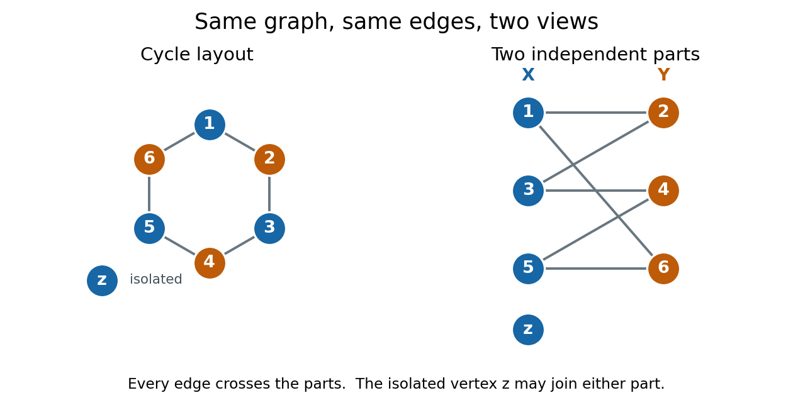
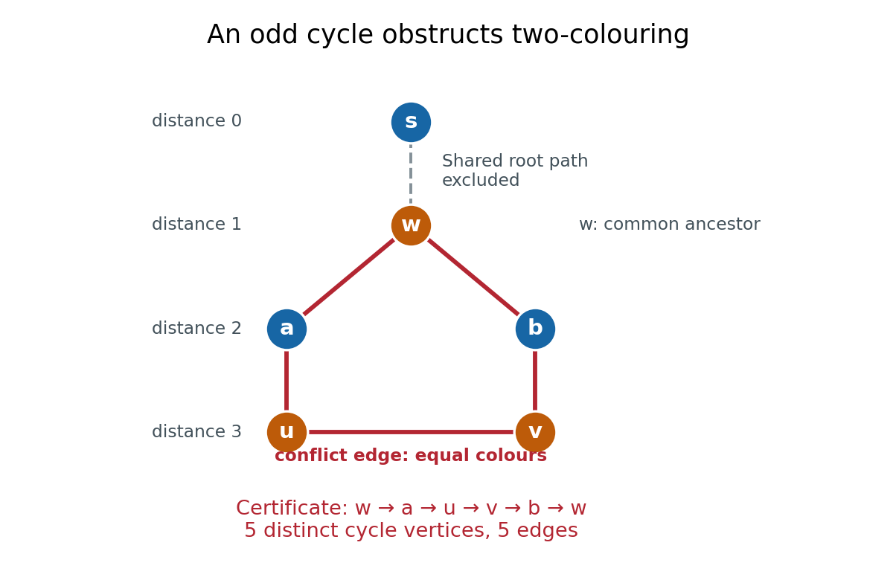

# Bipartite graph

↑ **Parent:** [Graph theory](graph-theory.md)  
ⓦ [Wiki](https://en.wikipedia.org/wiki/Bipartite_graph)

A [bipartite graph](bipartite-graph.md) separates its [vertices](graph.md#vertex-graph-theory) into two [independent sets](graph-theory.md#independent-set-graph-theory): every [edge](graph-theory.md#edge-of-a-graph) goes from one part to the other. Here $G=(V,E)$ is a finite [simple graph](graph.md#simple-graph) and an [undirected graph](graph-theory.md#undirected-graph), with no [self-loops](graph.md#loop-graph-theory) and no repeated [edges](graph-theory.md#edge-of-a-graph). The two parts $X,Y\subseteq V$ satisfy

$$
X\cap Y=\varnothing,\qquad X\cup Y=V,\qquad \{u,v\}\in E\Longrightarrow (u\in X,\ v\in Y)\ \text{or}\ (u\in Y,\ v\in X).
$$

Thus neither part contains an [edge](graph-theory.md#edge-of-a-graph). The parts need not have equal sizes, and some pairs across them may have no [edge](graph-theory.md#edge-of-a-graph); requiring every cross pair gives a [complete bipartite graph](#complete-bipartite-graph). The [independent set](graph-theory.md#independent-set-graph-theory) and cross-[edge](graph-theory.md#edge-of-a-graph) definitions are equivalent.[Section 1.1, printed p. 3, independent vertices; Section 1.6, printed p. 17, bipartite and complete multipartite graphs](mathematics-bibliography.md#graph-theory-by-reinhard-diestel/the-basics-author-hosted-chapter-preview)

For example, the six-[vertex](graph.md#vertex-graph-theory) [cycle graph](graph-theory.md#cycle-graph) $C_6$ with [edges](graph-theory.md#edge-of-a-graph) $12,23,34,45,56,61$ has parts $X=\{1,3,5\}$ and $Y=\{2,4,6\}$. Drawing the same [graph](graph.md) as a hexagon or in two columns changes neither its [edges](graph-theory.md#edge-of-a-graph) nor its [bipartite](bipartite-graph.md) property. An extra [isolated vertex](random-graph.md#isolated-vertex) $z$ can go in either part.

**[Figure 1](#bipartite-graph-independent-parts). The same six-cycle and isolated vertex drawn as a cycle and as two independent parts**.

We allow either part to be empty. Consequently a [graph](graph.md) with no [edges](graph-theory.md#edge-of-a-graph) is [bipartite](bipartite-graph.md), even when $V=\varnothing$; choose $X=V$, $Y=\varnothing$. Here "two colours" means two colours are available, with no requirement to use both. This convention explicitly includes the empty case, whereas definitions requiring two nonempty classes need an exception. For several [connected components of a graph](graph.md#component-graph-theory), choose the two parts separately in each [graph component](graph.md#component-graph-theory) and take their [unions](set.md#set-union). In a nonempty [connected graph](graph.md#connected-graph) that is [bipartite](bipartite-graph.md), fixing one [vertex](graph.md#vertex-graph-theory)'s colour forces all others along [graph paths](graph-theory.md#path-in-a-graph), so its two-colour assignment is unique up to swapping the colours. Each [graph component](graph.md#component-graph-theory), including an [isolated vertex](random-graph.md#isolated-vertex), can be swapped independently.

The [two-colourability criterion for bipartite graphs](#two-colourability-criterion-for-bipartite-graphs) identifies these parts with the colour classes of a [proper vertex colouring](graph-coloring.md#proper-vertex-coloring): assign colour $0$ to $X$ and colour $1$ to $Y$, so adjacent [vertices](graph.md#vertex-graph-theory) have different colours. More surprisingly, the [odd-cycle characterization of bipartite graphs](#odd-cycle-characterization-of-bipartite-graphs) turns a global requirement into one precise obstruction:

$$
G\text{ is bipartite}\quad\Longleftrightarrow\quad G\text{ contains no odd cycle}.
$$

This statement is for the finite [undirected graph](graph-theory.md#undirected-graph) and [simple graph](graph.md#simple-graph) model above; a [graph cycle](graph-theory.md#cycle-in-a-graph) has distinct [vertices](graph.md#vertex-graph-theory) except for the repeated starting [vertex](graph.md#vertex-graph-theory). Along a [graph cycle](graph-theory.md#cycle-in-a-graph) in a [bipartite graph](bipartite-graph.md), colours alternate, so returning to the starting colour takes an [even number](integer.md#even-number) of [edges](graph-theory.md#edge-of-a-graph). Therefore any [odd cycle](graph-theory.md#odd-cycle), whether or not other [edges](graph-theory.md#edge-of-a-graph) join its [vertices](graph.md#vertex-graph-theory), prevents a [bipartite](bipartite-graph.md) split.[Section 1.6, Proposition 1.6.1 and proof, printed pp. 17–18](mathematics-bibliography.md#graph-theory-by-reinhard-diestel/the-basics-author-hosted-chapter-preview)

[Breadth-first search](tree-graph-theory.md#breadth-first-search) supplies the converse constructively. Start an uncoloured [vertex](graph.md#vertex-graph-theory) $s$ with colour $0$, and use a [FIFO queue](data-structure.md#fifo-queue) to explore its [graph component](graph.md#component-graph-theory). When an [edge](graph-theory.md#edge-of-a-graph) $uv$ first discovers $v$, give $v$ the opposite colour to $u$, record $u$ as its [parent in a rooted tree](tree-graph-theory.md#parent-in-a-rooted-tree), and enqueue $v$. If both endpoints of any scanned [edge](graph-theory.md#edge-of-a-graph) already have the same colour, stop with a conflict. Restart from an uncoloured [vertex](graph.md#vertex-graph-theory) until every [graph component](graph.md#component-graph-theory) has been examined. If no conflict occurs, all [edges](graph-theory.md#edge-of-a-graph) cross the two colour classes, which are the required [independent sets](graph-theory.md#independent-set-graph-theory).[BipartiteX.java](mathematics-bibliography.md#algorithms-4th-edition-by-robert-sedgewick-and-others/bipartitex-java)

A conflict also explains the failure. In the [rooted tree](tree-graph-theory.md#rooted-tree) produced by [breadth-first search](tree-graph-theory.md#breadth-first-search), let $d(v)$ be the [graph distance](graph-theory.md#distance-graph-theory) from $s$. The colour of $v$ is its distance's [integer parity](integer.md#parity-mathematics). An [edge](graph-theory.md#edge-of-a-graph) $uv$ in an [undirected graph](graph-theory.md#undirected-graph) satisfies $|d(u)-d(v)|\leq1$, so equal colours force $d(u)=d(v)$. Follow the two parent chains upward to their [lowest common ancestor](tree-graph-theory.md#lowest-common-ancestor) $w$, discard the shared [graph path](graph-theory.md#path-in-a-graph) from $s$ to $w$, and join the remaining two [graph paths](graph-theory.md#path-in-a-graph) with the conflict [edge](graph-theory.md#edge-of-a-graph) $uv$. The result is a genuine [graph cycle](graph-theory.md#cycle-in-a-graph) with

$$
\bigl(d(u)-d(w)\bigr)+\bigl(d(v)-d(w)\bigr)+1=2\bigl(d(u)-d(w)\bigr)+1
$$

[edges](graph-theory.md#edge-of-a-graph), an [odd integer](integer.md#odd-integer). The two branches have no shared [vertices](graph.md#vertex-graph-theory) except $w$, so this is more than a [closed walk](graph-theory.md#closed-walk). This [odd cycle](graph-theory.md#odd-cycle) is a certificate that anyone can check directly, using only its listed [vertices](graph.md#vertex-graph-theory) and [edges](graph-theory.md#edge-of-a-graph).

**[Figure 2](#bipartite-graph-odd-cycle-certificate). A BFS colour conflict closes a five-cycle; the shared root path is excluded from the certificate**.

In the example, [breadth-first search](tree-graph-theory.md#breadth-first-search) from $s$ gives $d(w)=1$, $d(a)=d(b)=2$, and $d(u)=d(v)=3$. The conflict [edge](graph-theory.md#edge-of-a-graph) $uv$ closes the [odd cycle](graph-theory.md#odd-cycle) $w,a,u,v,b,w$, with five [edges](graph-theory.md#edge-of-a-graph). The common [edge](graph-theory.md#edge-of-a-graph) $sw$ is excluded. Thus the same procedure returns either two [independent sets](graph-theory.md#independent-set-graph-theory) covering $V$, or an explicit [odd cycle](graph-theory.md#odd-cycle). With [adjacency lists](data-structure.md#adjacency-list) and constant-time [FIFO queue](data-structure.md#fifo-queue) operations, its [time complexity](theoretical-computer-science.md#time-complexity) is $O(|V|+|E|)$ in [Big O notation](real-analysis.md#big-o-notation), with $O(|V|)$ additional storage.[BipartiteX.java](mathematics-bibliography.md#algorithms-4th-edition-by-robert-sedgewick-and-others/bipartitex-java)

The two parts often have a practical meaning: workers and jobs, with an [edge](graph-theory.md#edge-of-a-graph) exactly when a worker can perform a job. A [matching in a graph](matching-graph-theory.md) chooses compatible worker–job pairs with no reused endpoint; merely being [bipartite](bipartite-graph.md) does not guarantee enough compatible pairs. [Hall's marriage theorem](matching-graph-theory.md#hall-s-marriage-theorem) characterizes when every worker can be matched, and the [assignment problem](linear-programming.md#assignment-problem) adds costs to seek an optimal assignment. These connections make the [bipartite](bipartite-graph.md) structure useful after recognition, as the starting point for selecting [edges](graph-theory.md#edge-of-a-graph) under constraints.

**Table of contents**

- [Bipartite lattice](#bipartite-lattice)
- [Crown graph](#crown-graph)
- [Biadjacency matrix](#biadjacency-matrix)
- [Normalized adjacency operator of a bipartite graph](#normalized-adjacency-operator-of-a-bipartite-graph)
- [Biregular graph](#biregular-graph)
  - [Independent-set bound for biregular graphs](#independent-set-bound-for-biregular-graphs)
  - [Quasirandom bipartite graph](#quasirandom-bipartite-graph)
    - [Spectral discrepancy bound for a biregular graph](#spectral-discrepancy-bound-for-a-biregular-graph)
    - [Centered four-cycle identity for a biregular graph](#centered-four-cycle-identity-for-a-biregular-graph)
- [Half graph](#half-graph)
  - [Boundary rank obstruction in a half graph](#boundary-rank-obstruction-in-a-half-graph)
- [Odd-cycle characterization of bipartite graphs](#odd-cycle-characterization-of-bipartite-graphs)
- [Complete bipartite graph](#complete-bipartite-graph)
  - [Common neighbourhood from bipartite density](#common-neighbourhood-from-bipartite-density)
  - [Star (graph theory)](#star-graph-theory)
- [Two-colourability criterion for bipartite graphs](#two-colourability-criterion-for-bipartite-graphs)

## Bipartite lattice

↑ **Parent:** [Bipartite graph](bipartite-graph.md)

A lattice interaction graph is bipartite if its sites split into two sets such that every interaction bond joins opposite sets. An even nearest-neighbour ring has this property. It permits a two-sublattice [Néel state](statistical-physics.md#neel-state) and a [bipartite spin rotation](angular-momentum-operator.md#bipartite-spin-rotation); an odd antiferromagnetic ring is frustrated.

## Crown graph

↑ **Parent:** [Bipartite graph](bipartite-graph.md)  
ⓦ [Wiki](https://en.wikipedia.org/wiki/Crown_graph)

A crown graph is a [complete bipartite graph](#complete-bipartite-graph) with a perfect matching removed. For $n\geq2$ it has [chromatic number](graph-coloring.md#chromatic-number) two, but [greedy coloring](graph-coloring.md#greedy-coloring) in the order $a_1,b_1,a_2,b_2,\ldots,a_n,b_n$ uses $n$ colors: the matched pair gets the same new color, and every subsequent pair sees all earlier colors.

## Biadjacency matrix

↑ **Parent:** [Bipartite graph](bipartite-graph.md)

For a [bipartite graph](bipartite-graph.md) with ordered parts $X,Y$, its biadjacency matrix has rows indexed by $X$ and columns indexed by $Y$, with entry one for an [edge](graph-theory.md#edge-of-a-graph) and zero otherwise. It has size $|X|$ by $|Y|$, rather than the square full [bipartite adjacency matrix](graph-theory.md#bipartite-adjacency-matrix) on $X\sqcup Y$, which is the block [matrix](vector-space.md#matrix) $\left(\begin{smallmatrix}0&M\\M^{\mathsf T}&0\end{smallmatrix}\right)$. Its [singular values](linear-algebra.md#singular-value) describe the [normalized adjacency operator of a bipartite graph](#normalized-adjacency-operator-of-a-bipartite-graph) after division by $\sqrt{|X||Y|}$.

## Normalized adjacency operator of a bipartite graph

↑ **Parent:** [Bipartite graph](bipartite-graph.md)

Equip the function spaces of the two nonempty parts of a [bipartite graph](bipartite-graph.md) with uniform [inner products](inner-product.md). Its normalized adjacency operator is $(\theta_Gv)(x)=\mathbb E_yG(x,y)v(y)$. In orthonormal coordinate [bases](vector-space.md#basis), its matrix is $G/\sqrt{|X||Y|}$, not the unscaled adjacency matrix. For a [biregular graph](#biregular-graph) of [edge density of a bipartite graph](probabilistic-combinatorics.md#edge-density-of-a-bipartite-graph) $\gamma$, constant functions give a largest [singular value](linear-algebra.md#singular-value) $\gamma$, and the remaining [singular values](linear-algebra.md#singular-value) belong to the centered kernel $G-\gamma$.

## Biregular graph

↑ **Parent:** [Bipartite graph](bipartite-graph.md)

A biregular graph is a [bipartite graph](bipartite-graph.md) whose vertices have constant degree on each part separately. The two degree constants can differ. If its parts are $X,Y$ and its [edge density of a bipartite graph](probabilistic-combinatorics.md#edge-density-of-a-bipartite-graph) is $\gamma$, the two degrees are $\gamma|Y|$ and $\gamma|X|$. Thus its adjacency function has constant row and column averages $\gamma$.

### Independent-set bound for biregular graphs

↑ **Parent:** [Biregular graph](#biregular-graph)

For a [biregular graph](#biregular-graph) with $m$ left vertices of degree $r$ and $n$ right vertices of degree $s$, let $X$ be the indicator vector of a uniformly selected [independent set](graph-theory.md#independent-set-graph-theory). Use base-two [information entropy](information-entropy.md). [Shearer inequality](information-theory.md#shearer-s-inequality) gives $H(X_U)\leq r^{-1}\sum_{w\in W}H(X_{N(w)})$. Conditional on $X_U$, each right vertex with an empty selected neighbourhood is an independent fair binary choice, and the other right vertices are forbidden. Writing $q_w=\mathbb P(X_{N(w)}=0)$ gives $H(X)\leq r^{-1}\sum_w[H(X_{N(w)})+rq_w]$. For the $2^s$ neighbourhood patterns, assign weight $2^r$ to the zero pattern and weight one to all others. [Jensen's inequality](real-analysis.md#jensen-s-inequality) implies $H(Y)+rq_w\leq\log_2(2^r+2^s-1)$. Since $n/r=m/s$, the bound follows from $H(X)=\log_2i(G)$. If $s$ divides $m$, the disjoint union of $m/s$ copies of the [complete bipartite graph](#complete-bipartite-graph) $K_{s,r}$ attains equality: each component has $2^s+2^r-1$ [independent sets](graph-theory.md#independent-set-graph-theory).

### Quasirandom bipartite graph

↑ **Parent:** [Biregular graph](#biregular-graph)

For a [biregular graph](#biregular-graph) of [edge density of a bipartite graph](probabilistic-combinatorics.md#edge-density-of-a-bipartite-graph) $\gamma$, small rectangular discrepancy, a [box norm](additive-combinatorics.md#box-norm) fourth power close to $\gamma^4$, and a small second [singular value](linear-algebra.md#singular-value) of the [normalized adjacency operator of a bipartite graph](#normalized-adjacency-operator-of-a-bipartite-graph) are equivalent notions of quasirandomness, with quantitative bounds independent of the part sizes. Centering the adjacency function removes the constant singular component.

#### Spectral discrepancy bound for a biregular graph

↑ **Parent:** [Quasirandom bipartite graph](#quasirandom-bipartite-graph)

Let $H=M-\delta J$ be the centered [biadjacency matrix](#biadjacency-matrix) of an equal-part [biregular graph](#biregular-graph), and put $s=\|H\|_{\mathrm{op}}$. For subsets $A,B$ of the two parts, their edge discrepancy is $\mathbf1_A^{\mathsf T}H\mathbf1_B$. The [Cauchy-Schwarz inequality](probability-and-statistics.md#cauchy-schwarz-inequality) proves the displayed bound. If the part size is $n$, centering the two [indicator vectors](measure-theory.md#indicator-vector) improves it to $s n\sqrt{\alpha(1-\alpha)\beta(1-\beta)}$. The [centered four-cycle identity for a biregular graph](#centered-four-cycle-identity-for-a-biregular-graph) shows that $t_4(G)\leq\delta^4(1+c^4)$ implies $s\leq c\delta n$ for $c\geq0$.

#### Centered four-cycle identity for a biregular graph

↑ **Parent:** [Quasirandom bipartite graph](#quasirandom-bipartite-graph)

For an equal-part [biregular graph](#biregular-graph) with part size $n$ and degree $\delta n$, let $M$ be its [biadjacency matrix](#biadjacency-matrix) and $H=M-\delta J$, where $J$ is the all-ones [matrix](vector-space.md#matrix). The constant row and column sums make $H$ annihilate constants on both sides. Since $MM^{\mathsf T}=\delta^2nJ+HH^{\mathsf T}$ and the two summands have zero products, their squared [matrix trace](linear-algebra.md#matrix-trace) splits as displayed. The [bipartite four-cycle density](probabilistic-combinatorics.md#bipartite-four-cycle-density) counts the squared [matrix trace](linear-algebra.md#matrix-trace) of $MM^{\mathsf T}$ divided by $n^4$.

## Half graph

↑ **Parent:** [Bipartite graph](bipartite-graph.md)  
ⓦ [Wiki](https://en.wikipedia.org/wiki/Half_graph)

A half graph has two [vertex](graph.md#vertex-graph-theory) classes $X=\{x_1,\ldots,x_n\}$ and $Y=\{y_1,\ldots,y_n\}$, with $x_i$ adjacent to $y_j$ exactly when $i\leq j$. Its nested [vertex neighbourhoods](graph.md#vertex-neighbourhood) give a useful obstruction to partitions in which every pair is a [regular pair of vertex sets](probabilistic-combinatorics.md#regular-pair-of-vertex-sets).

### Boundary rank obstruction in a half graph

↑ **Parent:** [Half graph](#half-graph)

Partition both sides of a [half graph](#half-graph) into classes of size at least $100$. A class of size $s$ has at most $2\lceil s/10\rceil$ elements with fewer than $s/10$ class elements on one side in the underlying order. If there are $k_X$ and $k_Y$ classes, the union of these boundary elements has size at most $2n/5+2(k_X+k_Y)\leq11n/25$. Some index $m$ is therefore away from both boundaries. The class containing $m$ on each side has at least one tenth of its points strictly above $m$ and strictly below $m$. Choosing lower $X$ points with upper $Y$ points, or upper $X$ points with lower $Y$ points, yields [edge density of a bipartite graph](probabilistic-combinatorics.md#edge-density-of-a-bipartite-graph) values one and zero. Both cannot be within $1/10$ of the same class-pair [edge density of a bipartite graph](probabilistic-combinatorics.md#edge-density-of-a-bipartite-graph), so that pair is not a $1/10$-[regular pair of vertex sets](probabilistic-combinatorics.md#regular-pair-of-vertex-sets).

## Odd-cycle characterization of bipartite graphs

↑ **Parent:** [Bipartite graph](bipartite-graph.md)

A graph is [bipartite](bipartite-graph.md) if and only if it contains no [odd cycle](graph-theory.md#odd-cycle). One direction follows because every cycle alternates between the two vertex classes. For the converse, in each [connected component of a graph](graph.md#component-graph-theory) choose a root and partition the vertices according to the parity of their [graph distance](graph-theory.md#distance-graph-theory) from it. An edge joining equal parities would close an odd cycle, so every edge crosses the partition.

## Complete bipartite graph

↑ **Parent:** [Bipartite graph](bipartite-graph.md)  
ⓦ [Wiki](https://en.wikipedia.org/wiki/Complete_bipartite_graph)

The complete bipartite graph $K_{r,s}$ has vertex classes of sizes $r$ and $s$ and contains all $rs$ edges between the classes.

### Common neighbourhood from bipartite density

↑ **Parent:** [Complete bipartite graph](#complete-bipartite-graph)

If a [bipartite graph](bipartite-graph.md) with class sizes $m,N$ has at least $\beta mN$ [edges](graph-theory.md#edge-of-a-graph), double count pairs consisting of an $s$-set in the first class and a common neighbour in the second. Convexity of binomial coefficients gives some $S$ with $|N(S)|\ge N\binom{\lfloor\beta m\rfloor}s/\binom ms$. When $s\le\beta m/2$, the quotient is at least $(\beta/2)^s$. This turns density into a large complete bipartite subgraph.

### Star (graph theory)

↑ **Parent:** [Complete bipartite graph](#complete-bipartite-graph)  
ⓦ [Wiki](https://en.wikipedia.org/wiki/Star_(graph_theory))

A star graph is the [complete bipartite graph](#complete-bipartite-graph) with one centre and $m$ leaves. Any pair of its [edges](graph-theory.md#edge-of-a-graph) meet at the centre.

## Two-colourability criterion for bipartite graphs

↑ **Parent:** [Bipartite graph](bipartite-graph.md)

A finite graph is [bipartite](bipartite-graph.md) exactly when it has a proper colouring with two colours. Equivalently,

$$
P_G(2)>0
$$

for its [chromatic polynomial](graph-coloring.md#chromatic-polynomial).

## ↑ Ancestors (5)

1. [Graph theory](graph-theory.md)
2. [Foundations of mathematics](foundations-of-mathematics.md)
3. [Area of mathematics](mathematics.md#area-of-mathematics)
4. [Mathematics](mathematics.md)
5. [Codex Wiki](README.md)

## ← Incoming links (100)

- [Alternating-cycle perturbation of a doubly stochastic matrix](vector-space.md#alternating-cycle-perturbation-of-a-doubly-stochastic-matrix)
- [Antiferromagnetic Ising model](spin-model.md#antiferromagnetic-ising-model)
- [Assignment problem](linear-programming.md#assignment-problem)
- [Berge's theorem](matching-graph-theory.md#berge-s-theorem)
- [Biadjacency matrix](#biadjacency-matrix)
- [Bipartite four-cycle count](probabilistic-combinatorics.md#bipartite-four-cycle-count)
- [Bipartite four-cycle density](probabilistic-combinatorics.md#bipartite-four-cycle-density)
- [Bipartite graph](bipartite-graph.md)
- [Bipartite planar graph edge bound](planar-graph.md#bipartite-planar-graph-edge-bound)
- [Bipartite Szemerédi regularity lemma](probabilistic-combinatorics.md#bipartite-szemeredi-regularity-lemma)
- [Bipartite vertex cover](graph-theory.md#bipartite-vertex-cover)
- [Biregular graph](#biregular-graph)
- [Chromatic index bounds](graph-coloring.md#chromatic-index-bounds)
- [Chromatic number](graph-coloring.md#chromatic-number)
- [Common neighbourhood from bipartite density](#common-neighbourhood-from-bipartite-density)
- [Dense bipartite common-neighbour lemma](probabilistic-combinatorics.md#dense-bipartite-common-neighbour-lemma)
- [Equality in Sperner theorem](extremal-set-theory.md#equality-in-sperner-theorem)
- [Even-length walk generating function on a bipartite graph](combinatorics.md#even-length-walk-generating-function-on-a-bipartite-graph)
- [Flexible vertex in a balanced bipartite graph](matching-graph-theory.md#flexible-vertex-in-a-balanced-bipartite-graph)
- [Four-step path lemma for a dense bipartite graph](additive-combinatorics.md#four-step-path-lemma-for-a-dense-bipartite-graph)
- [Gale-Shapley algorithm](matching-graph-theory.md#gale-shapley-algorithm)
- [Galvin theorem for bipartite list edge coloring](graph-coloring.md#galvin-theorem-for-bipartite-list-edge-coloring)
- [Geometrical frustration](statistical-physics.md#geometrical-frustration)
- [Graph form of the Balog-Szemerédi-Gowers theorem](additive-combinatorics.md#graph-form-of-the-balog-szemeredi-gowers-theorem)
- [Graph minor](graph-minor.md)
- [Hall condition](matching-graph-theory.md#hall-condition)
- [Hall's marriage theorem](matching-graph-theory.md#hall-s-marriage-theorem)
- [Hypercube graph](graph.md#hypercube-graph)
- [Independence number](graph-theory.md#independence-number)
- [Kernel-perfect directed graph](graph-theory.md#kernel-perfect-directed-graph)
- [List-chromatic index](graph-coloring.md#list-chromatic-index)
- [Matching generating function](matching-graph-theory.md#matching-generating-function)
- [Matching saturation](matching-graph-theory.md#matching-saturation)
- [Necessary conditions for a Hamilton cycle](graph-theory.md#necessary-conditions-for-a-hamilton-cycle)
- [Nested matching criterion for a regular subgraph](graph-theory.md#nested-matching-criterion-for-a-regular-subgraph)
- [Normalized adjacency operator of a bipartite graph](#normalized-adjacency-operator-of-a-bipartite-graph)
- [Solution](past-exam-of-the-mathematics-course-of-the-university-of-cambridge/2001/iii/paper-76.md#4/i/solution)
- [Solution](past-exam-of-the-mathematics-course-of-the-university-of-cambridge/2002/iii/paper-11.md#2/solution)
- [Solution](past-exam-of-the-mathematics-course-of-the-university-of-cambridge/2002/iii/paper-11.md#3/i/solution)
- [Solution](past-exam-of-the-mathematics-course-of-the-university-of-cambridge/2002/iii/paper-23.md#6/c/solution)
- [Solution](past-exam-of-the-mathematics-course-of-the-university-of-cambridge/2002/iii/paper-9.md#1/solution)
- [Solution](past-exam-of-the-mathematics-course-of-the-university-of-cambridge/2002/iii/paper-9.md#2/solution)
- [Solution](past-exam-of-the-mathematics-course-of-the-university-of-cambridge/2004/iii/paper-13.md#1/solution)
- [Solution](past-exam-of-the-mathematics-course-of-the-university-of-cambridge/2005/iii/paper-11.md#1/solution)
- [Solution](past-exam-of-the-mathematics-course-of-the-university-of-cambridge/2007/ii/paper-3.md#17h/solution)
- [Solution](past-exam-of-the-mathematics-course-of-the-university-of-cambridge/2007/iii/paper-9.md#1/solution)
- [Solution](past-exam-of-the-mathematics-course-of-the-university-of-cambridge/2008/iii/paper-16.md#2/i/solution)
- [Solution](past-exam-of-the-mathematics-course-of-the-university-of-cambridge/2009/ii/paper-1.md#17f/i/solution)
- [Solution](past-exam-of-the-mathematics-course-of-the-university-of-cambridge/2009/ii/paper-1.md#17f/ii/solution)
- [Solution](past-exam-of-the-mathematics-course-of-the-university-of-cambridge/2009/iii/paper-14.md#1/solution)
- [Solution](past-exam-of-the-mathematics-course-of-the-university-of-cambridge/2010/ii/paper-2.md#17f/iv/solution)
- [Solution](past-exam-of-the-mathematics-course-of-the-university-of-cambridge/2010/ii/paper-2.md#17f/solution)
- [Solution](past-exam-of-the-mathematics-course-of-the-university-of-cambridge/2010/iii/paper-6.md#3/solution)
- [Solution](past-exam-of-the-mathematics-course-of-the-university-of-cambridge/2013/iii/paper-11.md#1/solution)
- [Solution](past-exam-of-the-mathematics-course-of-the-university-of-cambridge/2013/iii/paper-12.md#1/solution)
- [Solution](past-exam-of-the-mathematics-course-of-the-university-of-cambridge/2013/iii/paper-26.md#1/iii/solution)
- [Solution](past-exam-of-the-mathematics-course-of-the-university-of-cambridge/2013/iii/paper-38.md#4/b/solution)
- [Solution](past-exam-of-the-mathematics-course-of-the-university-of-cambridge/2013/iii/paper-75.md#2/a/solution)
- [Solution](past-exam-of-the-mathematics-course-of-the-university-of-cambridge/2014/iii/paper-79.md#3/solution)
- [Solution](past-exam-of-the-mathematics-course-of-the-university-of-cambridge/2015/ii/paper-3.md#14i/c/solution)
- [Solution](past-exam-of-the-mathematics-course-of-the-university-of-cambridge/2015/ii/paper-4.md#14i/solution)
- [Solution](past-exam-of-the-mathematics-course-of-the-university-of-cambridge/2015/iii/paper-38.md#5/a/solution)
- [Solution](past-exam-of-the-mathematics-course-of-the-university-of-cambridge/2016/ib/paper-4.md#20h/b/solution)
- [Solution](past-exam-of-the-mathematics-course-of-the-university-of-cambridge/2016/iii/paper-109.md#1/solution)
- [Solution](past-exam-of-the-mathematics-course-of-the-university-of-cambridge/2016/iii/paper-111.md#2/i/solution)
- [Solution](past-exam-of-the-mathematics-course-of-the-university-of-cambridge/2016/iii/paper-111.md#2/ii/solution)
- [Solution](past-exam-of-the-mathematics-course-of-the-university-of-cambridge/2016/iii/paper-212.md#3/solution)
- [Solution](past-exam-of-the-mathematics-course-of-the-university-of-cambridge/2017/ii/paper-2.md#15h/solution)
- [Solution](past-exam-of-the-mathematics-course-of-the-university-of-cambridge/2017/iii/paper-215.md#1/c/solution)
- [Solution](past-exam-of-the-mathematics-course-of-the-university-of-cambridge/2018/ib/paper-4.md#20h/solution)
- [Solution](past-exam-of-the-mathematics-course-of-the-university-of-cambridge/2018/ii/paper-1.md#17i/b/solution)
- [Solution](past-exam-of-the-mathematics-course-of-the-university-of-cambridge/2018/ii/paper-1.md#17i/c/solution)
- [Solution](past-exam-of-the-mathematics-course-of-the-university-of-cambridge/2018/iii/paper-110.md#2/solution)
- [Solution](past-exam-of-the-mathematics-course-of-the-university-of-cambridge/2019/ii/paper-4.md#17g/solution)
- [Solution](past-exam-of-the-mathematics-course-of-the-university-of-cambridge/2020/ii/paper-1.md#17g/a/solution)
- [Solution](past-exam-of-the-mathematics-course-of-the-university-of-cambridge/2020/ii/paper-3.md#17g/iv/solution)
- [Solution](past-exam-of-the-mathematics-course-of-the-university-of-cambridge/2023/ii/paper-2.md#17h/b/solution)
- [Solution](past-exam-of-the-mathematics-course-of-the-university-of-cambridge/2023/ii/paper-4.md#17h/b/solution)
- [Solution](past-exam-of-the-mathematics-course-of-the-university-of-cambridge/2023/ii/paper-4.md#17h/c/solution)
- [Solution](past-exam-of-the-mathematics-course-of-the-university-of-cambridge/2023/iii/paper-122.md#1/b/solution)
- [Solution](past-exam-of-the-mathematics-course-of-the-university-of-cambridge/2025/iii/paper-164.md#2/solution)
- [Solution](past-exam-of-the-quantum-condensed-matter-field-theory-course-of-the-university-of-cambridge/2012/paper-1.md#2/a/solution)
- [Perfect matching](matching-graph-theory.md#perfect-matching)
- [Permanent (mathematics)](linear-algebra.md#permanent-mathematics)
- [Popular sum](additive-combinatorics.md#popular-sum)
- [Random bipartite matching from empty-rectangle exclusion](matching-graph-theory.md#random-bipartite-matching-from-empty-rectangle-exclusion)
- [Random cut lower bound](graph-theory.md#random-cut-lower-bound)
- [Regular pair of bipartite partitions](probabilistic-combinatorics.md#regular-pair-of-bipartite-partitions)
- [Restricted sumset](additive-combinatorics.md#restricted-sumset)
- [Sidorenko conjecture](graph-theory.md#sidorenko-conjecture)
- [Simultaneously bipartite graph and complement](graph-theory.md#simultaneously-bipartite-graph-and-complement)
- [Stable matching in a bipartite graph](matching-graph-theory.md#stable-matching-in-a-bipartite-graph)
- [Staggered magnetization](statistical-physics.md#staggered-magnetization)
- [System of distinct representatives](matching-graph-theory.md#system-of-distinct-representatives)
- [Triangle replacement for self-avoiding walks](combinatorics.md#triangle-replacement-for-self-avoiding-walks)
- [Tripartite graph](graph.md#tripartite-graph)
- [Two-coloring](graph-coloring.md#two-coloring)
- [Two-colourability criterion for bipartite graphs](#two-colourability-criterion-for-bipartite-graphs)
- [Two-sublattice Ising mean-field approximation](spin-model.md#two-sublattice-ising-mean-field-approximation)
- [Vertex cover number](graph-theory.md#vertex-cover-number)
