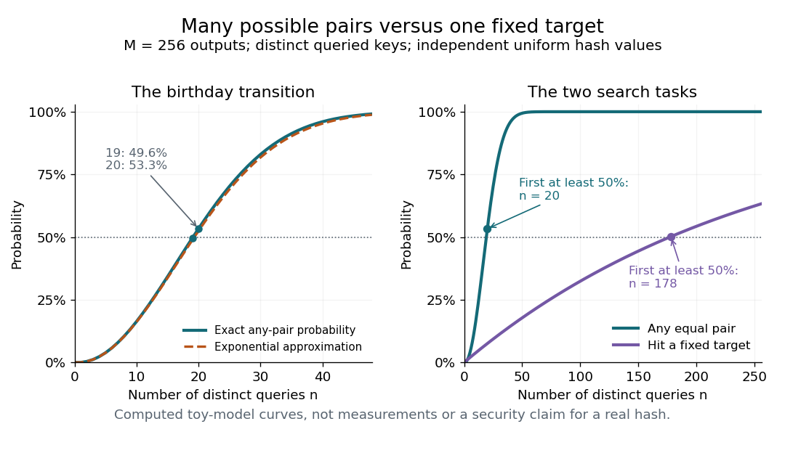

# Birthday probability for hash outputs

↑ **Parent:** [Hash collision](hash-collision.md)

How soon should a [hash collision](hash-collision.md) appear? Specify the [probability distribution](probability-distribution-split.md) of the outputs first. Evaluate $n$ distinct keys and assume their hash values $Y_1,\ldots,Y_n$ are [independent random variables](independent-random-variables.md), each with the [uniform distribution on a finite set](discrete-uniform-distribution.md) of $M\geq1$ possible [outputs](output-computing.md). The randomness may come from an idealized randomly chosen [hash function](hash-function.md); a fixed [hash function](hash-function.md) and a fixed list of keys have a definite outcome. Sampling the same key twice creates a repeated hash value without creating a [hash collision](hash-collision.md), so distinctness of the queried keys matters.

This is the existing [birthday problem](birthday-problem.md), with hash values in place of birthdays. Let $p_M(n)$ be the [probability](probability.md) of at least one equal pair. The exact formula is

$$
p_M(n)=\begin{cases}
1-\displaystyle\prod_{j=0}^{n-1}\left(1-\frac{j}{M}\right),&0\leq n\leq M,\\
1,&n>M.
\end{cases}
$$

The empty product is $1$, so $p_M(0)=p_M(1)=0$. Given $j$ previous distinct hash values, the next value avoids them with [conditional probability](conditional-probability.md) $(M-j)/M$. Multiply these conditional chances and subtract from $1$. Equivalently, for $n\leq M$, exactly $M(M-1)\cdots(M-n+1)$ of the $M^n$ equally likely ordered outcomes have no repeated value. This derivation also explains why independence of all outputs, rather than merely uniform individual values, is required.[Menezes, van Oorschot and Vanstone, Handbook of Applied Cryptography, section 2.1.5, Fact 2.27(i), birthday probability](https://cacr.uwaterloo.ca/hac/about/chap2.pdf)

**[Figure 19](#image-any-matching-pair-appears-much-sooner-than-a-match-to-one-fixed-target). Any matching pair appears much sooner than a match to one fixed target**. Computed [probabilities](probability.md) for $M=256$ under the independent uniform hash-output model. Left: the exact [birthday problem](birthday-problem.md) formula and its exponential approximation over the first 48 distinct queries. Right: any-pair collisions and hitting a digest fixed before the queries, over 256 distinct queries. Their first integer sample sizes reaching 50 percent are $20$ and $178$. These are theoretical toy curves, not measurements of a real [cryptographic hash function](cryptographic-hash-function.md).

For $M=256$, the exact [hash collision](hash-collision.md) [probabilities](probability.md) are $p_{256}(19)\approx0.495742$, $p_{256}(20)\approx0.533167$, and $p_{256}(32)\approx0.867643$. Thus only $20$ distinct queries already exceed a one-half chance of some pair matching. The striking feature is the number of opportunities: $n$ queries supply $\binom n2$ pairs. By [linearity of expectation](linearity-of-expectation.md), the [expected value](expected-value-split.md) of the number of equal pairs is $\lambda=\binom n2/M$. This expectation counts pairs, not the [probability](probability.md) of at least one pair; three equal outputs contribute three pairs in one outcome. The [union bound](boole-s-inequality.md) gives $p_M(n)\leq\min(1,\lambda)$.

Using the [natural logarithm](natural-logarithm.md) expansion $\log(1-u)=-u+O(u^2)$ in the exact product gives

$$
p_M(n)\approx1-\exp\left(-\frac{n(n-1)}{2M}\right).
$$

For $n\leq M/2$, the omitted correction in the logarithm of the no-collision [probability](probability.md) is $O(n^3/M^2)$. Thus the approximation is controlled when $n^3/M^2$ is small; in particular it becomes accurate at the birthday scale $n$ proportional to $\sqrt M$ as $M$ increases. The inequality $1-u\leq e^{-u}$ also shows that the displayed approximation is a lower bound for $p_M(n)$ when $n\leq M$. Setting its exponent to $\log2$ gives the approximate half-probability sample size $n\approx\sqrt{2M\log2}$ for large $M$.

For comparison, under the same independent uniform model the [probability](probability.md) of hitting one previously fixed digest $t$ in $n$ queries is

$$
q_M(n)=1-\left(1-\frac1M\right)^n.
$$

Each query supplies one chance to hit $t$, instead of a growing number of possible pairs. For $M=256$, $q_{256}(20)\approx0.075293$, and the first integer $n$ with $q_{256}(n)\geq1/2$ is $178$. In a toy model with $M=2^b$ possible $b$-[bit](bit.md) digests, the any-pair transition therefore has scale $2^{b/2}$ queries, while the fixed-target transition has scale $2^b$. This explains the birthday-search distinction between [collision resistance](collision-resistance.md) and [preimage resistance](preimage-resistance.md).[Menezes, van Oorschot and Vanstone, Handbook of Applied Cryptography, Fact 9.33 and section 9.7.1, generic collision versus preimage searches](https://cacr.uwaterloo.ca/hac/about/chap9.pdf)

The assumptions are essential. Uniform marginals alone do not give the product formula: if all $Y_i$ equal one shared uniform [random variable](random-variable-split.md), every distinct pair collides with [probability](probability.md) $1$. A [universal hash family](universal-hash-family.md) bounds each pair's [hash collision](hash-collision.md) [probability](probability.md), but that condition alone does not supply joint independence of every output. Nor does a fixed output length establish [collision resistance](collision-resistance.md) or [preimage resistance](preimage-resistance.md): the toy $h(k)=k\bmod16$ has $h(k)=h(k+16)$, making deliberate [hash collisions](hash-collision.md) immediate. The curves describe the specified model and do not establish the security of a concrete [cryptographic hash function](cryptographic-hash-function.md).

## ↑ Ancestors (4)

1. [Hash collision](hash-collision.md)
2. [Hash function](hash-function.md)
3. [Computer science](computer-science-split.md)
4. [Codex Wiki](split.md)
