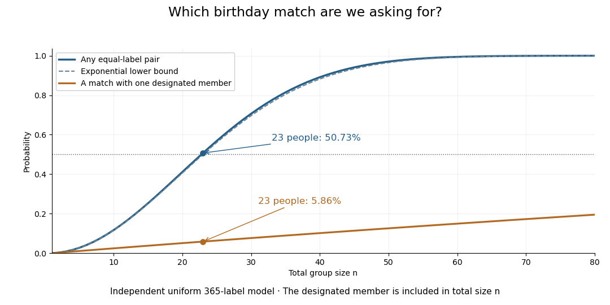

# Birthday problem

↑ **Parent:** [Probability and statistics](probability-and-statistics-split.md)  
ⓦ [Wiki](https://en.wikipedia.org/wiki/Birthday_problem)

The [birthday problem](birthday-problem.md) asks for the [probability](probability.md) that at least two members of a group share a birthday. Use the explicit model of [independent random variables](independent-random-variables.md) taking $m$ labels with a [uniform distribution on a finite set](discrete-uniform-distribution.md). Let $m\geq1$ and $n\geq0$ be [integers](integer-split.md). For calendar examples below, stipulate $m=365$ equally likely labels and omit leap days. For $0\leq n\leq m$, the probability of at least one matching pair is

$$
\boxed{P_{n,m}=1-\frac{m(m-1)\cdots(m-n+1)}{m^n}=1-\prod_{j=0}^{n-1}\left(1-\frac jm\right).}
$$

At $n=0$, the [empty product](empty-product.md) is one and $P_{0,m}=0$. At $n>m$, a repeat is certain by the [pigeonhole principle](pigeonhole-principle.md). Count the complement to obtain the formula: the first label has $m$ choices, then a distinct second label has $m-1$, and so forth, out of $m^n$ equally likely label sequences.[§3.1, Example 3.3 and Table 3.1, printed pp. 77–78: uniform-calendar assumptions, distinct-label product and threshold](introduction-to-probability-by-charles-m-grinstead-and-j-laurie-snell.md)

For the stipulated calendar, **$P_{22,365}\approx47.57\%$ and $P_{23,365}\approx50.73\%$**. Only 23 people suffice to put the probability above one half. There are $\binom{23}{2}=253$ possible pairs, each with matching probability $1/365$. The many comparison opportunities explain why a small group can contain a repeat.

**[Figure 3](#image-any-matching-pair-becomes-likely-much-sooner-than-a-match-with-one-specified-person). Any matching pair becomes likely much sooner than a match with one specified person**. Original exact computations under the independent uniform 365-label model. The solid curve allows every pair in a group of total size $n$; the lower curve requires a match with one designated member. The dashed curve is the exponential lower bound for any-pair collision probability. This is a model calculation, not observed birthday data.

The distinction also matters for [hash collisions](hash-collision.md). If independently generated outputs of a [hash function](hash-function.md) are uniformly distributed over $m$ possible labels, the same counting formula governs repeats. The [birthday square-root scale](birthday-square-root-scale.md) explains why looking for any repeated output requires far fewer labels than trying to match one predetermined output. The uniform-independent model is an assumption about those outputs; the [birthday problem](birthday-problem.md) does not itself establish that a particular implementation meets it.

**Table of contents**

- [Matching one specified birthday](matching-one-specified-birthday.md)
- [Birthday collision count](birthday-collision-count.md)
- [Birthday square-root scale](birthday-square-root-scale.md)
- [Collision probability of two independent categorical draws](collision-probability-of-two-independent-categorical-draws.md)

## ↑ Ancestors (4)

1. [Probability and statistics](probability-and-statistics-split.md)
2. [Area of mathematics](area-of-mathematics.md)
3. [Mathematics](mathematics-split.md)
4. [Codex Wiki](split.md)

## ← Incoming links (6)

- [Birthday probability for hash outputs](birthday-probability-for-hash-outputs.md)
- [Birthday problem](birthday-problem.md)
- [Classical collision query bound for Simon's problem](classical-collision-query-bound-for-simon-s-problem.md)
- [Solution](past-exam-of-the-mathematics-course-of-the-university-of-cambridge/2004/iii/paper-53/2/5/solution.md)
- [Solution](past-exam-of-the-mathematics-course-of-the-university-of-cambridge/2009/ia/paper-2/4f/solution.md)
- [Solution](past-exam-of-the-mathematics-course-of-the-year-1-of-the-natural-sciences-course-of-the-university-of-cambridge/2005/paper-1/3/b/i/solution.md)
