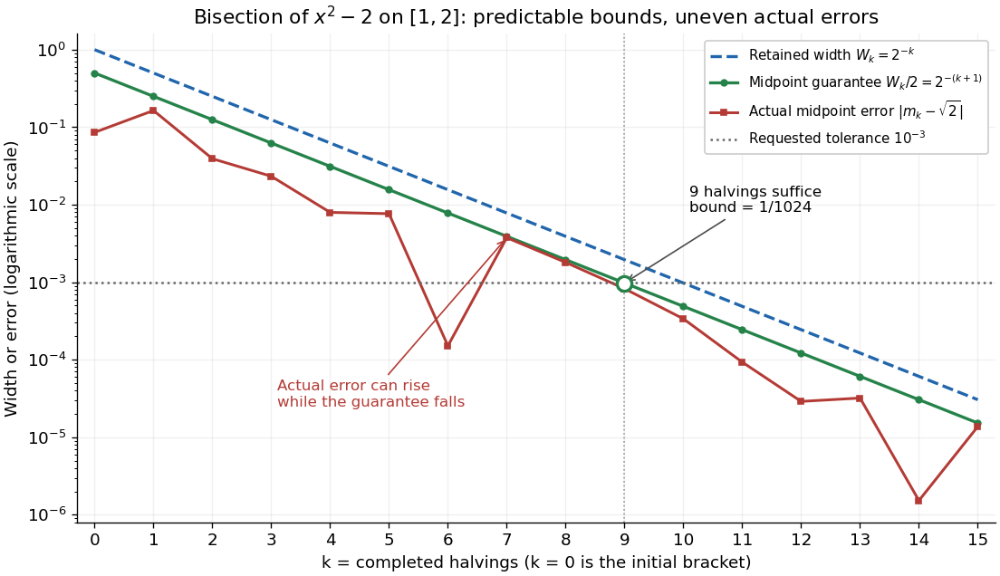

# Bisection error bound

↑ **Parent:** [Bisection method](bisection-method.md)

In exact arithmetic, after $k$ completed halvings the retained [root bracket](root-bracket.md) has width $W_k=b_k-a_k$ and [midpoint](midpoint.md) $m_k$, where

$$
W_k=\frac{b-a}{2^k},\qquad m_k=\frac{a_k+b_k}{2},\qquad |m_k-x_*|\leq\frac{W_k}{2}=\frac{b-a}{2^{k+1}}.
$$

The [absolute value](absolute-value.md) bound holds for every [zero of a function](zero-of-a-function.md) $x_*$ in the current [root bracket](root-bracket.md), including the one approached by continued [bisection method](bisection-method.md) updates. A [zero of a function](zero-of-a-function.md) discarded with an earlier half need not satisfy later bounds. Before update $k\geq1$, the evaluated candidate is $m_{k-1}$, whose corresponding guarantee is $(b-a)/2^k$. After update $k$, the new [midpoint](midpoint.md) $m_k$ has the smaller guarantee $(b-a)/2^{k+1}$, even without evaluating $f(m_k)$.

**[Figure 5](#image-bisection-widths-midpoint-error-bounds-and-actual-square-root-errors-after-zero-to-fifteen-halvings). Bisection widths, midpoint error bounds, and actual square-root errors after zero to fifteen halvings**.

The guaranteed error halves at every step; the actual [absolute value](absolute-value.md) error need not decrease at every step or have successive ratio $1/2$. In the [square root](square-root.md) example it increases from $|m_6-\sqrt2|\approx0.000151062$ to $|m_7-\sqrt2|\approx0.003755188$, while both errors remain below their guarantees. An exact [midpoint](midpoint.md) [zero of a function](zero-of-a-function.md) instead gives zero error and immediate termination. For this example $\sqrt2$ is an [irrational number](irrational-number.md), so no finite exact halving can produce it as a [midpoint](midpoint.md).

For a brief proof outline, each retained half has half the previous width and contains a [zero of a function](zero-of-a-function.md) by the [intermediate value theorem](intermediate-value-theorem.md). Every point in the retained [root bracket](root-bracket.md) is at most half its width from its [midpoint](midpoint.md). If the process does not stop at a [zero of a function](zero-of-a-function.md), the [nested interval theorem](nested-interval-theorem.md) gives one common point as the widths tend to zero; [continuity](continuous-function.md) and the opposite endpoint signs force its [function](function-split.md) value to be zero. Uniqueness in the initial [root bracket](root-bracket.md) is unnecessary.

## ↑ Ancestors (7)

1. [Bisection method](bisection-method.md)
2. [Bracketing method](bracketing-method.md)
3. [Numerical analysis](numerical-analysis-split.md)
4. [Analysis](analysis-split.md)
5. [Area of mathematics](area-of-mathematics.md)
6. [Mathematics](mathematics-split.md)
7. [Codex Wiki](split.md)

## ← Incoming links (7)

- [A cubic root from existence to a quantitative bracket](a-cubic-root-from-existence-to-a-quantitative-bracket.md)
- [Bisection method](bisection-method.md)
- [Bisection stopping criterion](bisection-stopping-criterion.md)
- [Bracketing method](bracketing-method.md)
- [Interval bisection](interval-bisection.md)
- [Limitations of bisection](limitations-of-bisection.md)
- [Nested interval theorem](nested-interval-theorem.md)
