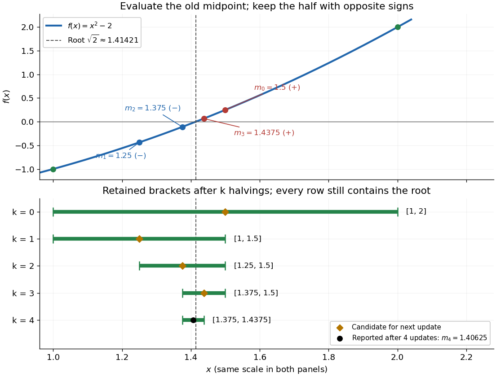

# Bisection method

↑ **Parent:** [Bracketing method](bracketing-method.md)  
ⓦ [Wiki](https://en.wikipedia.org/wiki/Bisection_method)

The [bisection method](bisection-method.md) finds a [zero of a function](zero-of-a-function.md) by repeatedly halving a [root bracket](root-bracket.md). Let $f$ be a real-valued [continuous function](continuous-function.md) on the [closed interval](closed-real-interval.md) $[a,b]$, with $a<b$. First check for endpoint [zeros of a function](zero-of-a-function.md); otherwise require strictly opposite signs at the endpoints. Evaluate the [midpoint](midpoint.md) and retain the half with strictly opposite endpoint signs, stopping immediately if the [midpoint](midpoint.md) is a [zero of a function](zero-of-a-function.md). The [intermediate value theorem](intermediate-value-theorem.md) ensures that every retained [root bracket](root-bracket.md) still contains a [zero of a function](zero-of-a-function.md). This is the construction in MIT's root-finding notes.[Laurent Demanet, MIT 18.330, Chapter 4, §4.1, pp. 1–2, 2012](https://ocw.mit.edu/courses/18-330-introduction-to-numerical-analysis-spring-2012/5b325bfa56a599794c7196de926844b0_MIT18_330S12_Chapter4.pdf)

For a worked [square root](square-root.md) calculation, use the [polynomial](polynomial-split.md) $f(x)=x^2-2$ on $[1,2]$. Write $[a_k,b_k]$ for the [root bracket](root-bracket.md) after $k$ halvings, with $[a_0,b_0]=[1,2]$. The candidate evaluated during update $k$ is the old [midpoint](midpoint.md) $m_{k-1}$:

$$
\begin{array}{c|c|r|c}
\text{update }k&\text{candidate }m_{k-1}&f(m_{k-1})&\text{retained }[a_k,b_k]\\\hline
1&1.5&0.25&[1,1.5]\\
2&1.25&-0.4375&[1.25,1.5]\\
3&1.375&-0.109375&[1.375,1.5]\\
4&1.4375&0.06640625&[1.375,1.4375]
\end{array}
$$

The initial [midpoint](midpoint.md) is $m_0=1.5$. After four halvings the new [midpoint](midpoint.md) is $m_4=1.40625$, and the [bisection error bound](bisection-error-bound.md) is $|m_4-\sqrt2|\leq0.03125$. Its actual error is approximately $0.00796356237310$. The last tested candidate $m_3=1.4375$ and the reported [midpoint](midpoint.md) $m_4$ are different points.

**[Figure 2](#image-bisection-of-a-square-root-bracket-the-graph-and-first-four-retained-intervals). Bisection of a square-root bracket: the graph and first four retained intervals**.

The useful feature of the [bisection method](bisection-method.md) is that the retained width halves on every update, independently of the shape of the [function graph](graph-of-a-function.md). The [bisection error bound](bisection-error-bound.md) therefore supplies an accuracy guarantee before the [zero of a function](zero-of-a-function.md) is known. No [derivative](derivative.md) is needed, and a valid initial [root bracket](root-bracket.md) gives convergence without a close initial guess. This makes the [bisection method](bisection-method.md) a dependable fallback for the faster [Newton root-finding iteration](newton-root-finding-iteration.md).

**Table of contents**

- [Bisection error bound](bisection-error-bound.md)
- [Bisection stopping criterion](bisection-stopping-criterion.md)
- [Limitations of bisection](limitations-of-bisection.md)

## ↑ Ancestors (6)

1. [Bracketing method](bracketing-method.md)
2. [Numerical analysis](numerical-analysis-split.md)
3. [Analysis](analysis-split.md)
4. [Area of mathematics](area-of-mathematics.md)
5. [Mathematics](mathematics-split.md)
6. [Codex Wiki](split.md)

## ← Incoming links (26)

- [A cubic root from existence to a quantitative bracket](a-cubic-root-from-existence-to-a-quantitative-bracket.md)
- [Bisection error bound](bisection-error-bound.md)
- [Bisection method](bisection-method.md)
- [Bisection stopping criterion](bisection-stopping-criterion.md)
- [Bracketing method](bracketing-method.md)
- [Cauchy sequence](cauchy-sequence.md)
- [Certified curve-plane intersection](certified-curve-plane-intersection.md)
- [Completeness of the real numbers](completeness-of-the-real-numbers.md)
- [Credible interval](credible-interval.md)
- [Error bounds for bounded monotone sequences](error-bounds-for-bounded-monotone-sequences.md)
- [Finite contamination bias of normal location](finite-contamination-bias-of-normal-location.md)
- [Frequency and wavelength peaks of Planck's law](frequency-and-wavelength-peaks-of-planck-s-law.md)
- [Ice-ocean albedo feedback](ice-ocean-albedo-feedback.md)
- [Intermediate value theorem](intermediate-value-theorem.md)
- [Interval bisection](interval-bisection.md)
- [Interval root exclusion](interval-root-exclusion.md)
- [Limitations of bisection](limitations-of-bisection.md)
- [Nested-bracket proof of the intermediate value theorem](nested-bracket-proof-of-the-intermediate-value-theorem.md)
- [Nested intervals](nested-intervals.md)
- [Newton root-finding iteration](newton-root-finding-iteration.md)
- [Solution](past-exam-of-the-mathematics-course-of-the-university-of-cambridge/2002/iii/paper-59/2/solution.md)
- [Solution](past-exam-of-the-mathematics-course-of-the-university-of-cambridge/2003/iii/paper-68/3/solution.md)
- [Root finding](root-finding.md)
- [SIR final removed fraction](sir-final-removed-fraction.md)
- [Small normal sample mean confidence interval](small-normal-sample-mean-confidence-interval.md)
- [Weak acid mass and charge balances](weak-acid-mass-and-charge-balances.md)
