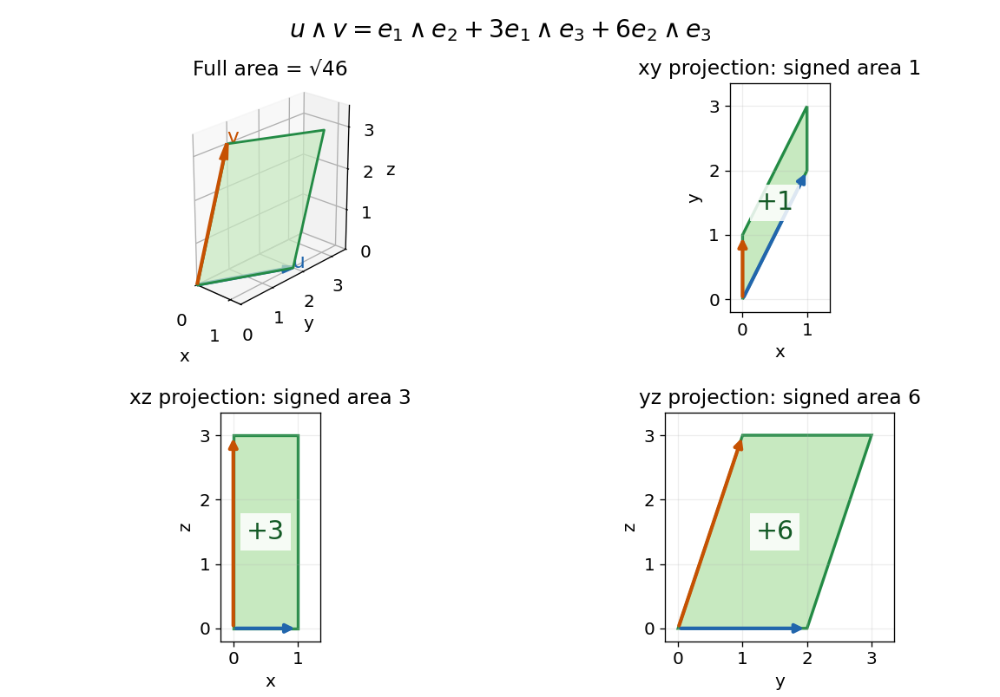

# Bivector

↑ **Parent:** [Exterior algebra](exterior-algebra.md)  
ⓦ [Wiki](https://en.wikipedia.org/wiki/Bivector)

A [bivector](bivector.md) is an element of the second [exterior power](exterior-power.md) $\Lambda^2V$. A [simple bivector](simple-bivector.md) is one [exterior product](exterior-product.md) $u\wedge v$; in real [Euclidean space](euclidean-norm.md), it records the oriented area generated by those two [vectors](vector.md). A general [bivector](bivector.md) is a sum of such elements and need not describe just one plane. Covariant counterparts are [differential two-forms](2-form.md), which take two [vectors](vector.md) as inputs rather than belonging to $\Lambda^2V$.

In $\mathbb R^3$, choose

$$
u=(1,2,0),\qquad v=(0,1,3).
$$

Expanding by [bilinearity](bilinearity.md) gives

$$
B=u\wedge v=e_1\wedge e_2+3e_1\wedge e_3+6e_2\wedge e_3.
$$

The three [coefficients](coefficient.md) are signed areas of the projections onto the $xy$, $xz$, and $yz$ coordinate planes. They are three components of one [bivector](bivector.md), not the three coordinates of either input [vector](vector.md).

**[Figure 3](#image-one-bivector-has-three-coordinate-plane-area-components-in-three-dimensions). One bivector has three coordinate-plane area components in three dimensions**. Original [parallelogram](parallelogram.md) generated by $u=(1,2,0)$ and $v=(0,1,3)$. The three planar panels show its projected signed areas $1$, $3$, and $6$ in the coordinate orders $xy$, $xz$, and $yz$. With the usual [dot product](dot-product.md), the full area is $\sqrt{46}$; projected areas are components, so they are not added to obtain that area.

With the usual [dot product](dot-product.md) and a fixed [orientation of a vector space](orientation-of-a-vector-space.md), the [cross product](cross-product.md) represents this area element by the [normal vector](normal-vector.md) $(6,-3,1)$. The order of the components matters: $e_1\wedge e_2$ corresponds to $e_3$, while $e_1\wedge e_3$ corresponds to $-e_2$. The [Gram determinant](gram-determinant.md) checks the full area:

$$
\|u\wedge v\|^2
=\|u\|^2\|v\|^2-(u\cdot v)^2
=5\cdot10-2^2=46.
$$

Here the [norm](norm.md) on [bivectors](bivector.md) is the one induced by the [Euclidean inner product](dot-product.md). The [exterior product](exterior-product.md) exists without that metric and in arbitrary dimension; the familiar [cross product](cross-product.md) description relies on the additional three-dimensional geometry.

**Table of contents**

- [Simple bivector](simple-bivector.md)

## ↑ Ancestors (7)

1. [Exterior algebra](exterior-algebra.md)
2. [Multilinear algebra](multilinear-algebra-split.md)
3. [Linear algebra](linear-algebra-split.md)
4. [Algebra](algebra-split.md)
5. [Area of mathematics](area-of-mathematics.md)
6. [Mathematics](mathematics-split.md)
7. [Codex Wiki](split.md)

## ← Incoming links (12)

- [Bivector](bivector.md)
- [Contracted chiral curvature identity](contracted-chiral-curvature-identity.md)
- [Exterior algebra](exterior-algebra.md)
- [Exterior power](exterior-power.md)
- [Exterior product](exterior-product.md)
- [Solution](past-exam-of-the-mathematics-course-of-the-university-of-cambridge/2003/iii/paper-57/3/a/solution.md)
- [Solution](past-exam-of-the-mathematics-course-of-the-university-of-cambridge/2004/iii/paper-58/3/solution.md)
- [Solution](past-exam-of-the-mathematics-course-of-the-university-of-cambridge/2008/iii/paper-65/6/solution.md)
- [Solution](past-exam-of-the-mathematics-course-of-the-university-of-cambridge/2009/iii/paper-59/1/d/solution.md)
- [Solution](past-exam-of-the-mathematics-course-of-the-university-of-cambridge/2009/iii/paper-59/4/solution.md)
- [Pfaffian](pfaffian.md)
- [Simple bivector](simple-bivector.md)
