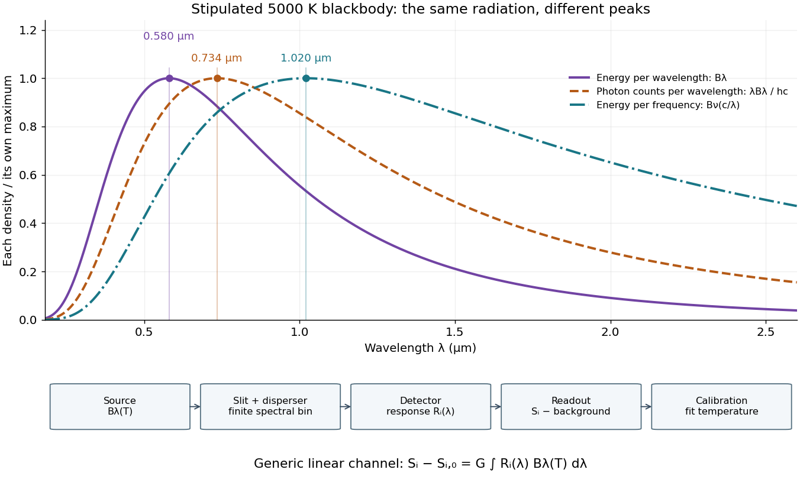

# Blackbody peak and detector response

↑ **Parent:** [Wien's displacement law](wien-s-displacement-law.md)

Consider a hypothetical [star](star.md) whose emitted [specific intensity](spectral-radiance.md) is exactly that of a uniform $5000\,\mathrm K$ [blackbody](blackbody.md). Assume transparent propagation with negligible [Doppler shift](doppler-effect.md) and [interstellar extinction](interstellar-extinction.md), so geometric dilution multiplies every spectral interval by the same factor. The stipulated [temperature](temperature-split.md) gives

$$
\lambda_{\max}=0.579554391\,\mu\mathrm m,\qquad
\nu_{\max}=293.946288\,\mathrm{THz},\qquad
c/\nu_{\max}=1.01988857\,\mu\mathrm m.
$$

Using the converted [frequency](frequency.md) peak as though it maximized $B_\lambda$ would return $b/(c/\nu_{\max})\simeq2841.26\,\mathrm K$, a substantial error caused solely by mixing spectral conventions.

Now stipulate a [photodetector](photodetector.md) with constant [quantum efficiency](quantum-efficiency.md) $\eta$ over the relevant [wavelengths](wavelength.md), collecting equal narrow [wavelength](wavelength.md) bins. For fixed accepted [projected area](projected-area.md) times [solid angle](solid-angle.md) $G$, with dilution included in $G$, its expected [photon](photon.md) count rate density is

$$
\frac{d\dot N}{d\lambda}=\eta G\frac{\lambda B_\lambda}{hc}.
$$

This follows by dividing the received [power](power.md) by the [photon](photon.md) [energy](energy-split.md) $hc/\lambda$. It peaks where $x=4(1-e^{-x})$, at $x=3.9206903949\ldots$, giving $0.73394057\,\mu\mathrm m$ for the same model [star](star.md). Constant [quantum efficiency](quantum-efficiency.md) is not constant energy [spectral responsivity](spectral-responsivity.md): the latter includes the [wavelength](wavelength.md)-dependent [photon](photon.md) [energy](energy-split.md) conversion. For example, $G=10^{-12}\,\mathrm{m^2\,sr}$, $\eta=0.5$ and a $1\,\mathrm{nm}$ bin centered at $0.600\,\mu\mathrm m$ give approximately $1.93\times10^{10}$ detected [photons](photon.md) per second in the narrow-bin approximation. These are calculated model values, not observations of a named [star](star.md).

A more general linear detector channel has output

$$
S_i-S_{i,0}=G\int_0^\infty R_i(\lambda)B_\lambda(T)\,d\lambda,
$$

where $S_{i,0}$ is the background reading and $R_i$ includes spectral selection, optical transmission and detector [spectral responsivity](spectral-responsivity.md). A raw channel maximum need not locate either [Planck function](planck-function.md) maximum. Recovering a [temperature](temperature-split.md) requires an appropriate calibrated response and an emission model. For a real [stellar atmosphere](stellar-atmosphere.md), [opacity](opacity.md) and [radiative transfer](radiative-transfer.md) can reshape the spectrum; [interstellar extinction](interstellar-extinction.md) can reshape it again. A single peak does not establish a unique physical [temperature](temperature-split.md) without those assumptions.

**[Figure 13](#image-one-model-star-three-peak-conventions-and-a-spectral-measurement-chain). One model star, three peak conventions, and a spectral measurement chain**. All curves use the same $5000\,\mathrm K$ [Planck function](planck-function.md) and are normalized separately. The $B_\nu(c/\lambda)$ curve retains density per [frequency](frequency.md) while displaying converted [wavelength](wavelength.md). The photon curve assumes constant [quantum efficiency](quantum-efficiency.md) in equal narrow [wavelength](wavelength.md) bins. The lower diagram shows a generic measurement sequence, not a reconstruction of a particular historical apparatus.

## ↑ Ancestors (7)

1. [Wien's displacement law](wien-s-displacement-law.md)
2. [Planck function](planck-function.md)
3. [Radiative transfer](radiative-transfer.md)
4. [Astrophysics](astrophysics-split.md)
5. [Branches of physics](branches-of-physics.md)
6. [Physics](physics-split.md)
7. [Codex Wiki](split.md)

## ← Incoming links (1)

- [Coblentz's cavity-radiation spectrum measurement](coblentz-s-cavity-radiation-spectrum-measurement.md)
