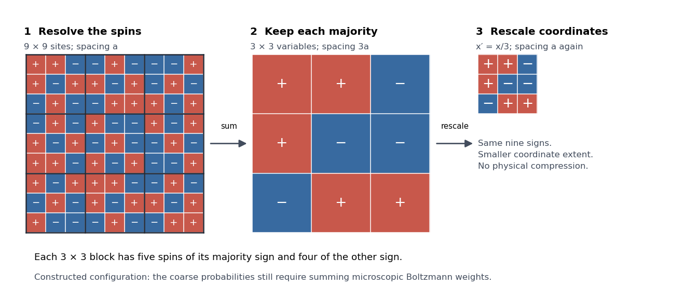

# Block-spin coarse-graining

↑ **Parent:** [Renormalization group](renormalization-group.md)

Consider [Ising spins](ising-spin-variable.md) $s_i=\pm1$ on a square lattice of spacing $a$. Divide it into disjoint $3\times3$ blocks $B$ and retain the majority sign $S_B$. Each block contains nine spins, so a tie is impossible. For example, five positive and four negative spins produce $S_B=+1$. All $2^9$ configurations are assigned a retained sign; the individual pattern within a block is lost. A [coarse-grained variable](coarse-grained-variable.md) has fewer possible values than the microscopic configuration it summarizes.

The spacing between block centres is $3a$. In coordinates $x'=x/3$ it is again $a$, so the retained pattern can be compared with the original lattice at the same numerical cutoff. This coordinate change does not physically shrink the sample. A majority picture alone does not specify the new interactions: the [blocking kernel](blocking-kernel.md) and original [Boltzmann weights](boltzmann-factor.md) determine their probabilities. The figure is a constructed configuration, not a simulated equilibrium state or a claim that majority blocking closes the nearest-neighbour [Ising model](ising-model.md).

**[Figure 3](#image-block-spin-coarse-graining-retains-a-majority-variable-then-restores-the-coordinate-convention). Block-spin coarse-graining retains a majority variable, then restores the coordinate convention**. Original constructed $9\times9$ [Ising spin](ising-spin-variable.md) pattern, its nine majority signs at spacing $3a$, and the same signs after $x'=x/3$. Red and blue mean $+1$ and $-1$. The last panel occupies one third of the original linear extent in the rescaled coordinates.

## ↑ Ancestors (6)

1. [Renormalization group](renormalization-group.md)
2. [Critical phenomenon](critical-phenomenon-split.md)
3. [Statistical physics](statistical-physics-split.md)
4. [Branches of physics](branches-of-physics.md)
5. [Physics](physics-split.md)
6. [Codex Wiki](split.md)

## ← Incoming links (1)

- [Block-spin coarse-graining](block-spin-coarse-graining.md)
